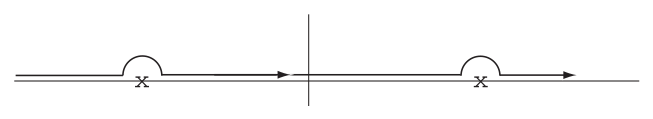
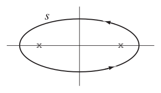
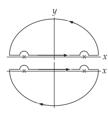
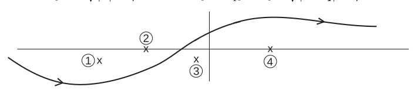
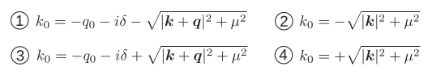

# Examples of Quantized Field Theories

<a id="p41">[p. 41]</a>

## I. The Maxwell Field

Lagrangian

$$
L_{M} = - \tfrac{1}{4} \sum_{\mu ,\nu} \left( \frac{\partial A_{\nu}}{\partial x_{\mu}} - \frac{\partial A_{\mu}}{\partial x_{\nu}} \right)^{2} - \tfrac{1}{2} \sum_{\mu} \left( \frac{\partial A_{\mu}}{\partial x_{\mu}} \right)^{2} \tag{168}
$$

Field equations

$$
\sum_{\mu} \frac{\partial^{2}}{\partial x_{\mu}^{2}} A_{\lambda} = \Box^{2} A_{\lambda} = 0 \tag{197}
$$

Commutation rules for the $A_{\lambda}$: To find these we uses the Peierls method. Take two points $y$ and $z$ with $z_{0} >y_{0}$. Let $\mathcal{Q} ( y ) = A_{\lambda} ( y ) , \mathcal{R} ( z ) = A_{\mu} ( z )$. Note: in this section $x,y,z,k$ etc. are meant to have components 1, 2, 3 and 0, while in $x_{\mu} ,y_{\mu} ,z_{\mu} ,k_{\mu}$, etc. we mean $\mu$ = 1$, 2 ,$ 3 and 4. When $\delta_{\mathcal{Q}} ( L ) =$ $\epsilon \delta^{4} ( x - y ) A_{\lambda} ( y )$ is added to $L_{M}$, the field <a id="ix-232">equation</a> for $A_{\mu}$ becomes

$$
\Box^{2} A_{\mu} + \delta_{\lambda \mu} \epsilon \delta^{4} ( x - y ) = 0 \tag{198}
$$

This equation is satisfied by $A_{\mu} + \delta_{\mathcal{Q}} A_{\mu} ( z )$ (by definition), and hence also by $\delta_{\mathcal{Q}} A_{\mu} ( z )$ because of (197). Therefore $\delta_{\mathcal{Q}} A_{\mu} ( z )$ is defined by the conditions

$$
\begin{aligned} \Box^{2} ( \delta_{\mathcal{Q}} A_{\mu} ( z ) ) &= - \delta_{\lambda \mu} \delta^{4} ( z - y ) \\ \delta_{\mathcal{Q}} A_{\mu} ( z ) &= 0 \text{ for } z_{0} <y_{0} . \end{aligned} \tag{199}
$$

That is to say, $\delta_{\mathcal{Q}} A_{\mu} ( z )$ is a c-number and is the retarded potential created by a point source acting instantaneously at the space-time point $y$.

$$
\begin{aligned} \delta_{\mathcal{Q}} A_{\mu} ( z ) &= \delta_{\lambda \mu} D_{R} ( z - y ) \\ \Box^{2} D_{R} ( z - y ) &= - \delta^{4} ( z - y ) \end{aligned} \tag{200}
$$

If $x$ is any 4-vector, using

$$
\delta ( x^{2} - a^{2} ) = \frac{1}{2 a} \{ \delta ( x - a ) + \delta ( x + a ) \} , \quad a> 0
$$

we get

$$
D_{R} ( x ) = \frac{1}{2 \pi} \Theta ( x ) \delta ( x^{2} ) = \frac{1}{4 \pi | \boldsymbol{r} |} \delta ( x_{0} -| \boldsymbol{r} | ) \tag{201}
$$

Here

$$
| \boldsymbol{r} | = \sqrt{x_{1}^{2} + x_{2}^{2} + x_{3}^{2} ;} \quad x_{o} = ct ; \quad x^{2} = r^{2} - x_{o}^{2} \quad \Theta ( x ) = \begin{cases} + 1 & \text{ for } x> 0 \\ 0 & \text{ for } x< 0 \end{cases}
$$

In the same way

$$
\delta_{\mathcal{R}} A_{\lambda} ( y ) = \delta_{\lambda \mu} D_{A} ( z - y ) = \delta_{\lambda \mu} D_{R} ( y - z ) \tag{202}
$$

<a id="p42">[p. 42]</a>

where $D_{A}$ is the advanced potential of the same source,

$$
D_{A} ( x ) = \frac{1}{4 \pi | \boldsymbol{r} |} \delta ( x_{0} + | \boldsymbol{r} | )
$$

Hence we have the the commutation rule (194)

$$
\begin{aligned} \boldsymbol{[} A_{\mu} ( z ) ,A_{\lambda} ( y ) \boldsymbol{]} &= i \hbar c\delta_{\lambda \mu} [ D_{A} ( z - y ) - D_{R} ( z - y ) ] \\ &= i \hbar c\delta_{\lambda \mu} D ( z - y ) \quad ( \text{ definition of } D ) \end{aligned} \tag{203}
$$

This invariant $D$-function satisfies by (200)

$$
\Box^{2} D ( x ) = - \delta^{4} ( x ) - ( - \delta^{4} ( x ) ) = 0 \tag{204}
$$

as it must. Also

$$
\begin{aligned} D ( x ) &= \frac{1}{4 \pi | \boldsymbol{r} |} [ \delta ( x_{0} + | \boldsymbol{r} | ) - \delta ( x_{0} -| \boldsymbol{r} | ) ] \\ &= - \frac{1}{2 \pi} \epsilon ( x ) \delta ( x^{2} ) \quad \epsilon ( x ) = \text{ sign } ( x_{0} ) \end{aligned} \tag{205}
$$

### Momentum Representations

We have

$$
\delta^{4} ( x ) = \frac{1}{( 2 \pi )^{4}} \int \exp ( ik \cdot x ) d^{4} k \tag{206}
$$

where the integral is fourfold, over $dk_{1} dk_{2} dk_{3} dk_{4}$. Therefore

$$
D_{R} ( x ) = \frac{1}{( 2 \pi )^{4}} \int_{+} \exp ( ik \cdot x ) \frac{1}{k^{2}} d^{4} k \tag{207}
$$

where $k^{2} = | \boldsymbol{k} |^{2} - k_{0}^{2}$. The integration with respect to $k_{1} k_{2} k_{3}$ is an ordinary real integral. That with respect to $k_{0}$ is a contour integral going along the real axis and _above_ the two poles at $k_{0} = \pm | \boldsymbol{k} |$.

For detailed calculations, see the Appendix below. This gives the correct behaviour of $D_{R}$ being zero for $x_{0} <$ 0. Similarly

$$
D_{A} ( x ) = \frac{1}{( 2 \pi )^{4}} \int_{-} \exp ( ik \cdot x ) \frac{1}{k^{2}} d^{4} k \tag{208}
$$

with a contour going _below_ both the poles. Therefore

$$
D ( x ) = \frac{1}{( 2 \pi )^{4}} \int_{s} \exp ( ik \cdot x ) \frac{1}{k^{2}} d^{4} k \tag{209}
$$

with a contour $s$ as shown.

<a id="p43">[p. 43]</a>

Evaluating the residues we have

$$
D ( x ) = - \frac{i}{( 2 \pi )^{3}} \int \exp ( ik \cdot x ) \delta ( k^{2} ) \epsilon ( k ) d^{4} k \tag{210}
$$

this being now an ordinary real integral.

## Appendix

Let us verify, e.g. (207). For $x_{0} <$ 0, we have to take the top path shown, otherwise the integrand blows up; this gives obviously 0.

For $x_{0} >$ 0, we have to take the bottom path; then

$$
D_{R} ( x ) = \frac{1}{( 2 \pi )^{4}} \int_{+} \frac{e^{i \boldsymbol{k} \cdot \boldsymbol{x}} e^{- ik_{0} x_{0}}}{\boldsymbol{k}^{2} - k_{0}^{2}} d^{3} kdk_{0} \quad x x
$$

where $\boldsymbol{k}$ and $\boldsymbol{x}$ are 3 dimensional vectors.

Now because of the clockwise direction

$$
\int_{+} \frac{e^{- ik_{0} x_{0}}}{\boldsymbol{k}^{2} - k_{0}^{2}} dk_{0} = - \int_{+} \frac{e^{- ik_{0} x_{0}}}{( k_{0} -| \boldsymbol{k} | ) ( k_{0} + | \boldsymbol{k} | )} dk_{0}
$$

$$
= 2 \pi i ( \text{ Residue at } k_{0} = | \boldsymbol{k} | + \text{ Residue at } k_{0} = -| \boldsymbol{k} | ) = 2 \pi i \left( \frac{e^{- i | \boldsymbol{k} | x_{0}}}{2 | \boldsymbol{k} |} - \frac{e^{+ i | \boldsymbol{k} | x_{0}}}{2 | \boldsymbol{k} |} \right)
$$

Hence

$$
D_{R} ( x ) = \frac{i}{( 2 \pi )^{3}} \int \frac{1}{2 | \boldsymbol{k} |} e^{i \boldsymbol{k} \cdot \boldsymbol{x}} \left\{ e^{i | \boldsymbol{k} | x_{0}} - e^{- i | \boldsymbol{k} | x_{0}} \right\} d^{3} k
$$

$$
= \frac{i}{( 2 \pi )^{3}} 2 \pi \int \int \frac{1}{2 | \boldsymbol{k} |} e^{i | \boldsymbol{k} || \boldsymbol{x} | \cos \theta} \left\{ e^{i | \boldsymbol{k} | x_{0}} - e^{- i | \boldsymbol{k} | x_{0}} \right\} | \boldsymbol{k} |^{2} d | \boldsymbol{k} | \sin \theta d\theta
$$

$$
= - \frac{i}{( 2 \pi )^{2}} \int_{0}^{\infty} \frac{1}{2 | \boldsymbol{k} |} \frac{1}{i | \boldsymbol{k} || \boldsymbol{x} |} \left\{ e^{i | \boldsymbol{k} | x_{0}} - e^{- i | \boldsymbol{k} | x_{0}} \right\} | \boldsymbol{k} |^{2} \left( e^{i | \boldsymbol{k} || \boldsymbol{x} | \alpha} \begin{vmatrix} \alpha = + 1 \\ \alpha = - 1 \end{vmatrix} d | \boldsymbol{k} | \right.
$$

$$
= - \frac{1}{4 \pi^{2}} \frac{1}{2 | \boldsymbol{x} |} \int_{0}^{\infty} \left\{ e^{i | \boldsymbol{k} | ( x_{0} + | \boldsymbol{x} | )} - e^{i | \boldsymbol{k} | ( x_{0} -| \boldsymbol{x} | )} - e^{- i | \boldsymbol{k} | ( x_{0} -| \boldsymbol{x} | )} + e^{- i | \boldsymbol{k} | ( x_{0} + | \boldsymbol{x} | )} \right\} d | \boldsymbol{k} |
$$

$$
= - \frac{1}{4 \pi | \boldsymbol{x} |} \frac{1}{2 \pi} \int_{-\infty}^{+ \infty} \left\{ e^{i | \boldsymbol{k} | ( x_{0} + | \boldsymbol{x} | )} - e^{i | \boldsymbol{k} | ( x_{0} -| \boldsymbol{x} | )} \right\} d | \boldsymbol{k} |
$$

$$
= - \frac{1}{4 \pi | \boldsymbol{x} |} \delta ( x_{0} -| \boldsymbol{x} | ) \quad \text{ for } x_{0} > 0 .
$$

### Fourier Analysis of Operators

Let us analyze the potential $A_{\mu}$ into Fourier components

$$
A_{\mu} ( x ) = B \int d^{3} k | \boldsymbol{k} |^{- 1 / 2} \{ a_{k\mu} \exp ( ik \cdot x ) + \tilde{a}_{k\mu} \exp ( - ik \cdot x ) \} \tag{211}
$$

where the factor $| \boldsymbol{k} |^{- 1 / 2}$ appears only as a matter of convenience; the actual Fourier coefficients are then $| \boldsymbol{k} |^{- 1 / 2} a_{k\mu}$ and $| \boldsymbol{k} |^{- 1 / 2} \tilde{a}_{k\mu}$. The integration is over all 4-vectors $( k )$ with $k_{0}$ = +$| \boldsymbol{k} | . B$ is a normalization factor to be determined later. The $a_{k\mu}$ and $\tilde{a}_{k\mu}$ are operators independent of $x$.

Since $A_{1} ,A_{2} ,A_{3}$ and $A_{0}$ are Hermitian, $\tilde{a}_{k\mu} = a_{k\mu}^{*}$ = Hermitian conjugate of $a_{k\mu} , \quad \mu$ = 1$, 2 , 3 ,$ 0 and therefore

$$
\tilde{a}_{k 4} = - a_{k 4}^{*} = - \text{ Hermitian conjugate of } a_{k 4} \tag{212}
$$

<a id="p44">[p. 44]</a>

Computing the commutator $\boldsymbol{[} A_{\mu} ( z ) ,A_{\lambda} ( y ) \boldsymbol{]}$ from (211) and comparing the result with (203) in the momentum representation (210), we have first, since the result is a function of $( z - y )$ only<a id="fnref-22" href="#fn-22">22</a>

$$
\begin{aligned} \boldsymbol{[} a_{k\mu} ,a_{k^{\prime} \lambda} \boldsymbol{]} &= 0 \\ \boldsymbol{[} \tilde{a}_{k\mu} , \tilde{a}_{k^{\prime} \lambda} \boldsymbol{]} &= 0 \\ \boldsymbol{[} a_{k\mu} , \tilde{a}_{k^{\prime} \lambda} \boldsymbol{]} &= \delta^{3} ( \boldsymbol{k} - \boldsymbol{k}^{\prime} ) \delta_{\mu \lambda} \end{aligned} \tag{213}
$$

And the two results for the commutator agree then precisely if we take

$$
B = \sqrt{\frac{\hbar c}{1 6 \pi^{3}}} \tag{214}
$$

### Emission and Absorption Operators

The operators $A_{\mu} ( x )$ obey the Heisenberg equations of motion for operators (190)

$$
i \hbar \frac{\partial A_{\mu}}{\partial t} = \boldsymbol{[} A_{\mu} ,H \boldsymbol{]} \tag{190a}
$$

Therefore the operator $a_{k\mu}$ exp$( ik \cdot x )$ has matrix elements between an initial state of energy $E_{1}$ and a final state of energy $E_{2}$, only if

$$
i \hbar ( - ick_{0} ) = E_{1} - E_{2} = \hbar c | \boldsymbol{k} | \tag{215}
$$

because by (211) and (190a) we have

$$
\psi_{1} i \hbar ( - ick_{0} ) a_{k\mu} \psi_{2} = \psi_{1} \hbar c | \boldsymbol{k} | a_{k\mu} \psi_{2} = \psi_{1} \boldsymbol{[} a_{\mu k} ,H \boldsymbol{]} \psi_{2} = ( E_{1} - E_{2} ) \psi_{1} a_{\mu k} \psi_{2} \tag{216}
$$

Now $\hbar c | \boldsymbol{k} |$ is a constant energy, characteristic of the frequency $\omega = ck$ characteristic of the particular Fourier <a id="ix-95">components</a> of the field. The operator $a_{k\mu}$ can only operate so as to _reduce_ the energy of a system by a lump of energy of this size. In the same way, $\tilde{a}_{k\mu}$ will only operate when

$$
E_{1} - E_{2} = - \hbar c | \boldsymbol{k} |
$$

to _increase_ the energy by the same amount.

This is the fundamental property of the quantized field operators, that they change the energy of a system not continuously but in jumps. This shows that our formalism includes correctly the experimentally known quantum behaviour of radiation.

We call $a_{k\mu}$ the _absorption_ operator for the field oscillator with propagation vector $k$ and polarization direction $\mu$. Likewise $\tilde{a}_{k\mu}$ the _emission_ operator.

We have thus 4 directions of polarization for a photon of given momentum. There are not all observed in electromagnetic radiation. Free radiation can only consist of transverse waves, and has only 2 possible polarizations. This is because the physically allowable states Ψ are restricted by a supplementary condition

$$
\sum_{\mu} \frac{\partial A_{\mu}^{( + )}}{\partial x_{\mu}} \Psi = 0 \tag{217}
$$

where $A_{\mu}^{( + )}$ is the positive frequency part of $A_{\mu}$, i.e. the part containing the absorption operators. In the classical theory we have

$$
\sum_{\mu} \frac{\partial A_{\mu}}{\partial x_{\mu}} = 0
$$

the condition imposed in order to simplify the Maxwell equations to the simple form $\Box^{2} A_{\mu}$ = 0. In the quantum theory it was usual to take

$$
\sum_{\mu} \frac{\partial A_{\mu}}{\partial x_{\mu}} \Psi = 0
$$

<a id="p45">[p. 45]</a>

but this means that photons of a certain kind cannot be _emitted_ in a physical state which is physically difficult to understand and brings mathematical inconsistencies into the theory. So we assume only (216) which only says these photons are _not present_ and cannot be absorbed from a physical state, which makes good sense. Also in the classical limit $\sum_{\mu} \partial A_{\mu} /\partial x_{\mu}$ is a real quantity, and so $\sum_{\mu} \partial A_{\mu} /\partial x_{\mu}$ = 0 follows correctly from (216) alone.

The method of using (216) as supplementary condition is due to Gupta and Bleuler<a id="fnref-23" href="#fn-23">23</a>;

S. N. Gupta, _Proc. Roy. Soc. A_ **63** (1950) 681.

K. Bleuler, _Helv. Phys. Acta_ **23** (1950) 567.

The older treatment is unnecessary and difficult, so we will not bother about it.

By (211), (216) is equivalent to assuming

$$
\sum_{\mu} ( k_{\mu} a_{k\mu} ) \Psi = 0 \tag{216a}
$$

for each momentum vector $k$ of a photon.

As a result of this work of Gupta and Bleuler, the supplementary conditions do not come into the practical use of the theory at all. We use the theory and get correct results, forgetting about the supplementary conditions.

### Gauge-Invariance of the Theory

The theory is gauge-invariant. That is to say, adding a gradient<a id="fnref-24" href="#fn-24">24</a> Λ${}_{\mu} = \partial$Λ$/\partial x_{\mu}$ to the potentials does not change the fields by anything which is physically observable. Therefore all states which differ only by such an addition to the potentials are physically identical.

If Ψ is any state then

$$
\Psi^{\prime} = \left( 1 + \lambda \sum_{\mu} k_{\mu} \tilde{a}_{k\mu} \right) \Psi
$$

is a state obtained from Ψ by emitting a pseudo-photon with potentials proportional to $\partial$Λ$/\partial x_{\mu}$. Hence Ψ$\prime$ should be indistinguishable from Ψ.

Now if Ψ$2$ is any state whatever satisfying the supplementary condition (216a) the matrix element

$$
\begin{aligned} ( \Psi^{\prime *} , \Psi_{1} ) &= \left( \Psi^{*} \left( 1 + \lambda \sum_{\mu} k_{\mu}^{*} \tilde{a}_{k\mu}^{*} \right) , \Psi_{2} \right) \\ &= \left( \Psi^{*} , \left( 1 + \lambda \sum_{\mu} k_{\mu} a_{k\mu}^{*} \right) \Psi_{2} \right) = ( \Psi^{*} , \Psi_{2} ) \end{aligned} \tag{216b}
$$

Hence the matrix elements of Ψ$\prime$ and Ψ to any physical state Ψ$2$ whatever are equal, and so the results of the theory are all independent of whether the state Ψ is represented by the vector Ψ or by Ψ$\prime$. This is enough to show that the theory is properly gauge-invariant, in spite of the fact that states are specified by the potentials which are not themselves gauge-invariant.

### The Vacuum State

The vacuum state is by definition the state of lowest energy, so that all absorption operators operating on it give zero:

$$
a_{k\mu} \Psi_{o} = 0 \tag{217a}
$$

and therefore by (212)

$$
( a_{k\mu} \Psi_{o} )^{*} = ( \Psi_{o}^{*} a_{k\mu}^{*} ) = \pm ( \Psi_{o}^{*} \tilde{a}_{k\mu} ) = 0 \tag{217b}
$$

Given any operator $\mathcal{Q}$, we are interested in the “vacuum expectation value” of $\mathcal{Q}$ defined as

$$
\langle Q \rangle_{o} = ( \Psi_{o}^{*} , \mathcal{Q} \Psi_{o} ) \tag{218}
$$

<a id="p46">[p. 46]</a>

Then we have at once

$$
\langle a_{k\mu} a_{k^{\prime} \lambda} \rangle_{o} = 0 \quad \text{ by } ( 2 1 7 a ) \tag{219a}
$$

$$
\langle \tilde{a}_{k\mu} \tilde{a}_{k^{\prime} \lambda} \rangle_{o} = 0 \quad \text{ by } ( 2 1 7 b ) \tag{219b}
$$

$$
\langle \tilde{a}_{k\mu} a_{k^{\prime} \lambda} \rangle_{o} = 0 \quad \text{ by } ( 2 1 7 a , b ) \tag{219c}
$$

And by the commutation laws (213) and (219c) we have

$$
\langle a_{k\mu} \tilde{a}_{k^{\prime} \lambda} \rangle_{o} = \langle \boldsymbol{[} a_{k\mu} , \tilde{a}_{k^{\prime} \lambda} \boldsymbol{]} \rangle_{o} = \delta^{3} ( \boldsymbol{k} - \boldsymbol{k}^{\prime} ) \delta_{\mu \lambda} \tag{220}
$$

The vacuum expectation value $\langle A_{\mu} ( z ) A_{\lambda} ( y ) \rangle_{o}$ is thus just the part of the commutator $\boldsymbol{[} A_{\mu} ( z ) ,A_{\lambda} ( y ) \boldsymbol{]}$ which contains positive frequencies exp$\{ ik \cdot ( z - y ) \}$ with $k_{0} >$ 0, as one can see using (211), (219) and (220). Thus<a id="fnref-25" href="#fn-25">25</a>

$$
\langle A_{\mu} ( z ) A_{\lambda} ( y ) \rangle_{o} = i \hbar c\delta_{\mu \lambda} D^{+} ( z - y ) \tag{221}
$$

$$
D^{+} ( x ) = - \frac{i}{( 2 \pi )^{3}} \int_{k_{0} > 0} \exp ( ik \cdot x ) \delta ( k^{2} ) \Theta ( k ) d^{4} k \tag{222}
$$

We write

$$
D ( x ) = D^{+} ( x ) + D^{-} ( x ) \tag{223}
$$

$$
D^{+} = \tfrac{1}{2} \left( D - iD^{( 1 )} \right) \quad D^{-} = \tfrac{1}{2} \left( D + iD^{( 1 )} \right) \tag{224}
$$

The even function $D^{( 1 )}$ is then defined by

$$
\langle A_{\mu} ( z ) A_{\lambda} ( y ) + A_{\lambda} ( y ) A_{\mu} ( z ) \rangle_{o} = \hbar c\delta_{\mu \lambda} D^{( 1 )} ( z - y ) \tag{225}
$$

$$
D^{( 1 )} ( x ) = \frac{1}{( 2 \pi )^{3}} \int \exp ( ik \cdot x ) \delta ( k^{2} ) d^{4} k \tag{226}
$$

It is then not hard to prove (see the Appendix below) that

$$
D^{( 1 )} ( x ) = \frac{1}{2 \pi^{2} x^{2}} \tag{227}
$$

The functions $D$ and $D^{( 1 )}$ are the two independent solutions of $\Box^{2} D$ = 0, one odd and the other even. Then we define the function

$$
\begin{aligned} \overline{D} ( x ) &= - \tfrac{1}{2} \epsilon ( x ) D ( x ) = \tfrac{1}{2} ( D_{R} ( x ) + D_{A} ( x ) ) = \frac{1}{4 \pi} \delta ( x^{2} ) \\ &= \frac{1}{( 2 \pi )^{4}} \int \exp ( ik \cdot x ) \frac{1}{k^{2}} d^{4} k \end{aligned} \tag{228}
$$

the last being a real principal value integral: This is the even solution of the point-source equation

$$
\Box^{2} \overline{D} ( x ) = - \delta^{4} ( x ) \tag{229}
$$

## Appendix

$$
D^{( 1 )} ( x ) = \frac{1}{( 2 \pi )^{3}} \int e^{ik \cdot x} \delta ( k^{2} ) d^{4} k
$$

$$
= - \frac{1}{( 2 \pi )^{2}} \int_{- 1}^{+ 1} d\mu \int_{-\infty}^{\infty} dk_{0} \int_{0}^{\infty} d | \boldsymbol{k} | e^{i | \boldsymbol{k} || \boldsymbol{x} | \mu} e^{- ik_{0} x_{0}} \frac{\{ \delta ( k_{0} -| \boldsymbol{k} | ) + \delta ( k_{0} + | \boldsymbol{k} | ) \}| \boldsymbol{k} |^{2}}{2 | \boldsymbol{k} |}
$$

$$
= \frac{1}{( 2 \pi )^{2}} \int_{0}^{\infty} d | \boldsymbol{k} | \frac{1}{i | \boldsymbol{k} || \boldsymbol{x} |} \left\{ e^{i | \boldsymbol{k} || \boldsymbol{x} |} - e^{- i | \boldsymbol{k} || \boldsymbol{x} |} \right\} \frac{1}{2 | \boldsymbol{k} |} \left\{ e^{- i | \boldsymbol{k} | x_{0}} + e^{i | \boldsymbol{k} | x_{0}} \right\} | \boldsymbol{k} |^{2}
$$

$$
= \frac{1}{2 \pi^{2}} \frac{1}{| \boldsymbol{x} |} \int_{0}^{\infty} \sin ( | \boldsymbol{k} || \boldsymbol{x} | ) \cos ( | \boldsymbol{k} | x_{0} ) d | \boldsymbol{k} | = \frac{1}{2 \pi^{2}} \frac{1}{2 | \boldsymbol{x} |} \int_{0}^{\infty} d | \boldsymbol{k} |\{ \sin ( ( | \boldsymbol{x} | + x_{0} ) | \boldsymbol{k} | ) + \sin ( ( | \boldsymbol{x} |- x_{0} ) | \boldsymbol{k} | ) \}
$$

<a id="p47">[p. 47]</a>

Taking the integral in the Abelian sense

$$
\lim \int_{\epsilon \to 0 \quad 0}^{\infty} e^{- \epsilon x} \sin axdx = \lim_{\epsilon \to 0} \frac{a}{\epsilon^{2} + a^{2}} = \frac{1}{a}
$$

hence in our case<a id="fnref-26" href="#fn-26">26</a>

$$
D^{( 1 )} ( x ) = \frac{1}{2 \pi^{2}} \frac{1}{2 | \boldsymbol{x} |} \left\{ \frac{1}{| \boldsymbol{x} | + x_{0}} + \frac{1}{| \boldsymbol{x} |- x_{0}} \right\} = \frac{1}{2 \pi^{2} x^{2}} .
$$

### The Gupta-Bleuler Method

There is one difficulty in the preceding theory. We assume according to (220)

$$
\langle a_{k\mu} a_{k^{\prime} \lambda}^{*} \rangle_{o} = \pm \delta^{3} ( \boldsymbol{k} - \boldsymbol{k}^{\prime} ) \delta_{\mu \lambda} \tag{220a}
$$

Here the plus sign holds for $\mu$ = 1$, 2 ,$3; the minus sign for $\mu$ = 4. Now if the operators $a_{k\mu} ,a_{k\mu}^{*}$ are represented in the usual way by matrices, as it is done in the elementary theory of the harmonic oscillator$( )$ (see Wentzel p. 33, Eq. (6.16)), the vacuum expectation values of a product $( a_{k\mu} a_{k\mu}^{*} )$ will always be _positive_, i.e. the plus sign should hold in (220a) for $\mu$ = 4 also. In fact $( a_{k\mu} a_{k\mu}^{*} )$ will have a positive expectation value in any state whatever, if the photon oscillators are treated as ordinary$( )$ elementary oscillators.

Therefore we must distinguish between the scalar product (Ψ$\frac{*}{1} ,$ Ψ${}_{2} )$ as we have defined it by our covariant theory, and the scalar product (Ψ$\frac{*}{1} ,$ Ψ${}_{2} )_{E}$ which one would calculate using the explicit matrix representation of the operators. The product (Ψ$\frac{*}{1} ,$ Ψ${}_{2} )_{E}$ has no physical significance, because the matrix representations of the $a_{k 4}$ refer to states with photons polarized purely in the time dimension, which cannot occur physically. However, it is convenient also to be able to use the matrix representations in practice.

To use the matrix representations, we have only to define an operator $\eta$ by the condition

$$
\eta \Phi = ( - 1 ) \Phi \tag{220b}
$$

where Φ is any state in which there is a definite number $N$ of photons polarized in the 4-direction. Then the physical scalar product is given in terms of the explicit matrix representations by

$$
( \Psi_{1}^{*} , \Psi_{2} ) = ( \Psi_{1}^{*} ,\eta \Psi_{2} )_{E} \tag{220c}
$$

The definition (220c), introduced by Gupta, makes the matrix representations consistent with all the requirements of the covariant theory, in particular also it gives (220) correctly. The physical scalar product is thus an _indefinite metric_ regarded from the point of view of the matrix representations. However, we have seen in (216b) that for any _physical_ states the scalar product (Ψ$\frac{*}{1} ,$ Ψ${}_{2} )$ is equal to (Ψ$\frac{*}{1 T} ,$ Ψ${}_{1 T} )$ where Ψ$1 T$ is a state involving transverse photons only, and hence is positive. Thus for physical states the metric is definite and this is all that we require of it.

### Example: Spontaneous Emission of Radiation

This is a purely quantum-mechanical effect. A classical treatment, considering the reaction of the atom to a classical applied Maxwell field, gives a correct account of the absorption of radiation and of stimulated emission, but fails to give the spontaneous emission.

Let an atom have 2 states, the ground state 1 and an excited state 2 with energy $\hbar cq$. For the transition 2 $\to$ 1 let the charge-current density of the atom have the unintegrated matrix elements

$$
j_{\mu A} ( x ) = j_{\mu A} ( r,t ) \quad \text{ at the point } x = ( r,t )
$$

The interaction with the Maxwell field has matrix element<a id="fnref-27" href="#fn-27">27</a>

$$
I = - \frac{1}{c} \int \sum_{\mu} j_{\mu A} ( r,t ) \langle A_{\mu} ( r,t ) \rangle_{\text{ emit }} d^{3} \boldsymbol{r} \tag{230}
$$

<a id="p48">[p. 48]</a>

for making a transition with emission of a photon. The total emission probability per unit time is obtained using time dependent perturbation theory:<a id="fnref-28" href="#fn-28">28</a>

$$
\begin{aligned} w &= \frac{1}{T} \sum | a_{1} ( T ) |^{2} = \frac{1}{T} \sum_{\text{ photon }} \left| \frac{1}{i \hbar} \int \left\{ - \frac{1}{c} \int \sum_{\mu} j_{\mu A} ( r,t ) \langle A_{\mu} ( r,t ) \rangle_{\text{ emit }} d^{3} \boldsymbol{r} \right\} dt \right|^{2} \\ &= \frac{1}{Tc^{4} \hbar^{2}} \int \int \sum_{\lambda ,\mu} j_{\lambda A}^{*} ( x^{\text{ states } \prime} ) j_{\mu A} ( x ) \langle A_{\lambda}^{*} ( x^{\prime} ) A_{\mu} ( x ) \rangle_{o} d^{4} xd^{4} x^{\prime} \end{aligned} \tag{231}
$$

the integral being over all space for a long time $T$, the sum over the physical photon states only. It is _not_ correct to take in (231) the photon states to be the 4 states with polarization in the directions $\mu$ = 1$, 2 , 3 , 4 ,$ because these are not physical states.

Using a sum-rule to sum over the states

$$
w = \frac{1}{Tc^{4} \hbar^{2}} \int \int \sum_{\lambda ,\mu} j_{\lambda A}^{*} ( x^{\prime} ) j_{\mu A} ( x ) \langle A_{\lambda}^{*} ( x^{\prime} ) A_{\mu} ( x ) \rangle_{o} d^{4} xd^{4} x^{\prime}
$$

Write $\tilde{j}_{\lambda A} ( x^{\prime} )$ for the matrix element<a id="fnref-29" href="#fn-29">29</a> of $j_{\lambda A} ( x^{\prime} )$ in the reverse transition 1 $\to$ 2. Then

$$
j_{\lambda A}^{*} ( x^{\prime} ) = \eta_{\lambda} \tilde{j}_{\lambda A} ( x^{\prime} ) , \quad A_{\lambda}^{*} ( x^{\prime} ) = \eta_{\lambda} A_{\lambda} ( x^{\prime} )
$$

with $\eta_{\lambda}$ = +1$,\lambda$ = 1$, 2 , 3 ; \eta_{4} = - 1 .$

Hence

$$
\begin{aligned} w &= \frac{1}{Tc^{4} \hbar^{2}} \int \int \sum_{\lambda ,\mu = 1}^{4} j_{\lambda A}^{*} ( x^{\prime} ) j_{\mu A} ( x ) \langle A_{\lambda}^{*} ( x^{\prime} ) A_{\mu} ( x ) \rangle_{o} d^{4} xd^{4} x^{\prime} \\ &= \frac{\hbar c}{( 2 \pi )^{3}} \int d^{4} k\delta ( k^{2} ) \Theta ( k_{0} ) \sum_{\mu = 1}^{4} j_{\mu A} ( k ) \tilde{j}_{\mu A} ( k ) \frac{1}{Tc^{4} \hbar^{2}} \int_{0}^{cT} \int_{0}^{cT} dx_{0} dx_{0}^{\prime} \exp \{ i ( x - x_{0} ) ( q - k_{o} ) \} \\ &= \frac{1}{( 2 \pi )^{2} \hbar c^{2}} \sum_{\mu = 1}^{4} \int d^{3} \boldsymbol{k} \delta ( | \boldsymbol{k} |^{2} - q^{2} ) j_{\mu A} ( \boldsymbol{k} ) \tilde{j}_{\mu A} ( \boldsymbol{k} ) \end{aligned} \tag{232}
$$

since

$$
\frac{1}{cT} \int_{0}^{cT cT} \int_{0} dx_{0} dx_{0}^{\prime} \exp \{ i ( x - x_{0} ) ( q - k_{o} ) \} = cT \frac{\sin^{2} \tfrac{cT}{2} ( q - k_{0} )}{\left( \tfrac{cT}{2} ( q - k_{0} ) \right)^{2}} \to \pi \delta ( q - k_{0} ) \text{ if } cT \to \infty
$$

where<a id="fnref-30" href="#fn-30">30</a>

$$
j_{\mu A} ( \boldsymbol{k} ) = \int j_{\mu A} ( r ) e^{- i \boldsymbol{k} \cdot \boldsymbol{r}} d^{3} \boldsymbol{r} \quad \tilde{j}_{\mu A} ( \boldsymbol{k} ) = \int \tilde{j}_{\mu A} ( r ) e^{i \boldsymbol{k} \cdot \boldsymbol{r}} d^{3} \boldsymbol{r}
$$

By the charge conservation law

$$
\sum_{\mu} k_{\mu} j_{\mu A} ( k ) = 0 \sum_{\mu} k_{\mu} \tilde{j}_{\mu A} ( k ) = 0
$$

and so

$$
\begin{aligned} \sum_{\mu} j_{\mu A} ( k ) \tilde{j}_{\mu A} ( k ) &= \frac{1}{q^{2}} qj_{4 A} q \tilde{j}_{4 A} + \sum_{i}^{3} | j_{iA} ( k ) |^{2} = - \frac{1}{q^{2}} \sum_{i,\ell = 1}^{3} \left\{ k_{i} j_{iA} ( k ) k_{\ell} \tilde{j}_{\ell A} ( k ) \right\} + \sum_{i}^{3} | j_{iA} ( k ) |^{2} \\ &= - \frac{1}{q^{2}} | \boldsymbol{k} |^{2} | \boldsymbol{j}_{A} |^{2} \cos^{2} \theta + | \boldsymbol{j}_{A} |^{2} = | \boldsymbol{j}_{A} |^{2} ( 1 - \cos^{2} \theta ) = | j_{1 A} |^{2} + | j_{2 A} |^{2} \end{aligned} \tag{232a}
$$

<a id="p49">[p. 49]</a>

where 1 and 2 are the two directions of transverse polarization. This shows how the third and fourth polarization directions do not appear in real <a id="ix-189">emission</a> problems. The same result would be obtained if we used the indefinite metric explicitly, i.e.take the sum in (231) over the 4 polarization states $\mu$ = 1$, 2 , 3 , 4 ,$ with the $\mu$ = 4 given a minus sign arising from the $\eta$ in (220c). But it is always simpler to work directly with the covariant formalism, than to bother with the non-physical photon states and then have to use $\eta$ to get the right answers.

Finally, the emission probability in direction of polarization 1 and in direction of propagation given by the solid angle $d$Ω is, using (232), (232a), and $\delta ( | \boldsymbol{k} |^{2} - q^{2} ) = \frac{1}{2 q} \delta ( | \boldsymbol{k} |- q )$ for $q>$ 0

$$
w = \frac{qd \Omega}{8 \pi^{2} \hbar c^{2}} | j_{1 A} ( x ) |^{2} \tag{233}
$$

For dipole radiation by a one-electron atom with coordinates $( x,y,z )$

$$
j_{1} = e \dot{x} = iecqx \quad \boldsymbol{k} \boldsymbol{\cdot} \boldsymbol{r} \ll 1
$$

and

$$
w = \frac{e^{2} q^{3} d \Omega}{8 \pi^{2} \hbar} | \langle x \rangle_{1 2} |^{2} \tag{234}
$$

This checks with Bethe’s _Handbuch_ article.<a id="fnref-31" href="#fn-31">31</a>

The example shows how covariant methods will work, even for problems of this elementary sort for which they are not particularly suited. The covariant method avoids the necessity of having to think about the normalization of the photon states, the factors of 2 and $\pi$ etc. being given automatically when one uses (221).

### The Hamiltonian Operator

From the equation

$$
i \hbar \frac{\partial A_{\mu}}{\partial t} = \boldsymbol{[} A_{\mu} ,H \boldsymbol{]}
$$

we find

$$
\boldsymbol{[} a_{k\mu} ,H \boldsymbol{]} = \hbar c | \boldsymbol{k} | a_{k\mu}
$$

$$
\boldsymbol{[} \tilde{a}_{k\mu} ,H \boldsymbol{]} = - \hbar c | \boldsymbol{k} | \tilde{a}_{k\mu}
$$

Using the commutation rules (213) we can find an operator $H$ which satisfies all these conditions simultaneously. Namely

$$
H = \int d^{3} \boldsymbol{k} \hbar c | \boldsymbol{k} | \sum_{1}^{4} \tilde{a}_{k\lambda} a_{k\lambda} \tag{234a}
$$

This operator is in fact unique apart from an arbitrary additive constant. To fix the constant we require<a id="fnref-32" href="#fn-32">32</a> $\langle H \rangle_{o}$ = 0 which leads to the result (234a) precisely, as one can see at once from (219). Hence (234a) is the Hamiltonian of this theory, which is very simple in this momentum representation.

To derive $H$ from the Lagrangian is also possible but much more tedious. From (234a) we see that

$$
N_{k\lambda} = \tilde{a}_{k\lambda} a_{k\lambda} \quad ( \text{ not summed } )
$$

is an operator just representing the number of quanta in the frequency $k$ and polarization $\lambda$. It follows at once from the commutation rules (213), from the singular $\delta$-function factor which comes from the continuous spectrum, $N_{k\lambda}$ being in fact the number of quanta per unit frequency range, that $\int N_{k\lambda} d^{3} \boldsymbol{k}$ integrated over _any_ region of momentum-space has the integer eigenvalues 0, 1, 2, $\dots$ . This is so, because the state with <a id="p50">[p. 50]</a> $n_{i}$ particles with momentum $k_{i}$ is Ψ = $\prod_{i = 1}^{\ell} ( \tilde{a}_{k_{i} \lambda} )^{n_{i}}$Ψ$o$. Then taking $\int_{\Omega} N_{k\lambda} d^{3} \boldsymbol{k}$ over Ω including the momenta $k_{1} ,k_{2} ,\dots ,k_{j}$ we get

$$
\int_{\Omega} N_{k\lambda} d^{3} \boldsymbol{k} \Psi = \int_{\Omega} \tilde{a}_{k\lambda} a_{k\lambda} \prod_{i = 1}^{\ell} ( \tilde{a}_{k_{i} \lambda} )^{n_{i}} \Psi_{o} d^{3} \boldsymbol{k}
$$

$$
= \int_{\Omega} \tilde{a}_{k\lambda} \left\{ \sum_{i = 1}^{\ell} n_{i} \prod_{i = 1}^{\ell} \tilde{a}_{k_{i} \lambda}^{( n_{i} - 1 )} \boldsymbol{[} a_{k\lambda} , \tilde{a}_{k_{i} \lambda} \boldsymbol{]} + \prod_{i = 1}^{\ell} ( a_{k_{i} \lambda} )^{n_{i}} a_{k\lambda} \right\} \Psi_{o} d^{3} \boldsymbol{k} \quad \text{ by } ( 2 1 3 ) \text{ and } ( 2 1 7 a )
$$

$$
= \int_{\Omega} \tilde{a}_{k\lambda} \sum_{i = 1}^{\ell} n_{i} \prod_{i = 1}^{\ell} \tilde{a}_{k_{i} \lambda}^{( n_{i} - 1 )} \delta^{3} ( \boldsymbol{k} - \boldsymbol{k}_{i} ) \Psi_{o} d^{3} \boldsymbol{k} = \sum_{i = 1}^{j} n_{i} \prod_{i = 1}^{\ell} ( \tilde{a}_{k_{i} \lambda} )^{n_{i}} \Psi_{o} = \sum_{i = 1}^{j} n_{i} \Psi
$$

### Fluctuations of the Fields

Since the electromagnetic fields $\boldsymbol{E}$ and $\boldsymbol{H}$ are quantum-mechanical variables, they do not have well-determined values in any state in which energy and momentum are well-defined, for example the vacuum state. A state of the fields can be specified _either_ by fixing the values of $\boldsymbol{E}$ and $\boldsymbol{H}$ _or_ by specifying the numbers of quanta present with various momenta and energies. The two descriptions are complementary and are both possible only in the classical limit of large numbers of quanta and very strong fields.

An educational discussion of these questions, considering in detail the example of a cavity resonator with one mode of oscillation, has been given by L. P. Smith, _Phys. Rev._ **69** (1946) 195. This is worth reading. Essential is the fact that you cannot fix the time-dependence of the field (phase) with a fixed number of quanta (energy).

We consider a more general problem. What is the mean-square fluctuation in the vacuum state of a field-quantity? We define

$$
\begin{aligned} E_{1} ( VT ) &= \frac{1}{VT} \int_{VT} E_{1} ( x ) d\tau dt \\ H_{1} ( VT ) &= \frac{1}{VT} \int_{VT} H_{1} ( x ) d\tau dt \end{aligned} \tag{235}
$$

averaged over some finite space-volume $V$ and also over a time $T$. Let $V ( \boldsymbol{k} ) = \int_{V} e^{- i \boldsymbol{k} \cdot \boldsymbol{r}} d\tau$. Then since $\boldsymbol{H} = \nabla \times \boldsymbol{A}$, we have

$$
\begin{aligned} \left\langle \{ H_{1} ( VT ) \}^{2} \right\rangle_{o} &= \frac{1}{V^{2} T^{2}} \int \int d\tau d\tau^{\prime} dtdt^{\prime} \left\langle \left( \frac{\partial}{\partial x_{2}} A_{3} - \frac{\partial}{\partial x_{3}} A_{2} \right) \left( \frac{\partial}{\partial x_{2}^{\prime}} A_{3}^{\prime} - \frac{\partial}{\partial x_{3}^{\prime}} A_{2}^{\prime} \right) \right\rangle_{o} \\ &= \frac{1}{V^{2} T^{2}} \frac{\hbar c}{2} \int \int d\tau d\tau^{\prime} dtdt^{\prime} \left( \frac{\partial}{\partial x_{2}} \frac{\partial}{\partial x_{2}^{\prime}} + \frac{\partial}{\partial x_{3}} \frac{\partial}{\partial x_{3}^{\prime}} \right) D^{( 1 )} ( x - x^{\prime} ) \quad \text{ using } ( 2 2 5 ) \\ &= \frac{1}{V^{2} T^{2}} \frac{\hbar c}{1 6 \pi^{3}} \int \int d\tau d\tau^{\prime} dtdt^{\prime} \left( \frac{\partial}{\partial x_{2}} \frac{\partial}{\partial x_{2}^{\prime}} + \frac{\partial}{\partial x_{3}} \frac{\partial}{\partial x_{3}^{\prime}} \right) \int d^{4} ke^{ik \cdot ( x - x^{\prime} )} \delta ( k^{2} ) \text{ using } ( 2 2 6 ) \\ &= \frac{\hbar c}{1 6 \pi^{3} V^{2} T^{2}} \int_{0}^{T} \int_{0}^{T} \int \frac{d^{3} \boldsymbol{k}}{| \boldsymbol{k} |} ( k_{2}^{2} + k_{3}^{2} ) | V ( k ) |^{2} e^{i | \boldsymbol{k} | x_{0}} e^{- i | \boldsymbol{k} | x_{0}^{\prime}} dtdt^{\prime} \\ &= \frac{\hbar c}{1 6 \pi^{3} V^{2} T^{2}} \int \frac{d^{3} \boldsymbol{k}}{| \boldsymbol{k} |} ( k_{2}^{2} + k_{3}^{2} ) | V ( k ) |^{2} \frac{4 \sin^{2} ( \tfrac{1}{2} c | \boldsymbol{k} T )}{c^{2} | \boldsymbol{k} |^{2}} \\ \left\langle \{ E_{1} ( VT ) \}^{2} \right\rangle_{o} &= \frac{1}{V^{2} T^{2}} \frac{\hbar c}{2} \int \int d\tau d\tau^{\prime} dtdt^{\prime} \left( - \frac{\partial}{\partial x_{4}} \frac{\partial}{\partial x_{4}^{\prime}} - \frac{\partial}{\partial x_{1}} \frac{\partial}{\partial x_{1}^{\prime}} \right) D^{( 1 )} ( x - x^{\prime} ) \\ &= \frac{\hbar c}{1 6 \pi^{3} V^{2} T^{2}} \int \frac{d^{3} \boldsymbol{k}}{| \boldsymbol{k} |} ( | \boldsymbol{k} |^{2} - k_{1}^{2} ) | V ( k ) |^{2} \frac{4 \sin^{2} ( \tfrac{1}{2} c | \boldsymbol{k} T )}{c^{2} | \boldsymbol{k} |^{2}} = \left\langle \{ H_{1} ( VT ) \}^{2} \right\rangle_{o} \end{aligned} \tag{236}
$$

<a id="p51">[p. 51]</a>

Taking for $V$ any finite volume and $T$ a finite time, this mean-square fluctuation is finite. Example: a sphere of radius R gives

$$
V ( K ) = \frac{4 \pi}{| \boldsymbol{k} |^{3}} ( \sin R | \boldsymbol{k} |- R | \boldsymbol{k} | \cos R | \boldsymbol{k} | ) \tag{237}
$$

But if either $R$ or $T$ tends to zero, the fluctuations tend to $\infty$ and in the limit actually diverge.<a id="fnref-33" href="#fn-33">33</a> That is to say, only measurements of field-quantities averaged both in space and in time can have any physical reality.

### Fluctuation of Position of an Electron in a Quantized Electromagnetic Field. The Lamb Shift.

Consider an electron represented by an extended spherical charge of radius R, lying in a stationary state in the potential $\varphi ( r )$ of a hydrogen atom. It has a certain wave-function $\psi ( r )$. We consider everything non-relativistically except for the quantized radiation field with which the electron interacts. The effect of this fluctuating field is to produce a rapid fluctuation in position of the electron. In fact we have for rapid fluctuations

$$
m \ddot{\boldsymbol{r}} = - e \boldsymbol{E}
$$

Thus a fluctuating component of $\boldsymbol{E}$ with frequency $c | \boldsymbol{K} |$ produces the same fluctuation in $\boldsymbol{r}$ with amplitude multiplied by a factor $\frac{e}{m} \frac{1}{c^{2} | \boldsymbol{K} |^{2}}$ . The slow fluctuations of $\boldsymbol{E}$ cannot be followed by the electron if the frequency is less than the atomic frequency $cK_{H}$. Hence we find from (236), making $T \to$ 0

$$
\left\langle r_{1}^{2} \right\rangle_{o} = \frac{e^{2}}{m^{2}} \frac{\hbar c}{1 6 \pi^{3} V^{2}} \int_{K_{H}}^{\infty} \frac{d^{3} \boldsymbol{K}}{| \boldsymbol{K} |} ( K_{2}^{2} + K_{3}^{2} ) | V ( K ) |^{2} \frac{1}{c^{4} | \boldsymbol{K} |^{4}}
$$

because lim sin$x {}^{2} x^{2}$ = 1. The integral now converges at $\infty$, because of the finite size of the electron. Since

$$
x \to 0
$$

$R$ is very small we may approximate (237) by

$$
V ( K ) = \begin{cases} \tfrac{4}{3} \pi R^{3} = V & \text{ for } | \boldsymbol{K} | R< 1 \\ 0 & \text{ for } | \boldsymbol{K} | R> 1 \end{cases}
$$

Then, since $( K_{2}^{2} + K_{3}^{2} ) = | \boldsymbol{K} |^{2} ( 1 -$ cos2 $\theta )$ and $\int 0 \pi$ sin2 $\theta$ sin$\theta d\theta = \tfrac{4}{3}$, we have<a id="fnref-34" href="#fn-34">34</a>

$$
\left\langle r_{1}^{2} \right\rangle_{o} = \frac{e^{2} \hbar}{6 m^{2} c^{3} \pi^{2}} \int_{K_{H}}^{1 /R} \frac{d | \boldsymbol{K} |}{| \boldsymbol{K} |} = \frac{e^{2} \hbar}{6 m^{2} c^{3} \pi^{2}} \log \left( \frac{1}{RK_{H}} \right) \tag{238}
$$

This fluctuation in position produces a change in the effective potential acting on the electron. Thus

$$
\langle V ( r + \delta r ) \rangle = V ( r ) + \langle \delta \boldsymbol{r} \cdot \nabla V ( r ) \rangle_{o} + \tfrac{1}{2} \left\langle ( \delta \boldsymbol{r} )^{2} \right\rangle_{o} \frac{\partial^{2} V}{\partial r^{2}} + \dots
$$

$$
= V ( r ) + \tfrac{1}{2} \left\langle r_{1}^{2} \right\rangle_{o} \nabla^{2} V
$$

because $\langle \delta \boldsymbol{r} \cdot \nabla V ( r ) \rangle_{o}$ = 0, being odd. Now in a hydrogen atom, $\nabla^{2} V = e^{2} \delta^{3} ( \boldsymbol{r} )$ (Heaviside units!) Hence the change in the energy of the electron due to the fluctuations is<a id="fnref-35" href="#fn-35">35</a> $( a_{o}$ = Bohr radius)

$$
\begin{aligned} \Delta E &= \int \psi^{*} \delta V\psi d\tau = \tfrac{1}{2} \left\langle r_{1}^{2} \right\rangle_{o} e^{2} | \psi ( 0 ) |^{2} \\ &= \begin{cases} \frac{e^{4} \hbar}{1 2 \pi^{2} m^{2} c^{3}} \log \left( \frac{1}{RK_{H}} \right) \frac{1}{\pi n^{3} a_{o}^{3}} & \text{ for s } - \text{ states } \\ 0 & \text{ for all others } \end{cases} \end{aligned} \tag{239}
$$

<a id="p52">[p. 52]</a>

because for the hydrogen atom<a id="fnref-36" href="#fn-36">36</a> $( \rho = r \sqrt{- 8 m_{r} E_{n}} / \hbar )$

$$
\psi_{n\ell m} ( r,\theta ,\phi ) = - \frac{1}{\sqrt{2 \pi}} e^{im\phi} \left\{ \frac{( 2 \ell + 1 ) ( \ell -| m | ) !}{2 ( \ell + | m | ) !} \right\}^{1 / 2} P_{\ell}^{| m |} ( \cos \theta ) \left[ \left( \frac{2}{na_{o}} \right)^{3} \frac{( n - \ell - 1 ) !}{2 n [ ( n + \ell ) ! ]^{3}} \right]^{1 / 2} e^{- \rho / 2} \rho^{\ell} L_{n + \ell}^{2 \ell + 1} ( \rho )
$$

and

$$
\psi_{n 0 0} ( 0 ,\theta ,\phi ) = \frac{1}{\sqrt{2 \pi}} \frac{\sqrt{2}}{2} \left\{ - \left[ \left( \frac{2}{na_{o}} \right)^{3} \frac{( n - 1 ) !}{2 n ( n ! )^{3}} \right]^{1 / 2} \right\} \left( - \frac{( n ! )^{2}}{( n - 1 ) !} \right) = \frac{1}{\pi^{1 / 2} a_{o}^{3 / 2} n^{3 / 2}}
$$

There will also be a (much bigger) addition to kinetic energy, arising from the fluctuations. We ignore this on the grounds that it will be the same for all atomic states and so will not give any relativistic displacement. Of course this is not a good argument.

Hence we find the first approximation to the <a id="ix-123">Lamb shift</a>; the 2$s$ state is shifted relative to the 2$p$ states by

$$
\Delta E = + \frac{e^{4} \hbar}{9 6 \pi^{3} m^{2} c^{3} a_{o}^{3}} \log \frac{1}{RK_{H}}
$$

Now<a id="fnref-37" href="#fn-37">37</a>

$$
a_{o} = \frac{4 \pi \hbar^{2}}{me^{2}} = \frac{1}{\alpha} \frac{\hbar}{mc} \quad ( \text{ Bohr radius } )
$$

Ry = $\frac{e^{4} m}{3 2 \pi^{2} \hbar^{4}}$ (Rydberg energy unit)

$$
K_{H} = \frac{\text{ Ry }}{4 \hbar c}
$$

We take $R = ( \hbar /mc )$, the electron Compton wave-length since it is at this frequency that the NR treatment becomes completely wrong. Then

$$
\begin{aligned} RK_{H} &= \frac{\text{ Ry }}{4 mc^{2}} = \frac{1}{8} \alpha^{2} \\ \Delta E &= + \frac{\alpha^{3}}{3 \pi} \log ( 8 \times 1 3 7^{2} ) \text{ Ry } \end{aligned} \tag{240}
$$

Actually $\frac{\alpha^{3}}{3 \pi}$ Ry = 136 Mc in frequency units. This gives an effect of the right sign and order of magnitude. Method due to Welton [[14]](#ref-14).

The size of the log is wrong because the low-frequency cut-off was badly done. We find ∆$E \sim$ 1600 Mc instead of the correct value of 1060 Mc. But physically the origin of the shift is correctly described in this way.

## Ia. Theory of Line Shift and Line Width

To make a better treatment of the effect of the radiation interaction on energy-levels, we must try to solve more exactly the equation of motion for the system atom plus radiation field. The effect of the field is shown not only in a shift of energy levels, but also in a finite _width_ of the levels due to real radiation. Roughly, if the state has a life-time $T$ for decay by radiation, the width Γ of the level, or the mean variation in energy of the emitted photons, is given by the uncertainty principle Γ $\approx \hbar /T$. The line-shift and line-width are effects of the same kind and cannot be correctly treated except in combination.

So we make a theory now which treats the atom non-relativistically, but takes account properly of the radiation interaction. This means, we repeat the calculation of spontaneous emission by an atom, but now including the reaction of the radiation on the atom instead of taking the atom as given by a fixed charge-current oscillator.

For this sort of calculation it is always convenient to work in a special representation called the _Inter-_ _action Representation_.

<a id="p53">[p. 53]</a>

### The Interaction Representation

In the Schrödinger representation the wave-function Ψ satisfies the equation of motion

$$
i \hbar \frac{\partial}{\partial t} \Psi = H \Psi \tag{241}
$$

where $H$ is the Hamiltonian. In the case of an atom interacting with the radiation field, we have

$$
H = H_{A} + H_{M} + H_{I}^{S} \tag{242}
$$

where $H_{A}$ is the Hamiltonian operator for the atom, and $H_{M}$ that for the Maxwell field without interaction. $H_{M}$ is given by (234a), and in quantum electrodynamics according to (170)

$$
H_{I}^{S} = - \frac{1}{c} \int \sum_{\mu} j_{\mu}^{S} ( r ) A_{\mu}^{S} ( r ) d^{3} \boldsymbol{r} \tag{243}
$$

because $j_{\mu}^{S} ( r ) = ie \overline{\psi} \gamma_{\mu} \psi$, and in this case $H = \sum_{\mu} \pi_{\mu} A_{\mu} - L = - L$ because $\pi_{\mu} = \partial L /\partial \dot{A}_{\mu}$, and $L_{I}$ does not contain $\dot{A}_{\mu}$. All the operators in (242), (243) are time-independent<a id="fnref-38" href="#fn-38">38</a>, Schrödinger representation operators, and so are the given the label $S$.

Now we choose a new wave function Φ$( t )$ which is given in terms of Ψ by

$$
\Psi ( t ) = \exp \left\{ - \frac{i}{\hbar} ( H_{A} + H_{M} ) t \right\} \Phi ( t ) \tag{244}
$$

This Φ$( t )$ will be a constant for any state representing the atom and the Maxwell field without interaction. Thus the time-variation of Φ$( t )$ in an actual state describes _just_ the effect of the interaction in perturbing the atomic states. From (241) and (244), the time-variation of Φ is given by the Schrödinger equation

$$
i \hbar \frac{\partial \Phi}{\partial t} = H_{I} ( t ) \Phi \tag{245}
$$

with

$$
H_{I} ( t ) = \exp \left\{ \frac{i}{\hbar} ( H_{A} + H_{M} ) t \right\} H_{I}^{S} \exp \left\{ - \frac{i}{\hbar} ( H_{A} + H_{M} ) t \right\} \tag{246}
$$

Thus

$$
H_{I} = - \frac{1}{c} \int \sum_{\mu} j_{\mu} ( r,t ) A_{\mu} ( r,t ) d^{3} \boldsymbol{r} \tag{247}
$$

with

$$
j_{\mu} ( r,t ) = \exp \left\{ \frac{i}{\hbar} H_{A} t \right\} j_{\mu}^{S} ( \boldsymbol{r} ) \exp \left\{ - \frac{i}{\hbar} H_{A} t \right\} \tag{248}
$$

$$
A_{\mu} ( r,t ) = \exp \left\{ \frac{i}{\hbar} H_{M} t \right\} A_{\mu}^{S} ( r ) \exp \left\{ - \frac{i}{\hbar} H_{M} t \right\} \tag{249}
$$

These operators $j_{\mu} ( r,t )$ and $A_{\mu} ( r,t )$ have precisely the time-dependence of the field-operators in the Heisenberg representation, for the two systems, atom and radiation field, taken separately without interaction. Thus in the Interaction Representation the time-dependence of the Schrödinger wave-function is split into two parts, the operators taking the time-dependence of the non-interaction systems, the wave-function taking a time-dependence showing the effects of the interaction only. The operators $A_{\mu} ( r,t )$ satisfy the wave-equation $\Box^{2} A_{\mu}$ = 0 and the covariant commutation laws (203), because we see from (249) that

$$
\frac{\partial A_{\mu} ( r,t )}{\partial t} = i \hbar \boldsymbol{[} H_{M} ,A_{\mu} ( r,t ) \boldsymbol{]}
$$

i. e., the time variation of $A_{\mu} ( r,t )$ is the same as that of $A_{\mu} ( x )$ in the Heisenberg representation without interaction (see (190a)), which in turn leads to the field equations (197). Matrix elements of IR operators given by (246), (248) or (249) between IR wave-functions given by (244) are of course the same as the matrix elements which would be obtained in any other representation.

<a id="p54">[p. 54]</a>

### The Application of the Interaction <a id="ix-235">Representation</a> to the Theory of Line-Shift and Line-Width

Consider the solution of Eq. (245) in which the atom is given initially in a stationary unperturbed state $O$ with energy $E_{o}$, the <a id="ix-188">Maxwell</a> <a id="ix-178">field</a> being in the vacuum state, with no photons present. Let Φ$o$ be the interaction representation <a id="ix-236">wave-function</a> representing the atom in state $O$ and the Maxwell field in the vacuum state, without interaction. Φ$o$ is independent of time.

The initial condition Φ$( t )$ = Φ$o$ at time $t = t_{o}$ is a physically unreal one. It would mean putting the atom into existence at time 0 without any radiation field being excited at this time. This we cannot do physically. In fact the initial condition for an atom in an excited state will depend on how it got into the excited state. This cannot be formulated in a simple way: one needs a complicated model in order to describe the initial excitation of the atom.

We are interested in calculating the variation with time of (Φ$o *$Φ$( t )$), the probability amplitude for finding the atom still in the unperturbed state Φ$o$ at time $t$. By (245) we have

$$
\frac{d}{dt} ( \Phi_{o}^{*} \Phi ( t ) ) = - \frac{i}{\hbar} ( \Phi_{o}^{*} H_{I} ( t ) \Phi ( t ) ) \tag{250}
$$

Suppose we take the physically unreal initial condition

$$
\Phi ( t ) = \Phi_{o} \quad \text{ at } t = t_{o}
$$

Then (250) will give

$$
\frac{d}{dt} ( \Phi_{o}^{*} \Phi ( t ) )_{t = t_{o}} = 0 \tag{251}
$$

from the $H_{I}$ given by (247) has zero expectation value in the Maxwell field vacuum, since $A_{\mu} ( r,t )$ also has a zero expectation value in vacuum as one can see from (211) and (217). Thus (Φ$o *$Φ$( t )$) is momentarily stationary at $t = t_{o}$. This is however not interesting since the conditions at $t = t_{o}$ are entirely unphysical.

The physically meaningful quantity is the value of (250) at a time $t$ a long time after $t_{o}$. Then the atom will have “settled down” to a quasi-stationary state of radiative decay, and we may expect that the value we find for (250) is independent of the particular initial condition chosen and will be correct for an atom which has been excited by any reasonable method to the state Φ$o$.

We make the calculation so as to include effects of the radiation $H_{I}$ up to second order. This means we include effects of emitting and absorbing one photon only. In fact we know physically that effects from two or more photons are very small, so the approximation is a good one.

Suppose that $( t - t_{o} )$ is long compared with all the atomic frequencies. Then a solution of (245), valid to first order in $H_{I}$, is

$$
\Phi_{1} ( t ) = \left[ 1 - \frac{i}{\hbar} \int_{-\infty}^{t} H_{I} ( t^{\prime} ) dt^{\prime} \right] a ( t ) \Phi_{o} \tag{252}
$$

+ terms involving other atomic states Φ$n$ with two or more photons present.

Here $a ( t )$ = (Φ$o *$Φ$( t )$) is a slowly varying amplitude, constant to first order in $H_{I}$, representing the slow decay of the atom. Note that our treatment is not only a perturbation theory correct to second order in $H_{I}$, but it also must account _exactly_ for the big effects produced by the radiative decay over long periods of time. Therefore we do not put $a ( t )$ = 1 in (252) although this would be correct to first order in $H_{I}$.

If we put $a ( t )$ = 1 in (252) we should have just the solution of the radiation emission problem, neglecting all effects of radiation reaction on the atom, which we obtained before from Eg. (230).

The value of $\frac{d}{dt} a ( t ) = \frac{d}{dt}$ (Φ$o *$Φ$( t )$) is obtained correct to second order in $H_{I}$, and including the radiative reaction effects, by substituting (252) into (250).

Hence we have

$$
\frac{1}{a ( t )} \frac{d}{dt} a ( t ) = - \frac{1}{\hbar} \int_{-\infty}^{t} dt^{\prime} \{ \Phi_{o}^{*} H_{I} ( t ) H_{I} ( t^{\prime} ) \Phi_{o} \} \tag{253}
$$

<a id="p55">[p. 55]</a>

Using (247), (221) this gives<a id="fnref-39" href="#fn-39">39</a>

$$
\begin{aligned} \frac{1}{a} \frac{da}{dt} &= - \frac{i}{\hbar c} \int_{-\infty}^{t} dt^{\prime} \int \int d^{3} \boldsymbol{r} d^{3} \boldsymbol{r}^{\prime} D^{+} ( r - r^{\prime} ,t - t^{\prime} ) \sum_{\mu} \langle j_{\mu} ( r,t ) j_{\mu} ( r^{\prime} ,t^{\prime} ) \rangle_{oo} \\ &= - \frac{1}{( 2 \pi )^{3} \hbar c} \int \frac{d^{3} \boldsymbol{k}}{2 | \boldsymbol{k} |} \int_{-\infty}^{t} dt^{\prime} \int \int d^{3} \boldsymbol{r} d^{3} \boldsymbol{r}^{\prime} \exp \{ i \boldsymbol{k} \cdot ( \boldsymbol{r} - \boldsymbol{r}^{\prime} ) - ic | \boldsymbol{k} | ( t - t^{\prime} ) \} \sum_{\mu} \langle j_{\mu} ( r,t ) j_{\mu} ( r^{\prime} ,t^{\prime} ) \rangle_{oo} \end{aligned} \tag{254}
$$

Let the atomic states be labelled by $n$, the state $n$ having energy $E_{n}$. Let

$$
j_{\mu}^{k} ( n,m ) \tag{255}
$$

be the matrix element of the operator

$$
\int j_{\mu}^{S} ( r ) e^{- i \boldsymbol{k} \cdot \boldsymbol{r}} d^{3} \boldsymbol{r} \tag{256}
$$

in the transition $m \to n$. Then using a matrix product to evaluate $\langle j_{\mu} ( r,t ) j_{\mu} ( r^{\prime} ,t^{\prime} ) \rangle_{oo}$,

$$
\frac{1}{a} \frac{da}{dt} = - \frac{1}{1 6 \pi^{3} \hbar c} \int \frac{d^{3} \boldsymbol{k}}{| \boldsymbol{k} |} \int_{-\infty}^{t} dt^{\prime} \sum_{n} \exp \left\{ \frac{i}{\hbar} ( t - t^{\prime} ) ( E_{o} - E_{n} - \hbar c | \boldsymbol{k} | ) \right\} \sum_{\mu} | j_{\mu}^{k} ( n, 0 ) |^{2} \tag{257}
$$

where we made use of (248).

As before, the sum extends only over the two transverse polarizations $\mu$, the other two cancelling each other exactly. Now we have to calculate

$$
\int_{-\infty}^{0} e^{iax} dx = \pi \delta ( a ) + \frac{1}{ia} = 2 \pi \delta_{+} ( a ) \tag{258}
$$

this being the definition of the $\delta_{+}$ function. Thus

$$
\frac{1}{a} \frac{da}{dt} = - \frac{1}{8 \pi^{2} c} \int \frac{d^{3} \boldsymbol{k}}{| \boldsymbol{k} |} \sum_{n,\mu} | j_{\mu}^{k} ( n, 0 ) |^{2} \delta_{+} ( E_{n} - E_{0} + \hbar c | \boldsymbol{k} | ) \tag{259}
$$

We write

$$
\frac{1}{a} \frac{da}{dt} = - \frac{1}{2} \Gamma - \frac{i}{\hbar} \Delta E \tag{260}
$$

Then ∆$E$ and Γ are real constants given by

$$
\Delta E = - \frac{\hbar}{1 6 \pi^{3} c} \int \frac{d^{3} \boldsymbol{k}}{| \boldsymbol{k} |} \sum_{n,\mu} \frac{| j_{\mu}^{k} ( n, 0 ) |^{2}}{E_{n} - E_{0} + \hbar c | \boldsymbol{k} |} \tag{261}
$$

$$
\Gamma = \frac{1}{8 \pi^{2} c} \int \frac{d^{3} \boldsymbol{k}}{| \boldsymbol{k} |} \sum_{n,\mu} | j_{\mu}^{k} ( n, 0 ) |^{2} \delta ( E_{n} - E_{0} + \hbar c | \boldsymbol{k} | ) \tag{262}
$$

These are independent of $t$. Therefore the <a id="ix-15">amplitude</a> of the state Φ$o$ in the wave-function Φ$( t )$ is given for all $t \gg t_{o}$ by

$$
a ( t ) = ( \Phi_{o}^{*} \Phi ( t ) ) = \exp \left\{ - \frac{i}{\hbar} \Delta E ( t - t_{o} ) - \frac{1}{2} \Gamma ( t - t_{o} ) \right\} \tag{263}
$$

The state Φ$o$, as a result of the perturbation by the radiation field, has its energy shifted by ∆$E$, and decays exponentially like

$$
| a ( t ) |^{2} = e^{- \Gamma ( t - t_{o} )} \quad ( 2 6 3 / a )
$$

<a id="p56">[p. 56]</a>

Comparing (232) and (262), we see that Γ is exactly the total probability per unit time of radiation from the state $o$ to all other states $n$, calculated neglecting radiation reaction. This gives the physical interpretation for the decay law (263/a). When the denominators in (261) have zeroes, the integration over $| \boldsymbol{k} |$ is to be taken as a Cauchy principal value. The energy shift ∆$E$ is exactly what would be obtained from elementary second-order perturbation theory, if the difficulties arising from vanishing denominators were just ignored.

We calculate now the spectrum of radiation emitted in the transition from the level $o$ to the level $n$, including effects of the level shifts ∆$E_{o}$ and ∆$E_{n}$ and the widths Γ$o$ and Γ$n$. Let $b_{nk}$ be the amplitude at time $t$, of the state in which the atom is in state $n$ and the photon is present with propagation vector $k$. The equation of motion for $b_{nk}$, including effects of radiation out of the state $n$, is

$$
\frac{db_{nk}}{dt} = \left\{ - \frac{1}{2} \Gamma_{n} - \frac{i}{\hbar} \Delta E_{n} \right\} b_{nk} - Q \exp \left\{ \frac{i}{\hbar} ( E_{n} - E_{o} + \hbar c | \boldsymbol{k} | ) t \right\} a ( t ) \tag{264}
$$

with $a ( t )$ given by (263).<a id="fnref-40" href="#fn-40">40</a> Here the last term represents the effects of transitions $o \to n$, and $Q$ is the space part of a matrix element of $H_{I}^{S}$ which is independent of $t$ and varies only slowly with $k$ so that we can regard $Q$ as a constant for all values of $k$ within the line-width. The exponential is the time part of the matrix element, the exponent being proportional to the energy difference between the atom in state $n$ plus the photon, and the atom in the zero state. The solution of (264) is, taking for convenience $t_{o}$ = 0,

$$
b_{nk} = A \{ \exp ( - \beta t ) - \exp ( - \gamma t ) \} \tag{265}
$$

using the initial condition $b_{nk}$ = 0 at $t$ = 0. Here

$$
\begin{aligned} \beta &= \frac{1}{2} \Gamma_{o} + \frac{i}{\hbar} ( E_{o} + \Delta E_{o} - E_{n} - \hbar c | \boldsymbol{k} | ) \\ \gamma &= \frac{1}{2} \Gamma_{n} + \frac{i}{\hbar} \Delta E_{n} \end{aligned} \tag{266}
$$

and $A = Q/ ( \beta - \gamma )$.

The probability that the atom leaves the state $n$ by a second radiative transition at time $t$, so that a quantum $k$ remains, is

$$
\Gamma_{n} | b_{nk} ( t ) |^{2}
$$

The quantum $k$ remains from the first transition $o \to n$. After the atom makes the second transition to a continuum of possible states, the final states will no longer be coherent, and so the quanta left behind at different times $t$ will not interfere with each other. The total probability for the emission of a quantum of frequency $k$ in the first transition is thus

$$
P ( k ) = \Gamma_{n} | Q |^{2} \frac{1}{| \beta - \gamma |^{2}} \int_{0}^{\infty} | e^{- \beta t} - e^{- \gamma t} |^{2} dt \tag{267}
$$

Now

$$
\begin{aligned} \frac{1}{| \beta - \gamma |^{2}} \int_{0}^{\infty} | e^{- \beta t} - e^{- \gamma t} |^{2} dt &= \frac{1}{( \beta - \gamma ) ( \beta^{*} - \gamma^{*} )} \left\{ \frac{1}{\beta + \beta^{*}} + \frac{1}{\gamma + \gamma^{*}} - \frac{1}{\beta + \gamma^{*}} - \frac{1}{\beta^{*} + \gamma} \right\} \\ &= \frac{1}{\beta - \gamma} \left\{ \frac{1}{( \gamma + \gamma^{*} ) ( \beta^{*} + \gamma )} - \frac{1}{( \beta + \beta^{*} ) ( \beta + \gamma^{*} )} \right\} \\ &= \frac{\beta + \beta^{*} + \gamma + \gamma^{*}}{( \beta + \beta^{*} ) ( \gamma + \gamma^{*} ) ( \beta + \gamma^{*} ) ( \gamma + \beta^{*} )} = \frac{1}{2} \frac{\operatorname{Re} ( \beta + \gamma )}{\operatorname{Re} ( \beta ) \operatorname{Re} ( \gamma ) | \beta + \gamma^{*} |^{2}} \end{aligned} \tag{268}
$$

Hence

$$
P ( k ) = | Q |^{2} \frac{\Gamma_{o} + \Gamma_{n}}{\Gamma_{o}} \frac{\hbar^{2}}{( E_{o} + \Delta E_{o} - E_{n} - \Delta E_{n} - \hbar c | \boldsymbol{k} | )^{2} + \tfrac{1}{4} \hbar^{2} ( \Gamma_{o} + \Gamma_{n} )^{2}} \tag{269}
$$

This formula for P(k) gives the natural shape of a spectral line. The maximum intensity occurs at

$$
\hbar c | \boldsymbol{k} | = ( E_{o} + \Delta E_{o} ) - ( E_{n} + \Delta E_{n} ) \tag{270}
$$

<a id="p57">[p. 57]</a>

i.e. at the difference between the energies of the two levels including the radiative level shifts. The width at half-maximum is

$$
\hbar ( \Gamma_{o} + \Gamma_{n} ) \tag{271}
$$

just the sum of the two widths of the levels given by their reciprocal life-times.

These formulae (270) and (271) are important in interpreting the modern radio-frequency spectroscopic experiments with their very accurate measurements of line shapes and positions.

### Calculation of Line-Shift, Non-Relativistic Theory

In all atomic systems, the line widths are finite and easily calculated from the known transition amplitudes. For this, non-relativistic theory is accurate enough for all purposes. The line-shift (261) is much more difficult, and non-relativistic theory is not accurate enough to handle it properly. Still we shall calculate (261) using the NR theory, to see what it gives. It turns out to give quite a lot that is interesting.

First, in a NR calculation we use the dipole approximation which we also used to derive (234). Supposing a one-electron atom, the electron having mass $m$ and charge $- e$, we put

$$
j_{1}^{k} ( n 0 ) = - \frac{e}{m} ( p_{1} )_{n 0} = - \frac{e}{m} \left\{ \int \psi_{n}^{*} \left( - i \hbar \frac{\partial}{\partial x} \right) \psi_{0} d^{3} \boldsymbol{r} \right\} \tag{272}
$$

The line shift (261) becomes

$$
\Delta E = - \frac{e^{2} \hbar}{1 6 \pi^{3} m^{2} c} \int \frac{d^{3} \boldsymbol{k}}{| \boldsymbol{k} |} \sum_{n} \frac{| ( p_{1} )_{n 0} |^{2} + | ( p_{2} )_{n 0} |^{2}}{E_{n} - E_{o} + \hbar c | \boldsymbol{k} |}
$$

and integrating over the direction of $\boldsymbol{k}$, (compare with (238)),

$$
\Delta E = - \frac{e^{2} \hbar}{6 \pi^{2} m^{2} c} \int_{0}^{\infty} | \boldsymbol{k} | d | \boldsymbol{k} | \sum_{n} \frac{| \boldsymbol{p}_{n 0} |^{2}}{E_{n} - E_{o} + \hbar c | \boldsymbol{k} |} \tag{273}
$$

The integral over $| \boldsymbol{k} |$ is now obviously divergent, even before summing over $n$. Therefore the line-shift is _infinite_. When a complete relativistic theory with positrons is used, the divergence becomes only logarithmic instead of linear, but it still definitely diverges. This was for many years a disaster which destroyed all faith in the theory, and no way of avoiding the difficulty was found until 1947.

### The Idea of Mass Renormalization

The line shift (273) is also infinite for a _free_ electron of momentum $\boldsymbol{p}$. In this case $\boldsymbol{p}$ is a diagonal operator and the sum over $n$ reduces to the term $n$ = 0. Therefore

$$
\Delta E_{F} = - \frac{1}{6 \pi^{2}} \frac{e^{2}}{m^{2} c^{2}} \int \left( \tfrac{\infty}{0} d | \boldsymbol{k} | \right) \boldsymbol{p}^{2} \tag{274}
$$

The effect of the radiation interaction is just to give a free electron an additional energy proportional to its kinetic energy $( \boldsymbol{p}^{2} / 2 m )$. If the integral in (274) is cut off at an upper limit $K \sim ( mc/ \hbar )$ in order to allow for the fact that the theory anyway is wrong in the relativistic region; then

$$
\Delta E_{F} \approx - \frac{1}{6 \pi^{2}} \frac{e^{2}}{\hbar c} \frac{\boldsymbol{p}^{2}}{m}
$$

is a small correction to the kinetic energy, which would be produced by an increase in the rest-mass of the electron from $m$ to $( m + \delta m )$,

$$
\delta m = \frac{1}{3 \pi^{2}} \frac{e^{2}}{c^{2}} \int_{0}^{\infty} d | \boldsymbol{k} | \tag{275}
$$

<a id="p58">[p. 58]</a>

We must now take into account that the observed rest-mass of _any_ electron, bound or free, is not $m$ but $m + \delta m$. Therefore in (273) a part

$$
- \frac{1}{6 \pi^{2}} \frac{e^{2}}{c^{2}} \int \left( \tfrac{\infty}{0} d | \boldsymbol{k} | \right) \left\langle \boldsymbol{p}^{2} \right\rangle_{oo} \tag{276}
$$

expresses only the effect of the mass-change $\delta m$ on the kinetic energy of the bound electron; this part is already included in the kinetic energy of the electron, when the observed mass $( m + \delta m )$ is taken for the mass in the formula $( \boldsymbol{p}^{2} / 2 m )$. Therefore the part (276) has to be subtracted from (273), to give the observable <a id="ix-154">line-shift</a>. The subtraction just cancels out the error that was made in identifying the mass $m$ of a “bare” electron without electromagnetic interaction with the observed electronic mass.

The idea of this <a id="ix-171">mass-renormalization</a> is that, although the “bare” mass $m$ appears in the original description of the atom without radiation field, all the final results of the theory should depend only on the physically observable $m + \delta m$. The idea is originally due to Kramers [[16]](#ref-16), developed by Bethe (_Phys. Rev._ **72** (1947) 339.)

Subtracting (276) from (273) gives the physically observable line-shift

$$
\Delta E = \frac{e^{2}}{6 \pi^{2} m^{2} c^{2}} \int_{0}^{\infty} d | \boldsymbol{k} | \sum_{n} \frac{( E_{n} - E_{o} ) | \boldsymbol{p}_{no} |^{2}}{E_{n} - E_{o} + \hbar c | \boldsymbol{k} |} \tag{277}
$$

The divergence at high $| \boldsymbol{k} |$ is now only logarithmic. Taking an upper limit cut-off for the integral at the point

$$
\hbar c | \boldsymbol{k} | = K
$$

where $K$ is an energy on the order of magnitude of $mc^{2}$, we have

$$
\Delta E = \frac{e^{2}}{6 \pi^{2} m^{2} c^{3} \hbar} \sum_{n} ( E_{n} - E_{o} ) | \boldsymbol{p}_{no} |^{2} \log \frac{K}{E_{n} - E_{o}} \tag{278}
$$

remembering that the integration over $| \boldsymbol{k} |$ in (277) is to be taken as a Cauchy principal value when $( E_{n} - E_{0} )$ is negative.

From this formula (278) the line-shift for hydrogen states can be calculated numerically, as was done by Bethe, Brown and Stehn (_Phys. Rev._ **77** (1950) 370.)

Since the log in (278) will be quite large $( \sim$ 7) for states $n$ which are in the non-relativistic range, it is convenient to write

$$
\sum_{n} ( E_{n} - E_{o} ) | \boldsymbol{p}_{no} |^{2} \log | E_{n} - E_{o} | = \left\{ \sum_{n} ( E_{n} - E_{o} ) | \boldsymbol{p}_{no} |^{2} \right\} \log ( E - E_{o} )_{\text{ av }} \tag{279}
$$

this being the definition of $( E - E_{o} )_{\text{ av }}$. Then $( E - E_{o} )_{\text{ av }}$ is a non-relativistic energy. Exact calculation gives for the 2s state in hydrogen

$$
( E - E_{o} )_{\text{ av }} = 1 6 . 6 \text{ Ry } \tag{280}
$$

Thus the important transitions are to states which although non-relativistic are continuum states with very high excitation. This is surprising.

Note that in (278) the terms are all positive if $E_{o}$ is the ground state. For higher states there will be both positive and negative contributions. In particular, we shall see that for a Coulomb potential the positive and negative terms cancel almost exactly, for all except $s$ states<a id="fnref-41" href="#fn-41">41</a>. The cancellation is more or less accidental and seems to have no deeper meaning.

Now using a sum rule

$$
\sum_{n} ( E_{n} - E_{o} ) | \boldsymbol{p}_{no} |^{2} = \langle \boldsymbol{p} \boldsymbol{\cdot} \boldsymbol{[} H, \boldsymbol{p} \boldsymbol{]} \rangle_{oo} \tag{281}
$$

where $H$ is the Hamiltonian for the atom<a id="fnref-42" href="#fn-42">42</a>

$$
H = \frac{1}{2 m} \boldsymbol{p}^{2} + V \quad V = - \frac{1}{4 \pi} \frac{e^{2}}{r} , \quad \boldsymbol{[} H, \boldsymbol{p} \boldsymbol{]} = i \hbar ( \nabla V ) \tag{282}
$$

<a id="p59">[p. 59]</a>

$$
\begin{aligned} \langle \boldsymbol{p} \cdot \boldsymbol{[} H, \boldsymbol{p} \boldsymbol{]} \rangle_{oo} &= \hbar^{2} \int \psi_{o}^{*} \nabla \cdot ( \psi_{o} \nabla V ) d\tau \\ &= \frac{\hbar^{2}}{2} \left\{ \int \psi_{o}^{*} \nabla \cdot ( \psi_{o} \nabla V ) d\tau + \int \psi_{o} \nabla \cdot ( \psi_{o}^{*} \nabla V ) d\tau \right\} \\ &= \frac{\hbar^{2}}{2} \left\{ 2 \int \psi_{o}^{*} \psi_{o} \nabla^{2} Vd\tau + \int \nabla ( \psi_{o}^{*} \psi_{o} ) \cdot \nabla Vd\tau \right\} \\ &= \frac{\hbar^{2}}{2} \int \psi_{o}^{*} \psi_{o} \nabla^{2} Vd\tau = \tfrac{1}{2} e^{2} \hbar^{2} | \psi_{o} ( 0 ) |^{2} \end{aligned} \tag{283}
$$

where we used Green’s vector theorem, the fact that $\langle \boldsymbol{p} \cdot \boldsymbol{[} H, \boldsymbol{p} \boldsymbol{]} \rangle_{oo}$ is real, and the result that $\nabla^{2} V$ = $e^{2} \delta^{3} ( \boldsymbol{r} )$ in Heaviside units.

Hence<a id="fnref-43" href="#fn-43">43</a>

$$
\begin{aligned} \Delta E &= \frac{e^{4} \hbar}{1 2 \pi^{2} m^{2} c^{3}} | \psi_{o} ( 0 ) |^{2} \log \frac{K}{( E - E_{o} )_{\text{ av }}} \\ &= \frac{e^{4} \hbar}{1 2 \pi^{2} m^{2} c^{3}} \log \frac{K}{( E - E_{o} )_{\text{ av }}} \times \begin{cases} 1 / ( \pi n^{3} a_{o}^{3} ) & \text{ for } s \text{ states } \\ 0 & \text{ for others } \end{cases} \end{aligned} \tag{284}
$$

Compare this with (239). It differs only in having the log$( K/ ( E - E_{o} )_{\text{ av }} )$ replacing log(1$/RK_{H} )$. The low frequency photons have now been treated properly instead of being estimated. Only the high-frequency end is still inaccurate because of the vagueness of the cut-off $K$. Taking $K = mc^{2}$, (284) gives for the Lamb shift 2$s - 2 p$ the value _1040 Megacycles_. Remarkably close to the experimental value of 1062.

The success of this calculation of the line shift shows that the correct treatment of the interaction between an electron and the Maxwell field, with the help of the idea of mass renormalization, will give sensible results in agreement with experiment. This calculation could be done non-relativistically because the line shift is mainly a low-frequency and non-relativistic effect.

There are other effects of the radiation interaction, especially the anomalous increase in the observed magnetic moment of the electron by a factor $( )$1 + $\frac{\alpha}{2 \pi} ( )$ over the value given by the Dirac theory, which are essentially relativistic in character. For studying these effects, and for calculating the Lamb shift accurately without an arbitrary cut-off, we need to use a complete relativistic quantum electrodynamics, in which both electrons and the Maxwell field are handled relativistically.

Therefore we must go back to where we left off the theory of the Dirac electron on page 31, and start to construct a relativistic field theory of electrons and positrons, similar to the quantized Maxwell field theory.

## II. Field Theory of the Dirac Electron, Without Interaction

We apply to the Dirac equation the method of field quantization for anti-commuting fields. The reason why we must do this, and not use commuting fields, we will see later. Write

$$
\mu = ( mc/ \hbar ) , \quad m = \text{ electron mass }
$$

Lagrangian

$$
L_{o} = - \hbar c \overline{\psi} \left( \sum_{\lambda} \gamma_{\lambda} \frac{\partial}{\partial x_{\lambda}} + \mu \right) \psi \tag{285}
$$

Note the factor $\hbar$ here. This means that the theory has no classical limit in the sense of the Correspondence Principle. In the classical limit, only charges and currents composed of many particles have any meaning; the $\psi$ field disappears entirely from view. The $\hbar$ has to be put into (285) to make the dimensions right, since $\left( \overline{\psi} \psi \right)$ has dimensions (1/Volume) just as in the 1-particle Dirac theory of which this is an extension. <a id="p60">[p. 60]</a> <a id="ix-179">Field</a> equations

$$
\begin{aligned} \sum_{\lambda} \gamma_{\lambda} \frac{\partial \psi}{\partial x_{\lambda}} + \mu \psi &= 0 \\ \sum_{\lambda} \frac{\partial \overline{\psi}}{\partial x_{\lambda}} \gamma_{\lambda} - \mu \overline{\psi} &= 0 \end{aligned} \tag{286}
$$

The charge-conjugate field $\varphi$ can be defined by

$$
\varphi = C\psi^{+}
$$

according to (51), and it also satisfies

$$
\left( \sum_{\lambda} \gamma_{\lambda} \frac{\partial}{\partial x_{\lambda}} + \mu \right) \varphi = 0 \tag{287}
$$

### Covariant Commutation Rules

We proceed as for the <a id="ix-192">Maxwell</a> field. Take two points $z$ and $y$ with $z_{0} >y_{0}$. Let

$$
\begin{aligned} \mathcal{Q} ( y ) &= \overline{\psi} ( y ) u \\ \mathcal{R} ( z ) &= \overline{v} \psi ( z ) \text{ or } \quad \overline{\psi} ( z ) v \end{aligned} \tag{288}
$$

Here $u$ and $v$ are spinor operators, not depending on $y$ or $z$ and anticommuting with all the $\psi$ and $\overline{\psi}$ operators in our equations, as we assumed at the beginning of this section. For example take $u = \psi ( w )$ where $w$ is a point far away outside the light-cones of both $y$ and $z$. We make a change in the Lagrangian by

$$
\delta_{\mathcal{Q}} L = \epsilon \delta^{4} ( x - y ) \overline{\psi} ( y ) u \tag{289}
$$

The factor $u$ must be put in to make $\delta_{\mathcal{Q}} L$ a bilinear expression, which is necessary for the Peierls method to be applicable. In fact only bilinear expressions have a physically observable meaning, and it is never meaningful under any circumstances to add together a term linear and a term bilinear in the field operators.

The changed field equations for $\psi$ and $\overline{\psi}$ are For $\overline{\psi}$ : No change

$$
\text{ For } \psi : \quad \left( \sum_{\lambda} \gamma_{\lambda} \frac{\partial}{\partial x_{\lambda}} + \mu \right) \psi - \frac{\epsilon}{\hbar c} \delta^{4} ( x - y ) u = 0 \tag{290}
$$

Thus $\delta_{\mathcal{Q}} \psi ( z )$ = 0 and $\epsilon \delta_{\mathcal{Q}} \psi ( z )$ satisfies (290). (Compare with (198).) Hence $\delta_{\mathcal{Q}} \psi ( z )$ is defined by the conditions

$$
\begin{aligned} \left( \sum_{\lambda} \gamma_{\lambda} \frac{\partial}{\partial x_{\lambda}} + \mu \right) \delta_{\mathcal{Q}} \psi ( z ) &= \frac{1}{\hbar c} \delta^{4} ( z - y ) u \\ \delta_{\mathcal{Q}} \psi ( z ) &= 0 \quad \text{ for } z_{0} <y_{0} \end{aligned} \tag{291}
$$

From (291), $\delta_{\mathcal{Q}} \psi ( z )$ is a c-number spinor. We write

$$
\delta_{\mathcal{Q}} \psi ( z ) = - \frac{1}{\hbar c} S_{R} ( z - y ) u \tag{292}
$$

Then $S_{R} ( x )$ is a c-number Dirac matrix function of x, satisfying

$$
\begin{aligned} \left( \sum_{\lambda} \gamma_{\lambda} \frac{\partial}{\partial x_{\lambda}} + \mu \right) S_{R} ( x ) &= - \delta^{4} ( x ) \\ S_{R} ( x ) &= 0 \text{ for } x_{0} < 0 \end{aligned} \tag{293}
$$

<a id="p61">[p. 61]</a>

and the 4 $\times$ 4 unit matrix $\mathbb{I}$ is understood on the right of (293).

If we have $\mathcal{R} = \overline{\psi} ( z ) v$ then $\delta \overline{\psi}$ = 0, as before. If $\mathcal{R} = \overline{v} \psi ( z )$ then

$$
\begin{aligned} \delta_{\mathcal{R}} \psi ( y ) &= - \frac{1}{\hbar c} \overline{v} S_{A} ( z - y ) \\ \delta_{\mathcal{R}} \psi ( y ) &= 0 \end{aligned} \tag{294}
$$

where $S_{A} ( x )$ is the <a id="ix-139">Dirac</a> matrix satisfying

$$
\begin{aligned} \left( \sum_{\lambda} \gamma_{\lambda} \frac{\partial}{\partial x_{\lambda}} + \mu \right) S_{A} ( x ) &= - \delta^{4} ( x ) \\ S_{A} ( x ) &= 0 \text{ for } x_{0} > 0 \end{aligned} \tag{295}
$$

Finally, if we had chosen $\mathcal{Q} = \overline{u} \psi ( y )$ we should have had $\delta_{\mathcal{Q}} \psi ( z )$ = 0 in the same way.

Hence using the Peierls commutation law (194) with (292) and (294) we find

$$
\begin{aligned} \boldsymbol{[} \overline{v} \psi ( z ) , \overline{u} \psi ( y ) \boldsymbol{]} &= \boldsymbol{[} \overline{\psi} ( z ) v, \overline{\psi} ( y ) u \boldsymbol{]} = 0 \\ \boldsymbol{[} \overline{v} \psi ( z ) , \overline{\psi} ( y ) u \boldsymbol{]} &= - i \overline{v} [ S_{A} ( z - y ) - S_{R} ( z - y ) ] u \end{aligned} \tag{296}
$$

These hold for every choice of $u$ and $v$ if we now choose $u$ and $v$ anti-commuting with all the $\psi$ and $\overline{\psi}$ operators. Therefore writing

$$
S ( x ) = S_{A} ( x ) - S_{R} ( x ) \tag{297}
$$

we can write down the commutation rules for the operator components:

$$
\{ \psi_{\alpha} ( z ) ,\psi_{\beta} ( y ) \} = \left\{ \psi_{\alpha} ( z ) , \overline{\psi}_{\beta} ( y ) \right\} = 0 \tag{298}
$$

$$
\left\{ \psi_{\alpha} ( z ) , \overline{\psi}_{\beta} ( y ) \right\} = - iS_{\alpha \beta} ( z - y ) \tag{299}
$$

The invariant $S -$function satisfies by (293) and (295)

$$
\left( \sum_{\lambda} \gamma_{\lambda} \frac{\partial}{\partial x_{\lambda}} + \mu \right) S ( x ) = 0 \tag{300}
$$

There are no simple formulae for the $S$-functions like (261) and (265) for the $D$-functions, in coordinate space. However in momentum representations the $S$-functions are equally simple.

### Momentum Representations

Write

$$
\begin{aligned} S_{R} ( x ) &= \left( \sum_{\lambda} \gamma_{\lambda} \frac{\partial}{\partial x_{\lambda}} - \mu \right) \Delta_{R} ( x ) , \quad S_{A} ( x ) = \left( \sum_{\lambda} \gamma_{\lambda} \frac{\partial}{\partial x_{\lambda}} - \mu \right) \Delta_{A} ( x ) \\ S ( x ) &= \left( \sum_{\lambda} \gamma_{\lambda} \frac{\partial}{\partial x_{\lambda}} - \mu \right) \Delta ( x ) \end{aligned} \tag{301}
$$

Then we have

$$
\begin{aligned} \left( \Box^{2} - \mu^{2} \right) \Delta_{R} ( x ) &= \left( \Box^{2} - \mu^{2} \right) \Delta_{A} ( x ) = - \delta^{4} ( x ) \\ \left( \Box^{2} - \mu^{2} \right) \Delta ( x ) &= 0 \quad \Delta ( x ) = ( \Delta_{A} - \Delta_{R} ) ( x ) \end{aligned} \tag{302}
$$

with the boundary conditions as before. And the ∆-functions are exact analogues of the $D$-functions, the $D$-functions being the special case $\mu$ = 0. Instead of (207) we have by making the formal substitution

$$
\begin{aligned} & \quad k^{2} \to k^{2} + \mu^{2} \int \\ \Delta_{R} ( x ) &= \frac{1}{( 2 \pi )^{4}}_{+} e^{ik \cdot x} \frac{1}{k^{2} + \mu^{2}} d^{4} k \end{aligned} \tag{303}
$$

<a id="p62">[p. 62]</a>

where the contour in the $k_{0}$-plane goes above the two poles at $k_{0} = \pm \sqrt{| \boldsymbol{k} |^{2} + \mu^{2}}$. Similarly for (208). And instead of (210)

$$
\Delta ( x ) = - \frac{i}{( 2 \pi )^{3}} \int e^{ik \cdot x} \delta ( k^{2} + \mu^{2} ) \epsilon ( k ) d^{4} k \tag{304}
$$

Hence using (301) and the notation (110)

$$
S ( x ) = \frac{1}{( 2 \pi )^{3}} \int e^{ik \cdot x} ( k / + i\mu ) \delta ( k^{2} + \mu^{2} ) \epsilon ( k ) d^{4} k \tag{305}
$$

Note the projection operator Λ$+$ appearing here, as defined by (115) with the momentum $p = \hbar k$. Thus the $S$-function distinguishes automatically between the electron states $k_{0}$ = +$\sqrt{| \boldsymbol{k} |^{2} + \mu^{2}}$ and the positron states $k_{0} = - \sqrt{| \boldsymbol{k} |^{2} + \mu^{2}}$

### Fourier Analysis of Operators

We analyze $\psi_{\alpha}$ into Fourier components, written in a quite general form:

$$
\psi_{\alpha} ( x ) = Q \int d^{3} \boldsymbol{k} \left( \frac{\mu^{2}}{| \boldsymbol{k} |^{2} + \mu^{2}} \right)^{1 / 4} \left\{ \sum_{u^{+}} u_{\alpha} e^{i \boldsymbol{k} \cdot \boldsymbol{x}} b_{ku} + \sum_{u^{-}} u_{\alpha} e^{- i \boldsymbol{k} \cdot \boldsymbol{x}} b_{ku} \right\} \tag{306}
$$

where, as in (211), the factor $\left( \mu^{2} / ( | \boldsymbol{k} |^{2} + \mu^{2} ) \right)^{1 / 4}$ only makes the notation simpler. The integration is over all 4-vectors $k$ with $k_{0}$ = +$\sqrt{| \boldsymbol{k} |^{2} + \mu^{2}}$. For each $k$, the sum $\sum u^{+}$ is over the two spin-states $u$ satisfying, by (111), the equation

$$
( / k - i\mu ) u = 0 \tag{307}
$$

and the sum $\sum u -$ is over the two spin-states $u$ satisfying by (112)

$$
( / k + i\mu ) u = 0 \tag{308}
$$

the normalization being given by (106) and (113). The $b_{ku}$ are operators independent of $x$ and $\alpha$, whose properties are to be determined.

Taking the adjoint to (306) we have

$$
\overline{\psi}_{\alpha} ( x ) = Q \int d^{3} \boldsymbol{k} \left( \frac{\mu^{2}}{| \boldsymbol{k} |^{2} + \mu^{2}} \right)^{1 / 4} \left\{ \sum_{u^{+}} b_{ku}^{*} \overline{u}_{\alpha} e^{- i \boldsymbol{k} \cdot \boldsymbol{x}} + \sum_{u -} b_{ku}^{*} \overline{u}_{\alpha} e^{i \boldsymbol{k} \cdot \boldsymbol{x}} \right\} \tag{309}
$$

Here the $b_{ku}^{*}$ are ordinary Hermitian conjugates of $b_{ku}$.

Computing the anti-commutators (298), (299) from (306) and (309), and comparing the results with the momentum integral (305), using (115) and the properties of Λ$+$ we have

$$
\{ b_{ku} ,b_{k^{\prime} v} \} = \{ b_{ku}^{*} ,b_{k^{\prime} v}^{*} \} = 0 \tag{310}
$$

$$
\{ b_{ku} ,b_{k^{\prime} v}^{*} \} = \delta^{3} ( \boldsymbol{k} - \boldsymbol{k}^{\prime} ) \delta_{uv} \tag{311}
$$

and we find that the constant $Q$ in (306) and (309) is given by<a id="fnref-44" href="#fn-44">44</a>

$$
Q = ( 2 \pi )^{- 3 / 2} \tag{312}
$$

### Emission and Absorption Operators

Let

$$
E_{k} = \hbar c \sqrt{| \boldsymbol{k} |^{2} + \mu^{2}} \tag{313}
$$

<a id="p63">[p. 63]</a>

be the energy of an electron or a positron with momentum $\hbar k$. We apply the same argument which led to (215) for the Maxwell field. From this it follows that

$b_{ku}$ for electron <a id="ix-163">states</a> $u$ 
$b_{ku}^{*}$ for positron states $u$

have matrix elements only for transitions from an initial state of energy $E_{1}$ to a final state of energy $E_{2}$, where

$$
E_{1} - E_{2} = E_{k} \tag{314}
$$

## And

$b_{ku}$ for positron states $u$ 
$b_{ku}^{*}$ for electron states $u$

have matrix elements which are non-zero only when

$$
E_{2} - E_{1} = E_{k} \tag{315}
$$

Thus we see as before that the field has the properties we require of a quantized field. It can carry energy only in discrete lumps of magnitude $E_{k}$ for each frequency $k$. And the energy can be carried by two kinds of excitation, which we have called electrons and positrons anticipating the later results of the theory. We see already that these two excitation states have particle properties, and that there are two kinds of particles.

The absorption operators are

$b_{ku}$ for electrons

$$
b_{ku}^{*} \text{ for positrons }
$$

the emission operators are

$b_{ku}$ for positrons

$$
b_{ku}^{*} \text{ for electrons }
$$

### Charge-Symmetrical Representation

We use the charge-<a id="ix-119">conjugate</a> field $\varphi$ defined by (51), in order to put the whole theory into a form where there is complete symmetry between electrons and positrons. This symmetry is known as the charge-symmetry of the theory.

Let $k$ be given, and a spinor $u$ satisfying (308), representing a positron state. We represent the positron state alternatively by the charge conjugate spinor

$$
v = Cu^{+} \tag{316}
$$

which will satisfy (307) as $u$ does for electron states. We denote by

$$
b_{kv}^{C} = b_{ku}^{*}
$$

the absorption operator for the positron state $v$. Then instead of (306), (309) we may write the pair of equations

$$
\psi_{\alpha} ( x ) = Q \int d^{3} \boldsymbol{k} \left( \frac{\mu^{2}}{| \boldsymbol{k} |^{2} + \mu^{2}} \right)^{1 / 4} \left\{ \sum_{u^{+}} u_{\alpha} e^{i \boldsymbol{k} \cdot \boldsymbol{x}} b_{ku} + \sum_{v^{+}} \left\{ Cv^{+} \right\}_{\alpha} e^{- i \boldsymbol{k} \cdot \boldsymbol{x}} b_{kv}^{* C} \right\} \tag{317}
$$

$$
\varphi_{\alpha} ( x ) = Q \int d^{3} \boldsymbol{k} \left( \frac{\mu^{2}}{| \boldsymbol{k} |^{2} + \mu^{2}} \right)^{1 / 4} \left\{ \sum_{v^{+}} v_{\alpha} e^{i \boldsymbol{k} \cdot \boldsymbol{x}} b_{kv}^{C} + \sum_{u^{+}} \left\{ Cu^{+} \right\}_{\alpha} e^{- i \boldsymbol{k} \cdot \boldsymbol{x}} b_{ku}^{*} \right\} \tag{318}
$$

<a id="p64">[p. 64]</a>

The $\psi$ and $\varphi$ fields are thus entirely symmetrical between positrons and electrons; $\varphi$ could be taken as the starting-point and $\psi$ derived from it, just as easily as vice versa.

The commutation rules (311) become

$$
\begin{aligned} \{ b_{ku} ,b_{k^{\prime} u^{\prime}}^{*} \} &= \delta^{3} ( \boldsymbol{k} - \boldsymbol{k}^{\prime} ) \delta_{uu^{\prime}} \\ \left\{ b_{kv}^{C} ,b_{k^{\prime} v^{\prime}}^{* C} \right\} &= \delta^{3} ( \boldsymbol{k} - \boldsymbol{k}^{\prime} ) \delta_{vv^{\prime}} \\ \left\{ b_{kv^{\prime}}^{C} ,b_{ku}^{*} \right\} &= 0 , \quad \text{ etc } . \end{aligned} \tag{318a}
$$

These are also symmetrical between electron and positron.

### The Hamiltonian

The Hamiltonian $H$ has commutation rules with the emission and absorption operators as for the Maxwell <a id="ix-180">field</a>. These rules come straight from the Heisenberg equations of motion for $\psi$ and $\varphi$. For any electron state $u$ or positron $v$

$$
\begin{aligned} \boldsymbol{[} b_{ku} ,H \boldsymbol{]} &= E_{k} b_{ku} \quad \boldsymbol{[} b_{kv}^{C} ,H \boldsymbol{]} = E_{k} b_{kv}^{C} \\ \boldsymbol{[} b_{ku}^{*} ,H \boldsymbol{]} &= - E_{k} b_{ku}^{*} \quad \boldsymbol{[} b_{kv}^{* C} ,H \boldsymbol{]} = - E_{k} b_{kv}^{* C} \end{aligned} \tag{319}
$$

Hence the Hamiltonian of the theory is

$$
H = \int d^{3} \boldsymbol{k} E_{k} \left\{ \sum_{u^{+}} b_{ku}^{*} b_{ku} + \sum_{v^{+}} b_{kv}^{* C} b_{kv}^{C} \right\} \tag{320}
$$

as one can verify at once by substituting into (319).

The additive constant is again chosen so that $\langle H \rangle_{o}$, the expectation value of $H$ in the vacuum state, is zero. This eliminates a possible arbitrary additive constant from $H$.

In (317), (318) and (320) there is complete symmetry between electrons and positrons. The theory could just have well been built up from the positron as the fundamental particle, instead of from the electron.

But for practical calculations we shall generally not use (317), (318), (320). It is generally easier to work with the unsymmetrical form of the theory, with the fields $\psi$ and $\overline{\psi}$.

### Failure of Theory with Commuting Fields

Suppose we had taken the theory up to this point, only assuming $\psi$ and $\overline{\psi}$ to be ordinary commuting fields. Then $u$ and $v$ would be taken to be quantities commuting with all $\psi$ and $\overline{\psi}$, in the relations (296). Thus (298) and (299) would still be true only with commutators everywhere instead of anticommutators. Likewise (310) and (311). However in this symmetric representation, instead of (318a) we should have

$$
\begin{aligned} \boldsymbol{[} b_{ku} ,b_{k^{\prime} u^{\prime}}^{*} \boldsymbol{]} &= \delta^{3} ( \boldsymbol{k} - \boldsymbol{k}^{\prime} ) \delta_{uu^{\prime}} \\ \boldsymbol{[} b_{kv}^{C} ,b_{k^{\prime} v^{\prime}}^{* C} \boldsymbol{]} &= - \delta^{3} ( \boldsymbol{k} - \boldsymbol{k}^{\prime} ) \delta_{vv^{\prime}} \end{aligned} \tag{321}
$$

And then the Hamiltonian instead of being given by (320) would have to be

$$
H = \int d^{3} \boldsymbol{k} E_{k} \left\{ \sum_{u^{+}} b_{ku}^{*} b_{ku} - \sum_{v^{+}} b_{kv}^{* C} b_{kv}^{C} \right\} \tag{322}
$$

So positrons would actually be particles of negative energy, like the negative energy electrons of the one-electron theory. This is physically inadmissible.

Thus the use of anticommuting fields is the only thing which gives us a proper positive energy for the positrons. This is reasonable, because the intuitive Dirac hole theory can only work by virtue of the Pauli exclusion principle, and the exclusion principle is a feature of anticommuting fields.

<a id="p65">[p. 65]</a>

### The Exclusion Principle

Take any creation operator $b_{ku}^{*}$. As a special case of (310) we have identically

$$
b_{ku}^{*} b_{ku}^{*} = 0 \tag{323}
$$

Given any state Ψ, the result of creating _two_ electrons with frequency $k$ and spin $u$ in that state is $b_{ku}^{*} b_{ku}^{*}$Ψ = 0. Thus there are no states in which two electrons have the same momentum and spin. So we have the Pauli exclusion principle valid for both electrons and positrons. Also, an electron and a positron do not exclude each other.

It is a very great success of the general <a id="ix-181">field</a> theory, that it has given us the Pauli principle automatically, not by special hypothesis as in the old particle theory of electrons.<a id="fnref-45" href="#fn-45">45</a>

The most general state of the fields is described by specifying for each electron and positron state the number of particles occupying it. This number in each case can take just the two values 0 and 1.

### The Vacuum State

The vacuum state Ψ$o$ is defined by

$b_{ku}$Ψ$o$ = 0 and thus Ψ$\frac{*}{o} b_{ku}^{*}$ = 0 for electron states $u$

$$
b_{ku}^{*} \Psi_{o} = 0 \text{ and thus } \quad \Psi_{o}^{*} b_{ku} = 0 \text{ for positron states } u \tag{323a}
$$

So the vacuum expectation value of products of emission and absorption operators are given by (311). We find using (323a)

$$
\begin{aligned} \langle b_{ku} b_{k^{\prime} v} \rangle_{o} &= \langle b_{ku}^{*} b_{k^{\prime} v}^{*} \rangle_{o} = 0 \\ \langle b_{ku} b_{k^{\prime} v}^{*} \rangle_{o} &= \Theta_{u} \delta^{3} ( \boldsymbol{k} - \boldsymbol{k}^{\prime} ) \delta_{uv} \\ \langle b_{ku}^{*} b_{k^{\prime} v} \rangle_{o} &= ( 1 - \Theta_{u} ) \delta^{3} ( \boldsymbol{k} - \boldsymbol{k}^{\prime} ) \delta_{uv} \end{aligned} \tag{324}
$$

where

$$
\Theta_{u} = \begin{cases} = 1 & \text{ for electron states } u , \\ = 0 & \text{ for positron states } . \end{cases}
$$

Hence by (306) and (309) the expectation value $\left\langle \psi_{\alpha} ( z ) \overline{\psi}_{\beta} ( y ) \right\rangle_{o}$ is just the part of the anti-commutator $\{ \psi_{\alpha} ( z ) , \overline{\psi}_{\beta} ( y ) \}$ which contains positive frequencies exp$[ ik \cdot ( z - y )$], with $k_{o} >$ 0. Thus, similarly to (221)

$$
\left\langle \psi_{\alpha} ( z ) \overline{\psi}_{\beta} ( y ) \right\rangle_{o} = - iS_{\alpha \beta}^{+} ( z - y ) \tag{325}
$$

$$
S^{+} ( x ) = \frac{1}{( 2 \pi )^{3}} \int e^{ik \cdot x} ( k / + i\mu ) \delta ( k^{2} + \mu^{2} ) \Theta ( k ) d^{4} k \tag{326}
$$

where

$$
\Theta ( x ) = \begin{cases} = + 1 & \text{ for } x_{0} > 0 \\ = 0 & \text{ for } x_{0} < 0 \end{cases}
$$

writing as before

$$
S^{+} = \tfrac{1}{2} \left( S - iS^{( 1 )} \right) \quad S^{-} = \tfrac{1}{2} \left( S + iS^{( 1 )} \right) \tag{327}
$$

$$
\left\langle \psi_{\beta} ( y ) \psi_{\alpha} ( z ) \right\rangle_{o} = - iS_{\alpha \beta}^{-} ( z - y ) \tag{328}
$$

$$
\left\langle \boldsymbol{[} \psi_{\alpha} ( z ) , \overline{\psi}_{\beta} ( y ) \boldsymbol{]} \right\rangle_{o} = - S_{\alpha \beta}^{( 1 )} ( z - y ) \tag{329}
$$

$$
S^{( 1 )} ( x ) = \frac{i}{( 2 \pi )^{3}} \int e^{ik \cdot x} ( k / + i\mu ) \delta ( k^{2} + \mu^{2} ) d^{4} k \tag{330}
$$

<a id="p66">[p. 66]</a>

$$
S^{-} ( x ) = - \frac{1}{( 2 \pi )^{3}} \int e^{ik \cdot x} ( k / + i\mu ) \delta ( k^{2} + \mu^{2} ) \Theta ( - k ) d^{4} k \tag{330a}
$$

These results for the Dirac theory without electromagnetic interaction will be used a lot when we come to the complete quantum electrodynamics with both Dirac and Maxwell fields quantized. Meanwhile, we should say a little about the theory of quantized Dirac particles in a given c-number Maxwell field.

## III. Field Theory of Dirac Electron in External Field

Lagrangian

$$
L = L_{D} - ie \overline{\psi} / A^{e} \psi \tag{331}
$$

Field equations

$$
\left\{ \sum_{\lambda} \gamma_{\lambda} \left( \frac{\partial}{\partial x_{\lambda}} + \frac{ie}{\hbar c} A_{\lambda}^{e} \right) + \mu \right\} \psi = 0 \tag{332}
$$

$$
\sum_{\lambda} \left( \frac{\partial \overline{\psi}}{\partial x_{\lambda}} - \frac{ie}{\hbar c} A_{\lambda}^{e} \overline{\psi} \right) \gamma_{\lambda} - \mu \overline{\psi} = 0 \tag{333}
$$

These equations are still _linear_, the $A_{\mu}^{e}$ being given functions of position. This makes the theory still simple.

### Covariant Commutation Rules

Because of the linearity, a change $\overline{v} \psi ( z )$ in $L$ makes no difference to the field equation for $\psi ( y )$. Therefore for every two space-time points $y$ and $z$ we still have, as in (298),

$$
\{ \psi_{\alpha} ( z ) ,\psi_{\beta} ( y ) \} = \{ \psi_{\alpha} ( z ) , \overline{\psi}_{\beta} ( y ) \} = 0 \tag{334}
$$

Beyond this point not much can be done with the theory for general time-dependent potentials $A_{\mu}^{e}$. In practice when we have time-dependent $A_{\mu}^{e}$ we always use perturbation theory starting from free field formalism, assuming the $A_{\mu}^{e}$ to be small, or else use special tricks for particular problems.

The important practical cases in which the $A_{\mu}^{e}$ are not small are always those in which the $A_{\mu}^{e}$ are _time-independent_ in a particular <a id="ix-155">Lorentz</a> system. Examples: electrons bound in atoms by static Coulomb forces, electrons moving in constant macroscopic electric and magnetic fields.

So we assume $A_{\mu}^{e} = A_{\mu}^{e} ( r )$ time-independent. We also assume the $A_{\mu}^{e}$ to be physically well-behaved so that the stationary eigenvalue equation

$$
E_{n} \psi_{n} = \left\{ - e \Phi + \sum_{j = 1}^{3} \left( - i \hbar c \frac{\partial}{\partial x_{j}} + eA_{j}^{e} \right) \alpha^{j} + mc^{2} \beta \right\} \psi_{n} \tag{335}
$$

regarded as an equation for the c-number Dirac wave-function $\psi_{n} ( r )$ has a complete set of eigenfunctions $\psi_{n}$ with eigenvalues $E_{n}$; the spectrum may be either discrete or continuous or mixed. Equation (335) is derived from (332) by substituting into it the particular function

$$
\psi = \psi_{n} ( r ) \exp \left\{ - i \frac{E_{n}}{\hbar} t \right\} \tag{336}
$$

We assume further the potentials to be such that the eigenfunctions $\psi_{n}$ separate clearly into two classes, the $\psi_{n +}$ with positive $E_{n}$ and the $\psi_{n -}$ with negative $E_{n}$. This is again true for all physically occurring potentials, though it would fail for the Coulomb field of a point nucleus with charge $Z>$ 137.

The time-independent potentials make the problem essentially non-covariant, and so we shall use the non-covariant notations in developing the theory. We write the equations as if all the levels $n$ are _discrete_, thus $\sum n$ means a sum over discrete levels plus an integral over continuous levels suitably normalized. We are now chiefly interested in discrete levels, and so we need not bother to write the formulae for normalizing <a id="p67">[p. 67]</a> the continuous levels explicitly. This makes the picture apparently simpler than the free-particle theory, where the normalization of continuous levels was done at every stage accurately; the simplicity is only apparent, because we shall just be ignoring the complications arising from continuous levels.

The general solution of the <a id="ix-182">field</a> equations (332) is

$$
\psi ( r,t ) = \sum_{n} b_{n} \psi_{n} ( r ) \exp \left\{ - i \frac{E_{n}}{\hbar} t \right\} \tag{337}
$$

where the $b_{n}$ are operators independent of $r$ and $t$, and $E_{n}$ can be both positive and negative.

By (334) we have

$$
\{ b_{m} ,b_{n} \} = 0 \quad \{ b_{m}^{*} ,b_{n}^{*} \} = 0
$$

where $b_{m}^{*}$ is the Hermitian conjugate of $b_{m}$. We take the $\psi_{n}$ normalized so that

$$
\int \psi_{m}^{*} ( r ) \psi_{n} ( r ) d^{3} \boldsymbol{r} = \delta_{nm} \tag{338}
$$

i.e.in the usual non-covariant way. Note especially in (339) that we are treating all levels as if they were discrete; this can be done for example by enclosing our whole system in a finite box.

We want still to find the continuous rules between $\psi$ and $\psi^{*}$, or between $b_{n}$ and $b_{m}^{*}$.<a id="fnref-46" href="#fn-46">46</a> Suppose we add to the Lagrangian (331)

$$
\delta L ( r,t ) = \epsilon \delta ( t - t_{o} ) \psi^{*} ( r,t_{o} ) \psi_{n} ( r ) u \tag{339}
$$

where $u$ is an operator anticommuting with $\psi$ and $\psi^{*}$ as in (288). This produces a change in the field equation for $\psi$ which now becomes

$$
\left\{ \sum_{\lambda} \gamma_{\lambda} \left( \frac{\partial}{\partial x_{\lambda}} + \frac{ie}{\hbar c} A_{\lambda}^{e} \right) + \mu \right\} \psi = \frac{\epsilon}{\hbar c} \delta ( t - t_{o} ) \beta \psi_{n} ( r ) u \tag{340}
$$

So the change $\delta \psi$ produced in $\psi$ by the addition of $\delta L$ satisfies (341) with the initial condition $\delta \psi ( r,t )$ = 0 for $t<t_{o}$. (Compare with (198) and (290).) Now the solution of (341) will obviously be of the form

$$
\delta \psi = a ( t ) \psi_{n} ( r ) \tag{341}
$$

where $a ( t )$ is a function of $t$ only, because the right side of the linear equation also has this form. Substituting (342) into (341) and using (335) we have

$$
\left( i \hbar \frac{\partial}{\partial t} - E_{n} \right) a ( t ) = - \epsilon \delta ( t - t_{o} ) u \tag{342}
$$

and hence

$$
\delta \psi = \frac{i\epsilon}{\hbar} \Theta ( t - t_{o} ) \psi_{n} ( r ) \exp \left\{ - i \frac{E_{n}}{\hbar} ( t - t_{o} ) \right\} u \tag{343}
$$

as we can verify using

$$
\frac{d}{dt} \Theta ( t - t_{o} ) = \delta ( t - t_{o} )
$$

Integrating (340) over space-time gives by (339)

$$
c \int \int \delta L ( r,t ) d^{3} \boldsymbol{r} dt = \epsilon cb_{n}^{*} \exp \left\{ i \frac{E_{n}}{\hbar} t_{o} \right\} u \tag{344}
$$

For $t>t_{o}$, (343) is the change produced in $\psi ( r,t )$ by adding (344) to the action integral. Hence by the Peierls commutation rule, using (193), (343) and (344),

$$
\boldsymbol{[} b_{n}^{*} u,\psi ( r,t ) \boldsymbol{]} = - \psi_{n} ( r ) \exp \left\{ - i \frac{E_{n}}{\hbar} t \right\}
$$

<a id="p68">[p. 68]</a>

and therefore

$$
\{ b_{n}^{*} ,\psi ( r,t ) \} = \psi_{n} ( r ) \exp \left\{ - i \frac{E_{n}}{\hbar} t \right\} \tag{345}
$$

because by assumption the $u$’s <a id="ix-39">anticommute</a> with the $\psi$’s. The time $t_{o}$ no longer appears in (345), checking the consistency of the method.

Multiplying (345) by $\psi_{n}^{*} ( r^{\prime} )$ exp$\{- iE_{n} t^{\prime} / \hbar \}$ and summing over $n$, we have<a id="fnref-47" href="#fn-47">47</a>

$$
\{ \psi_{\alpha} ( r,t ) ,\psi_{\beta}^{*} ( r^{\prime} ,t^{\prime} ) \} = \sum_{n} \psi_{n\alpha} ( r ) \psi_{n\beta}^{*} ( r^{\prime} ) \exp \left\{ - i \frac{E_{n}}{\hbar} ( t - t^{\prime} ) \right\} \tag{346}
$$

This is the general commutation rule which reduces to (299) in the special case of free particles.

Multiplying (345) by $\psi_{m}^{*} ( r )$ and integrating over $r$, we have

$$
\{ b_{m} ,b_{n}^{*} \} = \delta_{nm} \tag{347}
$$

which is identical to (311) in the case of free particles when normalizations are properly treated.

### The Hamiltonian

As before, the $b_{n +}$ are absorption operators for electrons and the $b_{n -}^{*}$ absorption operators for positrons, only the electrons and positrons being defined by the bound <a id="ix-81">wave-functions</a>. The vacuum state Ψ$o$ is given by

$$
b_{n +} \Psi_{0} = 0 \quad b_{n -}^{*} \Psi_{0} = 0 \tag{348}
$$

And the total Hamiltonian of the <a id="ix-160">system</a>, in order to give the correct commutators with the $b_{n}$ and the $b_{n}^{*}$ and also to have zero expectation value in the vacuum, is

$$
H = \sum_{n +} E_{n} b_{n}^{*} b_{n} - \sum_{n -} E_{n} b_{n} b_{n}^{*} \tag{349}
$$

$$
= \sum_{n +} E_{n} b_{n}^{*} b_{n} + \sum_{n -} | E_{n} | b_{n} b_{n}^{*} \tag{350}
$$

From this Hamiltonian it is clear that the system is just a superposition of non-interacting particle-states. In each particle-state independently there is a number of particles given by

$N_{n} = b_{n}^{*} b_{n}$ for electron states 
$N_{n} = b_{n} b_{n}^{*}$ for positron states

From the commutation rules (338) and (347)

$$
N_{n}^{2} = N_{n} \tag{351}
$$

so each $N_{n}$ has just the two eigenvalues 0, 1. This describes exactly the physical situation in a many-electron atom where each atomic level may be full or empty independent of the others.

If each $N$ is represented by the (2 $\times$ 2) diagonal matrix

$$
N_{n} = \begin{pmatrix} 0 & 0 \\ 0 & 1 \end{pmatrix} \tag{352}
$$

then we have

$$
\begin{aligned} b_{n +} &= \begin{pmatrix} 0 & 1 \\ 0 & 0 \end{pmatrix} \quad b_{n -}^{*} = \begin{pmatrix} 0 & 0 \\ 1 & 0 \end{pmatrix} \\ b_{n -} &= \begin{pmatrix} 0 & 0 \\ 1 & 0 \end{pmatrix} \quad b_{n -}^{*} = \begin{pmatrix} 0 & 1 \\ 0 & 0 \end{pmatrix} \end{aligned} \tag{353}
$$

<a id="p69">[p. 69]</a>

This gives an explicit matrix representation for the operators. Each of the states $n$ has its own two-valued row and column index. Thus for an atom with $M$ levels altogether the operators would be represented by $( 2^{M} \times 2^{M} )$ matrices.

Once having got the Hamiltonian (350) and the stationary states $\psi_{n}$ the theory of many-electron systems is completely straightforward. We see that the levels of the hydrogen atom given by the one-electron Dirac theory are still exactly valid in this many-electron theory. Only now the Hamiltonian (350) having positive eigenvalues, the negative energy states give us no disasters. The positrons appear with positive energy, so that all the results of the Dirac theory are given to us simply and automatically.

### Antisymmetry of the States

We know that in elementary quantum theory of many-electron systems we have to represent the system wave-functions by determinants of one-particle wave-functions, so as to make the system wave-functions always antisymmetric in the particle coordinates. We shall no longer need to make any such arbitrary choice of wave-functions in the field theory, all the results of the antisymmetry being given automatically by the theory.

For example, consider an atom with 2 electrons in states $\psi_{1}$ and $\psi_{2}$, all other states being empty. Then the state of the system is given by

$$
\Psi = b_{1}^{*} b_{2}^{*} \Psi_{o} \tag{354}
$$

where Ψ$o$ is the vacuum state. In (354) there is no arbitrariness; an interchange of the indices 1 and 2 will only change Ψ into $-$Ψ which means no physical change. Now consider a 2-particle interaction operator

$$
V = \tfrac{1}{2} \int \int d^{3} \boldsymbol{r}_{1} d^{3} \boldsymbol{r}_{2} \{ \psi^{*} ( r_{1} ) \psi ( r_{1} ) \} V ( r_{1} - r_{2} ) \{ \psi^{*} ( r_{2} ) \psi ( r_{2} ) \} \tag{355}
$$

For example, $V$ may be the Coulomb potential between two electrons, which is not included in the Lagrangian (331). The $\frac{1}{2}$ is put in so as to count each pair of points $r_{1} , r_{2}$ only once. We calculate the matrix element of $V$ for a transition from Ψ to a state

$$
\Psi^{\prime} = b_{3}^{*} b_{4}^{*} \Psi_{o}
$$

where the 2 electrons are in two other states $\psi_{3}$ and $\psi_{4}$. This matrix element is

$$
M = ( \Psi_{o}^{*} ,b_{4} b_{3} Vb_{1}^{*} b_{2}^{*} \Psi_{o} ) \tag{356}
$$

Expanding $V$ by (337) into a sum of products of $b_{n}$ and $b_{n}^{*}$, a contribution to (356) will come only from the 4 terms in $V$ proportional to $b_{1} b_{2} b_{3}^{*} b_{4}^{*}$. Using the <a id="ix-40">anticommutation</a> rules, we have

$$
\begin{aligned} ( \Psi^{\prime *} ,b_{1} b_{2} Vb_{3}^{*} b_{4}^{*} \Psi ) &= - 1 \\ ( \Psi^{\prime *} ,b_{1} b_{2} Vb_{4}^{*} b_{3}^{*} \Psi ) &= 1 , \quad \text{ etc } . , \end{aligned} \tag{357}
$$

Hence adding up the 4 terms

$$
\begin{aligned} M &= \int \int d^{3} \boldsymbol{r}_{1} d^{3} \boldsymbol{r}_{2} V ( r_{1} - r_{2} ) \{\{ \psi_{3}^{*} ( r_{1} ) \psi_{1} ( r_{1} ) \}\{ \psi_{4}^{*} ( r_{2} ) \psi_{2} ( r_{2} ) \} \\ & \quad -\{ \psi_{3}^{*} ( r_{1} ) \psi_{2} ( r_{1} ) \}\{ \psi_{4}^{*} ( r_{2} ) \psi_{2} ( r_{2} ) \}\} \end{aligned} \tag{358}
$$

This is exactly the result, direct minus exchange interaction, which would be given by using antisymmetrized wave-functions.

The field theory thus gives the full force of the Fermi statistics for electrons. And we could have shown in the same way that it gives the Bose statistics for photons.

<a id="p70">[p. 70]</a>

### Polarization of the Vacuum

Because of the possibility of exciting the vacuum by creating a positron-electron pair, the vacuum behaves like a dielectric, just as a solid has dielectric properties in virtue of the possibility of its atoms being excited to excited states by Maxwell radiation. This effect does not depend on the quantizing of the Maxwell field, so we calculate it using classical fields.

Like a real solid dielectric, the vacuum is both non-linear and dispersive, i.e. the dielectric constant depends on the field intensity and on the frequency. And for sufficiently high frequencies and field intensities it has a complex dielectric constant, meaning it can absorb energy from the Maxwell field by real creation of pairs.

We calculate the dielectric constant only in the linear region, i.e.assuming weak fields. The critical field for this problem is

$$
E_{c} = \frac{m^{2} c^{3}}{e \hbar} \approx 1 0^{1 6} \frac{\text{ Volts }}{\text{ cm }} \quad ( \text{ from } eE \cdot \frac{\hbar}{mc} \approx mc^{2} ) \tag{359}
$$

and in fact the linear theory is good enough for almost all problems. The important case where it is _not_ good enough is the propagation of photons through the intense Coulomb field round a heavy nucleus like lead. Then the non-linearity produces a scattering of photons which is small but has been detected experimentally by Wilson. [[15]](#ref-15)

We calculate the dispersive effects exactly, i.e. with no restriction on the frequency. Since the treatment is linear, the imposed Maxwell field may be supposed to be given by the potentials of a plane wave whose amplitude increases slowly with time

$$
A_{\mu}^{e} ( x ) = e_{\mu} \exp \{ iq \cdot x + \delta_{o} x_{o} \} \tag{360}
$$

Here $e$ and $q$ are given vectors, $\delta_{o}$ is a small positive number. This exponentially increasing amplitude is put in so that the potential $A_{\mu}^{e}$ effectively acts only for a finite time before any given time at which observations may be made. This enables us to fix the initial conditions of the problem unambiguously. At the end of the calculation we shall go to the limit $\delta_{o}$ = 0.

The vacuum polarization is the effect of the fluctuations of the quantized electron-positron field on a given Maxwell field. The Lamb shift is the effect of the fluctuations of the quantized Maxwell field on a given electron. The two effects are just opposites of each other, the roles of the two fields being interchanged. Thus we can treat the vacuum polarization now conveniently with the theory of the quantized electron field alone. The treatment will be relativistic and so more correct than the treatment given for the Lamb shift. Later, to have a complete theory of both effects, we shall quantize both fields together and consider the reaction of each on the other.

Historically the electron self-energy (Lamb shift) and the vacuum polarization were the two problems on which the theory broke down because of divergences. Schwinger showed that the vacuum polarization could be calculated and was finite, if one used the same kind of renormalization idea that made the Lamb shift also finite.

The electron field operator $\psi_{H}$ in the field (360) satisfies (332). Here $\psi_{H}$ is the operator in the Heisenberg representation. Now a solution of (332) correct to first order in $A_{\mu}^{e}$ is

$$
\psi_{H} ( x ) = \psi ( x ) + \frac{ie}{\hbar c} \int dx^{\prime} S_{R} ( x - x^{\prime} ) A /^{e} ( x^{\prime} ) \psi ( x^{\prime} ) \tag{361}
$$

Here $S_{R}$ is given by (293), (301), and (303), and $\psi ( x )$ is a solution of the free-field equation (286). In fact $\psi ( x )$ is the field operator of the interaction representation, when the effects of $A_{\mu}$ are represented in the wave-function instead of in the operators. Using the retarded potential in (361) means that the unperturbed states are specified in the past, as the initial states upon which $A_{\mu}^{e}$ later produces effects. Thus the vacuum state defined by (323a) is the state in which initially no electrons or positrons are present. This is the state which we wish to study, and we call it Ψ$o$.

Using the interaction representation operators $\psi ( x )$, Ψ$o$ is the vacuum state and remains so for all time; the physical state is initially Ψ$o$ but does not remain Ψ$o$. Using the Heisenberg operators $\psi_{H} ( x )$, Ψ$o$ is the <a id="p71">[p. 71]</a> physical state for all time; it is initially the vacuum state but does not remain so. In the remote past as $x_{0} \to -\infty$, because $S_{R}$ is a retarded potential $\psi_{H} ( x )$ and $\psi ( x )$ become identical.

The expression (361) is useful because we know how to calculate matrix elements of $\psi ( x )$ from the state Ψ$o$, whereas the matrix elements of $\psi_{H}$ do not have any simple form. We also need the adjoint equation

$$
\overline{\psi}_{H} ( x ) = \overline{\psi} ( x ) + \frac{ie}{\hbar c} \int dx^{\prime} \overline{\psi} ( x^{\prime} ) A /^{e} ( x^{\prime} ) S_{A} ( x^{\prime} - x ) \tag{362}
$$

where $S_{A} ( x )$ is given by (295).

The total current operator to first order in $A_{\mu}$ is

$$
\begin{aligned} j_{\mu H} ( x ) &= - iec \overline{\psi}_{H} ( x ) \gamma_{\mu} \psi_{H} ( x ) \\ &= j_{\mu} ( x ) + \frac{e^{2}}{\hbar} \int d^{4} x^{\prime} \left\{ \psi ( x ) \gamma_{\mu} S_{R} ( x - x^{\prime} ) A /^{e} ( x^{\prime} ) \psi ( x^{\prime} ) + \overline{\psi} ( x^{\prime} ) A /^{e} ( x^{\prime} ) S_{A} ( x^{\prime} - x ) \gamma_{\mu} \psi ( x ) \right\} \end{aligned} \tag{363}
$$

Here

$$
j_{\mu} ( x ) = - iec \overline{\psi} ( x ) \gamma_{\mu} \psi ( x ) \tag{364}
$$

is the current operator of the interaction representation. The vacuum expectation value

$$
\begin{aligned} ( \Psi_{o}^{*} j_{\mu} ( x ) \Psi_{o} ) &= \langle j_{\mu} ( x ) \rangle_{o} \\ &= - iec \left\langle \sum_{\alpha ,\beta} \overline{\psi}_{\beta} ( x ) ( \gamma_{\mu} )_{\beta \alpha} \psi_{\alpha} ( x ) \right\rangle_{o} \\ &= - iec \sum_{\alpha ,\beta} ( \gamma_{\mu} )_{\beta \alpha} \left\langle \psi_{\beta} ( x ) \psi_{\alpha} ( x ) \right\rangle_{o} \end{aligned} \tag{365}
$$

is given by (328)

$$
\begin{aligned} \langle j_{\mu} ( x ) \rangle_{o} &= - ec \operatorname{Spur} \int \left\{ \gamma_{\mu} S^{-} ( 0 ) \right\} \\ &= \frac{ec}{( 2 \pi )^{3}} \quad d^{3} \boldsymbol{k} \delta ( k^{2} + \mu^{2} ) \Theta ( - k ) \operatorname{Spur} \{ \gamma_{\mu} [ / k - i\mu ] \} \\ &= \frac{4 ec}{( 2 \pi )^{3}} \int d^{3} \boldsymbol{k} \delta ( k^{2} + \mu^{2} ) \Theta ( - k ) k_{\mu} \end{aligned} \tag{366}
$$

This is a highly divergent integral and is mathematically meaningless. This is one of the difficulties of the theory about which one can argue for a long time.

However there is no doubt that correct physical results are obtained by putting $\langle j_{\mu} ( x ) \rangle_{o}$ = 0 simply. There are two good reasons for doing this.

(1) Physical. $\langle j_{\mu} ( x ) \rangle_{o}$, being the expectation value of the charge-current in the vacuum in the absence of all external fields, is known to be zero experimentally. Therefore if we calculated $\langle j_{\mu} ( x ) \rangle_{o}$ and found it were not zero we should simply define the current operator to be $j_{\mu} - \langle j_{\mu} \rangle_{o}$. With this definition the expectation value would become zero automatically.

(2) Mathematical. $\langle j_{\mu} ( x ) \rangle_{o}$ as we have calculated it is a vector, each component of which is a number quite independent of the coordinate system. There does not exist such a vector invariant under Lorentz transformations, except for this zero vector. Therefore $\langle j_{\mu} ( x ) \rangle_{o}$ = 0 is the only assumption we _can_ make which would keep the theory invariant.

This is a simple example of a method which has often to be used in quantum electrodynamics. When a calculation leads to a divergent integral or a mathematically indeterminate expression, we use physical arguments or arguments of Lorentz invariance to find a definite value for the quantity we are unable to calculate. This is the reason for the great success of the covariant formulation of electrodynamics introduced by Schwinger.

So using this principle we have by (328)

$$
\langle j_{\mu H} ( x ) \rangle_{o} = - \frac{ie^{2}}{\hbar} \int d^{4} x^{\prime} \operatorname{Spur} \{ A /^{e} ( x^{\prime} ) S^{-} ( x^{\prime} - x ) \gamma_{\mu} S_{R} ( x - x^{\prime} ) + A /^{e} ( x^{\prime} ) S_{A} ( x^{\prime} - x ) \gamma_{\mu} S^{-} ( x - x^{\prime} ) \} \tag{367}
$$

<a id="p72">[p. 72]</a>

We use the momentum representation (303) for $S_{R}$. But instead of taking the contour along the real axis for $k_{0}$ we can use a path of integration running along a straight line parallel to the real axis a distance $\delta_{o}$ above it. That gives the momentum representation

$$
e^{- \delta_{0}} S_{R} ( x ) = \frac{i}{( 2 \pi )^{4}} \int e^{ik \cdot x} \frac{/ k + i/\delta + i\mu}{( k + i\delta )^{2} + \mu^{2}} d^{4} k \tag{368}
$$

where $\delta_{0}$ is any positive real number, $\delta$ is the vector with components (0$, 0 , 0 ,\delta_{0} )$ and the integral is along the real axis. The poles of (368) in the $k_{0}$ plane are displaced away from the real axis and so the integrand is free from singularities on the path of integration. Similarly

$$
e^{+ \delta_{0}} S_{A} ( x ) = \frac{i}{( 2 \pi )^{4}} \int e^{ik \cdot x} \frac{/ k - i/\delta + i\mu}{( k - i\delta )^{2} + \mu^{2}} d^{4} k \tag{369}
$$

When using (368) and (369) we shall usually make $\delta_{0} \to$ 0 after carrying out the integrations, so that the convergence factors $e^{\pm \delta_{0} x_{0}}$ will tend to 1 for every finite $x$.

Thus the momentum representation of (367) will be

$$
\begin{aligned} \langle j_{\mu H} ( x ) \rangle_{o} &= - \frac{e^{2}}{\hbar} \frac{1}{( 2 \pi )^{7}} \int d^{4} x^{\prime} \int \int d^{4} k_{1} d^{4} k_{2} \exp \{ iq \cdot x^{\prime} + i ( k_{1} - k_{2} ) \cdot ( x^{\prime} - x ) + \delta_{0} x_{0} \}\times \\ & \quad \times \left\{ \operatorname{Spur} \{ /e ( k /_{1} + i\mu ) \gamma_{\mu} ( / k_{2} + i/\delta + i\mu ) \} \frac{\delta ( k_{1}^{2} + \mu^{2} ) \Theta ( - k_{1} )}{( k_{2} + i\delta )^{2} + \mu^{2}} \right. \\ & \quad \left. + \operatorname{Spur} \{ /e ( / k_{1} - i/\delta + i\mu ) \gamma_{\mu} ( / k_{2} + i\mu ) \} \frac{\delta ( k_{2}^{2} + \mu^{2} ) \Theta ( - k_{2} )}{( k_{1} - i\delta )^{2} + \mu^{2}} \right\} \end{aligned}
$$

The integration of $x^{\prime}$ is immediate and gives (2$\pi )$4$\delta^{4} ( k_{1} - k_{2} + q )$. Hence

$$
\begin{aligned} \langle j_{\mu H} ( x ) \rangle_{o} &= - \frac{e^{2}}{( 2 \pi )^{3} \hbar} e^{iq \cdot x + \delta_{0} x_{0}} \times \\ & \quad \times \int d^{4} k \left\{ \operatorname{Spur} \{ /e ( / k + i\mu ) \gamma_{\mu} ( / k + q / + i/\delta + i\mu ) \} \frac{\delta ( k^{2} + \mu^{2} ) \Theta ( - k )}{( k + q + i\delta )^{2} + \mu^{2}} \right. \\ & \quad \left. + \operatorname{Spur} \{ /e ( k / - i/\delta + i\mu ) \gamma_{\mu} ( k / + q / + i\mu ) \} \frac{\delta \{ ( k + q )^{2} + \mu^{2} \} \Theta ( - k - q )}{( k - i\delta )^{2} + \mu^{2}} \right\} \end{aligned} \tag{370}
$$

Now consider the function<a id="fnref-48" href="#fn-48">48</a>

$$
F_{\nu} ( k ) = \operatorname{Spur} \{ /e ( / k + i\mu ) \gamma_{\nu} ( / k + /q + i/\delta + i\mu ) \} \frac{1}{( k^{2} + \mu^{2} ) [ ( k + q + i\delta )^{2} + \mu^{2} ]} \tag{371}
$$

This has poles at 4 points in the $k_{0}$ plane

$$
k_{0} = \pm \sqrt{| \boldsymbol{k} |^{2} + \mu^{2}} \quad k_{0} = - q_{0} - i\delta_{0} \pm \sqrt{| \boldsymbol{k} + \boldsymbol{q} |^{2} + \mu^{2}} \tag{372}
$$

The integral in the expression (370) is just the sum of the residues at the two points<a id="fnref-49" href="#fn-49">49</a>

$$
k_{0} = - \sqrt{| \boldsymbol{k} |^{2} + \mu^{2}} \quad k_{0} = - q_{0} - i\delta_{0} - \sqrt{| \boldsymbol{k} + \boldsymbol{q} |^{2} + \mu^{2}} \tag{373}
$$

<a id="p73">[p. 73]</a>

Hence

$$
\langle j_{\nu H} ( x ) \rangle_{o} = \frac{ie^{2}}{( 2 \pi )^{4} \hbar} e^{iq \cdot x + \delta_{0} x_{0}} \int_{C} F_{\nu} ( k ) dk \tag{374}
$$

where $\int C$ means a contour integral in the $k_{0}$ plane drawn as shown in the diagram, going from $-\infty$ to +$\infty$ below the two poles (373) and above the other two poles, and including the upper semicircle of the $k_{0}$ plane at infinity. So long as $\delta_{0} >$ 0 the poles are always clearly separated from each other. Now the calculation really starts, with the evaluation of this integral (374). This will be typical of all the calculations which have to be done in <a id="ix-216">quantum electrodynamics</a> using the modern methods.

### Calculation of Momentum Integrals

Write $J_{\nu} = \int_{C} F_{\nu} ( k ) dk$. Then $J_{\nu}$ is a vector function of the variables $\mu$ (the mass of the electron) and

$$
Q = q + i\delta \tag{375}
$$

$J_{\nu}$ is certainly an analytic function of $\mu$ if $\delta >$ 0, and it is an analytic function of $Q$ if $\mu$ is large enough so that the poles (373) always lie to the left of the imaginary axis and the other two poles (372) to the right. Therefore we can calculate $J_{\nu}$ for large values of $\mu$ and $\delta$ = 0 so that $Q = q$.

To simplify (371) we take $\delta$ = 0 and use Feynman’s formula (_Phys. Rev._ **76** (1949) 785)

$$
\frac{1}{ab} = \int_{0}^{1} dz \frac{1}{[ az + b ( 1 - z ) ]^{2}} \tag{376}
$$

which we can get at once simply from the definite integral of the RHS.<a id="fnref-50" href="#fn-50">50</a> Hence

$$
\begin{aligned} J_{\nu} &= \int_{0}^{1} dz \int_{C} dk \operatorname{Spur} \{ /e ( / k + i\mu ) \gamma_{\nu} ( k / + /q + i\mu ) \} \frac{1}{\{ k^{2} + \mu^{2} + z ( 2 k \cdot q + q^{2} ) \}^{2}} \\ &= \int_{0}^{1} dz \int_{C} dk \operatorname{Spur} \{ /e ( / k - z/q + i\mu ) \gamma_{\nu} ( / k + ( 1 - z ) /q + i\mu ) \} \frac{1}{\{ k^{2} + \mu^{2} + ( z - z^{2} ) q^{2} \}^{2}} \end{aligned} \tag{377}
$$

In the last step a shift of origin was made in the $k$–integration replacing $k$ by $( k - zq )$. Again in (377) the poles in the $k_{0}$–plane for every $z$ are well separated by the imaginary axis, provided that $\mu$ is large. Evaluating the spur and dropping terms are odd in $k$, and using (33),<a id="fnref-51" href="#fn-51">51</a> Spur $\gamma_{\nu}$ = 0, Spur $\gamma_{\mu} \gamma_{\nu}$ = 4$\delta_{\mu \nu}$, we get

$$
J_{\nu} = 4 \int_{0}^{1} dz \int_{C} dk \frac{e_{\nu} ( - k^{2} - \mu^{2} + ( z - z^{2} ) q^{2} ) + 2 ( e \cdot k ) k_{\nu} - 2 ( z - z^{2} ) ( e \cdot q ) q_{\nu}}{\{ k^{2} + \mu^{2} + ( z - z^{2} ) q^{2} \}^{2}} \tag{378}
$$

the odd terms going out because we can now take the $k_{0}$–integration straight up the imaginary axis from $- i \infty$ to $i \infty$ if we like. For the same reasons of symmetry we may replace

$$
e \cdot kk_{\nu} \quad \text{ by } \quad \tfrac{1}{4} k^{2} e_{\nu} \quad \text{ because } \quad e \cdot kk_{\nu} = \sum_{\lambda} e_{\lambda} k_{\lambda} k_{\nu} \to e_{\nu} k_{\nu} k_{\nu} \to \tfrac{1}{4} e_{\nu} k^{2}
$$

in the numerator, and obtain finally

$$
J_{\nu} = 4 \int_{0}^{1} dz \int_{C} dk \frac{e_{\nu} \{- \tfrac{1}{2} k^{2} - \mu^{2} + ( z - z^{2} ) q^{2} \}- 2 ( z - z^{2} ) ( e \cdot q ) q_{\nu}}{\{ k^{2} + \mu^{2} + ( z - z^{2} ) q^{2} \}^{2}} \tag{379}
$$

This integral is still badly divergent. So we again use a physical argument to give a definite value to the most divergent part of it. The current operator both in interaction and in Heisenberg <a id="ix-128">representation</a> must satisfy

$$
\sum_{\nu} \frac{\partial j_{\nu} ( x )}{\partial x_{\nu}} = 0 \tag{380}
$$

<a id="p74">[p. 74]</a>

identically. Therefore (374) gives (since we now take $\delta$ = 0)

$$
\sum_{\nu} q_{\nu} J_{\nu} = 0 \tag{381}
$$

which gives the relation

$$
\int_{0}^{1} dz \int_{C} dk \frac{- \tfrac{1}{2} k^{2} - \mu^{2} - ( z - z^{2} ) q^{2}}{\{ k^{2} + \mu^{2} + ( z - z^{2} ) q^{2} \}^{2}} \equiv 0 \tag{382}
$$

This equation (382) is a guiding equation telling us that a certain divergent expression appearing in (379) is to be given the value zero in order to make physical sense. We are left with

$$
J_{\nu} = 8 ( q^{2} e_{\nu} - e \cdot qq_{\nu} ) \int_{0}^{1} dz ( z - z^{2} ) \int_{C} \frac{dk}{\{ k^{2} + \mu^{2} + ( z - z^{2} ) q^{2} \}^{2}} \tag{383}
$$

For any positive Λ the integral

$$
I_{\Lambda} = \int_{C} \frac{dk}{( k^{2} + \Lambda )^{3}} \tag{384}
$$

is convergent and can be evaluated by integrating for $k_{0}$ up the imaginary axis from $- i \infty$ to +$i \infty$. This gives (see the Appendix below)

$$
I_{\Lambda} = i \int \int \int \int \frac{dk_{1} dk_{2} dk_{3} dk_{0}}{( k_{1}^{2} + k_{2}^{2} + k_{3}^{2} + k_{0}^{2} + \Lambda )^{3}} = 2 \pi^{2} i \int_{0}^{\infty} \frac{k^{3} dk}{( k^{2} + \Lambda )^{3}} = \pi^{2} i \int_{0}^{\infty} \frac{xdx}{( x + \Lambda )^{3}} = \frac{\pi^{2} i}{2 \Lambda} \tag{385}
$$

Hence integrating with respect to Λ

$$
\int_{C} dk \left\{ \frac{1}{( k^{2} + \Lambda )^{2}} - \frac{1}{( k^{2} + \mu^{2} )^{2}} \right\} = \pi^{2} i \log \left( \frac{\mu^{2}}{\Lambda} \right) \tag{386}
$$

this integral being also convergent. However

$$
\int_{C} \frac{dk}{( k^{2} + \mu^{2} )^{2}}
$$

is logarithmically divergent for large $k$. Its value is

$$
2 i\pi^{2} \log \left( \frac{k_{\max}}{\mu} \right) = 2 i\pi^{2} R \tag{387}
$$

where $R$ is the logarithmic factor and is independent of $q$.

Using (386) and (387) in (383), with Λ = $\mu^{2} + ( z - z^{2} ) q^{2}$, we get

$$
J_{\nu} = 8 \pi^{2} i ( q^{2} e_{\nu} - e \cdot qq_{\nu} ) \left\{ \tfrac{1}{3} R - \int_{0}^{1} dz ( z - z^{2} ) \log \left[ 1 + \frac{( z - z^{2} ) q^{2}}{\mu^{2}} \right] \right\} \tag{388}
$$

This is the analytic formula for $J_{\nu}$ valid for large $\mu$ in which case the logarithm is real. We make the analytic continuation to small values of $\mu$ by writing $( q + i\delta )$ for $q$ in (388), treating $\delta_{0}$ as small and positive. Then $q^{2}$ becomes $q^{2} - 2 i\delta q_{0}$ and the logarithm becomes

$$
\log \left| 1 + \frac{( z - z^{2} ) q^{2}}{\mu^{2}} \right| + \begin{cases} 0 & \text{ for } \frac{( z - z^{2} ) q^{2}}{\mu^{2}} > - 1 \\ - i\pi \epsilon ( q_{0} ) & \text{ for } \frac{( z - z^{2} ) q^{2}}{\mu^{2}} < - 1 \end{cases}
$$

<a id="p75">[p. 75]</a>

Writing now $z$ for 4$( z - z^{2} )$ and using (374), we go to the limit $\delta_{0}$ = 0 and find<a id="fnref-52" href="#fn-52">52</a>

$$
\begin{aligned} \langle j_{\nu H} ( x ) \rangle_{o} &= - \frac{e^{2}}{2 \pi^{2} \hbar} \left( q^{2} e_{\nu} - e \cdot qq_{\nu} \right) e^{iq \cdot x} \times \\ & \quad \times \left\{ \tfrac{1}{3} R - \frac{1}{8} \int_{0}^{1} \frac{zdz}{\sqrt{1 - z}} \log \left| 1 + \frac{zq^{2}}{4 \mu^{2}} \right| + \frac{i\pi}{8} \epsilon ( q_{0} ) \int_{0}^{- 4 \mu^{2} /q^{2}} \frac{zdz}{\sqrt{1 - z}} \right\} \end{aligned} \tag{389}
$$

the last term being zero except when

$$
q^{2} < - 4 \mu^{2} \tag{390}
$$

Now the external potential $A_{\nu}^{e} ( x )$ is associated with a classical external charge-current density

$$
\begin{aligned} j_{\nu E} ( x ) &= - c \sum_{\lambda} \frac{\partial}{\partial x_{\lambda}} F_{\lambda \nu E} ( x ) \\ &= - c \sum_{\lambda} \left\{ \frac{\partial^{2}}{\partial x_{\lambda}^{2}} A_{\nu}^{e} ( x ) - \frac{\partial^{2}}{\partial x_{\nu} \partial x_{\lambda}} A_{\lambda}^{e} ( x ) \right\} \\ &= c \left\{ q^{2} e_{\nu} - e \cdot qq_{\nu} \right\} e^{iq \cdot x} \end{aligned} \tag{391}
$$

Hence (389) gives the final result, with $\alpha =$ 1371 $= \frac{e^{2}}{4 \pi \hbar c}$, (Heaviside units)

$$
\langle j_{\nu H} ( x ) \rangle_{o} = - \alpha j_{\nu E} ( x ) \left\{ \frac{2}{3 \pi} R - \frac{1}{4 \pi} \int_{0}^{1} \frac{zdz}{\sqrt{1 - z}} \log \left| 1 + \frac{zq^{2}}{4 \mu^{2}} \right| + \frac{i}{4} \epsilon ( q_{0} ) \int_{0}^{- 4 \mu^{2} /q^{2}} \frac{zdz}{\sqrt{1 - z}} \right\} \tag{392}
$$

## Appendix

The four dimensional volume element is (see (385)) $d\xi_{1} d\xi_{2} d\xi_{3} d\xi_{4}$ = 2$\pi^{2} r^{3} dr$ in four dimensional polar coordinates. To show this, we denote the surface of a $p$ dimensional unit sphere by $\omega$. Then the surface of a $p$ dimensional sphere of radius $R$ is $R^{p - 1} \omega$, and hence the volume element in polar coordinates is $\omega R^{p - 1} dR$.

To calculate the value of $\omega$, we compute the $p$ dimensional Laplace <a id="ix-126">integral</a> in Cartesian and polar coordinates. We have

$$
J = \int \int \dots \int \exp \left\{ - \sum_{i = 1}^{p} \xi_{i}^{2} \right\} d\xi_{1} d\xi_{2} \dots d\xi_{p} = \left( \sqrt{\pi} \right)^{p}
$$

On the other hand

$$
J = \omega \int_{0}^{\infty} e^{- \rho^{2}} \rho^{p - 1} d\rho = \omega \frac{\Gamma ( p/ 2 )}{2}
$$

and thus by comparison

$$
\omega = \frac{2 \pi^{p/ 2}}{\Gamma ( p/ 2 )}
$$

For $p$ = 4, we have Γ(2) = 1, $\omega$ = 2$\pi^{2}$. For $p$ = 3, we have Γ$( \tfrac{3}{2} ) = \frac{\pi}{2} \sqrt{, \omega} = \frac{2 \pi^{3 / 2}}{\sqrt{\pi /} 2}$ = 4$\pi$, etc.

### Physical Meaning of the Vacuum Polarization

We now discuss the various physical effects arising from the calculation of

$$
\langle j_{\nu H} ( x ) \rangle_{o}
$$

1) The result is completely gauge-invariant. This may be seen at once from (391): for if a gradient $\partial$Λ$/\partial x_{\nu}$ is added to $A_{\nu}^{e}$, there is no change in $j_{\nu E}$.

<a id="p76">[p. 76]</a>

2) If the relation (382) had not been used in order to simplify (379), we should have had an addition to $\langle j_{\nu H} ( x ) \rangle_{o}$ of the form $K^{\prime} e_{\nu} = KA_{\nu}^{e} ( x )$ (see (360)) where $K$ is an indeterminate numerical factor containing the divergent integral standing on the left of (382). That is to say, an induced current proportional to the inducing potential. This would have destroyed the gauge-invariance of the result if $K \neq$ 0. Therefore we can also use the physical requirement that the results must be gauge-invariant in order to give the value zero to the indeterminate $K$.

3) The energy density of the vacuum arising from the polarization by the potentials $A_{\nu}^{e} ( x )$ is

$$
d ( x ) = - \frac{1}{2 c} \sum_{\nu} A_{\nu}^{e} ( x ) \langle j_{\nu E} ( x ) \rangle_{o} \tag{393}
$$

Thus the term $KA_{\nu}^{e} ( x )$ would give an energy density

$$
- \frac{K}{2 c} \sum_{\nu} A_{\nu}^{e} ( x ) A_{\nu}^{e} ( x ) \tag{394}
$$

associated with the electromagnetic potentials. This would give to the photon a finite rest-mass, and for this reason $K$ is often referred to as the “self-energy of the photon”. There is a lot of discussion in the literature of this photon self-energy. But since physical arguments lead us definitely to give $K$ the value zero, we have no choice but to say that the photon self-energy also is zero. This is of course the result that any consistent theory of electrodynamics must give.

4) The logarithmic divergence $R$ is a real divergence and cannot be given the value 0 from physical arguments. However, it gives only an induced charge exactly proportional to the inducing external charge. It is never possible experimentally to separate the external charge from the proportional induced charge. Therefore in all measurements of the external charge, the measured charge will be not $j_{\nu E} ( x )$ but

$$
j_{\nu R} ( x ) = \left( 1 - \frac{2 \alpha}{3 \pi} R \right) j_{\nu E} ( x ) \tag{395}
$$

$j_{\nu R}$ here meaning “renormalized charge”. Thus the effect of the term $R$ in (392) is only change the unit in which the external charge is measured. We write the results in terms of the observed external charge $j_{\nu R}$ instead of the unobservable $j_{\nu E}$, this change of units being called “charge renormalization”. Note the similarity between charge and mass renormalization. In both cases a divergent effect is recognized as producing no observable phenomenon, because it only changes the value of one of the fundamental constants, in the one case the electron mass $m$ and in the other the unit of charge $e$. Since $m$ and $e$ are things which are observed directly, the divergent effects disappear completely when the results are written in terms of the observed $m$ and $e$. Thus (392) becomes

$$
\langle j_{\nu H} ( x ) \rangle_{o} = \alpha j_{\nu R} ( x ) \left\{ \frac{1}{4 \pi} \int_{0}^{1} \frac{zdz}{\sqrt{1 - z}} \log \left| 1 + \frac{zq^{2}}{4 \mu^{2}} \right| - \frac{i}{4} \epsilon ( q_{0} ) \int_{0}^{- 4 \mu^{2} /q^{2}} \frac{zdz}{\sqrt{1 - z}} \right\} \tag{396}
$$

Everything here is now finite and observable.

5) When $A_{\nu}^{e} ( x )$ is the potential of a pure radiation field without sources, $j_{\nu R}$ = 0 and so there is no polarization. Thus for every photon or freely travelling wave, the vacuum behaves like a true vacuum; there are no dielectric effects of any kind. This agrees with the common-sense idea of the vacuum. The result is however only true so long as the polarization can be treated as linear; if non-linear effects were included then two beams of light crossing the same region would produce a polarization current, giving rise to a “scattering of light by light”. The light-by-light scattering has been calculated, it is not zero but is much too small to be observable.

6) The induced current (396) consists of two components, the first in phase with the potential $A_{\nu}^{e} ( x )$ and the second out of phase by $\pi /$2. Speaking of the vacuum as a circuit being driven by the potential $A_{\nu}^{e} ( x )$, the first is an inductive effect, the second a resistive one. So only the second term gives an absorption of energy by the vacuum from the driving potentials.

<a id="p77">[p. 77]</a>

We study the energy balance, remembering that the classical potentials $A_{\nu}^{e} ( x )$ must always be real quantities like

$$
A_{\nu}^{e} ( x ) = e_{\nu} \cos ( q \cdot x ) \tag{397}
$$

and we take without loss of generality $q_{0}$ positive. Then (396) gives, taking $e \cdot q$ = 0,

$$
\langle j_{\nu H} ( x ) \rangle_{o} = e_{\nu} \{ A \cos ( q \cdot x ) + B \sin ( q \cdot x ) \} \tag{398}
$$

where $A$ and $B$ are real and $2 \quad 2$

$$
B = \tfrac{1}{4} \alpha cq^{2} \int_{0}^{- 4 \mu /q} \frac{zdz}{\sqrt{1 - z}} \tag{399}
$$

The energy supplied by the potentials to the vacuum per unit volume and per unit time is

$$
\begin{aligned} E &= - \frac{1}{c} \sum_{\nu} \langle j_{\nu H} ( x ) \rangle_{o} \frac{\partial A_{\nu}^{e} ( x )}{\partial t} \\ &= - q_{0} \sum_{\nu} e_{\nu}^{2} \left[ A \sin ( q \cdot x ) \cos ( q \cdot x ) + B \sin^{2} ( q \cdot x ) \right] \end{aligned} \tag{400}
$$

From (400) one sees that the in-phase current gives no net absorption of energy, while the out-of-phase current gives a mean energy supply per unit time

$$
\overline{E} = - \tfrac{1}{2} q_{0} e^{2} B = - \frac{\alpha ce^{2} q^{2} q_{0}}{8} \int_{0}^{- 4 \mu^{2} /q^{2}} \frac{zdz}{\sqrt{1 - z}} \tag{401}
$$

If $q$ does not satisfy (390), i.e.if

$$
q_{0} < \sqrt{4 \mu^{2} + | \boldsymbol{q} |^{2}} \tag{402}
$$

then $B$ = 0 and $E$ = 0, there is not enough energy in the vibrations of the field to create a real positron-electron pair whose rest-mass alone requires 2$mc^{2}$, given that the field supplies in the interaction a momentum $\hbar k$ together with the energy $\hbar cq_{0}$.

However if (390) is satisfied, then there is enough energy for creation of real pairs, each real pair carrying energy $\hbar cq_{0}$. Since $q$ is time-like and $e \cdot q$ = 0, $e$ is space-like and $( e^{2} ) >$ 0. This can be seen as follows:

$$
e \cdot q = 0 = \boldsymbol{e} \cdot \boldsymbol{q} - e_{0} q_{0}
$$

Since $q$ is timelike, we can use a Lorentz transformation which makes $\boldsymbol{q}$ = 0; then, of course, $q_{0} \neq$ 0. But then we must have $e_{0}$ = 0, which means that $e$ is spacelike. Therefore $E>$ 0, verifying that the potentials can never extract energy from the vacuum. And we have the probability per unit volume and per unit time that the potential (397) will create a real pair

$$
w = \frac{\overline{E}}{\hbar cq_{0}} = - \frac{\alpha ( e^{2} ) ( q^{2} )}{8 \hbar} \int_{0}^{- 4 \mu^{2} /q^{2}} \frac{zdz}{\sqrt{1 - z}} \tag{403}
$$

The result could of course have been found more easily by elementary methods. The thing I want to stress here is that the elementary real pair-creation processes are necessarily tied up with the less elementary <a id="ix-218">vacuum-polarization</a> effect given by the $A$ term in (398), and the $A$ term will exist whether or not real pair production is possible. The situation is quite the same as the tying up of the elementary line-width effect in atomic spectra with the less elementary line-shifts; we discussed these effects in detail earlier. Therefore we have quite as much reason to take seriously the vacuum-polarization effect given by the in-phase current in (396), as we have to take seriously the Lamb shift itself. Because physicists were unwilling to take these two effects seriously, physics was held up for quite a number of years.

<a id="p78">[p. 78]</a>

### Vacuum Polarization For Slowly Varying Weak Fields. The Uehling Effect.

Let now the external potential $A_{\nu}^{e} ( x )$ be not only weak but also slowly varying in both space and time, i.e. let it be a superposition of Fourier components (360) with

$$
| q^{2} |\ll \mu^{2} \tag{404}
$$

Then by (390) the second term in (396) is zero<a id="fnref-53" href="#fn-53">53</a> and the logarithm may be expanded in terms of $( q^{2} /\mu^{2} )$. Keeping only the term of order $q^{2}$

$$
\langle j_{\nu H} ( x ) \rangle_{o} = \alpha \frac{q^{2}}{1 6 \pi \mu^{2}} j_{\nu R} ( x ) \int_{0}^{1} \frac{z^{2} dz}{\sqrt{1 - z}} = \frac{\alpha q^{2}}{1 5 \pi \mu^{2}} j_{\nu R} ( x )
$$

But in each Fourier component of $j_{\nu R} ( x )$, operating with the D’Alembertian $\Box^{2}$ gives a factor $( - q^{2} )$. Hence the result, independent of the Fourier decomposition, valid for slowly varying fields

$$
\langle j_{\nu H} ( x ) \rangle_{o} = - \frac{\alpha}{1 5 \pi \mu^{2}} \left\{ \Box^{2} j_{\nu R} ( x ) \right\} \tag{405}
$$

Consider the effect of (405) in the case of the hydrogen atom. The proton<a id="fnref-54" href="#fn-54">54</a> is represented by the static <a id="ix-220">charge</a>-density $\rho_{P} ( r )$, and this induces a charge in the vacuum whose density is

$$
\rho_{\text{ IN }} ( r ) = - \frac{\alpha}{1 5 \pi \mu^{2}} \nabla^{2} \rho_{P} ( r ) \tag{406}
$$

The electrostatic potential of the proton is thus $V ( r ) + V_{\text{ IN }} ( r )$, where

$$
\nabla^{2} V ( r ) = - \rho_{P} ( r )
$$

$$
\nabla^{2} V_{\text{ IN }} ( r ) = - \rho_{\text{ IN }} ( r ) = \frac{\alpha}{1 5 \pi \mu^{2}} \nabla^{2} \rho_{P} ( r )
$$

and hence

$$
V_{\text{ IN }} ( r ) = + \frac{\alpha}{1 5 \pi \mu^{2}} \rho_{P} ( r ) \tag{407}
$$

Thus for a point proton, the potential added to the Coulomb potential by vacuum-polarization is

$$
V_{\text{ IN }} ( r ) = + \frac{\alpha e}{1 5 \pi \mu^{2}} \delta^{3} ( \boldsymbol{r} ) \tag{408}
$$

And the change in the energy of a state of the hydrogen atom with wave-function $\psi ( r )$ is

$$
\Delta E_{P} = - \frac{\alpha e^{2}}{1 5 \pi \mu^{2}} | \psi ( 0 ) |^{2} = - \tfrac{1}{5} \left\{ \frac{e^{4} \hbar}{1 2 \pi^{2} m^{2} c^{3}} | \psi ( 0 ) |^{2} \right\} \tag{409}
$$

This is just the same as the formula for the Lamb shift, (284), with $( - 1 /$5) instead of the logarithm. Thus it is a factor 40 smaller than the Lamb shift, and in the opposite direction, $-$27 megacycles in the total of 1062. Still the experiments are good enough to show that the effect is there all right.

The result (409) was calculated many years ago by Uehling [[17]](#ref-17) using old-fashioned methods.

## IV. Field Theory Of Dirac And Maxwell Fields In Interaction

### The Complete Relativistic Quantum Electrodynamics

We now take the combined system of Dirac and Maxwell fields in interaction, and make out of it a relativistic quantum theory using the methods we have already developed. This will then be the complete theory of quantum electrodynamics, applicable to all problems in which electrons, positrons and photons are <a id="p79">[p. 79]</a> concerned. We also include in the theory a classical <a id="ix-191">Maxwell</a> field, which acts on the electrons and positrons and represents the effects of external charges such as protons which may happen to be present.

Lagrangian

$$
L = L_{D} + L_{M} - ie \overline{\psi} / A\psi - ie \overline{\psi} / A^{e} \psi \tag{410}
$$

Here we use $A_{\nu} ( x )$ for the Maxwell potential operators and $A_{\nu}^{e} ( x )$ for the potentials of the classical external field.

Field equations

$$
\left\{ \sum_{\lambda} \gamma_{\lambda} \left\{ \frac{\partial}{\partial x_{\lambda}} + \frac{ie}{\hbar c} ( A_{\lambda} + A_{\lambda}^{e} ) \right\} + \mu \right\} \psi = 0 \tag{411}
$$

$$
\sum_{\lambda} \left\{ \frac{\partial}{\partial x_{\lambda}} - \frac{ie}{\hbar c} ( A_{\lambda} + A_{\lambda}^{e} ) \right\} \overline{\psi} \gamma_{\lambda} - \mu \overline{\psi} = 0 \tag{412}
$$

$$
\Box^{2} A_{\nu} = ie \overline{\psi} \gamma_{\nu} \psi \tag{413}
$$

(See (384).)<a id="fnref-55" href="#fn-55">55</a>

These equations are _non-linear_. And so there is no possibility of finding the general commutation rules of the field operators in closed form. We cannot find any solutions of the field equations, except for the solutions which are obtained as formal power series expansions in the coefficient $e$ which multiplies the non-linear interaction terms. It is thus a basic limitation of the theory, that it is in its nature a perturbation theory stating from the non-interacting fields as an unperturbed system. Even to write down the general commutation laws of the fields, it is necessary to use a perturbation theory of this kind.

Since the perturbation theory treatment is forced on us from the beginning, it is convenient not to set up the theory in the Heisenberg representation but to use the interaction representation. The IR is just designed for a perturbation theory in which the radiation interaction is treated as small. In the IR the commutation rules can be obtained simply in closed form, and so the theory can be set up with a minimum of trouble.

There are two different interaction representations which we can use. The first may be called the _Bound_ _Interaction Representation_. It is exactly the representation we used in discussing the radiation from an atom in the non-relativistic theory. We take all field operators to have the time-dependence of the Heisenberg operators in the theory of the free Maxwell field and the electron field interacting with external potential, only the interaction between the two fields being omitted. Thus the field equations in the BIR are (332), (333), and

$$
\Box^{2} A_{\nu} = 0 \tag{414}
$$

The wave-function Φ$( t )$ in the BIR satisfies the Schrödinger equation

$$
i \hbar \frac{\partial \Phi}{\partial t} = H_{R} ( t ) \Phi \tag{415}
$$

$$
H_{R} ( t ) = ie \int \overline{\psi} ( r,t ) A / ( r,t ) \psi ( r,t ) d^{3} \boldsymbol{r} \tag{416}
$$

This $H_{R} ( t )$ is just the difference between the Hamiltonians of the theories with and without the radiation interaction. Because no derivatives of field operators occur in $H_{R}$, the difference is just minus the difference between the corresponding Lagrangians, and so has the simple form given by (416). (Compare with (243).)

Using the BIR we can discuss the radiation of light by an atom, as it was done before, but now treating the atom relativistically. In fact this representation must be used, as soon as we wish to calculate effects accurately enough to require exact Dirac wave-functions for the unperturbed atomic states. However, the BIR is not convenient to use, because the commutation rules for the electron field are given by (346) and are still too complicated for all but the simplest problems. Therefore we shall use the BIR only when we are compelled to, and then usually only in the final stages of a problem. Generally we can do the main part of the work, with the major calculations, in the second type of interaction representation.

<a id="p80">[p. 80]</a>

### Free Interaction Representation

Here we take all field operators $\overline{\psi} , \psi$ and $A_{\mu}$ to satisfy the free field equations (286) and (414). The commutation rules are then also given by the free-field formulae (203) and (298), (299). The wave-function satisfies the Schrödinger equation

$$
i \hbar \frac{\partial \Phi}{\partial t} = \{ H^{e} ( t ) + H_{R} ( t ) \} \Phi \tag{417}
$$

$$
H^{e} ( t ) = ie \int \overline{\psi} ( \boldsymbol{r} ,t ) A /^{e} ( \boldsymbol{r} ,t ) \psi ( r,t ) d^{3} \boldsymbol{r} \tag{418}
$$

with $H_{R}$ formally again given by (416). But here $H_{R}$ is not the same operator as in (415) because of the time-dependence of the $\overline{\psi}$ and $\psi$ in the two cases.

This FIR is the interaction representation normally used in <a id="ix-144">quantum electrodynamics</a>, and will be called henceforth the Interaction Representation or IR simply. It is very well suited to relativistic calculations because it makes the field-commutators and expectation values invariant functions. Thus the calculations can be explicitly and formally invariant, even when the <a id="ix-193">potentials</a> $A_{\nu}^{e}$ are given in a special Lorentz frame as in the hydrogen atom.

It was Schwinger and Feynman who first discovered the importance of making calculations formally invariant when using a relativistic theory. They made this discovery in completely different ways, characteristically. Feynman simply found that the calculations become much easier and simpler when done in a way which did not conceal the invariance of the theory. This is still true, in fact the main reason why we can tackle now more difficult problems than we could 10 years ago is just that the calculations with the new methods are so much shorter. But the greater and essential advantage of the covariant calculations, pointed out by Schwinger, is that they enable the separation of finite observable effects from infinite renormalization terms to be made in a clear and unambiguous way. We had an example of this in the treatment we gave of vacuum polarization, where the covariant type of calculation was used. The divergent term (382) could be separated clearly from (379), because of the way in which (379) depends formally on the vectors $e_{\nu}$ and $q_{\nu}$. If the calculation had been done in a non-covariant way we could not have used (381) as we did.

So now we shall apply the covariant methods, working in the IR, to solve a number of the standard problems of electrodynamics, in increasing order of difficulty.

---

## Notes

**22.** In the last commutator, the operator $\tilde{a}_{k^{\prime} \lambda}$ lacked the tilde. [↩](#fnref-22)

**23.** “Bleuler” was written “Bleuber”. [↩](#fnref-23)

**24.** Originally, the phrase read $A_{\mu} = \partial$Λ$/\partial x_{\mu}$; this seemed confusing as the original potential is itself $A_{\mu}$. [↩](#fnref-24)

**25.** Eq. (222) lacked the lower limit $k_{0} >$ 0 on the integral. [↩](#fnref-25)

**26.** $D^{( 1 )} ( x )$ was added on the left-hand side for clarity [↩](#fnref-26)

**27.** Eq. (230) lacked the sum over $\mu$; _cf._ Eq. (170). [↩](#fnref-27)

**28.** “obtained” was inserted; statement read “per unit time is using . . . ” [↩](#fnref-28)

**29.** The subscript $A$ was missing in the term $j_{\lambda A} ( x^{\prime} )$. [↩](#fnref-29)

**30.** The exponential in the first integral lacked $i$; it had the argument $- \boldsymbol{k} \cdot \boldsymbol{r}$. [↩](#fnref-30)

**31.** Bethe & Salpeter, ref. [[20]](#ref-20), p. 249, Eq. 59.7 [↩](#fnref-31)

**32.** There was no subscript “o” on the vacuum expectation value. [↩](#fnref-32)

**33.** “if” substuted for “it”; and “gives” added to the previous sentence. [↩](#fnref-33)

**34.** The limits on the integral were $-$1 and +1, and the value of the integral was given as $\frac{2}{3}$. [↩](#fnref-34)

**35.** The expression for $a_{o}$ is not here in the original, but it appears before Eq. (240). [↩](#fnref-35)

**36.** The expression for $\rho$ is not in the original. [↩](#fnref-36)

**37.** $a_{o}$ = 0$. 5 2 9 1 7 7 \times 1 0^{- 8}$ cm; Ry = 13.6056 eV. [↩](#fnref-37)

**38.** “time-independent” substituted for “time-dependent”, which describes the Heisenberg representation. [↩](#fnref-38)

**39.** Sum over $\mu$ inserted. [↩](#fnref-39)

**40.** Following “given by (263)”, the second edition has the phrase “with $o$ suffices”. The first edition lacks this phrase. As the sentence makes more sense without it, it has been deleted. [↩](#fnref-40)

**41.** “$s$ states” replaces “$x$ states”. [↩](#fnref-41)

**42.** The coefficient of the first integral in Eq. (283) was $\hbar$; it has been replaced by $\hbar^{2}$. Also, Eq. (283) lacked a label in the second edition. [↩](#fnref-42)

**43.** Here, the Bohr radius was denoted $a$; it seemed reasonable to use $a_{o}$ instead. [↩](#fnref-43)

**44.** “is” replaces “being” [↩](#fnref-44)

**45.** “by” replaces “be” [↩](#fnref-45)

**46.** In v.2, the Hermitian conjugate $b_{m}^{*}$ lacked the asterisk. [↩](#fnref-46)

**47.** The argument of the exp function originally had the factor $( t - t_{o} )$; this has been replaced by the factor [↩](#fnref-47)

$$
( t - t^{\prime} ) .
$$

**48.** The function $F_{\nu} ( k )$ was written as a scalar, $F ( k )$. This is misleading; the right-hand side is a vector function, because it is linear in $\gamma_{\nu}$. So $F ( k )$ was promoted to $F_{\nu} ( k )$. [↩](#fnref-48)

**49.** The phrase “integral in the” was inserted. [↩](#fnref-49)

**50.** “definite” replaces “indefinite” [↩](#fnref-50)

**51.** In v.2, this reads “Spur $\sum_{\mu} \gamma_{\mu} \gamma_{\nu}$ = 4” [↩](#fnref-51)

**52.** The bottom limit of 0 was added to the last integral sign. Note that the change of variable is easier to follow by first observing [↩](#fnref-52)

$$
\int_{0}^{1} dz ( z - z^{2} ) f ( z - z^{2} ) = 2 \int_{0}^{1 / 2} dz ( z - z^{2} ) f ( z - z^{2} )
$$

because the expression $( z - z^{2} )$ is symmetric about $z = \tfrac{1}{2}$.

**53.** The original read “Then by (390) in (396) the second term is zero”. [↩](#fnref-53)

**54.** “proton” replaces “photon” [↩](#fnref-54)

**55.** The potentials had a subscript $\nu$ and the gamma matrices a subscript $\lambda$. [↩](#fnref-55)

---

## References

**[14]** Theodore A. Welton, “Some Observable Effects of the Quantum-Mechanical Fluctuations of the Electromagnetic Field”, _Phys. Rev._ **74** (1948) 1157. Ted Welton was a friend and undergraduate classmate of Feynman’s at MIT. See Schweber, _QED and the Men Who Made It_, pp 375–378. [↩](#refback-14-1)

**[16]** H. A. Kramers, “The interaction between charged particles and the radiation field”, _Nuovo Cim._ NS **15** (1938) 108. English translation in Miller, _Early Quantum Electrodynamics_, pp 254–258. [↩](#refback-16-1)

**[15]** R. R. Wilson, “Scattering of 1$. 3$3 MeV Gamma Rays by an Electric Field”, _Phys. Rev._ **90** (1953) 720. Wilson was at Cornell at the time; also he notes “The measurements here reported were all made in 1951. Publication has been held up until now in the hope that the Rayleigh scattering could be calculated more accurately.” [↩](#refback-15-1)

**[17]** E. A. Uehling, “Polarization Effects in the Positron Theory”, _Phys. Rev._ **48** (1935) 55. [↩](#refback-17-1)

**[20]** Hans A. Bethe & Edwin E. Salpeter, _Quantum Mechanics of One- and Two-Electron Atoms_, Springer- Verlag, Berlin, 1957. Reissued by Plenum Publishing Co., New York, 1977, (paperback edition). This is a revised and updated version of the article Dyson cites, H. A. Bethe, “Quantenmechanik der Einund Zwei-Elektronenprobleme”, _Handbuch der Physik_, Bd. 24/1, Springer, Berlin, 1933. The relevant formula for Eq. (710) is to be found in the new work with exactly the same label, (3.26), on p. 17. Note that Bethe & Salpeter use Hartree’s “atomic units”, so that distances are measured in terms of $a_{o}$. [↩](#refback-20-1)

---

[← Field Theory](04-field-theory.md) · [Free Particle Scattering Problems →](06-free-particle-scattering-problems.md)
