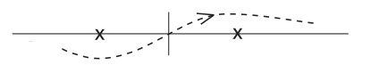
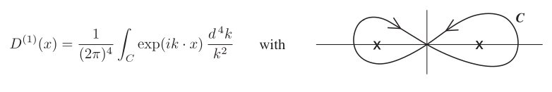

# Free Particle Scattering Problems

<a id="p81">[p. 81]</a>

In this extensive class of problems we are interested in calculating the over-all transition matrix element $M$ between an initial state $A$ and a final state $B , A$ and $B$ being specified by assigning the spins and momenta of the free particles which are present in these states. The scattering process is supposed to occur as follows: The free particles which are specified by state $A$ in the remote past, converge and interact, and other free particles emerge or are created in the interaction and finally constitute the state $B$ in the remote future. We wish to calculate the matrix element $M$ for this process, without studying the equations of motion or investigating the behavior of the system at intermediate times while the interaction is in progress.

The unperturbed states $A$ and $B$ are supposed to be states of free particles without interaction and are therefore represented by constant state-vectors Φ$A$ and Φ$B$ in the <a id="ix-125">interaction representation</a>. The actual initial and final states in a scattering problem will consist of particles each having a self-<a id="ix-183">field</a> with which it continues to interact even in the remote future and past, hence Φ$A$ and Φ$B$ do not accurately represent the initial and final states. However, so long as we are using perturbation theory and not including the higher order effects arising form the self-fields of the particles, it is consistent to use constant Φ$A$ and Φ$B$ representing bare particles <a id="ix-111">without radiation</a> interaction. Even when self-field effects are considered, it turns out that the bare-particle Φ$A$ and Φ$B$ can still be used, although in this case some careful justification for it is needed.

The matrix element $M$ is

$$
M = ( \Phi_{B}^{*} U \Phi_{A} ) \tag{419}
$$

Here $U$Φ$A$ is the state which is obtained at $t$ = +$\infty$ by solving the <a id="ix-233">equation</a> of motion (417) with the initial condition Φ = Φ$A$ at $t = -\infty . U$ can easily be written down as a perturbation expansion in the operators $H^{e}$ and $H_{R}$,

$$
\begin{aligned} U &= 1 + \left( - \frac{i}{\hbar} \right) \int_{-\infty}^{\infty} dt_{1} \{ H^{e} ( t_{1} ) + H_{R} ( t_{1} ) \} \\ & \quad + \left( - \frac{i}{\hbar} \right)^{2} \int_{-\infty}^{\infty} dt_{1} \int_{-\infty}^{\infty} dt_{2} \{ H^{e} ( t_{1} ) + H_{R} ( t_{1} ) \}\{ H^{e} ( t_{2} ) + H_{R} ( t_{2} ) \} + \dots \end{aligned} \tag{420}
$$

$$
= \sum_{n = 0}^{\infty} \left( - \frac{i}{\hbar} \right)^{n} \frac{1}{n !} \int_{-\infty}^{\infty} dt_{1} \dots \int_{-\infty}^{\infty} dt_{n} P \{\{ H^{e} ( t_{1} ) + H_{R} ( t_{1} ) \} \dots \{ H^{e} ( t_{n} ) + H_{R} ( t_{n} ) \}\} \tag{421}
$$

Here the $P$ signifies a chronological product, the factors in it being multiplied not in the order in which they are written but in the order of the times $t_{1} ,t_{2} ,\dots ,t_{n}$, the factors with later times standing to the left of those with earlier times. This accounts for the factor 1$/n$! after we change all the limits to cover the whole range from $-\infty$ to +$\infty$. The operator $U$ is generally referred to as “the S-matrix”.

Before discussing the general analysis of the series expansion (421), we shall use it to solve some standard problems.

## A. Møller Scattering of Two Electrons

We have in the initial state $A$ two electrons in states $( p_{1} u_{1} ) ( p_{2} u_{2} )$ and in the final state $B$ two electrons $( p_{1}^{\prime} u_{1}^{\prime} ) ( p_{2}^{\prime} u_{2}^{\prime} )$. The electron ($p_{1} u_{1} )$ is given by the one-particle <a id="ix-82">wave-function</a>

$$
u_{1} e^{ip_{1} \cdot x} \tag{422}
$$

<a id="p82">[p. 82]</a>

normalized by $( \overline{u}_{1} u_{1} )$ = 1. With the wave function normalized in this way, (422) is just the matrix element of the operator $\psi ( x )$ between the vacuum state and the state containing electron 1. We can see this from

$$
\psi ( x ) = \sum_{p,u} b_{pu} ue^{ip \cdot x}
$$

$$
\text{ where } \{ b_{pu} ,b_{p^{\prime} u^{\prime}}^{*} \} = \delta_{pp^{\prime}} \delta_{uu^{\prime}} . \text{ Then } ( \Phi_{o}^{*} ,\psi ( x ) \Phi_{pu} ) = ( \Phi_{o}^{*} ,b_{pu} \Phi_{pu} ) ue^{ip \cdot x} = ( \Phi_{o}^{*} , \Phi_{o} ) ue^{ip \cdot x} = ue^{ip \cdot x} .
$$

Thus we consider the states 1, 2 and 1${}^{\prime} , 2^{\prime}$ as if they were discrete states, the $\psi$ operator being given by the expansion (337). It would also be possible to use the continuous-state expansion (306) for $\psi$, but then the normalization of the initial and final states would have to be considered afresh. Since we fixed the normalization (472) when we previously derived the Møller formula (144), we shall now stick to it.

We shall calculate in the Born approximation as before, thus keeping only the term $n$ = 2 in (421) which gives the matrix element $M$ proportional to $e^{2}$. In this problem the external potential $A^{e}$ is zero. The term $n$ = 2 in (421) is

$$
U_{2} = \frac{+ e^{2}}{2 \hbar^{2} c^{2}} \int \int dx_{1} dx_{2} P \left\{ \psi ( x_{1} ) A / ( x_{1} ) \psi ( x_{1} ) , \overline{\psi} ( x_{2} ) A / ( x_{2} ) \psi ( x_{2} ) \right\} \tag{423}
$$

the integration going over all space-time. To obtain the matrix element $M$ = (Φ$\frac{*}{B} U_{2}$Φ${}_{A} )$ we only have to replace according to (377)

$$
\psi ( x_{i} ) = u_{1} e^{ip_{1} \cdot x_{i}} b_{1} + u_{2} e^{ip_{2} \cdot x_{i}} b_{2} + u^{\prime} e^{ip_{1}^{\prime} \cdot x_{i}} b_{1}^{\prime} + u_{2}^{\prime} e^{ip_{2}^{\prime} \cdot x_{i}} b_{2}^{\prime} \quad \text{ by } \quad u_{1} e^{ip_{1} \cdot x_{i}} b_{1} + u_{2} e^{ip_{2} \cdot x_{i}} b_{2} \tag{424}
$$

and

$$
\overline{\psi} ( x_{i} ) = \overline{u}_{1} e^{- ip_{1} \cdot x_{i}} b_{1}^{*} + \overline{u}_{2} e^{- ip_{2} \cdot x_{i}} b_{2}^{*} + \overline{u}_{1}^{\prime} e^{- ip_{1}^{\prime} \cdot x_{i}} b_{1}^{*\prime} + \overline{u}_{2}^{\prime} e^{- ip_{2}^{\prime} \cdot x_{i}} b_{2}^{*\prime} \quad \text{ by } \quad \overline{u}_{1}^{\prime} e^{- ip_{1}^{\prime} \cdot x_{i}} b_{1}^{*\prime} + \overline{u}_{2}^{\prime} e^{- ip_{2}^{\prime} \cdot x_{i}} b_{2}^{*\prime}
$$

because we only absorb 1 and 2 and only create 1$\prime$ and 2$\prime$. Then we want to pick out the coefficient of

$$
( b_{1}^{*\prime} b_{1} ) ( b_{2}^{*\prime} b_{2} ) \tag{425}
$$

in the resulting expansion. There are no photons in the initial and final states and so the vacuum expectation value is taken for the Maxwell potential operators. We thus find, taking account of the fact that the $b$ and $\overline{b}$ anticommute with each other as in the derivation of (358), the result

$$
\begin{aligned} M &= \sum_{\mu ,\lambda} \frac{e^{2}}{\hbar^{2} c^{2}} \int \int dx_{1} dx_{2} \{ \exp [ i ( p_{1} - p_{1}^{\prime} ) \cdot x_{1} + i ( p_{2} - p_{2}^{\prime} ) \cdot x_{2} ] ( \overline{u}_{1}^{\prime} \gamma_{\lambda} u_{1} ) ( \overline{u}_{2}^{\prime} \gamma_{\mu} u_{2} ) \\ & \quad - \exp [ i ( p_{1} - p_{2}^{\prime} \cdot x_{1} + i ( p_{2} - p_{1}^{\prime} ) \cdot x_{2} ] ( \overline{u}_{2}^{\prime} \gamma_{\lambda} u_{1} ) ( \overline{u}_{1}^{\prime} \gamma_{\mu} u_{2} ) \} \langle P \{ A_{\lambda} ( x_{1} ) ,A_{\mu} ( x_{2} ) \} \rangle_{o} \end{aligned} \tag{426}
$$

The expectation-value of the chronological product brings in an important new function,

$$
\langle P \{ A_{\lambda} ( x_{1} ) ,A_{\mu} ( x_{2} ) \} \rangle_{o} = \tfrac{1}{2} \hbar c\delta_{\lambda \mu} D_{F} ( x_{1} - x_{2} ) \tag{427}
$$

where $F$ stands for <a id="ix-79">Feynman</a>. Also called by Stueckelberg $D^{c} , c$ for causality. [[18]](#ref-18)

### Properties of the $D_{F}$ Function

Since

$$
P \{ A_{\lambda} ( x_{1} ) ,A_{\mu} ( x_{2} ) \} = \tfrac{1}{2} \{ A_{\lambda} ( x_{1} ) ,A_{\mu} ( x_{2} ) \} + \tfrac{1}{2} \epsilon ( x_{1} - x_{2} ) \boldsymbol{[} A_{\lambda} ( x_{1} ) ,A_{\mu} ( x_{2} ) \boldsymbol{]} \tag{428}
$$

we have by (203) and (205)

$$
\begin{aligned} D_{F} ( x ) &= D^{( 1 )} ( x ) + i\epsilon ( x ) D ( x ) = \frac{1}{2 \pi^{2}} \left[ \frac{1}{x^{2}} - i\pi \delta ( x^{2} ) \right] \\ &= D^{( 1 )} ( x ) - i \{ D_{A} ( x ) + D_{R} ( x ) \} \\ &= D^{( 1 )} ( x ) - 2 i \overline{D} ( x ) \end{aligned} \tag{429}
$$

<a id="p83">[p. 83]</a>

according to (228). Obviously $D_{F}$ is an even function. It has the property that asymptotically as $x_{0} \to \infty$ in the future, $D_{F}$ = 2$iD^{+}$ contains only positive frequencies, while as $x_{0} \to -\infty$ in the past, $D_{F} = - 2 iD^{-}$ contains only negative frequencies. See Fierz, _Helv. Phys. Acta_ **23** (1950) 731 for a full discussion.

Thus $D_{F}$ is the potential arising from a point source disturbance at the origin, when all the potential travelling out in the future represents particles <a id="ix-5">created</a>, and all the potential travelling in from<a id="fnref-56" href="#fn-56">56</a> the past represents particles to be absorbed, all particles having positive energy. It is thus the potential which maintains the correct causal time-sequence of events, and in this way it was discovered by Stueckelberg. But the definition (427) is easier to understand and use.

The momentum representation of $D_{F}$ is

$$
D_{F} ( x ) = \frac{- 2 i}{( 2 \pi )^{4}} \int_{F} e^{ik \cdot x} \frac{d^{4} k}{k^{2}} \tag{430}
$$

The contour of integration here is along the real axis, below the pole at $k_{0} = -| \boldsymbol{k} |$ and above the pole at $k_{0}$ = +$| \boldsymbol{k} |$, in the $k_{0}$ plane:

_Figure 6 (p. 83)_

We can see this using (429), (207), (208), and comparing (210), (226) and (209) one also knows that

_Figure 7 (p. 83)_

(430) is always known as a “Feynman integral”. We can also write

$$
D_{F} ( x ) = \frac{- 2 i}{( 2 \pi )^{4}} \int e^{ik \cdot x} \frac{d^{4} k}{k^{2} - i\epsilon} \tag{431}
$$

Here the integration is along the real axis for all four components of $k . \epsilon$ is a small positive real number and the limit $\epsilon \to$ 0 is supposed to be taken in (431) after the integration is done. Before going to the limit, the $\epsilon$ term just shifts the poles off the real axis, the pole $| \boldsymbol{k} |$ going done and the pole $-| \boldsymbol{k} |$ going up, and so the integral is well-defined and non-singular.

### The Møller Formula, conclusion

Using (427) and (431) in (426), the integrations over $x_{1}$ and $x_{2}$ can be done at once, giving a $\delta$-function involving $k$, and the $k$ integration can then also be done immediately. The result is

$$
M_{2} = \sum_{\lambda} \frac{- ie^{2}}{\hbar c} ( 2 \pi )^{4} \delta^{4} ( p_{1} + p_{2} - p_{1}^{\prime} - p_{2}^{\prime} ) \left\{ \frac{( \overline{u}_{1}^{\prime} \gamma_{\lambda} u_{1} ) ( \overline{u}_{2}^{\prime} \gamma_{\lambda} u_{2} )}{( p_{1} - p_{1}^{\prime} )^{2} - i\epsilon} - \frac{( \overline{u}_{2}^{\prime} \gamma_{\lambda} u_{1} ) ( \overline{u}_{1}^{\prime} \gamma_{\lambda} u_{2} )}{( p_{1} - p_{2}^{\prime} )^{2} - i\epsilon} \right\} \tag{432}
$$

Now $p_{1}$ and $p_{1}^{\prime}$ are both electron momentum 4-vectors and hence $( p_{1} - p_{1}^{\prime} )$ is a space-like vector and its square cannot be zero. Hence we can go directly to the limit by putting $\epsilon$ = 0 in (432). This gives us the Møller formula (144) allowing for a difference in units in $p$ and $e$.

It is clear that the formula comes very directly out of (423), once we know the momentum expansion (431) of the $D_{F}$ function. And we shall find that things are equally simple in other free-particle scattering problems.

<a id="p84">[p. 84]</a>

### Electron-Positron <a id="ix-228">Scattering</a>

Exactly the same formula (432) also gives the matrix element of scattering of an electron by a positron. We must assume that the electron is initially in state 1 given by

$$
u_{1} e^{ip_{1} \cdot x} \tag{433}
$$

and finally in state 1$\prime$ by

$$
u_{1}^{\prime} e^{ip_{1}^{\prime} \cdot x} \tag{434}
$$

But now the initial state of the positron is given by the wave-function

$$
\overline{u}_{2}^{\prime} e^{- ip_{2}^{\prime} \cdot x} \tag{435}
$$

and the final state by

$$
\overline{u}_{2} e^{- ip_{2} \cdot x} \tag{436}
$$

using the negative-energy electron wave-functions and _not_ the charge-conjugate functions to represent the positron. The correctness of (435) and (436) is clear since $b_{2}$ is the _emission_ operator and $b_{2}^{\prime}$ the _absorption_ operator for this positron.

The second term in (432) now represents not an ordinary exchange effect but a special short-range scattering due to a virtual annihilation of the positron and electron. This term has been observed experimentally by measuring the fine-structure constant of positronium. (M. Deutsch and E. Dulit, _Phys. Rev._ **84** (1951) 601, (Nov. 1, 1951).)

## B. Scattering of a Photon by an Electron. The Compton Effect. Klein-Nishina Formula.

Again we use the same operator $U_{2}$ given by (423). We only have to calculate its matrix element $M_{2}$ between an initial state $A$ and a final state $B$, where $A$ consists of an electron with wave-function

$$
ue^{ip \cdot x} \tag{437}
$$

and a photon with <a id="ix-194">potentials</a> given by

$$
A_{\mu} = e_{\mu} e^{ik \cdot x} \tag{438}
$$

and $B$ consists of the electron in state

$$
u^{\prime} e^{ip^{\prime} \cdot x} \tag{439}
$$

and the photon with potentials

$$
A_{\mu} = e_{\mu}^{\prime} e^{ik^{\prime} \cdot x} \tag{440}
$$

The operator $A_{\lambda} ( x_{1} )$ appearing in (423) contains both photon emission and absorption components according to (211), and so does $A_{\mu} ( x_{2} )$. Hence the matrix element $M_{2}$ is a sum of contributions; we can either take $e_{\lambda} e^{ik \cdot x_{1}}$ from $A_{\lambda} ( x_{1} )$ and<a id="fnref-57" href="#fn-57">57</a> $e_{\mu}^{\prime} e^{ik^{\prime} \cdot x_{2}}$ from $A_{\mu} ( x_{2} )$ or vice versa. Likewise the electron can be absorbed by $\psi ( x_{2} )$ or emitted again by $\overline{\psi} ( x_{1} )$, or vice versa. Thus altogether we find for $M_{2}$, after taking into account that the whole expression is symmetrical in $x_{1}$ and $x_{2}$,

$$
\begin{aligned} M_{2} &= \frac{e^{2}}{\hbar^{2} c^{2}} \sum_{\lambda ,\mu ,\alpha ,\beta} \int \int dx_{1} dx_{2} \left\{ \exp ( ip \cdot x_{2} - ip^{\prime} \cdot x_{1} ) ( \overline{u}_{1}^{\prime} \gamma_{\lambda} )_{\alpha} \left\langle \epsilon ( x_{1} - x_{2} ) P \left\{ \psi_{\alpha} ( x_{1} ) , \overline{\psi}_{\beta} ( x_{2} ) \right\} \right\rangle_{o} ( \gamma_{\mu} u )_{\beta} \right\} \times \\ & \quad \left\{ e_{\lambda} e_{\mu}^{\prime} \exp ( ik \cdot x_{1} - ik^{\prime} \cdot x_{2} ) + e_{\mu} e_{\lambda}^{\prime} \exp ( ik \cdot x_{2} - ik^{\prime} \cdot x_{1} ) \right\} \end{aligned} \tag{441}
$$

Note that with <a id="ix-41">anticommuting</a> fields the expression $\epsilon ( x_{1} - x_{2} ) P \left\{ \psi_{\alpha} ( x_{1} ) , \overline{\psi}_{\beta} ( x_{2} ) \right\}$ is a relativistic invariant whereas the $P$-product by itself is not. Thus in analogy with (427) we write

$$
\left\langle \epsilon ( x_{1} - x_{2} ) P \left\{ \psi_{\alpha} ( x_{1} ) , \overline{\psi}_{\beta} ( x_{2} ) \right\} \right\rangle_{o} = - \tfrac{1}{2} S_{F\alpha \beta} ( x_{1} - x_{2} ) \tag{442}
$$

<a id="p85">[p. 85]</a>

where $S_{F}$ is a new invariant function. Since

$$
\epsilon ( x_{2} - x_{1} ) P \left\{ \psi_{\alpha} ( x_{1} ) , \overline{\psi}_{\beta} ( x_{2} ) \right\} = \tfrac{1}{2} \boldsymbol{[} \psi_{\alpha} ( x_{1} ) , \overline{\psi}_{\beta} ( x_{2} ) \boldsymbol{]} + \tfrac{1}{2} \epsilon ( x_{2} - x_{1} ) \left\{ \psi_{\alpha} ( x_{1} ) , \overline{\psi}_{\beta} ( x_{2} ) \right\} \tag{443}
$$

we have by (299) and (329)

$$
S_{F} ( x ) = S^{( 1 )} + i\epsilon ( x ) S ( x ) \tag{444}
$$

in exact analogy to (429). We write also

$$
S_{F} ( x ) = \sum_{\lambda} \left( \gamma_{\lambda} \frac{\partial}{\partial x_{\lambda}} - \mu \right) \Delta_{F} ( x ) \tag{445}
$$

and we find from (444) the momentum <a id="ix-129">representations</a>

$$
\Delta_{F} ( x ) = \frac{- 2 i}{( 2 \pi )^{4}} \int e^{ik \cdot x} \frac{d^{4} k}{k^{2} + \mu^{2} - i\epsilon} \tag{446}
$$

$$
S_{F} ( x ) = \frac{2}{( 2 \pi )^{4}} \int e^{ik \cdot x} \left( \frac{/ k + i\mu}{k^{2} + \mu^{2} - i\epsilon} \right) d^{4} k \tag{447}
$$

We can also write (447) conveniently as

$$
S_{F} ( x ) = \frac{2}{( 2 \pi )^{4}} \int_{F} e^{ik \cdot x} \frac{1}{k / - i\mu} d^{4} k \tag{448}
$$

Here the Dirac matrix in the denominator means that we have to multiply above and below by $( / k + i\mu )$ in order to evaluate the integral. Thus (448) is not a real simplification of (447), only it saves writing. The Feynman integration in (448) is defined as a <a id="ix-67">contour integral</a> exactly as in (430).

Now substituting from (448) into (441), just like for (432)

$$
M_{2} = \frac{- e^{2}}{\hbar^{2} c^{2}} ( 2 \pi )^{4} \delta^{4} ( p + k - p^{\prime} - k^{\prime} ) \overline{u}^{\prime} \left[ /e \frac{1}{p / - k /^{\prime} - i\mu} /e^{\prime} + /e^{\prime} \frac{1}{p / + / k - i\mu} /e \right] u \tag{449}
$$

Again the denominators $( p - k )$2 $+ \mu^{2}$ can never vanish so the $\epsilon$ can be put equal to zero in (447). In fact if the electron is initially at rest

$$
( p - k^{\prime} )^{2} + \mu^{2} = ( p^{2} + \mu^{2} ) + k^{\prime 2} - 2 p \cdot k^{\prime} = 2 p_{0} k_{0}^{\prime} = 2 \mu k_{0}^{\prime}
$$

and similarly

$$
( p + k )^{2} + \mu^{2} = - 2 \mu k_{0} \tag{450}
$$

because $k^{\prime 2}$ = 0 and $p^{2} = - \mu^{2} ; \boldsymbol{p}$ = 0 because the electron is at rest.

$$
M_{2} = \frac{- e^{2}}{2 \hbar^{2} c^{2} \mu} ( 2 \pi )^{4} \delta^{4} ( p + k - p^{\prime} - k^{\prime} ) \overline{u}^{\prime} \left[ \frac{1}{k_{0}^{\prime}} /e ( p / - / k^{\prime} + i\mu ) /e^{\prime} - \frac{1}{k_{0}} /e^{\prime} ( p / + / k + i\mu ) /e \right] u \tag{451}
$$

Now we can simplify (451) further. Since the photon is not polarized in time, $e_{4} = e_{4}^{\prime}$ = 0; since the electron is at rest, $\boldsymbol{p}$ = 0. Hence $e \cdot p$ = 0, and thus $/e/p = - p/e /$ + 2$\mathbb{I} e \cdot p = - p/e /$ , i.e. $p /$ and $/e$ anticommute. This plus the fact that $u$ is a spin state of momentum $\hbar p$, i.e.

$$
( p / - i\mu ) u = 0 \tag{452}
$$

mean that the term $p / + i\mu$ in (451) can be omitted. Thus we get

$$
M_{2} = \frac{e^{2}}{2 \hbar^{2} c^{2} \mu} ( 2 \pi )^{4} \delta^{4} ( p + k - p^{\prime} - k^{\prime} ) \overline{u}^{\prime} \left[ /e \frac{/ k^{\prime}}{k_{0}^{\prime}} /e^{\prime} + /e^{\prime} \frac{/ k}{k_{0}} /e \right] u \tag{453}
$$

<a id="p86">[p. 86]</a>

### Calculation of the Cross-Section

We write as in (145)

$$
M_{2} = K ( 2 \pi )^{4} \delta^{4} ( p + k - p^{\prime} - k^{\prime} ) \tag{454}
$$

Then the <a id="ix-117">scattering</a> probability per unit volume and per unit time for the single final state is as before

$$
w_{\delta} = c | K |^{2} ( 2 \pi )^{4} \delta^{4} ( p + k - p^{\prime} - k^{\prime} ) \tag{455}
$$

The number of final states for the electron is

$$
\frac{1}{( 2 \pi )^{3}} \left( \frac{mc^{2}}{E^{\prime}} \right) dp_{1}^{\prime} dp_{2}^{\prime} dp_{3}^{\prime} \tag{456}
$$

The photon with potentials (440), when $e_{\mu}^{\prime}$ is a space-like vector having $( e_{\mu}^{\prime} )$2 = 1 is normalized to one particle per volume $\hbar c/ 2 k_{0}^{\prime}$. This can be seen at once, comparing (440) with (211) and (214), and taking into account the difference of (2$\pi )$3 between the continuous and discrete normalizations. Hence the number of final states for the photon is

$$
\frac{1}{( 2 \pi )^{3}} \left( \frac{\hbar c}{2 k_{0}^{\prime}} \right) dk_{1}^{\prime} dk_{2}^{\prime} dk_{3}^{\prime} \tag{457}
$$

The total transition probability is thus

$$
w = c | K |^{2} \frac{1}{( 2 \pi )^{2}} \left( \frac{mc^{2}}{E^{\prime}} \frac{\hbar c}{2 k_{0}^{\prime}} \right) \frac{dk_{1}^{\prime} dk_{2}^{\prime} dk_{3}^{\prime}}{d ( p_{0}^{\prime} + k_{0}^{\prime} )} \tag{458}
$$

We write this as a probability for scattering the _photon_ with frequency $k_{0}^{\prime}$ into a unit solid angle $d$Ω. Then using momentum conservation, we have

$$
\begin{aligned} \frac{dp_{0}^{\prime}}{dk_{0}^{\prime}} &= \frac{p_{1}^{\prime} dp_{1}^{\prime} + \dots}{p_{0}^{\prime} dk_{0}^{\prime}} = - \frac{p_{1}^{\prime} dk_{1}^{\prime} + \dots}{p_{0}^{\prime} dk_{0}^{\prime}} = - \frac{p_{1}^{\prime} k_{1}^{\prime} + \cdot \cdot \cdot + p_{3}^{\prime} k_{3}^{\prime}}{p_{0}^{\prime} k_{0}^{\prime}} \\ \frac{dk_{0}^{\prime}}{d ( p_{0}^{\prime} + k_{0}^{\prime} )} &= \frac{p_{0}^{\prime} k_{0}^{\prime}}{- ( p^{\prime} \cdot k^{\prime} )} = \frac{p_{0}^{\prime} k_{0}^{\prime}}{- p \cdot k} = \frac{p_{0}^{\prime} k_{0}^{\prime}}{p_{0} k_{0}} \end{aligned} \tag{459}
$$

Hence finally

$$
w = c | K |^{2} \frac{1}{( 2 \pi )^{2}} \frac{\hbar c}{2 k_{0}} k_{0}^{\prime 2} d \Omega \tag{460}
$$

The differential cross-section for scattering the photon of frequency $k_{0}$ into solid angle $d$Ω is then

$$
\sigma = \frac{wV_{1} V_{2}}{c}
$$

where $V_{1}$ is according to (149) the electron normalization volume $\frac{mc^{2}}{E}$ = 1 and $V_{2}$ is the photon volume,

$V_{2} = \frac{\hbar c}{2 k_{0}}$ . Thus

$$
\sigma = \left( \frac{\hbar c}{4 \pi k_{0}} \right)^{2} | K |^{2} k_{0}^{\prime 2} d \Omega \tag{461}
$$

$$
K = \frac{e^{2}}{2 \hbar^{2} c^{2} \mu} \overline{u}^{\prime} \left[ /e \frac{k /^{\prime}}{k_{0}^{\prime}} /e^{\prime} + /e^{\prime} \frac{k /}{k_{0}} /e \right] u \tag{462}
$$

This gives the cross-section for a known electron spin in the initial and final states.

<a id="p87">[p. 87]</a>

### Sum over Spins

Experimentally we do not observe the electron spins. Hence we observe only the cross-section $\overline{\sigma}$ obtained by averaging $\sigma$ over the two spin states $u$ and summing over the two spin states $u^{\prime}$. The summing and averaging we do by the method of projection operators according to (109), (114).

Here are some rules for spurs and dagger operators:

$\xi$ is a Dirac matrix in general.

1) Spur $\left( \xi^{( 1 )} \xi^{( 2 )} \dots \xi^{( 2 k - 1 )} \right)$ = 0, i.e.the spur of an odd number of factors is 0.

2) Spur $\left( \xi^{( 1 )} \xi^{( 2 )} \dots \xi^{( 2 k )} \right)$ = Spur $\left\{ P \left( \xi^{( 1 )} \xi^{( 2 )} \dots \xi^{( 2 k )} \right) \right\}$ where $P$ is any cyclic permutation.

This is clear, because any cyclic permutation consists of steps of the form

$$
\left( \xi^{( 1 )} \xi^{( 2 )} \dots \xi^{( s )} \right) \xi^{( m )} \to \xi^{( m )} \left( \xi^{( 1 )} \xi^{( 2 )} \dots \xi^{( s )} \right)
$$

and for two square matrices<a id="fnref-58" href="#fn-58">58</a> $A , B$

$$
\operatorname{Spur} AB = \sum_{i,j} a_{ij} b_{ji} = \operatorname{Spur} BA
$$

$$
3 ) \operatorname{Spur} \left( \xi^{( 1 )} \xi^{( 2 )} \dots \xi^{( 2 k - 1 )} \xi^{( 2 k )} \right) = \operatorname{Spur} \left( \xi^{( 2 k )} \xi^{( 2 k - 1 )} \dots \xi^{( 2 )} \xi^{( 1 )} \right)
$$

To show this, it is enough to assume that all $\xi^{( i )}$ are different; by the commutation rules of the $\gamma$’s we can always reduce the product to this form. Then, since each inversion (of neighbors) brings in a minus sign, and since there are an even number of inversions, we get our rule immediately.

$$
4 ) a/b / = - /b/a + 2 \mathbb{I} ( a \cdot b )
$$

In particular

$$
/e/e = \mathbb{I} ( e \cdot e ) \quad /e/ k = - / k/e \quad /e^{\prime} k /^{\prime} = - k /^{\prime} /e^{\prime}
$$

5) By 2), one can cyclically permute a product of dagger operators without changing its spur.

Now we can proceed to evaluate the sum over spins. We have

$$
\begin{aligned} \tfrac{1}{2} \sum_{u} \sum_{u^{\prime}} | K |^{2} &= - \frac{e^{4}}{8 \hbar^{4} c^{4} \mu^{2}} \sum_{u} \sum_{u^{\prime}} \left\{ \overline{u}^{\prime} \left( /e \frac{k /^{\prime}}{k_{0}^{\prime}} /e^{\prime} + /e^{\prime} \frac{/ k}{k_{0}} /e \right) u \right\} \left\{ \overline{u} \left( /e \frac{k /}{k_{0}} /e^{\prime} + /e^{\prime} \frac{/ k^{\prime}}{k_{0}^{\prime}} /e \right) u^{\prime} \right\} \\ &= \frac{e^{4}}{3 2 \hbar^{4} c^{4} \mu^{4}} \operatorname{Spur} \left\{ ( p / + i\mu ) \left( /e \frac{/ k}{k_{0}} /e^{\prime} + /e^{\prime} \frac{k /^{\prime}}{k_{0}^{\prime}} /e \right) ( p /^{\prime} + i\mu ) \left( /e \frac{/ k^{\prime}}{k_{0}^{\prime}} /e^{\prime} + /e^{\prime} \frac{k /}{k_{0}} /e \right) \right\} \\ \text{ Now } \frac{/ k}{k_{0}} &= i\beta + \frac{k_{1} \gamma_{1} + k_{2} \gamma_{2} + k_{3} \gamma_{3}}{k_{0}} = i\beta + \gamma_{k} , \text{ say } . \end{aligned} \tag{463}
$$

Similarly $\frac{k /^{\prime}}{k_{0}^{\prime}} = i\beta + \gamma_{k}^{\prime}$.

Since $/p$ <a id="ix-42">anticommutes</a> with $/e , /e^{\prime} , \gamma_{k}$ and $\gamma_{k}^{\prime}$, (compare with remark after (451)) we may write (463) in the form

$$
\frac{e^{4}}{3 2 \hbar^{4} c^{4} \mu^{4}} \operatorname{Spur} \left[ \left\{ \left( /e \frac{k /}{k_{0}} /e^{\prime} + /e^{\prime} \frac{/ k^{\prime}}{k_{0}^{\prime}} /e \right) ( i\mu - p / ) + 4 \mu ( e \cdot e^{\prime} ) \right\} ( p /^{\prime} + i\mu ) \left\{ /e \frac{/ k^{\prime}}{k_{0}^{\prime}} /e^{\prime} + /e^{\prime} \frac{/ k}{k_{0}} /e \right\} \right]
$$

<a id="p88">[p. 88]</a>

because, using 4), and again compare with remark after (451),<a id="fnref-59" href="#fn-59">59</a>

$$
p/e / \frac{k /}{k_{0}} /e^{\prime} = - /e/p \frac{k /}{k_{0}} /e^{\prime} = + /e \frac{/ k}{k_{0}} p/e /^{\prime} - 2 /e \frac{k \cdot p}{k_{0}} /e^{\prime} = - /e \frac{k /}{k_{0}} /e^{\prime} p / + 2 \mu /e/e^{\prime}
$$

and similarly<a id="fnref-60" href="#fn-60">60</a>

$$
p/e /^{\prime} \frac{/ k^{\prime}}{k_{0}^{\prime}} /e = - /e^{\prime} \frac{/ k^{\prime}}{k_{0}^{\prime}} /e/p + 2 \mu /e^{\prime} /e
$$

so adding the terms gives

$$
- \left( /e \frac{/ k}{k_{0}} /e^{\prime} + /e^{\prime} \frac{k /^{\prime}}{k_{0}^{\prime}} /e \right) p / + 2 \mu \{ /e,/e^{\prime} \} = - \left( /e \frac{/ k}{k_{0}} /e^{\prime} + /e^{\prime} \frac{k /^{\prime}}{k_{0}^{\prime}} /e \right) p / + 4 \mu ( e \cdot e^{\prime} )
$$

Now since $k/ / k = / k^{\prime} k /^{\prime} = p/p / + \mu^{2}$ = 0 (for the photons because they are on the lightcone, for the electron because $p^{2} = - \mu^{2} )$, we get for $| K |^{2}$

$$
\frac{e^{4}}{3 2 \hbar^{4} c^{4} \mu^{4}} \operatorname{Spur} \left[ 4 \mu ( e \cdot e^{\prime} ) ( p /^{\prime} + i\mu ) ( /e \frac{k /^{\prime}}{k_{0}^{\prime}} /e^{\prime} + /e^{\prime} \frac{/ k}{k_{0}} /e ) + ( /e \frac{/ k^{\prime}}{k_{0}^{\prime}} /e^{\prime} /e \frac{/ k}{k_{0}} /e^{\prime} + /e^{\prime} \frac{/ k}{k_{0}} /e/e^{\prime} \frac{/ k^{\prime}}{k_{0}^{\prime}} /e ) ( i\mu - p / ) ( / k - k /^{\prime} ) \right] \tag{464}
$$

because

$$
( i\mu - p / ) ( p /^{\prime} + i\mu ) = i\mu ( p /^{\prime} - p / ) - \mu^{2} - p/p /^{\prime} = i\mu ( / k - k /^{\prime} ) - \mu^{2} - p / ( p / - / k^{\prime} + / k ) = ( i\mu - p / ) ( / k - / k^{\prime} )
$$

We consider the second part of (464) first:

$$
\operatorname{Spur} \left[ /e \frac{/ k^{\prime}}{k_{0}^{\prime}} /e^{\prime} /e \frac{k /}{k_{0}} /e^{\prime} \left\{ - p / ( k / - / k^{\prime} ) - ( k / - / k^{\prime} ) p / \right\} \right] = 2 p_{0} ( k_{0} - k_{0}^{\prime} ) \operatorname{Spur} \left[ /e/e^{\prime} \frac{/ k^{\prime}}{k_{0}^{\prime}} \frac{/ k}{k_{0}} /e/e^{\prime} \right]
$$

$$
= 2 \mu ( k_{0} - k_{0}^{\prime} ) \operatorname{Spur} \left[ - 2 ( e \cdot e^{\prime} ) \left( \frac{/ k^{\prime}}{k_{0}^{\prime}} /e^{\prime} \frac{/ k}{k_{0}} /e \right) - \frac{/ k^{\prime}}{k_{0}^{\prime}} \frac{k /}{k_{0}} \right]
$$

$$
= - 8 \mu \frac{k_{0} - k_{0}^{\prime}}{k_{0} k_{0}^{\prime}} ( k \cdot k^{\prime} ) + 4 \mu ( e \cdot e^{\prime} ) \operatorname{Spur} \left[ - / k/e \frac{k /^{\prime}}{k_{0}^{\prime}} /e^{\prime} + / k^{\prime} /e^{\prime} \frac{/ k}{k_{0}} /e \right]
$$

since

$$
\operatorname{Sp} \left[ /e/e^{\prime} / k^{\prime} / k/e/e^{\prime} \right] = \operatorname{Sp} \left[ /e/e^{\prime} /e/e^{\prime} / k^{\prime} k / \right] = \operatorname{Sp} \left[ - /e/e/e^{\prime} /e^{\prime} k /^{\prime} / k + 2 \mathbb{I} e/e /^{\prime} / k^{\prime} k / ( e \cdot e^{\prime} ) \right] = \operatorname{Sp} \left[ - / k^{\prime} k / - 2 ( e \cdot e^{\prime} ) / k^{\prime} /e^{\prime} / k/e \right]
$$

Hence altogether (464) becomes

$$
\text{ But } / k/e/ k = k /^{\prime} \frac{e^{4}}{3 2 \hbar^{4} c^{4} \mu^{4}} /e^{\prime} / k^{\prime} = 0 \text{ and } \left\{ - 8 \mu \frac{k_{0} - k_{0}^{\prime}}{k_{0} k_{0}^{\prime}} ( k \cdot k^{\prime} ) + 4 \mu ( e \cdot e^{\prime} ) \operatorname{Spur} \left[ ( p / - k /^{\prime} ) /e \frac{/ k^{\prime}}{k_{0}^{\prime}} /e^{\prime} + ( p / + / k ) /e^{\prime} \frac{k /}{k_{0}} /e \right] \right\}
$$

$$
( p^{\prime} - p )^{2} = ( k - k^{\prime} )^{2} = k^{2} + k^{\prime 2} - 2 k \cdot k^{\prime} = - 2 k \cdot k^{\prime}
$$

$$
( p^{\prime} - p )^{2} = p^{\prime 2} + p^{2} - 2 p^{\prime} \cdot p = 2 \mu^{2} + 2 \mu p_{0}^{\prime} = 2 \mu^{2} + 2 \mu ( - \mu + k_{0} - k_{0}^{\prime} ) = 2 \mu ( k_{0} - k_{0}^{\prime} )
$$

Hence $k \cdot k^{\prime} = - \mu ( k_{0} - k_{0}^{\prime} )$ and then

$$
\operatorname{Sp} \left[ ( /p - / k^{\prime} ) /e \frac{k /^{\prime}}{k_{0}^{\prime}} /e^{\prime} + ( p / + / k ) /e^{\prime} \frac{k /}{k_{0}} /e \right] = \operatorname{Sp} \left[ p/e / \frac{/ k^{\prime}}{k_{0}^{\prime}} /e^{\prime} - / k^{\prime} /e^{\prime} \frac{/ k^{\prime}}{k_{0}^{\prime}} /e + p/e /^{\prime} \frac{/ k}{k_{0}} /e + / k/e \frac{k /}{k_{0}} /e^{\prime} \right]
$$

$$
= \operatorname{Sp} \left[ p/e / \frac{k /^{\prime}}{k_{0}^{\prime}} /e^{\prime} + /e \frac{/ k}{k_{0}} /e^{\prime} p / \right] = \operatorname{Sp} \left[ p/e / \frac{k /^{\prime}}{k_{0}^{\prime}} /e^{\prime} + p/e / \frac{/ k}{k_{0}} /e^{\prime} \right]
$$

<a id="p89">[p. 89]</a>

and so (464) is

$$
\frac{e^{4}}{8 \hbar^{4} c^{4} \mu^{4}} \left\{ \frac{2 \mu^{2} ( k_{0} - k_{0}^{\prime} )^{2}}{k_{0} k_{0}^{\prime}} + 2 \mu ( e \cdot e^{\prime} ) \operatorname{Spur} \left[ p/ei\beta /e /^{\prime} \right] \right\} = \frac{e^{4}}{4 \hbar^{4} c^{4} \mu^{2}} \left\{ \frac{( k_{0} - k_{0}^{\prime} )^{2}}{k_{0} k_{0}^{\prime}} + 4 ( e \cdot e^{\prime} )^{2} \right\} \tag{465}
$$

Hence by (461) the cross-section averaged over electron spins is

$$
\overline{\sigma} = \frac{e^{4} k_{0}^{\prime 2} d \Omega}{6 4 \pi^{2} \hbar^{2} c^{2} \mu^{2} k_{0}^{2}} \left\{ \frac{( k_{0} - k_{0}^{\prime} )^{2}}{k_{0} k_{0}^{\prime}} + 4 ( e \cdot e^{\prime} )^{2} \right\}
$$

The classical electron radius is

$$
r_{o} = \frac{e^{2}}{4 \pi mc^{2}} = \frac{e^{2}}{4 \pi \hbar c\mu}
$$

Hence

$$
\overline{\sigma} = \tfrac{1}{4} r_{o}^{2} d \Omega \left( \frac{k_{0}^{\prime}}{k_{0}} \right)^{2} \left\{ \frac{( k_{0} - k_{0}^{\prime} )^{2}}{k_{0} k_{0}^{\prime}} + 4 \cos^{2} \varphi \right\} \tag{466}
$$

where $\varphi$ is the angle between the polarizations of the incident quantum $k_{0}$ and the emitted quantum $k_{0}^{\prime}$ . This is the famous _Klein-Nishina formula_.

To put $\overline{\sigma}$ explicitly as a function of the scattering angle $\theta$, we must use the equations<a id="fnref-61" href="#fn-61">61</a>

$$
k \cdot k^{\prime} = - \mu ( k_{0} - k_{0}^{\prime} )
$$

$$
k \cdot k^{\prime} = | \boldsymbol{k} || \boldsymbol{k}^{\prime} | \cos \theta - k_{0} k_{0}^{\prime} = k_{0} k_{0}^{\prime} ( \cos \theta - 1 )
$$

$$
k_{0} k_{0}^{\prime} ( 1 - \cos \theta ) = \mu ( k_{0} - k_{0}^{\prime} )
$$

$$
\frac{k_{0}}{k_{0}^{\prime}} = 1 + ( 1 - \cos \theta ) \frac{k_{0}}{\mu}
$$

Put

$$
\epsilon = \frac{k_{0}}{\mu} = \left( \frac{\text{ Photon energy }}{mc^{2}} \right)
$$

Then

$$
\overline{\sigma} = \tfrac{1}{4} r_{o}^{2} d \Omega \frac{\left( \frac{( 1 - \cos \theta )^{2} \epsilon^{2}}{1 + \epsilon ( 1 - \cos \theta )} + 4 \cos^{2} \varphi \right)}{[ 1 + \epsilon ( 1 - \cos \theta ) ]^{2}} \tag{467}
$$

Thus for large $\epsilon$ the scattered photons are mainly unpolarized and concentrated in the forward direction. For small $\epsilon$ (non-relativistic problem) we have simply<a id="fnref-62" href="#fn-62">62</a>

$$
\overline{\sigma} = r_{o}^{2} \cos^{2} \varphi d \Omega \tag{468}
$$

the classical result. Summing over the two polarizations of the photon $k^{\prime}$ and averaging over all polarizations of $k$, this gives the cross-section for all polarizations

$$
\overline{\sigma} = \tfrac{1}{2} r_{o}^{2} ( 1 + \cos^{2} \theta ) d \Omega \tag{469}
$$

We get this by evaluating $\tfrac{1}{2} \sum_{e} \sum_{e^{\prime}} ( e \cdot e^{\prime} )$2. First we have to sum over the two polarization directions of photon $k^{\prime}$. This summation for three directions would give

$$
\sum ( e \cdot e^{\prime} )^{2} = e^{2} = 1
$$

Hence for the two directions perpendicular to $k^{\prime}$ we can write

$$
\sum_{e^{\prime}} ( e \cdot e^{\prime} )^{2} = 1 - ( \boldsymbol{e} \cdot \hat{\boldsymbol{k}}^{\prime} )^{2}
$$

<a id="p90">[p. 90]</a>

Now we perform the other summation over the two polarization directions of photon $k$, using the same argument. This gives

$$
\sum_{e} \sum_{e^{\prime}} ( e \cdot e^{\prime} )^{2} = \sum_{e} \left[ 1 - ( \boldsymbol{e} \cdot \hat{\boldsymbol{k}}^{\prime} )^{2} \right] = 2 - \left[ \hat{\boldsymbol{k}}^{\prime 2} - ( \hat{\boldsymbol{k}} \cdot \hat{\boldsymbol{k}}^{\prime} )^{2} \right] = 1 + \cos^{2} \theta
$$

This with the averaging factor of $\frac{1}{2}$ gives (469).

The total cross-section then is

$$
\sigma = \tfrac{8}{3} \pi r_{o}^{2} \tag{470}
$$

This non-relativistic scattering given by (468) – (470) is called _Thomson scattering_.<a id="fnref-63" href="#fn-63">63</a>

## C. Two Quantum Pair Annihilation

Consider a process by which an electron in the state $( p,u )$ and a positron associated with the wave-function (439) are both annihilated, with the emission of two photons given by the potentials (438) and (440). The positron momentum-energy 4-vector is then $( - \hbar p^{\prime} )$ so we write $p_{+} = - p^{\prime}$. The positron spinor in the charge-conjugate representation is $v = Cu^{\prime +}$.

This annihilation process will again be effected by the operator $U_{2}$ given by (423). And the matrix element for the transition is exactly as before given by an expression identical with (449) except that $k$ is now replaced by $- k$, namely

$$
\begin{aligned} M_{2} &= - \frac{e^{2} ( 2 \pi )^{4}}{\hbar^{2} c^{2}} \delta^{4} ( p + p_{+} - k - k^{\prime} ) \overline{u}^{\prime} \left\{ /e \frac{1}{p / - / k^{\prime} - i\mu} /e^{\prime} + /e^{\prime} \frac{1}{p / - k / - i\mu} /e \right\} u \\ &= K ( 2 \pi )^{4} \delta^{4} ( p + p_{+} - k - k^{\prime} ) \end{aligned} \tag{471}
$$

We consider the probability for this process for an electron and positron _both at rest_. The result will then apply to the decay of a positronium atom, where the velocities are only of the order of $\alpha c$ and can be treated as zero to a good approximation.

Then

$$
\begin{aligned} p &= p_{+} = ( 0 , 0 , 0 ,i\mu ) \\ k_{0} &= k_{0}^{\prime} = \mu \end{aligned} \tag{472}
$$

As in (453) we have

$$
K = \frac{e^{2}}{2 \hbar^{2} c^{2} \mu^{2}} \overline{u}^{\prime} ( /e/ k^{\prime} /e^{\prime} + /e^{\prime} / k/e ) u \tag{473}
$$

The decay probability per unit volume per unit time into a solid angle $d$Ω for _one_ of the photons is

$$
w = c | K |^{2} \frac{1}{( 2 \pi )^{2}} \left( \frac{\hbar c}{2 \mu} \right)^{2} \frac{dk_{1} dk_{2} dk_{3}}{d ( k_{0} + k_{0}^{\prime} )}
$$

(because $k_{0} = \mu$ here) in analogy to (458). But now $d ( k_{0} + k_{0}^{\prime} )$ = 2$dk_{0}^{\prime}$ and so

$$
w = c | K |^{2} \frac{1}{( 2 \pi )^{2}} \frac{1}{8} \hbar^{2} c^{2} d \Omega \tag{474}
$$

For _parallel_ polarizations, $e = e^{\prime}$, and

$$
( /e/ k^{\prime} /e^{\prime} + /e^{\prime} k/e / ) = - ( / k^{\prime} + / k ) = - 2 i\mu \beta
$$

But $\beta$ has zero matrix element between the spin-states $u$ and $u^{\prime}$, which are positive and negative-frequency states both of zero momentum. Hence for parallel polarizations

$$
w = 0 \tag{475}
$$

<a id="p91">[p. 91]</a>

For _perpendicular_ polarizations, take coordinate axes 1 along $e$, 2 along $e^{\prime}$, and 3 along $k$. Then

$$
( /e/ k^{\prime} /e^{\prime} + /e^{\prime} / k/e ) = \mu \{ \gamma_{1} ( - \gamma_{3} + i\beta ) \gamma_{2} + \gamma_{2} ( \gamma_{3} + i\beta ) \gamma_{1} \} = 2 \mu \gamma_{1} \gamma_{2} \gamma_{3} \tag{476}
$$

Hence for perpendicular polarizations<a id="fnref-64" href="#fn-64">64</a>

$$
\overline{u} [ /e/ k^{\prime} /e^{\prime} + /e^{\prime} / k/e ] u = 2 \mu v^{T} C\gamma_{4} \gamma_{1} \gamma_{2} \gamma_{3} u = - 2 \mu iv^{T} \gamma_{4} \sigma_{2} u
$$

$$
= 2 \mu v^{T} \begin{bmatrix} 0 & - 1 & 0 & 0 \\ 1 & 0 & 0 & 0 \\ 0 & 0 & 0 & 1 \\ 0 & 0 & - 1 & 0 \end{bmatrix} u
$$

0 when spins $u$ and $v$ are parallel

$$
= \{ \quad \sqrt{\}}
$$

$2 \mu$ 2 when spins $u$ and $v$ are antiparallel

We get this latter result by observing that for antiparallel spins the initial wave function is

$$
\psi = \frac{1}{\sqrt{2}} \begin{pmatrix} 1 \\ 0 \end{pmatrix} \begin{pmatrix} 0 \\ 1 \end{pmatrix} - \frac{1}{\sqrt{2}} \begin{pmatrix} 0 \\ 1 \end{pmatrix} \begin{pmatrix} 1 \\ 0 \end{pmatrix}
$$

(neglecting the “small components”) and therefore

$$
v^{T} \begin{bmatrix} 0 & - 1 \\ 1 & 0 \end{bmatrix} u = \frac{1}{\sqrt{2}} ( 0 1 ) \begin{bmatrix} 0 & - 1 \\ 1 & 0 \end{bmatrix} \begin{pmatrix} 1 \\ 0 \end{pmatrix} - \frac{1}{\sqrt{2}} ( 1 0 ) \begin{bmatrix} 0 & - 1 \\ 1 & 0 \end{bmatrix} \begin{pmatrix} 0 \\ 1 \end{pmatrix}
$$

$$
= \frac{1}{\sqrt{2}} \left[ ( 1 0 ) \begin{pmatrix} 1 \\ 0 \end{pmatrix} - ( 0 - 1 ) \begin{pmatrix} 0 \\ 1 \end{pmatrix} \right] = \frac{2}{\sqrt{2}} = \sqrt{2}
$$

This is one place where charge-conjugate spinors are useful and necessary!

Summarizing, we find for electron and positron with spins parallel, in triplet state, the 2-photon decay is forbidden. This selection rule is in fact an exact one for positronium in the ground state 1$s$ triplet. Only 3-photon decay can occur and this makes the lifetime $\sim$ 1100 times longer. For electron and positron in singlet state, the 2-photon decay occurs with the photons always polarized perpendicularly to each other. The probability for the decay, integrating (474) over a solid <a id="ix-22">angle</a> 2$\pi$ since the photons are indistinguishable, is

$$
w = \frac{\hbar^{2} c^{3}}{1 6 \pi} 2 | K |^{2} = \frac{2 e^{4}}{\hbar^{2} c\mu^{2} 8 \pi} = 4 \pi cr_{o}^{2} \tag{477}
$$

Formula (477) is for electron and positron normalized to one particle per unit volume. If the density of the electron probability relative to the position of the positron is $\rho$, then the mean <a id="ix-35">annihilation</a> life-time will be<a id="fnref-65" href="#fn-65">65</a> (the “classical electron radius” $r_{o} = e^{2} / ( 4 \pi mc^{2} )$ in Heaviside units)

$$
\tau = \frac{1}{4 \pi cr_{o}^{2} \rho} \tag{478}
$$

For the positronium 1$s$ singlet state

$$
\begin{aligned} \rho &= \frac{1}{8 \pi a_{o}^{3}} \quad a_{o} = \text{ Bohr radius } = 1 3 7^{2} r_{o} \\ \tau &= 2 \times 1 3 7^{4} \times \frac{a_{o}}{c} = 2 \times 1 3 7^{5} \times \frac{\hbar}{mc^{2}} \approx 1 . 2 \times 1 0^{- 1 0} \sec . \end{aligned} \tag{479}
$$

For slowly-moving electrons and positrons with relative velocity $v$, the annihilation cross-section according to (477) will be

$$
4 \pi r_{o}^{2} \left( \frac{c}{v} \right) \quad \text{ singlet state } , \tag{480}
$$

proportional to 1 just like neutron cross-sections at low (thermal) energies.

<a id="p92">[p. 92]</a>

## D. Bremsstrahlung and <a id="ix-36">Pair</a> Creation in the Coulomb Field of an Atom

We consider these two important processes together. Given an external potential $A_{\mu}^{e}$ representing the Coulomb field, the processes are:

_Bremsstrahlung_

Electron $( pu ) \to$ Electron $( p^{\prime} u^{\prime} )$ + Photon ($k^{\prime} e^{\prime} )$

_Pair-creation_

Photon $( k^{\prime} e^{\prime} ) \to$ Electron $( pu )$ + Positron ($p_{+}^{\prime} u^{\prime} )$

We treat not only the photon $( ke )$ but also the potential $A^{e}$ in _Born approximation._ This is valid so long as

Potential energy $\times$ time of transit $\ll \hbar$

$$
\text{ or } \text{ or } \quad \frac{Ze^{2}}{4 \pi \hbar v} \frac{Ze^{2}}{4 \pi r} \times \frac{r}{v} = \frac{Z}{1 3 7} \frac{c}{v} \ll \hbar \ll 1 \tag{481}
$$

The treatment will only be good for _relativistic velocities_ $v \sim c$, and for _lighter atoms_ $Z \ll$ 137. In fact for heavy atoms $( Z$ = 82 for lead) and $v \sim c$ the error from the Born approximation is about 10%.

The processes arise in the Born approximation just from the term linear in $A_{\mu}$ and linear in $A_{\mu}^{e}$ in (421). This term is

$$
U_{1} = \frac{e^{2}}{\hbar^{2} c^{2}} \int \int dx_{1} dx_{2} P \left\{ \psi ( x_{1} ) A / ( x_{1} ) \psi ( x_{1} ) , \overline{\psi} ( x_{2} ) A /^{e} ( x_{2} ) \psi ( x_{2} ) \right\} \tag{482}
$$

The factor $\frac{1}{2}$ in (423) is now missing, otherwise everything is the same as before. We suppose $A_{\mu}^{e} ( x_{2} )$ is a superposition of Fourier components

$$
A_{\mu}^{e} ( x_{2} ) = \frac{1}{( 2 \pi )^{4}} \int dkf ( k ) e_{\mu} e^{ik \cdot x_{2}} \tag{483}
$$

where $f ( k )$ is a known function of $k$. For a static Coulomb field all the vectors $k$ appearing in (483) have zero 4th component, and $e_{\mu}$ is the constant vector (0$, 0 , 0 ,i )$. We calculate the matrix element $M_{1}$ for bremsstrahlung or pair creation with $A_{\mu}^{e}$ given by the pure Fourier component (438) ; the results are then to be afterwards superposed to give the actual potential according to (483).

For bremsstrahlung the formula for $M_{1}$ is (449), identically the same as for the Compton effect, or integrating over the frequency $k$

$$
M_{1} = - \frac{e^{2}}{\hbar^{2} c^{2}} f ( p^{\prime} + k^{\prime} - p ) \overline{u}^{\prime} \left\{ /e \frac{1}{p / - / k^{\prime} - i\mu} /e^{\prime} + /e^{\prime} \frac{1}{p /^{\prime} + / k^{\prime} - i\mu} /e \right\} u \tag{484}
$$

The factor 2 difference between (482) and (423) is just compensated by the fact that the photon $k^{\prime} e^{\prime}$ can be emitted by two operators $A_{\mu}$ in (423) and by only one in (482). The bremsstrahlung cross section is then calculated by squaring (484) and integrating over $k^{\prime}$ and $p^{\prime}$ with appropriate normalization factors. For the details see Heitler’s book $§ 1 7 .$<a id="fnref-66" href="#fn-66">66</a>

For pair creation the same formula (449) gives the matrix element $M_{1}$, allowing for the fact that the roles of the particles are now changed around so that electron $( pu )$ instead of ($p^{\prime} u^{\prime} )$ is created etc. Thus

$$
M_{1} = - \frac{e^{2} ( 2 \pi )^{4} )}{\hbar^{2} c^{2}} \delta^{4} ( k + k^{\prime} - p - p_{+} ) \overline{u} \left\{ /e \frac{1}{/ k^{\prime} - p /_{+} - i\mu} /e^{\prime} + /e^{\prime} \frac{1}{/ k - p /_{+} - i\mu} /e \right\} u^{\prime} \tag{485}
$$

<a id="p93">[p. 93]</a>

and integrating over the components of the potential

$$
M_{1} = - \frac{e^{2}}{\hbar^{2} c^{2}} f ( p + p_{+} - k^{\prime} ) \overline{u} \left\{ /e \frac{1}{/ k^{\prime} - p /_{+} - i\mu} /e^{\prime} + /e^{\prime} \frac{1}{p / - / k^{\prime} - i\mu} /e \right\} u^{\prime} \tag{486}
$$

For the <a id="ix-34">cross-section</a> calculation see again Heitler, $§ 2 0 .$<a id="fnref-67" href="#fn-67">67</a>

---

## Notes

**56.** “from” replaces a second “in” [↩](#fnref-56)

**57.** The factor $x_{2}$ had a superfluous superscript “$\prime$”. [↩](#fnref-57)

**58.** $A , B$ added for clarity [↩](#fnref-58)

**59.** The words after “because”, “using 4) . . . (451)” were added. [↩](#fnref-59)

**60.** In the second edition, the intermediate calculation was wrong; however, the conclusion was correct. It was rewritten up to Eq. (464). See the trace theorems Eq. (585) _et seq._ Also, note the identity [↩](#fnref-60)

$$
\operatorname{Sp} ( / a_{1} / a_{2} a /_{3} / a_{4} ) = ( a_{1} \cdot a_{2} ) ( a_{3} \cdot a_{4} ) - ( a_{1} \cdot a_{3} ) ( a_{2} \cdot a_{4} ) + ( a_{1} \cdot a_{4} ) ( a_{2} \cdot a_{3} )
$$

**61.** The third equation lacked a subscript “0” on the variable $k_{0}^{\prime}$ ; the fourth equation lacked a superscript “$\prime$” on the variable $k_{0}^{\prime}$ . [↩](#fnref-61)

**62.** Eq. (468) lacked a label. The word “simply” was inserted. [↩](#fnref-62)

**63.** “Thomson” replaces “Thompson”. [↩](#fnref-63)

**64.** The first spinor $u$ lacked a bar; $\overline{u}$ replaces $u$. [↩](#fnref-64)

**65.** The expression for $r_{o}$ was added. [↩](#fnref-65)

**66.** In the 3rd edition of Heitler’s book, see $§ 2 5 .$ [↩](#fnref-66)

**67.** In the 3rd edition of Heitler’s book, see $§ 2 6 .$ [↩](#fnref-67)

---

## References

**[18]** E. C. G. Stueckelberg, “Une propriété de l’operateur $S$ en mécanique asymptotique”, _Helv. Phys. Acta_ **19** (1946) 242. See also D. Rivier & E. C. G. Stuecklberg (_sic_), “A convergent expression for the magnetic moment of the muon”, _Phys. Rev._ **74** (1948) 218. [↩](#refback-18-1)

---

[← Examples of Quantized Field Theories](05-examples-of-quantized-field-theories.md) · [General Theory of Free Particle Scattering →](07-general-theory-of-free-particle-scattering.md)
