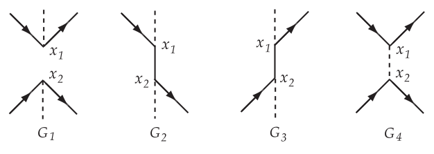
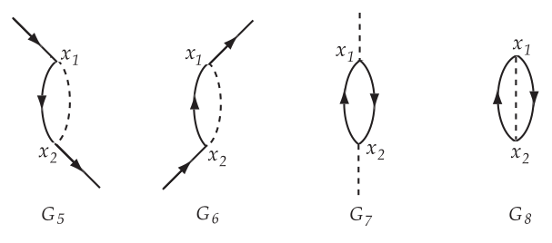
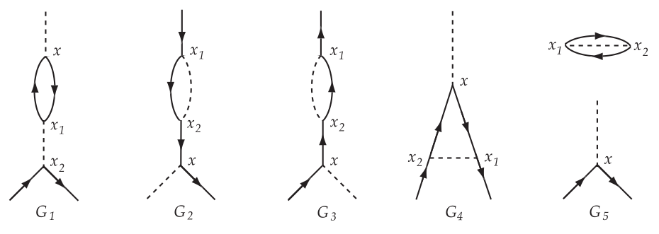
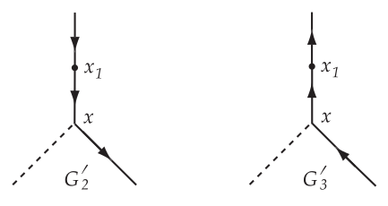

[← Free Particle Scattering Problems](06-free-particle-scattering-problems.md) · [Scattering By A Static Potential. Comparison With Experimental Results. →](08-scattering-by-a-static-potential-comparison-with-experimental-results.md)

---

<hr class="page" style="height:2px;border:0;background:currentColor;opacity:0.25">
<a id="p94" href="book.pdf#page=100" target="_blank" title="This page in the PDF"><sup>[p. 94]</sup></a>

# General Theory of Free Particle Scattering

We have shown how (421) leads to matrix elements for standard scattering processes, from which cross-sections can be calculated. In each case we used only the term $`n`$ = 2 in (421), which happened to be the lowest term giving a contribution to these processes. The higher terms $`n`$ = 4$`, 6 ,\dots`$ will also give contributions to the matrix elements for these processes, contributions which are collectively called “radiative corrections”. It turns out that the results without radiative corrections agree with the experimental scattering cross-sections in all cases. The experiments are never accurate to better than a few percent, and the radiative corrections are always smaller than the lowest-order terms by at least one power of $`( e^{2} / 4 \pi \hbar c )`$ = (1$`/ 137`$). Thus the study of the radiative corrections for scattering processes will not lead to any directly observable effects.

Nevertheless we shall work out a method of calculating the high-order terms of (421). This method turns out to be simplest and easiest to explain when we are discussing scattering problems. Incidentally we shall see what the radiative corrections to scattering look like, and we shall learn something about the nature of radiative corrections in general. Finally at the end we shall be able to use the method of calculation in order to find the radiative corrections to the motion of an electron in a hydrogen atom, which is the case in which these small effects can be accurately observed, but where the pure scattering theory is not directly applicable.

To avoid unnecessary complications we suppose there is no external field $`A^{e}`$. Problems in which there is an external field, so long as it can be treated in the <a id="ix-32">Born approximation</a>, can always be simply related to problems without external field, just as the <a id="ix-33">bremsstrahlung</a> matrix element (484) is related to the Compton <a id="ix-34">effect</a> (449). When there is no external field the matrix element for any scattering process is

<a id="eq-487"></a>

```math
M = ( \Phi_{B}^{*} S \Phi_{A} ) \qquad \text{(487)}
```

<a id="eq-488"></a>

```math
S = \sum_{n = 0}^{\infty} \left( \frac{e}{\hbar c} \right)^{n} \frac{1}{n !} \int \dots \int dx_{1} \dots dx_{n} P \left\{ \psi / A\psi ( x_{1} ) ,\dots , \psi / A\psi ( x_{n} ) \right\} \qquad \text{(488)}
```

The operators in (488) are field-operators of the interaction representation, the integrations over the points $`x_{1} ,\dots x_{n}`$ extend over all space-time, and the initial and final states $`A`$ and $`B`$ are entirely arbitrary.

We wish to calculate the matrix element $`M`$ of $`S`$ for a particular scattering process, in which the states $`A`$ and $`B`$ are specified by enumerating the particles present in the two states. We must now take properly into account the fact that the particles in states $`A`$ and $`B`$, although well separated and no longer interacting with one another, are real particles interacting with their self-fields and with the vacuum-fluctuations of the fields in their neighborhood. Thus $`A`$ and $`B`$ are really time-dependent states in the interaction representation and will not be given by time-independent vectors Φ$`A`$ and Φ$`B`$, except in the lowest-order approximation. (See page 81.) Let Ψ$`{}_{B} ( t )`$ be the actual time-dependent state-vector of the state $`B`$ in the IR. We are not interested in the dependence of Φ$`{}_{B} ( t )`$ on $`t`$. In an actual scattering experiment the particles in state B are observed in counters or photographic plates or cloud-chambers and the time of their arrival is not measured precisely. Therefore it is convenient to use for $`B`$ not the state-function Ψ$`{}_{B} ( t )`$ but a state-function Φ$`B`$ which is _by definition_ the state-function describing a set of bare particles without radiation interaction, the bare particles having the same momenta and spins as the real particles in the state $`B`$. In the IR the state-function Φ$`B`$ is time-independent. The question is only, what is the connection between Ψ$`{}_{B} ( t )`$ and Φ$`B`$?

<div align="right"><a href="book.pdf#page=100" target="_blank" title="This page in the PDF"><sup>[p. 94]</sup></a></div>
<hr class="page" style="height:2px;border:0;background:currentColor;opacity:0.25">
<a id="p95" href="book.pdf#page=101" target="_blank" title="This page in the PDF"><sup>[p. 95]</sup></a>

Suppose $`t_{B}`$ to be a time so long in the future after the scattering process is over, that from $`t_{B}`$ to +$`\infty`$ the state $`B`$ consists of separated outward-traveling particles. Then the relation between Ψ$`{}_{B} ( t )`$ and Φ$`B`$ is simple. We imagine a fictitious world in which the charge $`e`$ occurring in the radiation interaction decreases infinitely slowly (adiabatically) from its actual value at time $`t_{B}`$ to zero at time (+$`\infty )`$. In the fictitious world, the state Ψ$`{}_{B} ( t_{B} )`$ at time $`t_{B}`$ will grow into the bare-particle state Φ$`B`$ at time +$`\infty`$. Thus

<a id="eq-489"></a>

```math
\Phi_{B} = \Omega_{2} ( t_{B} ) \Psi_{B} ( t_{B} ) \qquad \text{(489)}
```

where<sup><a id="fnref-68" href="#fn-68">68</a></sup>

<a id="eq-490"></a>

```math
\Omega_{2} ( t_{B} ) = \sum_{n = 0}^{\infty} \left( \frac{e}{\hbar c} \right)^{n} \frac{1}{n !} \int_{t_{B}}^{\infty} \dots \int_{t_{B}}^{\infty} dx_{1} \dots dx_{n} P \left\{ \psi / A\psi ( x_{1} ) ,\dots , \overline{\psi} A\psi / ( x_{n} ) \right\} g_{B} ( t_{1} ) \dots g_{B} ( t_{n} ) \qquad \text{(490)}
```

and $`g_{B} ( t )`$ is a function decreasing adiabatically from the value 1 at $`t = t_{B}`$ to zero at $`t = \infty`$. Similarly, when $`t_{A}`$ is a time so far in the past that the state $`A`$ consists of separated converging particles from $`t = -\infty`$ to $`t = t_{A}`$ we have

<a id="eq-491"></a>

```math
\Psi_{A} ( t_{A} ) = \Omega_{1} ( t_{A} ) \Phi_{A} \qquad \text{(491)}
```

<a id="eq-492"></a>

```math
\Omega_{1} ( t_{A} ) = \sum_{n = 0}^{\infty} \left( \frac{e}{\hbar c} \right)^{n} \frac{1}{n !} \int_{-\infty}^{t_{A}} \dots \int_{-\infty}^{t_{A}} dx_{1} \dots dx_{n} P \left\{ \psi / A\psi ( x_{1} ) ,\dots , \overline{\psi} A\psi / ( x_{n} ) \right\} g_{A} ( t_{1} ) \dots g_{A} ( t_{n} ) \qquad \text{(492)}
```

where $`g_{A} ( t )`$ is a function increasing adiabatically from $`t = -\infty`$ to $`t = t_{A}`$.

The scattering matrix element between states $`A`$ and $`B`$ is given exactly by

<a id="eq-493"></a>

```math
M = \left( \Psi_{B}^{*} ( t_{B} ) S_{t_{A}}^{t_{B}} \Psi_{A} ( t_{A} ) \right) \qquad \text{(493)}
```

<a id="eq-494"></a>

```math
S_{t_{A}}^{t_{B}} = \sum_{n = 0}^{\infty} \left( \frac{e}{\hbar c} \right)^{n} \frac{1}{n !} \int_{t_{A}}^{t_{B}} \dots \int_{t_{A}}^{t_{B}} P \left\{ \psi / A\psi ( x_{1} ) ,\dots , \overline{\psi} A\psi / ( x_{n} ) \right\} dx_{1} \dots dx_{n} \qquad \text{(494)}
```

Of course (493) is independent of the times $`t_{A}`$ and $`t_{B}`$. When $`t_{A}`$ and $`t_{B}`$ are chosen so far in the past that (489) and (491) are satisfied, then (493) may be written in the form (487), where now

<a id="eq-495"></a>

```math
\begin{aligned} S &= \Omega_{2} ( t_{B} ) S_{t_{A}}^{t_{B}} \Omega_{1} ( t_{A} ) \\ &= \sum_{n = 0}^{\infty} \left( \frac{e}{\hbar c} \right)^{n} \frac{1}{n !} \int_{-\infty}^{\infty} \dots \int_{-\infty}^{\infty} dx_{1} \dots dx_{n} P \left\{ \psi / A\psi ( x_{1} ) ,\dots , \overline{\psi} A\psi / ( x_{n} ) \right\} g ( t_{1} ) \dots g ( t_{n} ) \end{aligned} \qquad \text{(495)}
```

and $`g ( t )`$ is a function increasing adiabatically from 0 to 1 for $`-\infty <t<t_{A}`$, equal to 1 for $`t_{A} \leq t \leq t_{B}`$, and decreasing adiabatically from 1 to 0 for $`t_{A} <t< \infty`$. Thus we come to the important conclusion that formula (487) for the matrix element is correct, using the bare particle state-functions Φ$`A`$ and Φ$`B`$, provided that formula (488) for $`S`$ is interpreted by putting in the slowly varying cut-off function $`g ( t_{i} )`$ to make the integrals converge at $`t_{i} = \pm \infty`$. The cut-off functions are to be put in as they appear in (495), and then $`S`$ is defined as the limit to which (495) tends as the rate of variation of $`g ( t )`$ is made infinitely slow.

The main practical effect of this limiting process in the definition of $`S`$ is to justify us in throwing away all terms in the integrals which oscillate finitely at $`t_{i} = \pm \infty`$. There are however certain cases in which the integral (488) is in a more serious way ambiguous due to bad convergence at $`t_{i} = \pm \infty`$. In these cases the cut-off functions have to be kept explicitly until a late stage of the calculations before going to the limit $`g ( t )`$ = 1. In all cases, if the limiting process is done in this way, the matrix element $`M`$ is obtained correctly and unambiguously.

The use of bare-particle wave-functions Φ$`A`$ and Φ$`B`$ in (487) is thus justified. This makes the calculation of $`M`$ in principle simple. It is only necessary to pick out from (488) the terms which contain the right combination of elementary emission and absorption operators to annihilate the particles in $`A`$ and to create those in $`B`$. We shall next describe a general method of systematically picking out those terms, which is due originally to Feynman. It was first explained in published form by G. C Ẇick, _Phys. Rev._ **80** (1950) 268. Feynman and Wick have applied the method only to chronologically ordered products such as appear in (488). However the method applies in the same way to all products whether chronological or not, and we shall describe it in full generality.

<div align="right"><a href="book.pdf#page=101" target="_blank" title="This page in the PDF"><sup>[p. 95]</sup></a></div>
<hr class="page" style="height:2px;border:0;background:currentColor;opacity:0.25">
<a id="p96" href="book.pdf#page=102" target="_blank" title="This page in the PDF"><sup>[p. 96]</sup></a>

## <a id="s-reduction-of-an-operator-to-normal-form"></a>The Reduction of an Operator to Normal Form

Given any operator $`\mathcal{O}`$ which is a product of field operators, for example

<a id="eq-496"></a>

```math
\mathcal{O} = \overline{\psi} ( x_{1} ) A / ( x_{1} ) \psi ( x_{1} ) \overline{\psi} ( x_{2} ) A / ( x_{2} ) \psi ( x_{2} ) \qquad \text{(496)}
```

we want to pick out the matrix element of $`\mathcal{O}`$ for a transition between states $`A`$ and $`B`$ in which there is a known distribution of bare particles. For example $`A`$ may be a state with only one electron in state 1, and $`B`$ a state with one electron in state 2. Then we wish to pick out from (496) terms in which there appear the operators $`b_{1}`$ and $`b_{2}^{*}`$. In order to pick out all such terms systematically, we make a complete analysis of $`\mathcal{O}`$ into a sum of terms $`\mathcal{O}_{n}`$, each $`\mathcal{O}_{n}`$ being a sum of products of emission and absorption operators in which all emission operators stand to the left of all absorption operators.<sup><a id="fnref-69" href="#fn-69">69</a></sup>. Any operator in which the emission and absorption operators are arranged in this special way is called “Normal”<sup><a id="fnref-70" href="#fn-70">70</a></sup> <a id="refback-19-1"></a>[[19]](#ref-19). The $`\mathcal{O}_{n}`$ will be called the “Normal constituents” of $`\mathcal{O}`$. Once $`\mathcal{O}`$ has been analyzed in this way, then we find the matrix element simply by taking the coefficient of $`b_{2}^{*} b_{1}`$ in the expansion $`\sum \mathcal{O}_{n}`$. No other term in the expansion can give any contribution to the matrix element. In $`\mathcal{O}`$ itself there might appear a term such as

<a id="eq-497"></a>

```math
b_{2}^{*} b_{3} b_{3}^{*} b_{1} \qquad \text{(497)}
```

which would give a contribution to the matrix element, since the operator $`b_{3}^{*}`$ could create a particle in an intermediate state 3 which the operator $`b_{3}`$ would then annihilate. The expansion of $`\mathcal{O}`$ into normal constituents eliminates all terms such as (497) and replaces them by sums of normal products with numerical coefficients. Thus using the anticommutation rule for $`b_{3}`$ and $`b_{3}^{*}`$, (497) becomes replaced by

<a id="eq-498"></a>

```math
Ab_{2}^{*} b_{1} - b_{2}^{*} b_{3}^{*} b_{3} b_{1} \qquad \text{(498)}
```

where $`A`$ is a numerical coefficient. The second term in (498) gives no contribution to the matrix element.

It is clear that by using the commutation rules of the operators in this way, every $`\mathcal{O}`$ can be written as a sum of normal products, and that the analysis leads to a unique expansion of $`\mathcal{O}`$. But we do not need to go through the tedious algebra of using the commutation rules, instead we can write down the normal constituents $`\mathcal{O}_{n}`$ directly by following simple rules.

First, we define the notation $`N ( \mathcal{Q} )`$, where $`\mathcal{Q}`$ is any product of emission and absorption operators, to be the product obtained by simply rearranging the factors of $`\mathcal{Q}`$ in a normal order, irrespective of the commutation rules, with a factor $`( - 1`$) if the rearrangement involves an odd permutation of the electron-positron operators. Similarly if $`\mathcal{Q}`$ is any sum of products, $`N ( \mathcal{Q} )`$ is defined by rearranging factors in each term of the sum in the same way. Thus we have for example (see (211))

<a id="eq-499"></a>

```math
N ( A_{\lambda} ( x ) A_{\mu} ( y ) ) = A_{\lambda}^{+} ( x ) A_{\mu}^{+} ( y ) + A_{\lambda}^{-} ( x ) A_{\mu}^{-} ( y ) + A_{\lambda}^{-} ( x ) A_{\mu}^{+} ( y ) + A_{\mu}^{+} ( y ) A_{\lambda}^{+} ( x ) \qquad \text{(499)}
```

where $`A_{\mu}^{+} ( x )`$ is the positive-frequency part of $`A_{\mu} ( x )`$, i.e. the part containing absorption operators. Observe that the order of factors in the first two products in (499) is immaterial, only the third and fourth products have their order fixed by the condition of being normal. Similarly (see (306) and (309))

<a id="eq-500"></a>

```math
N \left( \psi_{\alpha} ( x ) \overline{\psi}_{\beta} ( y ) \right) = \psi_{\alpha}^{+} ( x ) \overline{\psi}_{\beta}^{+} ( y ) + \psi_{\alpha}^{-} ( x ) \overline{\psi}_{\beta}^{-} ( y ) + \psi_{\alpha}^{-} ( x ) \overline{\psi}_{\beta}^{+} ( y ) - \psi_{\beta}^{-} ( y ) \psi_{\alpha}^{+} ( x ) \qquad \text{(500)}
```

With this notation, every product of _two_ field operators can immediately be written as a sum of normal constituents. Using the commutation rules (213) and the vacuum expectation values given by (219), (220),

<a id="eq-501"></a>

```math
A_{\lambda} ( x ) A_{\mu} ( y ) = \langle A_{\lambda} ( x ) A_{\mu} ( y ) \rangle_{o} + N ( A_{\lambda} ( x ) A_{\mu} ( y ) ) \qquad \text{(501)}
```

Similarly, using (310), (311), (324),

<a id="eq-502"></a>

```math
\psi_{\alpha} ( x ) \overline{\psi}_{\beta} ( y ) = \left\langle \psi_{\alpha} ( x ) \overline{\psi}_{\beta} ( y ) \right\rangle_{o} + N \left( \psi_{\alpha} ( x ) \overline{\psi}_{\beta} ( y ) \right) \qquad \text{(502)}
```

And in fact for _any_ two field operators $`\mathcal{P} , \mathcal{Q}`$ we have

<a id="eq-503"></a>

```math
\mathcal{P} \mathcal{Q} = \langle \mathcal{P} \mathcal{Q} \rangle_{o} + N ( \mathcal{P} \mathcal{Q} ) \qquad \text{(503)}
```

<div align="right"><a href="book.pdf#page=102" target="_blank" title="This page in the PDF"><sup>[p. 96]</sup></a></div>
<hr class="page" style="height:2px;border:0;background:currentColor;opacity:0.25">
<a id="p97" href="book.pdf#page=103" target="_blank" title="This page in the PDF"><sup>[p. 97]</sup></a>

provided $`\mathcal{P}`$ and $`\mathcal{Q}`$ are both linear in emission and absorption operators. The proof of (503) has in effect been done by proving (501) and (502), because these include all of the possible products of two boson or two fermion operators, and (503) is trivial for the product of one boson and one fermion operator, because they commute. Equations (501) – (503) are operator identities, and hold whether or not the physical problem is directly concerned with the vacuum state of the fields. In fact we could if we wished define the “vacuum expectation values” as the functions appearing in (501) – (503) and so avoid speaking about the vacuum state at all.

Next we shall state the generalization of the rule (503) to any product $`\mathcal{O}`$ of field operators, for example the $`\mathcal{O}`$ given by (496). We define a “factor pairing” of $`\mathcal{O}`$ by picking out from $`\mathcal{O}`$ a certain even number of factors, either all or none or any intermediate number, and associating them together in pairs. For the product $`\mathcal{P} \mathcal{Q}`$ there are only two factor-pairings, either we choose the pair $`\mathcal{P} \mathcal{Q}`$ together or we choose no pairs at all. To each factor-pairing $`n`$ corresponds to a normal constituent $`\mathcal{O}_{n}`$ obtained as follows: For each pair of factors $`\mathcal{P} \mathcal{Q}`$ which is paired in $`n , \mathcal{O}_{n}`$ contains the numerical factor $`\langle \mathcal{P} \mathcal{Q} \rangle_{o}`$, the order of $`\mathcal{P}`$ and $`\mathcal{Q}`$ being maintained as it was in $`\mathcal{O}`$. The unpaired factors $`\mathcal{R}_{1} \mathcal{R}_{2} \dots \mathcal{R}_{m}`$ in $`\mathcal{O}`$ appear in $`\mathcal{O}_{n}`$ rearranged in normal form. Thus the complete form of $`\mathcal{O}_{n}`$ is

<a id="eq-504"></a>

```math
\mathcal{O}_{n} = \pm \langle \mathcal{P} \mathcal{Q} \rangle_{o} \langle \mathcal{P}^{\prime} \mathcal{Q}^{\prime} \rangle_{o} \dots N ( \mathcal{R}_{1} , \mathcal{R}_{2} ,\dots \mathcal{R}_{m} ) \qquad \text{(504)}
```

the sign in front being + or $`-`$ according to the even or odd character of the permutation of the electron-positron operators from the order in which they are written in $`\mathcal{O}`$ to the order in which they are written in (504). With this definition of (504) of $`\mathcal{O} n`$, we have the following theorem:

_Every operator product_ $`\mathcal{O}`$ _is identically equal to the sum of the_ $`\mathcal{O} n`$ _obtained from all its factor-pairings._

This theorem gives the decomposition of $`\mathcal{O}`$ into its normal constituents. Equations (501) – (503) are just special cases of it. Clearly non-zero $`\mathcal{O}_{n}`$ are only obtained when each pair of factors is either a $`\overline{\psi}`$ and a $`\psi`$ operator or two $`A_{\mu}`$ operators. We shall therefore suppose that the factor-pairings are always restricted in this way.

The proof of the theorem is very simple, by induction on $`m`$, the number of factors in $`\mathcal{O}`$. The theorem is true when $`m`$ = 1 or 2, so we need only prove it true for $`m`$ assuming it true for $`m -`$ 2. Let then $`\mathcal{O}^{\prime}`$ be a product of $`( m -`$ 2) factors. First we show that the theorem is true for

<a id="eq-505"></a>

```math
\mathcal{O} = ( \mathcal{P} \mathcal{Q} \pm \mathcal{Q} \mathcal{P} ) \mathcal{O}^{\prime} \qquad \text{(505)}
```

where $`\mathcal{P}`$ and $`\mathcal{Q}`$ are field operators and the plus sign appears only if $`\mathcal{P}`$ and $`\mathcal{Q}`$ are both electron-positron operators. In fact, the normal constituents of $`\mathcal{P} \mathcal{Q} \mathcal{O}^{\prime}`$ and of $`( \pm \mathcal{Q} \mathcal{P} \mathcal{O}^{\prime} )`$ will be identical, so long as $`\mathcal{P}`$ and $`\mathcal{Q}`$ are not paired together. Therefore the sum of the normal constituents of $`\mathcal{O}`$ reduces to

<a id="eq-506"></a>

```math
\sum \mathcal{O} n = \{ \langle \mathcal{P} \mathcal{Q} \rangle_{o} \pm \langle \mathcal{Q} \mathcal{P} \rangle_{o} \} \sum \mathcal{O}_{n}^{\prime} \qquad \text{(506)}
```

But $`\sum \mathcal{O}_{n}^{\prime} = \mathcal{O}^{\prime}`$, and

<a id="eq-507"></a>

```math
\langle \mathcal{P} \mathcal{Q} \rangle_{o} \pm \langle \mathcal{Q} \mathcal{P} \rangle_{o} = ( \mathcal{P} \mathcal{Q} \pm \mathcal{Q} \mathcal{P} ) \qquad \text{(507)}
```

this being a number and not an operator. Therefore (506) gives $`\sum \mathcal{O} n`$ = 0, and the theorem is proved for $`\mathcal{O}`$ given by (505). Next let $`\mathcal{O}`$ be any product of $`m`$ factors. Then by using the commutation relations we can write

<a id="eq-508"></a>

```math
\mathcal{O} = N ( \mathcal{O} ) + \Sigma \qquad \text{(508)}
```

where Σ is a sum of terms of the form (505). The theorem is true for each term (505) and so is true for Σ. The theorem is trivially true for $`N ( \mathcal{O} )`$, because $`\langle \mathcal{P} \mathcal{Q} \rangle_{o}`$ = 0 for every pair of factors $`\mathcal{P} , \mathcal{Q}`$ in the order in which they occur in $`N ( \mathcal{O} )`$, and so all normal constituents (504) of $`N ( \mathcal{O} )`$ are zero except the constituent $`N ( \mathcal{O} )`$ itself. Therefore the theorem holds for every $`\mathcal{O}`$ given by (508), and this completes the proof.

<div align="right"><a href="book.pdf#page=103" target="_blank" title="This page in the PDF"><sup>[p. 97]</sup></a></div>
<hr class="page" style="height:2px;border:0;background:currentColor;opacity:0.25">
<a id="p98" href="book.pdf#page=104" target="_blank" title="This page in the PDF"><sup>[p. 98]</sup></a>

## <a id="s-feynman-graphs"></a><a id="ix-132">Feynman</a> Graphs

We use a method of Feynman to enumerate the possible factor-pairings of $`\mathcal{O}`$. Each pairing is pictured in a diagram or graph $`G . G`$ consists of a certain number of vertices with lines joining them. The vertices represent simply the different field-points at which the factors of $`\mathcal{O}`$ operate. Thus for $`\mathcal{O}`$ given by (496) each $`G`$ has the two vertices $`x_{1} , x_{2}`$. The lines in $`G`$ are either dotted, representing photon operators, or undotted, representing electron-positron operators. The rules for drawing these lines are the following:

1) For each factor-pair $`\overline{\psi} ( x ) \psi ( y )`$, an undotted line is drawn in $`G`$ running from $`x`$ to $`y`$, the direction being marked by an arrow in the line.

2) For each unpaired factor $`\overline{\psi} ( x )`$, an undotted line is drawn running from $`x`$ out of the diagram, the other end of the line being free and not being a vertex of $`G`$.

3) For each unpaired factor $`\psi ( y )`$, an undotted line is drawn running into $`y`$, the other end of the line being free.

4) For each factor-pair $`A_{\mu} ( x ) A_{\nu} ( y )`$, a dotted line joins $`x`$ and $`y`$.

5) For unpaired factor $`A_{\mu} ( x )`$, a dotted line is drawn with one end of $`x`$ and the other end free.

6) Every undotted line has a definite direction marked by an arrow. A dotted line has no direction and no arrow.

In general, we must allow factor-pairings in which two operators at the same field-point are paired together. This will give a line in $`G`$ with both ends at the same point. However in the case of operators such as (496) or more generally (488), a pair of factors taken from the same point will always give rise to a factor

<a id="eq-509"></a>

```math
\langle j_{\mu} ( x ) \rangle_{o} = - iec \left\langle \psi ( x ) \gamma_{\mu} \psi ( x ) \right\rangle_{o} \qquad \text{(509)}
```

in the corresponding normal constituents (504). We saw in the discussion following (366) that the vacuum expectation value (509) is zero, the operators being IR operators. Therefore factor-pairings in which two factors at the same field-point are paired, in the analysis of quantum-electrodynamical operators such as (488), always give zero contributions. So we may add to our list of rules for the construction of $`G`$:

7) Lines joining a point to itself are forbidden.

The possible factor pairings of (496) are then represented by the following $`G`$’s:



_Figure 8 (p. 98)_

<div align="right"><a href="book.pdf#page=104" target="_blank" title="This page in the PDF"><sup>[p. 98]</sup></a></div>
<hr class="page" style="height:2px;border:0;background:currentColor;opacity:0.25">
<a id="p99" href="book.pdf#page=105" target="_blank" title="This page in the PDF"><sup>[p. 99]</sup></a>



_Figure 9 (p. 99)_

Corresponding to these $`G`$’s there will be just 8 normal constituents of $`\mathcal{O}`$, which we call $`\mathcal{O}_{1} \dots \mathcal{O}_{8}`$. These normal constituents are, in their respective order:

```math
\mathcal{O}_{1} = \pm N \left\{ \psi ( x_{1} ) A / ( x_{1} ) \psi ( x_{1} ) \overline{\psi} ( x_{2} ) A / ( x_{2} ) \psi ( x_{2} ) \right\}
```

```math
\mathcal{O}_{2} = \pm \left\langle \psi ( x_{1} ) \psi ( x_{2} ) \right\rangle_{o} N \left\{ A / ( x_{1} ) \psi ( x_{1} ) \overline{\psi} ( x_{2} ) A / ( x_{2} ) \right\}
```

```math
\mathcal{O}_{3} = \pm \left\langle \psi ( x_{2} ) \psi ( x_{1} ) \right\rangle_{o} N \left\{ \psi ( x_{1} ) A / ( x_{1} ) A / ( x_{2} ) \psi ( x_{2} ) \right\}
```

```math
\mathcal{O}_{4} = \pm \left\langle A / ( x_{1} ) A / ( x_{2} ) \right\rangle_{o} N \left\{ \psi ( x_{1} ) \psi ( x_{1} ) \overline{\psi} ( x_{2} ) \psi ( x_{2} ) \right\}
```

```math
\mathcal{O}_{5} = \pm \left\langle \psi ( x_{1} ) \psi ( x_{2} ) \right\rangle_{o} \left\langle A / ( x_{1} ) A / ( x_{2} ) \right\rangle_{o} N \left\{ \psi ( x_{2} ) \psi ( x_{1} ) \right\}
```

```math
\mathcal{O}_{6} = \pm \left\langle \psi ( x_{2} ) \psi ( x_{1} ) \right\rangle_{o} \left\langle A / ( x_{1} ) A / ( x_{2} ) \right\rangle_{o} N \left\{ \psi ( x_{1} ) \psi ( x_{2} ) \right\}
```

```math
\mathcal{O}_{7} = \pm \left\langle \psi ( x_{1} ) \psi ( x_{2} ) \right\rangle_{o} \left\langle \psi ( x_{2} ) \psi ( x_{1} ) \right\rangle_{o} N \left\{ A / ( x_{1} ) A / ( x_{2} ) \right\}
```

```math
\mathcal{O}_{8} = \pm \left\langle \psi ( x_{1} ) \psi ( x_{2} ) \right\rangle_{o} \left\langle \psi ( x_{2} ) \psi ( x_{1} ) \right\rangle_{o} \left\langle A / ( x_{1} ) A / ( x_{2} ) \right\rangle_{o}
```

This type of process to which $`\mathcal{O}_{i}`$ gives matrix elements can be seen at once by looking at the _external_ lines of $`G_{i}`$, i.e. the lines which have one end free. Thus, for Møller scattering only $`G_{4}`$ contributes. For Compton scattering only $`G_{2}`$ and $`G_{3}`$. And for a transition from a one-electron atom to a one-electron state, which requires an operator of the form $`b_{2}^{*} b_{1}`$, and $`G_{5}`$ and $`G_{6}`$ will contribute.

A $`\psi`$ operator not only annihilates electrons but also creates positrons. And a $`\overline{\psi}`$ not only creates electrons but annihilates positrons. Thus an undotted external line with the arrow pointing in represents _either_ an electron in the initial state _or_ a positron in the final state. And an undotted external line with the arrow pointing out represents either an outgoing electron or an incoming positron. Dotted external lines likewise represent a photon either in the initial or the final state, because $`A_{\mu}`$ can both annihilate and create a photon. Thus $`G_{4}`$ will give not only electron-electron scattering, but also electron-positron scattering. $`G_{2}`$ and $`G_{3}`$ give not only the Compton effect, but also two-quantum annihilation of a positron-electron pair, and also the inverse process of pair-creation by the collision of two photons.

We have introduced the Feynman graphs simply as a convenient pictorial way of visualizing the analysis of an operator into its normal constituents. The graphs are just diagrams drawn on the paper. But according to Feynman<sup><a id="fnref-71" href="#fn-71">71</a></sup> , “Space-time Approach to Quantum Electrodynamics”, _Phys. Rev._ **76** (1949) 769, the graphs are more than this. He regards the graphs as a picture of an actual process which is occurring physically in space-time. Thus $`G_{2}`$ represents an electron and a photon coming together and interacting at the space-time point $`x_{1}`$, where the photon is absorbed; then the electron propagates through space-time along the line $`x_{1} x_{2}`$, until at $`x_{2}`$ it emits a photon, and the electron and photon then travel out along the outgoing lines at $`x_{2}`$. According to Feynman an internal undotted line running from $`x_{1}`$ to $`x_{2}`$ represents an electron propagating from $`x_{1}`$ to $`x_{2}`$ if the time $`x_{2}`$ is later than the time $`x_{1}`$, and represents a positron propagating from $`x_{2}`$ to $`x_{1}`$ if the time $`x_{2}`$ is earlier. In this sense a positron can be regarded as precisely equivalent to an electron which happens to propagate itself backwards instead of forwards in time.

The space-time picture of Feynman is a perfectly consistent and reasonable one. It gives a correct account of everything that happens, including pair creation and annihilation and all the other phenomena<span class="page" style="float:left;width:100%;margin:0.4em 0 0.6em"><span style="display:block;text-align:right"><a href="book.pdf#page=105" target="_blank" title="This page in the PDF"><sup>[p. 99]</sup></a></span><span style="display:block;height:2px;background:currentColor;opacity:0.25"></span><a id="p100" href="book.pdf#page=106" target="_blank" title="This page in the PDF"><sup>[p. 100]</sup></a></span> connected with positrons. It is in fact equivalent mathematically to the field-theory treatment we follow in this course.

The disadvantage of the Feynman theory is that it is constructed as a particle theory. The fact that there are many particles, indistinguishable from each other and obeying quantum statistics, has to be put into the theory as a special assumption. And the equations of motion of the particles become quite complicated when interactions between several particles, not to mention vacuum-polarization effects, are included. Thus the logical basis of the Feynman theory is much less simple than that of the field theory, where everything follows from general principles once the form of the Lagrangian is chosen.

In this course we follow the pedestrian route of logical development, starting from the general principles of quantizations applied to covariant field equations, and deriving from these principles first the existence of particles and later the results of the Feynman theory. Feynman by the use of imagination and intuition was able to build a correct theory and get the right answers to problems much quicker than we can. It is safer and better for us to use the Feynman space-time pictures not as the basis for our calculations but only as a help in visualizing the formulae which we derive rigorously from the field-theory. In this way we have the advantages of the Feynman theory, its concreteness and its simplification of calculations, without its logical disadvantages.

## <a id="s-feynman-rules-of-calculation"></a>Feynman Rules of Calculation

The Feynman rules of calculation arise when we analyze into normal constituents a _chronologically ordered_ operator such as (488). In this case the vacuum expectation values in (504) are always taken for pairs of operators which are already chronologically ordered. Hence the numerical factors in (504) are all either

<a id="eq-510"></a>

```math
\langle P ( A_{\lambda} ( x ) ,A_{\mu} ( y ) ) \rangle_{o} = \tfrac{1}{2} \hbar cD_{F} ( x - y ) \delta_{\lambda \mu} \qquad \text{(510)}
```

or

<a id="eq-511"></a>

```math
\epsilon ( x - y ) \left\langle P \left( \psi_{\alpha} ( x ) , \overline{\psi}_{\beta} ( y ) \right) \right\rangle_{o} = - \tfrac{1}{2} S_{F\alpha \beta} ( x - y ) \qquad \text{(511)}
```

using (427) and (442). The factor $`\epsilon`$ is put into (511) so that the $`\pm`$ sign still characterizes the permutation of electron-positron operators in going from the order _as written_ in (504) to the order as written in $`\mathcal{O}`$. For the same reason, we shall follow Wick and generally use for chronological products the notation

<a id="eq-512"></a>

```math
T ( \mathcal{R}_{1} \mathcal{R}_{2} \dots \mathcal{R}_{n} ) = \pm P ( \mathcal{R}_{1} \mathcal{R}_{2} \dots \mathcal{R}_{n} ) \qquad \text{(512)}
```

where the sign is plus or minus according to the even or odd character of the permutation of electron-positron operators involved in going from the written order to the chronological order in (512). Hence in particular we have

<a id="eq-513"></a>

```math
\begin{aligned} T ( A_{\lambda} ( x ) ,A_{\mu} ( y ) \} &= P \{ A_{\lambda} ( x ) ,A_{\mu} ( y ) ) \\ T \left( \psi_{\alpha} ( x ) , \overline{\psi}_{\beta} ( y ) \right) &= \epsilon ( x - y ) P \left( \psi_{\alpha} ( x ) , \overline{\psi}_{\beta} ( y ) \right) \end{aligned} \qquad \text{(513)}
```

and for every set of field operators $`\mathcal{R}_{1} \mathcal{R}_{2} \dots \mathcal{R}_{n}`$ the quantity (512) is a relativistic invariant although the $`P`$-product by itself is not. In (488) itself the $`P`$-product may be written as a $`T`$-product, the sign in (512) in this case always being plus.

The rules for writing down the normal constituents of (488) are therefore extremely simple. We are generally only interested in those normal constituents which give matrix elements for some specified type of scattering process. Then the rules are

1) Draw all the graphs which have the right set of external lines corresponding to the particles absorbed and emitted in the process considered. Each <a id="ix-127">graph</a> $`G`$ will have the same external lines, but the number of vertices and of internal lines will vary from graph to graph. We shall always calculate only up to some definite order $`N`$ in the series (488), and so we draw only graphs with not more than $`N`$ vertices. The total number of such graphs is finite. Each vertex in each graph must have precisely 3 lines ending at it, one<span class="page" style="float:left;width:100%;margin:0.4em 0 0.6em"><span style="display:block;text-align:right"><a href="book.pdf#page=106" target="_blank" title="This page in the PDF"><sup>[p. 100]</sup></a></span><span style="display:block;height:2px;background:currentColor;opacity:0.25"></span><a id="p101" href="book.pdf#page=107" target="_blank" title="This page in the PDF"><sup>[p. 101]</sup></a></span> incoming electron line, one outgoing electron line, and one photon line.

2) To each <a id="ix-128">graph</a> $`G`$ with $`n`$ vertices corresponds one normal constituent $`S_{G}`$ of $`S`$.

3) Choosing a particular $`G`$, write down the $`n`$<sup>th</sup> term $`S_{n}`$ of the series (488) and <a id="ix-23">pair</a> off the factors of $`S_{n}`$ as indicated by $`G`$. Replace each factor-pair $`A_{\lambda} ( x ) A_{\mu} ( y )`$ by (510), and replace each factor-pair $`\psi_{\alpha} ( x ) \overline{\psi}_{\beta} ( y )`$ by (511). Apply an $`N`$-ordering to the remaining unpaired factors of $`S_{n}`$, and multiply the whole expression by $`( \pm 1`$) following the rule given for equation (504). The result of applying these operations to $`S_{n}`$ is the normal constituent $`S_{G}`$.

If we wish to calculate the matrix element for the <a id="ix-37">scattering</a> process, then we have only to add one more rule to the three already given.

4) In each $`S_{G}`$, substitute for the unpaired operators the wave-functions of the absorbed and emitted particles, for example writing (437) for $`\psi ( x )`$ when an electron ($`p,u )`$ is absorbed, and writing (438) for $`A_{\mu} ( x )`$ when a photon ($`k,e )`$ is absorbed. These substitutions may sometimes be made in more than one way (for example in the Compton <a id="ix-35">effect</a> when the absorbed and emitted photon may be assigned in two ways to the two unpaired photon operators.) In such cases the substitutions are to be made in all possible ways, and the results added together, taking account of Fermi statistics by putting in a minus sign when two electron or positron wave-functions are interchanged.

The rules (1)–(4) constitute the Feynman rules for calculating the matrix elements of all processes in electrodynamics. According to Feynman they have an intermediate concrete interpretation. Thus (510) is the probability amplitude for a photon emitted at $`x`$ with polarization $`\lambda`$ to propagate itself and arrive at $`y`$ with polarization $`\mu`$, plus the amplitude for a photon having been emitted at $`y`$ to arrive at $`x`$. And (511) is the amplitude for an electron emitted at $`y`$ to arrive at $`x`$, plus the amplitude for a positron emitted at $`x`$ to arrive at $`y`$, with the assigned spins $`\alpha`$ and $`\beta`$. In this way the matrix element is just the probability amplitude for the succession of events, interactions and propagations, that are depicted in the vertices and lines of $`G`$. The total probability amplitude for a process is just the sum of the amplitudes derived by from the various graphs $`G`$ which contribute to the process.

The Feynman rules of calculation take their most practical form when we use the momentum representations (430) and (448) for the $`D_{F}`$ and $`S_{F}`$ functions, carry out the integrations over the points $`x_{1} \dots x_{n}`$, and so obtain the matrix elements as integrals of rational functions in momentum-space. In this way for example the simple matrix elements (432) and (449) were obtained.

In the momentum space integral for $`S_{G}`$, there will appear

<a id="eq-514"></a>

```math
( 1 ) \quad A \text{ factor } \frac{1}{k^{2}} \text{ corresponding to each internal photon line of } G , \qquad \text{(514)}
```

<a id="eq-515"></a>

```math
( 2 ) \quad A \text{ factor } \frac{1}{/ k - i\mu} \text{ corresponding to each internal electron line of } G , \qquad \text{(515)}
```

<a id="eq-516"></a>

```math
( 3 ) \quad A \text{ factor } ( 2 \pi )^{4} \delta^{4} ( k_{1} + k_{2} + k_{3} ) \qquad \text{(516)}
```

corresponding to each internal photon line of $`G`$ at which the 3 lines associated with momenta $`( k_{1} ,k_{2} ,k_{3} )`$ meet. This factor arises from the integration over the space-time position of the vertex.

In addition to these factors there will be numerical factors and Dirac matrices $`\gamma_{\alpha}`$ arising from the particular form of $`S_{n}`$. In practice it is easiest not to write down the $`S_{G}`$ directly in momentum space, but to use the rules (1) – (4) to obtain formulae in configuration space with the right numerical constants, and then transform to momentum space by (430) and (448).

We shall now show how these general methods work by calculating in detail _the_ historic problem, the second-order radiative correction to the scattering of an electron by a weak external potential. This<span class="page" style="float:left;width:100%;margin:0.4em 0 0.6em"><span style="display:block;text-align:right"><a href="book.pdf#page=107" target="_blank" title="This page in the PDF"><sup>[p. 101]</sup></a></span><span style="display:block;height:2px;background:currentColor;opacity:0.25"></span><a id="p102" href="book.pdf#page=108" target="_blank" title="This page in the PDF"><sup>[p. 102]</sup></a></span> problem has been first satisfactorily treated by Schwinger,<sup><a id="fnref-72" href="#fn-72">72</a></sup> _Phys. Rev._ **76** (1949) 790. Schwinger’s paper is outstandingly difficult to read, and I hope you will find my treatment at least slightly easier. But the problem is in its nature complicated and cannot be done without some fairly heavy mathematics. Once the calculations are done for this problem of scattering, it turns out that the results can be used without much further trouble for the relativistic calculation of the Lamb shift too. The scattering and Lamb shift problems are very closely related: in both cases one is calculating the second-order radiative corrections to the motion of an electron, only in one case the electron is in a high continuum state so that the external field can be treated as weak, in the other case the electron is in a discrete state and the potential must be treated as strong.

## <a id="s-the-self-energy-of-the-electron"></a>The Self-Energy of the Electron

Before we can study the effect of radiation interaction on an electron scattered by an external potential, we must first consider the effect of the radiation interaction on a single free electron in the absence of external potentials. Let the free electron be given initially in the state $`( pu )`$. The effect of the radiation interaction acting alone is given by the scattering matrix (488). If the initial state is Φ$`A`$, then the final state, reached after the radiation interaction has been acting for an infinitely long time, will be $`S`$Φ$`A`$. Now $`S`$ has matrix elements only for transitions which conserve momentum and energy. Starting from a one-electron state, it is impossible to make a transition to a many-particle state, for example by emitting one or more photons, while conserving momentum and energy. Therefore the only non-zero matrix elements of $`S`$ from the state Φ$`A`$ will be given by (487), where Φ$`B`$ is also a one-electron state. In Φ$`B`$ let the electron have the momentum and spin $`( p^{\prime} u^{\prime} )`$.

We consider radiative effects only up to the second order. The term of order 1 in (488) gives transitions only with emission an absorption of photons, and hence gives no contribution to the transition Φ$`{}_{A} \to`$ Φ$`B`$. Therefore we may write simply

<a id="eq-517"></a>

```math
S = 1 + U_{2} \qquad \text{(517)}
```

with $`U_{2}`$ given by (423). We have to calculate the matrix element $`M_{2}`$ of $`U_{2}`$ between the states $`( pu )`$ and $`( p^{\prime} u^{\prime} )`$.

To write down $`M_{3}`$ we use the <a id="ix-133">Feynman</a> <a id="ix-134">rules</a>. The factor-pairings of $`U_{2}`$ are represented in the 8 graphs on pp 98-99. Of these only $`G_{5}`$ and $`G_{6}`$ contribute to $`M_{2}`$, and they contribute equally since the integral (423) is symmetrical in the variables $`x_{1}`$ and $`x_{2}`$. The normal constituent of $`U_{2}`$ arising from $`G_{5}`$ and $`G_{6}`$ is, using (510) and (511)<sup><a id="fnref-73" href="#fn-73">73</a></sup>

<a id="eq-518"></a>

```math
\begin{aligned} U_{2 N} &= \sum_{\lambda ,\mu} \frac{e^{2}}{\hbar^{2} c^{2}} \int \int dx_{1} dx_{2} N \left( \overline{\psi} ( x_{1} ) \gamma_{\lambda} \left\langle T \left( \psi ( x_{1} ) , \overline{\psi} ( x_{2} ) \right) \right\rangle_{o} \gamma_{\mu} \psi ( x_{2} ) \right) \langle T ( A_{\lambda} ( x_{1} ) ,A_{\mu} ( x_{2} ) ) \rangle_{o} \\ &= - \frac{e^{2}}{4 \hbar c} \sum_{\lambda} \int \int dx_{1} dx_{2} N \left( \overline{\psi} ( x_{1} ) \gamma_{\lambda} S_{F} ( x_{1} - x_{2} ) \gamma_{\lambda} \psi ( x_{2} ) \right) D_{F} ( x_{2} - x_{1} ) \end{aligned} \qquad \text{(518)}
```

To obtain $`M_{2}`$ from (518) we substitute for $`\psi ( x_{2} )`$ and $`\overline{\psi} ( x_{1} )`$ the wave-functions of the initial and final states, and use the momentum integrals (430), (448). Then the integration over $`x_{1}`$ and $`x_{2}`$ can be carried out and we find

<a id="eq-519"></a>

```math
\begin{aligned} M_{2} &= \sum_{\lambda} \frac{ie^{2}}{\hbar c} \int_{F} \int_{F} dk_{1} dk_{2} \left( \overline{u}^{\prime} \gamma_{\lambda} \frac{1}{/ k_{1} - i\mu} \gamma_{\lambda} u \right) \frac{1}{k_{2}^{2}} \delta ( k_{1} - k_{2} - p^{\prime} ) \delta ( k_{2} - k_{1} + p ) \\ &= \sum_{\lambda} \frac{ie^{2}}{\hbar c} \delta ( p - p^{\prime} ) \int_{F} dk \left( \overline{u}^{\prime} \gamma_{\lambda} \frac{1}{/ k + p / - i\mu} \gamma_{\lambda} u \right) \frac{1}{k^{2}} \end{aligned} \qquad \text{(519)}
```

We consider the Dirac operator

<a id="eq-520"></a>

```math
\Sigma ( p ) = \sum_{\lambda} \int_{F} dk \left( \gamma_{\lambda} \frac{1}{/ k + p / - i\mu} \gamma_{\lambda} \right) \frac{1}{k^{2}} \qquad \text{(520)}
```

<div align="right"><a href="book.pdf#page=108" target="_blank" title="This page in the PDF"><sup>[p. 102]</sup></a></div>
<hr class="page" style="height:2px;border:0;background:currentColor;opacity:0.25">
<a id="p103" href="book.pdf#page=109" target="_blank" title="This page in the PDF"><sup>[p. 103]</sup></a>

appearing in (519). Since $`( p,u )`$ are the <a id="ix-208">momentum</a> and spin of a real electron, we may use the relations

<a id="eq-521"></a>

```math
p^{2} + \mu^{2} = 0 , \quad ( p / - i\mu ) u = 0 \qquad \text{(521)}
```

when we evaluate Σ$`( p )`$ in (519). So using (376), (585) and following the same method that was used in evaluating (377)<sup><a id="fnref-74" href="#fn-74">74</a></sup>

<a id="eq-522"></a>

```math
\begin{aligned} \Sigma ( p ) &= \int_{F} dk \sum \frac{\gamma_{\lambda} ( / k + p / + i\mu ) \gamma_{\lambda}}{k^{2} ( k^{2} + 2 p \cdot k )} = \int_{F} dk \frac{4 i\mu - 2 k / - 2 p /}{k^{2} ( k^{2} + 2 p \cdot k )} \\ &= 2 \int_{0}^{1} dz \int_{F}^{\lambda} dK \frac{i\mu - / k}{[ k^{2} + 2 zp \cdot k ]^{2}} = 2 \int_{0}^{1} \int_{F} dk \frac{( i\mu - / k + z/p )}{[ k^{2} - z^{2} p^{2} ]^{2}} \\ &= 2 \int_{0}^{1} dz \int_{F} dk \frac{i\mu ( 1 + z )}{[ k^{2} + z^{2} \mu^{2} ]^{2}} \end{aligned} \qquad \text{(522)}
```

where we changed the origin of the $`k`$ integration by the replacement $`k \to k - zp`$ and we eliminated the odd terms. Using (386) and introducing the logarithmic divergence $`R`$ again according to (387),

<a id="eq-523"></a>

```math
\Sigma ( p ) = 2 \int_{0}^{1} dzi\mu ( 1 + z ) \{ 2 i\pi^{2} ( R - \log z ) \} = - \pi^{2} \mu [ 6 R + 5 ] = - 6 \pi^{2} \mu R^{\prime} \qquad \text{(523)}
```

Thus Σ$`( p )`$ is a logarithmically divergent constant, depending only on the electron mass and independent of the state of the electron. The difference 5$`/ 6`$ between $`R`$ and $`R^{\prime}`$ is of course not significant. Substituting (523) into (519) gives the value of $`M_{2}`$

<a id="eq-524"></a>

```math
M_{2} = - 6 \pi^{2} i \frac{e^{2} \mu}{\hbar c} R^{\prime} \delta ( p - p^{\prime} ) ( \overline{u}^{\prime} u ) \qquad \text{(524)}
```

Thus $`U_{2}`$ does not give any transitions between different one-electron states. It has only the diagonal matrix elements given by (524) .

Now (524) has precisely the correct relativistic form to be identified with a pure self-energy <a id="ix-36">effect</a>. Suppose that in consequence of the radiation interaction the mass of a real electron is

<a id="eq-525"></a>

```math
m = m_{o} + \delta m \qquad \text{(525)}
```

where $`m_{o}`$ is the mass of the bare electron without interaction and $`\delta m`$ is the electromagnetic contribution to the mass. The mass-change $`\delta m`$ would be represented by a term

<a id="eq-526"></a>

```math
L_{S} = - \delta mc^{2} \overline{\psi} \psi \qquad \text{(526)}
```

in the Lagrangian density (410). This would produce an interaction energy

<a id="eq-527"></a>

```math
H_{S} ( t ) = \delta mc^{2} \int \overline{\psi} ( r,t ) \psi ( r,t ) d^{3} \boldsymbol{r} \qquad \text{(527)}
```

in the Schrödinger equation (415), and finally a contribution

<a id="eq-528"></a>

```math
U_{S} = - i \frac{\delta mc}{\hbar} \int \overline{\psi} \psi ( x ) dx \qquad \text{(528)}
```

in the scattering matrix (421) or (488).

The matrix element of (528) between the states $`( pu )`$ and ($`p^{\prime} u^{\prime} )`$ is

<a id="eq-529"></a>

```math
M_{S} = - i \frac{\delta mc}{\hbar} ( 2 \pi )^{4} \delta ( p - p^{\prime} ) ( \overline{u}^{\prime} u ) \qquad \text{(529)}
```

<div align="right"><a href="book.pdf#page=109" target="_blank" title="This page in the PDF"><sup>[p. 103]</sup></a></div>
<hr class="page" style="height:2px;border:0;background:currentColor;opacity:0.25">
<a id="p104" href="book.pdf#page=110" target="_blank" title="This page in the PDF"><sup>[p. 104]</sup></a>

This is identical with (524) if we identify the self-mass $`\delta m`$ by the equation

<a id="eq-530"></a>

```math
\delta m = \frac{3}{8 \pi^{2}} \frac{e^{2} m}{\hbar c} R^{\prime} = \frac{3 \alpha}{2 \pi} R^{\prime} m \qquad \text{(530)}
```

For all one-electron matrix elements, $`U_{2}`$ is identical with $`U_{S}`$. That is to say, the whole effect of the radiation interaction upon a free electron is to change its mass by the amount (530). This is a most satisfactory conclusion. It means that an electron with its self-field still has the correct relationship between momentum and energy for a relativistic particle, only the value of the rest-mass being changed by the self-field. It was always one of the central difficulties of the classical electron theory, that a classical extended electron did not have the right relativistic behavior.

The self-mass $`\delta m`$ is an unobservable quantity. The observed mass of an electron is $`m`$, and neither $`m_{o}`$ nor $`\delta m`$ can be measured separately. Thus it is unsatisfactory that $`\delta m`$ appears in the <a id="ix-254">scattering</a> matrix $`S`$ which is supposed to represent the results of experiments.

The reason why $`\delta m`$ still appears explicitly is just that we have _not_ used the observed mass $`m`$ in defining the initial and final states of the system. We defined these states as states of a free electron with the bare mass $`m_{o}`$. Wherever we used the letter $`m`$ for the electron mass in the theory up to this point, in fact it was an inconsistency of notation and we meant by $`m`$ the mass of a _bare_ electron.

It is much better not to change the notation, but to keep the notation and change the interpretation, so that $`m`$ everywhere in the theory is now intended to mean the mass of a real electron. In particular, we set up the interaction representation operators with the real electron mass $`m`$, and the initial and final states of scattering problems are defined as free particles with the correct mass $`m`$. With this changed interpretation, the whole of the theory up to this point is correct, except that in $`L_{D}`$ which appears in the Lagrangian (410) of quantum electrodynamics, and in the field equations (411), (412) satisfied by the Heisenberg operators, the bare mass $`m_{o}`$ must be used instead of $`m`$. We prefer to keep the observed mass $`m`$ in $`L_{D}`$, and correct for it by writing instead of (410)<sup><a id="fnref-75" href="#fn-75">75</a></sup>

<a id="eq-531"></a>

```math
L = L_{D} + L_{M} - ie \overline{\psi} / A\psi - ie \overline{\psi} / A^{e} \psi - L_{S} \qquad \text{(531)}
```

with $`L_{S}`$ given by (526). The radiation interaction becomes then

<a id="eq-532"></a>

```math
H_{R} ( t ) - H_{S} ( t ) = H^{I} ( t ) \qquad \text{(532)}
```

with $`H_{R}`$ given by (416) and $`H_{S}`$ by (527). After making the changes (537) and (532), the whole theory becomes consistent with the interpretation that $`m`$ is everywhere the observed electron mass.

In particular, one result of (532) is that for one-electron states the scattering operator $`S`$ becomes

<a id="eq-533"></a>

```math
S = 1 + U_{2} - U_{S} \qquad \text{(533)}
```

instead of (517), keeping only terms of order $`e^{2}`$. The matrix elements of $`( U_{2} - U_{S} )`$ for one-electron states are all zero. Thus, if we use the correct mass $`m`$ in defining the states of an electron, _there are no longer_ _any observable effects of the radiation interaction on the motion of a free electron._ This shows that the mass-renormalization, the procedure of inserting the term $`( - L_{S} )`$ in (531), is consistent and is likely to give sensible results.

## <a id="s-second-order-radiative-corrections-to-scattering"></a>Second-Order Radiative Corrections to Scattering

Let an electron be scattered from the initial state $`( pu )`$ to the final state ($`p^{\prime} u^{\prime} )`$ by the external potential

<a id="eq-534"></a>

```math
A_{\mu}^{e} ( x ) = \frac{1}{( 2 \pi )^{4}} \int e^{iq \cdot x} e_{\mu} ( q ) dq \qquad \text{(534)}
```

At the same time the electron is interacting with the quantized Maxwell field with the interaction (532), since we suppose the initial and final states to be defined with the observed mass of a free electron. The<span class="page" style="float:left;width:100%;margin:0.4em 0 0.6em"><span style="display:block;text-align:right"><a href="book.pdf#page=110" target="_blank" title="This page in the PDF"><sup>[p. 104]</sup></a></span><span style="display:block;height:2px;background:currentColor;opacity:0.25"></span><a id="p105" href="book.pdf#page=111" target="_blank" title="This page in the PDF"><sup>[p. 105]</sup></a></span> scattering matrix element $`M`$ is then given by (419), with $`U`$ given by (421) after replacing each $`H_{R}`$ by $`H^{I}`$ according to (532).

We treat $`A_{\mu}^{e}`$ in the linear Born approximation. Thus we keep only terms of order 0 and 1 in $`A_{\mu}^{e}`$. The terms of order 0 give the effects of the radiation interaction alone; as we have seen, these effects are zero for an initial state consisting of a single <a id="ix-276">electron</a>.

The scattering matrix is thus given effectively by the terms of order 1 in $`A_{\mu}^{e}`$ taken from (421), namely

<a id="eq-535"></a>

```math
U = \sum_{n = 0}^{\infty} \left( \frac{- i}{\hbar} \right)^{n} \frac{1}{n !} \int \dots \int dtdt_{1} \dots dt_{n} P \left\{ H^{e} ( t ) ,H^{I} ( t_{1} ) ,\dots ,H^{I} ( t_{n} ) \right\} \qquad \text{(535)}
```

We shall calculate radiative effects only up to the second order in the radiation interaction. Since $`\delta m`$ is itself of second order, this means that we go to second order in $`H_{R}`$ and to first order in $`H_{S}`$. Thus

<a id="eq-536"></a>

```math
U = U_{0} + \int U_{1} + U_{2} + U_{2}^{\prime} \qquad \text{(536)}
```

<a id="eq-537"></a>

```math
U_{0} = \frac{e}{\hbar c} \quad dx \overline{\psi} / A^{e} \psi ( x ) \qquad \text{(537)}
```

<a id="eq-538"></a>

```math
U_{1} = \frac{e^{2}}{\hbar^{2} c^{2}} \int \int dxdx_{1} P \left\{ \psi / A^{e} \psi ( x ) , \overline{\psi} / A\psi ( x_{1} ) \right\} \qquad \text{(538)}
```

<a id="eq-539"></a>

```math
U_{2} = \frac{e^{3}}{2 \hbar^{3} c^{3}} \int \int \int dxdx_{1} dx_{2} P \left\{ \psi / A^{e} \psi ( x ) , \overline{\psi} / A\psi ( x_{1} ) , \overline{\psi} / A\psi ( x_{2} ) \right\} \qquad \text{(539)}
```

<a id="eq-540"></a>

```math
U_{2}^{\prime} = \frac{ie\delta m}{\hbar^{2}} \int \int dxdx_{1} P \left\{ \psi / A^{e} \psi ( x ) , \overline{\psi} \psi ( x_{1} ) \right\} \qquad \text{(540)}
```

The matrix element we wish to calculate is then correspondingly

<a id="eq-541"></a>

```math
M = M_{0} + M_{1} + M_{2} + M_{2}^{\prime} \qquad \text{(541)}
```

The wave-functions of initial and final states are

<a id="eq-542"></a>

```math
ue^{ip \cdot x} \quad u^{\prime} e^{ip^{\prime} \cdot x} \qquad \text{(542)}
```

Then by (534) we have

<a id="eq-543"></a>

```math
M_{0} = \frac{e}{\hbar c} ( u^{\prime} /eu ) \qquad \text{(543)}
```

where $`q`$ is the constant vector

<a id="eq-544"></a>

```math
q = p^{\prime} - p \qquad \text{(544)}
```

and

<a id="eq-545"></a>

```math
e_{\mu} = e_{\mu} ( q ) \qquad \text{(545)}
```

The operator $`U_{1}`$ gives transitions from a one-electron state only to states consisting of an electron and a photon. This is just the bremsstrahlung process, scattering of the electron with real photon emission, and the matrix element for it is given by (484). In any scattering experiment, this process will of course go on at the same time as the scattering without radiation. Experimentally, the scattering with photon emission will only be separable from the radiationless scattering if the emitted photon has an energy greater than some limit ∆$`E`$, roughly equal to the energy resolution with which the energy of the electron can be measured. The scattering with emission of soft quanta (low frequency, $`k^{\prime}`$ small) will always be included in the radiationless scattering cross-section. Therefore we shall be interested in the value of $`M_{1}`$ for a final state consisting of the electron $`( p^{\prime} u^{\prime} )`$ and a photon with potentials (440), in the case where $`k^{\prime}`$ is so small as to be negligible in comparison with $`p , p^{\prime}`$ and $`q`$. In this case (484) gives

<a id="eq-546"></a>

```math
M_{1} = \frac{e^{2}}{\hbar^{2} c^{2}} \left[ \frac{p \cdot e^{\prime}}{p \cdot k^{\prime}} - \frac{p^{\prime} \cdot e^{\prime}}{p^{\prime} \cdot k^{\prime}} \right] ( \overline{u}^{\prime} /eu ) = \frac{e}{\hbar c} \left[ \frac{p \cdot e^{\prime}}{p \cdot k^{\prime}} - \frac{p^{\prime} \cdot e^{\prime}}{p^{\prime} \cdot k^{\prime}} \right] M_{0} \qquad \text{(546)}
```

<div align="right"><a href="book.pdf#page=111" target="_blank" title="This page in the PDF"><sup>[p. 105]</sup></a></div>
<hr class="page" style="height:2px;border:0;background:currentColor;opacity:0.25">
<a id="p106" href="book.pdf#page=112" target="_blank" title="This page in the PDF"><sup>[p. 106]</sup></a>

where we used (521) and rule (4) on page 87.

We now come to the calculation of $`M_{2}`$, the matrix element of (539) between the states (542). This is the main part of the problem. To do it we use the Feynman rules. There are just 9 graphs giving contributions to $`M_{2}`$, namely



_Figure 10 (p. 106)_

and $`\{ G_{6} ,G_{7} ,G_{8} ,G_{9} \}`$ obtained by interchanging the labels $`( x_{1} ,x_{2} )`$ in $`\{ G_{1} ,G_{2} ,G_{3} ,G_{4} \}`$, respectively. We can see this in the following way: The process we are interested in calls for one external photon line and two external <a id="ix-107">electron</a> lines. Hence $`A /^{e} ( x )`$, one $`\overline{\psi}`$ and one $`\psi`$ must be unpaired. Therefore the two $`A /`$’s are always coupled. The free electron lines can be $`\psi_{0} ,\psi_{1} ; \overline{\psi}_{1} ,\psi_{0} ; \overline{\psi}_{1} ,\psi_{1} ; \overline{\psi}_{1} ,\psi_{2}`$ and four more cases obtained by the substitution 1 $`\leftrightarrow`$ 2. In each case, the rest is uniquely determined by the rules. The ninth case is the one with external electron lines $`\overline{\psi}_{0} ,\psi_{0}`$.

The effect of $`\{ G_{6} ,G_{7} ,G_{8} ,G_{9} \}`$ is only to double the contribution from $`\{ G_{1} ,G_{2} ,G_{3} ,G_{4} \}`$, since (539) is symmetrical in the variables $`x_{1}`$ and $`x_{2}`$. Also $`G_{5}`$ will give only a numerical phase factor multiplying $`M_{0}`$, the phase factor being the same for all final states; it is in fact precisely the phase-shift between the initial and final states due to the self-energy of the vacuum. Similar phase shift factors would also multiply the contributions of $`G_{1} , G_{2}`$, etc., coming from disconnected graphs in higher order contributions. In this sense therefore, we can consider $`G_{5}`$ to be really the contribution of $`U_{0}`$ with one of the many possible disconnected additions. A numerical phase factor of this kind, the same for all final states, is entirely unobservable and without physical meaning, since it can be cancelled by changing the phase of all wave-functions by the same amount. Hence we can always ignore graphs such as $`G_{5}`$ having a disconnected part without external lines. There remain to be considered only $`\{ G_{1} ,G_{2} ,G_{3} ,G_{4} \}`$.

Using the Feynman rules, the contribution of $`G_{1}`$ to $`M_{2}`$ is (with the factor 2 from $`G_{6} )`$

<a id="eq-547"></a>

```math
\begin{aligned} M_{2 1} &= - \frac{e^{3}}{\hbar^{3} c^{3}} \int \int \int dxdx_{1} dx_{2} \sum_{\mu} \operatorname{Spur} \left\{ A /^{e} ( x ) \left\langle T \{ \psi ( x ) , \overline{\psi} ( x_{1} ) \} \right\rangle_{o} \gamma_{\mu} \left\langle T \{ \psi ( x_{1} ) , \overline{\psi} ( x ) \} \right\rangle_{o} \right\} \times \\ & \quad \times \overline{\psi} ( x_{2} ) \left\langle T \{ A_{\mu} ( x_{1} ) ,/ A ( x_{2} ) \} \right\rangle_{o} \psi ( x_{2} ) \end{aligned} \qquad \text{(547)}
```

where the spur appears because of the contraction according to rule 3, and the minus sign comes from the change in order of $`\overline{\psi}`$ and $`\psi`$ factors between (539) and (547). By (510) and (511)

```math
M_{2 1} = - \frac{e^{3}}{8 \hbar^{2} c^{2}} \int \int \int dxdx_{1} dx_{2} \sum_{\mu} \operatorname{Spur} \left\{ A /^{e} ( x ) S_{F} ( x - x_{1} ) \gamma_{\mu} S_{F} ( x_{1} - x ) \right\} D_{F} ( x_{1} - x_{2} ) \overline{\psi} ( x_{2} ) \gamma_{\mu} \psi ( x_{2} )
```

Hence, using the momentum integrals (430), (448), (534), (542) and carrying out the integration over

<div align="right"><a href="book.pdf#page=112" target="_blank" title="This page in the PDF"><sup>[p. 106]</sup></a></div>
<hr class="page" style="height:2px;border:0;background:currentColor;opacity:0.25">
<a id="p107" href="book.pdf#page=113" target="_blank" title="This page in the PDF"><sup>[p. 107]</sup></a>

<a id="eq-548"></a>

```math
\begin{aligned} & \quad ( x,x_{1} ,x_{2} ) , \\ M_{2 1} &= \frac{ie^{3}}{( 2 \pi )^{4} \hbar^{2} c^{2}} \int \int \int \int dk_{1} dk_{2} dk_{3} dq \sum_{\mu} \operatorname{Spur} \left\{ /e ( q ) \frac{1}{/ k_{1} - i\mu} \gamma_{\mu} \frac{1}{/ k_{2} - i\mu} \right\} \frac{1}{k_{3}^{2}} ( \overline{u}^{\prime} \gamma_{\mu} u ) \times \\ & \quad \times \delta ( q + k_{1} - k_{2} ) \delta ( - k_{1} + k_{2} + k_{3} ) \delta ( - k_{3} - p^{\prime} + p ) \\ &= \frac{ie^{3}}{( 2 \pi )^{4} \hbar^{2} c^{2}} \int_{F} dk \sum_{\mu} \operatorname{Spur} \left\{ /e \frac{1}{/ k - i\mu} \gamma_{\mu} \frac{1}{/ k + /q - i\mu} \right\} \frac{1}{q^{2}} ( \overline{u}^{\prime} \gamma_{\mu} u ) \\ &= \frac{ie^{3}}{( 2 \pi )^{4} \hbar^{2} c^{2}} \sum_{\mu} \frac{1}{q^{2}} ( \overline{u}^{\prime} \gamma_{\mu} u ) J_{\mu} \end{aligned} \qquad \text{(548)}
```

with $`q`$ given by (544) and<sup><a id="fnref-76" href="#fn-76">76</a></sup>

<a id="eq-549"></a>

```math
J_{\mu} = \int_{F} F_{\mu} ( k ) dk \qquad \text{(549)}
```

the function $`F_{\mu} ( k )`$ being identical with (371) for $`\delta`$ = 0. Note that (549) is a Feynman integral, which is precisely the same thing as the contour integral (374) with the contour drawn in the diagram. The effect of the $`\epsilon`$ in (431) is just equivalent to the contour $`C`$. Hence<sup><a id="fnref-77" href="#fn-77">77</a></sup> using (388) for $`J_{\mu}`$,

<a id="eq-550"></a>

```math
M_{2 1} = - \frac{e^{3}}{2 \pi^{2} \hbar^{2} c^{2}} ( \overline{u}^{\prime} /eu ) \left\{ \tfrac{1}{3} R - \int_{0}^{1} ( z - z^{2} ) \log \left( 1 + ( z - z^{2} ) \frac{q^{2}}{\mu^{2}} \right) dz \right\} \qquad \text{(550)}
```

where we have also dropped the term $`q_{\mu}`$ in(388), since

<a id="eq-551"></a>

```math
( \overline{u}^{\prime} /qu ) = \{ u^{\prime} ( p /^{\prime} - i\mu ) u \}-\{ u^{\prime} ( p / - i\mu ) u \} = 0 \qquad \text{(551)}
```

Writing $`\alpha = \frac{e^{2}}{4 \pi \hbar c}`$, (550) becomes

<a id="eq-552"></a>

```math
M_{2 1} = \alpha M_{0} \left\{ - \frac{2}{3 \pi} R + \frac{2}{\pi} \int_{0}^{1} ( z - z^{2} ) \log \left( 1 + ( z - z^{2} ) \frac{q^{2}}{\mu^{2}} \right) dz \right\} \qquad \text{(552)}
```

This is just the scattering which is produced by the charge-current density induced in the vacuum by the potential $`A_{\mu}^{e}`$ according to (392). As before, the term in $`R`$ is unobservable since it can never be separated experimentally from the simple scattering $`M_{0}`$ to which it is proportional. The observed external potential, measured in any way whatever, will not be $`A_{\mu}^{e}`$ but $`A_{\mu}^{e} ( 1 - \tfrac{2 \alpha}{3 \pi} R )`$, which we may call the “renormalized external potential”. Hence in terms of the observed $`A_{\mu}^{e}`$ the total contribution from $`G_{1}`$ will be

<a id="eq-553"></a>

```math
M_{2 1} = \frac{2 \alpha}{\pi} M_{0} \int_{0}^{1} ( z - z^{2} ) \log \left( 1 + ( z - z^{2} ) \frac{q^{2}}{\mu^{2}} \right) dz \qquad \text{(553)}
```

The integral will be in general complex as before. But for small $`q`$ it will be real, and neglecting terms of order higher than $`q^{2}`$, we have

<a id="eq-554"></a>

```math
M_{2 1} = \frac{2 \alpha}{\pi} \frac{q^{2}}{\mu^{2}} M_{0} \int_{0}^{1} ( z - z^{2} )^{2} dz = \frac{\alpha}{1 5 \pi} M_{0} \frac{q^{2}}{\mu^{2}} \qquad \text{(554)}
```

<div align="right"><a href="book.pdf#page=113" target="_blank" title="This page in the PDF"><sup>[p. 107]</sup></a></div>
<hr class="page" style="height:2px;border:0;background:currentColor;opacity:0.25">
<a id="p108" href="book.pdf#page=114" target="_blank" title="This page in the PDF"><sup>[p. 108]</sup></a>

Next we consider the contribution to $`M_{2}`$ from $`G_{2}`$. This is

<a id="eq-555"></a>

```math
M_{2 2} = \frac{e^{3}}{8 \hbar^{2} c^{2}} \int \int \int dxdx_{1} dx_{2} \sum_{\lambda} \psi ( x ) A /^{e} ( x ) S_{F} ( x - x_{2} ) \gamma_{\lambda} S_{F} ( x_{2} - x_{1} ) \gamma_{\lambda} \psi ( x_{1} ) D_{F} ( x_{1} - x_{2} ) \qquad \text{(555)}
```

```math
= - \frac{ie^{3}}{( 2 \pi )^{4} \hbar^{2} c^{2}} \int \int \int \int dk_{1} dk_{2} dk_{3} dq \sum_{\lambda} \left\{ \overline{u}^{\prime} /e ( q ) \frac{1}{k /_{1} - i\mu} \gamma_{\lambda} \frac{1}{/ k_{2} - i\mu} \gamma_{\lambda} u \right\} \frac{1}{k_{3}^{2}} \times
```

<a id="eq-556"></a>

```math
\times \delta ( k_{1} + q - p^{\prime} ) \delta ( k_{2} - k_{1} - k_{3} ) \delta ( k_{3} + p - k_{2} ) \qquad \text{(556)}
```

<a id="eq-557"></a>

```math
= - \frac{ie^{3}}{( 2 \pi )^{4} \hbar^{2} c^{2}} \sum_{\lambda} \int_{F} dk \left( \overline{u}^{\prime} /e \frac{1}{p / - i\mu} \gamma_{\lambda} \frac{1}{/ k + p / - i\mu} \gamma_{\lambda} u \right) \frac{1}{k^{2}} \qquad \text{(557)}
```

<a id="eq-558"></a>

```math
= - \frac{ie^{3}}{( 2 \pi )^{4} \hbar^{2} c^{2}} \left( \overline{u}^{\prime} /e \frac{1}{p / - i\mu} \Sigma ( p ) u \right) \qquad \text{(558)}
```

with Σ$`( p )`$ given by(520).

Before discussing Σ$`( p )`$ we must look at the factor $`\frac{1}{p / - i\mu}`$ which appears in (558). This factor is

<a id="eq-559"></a>

```math
\frac{p / + i\mu}{p^{2} + \mu^{2}} \qquad \text{(559)}
```

But since $`p`$ is the momentum vector of a real electron, $`p^{2} + \mu^{2}`$ = 0 and the factor (559) is singular. This means that the integrals over $`x_{1}`$ and $`x_{2}`$ are really divergent and not merely finitely oscillating at $`t = \pm \infty`$, and the transformation into momentum integrals is not allowable. Eq. (558) as it stands is strictly meaningless.

This is the place where we have to take explicitly into our calculations the slowly-varying cut-off functions $`g ( t_{i} )`$ appearing in (495), which are put in for the purpose of defining unambiguously the initial and final states of the problem. So we write instead of (555)

```math
M_{2 2} = \frac{e^{3}}{8 \hbar^{2} c^{2}} \int \int \int dxdx_{1} dx_{2} \sum_{\lambda} \psi ( x ) A /^{e} ( x ) S_{F} ( x - x_{2} ) \gamma_{\lambda} S_{F} ( x_{2} - x_{1} ) \gamma_{\lambda} \psi ( x_{1} ) D_{F} ( x_{1} - x_{2} ) g ( t_{1} ) g ( t_{2} ) ( 5 6 0 )
```

Here the $`g ( t_{1} ) g ( t_{2} )`$ factors are attached to the radiation interaction operating at $`x_{1}`$ and $`x_{2}`$. It is supposed that the time $`T`$ over which $`g ( t )`$ varies appreciably is long compared with the duration of the scattering process. Let the Fourier integral representation of $`g ( t )`$ be

<a id="eq-561"></a>

```math
\begin{aligned} g ( t ) &= \int_{-\infty}^{\infty} G ( \epsilon_{0} ) e^{- i\epsilon_{0} ct} d\epsilon_{0} \\ &= \int_{-\infty}^{\infty} G ( \epsilon_{0} ) e^{i\epsilon \cdot x} d\epsilon_{0} \end{aligned} \qquad \text{(561)}
```

where $`\epsilon_{0}`$ is a real variable and $`\epsilon`$ is the vector

<a id="eq-562"></a>

```math
\epsilon = ( 0 , 0 , 0 ,\epsilon_{0} ) \qquad \text{(562)}
```

We have the normalization $`\infty`$

<a id="eq-563"></a>

```math
g ( 0 ) = \int_{-\infty} G ( \epsilon_{0} ) d\epsilon_{0} = 1 \qquad \text{(563)}
```

and we suppose that $`G ( \epsilon_{0} )`$ is “almost” a $`\delta`$-function, that is to say a function which is large only for values of $`\epsilon_{0}`$ in a range of about $`( cT )^{- 1}`$ on either side of zero. Substituting (561) into (560), we obtain instead of (558) the corrected formula

<a id="eq-564"></a>

```math
M_{2 2} = - \frac{ie^{3}}{( 2 \pi )^{4} \hbar^{2} c^{2}} \int \int G ( \epsilon_{0} ) G ( \epsilon_{0}^{\prime} ) d\epsilon_{0} d\epsilon_{0}^{\prime} \left\{ \overline{u} /e ( q - \epsilon - \epsilon^{\prime} ) \frac{1}{p / + /\epsilon + /\epsilon^{\prime} - i\mu} \Sigma ( p + \epsilon ) u \right\} \qquad \text{(564)}
```

<div align="right"><a href="book.pdf#page=114" target="_blank" title="This page in the PDF"><sup>[p. 108]</sup></a></div>
<hr class="page" style="height:2px;border:0;background:currentColor;opacity:0.25">
<a id="p109" href="book.pdf#page=115" target="_blank" title="This page in the PDF"><sup>[p. 109]</sup></a>

In (564) the inadmissible factor (559) is replaced by something finite and mathematically well-defined. There will be a singularity in the integration of (564) over $`\epsilon_{0}`$, but this is an ordinary pole and the integration over $`\epsilon_{0}`$ will give a well-determined result when taken as a <a id="ix-124">Feynman</a> integral. We have as $`T \to \infty`$ and $`\epsilon_{0}`$ and

<a id="eq-565"></a>

```math
\begin{aligned} & \quad \epsilon_{0}^{\prime} \to 0_{\prime} \\ \frac{1}{p / + /\epsilon + /\epsilon^{\prime} - i\mu} &= \frac{p / + /\epsilon + /\epsilon + i\mu}{2 p \cdot ( \epsilon + \epsilon^{\prime} ) + ( \epsilon + \epsilon^{\prime} )^{2}} \sim - \frac{p / + i\mu}{2 p_{0} ( \epsilon_{0} + \epsilon_{0}^{\prime} )} \end{aligned} \qquad \text{(565)}
```

Hence when evaluating Σ$`( p + \epsilon )`$ we need retain only terms of order zero and one in $`\epsilon_{0}`$; the terms of order two and higher are negligible, because even when multiplied by (565) they tend to zero as $`T \to \infty`$.

Keeping only terms of order zero and one in $`\epsilon`$, Σ$`( p + \epsilon )`$ becomes

<a id="eq-566"></a>

```math
\Sigma ( p + \epsilon ) = \Sigma ( p ) - \sum_{\alpha} \epsilon_{\alpha} I_{\alpha} ( p ) \qquad \text{(566)}
```

<a id="eq-567"></a>

```math
I_{\alpha} ( p ) = \int_{F} dk \sum_{\lambda} \left( \gamma_{\lambda} \frac{1}{k / + p / - i\mu} \gamma_{\alpha} \frac{1}{/ k + p / - i\mu} \gamma_{\lambda} \right) \frac{1}{k^{2}} \qquad \text{(567)}
```

Here we have used the identity

<a id="eq-568"></a>

```math
\frac{1}{A + B} = \frac{1}{A} - \frac{1}{A} B \frac{1}{A} + \frac{1}{A} B \frac{1}{A} B \frac{1}{A} - \dots \qquad \text{(568)}
```

which is valid for any two operators $`A`$ and $`B`$, commuting or not, if the series on the RHS converges in some sense. This can be seen at once by multiplying through by $`A + B`$; then the condition becomes $`( B/A )^{n} \to 0`$ in some sense.

In (564) we may use the conditions (521), and these give for Σ$`( p )`$ the constant value (523). The integral $`I_{\alpha} ( p )`$ is like Σ($`p )`$ logarithmically divergent for large $`k`$, and it is also logarithmically divergent for small $`k`$, which Σ$`( p )`$ is not. We shall not attempt to evaluate $`I_{\alpha} ( p )`$ mathematically. From general principles of covariance we can say what is its form as a function of $`p`$. For general $`p`$ not satisfying (521), $`I_{\alpha} ( p )`$ is a Dirac matrix transforming like a vector under Lorentz transformations, and therefore must be of the form

<a id="eq-569"></a>

```math
I_{\alpha} ( p ) = F_{1} ( p^{2} ) \gamma_{\alpha} + F_{2} ( p^{2} ) ( p / - i\mu ) \gamma_{\alpha} + F_{3} ( p^{2} ) \gamma_{\alpha} ( /p - i\mu ) + F_{4} ( p^{2} ) ( p / - i\mu ) \gamma_{\alpha} ( p / - i\mu ) \qquad \text{(569)}
```

where $`F_{1} ,\dots ,F_{4}`$ are functions of the scalar $`p^{2}`$. Hence using (521) and (523), we see that in (564) we may put

<a id="eq-570"></a>

```math
\Sigma ( p + \epsilon ) = - 6 \pi^{2} \mu R^{\prime} - I_{1} /\epsilon - I_{2} ( p / - i\mu ) /\epsilon \qquad \text{(570)}
```

where $`I_{1}`$ and $`I_{2}`$ are new absolute constants, and in particular

<a id="eq-571"></a>

```math
I_{1} = F_{1} ( - \mu^{2} ) \qquad \text{(571)}
```

But in (564) the term

```math
\left( \frac{1}{p / + /\epsilon + /\epsilon^{\prime} - i\mu} \right) ( p / - i\mu ) /\epsilon = /\epsilon - \frac{1}{( p / + /\epsilon + /\epsilon^{\prime} - i\mu )} ( /\epsilon + /\epsilon^{\prime} ) /\epsilon
```

is of order $`\epsilon`$ and tends to zero as $`T \to 0`$. This term may be dropped, and then (564) becomes<sup><a id="fnref-78" href="#fn-78">78</a></sup>

<a id="eq-572"></a>

```math
M_{2 2} = - \frac{ie^{3}}{( 2 \pi )^{4} \hbar^{2} c^{2}} \int \int G \left\{ \overline{u} /e ( q - \epsilon - \epsilon^{\prime} ) \frac{1}{p / + /\epsilon + /\epsilon^{\prime} - i\mu} ( - 6 \pi^{2} \mu R^{\prime} - I_{1} /\epsilon ) u \right\} ( \epsilon_{0} ) G ( \epsilon_{0}^{\prime} ) d\epsilon_{0} d\epsilon_{0}^{\prime} \times \qquad \text{(572)}
```

Note that if $`I_{\alpha} ( p )`$ given by (567) were to be evaluated assuming that $`p^{2} + \mu^{2}`$ = 0 and $`p / - i\mu`$ = 0 operating both to the left and to the right, instead of only to the right as in (521), the result obtained would be just

<a id="eq-573"></a>

```math
I_{\alpha} ( p ) = I_{1} \gamma_{\alpha} \qquad \text{(573)}
```

<div align="right"><a href="book.pdf#page=115" target="_blank" title="This page in the PDF"><sup>[p. 109]</sup></a></div>
<hr class="page" style="height:2px;border:0;background:currentColor;opacity:0.25">
<a id="p110" href="book.pdf#page=116" target="_blank" title="This page in the PDF"><sup>[p. 110]</sup></a>

This is a convenient definition of $`I_{1}`$ for future reference.

Now it is clear that the term $`R^{\prime}`$ in $`M_{2 2}`$ represents some kind of effect of the electron self-energy, which ought not to be observable. We may expect that this term will be cancelled by the term $`M_{2}^{\prime}`$ arising from the self-energy correction $`H_{S}`$ in (532). This is all the more plausible, because the graph $`G_{2}`$ on page 106 contains as a part the graph $`G_{5}`$ on page 99 which represents the self-energy of a free electron. We now turn to the calculation of $`M_{2}^{\prime}`$.

$`M_{2}^{\prime}`$ is the sum of two contributions arising from the two graphs shown below.



_Figure 11 (p. 110)_

From $`G_{2}^{\prime}`$ the contribution is (compare with (528))

<a id="eq-574"></a>

```math
M_{2 2}^{\prime} = - \frac{ie\delta m}{2 \hbar^{2}} \int \int dxdx_{1} \overline{\psi} ( x ) A /^{e} S_{F} ( x - x_{1} ) \psi ( x_{1} ) \qquad \text{(574)}
```

Like (555) this <a id="ix-142">integral</a> does not oscillate but diverges at $`t_{1} = \pm \infty`$. Therefore we must take explicitly into account the cut-off factor multiplying the radiation interaction. At time $`t_{1}`$ the radiation interaction $`H_{R} ( t_{1} )`$ will carry the cut-off factor $`g ( t_{1} )`$. But the self-energy $`\delta m`$ at time $`t_{1}`$ is an effect of second order in $`H_{R}`$, and therefore becomes multiplied by $`[ g ( t_{1} ) ]`$<sup>2</sup> if $`g ( t_{1} )`$ varies slowly enough. In the definition of the scattering matrix element (487), the cut-off factors $`g ( t )`$ were introduced in order to represent the initial and final states by simple bare-particle wave-functions in an unambiguous way. We now require that the bare-particles’ wave-functions should always have the same mass $`m`$ as a real electron. This is achieved if we add the term $`( - H_{S} )`$ to the radiation interaction appearing in (495), each $`H_{S} ( t_{i} )`$ being multiplied by the cut-off factor $`[ g ( t_{i} ) ]`$<sup>2</sup> so long as we are dealing only with second order terms in $`\delta m`$. If we were calculating effects to fourth order in $`e`$, then the fourth order part of $`\delta m`$ should be multiplied by $`[ g ( t_{i} ) ]`$<sup>4</sup>, and so on.

The effect of the cut-off factors is therefore to replace (574) by

<a id="eq-575"></a>

```math
M_{2 2}^{\prime} = - \frac{ie\delta m}{2 \hbar^{2}} \int \int dxdx_{1} \overline{\psi} ( x ) A /^{e} S_{F} ( x - x_{1} ) \psi ( x_{1} ) [ g ( t_{1} ) ]^{2} \qquad \text{(575)}
```

Using (561) and performing the integrations as before, this becomes

<a id="eq-576"></a>

```math
M_{2 2}^{\prime} = - \frac{ie\delta m}{2 \hbar^{2}} \int \int G ( \epsilon_{0} ) G ( \epsilon_{0}^{\prime} ) d\epsilon_{0} d\epsilon_{0}^{\prime} \left\{ \overline{u}^{\prime} /e ( q - \epsilon - \epsilon^{\prime} ) \left( \frac{1}{p / + /\epsilon + /\epsilon^{\prime} - i\mu} \right) u \right\} \qquad \text{(576)}
```

In virtue of (530), this term does precisely cancel the term in $`R^{\prime}`$ in (572), as was to be expected.

To simplify the term in $`I_{1}`$ in (572), we may replace $`/\epsilon`$ by $`\tfrac{1}{2} ( /\epsilon + /\epsilon^{\prime} )`$ since the integrand is otherwise symmetrical between $`\epsilon`$ and $`\epsilon^{\prime}`$. And using (521) we may replace this in turn by $`\tfrac{1}{2} ( p / + /\epsilon + /\epsilon^{\prime} - i\mu )`$. This cancels the denominator of (572) precisely. After the denominator is cancelled, the expression is non-singular and we may go to the limit $`T \to \infty`$, using (563) to perform the integration over $`\epsilon_{0}`$ and $`\epsilon_{0}^{\prime}`$. Since it is assumed that the external potential is of a limited duration not tending to infinity with $`T`$, the factor $`/e ( q - \epsilon - \epsilon^{\prime} )`$ is a continuous function of $`\epsilon + \epsilon^{\prime}`$ and tends to $`/e ( q )`$ as $`T \to \infty`$.<sup><a id="fnref-79" href="#fn-79">79</a></sup> Hence in the limit $`T \to \infty`$ we have

<a id="eq-577"></a>

```math
M_{2 2} + M_{2 2}^{\prime} = \frac{ie^{3}}{( 2 \pi )^{4} \hbar^{2} c^{2}} \frac{1}{2} I_{1} ( \overline{u}^{\prime} /\epsilon u ) = \frac{i\alpha}{( 2 \pi )^{3}} I_{1} M_{o} \qquad \text{(577)}
```

<div align="right"><a href="book.pdf#page=116" target="_blank" title="This page in the PDF"><sup>[p. 110]</sup></a></div>
<hr class="page" style="height:2px;border:0;background:currentColor;opacity:0.25">
<a id="p111" href="book.pdf#page=117" target="_blank" title="This page in the PDF"><sup>[p. 111]</sup></a>

The graphs $`G_{3}`$ and $`G_{3}^{\prime}`$ give an exactly equal contribution. Hence

<a id="eq-578"></a>

```math
M_{2 2} + M_{2 3} + M_{2 2}^{\prime} + M_{2 3}^{\prime} = \frac{i\alpha}{4 \pi^{3}} I_{1} M_{o} \qquad \text{(578)}
```

It turns out that $`I_{1}`$ is pure imaginary, and the factor multiplying $`M_{o}`$ in (578) is real and negative.

What is the physical interpretation of the divergent term (578)? It is just a divergent constant multiple of $`M_{o}`$, like the charge-renormalization term in (552). So one is tempted at first to call it an additional charge-renormalization effect. But this cannot be right, because the whole charge-renormalization was calculated in (392) and the result agreed with (552). In fact (578) has a much more elementary interpretation. When the electron arrives at the point $`x`$ of the external potential where it undergoes scattering, there will be a certain probability $`P`$ that it will have previously emitted and not yet reabsorbed a photon, as pictured in the <a id="ix-125">Feynman</a> graph $`G_{4}`$. There will be a probability (1 $`- P )`$ that it will arrive at $`x`$ not accompanied by a photon, as pictured in $`G_{2}`$ or $`G_{3}`$.

Consider then the contribution $`M_{NP}`$ to the matrix element $`M`$, produced by scattering processes in which the electron arrives at $`x`$ with no photon present. In the zero-order approximation $`M_{NP} = M_{o}`$ simply. But in the second-order approximation we must take account of the reduced probability that the electron comes to $`x`$ without a photon present; this is done by multiplying the wave-function of the electron in both initial and final states by the factor

<a id="eq-579"></a>

```math
( 1 - P )^{1 / 2} \qquad \text{(579)}
```

Therefore in second-order approximation

<a id="eq-580"></a>

```math
M_{NP} = ( 1 - P ) M_{o} \qquad \text{(580)}
```

Since in second order

<a id="eq-581"></a>

```math
M_{NP} = M_{o} + M_{2 2} + M_{2 2}^{\prime} + M_{2 3} + M_{2 3}^{\prime} , \qquad \text{(581)}
```

the result (578) agrees with (580) provided that we identify $`P`$ with

<a id="eq-582"></a>

```math
P = - \frac{i\alpha}{4 \pi^{3}} I_{1} \qquad \text{(582)}
```

The factor (579) represents a renormalization of the amplitude of the wave-function, and for this reason (578) is usually called a “wave-function renormalization” effect. But this does not mean that the term (578) is to be removed by a process analogous to mass or charge renormalization. No difficulties arise if we simply retain (578) as it stands. Finally it will cancel out against a term (+$`PM_{o} )`$ which comes from $`G_{4}`$.

The contribution from $`G_{4}`$ to $`M`$ is, with a factor 2 to allow for $`G_{9}`$, using the Feynman rules,

<a id="eq-583"></a>

```math
\begin{aligned} M_{2 4} &= \frac{e^{3}}{8 \hbar^{2} c^{2}} \int \int dxdx_{1} dx_{2} \sum_{\lambda} \psi ( x ) \gamma_{\lambda} S_{F} ( x_{1} - x ) A /^{e} ( x ) S_{F} ( x - x_{2} ) \gamma_{\lambda} \psi ( x_{2} ) D_{F} ( x_{2} - x_{1} ) \\ &= - \frac{ie^{3}}{( 2 \pi )^{4} \hbar^{2} c^{2}} ( \overline{u}^{\prime} \Lambda ( p,p^{\prime} ) u ) \end{aligned} \qquad \text{(583)}
```

where

<a id="eq-584"></a>

```math
\Lambda ( p,p^{\prime} ) = \int_{F} dk \sum_{\lambda} \left( \gamma_{\lambda} \frac{1}{/ k + p /^{\prime} - i\mu} /e \frac{1}{k / + p / - i\mu} \gamma_{\lambda} \right) \frac{1}{k^{2}} \qquad \text{(584)}
```

There is no singular factor in (584) such as we had in (558). To perform the sum over $`\lambda`$ in (584), we use<span class="page" style="float:left;width:100%;margin:0.4em 0 0.6em"><span style="display:block;text-align:right"><a href="book.pdf#page=117" target="_blank" title="This page in the PDF"><sup>[p. 111]</sup></a></span><span style="display:block;height:2px;background:currentColor;opacity:0.25"></span><a id="p112" href="book.pdf#page=118" target="_blank" title="This page in the PDF"><sup>[p. 112]</sup></a></span> the table

<a id="eq-585"></a>

```math
\begin{aligned} \sum_{\lambda} \gamma_{\lambda} \gamma_{\lambda} &= 4 \\ \sum_{\lambda} \gamma_{\lambda} a\gamma /_{\lambda} &= - 2 a / \\ \sum_{\lambda} \gamma_{\lambda} a/b\gamma /_{\lambda} &= 4 ( a \cdot b ) \\ \sum_{\lambda} \gamma_{\lambda} a/b/c\gamma /_{\lambda} &= - 2 /c/b/ a \end{aligned} \qquad \text{(585)}
```

valid for any vectors $`a , b , c`$. These formulae can be deduced from the following recursive formula:

Denote $`/q_{( n )} = q /_{1} /q_{2} \dots /q_{n}`$ where $`q_{i}`$ are arbitrary vectors, and $`\chi_{n} = \sum_{\lambda} \gamma_{\lambda} q /_{( n )} \gamma_{\lambda} , \chi_{o}`$ = 4. Then we have

```math
\chi_{n + 1} = \sum_{\lambda} \gamma_{\lambda} /q_{( n )} /q_{n + 1} \gamma_{\lambda} = \sum_{\lambda} \sum_{\mu} \gamma_{\lambda} /q_{( n )} \gamma_{\mu} \gamma_{\lambda} ( q_{n + 1} )_{\mu} = \sum_{\lambda} \sum_{\mu} \gamma_{\lambda} /q_{( n )} [ 2 \delta_{\lambda \mu} - \gamma_{\lambda} \gamma_{\mu} ] ( q_{n + 1} )_{\mu}
```

```math
= 2 /q_{n + 1} /q_{( n )} - \chi_{n} q /_{n + 1}
```

which then gives (585) for $`n`$ = 1$`, 2 ,`$ 3. Thus

<a id="eq-586"></a>

```math
\Lambda ( p,p^{\prime} ) = - 2 \int_{F} dk \frac{( / k + p / ) /e ( k / + p /^{\prime} ) - 2 i\mu ( 2 e \cdot k + e \cdot p + e \cdot p^{\prime} ) - \mu^{2} /e}{k^{2} [ k^{2} + 2 k \cdot p^{\prime} ] [ k^{2} + 2 k \cdot p ]} \qquad \text{(586)}
```

In (583) we may use the relations

<a id="eq-587"></a>

```math
p^{2} + \mu^{2} = p^{\prime 2} + \mu^{2} = 0 \quad ( p / - i\mu ) u = 0 \quad \overline{u}^{\prime} ( p /^{\prime} - i\mu ) = 0 \qquad \text{(587)}
```

We also assume that the external potential satisfies the Lorentz condition

<a id="eq-588"></a>

```math
\sum_{\lambda} \frac{\partial A_{\mu}^{e}}{\partial x_{\mu}} = 0 \quad \text{ so that } \quad e \cdot q = 0 \qquad \text{(588)}
```

To evaluate (586) we use the 3-variable generalization of (376)

<a id="eq-589"></a>

```math
\frac{1}{abc} = 2 \int_{0}^{1} dx \int_{0}^{1} xdy \frac{1}{[ a ( 1 - x ) + bxy + cx ( 1 - y ) ]^{3}} \qquad \text{(589)}
```

which one can verify at once by direct integration. We write

<a id="eq-590"></a>

```math
\begin{aligned} p_{y} &= py + p^{\prime} ( 1 - y ) \\ p_{y}^{2} &= [ - ( p^{\prime} - p ) y + p^{\prime} ]^{2} = q^{2} y^{2} - ( 2 p^{\prime 2} - 2 p \cdot p^{\prime} ) y - \mu^{2} = q^{2} y^{2} - ( p^{\prime 2} - 2 p \cdot p^{\prime} + p^{2} ) - \mu^{2} \\ &= - \mu^{2} - ( y - y^{2} ) q^{2} \end{aligned} \qquad \text{(590)}
```

Then changing the origin of the $`k`$-integration by the substitution $`k \to k - xp_{y}`$ (586) and (589) give

<a id="eq-591"></a>

```math
\Lambda ( p,p^{\prime} ) = - 4 \int \int xdxdy \int_{F} dk \frac{( / k - x/p_{y} + p / ) /e ( k / - x/p_{y} + p /^{\prime} ) - 2 i\mu e \cdot ( 2 k - 2 xp_{y} + p + p^{\prime} ) - \mu^{2} /e}{\left[ k^{2} - x^{2} p_{y}^{2} \right]^{3}} \qquad \text{(591)}
```

In (591) we may drop terms which are odd in $`k`$. Also using (587) and (588) we may put

<a id="eq-592"></a>

```math
e \cdot p = e \cdot p^{\prime} = e \cdot p_{y} = i\mu /e + \tfrac{1}{2} /e/q \qquad \text{(592)}
```

<div align="right"><a href="book.pdf#page=118" target="_blank" title="This page in the PDF"><sup>[p. 112]</sup></a></div>
<hr class="page" style="height:2px;border:0;background:currentColor;opacity:0.25">
<a id="p113" href="book.pdf#page=119" target="_blank" title="This page in the PDF"><sup>[p. 113]</sup></a>

<a id="eq-593"></a>

```math
\begin{aligned} ( /p - x/p_{y} ) /e ( p /^{\prime} - x/p_{y} ) &= \left\{ ( 1 - x ) i\mu - ( 1 - xy ) /q \right\} /e \left\{ ( 1 - x ) i\mu + ( 1 - x + xy ) /q \right\} \\ &= - ( 1 - x )^{2} \mu^{2} /e + ( 1 - x ) i\mu /e/q ( 2 - x ) + ( 1 - xy ) ( 1 - x + xy ) q^{2} /e \end{aligned} \qquad \text{(593)}
```

Collecting terms from (592), (593), we have

<a id="eq-594"></a>

```math
\Lambda ( p,p^{\prime} ) = - 4 \int \int xdxdy \int_{F} dk \frac{/ k/e/ k + ( 1 - xy ) ( 1 - x + xy ) q^{2} /e - ( x - x^{2} ) i\mu /e/q + ( 2 - 2 x - x^{2} ) \mu^{2} /e}{[ k^{2} + x^{2} ( \mu^{2} + ( y - y^{2} ) q^{2} ) ]^{3}} \qquad \text{(594)}
```

Now we saw earlier that the integral (567), evaluated using the conditions $`p^{2} + \mu^{2}`$ = 0$`,/p - i\mu`$ = 0, has the value (573). Comparing (567) with (584), this implies that

<a id="eq-595"></a>

```math
\Lambda ( p,p ) = \Lambda ( p^{\prime} ,p^{\prime} ) = I_{1} /e \qquad \text{(595)}
```

when the conditions (587) with $`p^{\prime} = p`$ are assumed to hold. Thus $`( I_{1} /e )`$ is just the value of (594) for $`p^{\prime} = p`$. Adding together (583) and (578), this gives

<a id="eq-596"></a>

```math
M_{2 T} = M_{2 4} + M_{2 2} + M_{2 2}^{\prime} + M_{2 3} + M_{2 3}^{\prime} = - \frac{ie^{3}}{( 2 \pi )^{4} \hbar^{2} c^{2}} ( \overline{u}^{\prime} \Lambda_{c} ( p,p^{\prime} ) u ) \qquad \text{(596)}
```

```math
\Lambda_{c} ( p,p^{\prime} ) = \Lambda ( p,p^{\prime} ) - \tfrac{1}{2} \{ \Lambda ( p,p ) + \Lambda ( p^{\prime} ,p^{\prime} ) \}
```

<a id="eq-597"></a>

```math
\begin{aligned} &= - 4 \int \int xdxdy \left\{ \int_{F} dk \left[ / k/e/ k + ( 2 - 2 x - x^{2} ) \mu^{2} /e \right] \left( \frac{1}{[ k^{2} + x^{2} ( \mu^{2} + ( y - y^{2} ) q^{2} ) ]^{3}} - \frac{1}{[ k^{2} + x^{2} \mu^{2} ]^{3}} \right) \right. \\ & \quad \left. + \left[ ( 1 - xy ) ( 1 - x + xy ) q^{2} /e - ( x - x^{2} ) i\mu /e/q \right] \int_{F} dk \frac{1}{[ k^{2} + x^{2} ( \mu^{2} + ( y - y^{2} ) q^{2} ) ]^{3}} \right\} \end{aligned} \qquad \text{(597)}
```

The $`k`$-integrals in (597) are now convergent. Thus the effect of the “<a id="ix-258">wave-function</a> <a id="ix-256">renormalization</a>” term (578) is just to cancel out the part of $`M_{2 4}`$ which is independent of $`q`$ and divergent at high frequencies.

To evaluate (597) we use (385) and (386). First, in the term $`k/e/ / k`$ we may replace $`k_{\mu} k_{\nu}`$ by $`\tfrac{1}{4} \delta_{\mu \nu} k^{2}`$ because of the symmetry of the integral in $`k`$-space. So we may write, using (585)

<a id="eq-598"></a>

```math
/ k/e/ k = \sum_{\alpha} \tfrac{1}{4} k^{2} \gamma_{\alpha} /e\gamma_{\alpha} = - \tfrac{1}{2} k^{2} /e \qquad \text{(598)}
```

Then by (385) and (386)

<a id="eq-599"></a>

```math
\begin{aligned} & \quad \int_{F} dkk^{2} \left\{ \frac{1}{[ k^{2} + \Lambda ]^{3}} - \frac{1}{[ k^{2} + \Lambda^{\prime} ]^{3}} \right\} = \\ &= \int_{F} dkk^{2} \left\{ \frac{1}{[ k^{2} + \Lambda ]^{2}} - \frac{1}{[ k^{2} + \Lambda^{\prime} ]^{2}} - \frac{\Lambda}{[ k^{2} + \Lambda ]^{3}} + \frac{\Lambda^{\prime}}{[ k^{2} + \Lambda^{\prime} ]^{3}} \right\} = \pi^{2} i \log \frac{\Lambda^{\prime}}{\Lambda} \end{aligned} \qquad \text{(599)}
```

and (597) becomes

```math
\begin{aligned} \Lambda_{c} ( p,p^{\prime} ) &= 2 \pi^{2} i \int \int xdxdy \left\{ - /e \log \left[ 1 + ( y - y^{2} ) \frac{q^{2}}{\mu^{2}} \right] \right. \\ & \quad \left. + \frac{\{ x - 1 + 2 ( y - y^{2} ) ( 1 - x - x^{2} ) \} q^{2} /e + ( x - x^{2} ) i\mu /e/q}{x^{2} ( \mu^{2} + ( y - y^{2} ) q^{2}} \right\} \end{aligned}
```

Integrating the logarithmic term by parts with respect to $`y`$,

<a id="eq-600"></a>

```math
\Lambda_{c} ( p,p^{\prime} ) = - 2 \pi^{2} i \int_{0}^{1} \int_{0}^{1} dxdy \frac{1}{x [ \mu^{2} + ( y - y^{2} ) q^{2} ]} \left\{ \left[ ( 1 - x ) ( 1 - 2 y + 2 y^{2} ) + x^{2} y \right] q^{2} /e - ( x - x^{2} ) i\mu /e/q \right\} \qquad \text{(600)}
```

<div align="right"><a href="book.pdf#page=119" target="_blank" title="This page in the PDF"><sup>[p. 113]</sup></a></div>
<hr class="page" style="height:2px;border:0;background:currentColor;opacity:0.25">
<a id="p114" href="book.pdf#page=120" target="_blank" title="This page in the PDF"><sup>[p. 114]</sup></a>

When $`q^{2} < - 4 \mu^{2}`$, the external potential is able to create real pairs, and the denominator in (600) has poles in the range of the $`y`$-integration. In this case the Feynman rule of adding a term $`( - i\epsilon )`$ to $`\mu^{2}`$, where $`\epsilon`$ is an infinitesimal positive real number, will give an unambiguous determination of the integral. Just as in the case of the vacuum polarization formula (389), the integral will split into a real part and an imaginary part describing the effects of the real pairs created. We shall not discuss these effects of real pairs since they are not practically important. So we assume $`q^{2} > - 4 \mu^{2}`$.

In (600) there are no longer any divergences arising from large $`k`$. But (584) has a logarithmic divergence at small $`k`$ which appears in (600) as a divergence in the $`x`$-integration arising from the factor (1$`/x )`$. This last remaining divergence must now be examined in detail. It is the famous “Infra-Red Catastrophe”.

To discover the physical meaning of the $`x`$-divergence, we consider what would be the effect on our calculations if the Maxwell field were somehow modified so that all field oscillations with wave-numbers satisfying

<a id="eq-601"></a>

```math
| \boldsymbol{k} |\geq r \qquad \text{(601)}
```

were present as usual, while all oscillations not satisfying (601) were simply absent or incapable of being excited. We suppose $`r`$ to be a constant small compared with $`m , p , p^{\prime}`$ and $`q`$. Thus photons will exist only if their energies exceed

<a id="eq-602"></a>

```math
\Delta E = \hbar cr \qquad \text{(602)}
```

In the modified Maxwell theory the $`D_{F}`$ function will still be given by the integral (431), the $`k_{1} ,k_{2} ,k_{3}`$ integrations being limited by (601), and the $`k_{0}`$ integration being taken as usual along the whole real axis from $`-\infty`$ to +$`\infty`$. Let Λ$`{}^{r} ( p,p^{\prime} )`$ and Λ$`\frac{r}{c} ( p,p^{\prime} )`$ be the integrals which replace Λ($`p,p^{\prime} )`$ and Λ$`{}_{c} ( p,p^{\prime} )`$ when the Maxwell field is modified. We calculate the differences (Λ $`-`$ Λ$`{}^{r} )`$ and (Λ$`{}_{c} -`$ Λ$`\frac{r}{c} )`$, considering these integrals only in the limit of small $`r`$, neglecting all terms which tend to zero with $`r`$. This means that we may neglect terms containing either $`k`$ or $`x`$ as a factor in the numerator of integrals such as (591) or (594).

In (583) there is just one factor $`D_{F}`$. Thus Λ$`{}^{r} ( p,p^{\prime} )`$ is obtained from (584) simply by restricting the $`k_{1} ,k_{2} ,k_{3}`$ integration by (601). We can now follow the reduction of (584) to the form (594), except that we do not shift the origin of the $`k`$-integration through $`( xp_{y} )`$ since this would disturb the <a id="ix-145">condition</a> (601). Dropping terms in the numerator having $`k`$ or $`x`$ as a factor, this gives the result

<a id="eq-603"></a>

```math
\Lambda ( p,p^{\prime} ) - \Lambda^{r} ( p,p^{\prime} ) = - 4 \int \int xdxdy ( q^{2} + 2 \mu^{2} ) /e \int_{F} \frac{dk}{[ k^{2} + 2 xk \cdot p_{y} ]^{3}} \qquad \text{(603)}
```

Hence by (597)

<a id="eq-604"></a>

```math
\begin{aligned} & \quad \Lambda_{c} ( p,p^{\prime} ) - \Lambda_{c}^{r} ( p,p^{\prime} ) = \\ &= - 4 \int \int xdxdy/e \int_{F} dk \left\{ \frac{q^{2} + 2 \mu^{2}}{[ k^{2} + 2 xk \cdot p_{y} ]^{3}} - \frac{\mu^{2}}{[ k^{2} + 2 xk \cdot p ]^{3}} - \frac{\mu^{2}}{[ k^{2} + 2 xk \cdot p^{\prime} ]^{3}} \right\} \end{aligned} \qquad \text{(604)}
```

The integral (604), with the integration extended over the whole $`k`$-space, would give, using (385), (587), and the substitutions $`k \to k - xp_{y} ,k \to k - xp,k \to xp^{\prime}`$, respectively in the three integrals,

<a id="eq-605"></a>

```math
- 2 \pi i \int \int dxdy \frac{( 1 - 2 y + 2 y^{2} ) q^{2}}{x ( \mu^{2} + ( y - y^{2} ) q^{2} )} /e \qquad \text{(605)}
```

which is just the divergent part of (600). But the integration in (604) actually extends over $`k`$ not satisfying (601). Therefore subtracting (604) from (600) and using (605), we find for Λ$`\frac{r}{c} ( p,p^{\prime} )`$ the final result

<a id="eq-606"></a>

```math
\begin{aligned} \Lambda_{c}^{r} ( p,p^{\prime} ) &= - 2 \pi^{2} i \int_{0}^{1} dy \frac{1}{\mu^{2} + ( y - y^{2} ) q^{2}} \left\{ ( - 1 + \tfrac{5}{2} y - 2 y^{2} ) q^{2} /e - \tfrac{1}{2} i\mu /e/q \right\} \\ & \quad - 4 \int \int xdxdy/e \int_{F} dk \left\{ \frac{q^{2} + 2 \mu^{2}}{[ k^{2} + 2 xk \cdot p_{y} ]^{3}} - \frac{\mu^{2}}{[ k^{2} + 2 xk \cdot p ]^{3}} - \frac{\mu^{2}}{[ k^{2} + 2 xk \cdot p^{\prime} ]^{3}} \right\} \end{aligned} \qquad \text{(606)}
```

<div align="right"><a href="book.pdf#page=120" target="_blank" title="This page in the PDF"><sup>[p. 114]</sup></a></div>
<hr class="page" style="height:2px;border:0;background:currentColor;opacity:0.25">
<a id="p115" href="book.pdf#page=121" target="_blank" title="This page in the PDF"><sup>[p. 115]</sup></a>

This integral is completely convergent for every finite $`r`$, the $`k`$-integration being restricted to $`k`$ satisfying (601). The formula (606) is exact except for terms which tend to zero with $`r`$.

To evaluate the $`k`$ integral in (606) for general $`p`$ and $`p^{\prime}`$ is possible but tedious. So we shall do it only in the case of non-relativistic velocities, when

<a id="eq-607"></a>

```math
| \boldsymbol{p} |\ll \mu , \quad | \boldsymbol{p}^{\prime} |\ll \mu , \quad | \boldsymbol{q} |\ll \mu \qquad \text{(607)}
```

where $`| \boldsymbol{p} |`$ means $`\sqrt{p_{1}^{2} + p_{x}^{2} + p_{3}^{2}}`$, the magnitude of the space-like part of the 4-vector $`p`$. In addition to (607) we still assume $`r`$ small compared to $`q , p , p^{\prime}`$.

We consider the integral

<a id="eq-608"></a>

```math
K = \int_{0}^{1} \int_{0}^{1} xdxdy \int_{F} dk \frac{1}{[ k^{2} + 2 xk \cdot p_{y} ]^{3}} \qquad \text{(608)}
```

integrated over $`k`$ satisfying (601), and evaluate it including terms of order $`| \boldsymbol{p} |^{2} , q^{2} , | \boldsymbol{p}^{\prime} |^{2}`$, but neglecting higher terms. Integrating over $`k_{0}`$ only, we have for any positive $`b`$

<a id="eq-609"></a>

```math
\int_{F} dk_{0} \frac{1}{[ k^{2} + 2 ak_{0} + b ]} = i \int_{-\infty}^{\infty} \frac{dk_{0}}{[ | \boldsymbol{k} |^{2} + k_{0}^{2} + 2 iak_{0} + b ]} = i\pi \frac{1}{\sqrt{| \boldsymbol{k} |^{2} + a^{2} + b}} \qquad \text{(609)}
```

Differentiating (609) twice with respect to $`b`$,

<a id="eq-610"></a>

```math
\int_{F} \frac{dk_{0}}{[ k^{2} + 2 ak_{0} + b ]^{3}} = \frac{3 i\pi}{8} \left\{ | \boldsymbol{k} |^{2} + a^{2} + b \right\}^{- 5 / 2} \qquad \text{(610)}
```

Hence<sup><a id="fnref-80" href="#fn-80">80</a></sup>

<a id="eq-611"></a>

```math
\begin{aligned} K &= \int \int xdxdy \frac{3 i\pi}{8} \int_{| \boldsymbol{k} | >r} d^{3} \boldsymbol{k} \left\{ | \boldsymbol{k} + x \boldsymbol{p}_{y} |^{2} + x^{2} \left( \mu^{2} + ( y - y^{2} ) q^{2} \right) \right\}^{- 5 / 2} \\ &= \int \int xdxdy \frac{3 i\pi}{8} \int_{| \boldsymbol{k} | >r} d^{3} \boldsymbol{k} \left\{ \left( | \boldsymbol{k} |^{2} + x^{2} \mu^{2} \right)^{- 5 / 2} - \tfrac{5}{2} \left( 2 x \boldsymbol{k} \cdot \boldsymbol{p}_{y} + x^{2} | \boldsymbol{p}_{y} |^{2} + x^{2} ( y - y^{2} ) q^{2} \right) \times \right. \\ & \quad \left. \left( | \boldsymbol{k} |^{2} + x^{2} \mu^{2} \right)^{- 7 / 2} + \tfrac{3 5}{8} 4 x^{2} ( \boldsymbol{k} \cdot \boldsymbol{p}_{y} )^{2} \left( | \boldsymbol{k} |^{2} + x^{2} \mu^{2} \right)^{- 9 / 2} \right\} \\ &= \int \int xdxdy \frac{3 i\pi^{2}}{2} \int_{r}^{\infty} k^{2} dk \left\{ \left( k^{2} + x^{2} \mu^{2} \right)^{- 5 / 2} - \tfrac{5}{2} x^{2} \left( | \boldsymbol{p}_{y} |^{2} + ( y - y^{2} ) q^{2} \right) \left( k^{2} + x^{2} \mu^{2} \right)^{- 7 / 2} \right. \\ & \quad \left. + \tfrac{3 5}{6} x^{2} k^{2} | \boldsymbol{p}_{y} |^{2} \left( k^{2} + x^{2} \mu^{2} \right)^{- 9 / 2} \right\} \end{aligned} \qquad \text{(611)}
```

We can now carry out the integrations over $`x`$ and $`y`$, using

<a id="eq-612"></a>

```math
\int_{0}^{1} | \boldsymbol{p}_{y} |^{2} dy = \boldsymbol{p} \cdot \boldsymbol{p}^{\prime} + \tfrac{1}{3} q^{2} \qquad \text{(612)}
```

This gives

<a id="eq-613"></a>

```math
\begin{aligned} K &= \frac{3 i\pi^{2}}{2} \int_{r}^{\infty} k^{2} dk \left\{ \frac{1}{3 \mu^{2}} \left( \frac{1}{k^{3}} - \frac{1}{( k^{2} + \mu^{2} )^{3 / 2}} \right) - \frac{\boldsymbol{p} \cdot \boldsymbol{p}^{\prime} + \tfrac{1}{2} q^{2}}{3 \mu^{4}} \left( \frac{1}{k^{3}} - \frac{1}{( k^{2} + \mu^{2} )^{3 / 2}} \right. \right. \\ & \quad \left. - \frac{1}{2 \mu^{2} ( k^{2} + \mu^{2} )^{5 / 2}} \right) + \tfrac{1}{6} k^{2} \left[ \boldsymbol{p} \cdot \boldsymbol{p}^{\prime} + \tfrac{1}{3} q^{2} \right] \frac{2}{\mu^{4}} \left( \frac{1}{k^{5}} - \frac{1}{( k^{2} + \mu^{2} )^{5 / 2}} \right. \\ & \quad \left. \left. - \frac{5}{\mu^{2}} \frac{1}{( k^{2} + \mu^{2} )^{7 / 2}} \right) \right\} \end{aligned} \qquad \text{(613)}
```

The $`k`$-integration is now elementary, and after dropping terms which tend to zero with $`r`$ we have

<a id="eq-614"></a>

```math
\begin{aligned} K &= \frac{3 i\pi^{2}}{2 \mu^{2}} \left\{ \tfrac{1}{3} \left( \log \frac{\mu}{2 r} + 1 \right) - \frac{\boldsymbol{p} \cdot \boldsymbol{p}^{\prime} + \tfrac{1}{2} q^{2}}{\mu^{2}} \left( \tfrac{1}{3} \log \frac{\mu}{2 r} + \tfrac{1}{6} \right) \right. \\ & \quad \left. + \tfrac{1}{6} \frac{\boldsymbol{p} \cdot \boldsymbol{p}^{\prime} + \tfrac{1}{3} q^{2}}{\mu^{2}} \left( 2 \log \frac{\mu}{2 r} + \tfrac{5}{3} \right) \right\} \end{aligned} \qquad \text{(614)}
```

<div align="right"><a href="book.pdf#page=121" target="_blank" title="This page in the PDF"><sup>[p. 115]</sup></a></div>
<hr class="page" style="height:2px;border:0;background:currentColor;opacity:0.25">
<a id="p116" href="book.pdf#page=122" target="_blank" title="This page in the PDF"><sup>[p. 116]</sup></a>

Putting $`p = p^{\prime} , q`$ = 0 in (614), we find

<a id="eq-615"></a>

```math
K_{0} = \int_{0}^{1} \int_{0}^{1} xdxdy \int_{F} dk \frac{1}{[ k^{2} + 2 xk \cdot p ]^{3}} = \frac{3 i\pi^{2}}{2 \mu^{2}} \left\{ \tfrac{1}{3} \left( \log \frac{\mu}{2 r} + 1 \right) + \tfrac{1}{9} \frac{| \boldsymbol{p} |^{2}}{\mu^{2}} \right\} \qquad \text{(615)}
```

Substituting (614) and (615) into (606) and dropping terms of higher order than $`| \boldsymbol{p} |^{2} , | \boldsymbol{p}^{\prime} |^{2}`$ and $`q^{2}`$,

<a id="eq-616"></a>

```math
\begin{aligned} \Lambda_{c}^{r} ( p,p^{\prime} ) &= - 2 \pi^{2} i \left\{ - \tfrac{5}{1 2} \frac{q^{2}}{\mu^{2}} /e - \tfrac{1}{2} \frac{i}{\mu} /e/q \right\} - 4 /e \frac{3 i\pi^{2}}{2 \mu^{2}} \left\{ \tfrac{1}{3} q^{2} \left( \log \frac{\mu}{2 r} + 1 \right) - \tfrac{1}{1 8} q^{2} \left( 2 \log \frac{\mu}{2 r} + \tfrac{5}{3} \right) \right\} \\ &= - \tfrac{4}{3} \pi^{2} i \frac{q^{2}}{\mu^{2}} /e \left\{ \log \frac{\mu}{2 r} + \tfrac{1 1}{2 4} \right\} - \frac{\pi^{2}}{\mu} /e/q \end{aligned} \qquad \text{(616)}
```

Using (596) and adding the contribution (554) from $`G_{1}`$, we find for the second-order terms in (541) the value

<a id="eq-617"></a>

```math
M_{2} + M_{2}^{\prime} = - \frac{\alpha}{3 \pi} \left\{ \log \frac{\mu}{2 r} + \tfrac{1 1}{2 4} - \tfrac{1}{5} \right\} \frac{q^{2}}{\mu^{2}} M_{0} + \frac{\alpha}{4 \pi} \frac{ie}{mc^{2}} \left( \overline{u}^{\prime} /e/qu \right) \qquad \text{(617)}
```

## <a id="s-treatment-of-low-frequency-photons-the-infra-red-catastrophe"></a>The Treatment of Low-Frequency Photons. The Infra-Red Catastrophe.

The second-order correction (617) to the scattering matrix element $`M_{0}`$ has been made convergent by only taking into account the effects of photons with energy greater than ∆$`E`$ according to (603). When ∆$`E \to 0`$ the correction diverges logarithmically, and this divergence must now be interpreted.

In the approximation where $`| \boldsymbol{p} |^{2}`$ and $`| \boldsymbol{p}^{\prime} |^{2}`$ are small compared with $`\mu^{2}`$, (546) gives

<a id="eq-618"></a>

```math
M_{1} = \frac{e}{\hbar c\mu | \boldsymbol{k}^{\prime} |} ( q \cdot e^{\prime} ) M_{0} \qquad \text{(618)}
```

The total probability that an electron is scattered between the initial and final states (542), with the emission of a photon with potentials (440), summed over all photons with frequencies lying in the range<sup><a id="fnref-81" href="#fn-81">81</a></sup>

<a id="eq-619"></a>

```math
r_{1} < | \boldsymbol{k}^{\prime} | <r_{2} \qquad \text{(619)}
```

is therefore

<a id="eq-620"></a>

```math
\begin{aligned} W_{R} ( r_{1} ,r_{2} ) &= \int d^{3} \boldsymbol{k}^{\prime} \sum_{e^{\prime}} \frac{1}{( 2 \pi )^{3}} \left( \frac{\hbar c}{2 | \boldsymbol{k}^{\prime} |} \right) | M_{1} |^{2} \\ &= \frac{e^{2}}{1 6 \pi^{3} \hbar c\mu^{2}} | M_{0} |^{2} \int d^{3} \boldsymbol{k}^{\prime} \frac{1}{| \boldsymbol{k}^{\prime} |^{3}} \sum_{e^{\prime}} | q \cdot e^{\prime} |^{2} \\ &= \frac{\alpha}{\pi \mu^{2}} | M_{0} |^{2} \int_{r_{1}}^{r_{2}} \frac{dk^{\prime}}{k^{\prime}} \tfrac{2}{3} q^{2} \\ &= \frac{2 \alpha}{3 \pi} \left( \log \frac{r_{2}}{r_{1}} \right) \frac{q^{2}}{\mu^{2}} | M_{0} |^{2} \end{aligned} \qquad \text{(620)}
```

In (620) it is assumed that both $`r_{2}`$ and $`r_{1}`$ are frequencies small compared with $`| \boldsymbol{q} |`$.

On the other hand, the probability that an electron is scattered between the states (542) without emitting a photon is given by

<a id="eq-621"></a>

```math
\begin{aligned} W_{N} &= | M_{0} + M_{2} + M_{2}^{\prime} |^{2} \\ &= | M_{0} |^{2} + M_{0}^{*} ( M_{2} + M_{2}^{\prime} ) + ( M_{2} + M_{2}^{\prime} )^{*} M_{0} \end{aligned} \qquad \text{(621)}
```

neglecting terms of fourth order in the radiation interaction. If we consider in (621) the contribution only from virtual photons with frequencies in the range (619), then by (617) we have

<a id="eq-622"></a>

```math
\begin{aligned} M_{2} + M_{2}^{\prime} &= - \frac{\alpha}{3 \pi} \left( \log \frac{r_{2}}{r_{1}} \right) \frac{q^{2}}{\mu^{2}} | M_{0} |^{2} \\ W_{N} ( r_{1} ,r_{2} ) &= | M_{0} |^{2} - \frac{2 \alpha}{3 \pi} \left( \log \frac{r_{2}}{r_{1}} \right) \frac{q^{2}}{\mu^{2}} | M_{0} |^{2} \end{aligned} \qquad \text{(622)}
```

<div align="right"><a href="book.pdf#page=122" target="_blank" title="This page in the PDF"><sup>[p. 116]</sup></a></div>
<hr class="page" style="height:2px;border:0;background:currentColor;opacity:0.25">
<a id="p117" href="book.pdf#page=123" target="_blank" title="This page in the PDF"><sup>[p. 117]</sup></a>

So the contributions to (617) from low-frequency virtual photons serve only to compensate exactly the probability for scattering with emission of low-frequency real photons. The non-radiative probability is decreased by the effects of low-frequency virtual photons, so that the total scattering probability, radiative plus non-radiative, is essentially independent of the presence of very low-frequency photons. The total scattering probability is thus a finite quantity free from any infra-red divergence.

To describe correctly the radiative corrections to scattering it is essential to specify the critical energy ∆$`E`$ below which real photons will not be detected. Ideally we suppose that in each scattering event a photon of energy greater than ∆$`E`$ is detected with 100% efficiency, a photon of energy less than ∆$`E`$ with zero efficiency. Then the total observed probability for non-radiative scattering is given by (621), with $`M_{2} + M_{2}^{\prime}`$ given by (617) and

<a id="eq-623"></a>

```math
\log \frac{\mu}{2 r} = \log \left( \frac{mc^{2}}{2 \Delta E} \right) \qquad \text{(623)}
```

This probability (621) will include the scatterings in which a photon is emitted with energy below the limit of detection. The formula (617) is valid so long as

<a id="eq-624"></a>

```math
r \ll | \boldsymbol{p} | , | \boldsymbol{p}^{\prime} | , | \boldsymbol{q} |\ll \mu \qquad \text{(624)}
```

The probability for radiative scattering (i.e. scattering with emission of a detectable photon) is given by (546).

It can be proved that this removal of the infra-red divergence by taking into account the existence of unobservable photons is quite general, and works equally well when $`q`$ is not small. Only then the evaluation of (608) is considerably more unpleasant. Also, the same argument removes all infra-red divergences, also when higher-order radiative corrections are considered, in which case we are concerned with the effects of the emission of two or more soft photons during the scattering process. For a general discussion of this question see Bloch and Nordsieck, _Phys. Rev._ **52** (1937) 54.

---

## Notes

<a id="fn-68"></a>**68.** The first potential lacked a slash; $`A /`$ replaces $`A`$. [↩](#fnref-68)

<a id="fn-69"></a>**69.** The phrase “in which all emission operators stand to the left of all absorption operators” was lost in the transition from the first edition to the second. [↩](#fnref-69)

<a id="fn-70"></a>**70.** Nowadays called “normal order”, this ordering arises in connection with _Wick’s Theorem_: [↩](#fnref-70)

(time ordered operators) = (normal ordered operators) + (all contractions)

the contractions being equal to the propagators $`S_{F} , D_{F}`$, and so on.

<a id="fn-71"></a>**71.** In Schwinger’s QED anthology. [↩](#fnref-71)

<a id="fn-72"></a>**72.** In Schwinger’s anthology. [↩](#fnref-72)

<a id="fn-73"></a>**73.** Both the time ordering brackets lacked a right bracket. These were added. [↩](#fnref-73)

<a id="fn-74"></a>**74.** Unlike Dyson, Moravcsik cited Eq. (585) as well as Eq. (376). In Eq. (585) are Dirac matrix identities which establish the equality between the first two integrals in Eq. (522). Logically these identities should have been introduced before Chapter 6, but nothing prevents a reader making use of a “forward” reference. [↩](#fnref-74)

<a id="fn-75"></a>**75.** The subscript on the second $`L`$ was originally “$`O`$”. It has been replaced with a subscript “$`D`$”. [↩](#fnref-75)

<a id="fn-76"></a>**76.** Again, a subscript $`\mu`$ has been appended to the function $`F ( k )`$ to make it a Lorentz vector. See note 31 at Eq. (371). [↩](#fnref-76)

<a id="fn-77"></a>**77.** The last curly bracket was missing; it has been added. [↩](#fnref-77)

<a id="fn-78"></a>**78.** The times symbol $`\times`$ was inserted. [↩](#fnref-78)

<a id="fn-79"></a>**79.** This sentence read formerly “. . . the factor $`\epsilon ( q - \epsilon - \epsilon^{\prime} )`$ is a continuous function of ($`\epsilon + \epsilon^{\prime} )`$ and tends to $`/\epsilon ( ( q ) )`$ . . . ” [↩](#fnref-79)

<a id="fn-80"></a>**80.** A sentence, “Here, $`( k \cdot p_{y} )_{3}`$ denotes the scalar product of the space-like parts of the vectors $`k`$ and $`p_{y}`$.”, was deleted, because the expression $`\boldsymbol{k} \cdot \boldsymbol{p}_{y}`$ is self-explanatory. In both the first and second editions, scant attention was paid to three-vectors; sometimes an overhead arrow was used, but these were very few. In this typed version care has been taken to represent three-vectors with bold type, thus: $`( A_{x} ,A_{y} ,A_{z} ) = \boldsymbol{A}`$. [↩](#fnref-80)

<a id="fn-81"></a>**81.** “in” inserted; the original read “lying the range” [↩](#fnref-81)

---

## References

<a id="ref-19"></a>**[19]** F. J. Dyson, “Heisenberg operators in quantum electrodynamics”, _Phys. Rev._ **82** (1951) 428. Dyson introduces the term “normal product” on pp 429–430. [↩](#refback-19-1)

---

[← Free Particle Scattering Problems](06-free-particle-scattering-problems.md) · [Scattering By A Static Potential. Comparison With Experimental Results. →](08-scattering-by-a-static-potential-comparison-with-experimental-results.md)
