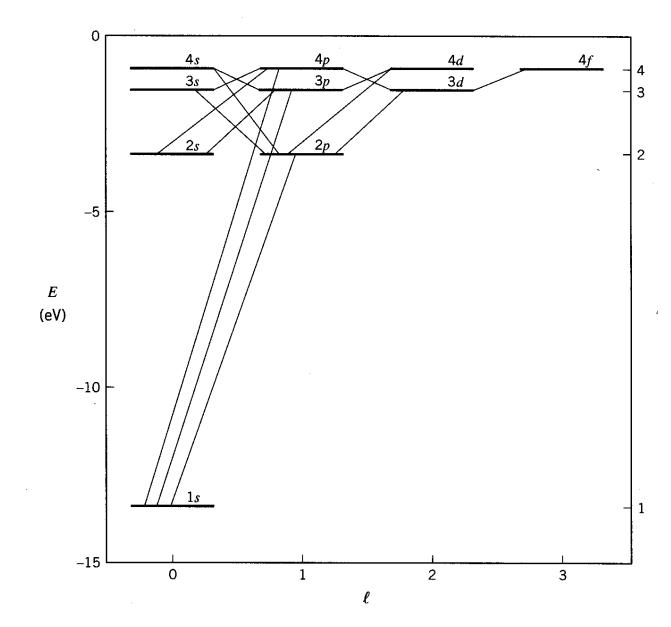
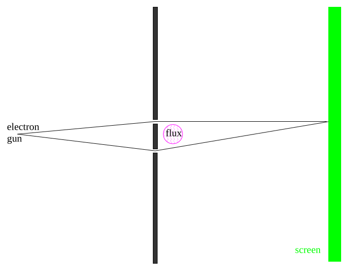
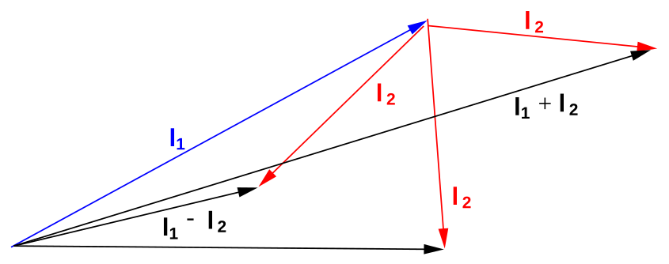

[← Additional Front Matter](00c-additional-front-matter.md) · [2 The Problems with Classical Physics →](02-the-problems-with-classical-physics.md)

---

<hr class="page" style="height:2px;border:0;background:currentColor;opacity:0.25">
<a id="p17" href="book.pdf#page=17" target="_blank" title="This page in the PDF"><sup>[p. 17]</sup></a>

# 1 Course Summary

# <a id="s-1-1-problems-with-classical-physics"></a>1.1 Problems with Classical Physics

Around the beginning of the 20th century, **classical physics,** based on Newtonian Mechanics and Maxwell’s equations of Electricity and Magnetism described nature as we knew it. Statistical Mechanics was also a well developed discipline describing systems with a large number of degrees of freedom. Around that time, Einstein introduced Special Relativity which was compatible with Maxwell’s equations but changed our understanding of space-time and modified Mechanics.

Many things remained unexplained. While the electron as a constituent of atoms had been found, atomic structure was rich and quite mysterious. There were problems with classical physics, (See section 2) including Black Body Radiation, the Photoelectric effect, basic Atomic Theory, Compton Scattering, and eventually with the diffraction of all kinds of particles. Plank hypothesized that EM energy was always emitted in quanta

```math
E = h\nu = \hbar \omega
```

to solve the Black Body problem. Much later, deBroglie derived the wavelength (See section 3.4) for particles.

```math
\lambda = \frac{h}{p}
```

Ultimately, the problems led to the development of Quantum Mechanics in which all particles are understood to have both wave and a particle behavior.

# <a id="s-1-2-thought-experiments-on-diffraction"></a>1.2 Thought Experiments on Diffraction

Diffraction (See section 3) of photons, electrons, and neutrons has been observed (see the pictures) and used to study crystal structure.

To understand the experimental input in a simplified way, we consider some thought experiments on the diffraction (See section 3.5) of photons, electrons, and bullets through two slits. For example, photons, which make up all electromagnetic waves, show a diffraction pattern exactly as predicted by the theory of EM waves, but we always detect an integer number of photons with the **Plank’s** **relation**, $`E = h\nu`$, between wave frequency and particle energy satisfied.

Electrons, neutrons, and everything else behave in exactly the same way, exhibiting wave-like diffraction yet detection of an integer number of particles and satisfying $`\lambda = \tfrac{h}{p}`$. This deBroglie wavelength formula relates the wave property $`\lambda`$ to the particle property $`p`$.

# <a id="s-1-3-probability-amplitudes"></a>1.3 Probability Amplitudes

In Quantum Mechanics, we understand this **wave-particle duality** using (complex) probability amplitudes (See section 4) which satisfy a wave equation.

```math
\psi ( \vec{x} , t ) = e^{i ( \vec{k} \cdot \vec{x} - \omega t )} = e^{i ( \vec{p} \cdot \vec{x} - Et ) / \hbar}
```

<div align="right"><a href="book.pdf#page=17" target="_blank" title="This page in the PDF"><sup>[p. 17]</sup></a></div>
<hr class="page" style="height:2px;border:0;background:currentColor;opacity:0.25">
<a id="p18" href="book.pdf#page=18" target="_blank" title="This page in the PDF"><sup>[p. 18]</sup></a>

The probability to find a particle at a position $`\vec{x}`$ at some time $`t`$ is the absolute square of the probability amplitude $`\psi ( \vec{x} , t )`$.

```math
P ( \vec{x} , t ) = | \psi ( \vec{x} , t ) |^{2}
```

To compute the probability to find an electron at our thought experiment detector, we add the probability amplitude to get to the detector through slit 1 to the amplitude to get to the detector through slit 2 and take the absolute square.

```math
P_{\text{ detector }} = | \psi_{1} + \psi_{2} |^{2}
```

Quantum Mechanics completely changes our view of the world. **Instead of a deterministic world,** **we now have only probabilities**. We cannot even measure both the position and momentum of a particle (accurately) at the same time. Quantum Mechanics will require us to use the mathematics of operators, Fourier Transforms, vector spaces, and much more.

# <a id="s-1-4-wave-packets-and-uncertainty"></a>1.4 Wave Packets and Uncertainty

The probability amplitude for a free particle with momentum $`\vec{p}`$ and energy $`E = \sqrt{( pc )^{2} + ( mc^{2} )^{2}}`$ is the complex wave function

```math
\psi_{\text{ free particle }} ( \vec{x} , t ) = e^{i ( \vec{p} \cdot \vec{x} - Et ) / \hbar} .
```

Note that $`| \psi |^{2}`$ = 1 everywhere so this does not represent a localized particle. In fact we recognize the wave property that, to have exactly one frequency, a wave must be spread out over space.

We can build up localized wave packets that represent single particles(See section 5.1) by adding up these free particle wave functions (with some coefficients).

```math
\psi ( x,t ) = \frac{1}{\sqrt{2 \pi \hbar}} \int_{-\infty}^{+ \infty} \varphi ( p ) e^{i ( px - Et ) / \hbar} dp
```

(We have moved to one dimension for simplicity.) Similarly we can compute the coefficient for each momentum $`\infty`$

```math
\varphi ( p ) = \frac{1}{\sqrt{2 \pi \hbar}} \int_{-\infty} \psi ( x ) e^{- ipx/ \hbar} dx.
```

These coefficients, $`\varphi ( p )`$, are actually the state function of the particle in momentum space. We can describe the state of a particle either in position space with $`\psi ( x )`$ or in momentum space with $`\varphi ( p )`$. We can use $`\varphi ( p )`$ to compute the probability distribution function for momentum.

```math
P ( p ) = | \varphi ( p ) |^{2}
```

We will show that wave packets like these behave correctly in the classical limit, vindicating the choice we made for $`\psi_{f reeparticle} ( \vec{x} , t )`$.

The Heisenberg Uncertainty Principle (See section 5.3) is a property of waves that we can deduce from our study of localized wave packets.

```math
\Delta p \Delta x \geq \frac{\hbar}{2}
```

<div align="right"><a href="book.pdf#page=18" target="_blank" title="This page in the PDF"><sup>[p. 18]</sup></a></div>
<hr class="page" style="height:2px;border:0;background:currentColor;opacity:0.25">
<a id="p19" href="book.pdf#page=19" target="_blank" title="This page in the PDF"><sup>[p. 19]</sup></a>

It shows that due to the wave nature of particles, we cannot localize a particle into a small volume without increasing its energy. For example, we can estimate the ground state energy (and the size of) a Hydrogen atom very well from the uncertainty principle.

The next step in building up Quantum Mechanics is to determine how a wave function develops with time – particularly useful if a potential is applied. The differential equation which wave functions must satisfy is called the Schrödinger Equation.

# <a id="s-1-5-operators"></a>1.5 Operators

The Schrödinger equation comes directly out of our understanding of wave packets. To get from wave packets to a differential equation, we use the new concept of (linear) operators (See section 6). We determine the momentum and energy operators by requiring that, when an operator for some variable $`v`$ acts on our simple wavefunction, we get $`v`$ times the same wave function.

```math
p_{x}^{( op )} = \frac{\hbar}{i} \frac{\partial}{\partial x}
```

```math
p_{x}^{( op )} e^{i ( \vec{p} \cdot \vec{x} - Et ) / \hbar} = \frac{\hbar}{i} \frac{\partial}{\partial x} e^{i ( \vec{p} \cdot \vec{x} - Et ) / \hbar} = p_{x} e^{i ( \vec{p} \cdot \vec{x} - Et ) / \hbar}
```

```math
E^{( op )} = i \hbar \frac{\partial}{\partial t}
```

```math
E^{( op )} e^{i ( \vec{p} \cdot \vec{x} - Et ) / \hbar} = i \hbar \frac{\partial}{\partial t} e^{i ( \vec{p} \cdot \vec{x} - Et ) / \hbar} = Ee^{i ( \vec{p} \cdot \vec{x} - Et ) / \hbar}
```

# <a id="s-1-6-expectation-values"></a>1.6 Expectation Values

We can use operators to help us compute the expectation value (See section 6.3) of a physical variable. If a particle is in the state $`\psi ( x )`$, the normal way to compute the expectation value of $`f ( x )`$ is $`\infty \quad \infty`$

```math
\langle f ( x ) \rangle = \int_{-\infty} P ( x ) f ( x ) dx = \int_{-\infty} \psi^{*} ( x ) \psi ( x ) f ( x ) dx.
```

If the variable we wish to compute the expectation value of (like $`p )`$ is not a simple function of $`x`$, let

```math
\text{ its operator act on } \psi ( x )_{\infty}
```

```math
\langle p \rangle = \int_{-\infty} \psi^{*} ( x ) p^{( op )} \psi ( x ) dx.
```

We have a shorthand notation for the expectation value of a variable $`v`$ in the state $`\psi`$ which is quite useful. $`\infty`$

```math
\langle \psi | v | \psi \rangle \equiv \int_{-\infty} \psi^{*} ( x ) v^{( op )} \psi ( x ) dx.
```

We extend the notation from just expectation values to

```math
\langle \psi | v | \varphi \rangle \equiv \int_{-\infty}^{\infty} \psi^{*} ( x ) v^{( op )} \varphi ( x ) dx
```

<div align="right"><a href="book.pdf#page=19" target="_blank" title="This page in the PDF"><sup>[p. 19]</sup></a></div>
<hr class="page" style="height:2px;border:0;background:currentColor;opacity:0.25">
<a id="p20" href="book.pdf#page=20" target="_blank" title="This page in the PDF"><sup>[p. 20]</sup></a>

and $`\infty`$

```math
\langle \psi | \varphi \rangle \equiv \int_{-\infty} \psi^{*} ( x ) \varphi ( x ) dx
```

We use this shorthand **Dirac Bra-Ket notation** a great deal.

# <a id="s-1-7-commutators"></a>1.7 Commutators

Operators (or variables in quantum mechanics) do not necessarily commute. We can compute the commutator (See section 6.5) of two variables, for example

```math
[ p,x ] \equiv px - xp = \frac{\hbar}{i} .
```

Later we will learn to derive the uncertainty relation for two variables from their commutator. We will also use commutators to solve several important problems.

# <a id="s-1-8-the-schrodinger-equation"></a>1.8 The Schrödinger Equation

Wave functions must satisfy the Schrödinger Equation (See section 7) which is actually a wave equation.

```math
\frac{- \hbar^{2}}{2 m} \nabla^{2} \psi ( \vec{x} , t ) + V ( \vec{x} ) \psi ( \vec{x} , t ) = i \hbar \frac{\partial \psi ( \vec{x} , t )}{\partial t}
```

We will use it to solve many problems in this course. In terms of operators, this can be written as

```math
H\psi ( \vec{x} , t ) = E\psi ( \vec{x} , t )
```

where (dropping the $`( op )`$ label) $`H = \tfrac{p^{2}}{2 m} + V ( \vec{x} )`$ is the Hamiltonian operator. So the Schrödinger Equation is, in some sense, simply the statement (in operators) that the kinetic energy plus the potential energy equals the total energy.

# <a id="s-1-9-eigenfunctions-eigenvalues-and-vector-spaces"></a>1.9 Eigenfunctions, Eigenvalues and Vector Spaces

For any given physical problem, the Schrödinger equation solutions which separate (See section 7.4) (between time and space), $`\psi ( x,t ) = u ( x ) T ( t ) ,`$ are an extremely important set. If we assume the equation separates, we get the two equations (in one dimension for simplicity)

```math
i \hbar \frac{\partial T ( t )}{\partial t} = ET ( t )
```

```math
Hu ( x ) = Eu ( x )
```

The second equation is called the time independent Schrödinger equation. For bound states, there are only solutions to that equation for some quantized set of energies

```math
Hu_{i} ( x ) = E_{i} u_{i} ( x ) .
```

For states which are not bound, a continuous range of energies is allowed.

<div align="right"><a href="book.pdf#page=20" target="_blank" title="This page in the PDF"><sup>[p. 20]</sup></a></div>
<hr class="page" style="height:2px;border:0;background:currentColor;opacity:0.25">
<a id="p21" href="book.pdf#page=21" target="_blank" title="This page in the PDF"><sup>[p. 21]</sup></a>

The time independent Schrödinger equation is an example of an eigenvalue equation (See section

```math
8 . 1 ) . \quad H\psi_{i} ( \vec{x} ) = E_{i} \psi_{i} ( \vec{x} )
```

If we operate on $`\psi_{i}`$ with $`H`$, we get back the same function $`\psi_{i}`$ times some constant. In this case $`\psi_{i}`$ would be called and Eigenfunction, and $`E_{i}`$ would be called an Eigenvalue. There are usually an infinite number of solutions, indicated by the index $`i`$ here.

Operators for physical variables must have real eigenvalues. They are called Hermitian operators (See section 8.3). We can show that the eigenfunctions of Hermitian operators are orthogonal (and can be normalized).

```math
\langle \psi_{i} | \psi_{j} \rangle = \delta_{ij}
```

(In the case of eigenfunctions with the same eigenvalue, called degenerate eigenfunctions, we can must choose linear combinations which are orthogonal to each other.) We will assume that the eigenfunctions also form a complete set so that any wavefunction can be expanded in them,

```math
\varphi ( \vec{x} ) = \sum_{i} \alpha_{i} \psi_{i} ( \vec{x} )
```

where the $`\alpha_{i}`$ are coefficients which can be easily computed (due to orthonormality) by

```math
\alpha_{i} = \langle \psi_{i} | \varphi \rangle .
```

So now we have another way to represent a state (in addition to position space and momentum space). We can represent a state by giving the coefficients in sum above. (Note that $`\psi_{p} ( x ) = e^{i ( px - Et ) / \hbar}`$ is just an eigenfunction of the momentum operator and $`\varphi_{x} ( p ) = e^{- i ( px - Et ) / \hbar}`$ is just an eigenfunction of the position operator (in p-space) so they also represent and expansion of the state in terms of eigenfunctions.)

Since the $`\psi_{i}`$ form an orthonormal, complete set, they can be thought of as the unit vectors of a vector space (See section 8.4). The arbitrary wavefunction $`\varphi`$ would then be a vector in that space and could be represented by its coefficients.

```math
\varphi = \begin{pmatrix} \alpha_{1} \\ \alpha_{2} \\ \alpha_{3} \\ \dots \end{pmatrix}
```

The bra-ket $`\langle \varphi | \psi i \rangle`$ can be thought of as a dot product between the arbitrary vector $`\varphi`$ and one of the unit vectors. We can use the expansion in terms of energy eigenstates to compute many things. In particular, since the time development of the energy eigenstates is very simple,

```math
\psi ( \vec{x} , t ) = \psi ( \vec{x} ) e^{- iE_{i} t/ \hbar}
```

<div align="center">

we can use these eigenstates to follow the time development of an arbitrary state $`\varphi`$

</div>

```math
\varphi ( t ) = \begin{pmatrix} \alpha_{1} e^{- t/ \hbar} \\ \alpha_{2} e^{-} \begin{matrix} iE_{1} \\ iE_{2} \\ iE_{3} \end{matrix}^{t/ \hbar} \\ \alpha_{3} e^{- t/ \hbar} \\ \dots \end{pmatrix}
```

simply by computing the coefficients $`\alpha_{i}`$ at $`t`$ = 0.

<div align="center">

We can define the Hermitian conjugate (See section 8.2) $`O^{\dagger}`$ of the operator $`O`$ by

</div>

```math
\langle \psi | O | \psi \rangle = \langle \psi | O\psi \rangle = \langle O^{\dagger} \psi | \psi \rangle .
```

Hermitian operators $`H`$ have the property that $`H^{\dagger} = H`$.

<div align="right"><a href="book.pdf#page=21" target="_blank" title="This page in the PDF"><sup>[p. 21]</sup></a></div>
<hr class="page" style="height:2px;border:0;background:currentColor;opacity:0.25">
<a id="p22" href="book.pdf#page=22" target="_blank" title="This page in the PDF"><sup>[p. 22]</sup></a>

# <a id="s-1-10-a-particle-in-a-box"></a>1.10 A Particle in a Box

As a concrete illustration of these ideas, we study the particle in a box (See section 8.5) (in one dimension). This is just a particle (of mass $`m )`$ which is free to move inside the walls of a box $`0 <x<a`$, but which cannot penetrate the walls. We represent that by a potential which is zero inside the box and infinite outside. We solve the **Schrödinger equation** inside the box and realize that the probability for the particle to be outside the box, and hence the wavefunction there, must be zero. Since there is no potential inside, the Schrödinger equation is

```math
Hu_{n} ( x ) = - \frac{\hbar^{2}}{2 m} \frac{d^{2} u_{n} ( x )}{dx^{2}} = E_{n} u_{n} ( x )
```

where we have anticipated that there will be many solutions indexed by $`n`$. We know four (only 2 linearly independent) functions which have a second derivative which is a constant times the same function: $`u ( x ) = e^{ikx} , u ( x ) = e^{- ikx} , u ( x )`$ = sin($`kx )`$, and $`u ( x )`$ = cos($`kx )`$. The wave function must be continuous though, so we require the boundary conditions

```math
u ( 0 ) = u ( a ) = 0 .
```

The sine function is always zero at $`x`$ = 0 and none of the others are. To make the sine function zero at $`x = a`$ we need $`ka = n\pi`$ or $`k = \tfrac{n\pi}{a}`$ . So the **energy eigenfunctions** are given by

```math
u_{n} ( x ) = C \sin \left( \frac{n\pi x}{a} \right)
```

where we allow the overall constant $`C`$ because it satisfies the differential equation. Plugging $`\sin \left( \tfrac{n\pi x}{a} \right)`$ back into the Schrödinger equation, we find that

```math
E_{n} = \frac{n^{2} \pi^{2} \hbar^{2}}{2 ma^{2}} .
```

Only **quantized energies** are allowed when we solve this bound state problem. We have one remaining task. The eigenstates should be normalized to represent one particle.

```math
\langle u_{n} | u_{n} \rangle = \int_{0}^{a} C^{*} \sin \left( \frac{n\pi x}{a} \right) C \sin \left( \frac{n\pi x}{a} \right) dx = | C |^{2} \frac{a}{2}
```

So the wave function will be normalized if we choose $`C = \sqrt{\frac{2}{a}}`$.

```math
u_{n} ( x ) = \sqrt{\frac{2}{a}} \sin \left( \frac{n\pi x}{a} \right)
```

We can always multiply by any complex number of magnitude 1, but, it doesn’t change the physics. This example shows many of the features we will see for other bound state problems. The one difference is that, because of an infinite change in the potential at the walls of the box, we did not need to keep the first derivative of the wavefunction continuous. In all other problems, we will have to pay more attention to this.

# <a id="s-1-11-piecewise-constant-potentials-in-one-dimension"></a>1.11 Piecewise Constant Potentials in One Dimension

We now study the physics of several **simple potentials in one dimension**. First a series of piecewise constant potentials (See section 9.1.1). for which the Schrödinger equation is

```math
\frac{- \hbar^{2}}{2 m} \frac{d^{2} u ( x )}{dx^{2}} + Vu ( x ) = Eu ( x )
```

<div align="right"><a href="book.pdf#page=22" target="_blank" title="This page in the PDF"><sup>[p. 22]</sup></a></div>
<hr class="page" style="height:2px;border:0;background:currentColor;opacity:0.25">
<a id="p23" href="book.pdf#page=23" target="_blank" title="This page in the PDF"><sup>[p. 23]</sup></a>

or

```math
\frac{d^{2} u ( x )}{dx^{2}} + \frac{2 m}{\hbar^{2}} ( E - V ) u ( x ) = 0
```

and the **general solution**, for $`E>V`$, can be written as either

```math
u ( x ) = Ae^{ikx} + Be^{- ikx}
```

or

```math
u ( x ) = A \sin ( kx ) + B \cos ( kx )
```

, with $`k = \sqrt{2 m ( \hbar^{2} E - V )}`$. We will also need solutions for the classically forbidden regions where the total energy is less than the potential energy, $`E<V`$.

```math
u ( x ) = Ae^{\kappa x} + Be^{- \kappa x}
```

with $`\kappa = \sqrt{2 m ( \hbar V_{2} - E )}`$. (Both $`k`$ and $`\kappa`$ are positive real numbers.) The 1D scattering problems are often analogous to problems where light is reflected or transmitted when it at the surface of glass.

First, we calculate the probability the a particle of energy $`E`$ is reflected by a potential step (See

```math
2
```

section 9.1.2) of height $`V_{0} : P_{R}`$ = $`\sqrt{\frac{E - \quad E - V_{0}}{\sqrt{E} + \sqrt{E - V_{0}}} ( \surd )}`$ . We also use this example to understand the probability current $`j = \tfrac{\hbar}{2 im} [ u^{*} \tfrac{du}{dx} - \tfrac{du^{*}}{dx} ( ) u ]`$.

Second we investigate the square potential well (See section 9.1.3) square potential well $`( V ( x ) = - V_{0}`$ for $`- a<x<a`$ and $`V ( x )`$ = 0 elsewhere), for the case where the particle is not bound $`E> 0`$. Assuming a beam of particles incident from the left, we need to match solutions in the three regions at the boundaries at $`x = \pm a`$. After some difficult arithmetic, the probabilities to be transmitted or reflected are computed. It is found that the probability to be transmitted goes to 1 for some particular energies.

```math
E = - V_{0} + \frac{n^{2} \pi^{2} \hbar^{2}}{8 ma^{2}}
```

This type of behavior is exhibited by electrons scattering from atoms. At some energies the scattering probability goes to zero.

Third we study the square potential barrier (See section 9.1.5) $`( V ( x )`$ = +$`V_{0}`$ for $`- a<x<a`$ and $`V ( x )`$ = 0 elsewhere), for the case in which $`E<V_{0}`$. Classically the probability to be transmitted would be zero since the particle is energetically excluded from being inside the barrier. The Quantum calculation gives the probability to be transmitted through the barrier to be

```math
| T |^{2} = \frac{( 2 k\kappa )^{2}}{( k^{2} + \kappa^{2} )^{2} \sinh^{2} ( 2 \kappa a ) + ( 2 k\kappa )^{2}} \to ( \frac{4 k\kappa}{k^{2} + \kappa^{2}} )^{2} e^{- 4 \kappa a}
```

where $`k = \sqrt{\tfrac{2 mE}{\hbar^{2}}}`$ and $`\kappa = \sqrt{2 m ( V \hbar_{0 2} - E )}`$. Study of this expression shows that the probability to be transmitted decreases as the barrier get higher or wider. Nevertheless, barrier penetration is an important quantum phenomenon.

We also study the square well for the bound state (See section 9.1.4) case in which $`E< 0`$. Here we need to solve a transcendental equation to determine the bound state energies. The number of bound states increases with the depth and the width of the well but there is always at least one bound state.

<div align="right"><a href="book.pdf#page=23" target="_blank" title="This page in the PDF"><sup>[p. 23]</sup></a></div>
<hr class="page" style="height:2px;border:0;background:currentColor;opacity:0.25">
<a id="p24" href="book.pdf#page=24" target="_blank" title="This page in the PDF"><sup>[p. 24]</sup></a>

# <a id="s-1-12-the-harmonic-oscillator-in-one-dimension"></a>1.12 The Harmonic Oscillator in One Dimension

Next we solve for the energy eigenstates of the harmonic oscillator (See section 9.2) potential $`V ( x ) = \tfrac{1}{2} kx^{2} = \tfrac{1}{2} m\omega^{2} x^{2}`$, where we have eliminated the spring constant $`k`$ by using the classical oscillator frequency $`\omega = \sqrt{\frac{k}{m}}`$ . The energy eigenvalues are

```math
E_{n} = \left( n + \frac{1}{2} \right) \hbar \omega .
```

The energy eigenstates turn out to be a polynomial (in $`x )`$ of degree $`n`$ times $`e^{- m\omega x^{2} / \hbar}`$. So the ground state, properly normalized, is just

```math
u_{0} ( x ) = \left( \frac{m\omega}{\pi \hbar} \right)^{\tfrac{1}{4}} e^{- m\omega x^{2} / \hbar} .
```

We will later return the harmonic oscillator to solve the problem by operator methods.

# <a id="s-1-13-delta-function-potentials-in-one-dimension"></a>1.13 Delta Function Potentials in One Dimension

The delta function potential (See section 9.3) is a very useful one to make simple models of molecules and solids. First we solve the problem with one attractive delta function $`V ( x ) = - aV_{0} \delta ( x )`$. Since the bound state has negative energy, the solutions that are normalizable are $`Ce^{\kappa x}`$ for $`x< 0`$ and $`Ce^{- \kappa x}`$ for $`x> 0`$. Making $`u ( x )`$ continuous and its first derivative have a discontinuity computed from the Schrödinger equation at $`x`$ = 0, gives us exactly one bound state with

```math
E = - \frac{ma^{2} V_{0}^{2}}{2 \hbar^{2}} .
```

Next we use two delta functions to model a molecule (See section 9.4), $`V ( x ) = - aV_{0} \delta ( x + d ) - aV_{0} \delta ( x - d )`$. Solving this problem by matching wave functions at the boundaries at $`\pm d`$, we find again transcendental equations for two bound state energies. The ground state energy is more negative than that for one delta function, indicating that the molecule would be bound. A look at the wavefunction shows that the 2 delta function state can lower the kinetic energy compared to the state for one delta function, by reducing the curvature of the wavefunction. The excited state has more curvature than the atomic state so we would not expect molecular binding in that state.

Our final 1D potential, is a model of a solid (See section 9.5).

```math
V ( x ) = - aV_{0} \sum_{n = -\infty}^{\infty} \delta ( x - na )
```

This has a infinite, periodic array of delta functions, so this might be applicable to a crystal. The solution to this is a bit tricky but it comes down to

```math
\cos ( \varphi ) = \cos ( ka ) + \frac{2 maV_{0}}{\hbar^{2} k} \sin ( ka ) .
```

Since the right hand side of the equation can be bigger than 1.0 (or less than -1), there are regions of $`E = \tfrac{\hbar^{2} k^{2}}{2 m}`$ which do not have solutions. There are also bands of energies with solutions. These energy bands are seen in crystals (like Si).

<div align="right"><a href="book.pdf#page=24" target="_blank" title="This page in the PDF"><sup>[p. 24]</sup></a></div>
<hr class="page" style="height:2px;border:0;background:currentColor;opacity:0.25">
<a id="p25" href="book.pdf#page=25" target="_blank" title="This page in the PDF"><sup>[p. 25]</sup></a>

# <a id="s-1-14-harmonic-oscillator-solution-with-operators"></a>1.14 Harmonic Oscillator Solution with Operators

We can solve the harmonic oscillator problem using operator methods (See section 10). We write the Hamiltonian in terms of the operator

```math
A \equiv \left( \sqrt{\frac{m\omega}{2 \hbar}} x + i \frac{p}{\sqrt{2 m \hbar \omega}} \right)
```

.

```math
H = \frac{p^{2}}{2 m} + \frac{1}{2} m\omega^{2} x^{2} = \hbar \omega ( A^{\dagger} A + \frac{1}{2} )
```

We compute the **commutators**

```math
[ A,A^{\dagger} ] = \frac{i}{2 \hbar} ( - [ x,p ] + [ p,x ] ) = 1
```

```math
[ H,A ] = \hbar \omega [ A^{\dagger} A,A ] = \hbar \omega [ A^{\dagger} ,A ] A = - \hbar \omega A
```

```math
[ H,A^{\dagger} ] = \hbar \omega [ A^{\dagger} A,A^{\dagger} ] = \hbar \omega A^{\dagger} [ A,A^{\dagger} ] = \hbar \omega A^{\dagger}
```

If we apply the the commutator $`[ H,A ]`$ to the eigenfunction $`u_{n}`$, we get $`[ H,A ] u_{n} = - \hbar \omega Au_{n}`$ which rearranges to the eigenvalue equation

```math
H ( Au_{n} ) = ( E_{n} - \hbar \omega ) ( Au_{n} ) .
```

This says that $`( Au_{n} )`$ is an eigenfunction of $`H`$ with eigenvalue $`( E_{n} - \hbar \omega )`$ so it **lowers the energy** by $`\hbar \omega`$. Since the energy must be positive for this Hamiltonian, the lowering must stop somewhere, at the ground state, where we will have

```math
Au_{0} = 0 .
```

This allows us to compute the **ground state energy** like this

```math
Hu_{0} = \hbar \omega ( A^{\dagger} A + \frac{1}{2} ) u_{0} = \frac{1}{2} \hbar \omega u_{0}
```

showing that the ground state energy is $`\tfrac{1}{2} \hbar \omega`$. Similarly, $`A^{\dagger}`$ **raises the energy** by $`\hbar \omega`$. We can travel up and down the energy ladder using $`A^{\dagger}`$ and $`A`$, always in steps of $`\hbar \omega`$. The energy eigenvalues are therefore

```math
E_{n} = \left( n + \frac{1}{2} \right) \hbar \omega .
```

A little more computation shows that

```math
Au_{n} = \sqrt{n} u_{n - 1}
```

and that

```math
A^{\dagger} u_{n} = \sqrt{n + 1} u_{n + 1} .
```

These formulas are useful for all kinds of **computations** within the important harmonic oscillator system. Both $`p`$ and $`x`$ can be written in terms of $`A`$ and $`A^{\dagger}`$.

```math
x = \sqrt{\frac{\hbar}{2 m\omega}} ( A + A^{\dagger} )
```

```math
p = - i \sqrt{\frac{m \hbar \omega}{2}} ( A - A^{\dagger} )
```

<div align="right"><a href="book.pdf#page=25" target="_blank" title="This page in the PDF"><sup>[p. 25]</sup></a></div>
<hr class="page" style="height:2px;border:0;background:currentColor;opacity:0.25">
<a id="p26" href="book.pdf#page=26" target="_blank" title="This page in the PDF"><sup>[p. 26]</sup></a>

# <a id="s-1-15-more-fun-with-operators"></a>1.15 More Fun with Operators

We find the time development operator (See section 11.5) by solving the equation $`i \hbar_{\partial t}^{\partial \psi} = H\psi`$.

```math
\psi ( t ) = e^{- iHt/ \hbar} \psi ( t = 0 )
```

This implies that $`e^{- iHt/ \hbar}`$ is the time development operator. In some cases we can calculate the actual operator from the power series for the exponential.

```math
e^{- iHt/ \hbar} = \sum_{n = 0}^{\infty} \frac{( - iHt/ \hbar )^{n}}{n !}
```

We have been working in what is called the Schrödinger picture in which the wavefunctions (or states) develop with time. There is the alternate Heisenberg picture (See section 11.6) in which the operators develop with time while the states do not change. For example, if we wish to compute the expectation value of the operator $`B`$ as a function of time in the usual Schrödinger picture, we get

```math
\langle \psi ( t ) | B | \psi ( t ) \rangle = \langle e^{- iHt/ \hbar} \psi ( 0 ) | B | e^{- iHt/ \hbar} \psi ( 0 ) \rangle = \langle \psi ( 0 ) | e^{iHt/ \hbar} Be^{- iHt/ \hbar} | \psi ( 0 ) \rangle .
```

In the Heisenberg picture the operator $`B ( t ) = e^{iHt/ \hbar} Be^{- iHt/ \hbar}`$.

We use operator methods to compute the uncertainty relationship between non-commuting variables (See section 11.3)

```math
( \Delta A ) ( \Delta B ) \geq \frac{i}{2} \langle [ A,B ] \rangle
```

which gives the result we deduced from wave packets for $`p`$ and $`x`$.

Again we use operator methods to calculate the time derivative of an expectation value (See section 11.4).

```math
\frac{d}{dt} \langle \psi | A | \psi \rangle = \frac{i}{\hbar} \langle \psi | [ H,A ] | \psi \rangle + \left\langle \psi \left| \frac{\partial A}{\partial t} \right| \psi \right\rangle_{\psi}
```

(Most operators we use don’t have explicit time dependence so the second term is usually zero.) This again shows the importance of the Hamiltonian operator for time development. We can use this to show that in Quantum mechanics the expectation values for $`p`$ and $`x`$ behave as we would expect from Newtonian mechanics **(Ehrenfest Theorem)**.

```math
\frac{d \langle x \rangle}{dt} = \frac{i}{\hbar} \langle [ H,x ] \rangle = \frac{i}{\hbar} \langle [ \frac{p^{2}}{2 m} ,x ] \rangle = \left\langle \frac{p}{m} \right\rangle
```

```math
\frac{d \langle p \rangle}{dt} = \frac{i}{\hbar} \langle [ H,p ] \rangle = \frac{i}{\hbar} \left\langle [ V ( x ) , \frac{\hbar}{i} \frac{d}{dx} ] \right\rangle = - \left\langle \frac{dV ( x )}{dx} \right\rangle
```

Any operator $`A`$ that commutes with the Hamiltonian has a **time independent** expectation value. The energy eigenfunctions can also be (simultaneous) eigenfunctions of the commuting operator $`A`$. It is usually a symmetry of the $`H`$ that leads to a commuting operator and hence an additional constant of the motion.

<div align="right"><a href="book.pdf#page=26" target="_blank" title="This page in the PDF"><sup>[p. 26]</sup></a></div>
<hr class="page" style="height:2px;border:0;background:currentColor;opacity:0.25">
<a id="p27" href="book.pdf#page=27" target="_blank" title="This page in the PDF"><sup>[p. 27]</sup></a>

# <a id="s-1-16-two-particles-in-3-dimensions"></a>1.16 Two Particles in 3 Dimensions

So far we have been working with states of just one particle in one dimension. The extension to two different particles and to three dimensions (See section 12) is straightforward. The coordinates and momenta of different particles and of the additional dimensions **commute with each other** as we might expect from classical physics. The only things that don’t commute are a coordinate with its momentum, for example,

```math
[ p_{( 2 ) z} ,z_{( 2 )} ] = \frac{\hbar}{i}
```

while

```math
[ p_{( 1 ) x} ,x_{( 2 )} ] = [ p_{( 2 ) z} ,y_{( 2 )} ] = 0 .
```

We may write states for two particles which are uncorrelated, like $`u_{0} ( \vec{x}_{( 1 )} ) u_{3} ( \vec{x}_{( 2 )} )`$, or we may write states in which the particles are correlated. The Hamiltonian for two particles in 3 dimensions simply becomes

<a id="eq-2"></a>

```math
\begin{aligned} H &= \frac{- \hbar^{2}}{2 m_{( 1 )}} \left( \frac{\partial^{2}}{\partial x_{( 1 )}^{2}} + \frac{\partial^{2}}{\partial y_{( 1 )}^{2}} + \frac{\partial^{2}}{\partial z_{( 1 )}^{2}} \right) + \frac{- \hbar^{2}}{2 m_{( 2 )}} \left( \frac{\partial^{2}}{\partial x_{( 2 )}^{2}} + \frac{\partial^{2}}{\partial y_{( 2 )}^{2}} + \frac{\partial^{2}}{\partial z_{( 2 )}^{2}} \right) + V ( \vec{x} \quad , \vec{x} \quad ) \\ H &= \frac{- \hbar^{2}}{2 m_{( 1 )}} \nabla_{( 1 )}^{2} + \frac{- \hbar^{2}}{2 m_{( 2 )}} \nabla_{( 1 )}^{2} + V ( \vec{x}_{( 1 )} , \vec{x}_{( 2 )} ) \end{aligned} \qquad \text{(2)}
```

If two particles interact with each other, with no external potential,

```math
H = \frac{- \hbar^{2}}{2 m_{( 1 )}} \nabla_{( 1 )}^{2} + \frac{- \hbar^{2}}{2 m_{( 2 )}} \nabla_{( 1 )}^{2} + V ( \vec{x}_{( 1 )} - \vec{x}_{( 2 )} )
```

the Hamiltonian has a **translational symmetry**, and remains invariant under the translation $`\vec{x} \to`$ $`\vec{x} + \vec{a}`$. We can show that this translational symmetry implies **conservation of total momentum**. Similarly, we will show that rotational symmetry implies conservation of angular momentum, and that time symmetry implies conservation of energy.

For two particles interacting through a potential that depends only on difference on the coordinates,

```math
H = \frac{\vec{p}_{1}^{2}}{2 m} + \frac{\vec{p}_{2}^{2}}{2 m} + V ( \vec{r}_{1} - \vec{r}_{2} )
```

we can make the usual transformation to the center of mass (See section 12.3) made in classical mechanics

```math
\vec{r} \equiv \vec{r}_{1} - \vec{r}_{2}
```

```math
\vec{R} \equiv \frac{m_{1} \vec{r}_{1} + m_{2} \vec{r}_{2}}{m_{1} + m_{2}}
```

and reduce the problem to the CM moving like a free particle

```math
\begin{aligned} M &= m_{1} + m_{2} \\ H &= \frac{- \hbar^{2}}{2 M} \vec{\nabla}_{R}^{2} \end{aligned}
```

plus one potential problem in 3 dimensions with the usual reduced mass.

```math
\frac{1}{\mu} = \frac{1}{m_{1}} + \frac{1}{m_{2}}
```

```math
H = - \frac{\hbar^{2}}{2 \mu} \vec{\nabla}_{r}^{2} + V ( \vec{r} )
```

So we are now left with a 3D problem to solve (3 variables instead of 6).

<div align="right"><a href="book.pdf#page=27" target="_blank" title="This page in the PDF"><sup>[p. 27]</sup></a></div>
<hr class="page" style="height:2px;border:0;background:currentColor;opacity:0.25">
<a id="p28" href="book.pdf#page=28" target="_blank" title="This page in the PDF"><sup>[p. 28]</sup></a>

# <a id="s-1-17-identical-particles"></a>1.17 Identical Particles

Identical particles present us with another symmetry in nature. Electrons, for example, are indistinguishable from each other so we must have a symmetry of the Hamiltonian under interchange (See section 12.4) of any pair of electrons. Lets call the operator that interchanges electron-1 and electron-2 $`P_{1 2}`$.

```math
[ H,P_{1 2} ] = 0
```

So we can make our energy eigenstates also eigenstates of $`P_{1 2}`$. Its easy to see (by operating on an eigenstate twice with $`P_{1 2} )`$, that the possible eigenvalues are $`\pm 1`$. It is a law of physics that spin $`\frac{1}{2}`$ particles called **fermions** (like electrons) always are **antisymmetric under interchange**, while particles with **integer spin called bosons** (like photons) always are **symmetric under** **interchange**. Antisymmetry under interchange leads to the Pauli exclusion principle that no two electrons (for example) can be in the same state.

# <a id="s-1-18-some-3d-problems-separable-in-cartesian-coordinates"></a>1.18 Some 3D Problems Separable in Cartesian Coordinates

We begin our study of Quantum Mechanics in 3 dimensions with a few simple cases of problems that can be separated in Cartesian coordinates (See section 13). This is possible when the Hamiltonian can be written

```math
H = H_{x} + H_{y} + H_{z} .
```

One nice example of separation of variable in Cartesian coordinates is the **3D harmonic oscillator**

```math
V ( r ) = \frac{1}{2} m\omega^{2} r^{2}
```

which has energies which depend on three quantum numbers.

```math
E_{n_{x} n_{y} n_{z}} = \left( n_{x} + n_{y} + n_{z} + \frac{3}{2} \right) \hbar \omega
```

It really behaves like 3 independent one dimensional harmonic oscillators.

Another problem that separates is the **particle in a 3D box**. Again, energies depend on three quantum numbers

```math
E_{n_{x} n_{y} n_{z}} = \frac{\pi^{2} \hbar^{2}}{2 mL^{2}} \left( n_{x}^{2} + n_{y}^{2} + n_{z}^{2} \right)
```

for a cubic box of side $`L`$. We investigate the effect of the Pauli exclusion principle by filling our 3D box with identical fermions which must all be in different states. We can use this to model White Dwarfs or Neutron Stars.

In classical physics, it takes three coordinates to give the location of a particle in 3D. In quantum mechanics, we are finding that it takes **three quantum numbers** to label and energy eigenstate (not including spin).

<div align="right"><a href="book.pdf#page=28" target="_blank" title="This page in the PDF"><sup>[p. 28]</sup></a></div>
<hr class="page" style="height:2px;border:0;background:currentColor;opacity:0.25">
<a id="p29" href="book.pdf#page=29" target="_blank" title="This page in the PDF"><sup>[p. 29]</sup></a>

# <a id="s-1-19-angular-momentum"></a>1.19 Angular Momentum

For the common problem of central potentials (See section 14.1) $`V ( r )`$, we use the obvious **rotational** **symmetry** to find that the **angular momentum**, $`\vec{L} = \vec{x} \times \vec{p}`$, operators commute with $`H`$,

```math
[ H,L_{z} ] = [ H,L_{x} ] = [ H,L_{y} ] = 0
```

but they do not commute with each other.

```math
[ L_{x} ,L_{y} ] \neq 0
```

We want to find **two mutually commuting operators** which commute with $`H`$, so we turn to $`L^{2} = L_{x}^{2} + L_{y}^{2} + L_{z}^{2}`$ which does commute with each component of $`L`$.

```math
[ L^{2} ,L_{z} ] = 0
```

We chose our two operators to be $`L^{2}`$ and $`L_{z}`$.

Some computation reveals that we can write

```math
p^{2} = \frac{1}{r^{2}} \left( L^{2} + ( \vec{r} \cdot \vec{p} )^{2} - i \hbar \vec{r} \cdot \vec{p} \right) .
```

With this the kinetic energy part of our equation will only have derivatives in $`r`$ assuming that we have eigenstates of $`L^{2}`$.

```math
\frac{- \hbar^{2}}{2 \mu} \left[ \frac{1}{r^{2}} \left( r \frac{\partial}{\partial r} \right)^{2} + \frac{1}{r} \frac{\partial}{\partial r} - \frac{L^{2}}{\hbar^{2} r^{2}} \right] u_{E} ( \vec{r} ) + V ( r ) u_{E} ( \vec{r} ) = Eu_{E} ( \vec{r} )
```

The **Schrödinger equation thus separates** into an angular part (the $`L^{2}`$ term) and a radial part (the rest). With this separation we expect (anticipating the angular solution a bit)

```math
u_{E} ( \vec{r} ) = R_{E\ell} ( r ) Y_{\ell m} ( \theta ,\varphi )
```

will be a solution. The $`Y_{\ell m} ( \theta ,\varphi )`$ will be eigenfunctions of $`L^{2}`$

```math
L^{2} Y_{\ell m} ( \theta ,\varphi ) = \ell ( \ell + 1 ) \hbar^{2} Y_{\ell m} ( \theta ,\varphi )
```

so the radial equation becomes

```math
\frac{- \hbar^{2}}{2 \mu} \left[ \frac{1}{r^{2}} \left( r \frac{\partial}{\partial r} \right)^{2} + \frac{1}{r} \frac{\partial}{\partial r} - \frac{\ell ( \ell + 1 )}{r^{2}} \right] R_{E\ell} ( r ) + V ( r ) R_{E\ell} ( r ) = ER_{E\ell} ( r )
```

We must come back to this equation for each $`V ( r )`$ which we want to solve.

We **solve the angular part of the problem in general** using angular momentum operators. We find that **angular momentum is quantized**.

```math
L_{z} Y_{\ell m} ( \theta ,\varphi ) = m \hbar Y_{\ell m} ( \theta ,\varphi )
```

```math
L^{2} Y_{\ell m} ( \theta ,\varphi ) = \ell ( \ell + 1 ) \hbar^{2} Y_{\ell m} ( \theta ,\varphi )
```

with $`\ell`$ and $`m`$ integers satisfying the condition $`- \ell \leq m \leq \ell`$. The operators that **raise and lower** **the** $`z`$ **component** of angular momentum are

```math
L_{\pm} = L_{x} \pm iL_{y}
```

```math
L_{\pm} Y_{\ell m} = \hbar \sqrt{\ell ( \ell + 1 ) - m ( m \pm 1 )} Y_{\ell ( m \pm 1 )}
```

We derive the functional form of the **Spherical Harmonics** $`Y_{\ell m} ( \theta ,\varphi )`$ using the differential form of the angular momentum operators.

<div align="right"><a href="book.pdf#page=29" target="_blank" title="This page in the PDF"><sup>[p. 29]</sup></a></div>
<hr class="page" style="height:2px;border:0;background:currentColor;opacity:0.25">
<a id="p30" href="book.pdf#page=30" target="_blank" title="This page in the PDF"><sup>[p. 30]</sup></a>

# <a id="s-1-20-solutions-to-the-radial-equation-for-constant-potentials"></a>1.20 Solutions to the Radial Equation for Constant Potentials

Solutions to the radial equation (See section 15.1) in a constant potential are important since they are the solutions for large $`r`$ in potentials of limitted range. They are therefore used in scattering problems as the incoming and outgoing states. The solutions are the spherical Bessel and spherical Neumann functions (See section 15.3).

```math
j_{\ell} ( \rho ) = ( - \rho )^{\ell} \left( \frac{1}{\rho} \frac{d}{d\rho} \right)^{\ell} \frac{\sin \rho}{\rho} \to \frac{\sin ( \rho - \tfrac{\ell \pi}{2} )}{\rho}
```

```math
n_{\ell} ( \rho ) = - ( - \rho )^{\ell} \left( \frac{1}{\rho} \frac{d}{d\rho} \right)^{\ell} \frac{\cos \rho}{\rho} \to \frac{- \cos ( \rho - \tfrac{\ell \pi}{2} )}{\rho}
```

where $`\rho = kr`$. The linear combination of these which falls off properly at large $`r`$ is called the **Hankel** **function** of the first type.

```math
h_{\ell}^{( 1 )} ( \rho ) = j_{\ell} ( \rho ) + in_{\ell} ( \rho ) = ( - \rho )^{\ell} \left( \frac{1}{\rho} \frac{d}{d\rho} \right)^{\ell} \frac{\sin \rho - i \cos \rho}{\rho} \to - \frac{i}{\rho} e^{i ( \rho - \tfrac{\ell \pi}{2} )}
```

We use these solutions to do a **partial wave analysis of scattering**, solve for **bound states of a** **spherical potential** well, solve for bound states of an **infinite spherical well** (a spherical “box”), and solve for scattering from a spherical potential well.

# <a id="s-1-21-hydrogen"></a>1.21 Hydrogen

The Hydrogen (Coulomb potential) radial equation (See section 16) is solved by finding the behavior at large $`r`$, then finding the behavior at small $`r`$, then using a power series solution to get

```math
R ( \rho ) = \rho^{\ell} \sum_{k = 0}^{\infty} a_{k} \rho^{k} e^{- \rho / 2}
```

with $`\rho = \sqrt{\frac{- 8 \mu E}{\hbar^{2}}} r`$. To keep the wavefunction normalizable the power series must terminate, giving us our **energy eigenvalue** condition.

```math
E_{n} = - \frac{Z^{2} \alpha^{2} mc^{2}}{2 n^{2}}
```

Here $`n`$ is called the **principle quantum number** and it is given by

```math
n = n_{r} + \ell + 1
```

where $`n_{r}`$ is the number of nodes in the radial wavefunction. It is an odd feature of Hydrogen that a radial excitation and an angular excitation have the same energy.

So a Hydrogen **energy eigenstate** $`\psi_{n\ell m} ( \vec{x} ) = R_{n\ell} ( r ) Y_{\ell m} ( \theta ,\varphi )`$ is described by three integer quantum numbers with the requirements that $`n \geq 1`$, $`\ell <n`$ and also an integer, and $`- l \leq m \leq \ell`$. The ground state of Hydrogen is $`\psi_{1 0 0}`$ and has energy of -13.6 eV. We compute several of the lowest energy eigenstates.

The diagram below shows the lowest energy bound states of Hydrogen and their typical decays.

<div align="right"><a href="book.pdf#page=30" target="_blank" title="This page in the PDF"><sup>[p. 30]</sup></a></div>
<hr class="page" style="height:2px;border:0;background:currentColor;opacity:0.25">
<a id="p31" href="book.pdf#page=31" target="_blank" title="This page in the PDF"><sup>[p. 31]</sup></a>



_Figure 1 (p. 31)_

# <a id="s-1-22-solution-of-the-3d-ho-problem-in-spherical-coordinates"></a>1.22 Solution of the 3D HO Problem in Spherical Coordinates

As and example of another problem with spherical symmetry, we solve the 3D symmetric harmonic oscillator (See section 17) problem. We have already solved this problem in Cartesian coordinates. Now we use spherical coordinates and angular momentum eigenfunctions.

The eigen-energies are

```math
E = \left( 2 n_{r} + \ell + \frac{3}{2} \right) \hbar \omega
```

where $`n_{r}`$ is the number of nodes in the radial wave function and $`\ell`$ is the total angular momentum quantum number. This gives exactly the same set of eigen-energies as we got in the Cartesian solution but the eigenstates are now states of definite total angular momentum and z component of angular momentum.

# <a id="s-1-23-matrix-representation-of-operators-and-states"></a>1.23 Matrix Representation of Operators and States

We may define the **components of a state vector** $`\psi`$ as the projections of the state on a complete, orthonormal set of states, like the eigenfunctions of a Hermitian operator.

```math
\psi i \equiv \langle u i | \psi \rangle
```

```math
| \psi \rangle = \sum \psi_{i} | u_{i} \rangle
```

<div align="right"><a href="book.pdf#page=31" target="_blank" title="This page in the PDF"><sup>[p. 31]</sup></a></div>
<hr class="page" style="height:2px;border:0;background:currentColor;opacity:0.25">
<a id="p32" href="book.pdf#page=32" target="_blank" title="This page in the PDF"><sup>[p. 32]</sup></a>

Similarly, we may define the **matrix element** of an operator in terms of a pair of those orthonormal basis states

```math
O_{ij} \equiv \langle u_{i} | O | u_{j} \rangle .
```

With these definitions, Quantum Mechanics problems can be solved using the matrix representation operators and states. (See section 18.1). An operator acting on a state is a matrix times a vector.

```math
\begin{pmatrix} ( O\psi )_{1} \\ ( O\psi )_{2} \\ \dots \\ ( O\psi )_{i} \\ \dots \end{pmatrix} = \begin{pmatrix} O_{1 1} & O_{1 2} & \dots & O_{1 j} & \dots \\ O_{2 1} & O_{2 2} & \dots & O_{2 j} & \dots \\ \dots & \dots & \dots & \dots & \dots \\ O_{i 1} & O_{i 2} & \dots & O_{ij} & \dots \\ \dots & \dots & \dots & \dots & \dots \end{pmatrix} \begin{pmatrix} \psi_{1} \\ \psi_{2} \\ \dots \\ \psi_{j} \\ \dots \end{pmatrix}
```

The product of operators is the product of matrices. Operators which don’t commute are represented by matrices that don’t commute.

# <a id="s-1-24-a-study-of-ell-1-operators-and-eigenfunctions"></a>1.24 A Study of $`\ell`$ = 1 Operators and Eigenfunctions

The set of states with the same total angular momentum and the angular momentum operators which act on them are often represented by vectors and matrices. For example the different $`m`$ states for $`\ell`$ = 1 will be represented by a 3 component vector and the angular momentum operators (See section 18.2) represented by 3X3 matrices. There are both practical and theoretical reasons why this set of states is separated from the states with different total angular momentum quantum numbers. The states are often (nearly) degenerate and therefore should be treated as a group for practical reasons. Also, a rotation of the coordinate axes will not change the total angular momentum quantum number so the rotation operator works within this group of states.

We write our **3 component vectors** as follows.

```math
\psi = \begin{pmatrix} \psi_{+} \\ \psi_{0} \\ \psi_{-} \end{pmatrix}
```

The matrices representing the angular momentum operators for $`\ell`$ = 1 are as follows.

```math
L_{x} = \frac{\hbar}{\sqrt{2}} \begin{pmatrix} 0 & 1 & 0 \\ 1 & 0 & 1 \\ 0 & 1 & 0 \end{pmatrix} \quad L_{y} = \frac{\hbar}{\sqrt{2 i}} \begin{pmatrix} 0 & 1 & 0 \\ - 1 & 0 & 1 \\ 0 & - 1 & 0 \end{pmatrix} \quad L_{z} = \hbar \begin{pmatrix} 1 & 0 & 0 \\ 0 & 0 & 0 \\ 0 & 0 & - 1 \end{pmatrix}
```

The same matrices also represent spin 1, $`s`$ = 1, but of course would act on a different vector space.

The rotation operators (See section 18.6) (symmetry operators) are given by

```math
R_{z} ( \theta_{z} ) = e^{i\theta_{z} L_{z} / \hbar} \quad R_{x} ( \theta_{x} ) = e^{i\theta_{x} L_{x} / \hbar} \quad R_{y} ( \theta_{y} ) = e^{i\theta_{y} L_{y} / \hbar}
```

for the differential form or the matrix form of the operators. For $`\ell`$ = 1 these are 3X3 (unitary) matrices. We use them when we need to redefine the direction of our coordinate axes. Rotations of the angular momentum states are not the same as rotations of vectors in 3 space. The components of the vectors represent different quantities and hence transform quite differently. The “vectors” we are using for angular momentum actually should be called spinors when we refer to their properties under rotations and Lorentz boosts.

<div align="right"><a href="book.pdf#page=32" target="_blank" title="This page in the PDF"><sup>[p. 32]</sup></a></div>
<hr class="page" style="height:2px;border:0;background:currentColor;opacity:0.25">
<a id="p33" href="book.pdf#page=33" target="_blank" title="This page in the PDF"><sup>[p. 33]</sup></a>

# <a id="s-1-25-spin-1-2-and-other-2-state-systems"></a>1.25 Spin 1/2 and other 2 State Systems

The angular momentum algebra defined by the commutation relations between the operators requires that the total angular momentum quantum number must either be an integer or a half integer. The half integer possibility was not useful for orbital angular momentum because there was no corresponding (single valued) spherical harmonic function to represent the amplitude for a particle to be at some position.

The half integer possibility is used to represent the internal angular momentum of some particles. The simplest and most important case is spin one-half (See section 18.8). There are just two

```math
1
```

possible states with different z components of spin: spin up $`\left( 0 \right)`$, with z component of angular

momentum +$`\frac{\hbar}{2}`$, and spin down $`\left( 0 \right)`$, with $`- \tfrac{\hbar}{2}`$. The corresponding spin operators are

```math
S_{x} = \frac{\hbar}{2} \begin{pmatrix} 0 & 1 \\ 1 & 0 \end{pmatrix} \quad 1 \quad S_{y} = \frac{\hbar}{2} \begin{pmatrix} 0 & - i \\ i & 0 \end{pmatrix} \quad S_{z} = \frac{\hbar}{2} \begin{pmatrix} 1 & 0 \\ 0 & - 1 \end{pmatrix}
```

These satisfy the usual commutation relations from which we derived the properties of angular momentum operators.

<div align="center">

It is common to define the Pauli Matrices, $`\sigma_{i}`$, which have the following properties.

</div>

```math
S_{i} \equiv \frac{\hbar}{2} \sigma_{i} .
```

```math
\vec{S} = \frac{\hbar}{2} \vec{\sigma}
```

```math
\sigma_{x} = \begin{pmatrix} 0 & 1 \\ 1 & 0 \end{pmatrix} \quad \sigma_{y} = \begin{pmatrix} 0 & - i \\ i & 0 \end{pmatrix} \quad \sigma_{z} = \begin{pmatrix} 1 & 0 \\ 0 & - 1 \end{pmatrix}
```

```math
[ \sigma_{i} ,\sigma_{j} ] = 2 i\epsilon_{ijk} \sigma_{k}
```

```math
\sigma_{i}^{2} = 1
```

```math
\sigma_{x} \sigma_{y} + \sigma_{y} \sigma_{x} = \sigma_{x} \sigma_{z} + \sigma_{z} \sigma_{x} = \sigma_{z} \sigma_{y} + \sigma_{y} \sigma_{z} = 0
```

```math
\{ \sigma_{i} ,\sigma_{j} \} = 2 \delta_{ij}
```

The last two lines state that the Pauli matrices anti-commute. The $`\sigma`$ matrices are the **Hermitian,** **Traceless matrices** of dimension 2. Any 2 by 2 matrix can be written as a linear combination of the $`\sigma`$ matrices and the identity.

# <a id="s-1-26-quantum-mechanics-in-an-electromagnetic-field"></a>1.26 Quantum Mechanics in an Electromagnetic Field

The **classical Hamiltonian** for a particle in an Electromagnetic field is

```math
H = \frac{1}{2 m} \left( \vec{p} + \frac{e}{c} \vec{A} \right)^{2} - e\varphi
```

where $`e`$ is defined to be a positive number. This Hamiltonian gives the correct Lorentz force law. Note that the momentum operator will now include momentum in the field, not just the particle’s momentum. As this Hamiltonian is written, $`\vec{p}`$ is the variable conjugate to $`\vec{r}`$ and is related to the velocity by $`\vec{p} = m \vec{v} - \tfrac{e}{c} \vec{A}`$.

<div align="right"><a href="book.pdf#page=33" target="_blank" title="This page in the PDF"><sup>[p. 33]</sup></a></div>
<hr class="page" style="height:2px;border:0;background:currentColor;opacity:0.25">
<a id="p34" href="book.pdf#page=34" target="_blank" title="This page in the PDF"><sup>[p. 34]</sup></a>

In Quantum Mechanics, the momentum operator is replaced (See section 20) in the same way to include the effects of magnetic fields and eventually radiation.

```math
\vec{p} \to \vec{p} + \frac{e}{c} \vec{A}
```

Starting from the above Hamiltonian, we derive the **Hamiltonian for a particle in a constant** **magnetic field**.

```math
\frac{- \hbar^{2}}{2 m} \nabla^{2} \psi + \frac{e}{2 mc} \vec{B} \cdot \vec{L} \psi + \frac{e^{2}}{8 mc^{2}} \left( r^{2} B^{2} - ( \vec{r} \cdot \vec{B} )^{2} \right) \psi = ( E + e\varphi ) \psi
```

This has the familiar effect of a magnetic moment parallel to the angular momentum vector, plus some additional terms which are very small for atoms in fields realizable in the laboratory.

So, for atoms, the dominant additional term is

```math
H_{B} = \frac{e}{2 mc} \vec{B} \cdot \vec{L} = - \vec{\mu} \cdot \vec{B} ,
```

where $`\vec{\mu} = - \tfrac{e}{2 mc} \vec{L}`$. This is, effectively, the **magnetic moment** due to the electron’s orbital angular momentum.

The other terms can be important if a state is spread over a region much larger than an atom. We work the example of a **plasma in a constant magnetic field**. A charged particle in the plasma has the following energy spectrum

```math
E_{n} = \frac{eB \hbar}{m_{e} c} \left( n + \frac{1}{2} \right) + \frac{\hbar^{2} k^{2}}{2 m_{e}} .
```

which depends on 2 quantum numbers. $`\hbar k`$ is the conserved momentum along the field direction which can take on any value. $`n`$ is an integer dealing with the state in x and y. This problem can be simplified using a few different symmetry operators. We work it two different ways: in one it reduces to the radial equation for the Hydrogen atom; in the other it reduces to the Harmonic Oscillator equation, showing that these two problems we can solve are somehow equivalent.

# <a id="s-1-27-local-phase-symmetry-in-quantum-mechanics-and-the-gauge-symmetry"></a>1.27 Local Phase Symmetry in Quantum Mechanics and the Gauge Sym- metry

There is a symmetry in physics which we might call the **Local Phase Symmetry** in quantum mechanics. In this symmetry we change the phase of the (electron) wavefunction by a different amount everywhere in spacetime. To compensate for this change, we need to also make a gauge transformation (See section 20.3) of the electromagnetic potentials. They all must go together like this.

```math
\frac{\psi ( \vec{r} , t )}{\varphi} \vec{A} \quad \to \frac{\to}{\to} \quad \vec{A} \frac{e^{- i \tfrac{e}{\hbar c} f ( \vec{r} ,t )} \psi ( \vec{r} , t )}{\varphi + \frac{1}{c} \frac{\partial f ( \vec{r} , t )}{\partial t}} - \vec{\nabla} f ( \vec{r} , t )
```

The local phase symmetry requires that Electromagnetism exist and have a gauge symmetry so that we can keep the Schrödinger Equation invariant under this phase transformation.

<div align="right"><a href="book.pdf#page=34" target="_blank" title="This page in the PDF"><sup>[p. 34]</sup></a></div>
<hr class="page" style="height:2px;border:0;background:currentColor;opacity:0.25">
<a id="p35" href="book.pdf#page=35" target="_blank" title="This page in the PDF"><sup>[p. 35]</sup></a>

We exploit the gauge symmetry in EM to show that, in **field free regions**, the function $`f`$ can be simply equal to a line integral of the vector potential (if we pick the right gauge).

```math
f ( \vec{r} ) = \int_{\vec{r}_{0}}^{\vec{r}} d \vec{r} \cdot \vec{A} .
```

We use this to show that the magnetic flux enclosed by a superconductor is quantized.

We also show that magnetic fields can be used to change interference effects in quantum mechanics. The **Aharanov Böhm Effect** brings us back to the two slit diffraction experiment but adds magnetic fields.



_Figure 2 (p. 35)_

The electron beams travel through two slits in field free regions but we have the ability to vary a magnetic field enclosed by the path of the electrons. At the screen, the amplitudes from the two slits interfere $`\psi = \psi_{1} + \psi_{2}`$. Let’s start with $`B`$ = 0 and $`A`$ = 0 everywhere. When we change the $`B`$ field, the wavefunctions must change.

```math
\psi \psi_{1 2} \psi \quad \to \to = \left( \psi_{1} e^{- i \tfrac{e \Phi}{\hbar c}} + \psi_{2} \right) \int^{\psi \psi_{1} e \frac{- i \tfrac{e}{\hbar c}_{1} d \vec{r} \cdot \vec{A}}{- i \tfrac{e}{\hbar c}_{2} d \vec{r} \cdot \vec{A}}_{2} e} \int e \int^{- i \tfrac{e}{\hbar c}_{2} d \vec{r} \cdot \vec{A}}
```

The relative phase from the two slits depends on the flux between the slits. By varying the $`B`$ field, we will **shift the diffraction pattern** even though $`B`$ = 0 along the whole path of the electrons.

<div align="right"><a href="book.pdf#page=35" target="_blank" title="This page in the PDF"><sup>[p. 35]</sup></a></div>
<hr class="page" style="height:2px;border:0;background:currentColor;opacity:0.25">
<a id="p36" href="book.pdf#page=36" target="_blank" title="This page in the PDF"><sup>[p. 36]</sup></a>

# <a id="s-1-28-addition-of-angular-momentum"></a>1.28 Addition of Angular Momentum

It is often required to add angular momentum from two (or more) sources (See section 21) together to get states of definite total angular momentum. For example, in the absence of external fields, the energy eigenstates of Hydrogen (including all the fine structure effects) are also **eigenstates** **of total angular momentum**. This almost has to be true if there is spherical symmetry to the problem.

As an example, lets assume we are adding the orbital angular momentum from two electrons, $`\vec{L}_{1}`$ and $`\vec{L}_{2}`$ to get a total angular momentum $`\vec{J}`$. We will show that the total angular momentum quantum number takes on every value in the range

```math
| \ell_{1} - \ell_{2} |\leq j \leq \ell_{1} + \ell_{2} .
```

We can understand this qualitatively in the **vector model** pictured below. We are adding two quantum vectors.



_Figure 3 (p. 36)_

The length of the resulting vector is somewhere between the difference of their magnitudes and the sum of their magnitudes, since we don’t know which direction the vectors are pointing.

The states of definite total angular momentum with quantum numbers $`j`$ and $`m`$, can be written in terms of **products of the individual states** (like electron 1 is in this state AND electron 2 is in that state). The general expansion is called the **Clebsch-Gordan series:**

```math
\psi_{jm} = \sum_{m_{1} m_{2}} \langle \ell_{1} m_{1} \ell_{2} m_{2} | jm\ell_{1} \ell_{2} \rangle Y_{\ell_{1} m_{1}} Y_{\ell_{2} m_{2}}
```

or in terms of the ket vectors

```math
| jm\ell_{1} \ell_{2} \rangle = \sum_{m_{1} m_{2}} \langle \ell_{1} m_{1} \ell_{2} m_{2} | jm\ell_{1} \ell_{2} \rangle | \ell_{1} m_{1} \ell_{2} m_{2} \rangle
```

The Clebsch-Gordan coefficients are tabulated although we will compute many of them ourselves.

When combining states of identical particles, the **highest total angular momentum state,** $`s = s_{1} + s_{2}`$, will always be **symmetric under interchange.** The symmetry under interchange will alternate as $`j`$ is reduced.

<div align="right"><a href="book.pdf#page=36" target="_blank" title="This page in the PDF"><sup>[p. 36]</sup></a></div>
<hr class="page" style="height:2px;border:0;background:currentColor;opacity:0.25">
<a id="p37" href="book.pdf#page=37" target="_blank" title="This page in the PDF"><sup>[p. 37]</sup></a>

The total number of states is always preserved. For example if I add two $`\ell`$ = 2 states together, I get total angular momentum states with $`j`$ = 0$`, 1 , 2 ,`$ 3 and 4. There are 25 product states since each $`\ell`$ = 2 state has 5 different possible $`m`$s. Check that against the sum of the number of states we have just listed.

```math
5 \otimes 5 = 9_{S} \oplus 7_{A} \oplus 5_{S} \oplus 3_{A} \oplus 1_{S}
```

where the numbers are the number of states in the multiplet.

We will use addition of angular momentum to:

$`•`$ Add the orbital angular momentum to the spin angular momentum for an electron in an atom

```math
\vec{J} = \vec{L} + \vec{S} ;
```

```math
\begin{array}{ll}
• & \text{ Add the orbital angular momenta together for two electrons in an atom } \vec{L} = \vec{L}_{1} + \vec{L}_{2} ; \\ 
• & \text{ Add the spins of two particles together } \vec{S} = \vec{S}_{1} + \vec{S}_{2} ; \\ 
• & \text{ Add the nuclear spin to the total atomic angular momentum } \vec{F} = \vec{J} + \vec{I} ; \\ 
• & \text{ Add the total angular momenta of two electrons together } \vec{J} = \vec{J}_{1} + \vec{J}_{2} ; \\ 
\end{array}
```

$`•`$ Add the total orbital angular momentum to the total spin angular momentum for a collection

of electrons in an atom $`\vec{J} = \vec{L} + \vec{S}`$;

$`•`$ Write the product of spherical harmonics in terms of a sum of spherical harmonics.

# <a id="s-1-29-time-independent-perturbation-theory"></a>1.29 Time Independent Perturbation Theory

Assume we have already solved and an energy eigenvalue problem and now need to include an additional term in the Hamiltonian. We can use time independent perturbation theory (See section 22) to calculate corrections to the energy eigenvalues and eigenstates. If the Schrödinger equation for the **full problem** is

```math
( H_{0} + H_{1} ) \psi_{n} = E_{n} \psi_{n}
```

and we have already solved the eigenvalue problem for $`H_{0}`$, we may use a **perturbation series,** to expand both our energy eigenvalues and eigenstates in powers of the small perturbation.

```math
E_{n} = E_{n}^{( 0 )} + E_{n}^{( 1 )} + E_{n}^{( 2 )} + \dots
```

```math
\psi_{n} = N \left( \varphi_{n} + {}_{k} \sum_{\not = n} c_{nk} \varphi_{k} \right)
```

```math
c_{nk} = c_{nk}^{( 1 )} + c_{nk}^{( 2 )} + \dots
```

where the superscript (0), (1), (2) are the zeroth, first, and second order terms in the series. $`N`$ is there to keep the wave function normalized but will not play an important role in our results.

By solving the Schrödinger equation at each order of the perturbation series, we **compute the** **corrections to the energies and eigenfunctions.** (see section 22.4.1) We just give the first few terms above.

```math
E_{n}^{( 1 )} = \langle \varphi_{n} | H_{1} | \varphi_{n} \rangle
```

```math
c_{nk}^{( 1 )} = \tfrac{\langle \varphi_{k} | H_{1} | \varphi_{n} \rangle}{E_{n}^{( 0 )} - E_{k}^{( 0 )}}
```

```math
E_{n}^{( 2 )} = {}_{k} \sum_{\not = n} \tfrac{| \langle \varphi_{k} | H_{1} | \varphi_{n} \rangle |^{2}}{E_{n}^{( 0 )} - E_{k}^{( 0 )}}
```

<div align="right"><a href="book.pdf#page=37" target="_blank" title="This page in the PDF"><sup>[p. 37]</sup></a></div>
<hr class="page" style="height:2px;border:0;background:currentColor;opacity:0.25">
<a id="p38" href="book.pdf#page=38" target="_blank" title="This page in the PDF"><sup>[p. 38]</sup></a>

A problem arises in the case of **degenerate states** or nearly degenerate states. The energy denominator in the last equation above is small and the series does not converge. To handle this case, we need to rediagonalize the full Hamiltonian in the subspace of nearly degenerate states.

```math
\sum_{i \in \mathcal{N}} \langle \varphi_{n}^{( j )} | H | \varphi_{n}^{( i )} \rangle \alpha_{i} = E_{n} \alpha_{j} .
```

This is just the standard eigenvalue problem for the full Hamiltonian in the **subspace of (nearly)** **degenerate states.**

We will use time independent perturbation theory is used to compute fine structure and hyperfine corrections to Hydrogen energies, as well as for many other calculations. Degenerate state perturbation theory will be used for the Stark Effect and for hyperfine splitting in Hydrogen.

# <a id="s-1-30-the-fine-structure-of-hydrogen"></a>1.30 The Fine Structure of Hydrogen

We have solved the problem of a non-relativistic, spinless electron in a coulomb potential exactly. Real Hydrogen atoms have several small corrections to this simple solution. If we say that electron spin is a relativistic effect, they can all be called relativistic corrections which are off order $`\alpha^{2}`$ compared to the Hydrogen energies we have calculated.

1. The relativistic correction to the electron’s kinetic energy.

2. The Spin-Orbit correction.

3. The “Darwin Term” correction to s states from Dirac equation.

Calculating these fine structure effects (See section 23) separately and summing them we find that we get a nice cancellation yielding a simple formula.

```math
E_{nlm} = E_{n}^{( 0 )} + \frac{E_{n}^{( 0 )}}{2 mc^{2}}^{2} \left[ 3 - \frac{4 n}{j + \tfrac{1}{2}} \right]
```

The correction depends only on the total angular quantum number and does not depend on $`\ell`$ so the states of different total angular momentum split in energy but there is still a good deal of degeneracy. It makes sense, for a **problem with spherical symmetry, that the states of definite total** **angular momentum are the energy eigenstates** and that the result depend on $`j`$.

We also compute the **Zeeman effect** in which an external magnetic field is applied to Hydrogen. The external field is very important since it breaks the spherical symmetry and splits degenerate states allowing us to understand Hydrogen through spectroscopy.

The correction due to a **weak magnetic field** is found to be

```math
\Delta E = \left\langle \psi_{n\ell jm_{j}} \left| \frac{eB}{2 mc} ( L_{z} + 2 S_{z} ) \right| \psi_{n\ell jm_{j}} \right\rangle = \frac{e \hbar B}{2 mc} m_{j} \left( 1 \pm \frac{1}{2 \ell + 1} \right)
```

The factor $`\left( 1 \pm \tfrac{1}{2 \ell + 1} \right)`$ is known as the **Lande** $`g`$ **Factor** because the state splits as if it had this gyromagnetic ratio. We know that it is in fact a combination of the orbital and spin g factors in

<div align="right"><a href="book.pdf#page=38" target="_blank" title="This page in the PDF"><sup>[p. 38]</sup></a></div>
<hr class="page" style="height:2px;border:0;background:currentColor;opacity:0.25">
<a id="p39" href="book.pdf#page=39" target="_blank" title="This page in the PDF"><sup>[p. 39]</sup></a>

a state of definite $`j`$. We have assumed that the effect of the field is small compared to the fine structure corrections. We can write the full energy in a weak magnetic field.

```math
E_{njm_{j} \ell s} = - \frac{1}{2} \alpha^{2} mc^{2} \left( \frac{1}{n^{2}} + \frac{\alpha^{2}}{n^{3}} \left[ \frac{1}{j + \tfrac{1}{2}} - \frac{3}{4 n} \right] \right) + g_{L} \mu_{B} Bm_{j}
```

Thus, in a weak field, the **the degeneracy is completely broken for the states** $`\psi_{njm_{j} \ell s}`$. All the states can be detected spectroscopically.

In the strong field limit we could use states of definite $`m_{\ell}`$ and $`m_{s}`$ and calculate the effects of the fine structure, $`H_{1} + H_{2}`$, as a perturbation. In an intermediate strength field, on the order of 500 Gauss, the combination of the Hydrogen fine structure Hamiltonian and the term to the B field must be diagonalized on the set of states with the same principal quantum number $`n`$.

# <a id="s-1-31-hyperfine-structure"></a>1.31 Hyperfine Structure

The **interaction between the spin of the nucleus and the angular momentum of the** **electron** causes a further (hyperfine) splitting (See section 24) of atomic states. It is called hyperfine because it is also order $`\alpha^{2}`$ like the fine structure corrections, but it is smaller by a factor of about $`\frac{m_{e}}{m_{p}}`$ because of the mass dependence of the spin magnetic moment for particles.

The magnetic moment of the nucleus is

```math
\vec{\mu}_{N} = \frac{Zeg_{N}}{2 M_{N} c} \vec{I}
```

where $`\vec{I}`$ is the **nuclear spin** vector. Because the nucleus, the proton, and the neutron have internal structure, the nuclear gyromagnetic ratio is not just 2. For the proton, it is $`g_{p} \approx 5 . 5 6 .`$

We computed the hyperfine contribution to the Hamiltonian for $`\ell`$ = 0 states.

```math
H_{hf} = \left\langle \frac{e}{mc} \vec{S} \cdot \vec{B} \right\rangle = \frac{4}{3} ( Z\alpha )^{4} \left( \frac{m}{M_{N}} \right) ( mc^{2} ) g_{N} \frac{1}{n^{3}} \frac{\vec{S} \cdot \vec{I}}{\hbar^{2}}
```

Now, just as in the case of the $`\vec{L} \cdot \vec{S}`$, spin-orbit interaction, we will define the total angular momentum

```math
\vec{F} = \vec{S} + \vec{I} .
```

It is in the states of definite $`f`$ and $`m_{f}`$ that the hyperfine perturbation will be diagonal. In essence, we are doing degenerate state perturbation theory. We could diagonalize the 4 by 4 matrix for the perturbation to solve the problem or we can use what we know to pick the right states to start with. Again like the spin orbit interaction, the **total angular momentum states** will be the right states **because we can write the perturbation in terms of quantum numbers of those states.**

```math
\vec{S} \cdot \vec{I} = \frac{1}{2} \left( F^{2} - S^{2} - I^{2} \right) = \frac{1}{2} \hbar^{2} \left( f ( f + 1 ) - \frac{3}{4} - \frac{3}{4} \right)
```

```math
\Delta E = \frac{2}{3} ( Z\alpha )^{4} \left( \frac{m}{M_{N}} \right) ( mc^{2} ) g_{N} \frac{1}{n^{3}} \left( f ( f + 1 ) - \frac{3}{2} \right) .
```

<div align="right"><a href="book.pdf#page=39" target="_blank" title="This page in the PDF"><sup>[p. 39]</sup></a></div>
<hr class="page" style="height:2px;border:0;background:currentColor;opacity:0.25">
<a id="p40" href="book.pdf#page=40" target="_blank" title="This page in the PDF"><sup>[p. 40]</sup></a>

For the hydrogen ground state we are just adding two spin $`\frac{1}{2}`$ particles so the possible values are $`f`$ = 0$`,`$ 1. The transition between the two states gives rise to EM waves with $`\lambda`$ = 21 cm.

We will work out the **effect of an external B field on the Hydrogen hyperfine states** both in the strong field and in the weak field approximation. We also work the problem without a field strength approximation. The **always applicable intermediate field strength result** is that the four states have energies which depend on the strength of the B field. Two of the energy eigenstates mix in a way that also depends on B. The four energies are

```math
E = E_{n 0 0} + \frac{\mathcal{A} \hbar^{2}}{4} \pm \mu_{B} B
```

```math
E = E_{n 0 0} - \frac{\mathcal{A} \hbar^{2}}{4} \pm \sqrt{\left( \frac{\mathcal{A} \hbar^{2}}{2} \right)^{2} + ( \mu_{B} B )^{2} .}
```

# <a id="s-1-32-the-helium-atom"></a>1.32 The Helium Atom

The Hamiltonian for Helium (See section 25) has the same terms as Hydrogen but has a large perturbation due to the repulsion between the two electrons.

```math
H = \frac{p_{1}^{2}}{2 m} + \frac{p_{2}^{2}}{2 m} - \frac{Ze^{2}}{r_{1}} - \frac{Ze^{2}}{r_{2}} + \frac{e^{2}}{| \vec{r}_{1} - \vec{r}_{2} |}
```

Note that the **perturbation due to the repulsion between the two electrons** is about the same size as the the rest of the Hamiltonian so first order perturbation theory is unlikely to be accurate.

The **Helium ground state has two electrons in the 1s level**. Since the spatial state is symmetric, the spin part of the state must be antisymmetric so $`s`$ = 0 (as it always is for closed shells). For our zeroth order energy eigenstates, we will use **product states of Hydrogen wavefunctions**

```math
u ( \vec{r}_{1} , \vec{r}_{2} ) = \varphi_{n_{1} \ell_{1} m_{1}} ( \vec{r}_{1} ) \varphi_{n_{2} \ell_{2} m_{2}} ( \vec{r}_{2} )
```

and ignore the perturbation. The energy for two electrons in the (1s) state for $`Z`$ = 2 is then $`4 \alpha^{2} mc^{2}`$ = 108$`. 8`$ eV.

We can estimate the ground state energy in **first order perturbation theory**, using the electron repulsion term as a (very large) perturbation. This is not very accurate.

We can improve the estimate of the ground state energy using the **variational principle**. The main problem with our estimate from perturbation theory is that we are not accounting for **changes in** **the wave function of the electrons due to screening**. We can do this in some reasonable approximation by reducing the charge of the nucleus in the wavefunction (not in the Hamiltonian). With the parameter $`Z^{*}`$, we get a better estimate of the energy.

<div align="center">

Calculation Energy $`Z_{wfn}`$

</div>

```math
1 \frac{0^{th} \text{ Order }}{1 \text{ Actual }^{st} \text{ Order Variational }}^{st} \text{ Order perturbation theory } \quad \frac{- 1 0 8 . 8}{- 7 8 . 9 7 5 - 7 7 . 3 8} - 7 4 . 8 \quad \frac{2}{\tfrac{2 7}{1 6}} 2
```

<div align="right"><a href="book.pdf#page=40" target="_blank" title="This page in the PDF"><sup>[p. 40]</sup></a></div>
<hr class="page" style="height:2px;border:0;background:currentColor;opacity:0.25">
<a id="p41" href="book.pdf#page=41" target="_blank" title="This page in the PDF"><sup>[p. 41]</sup></a>

Note that the variational calculation still uses first order perturbation theory. It just adds a variable parameter to the wavefunction which we use to minimize the energy. This only works for the ground state and for other special states.

There is only one allowed (1$`s )^{2}`$ state and it is the ground state. For **excited states**, the spatial states are (usually) different so they can be either symmetric or antisymmetric (under interchange of the two electrons). It turns out that the antisymmetric state has the electrons further apart so the repulsion is smaller and the energy is lower. If the spatial state is antisymmetric, then the spin state is symmetric, s=1. So the triplet states are generally significantly lower in energy than the corresponding spin singlet states. This **appears to be a strong spin dependent interaction** **but is actually just the effect of the repulsion between the electrons** having a big effect depending on the symmetry of the spatial state and hence on the symmetry of the spin state.

The **first exited state** has the hydrogenic state content of (1s)(2s) and has s=1. We calculated the energy of this state.

We’ll learn later that electromagnetic **transitions which change spin are strongly suppressed** causing the spin triplet (orthohelium) and the spin singlet states (parahelium) to have nearly separate decay chains.

# <a id="s-1-33-atomic-physics"></a>1.33 Atomic Physics

The Hamiltonian for an atom with Z electrons and protons (See section 26) has many terms representing the repulsion between each pair of electrons.

```math
\left[ \sum_{i = 1}^{Z} \left( \frac{p_{i}^{2}}{2 m} - \frac{Ze^{2}}{r_{i}} \right) + \sum_{i>j} \frac{e^{2}}{| \vec{r}_{i} - \vec{r}_{j} |} \right] \psi = E\psi .
```

We have seen that the coulomb repulsion between electrons is a very large correction in Helium and that the three body problem in quantum mechanics is only solved by approximation.

The physics of **closed shells** and angular momentum enable us to make sense of even the most complex atoms. When we have enough electrons to fill a shell, say the 1s or 2p, The resulting electron distribution is spherically symmetric because

```math
\sum_{m = - \ell}^{\ell} | Y_{\ell m} ( \theta ,\varphi ) |^{2} = \frac{2 \ell + 1}{4 \pi} .
```

With all the states filled and the relative phases determined by the antisymmetry required by Pauli, the quantum numbers of the closed shell are determined. **There is only one possible state** **representing a closed shell** and the quantum numbers are

```math
s = 0
```

```math
\ell = 0
```

```math
j = 0
```

The closed shell screens the nuclear charge. Because of the **screening**, the potential no longer has a pure $`\frac{1}{r}`$ behavior. Electrons which are far away from the nucleus see less of the nuclear charge and<span class="page" style="float:left;width:100%;margin:0.4em 0 0.6em"><span style="display:block;text-align:right"><a href="book.pdf#page=41" target="_blank" title="This page in the PDF"><sup>[p. 41]</sup></a></span><span style="display:block;height:2px;background:currentColor;opacity:0.25"></span><a id="p42" href="book.pdf#page=42" target="_blank" title="This page in the PDF"><sup>[p. 42]</sup></a></span> shift up in energy. We see that the atomic shells fill up in the order 1s, 2s, 2p, 3s, 3p, 4s, 3d, 4p, 5s, 4d, 5p, 6s, 4f, 5d, 6p. The effect of screening increasing the energy of higher $`\ell`$ states is clear. Its no wonder that the periodic table is not completely periodic.

A set of guidelines, known as Hund’s rules, help us determine the quantum numbers for the ground states of atoms. The hydrogenic shells fill up giving well defined $`j`$ = 0 states for the closed shells. As we add **valence electrons** we follow Hund’s rules to determine the ground state. We get a great simplification by treating nearly closed shells as a closed shell plus positively charged, spin $`\frac{1}{2}`$ **holes**. For example, if an atom is two electrons short of a closed shell, we treat it as a closed shell plus two positive holes.)

1. Couple the valence electrons (or holes) to give **maximum total spin**.

2. Now choose the state of maximum $`\ell`$ (subject to the Pauli principle. The Pauli principle rather

than the rule, often determines everything here.)

3. If the shell is more than half full, pick the highest total angular momentum state $`j = \ell + s`$

otherwise pick the lowest $`j = | \ell - s |`$.

# <a id="s-1-34-molecules"></a>1.34 Molecules

We can study simple molecules (See section 27) to understand the physical phenomena of molecules in general. The **simplest molecule we can work with is the** H$`2 +`$ **ion**. It has two nuclei (A and B) sharing one electron (1).

```math
H_{0} = \frac{p_{e}^{2}}{2 m} - \frac{e^{2}}{r_{1 A}} - \frac{e^{2}}{r_{1 B}} + \frac{e^{2}}{R_{AB}}
```

$`R_{AB}`$ is the distance between the two nuclei. We calculate the ground state energy using the Hydrogen states as a basis.

The lowest energy wavefunction can be thought of as a (anti)symmetric linear combination of an electron in the ground state near nucleus A and the ground state near nucleus B

```math
\psi_{\pm} \left( \vec{r} , \vec{R} \right) = C_{\pm} ( R ) [ \psi_{A} \pm \psi_{B} ]
```

where $`\psi_{A} = \sqrt{\frac{1}{\pi a_{0}^{3}}} e^{- r_{1 A} /a_{0}}`$ is g.s. around nucleus A. $`\psi_{A}`$ and $`\psi_{B}`$ are not orthogonal; there is overlap. The **symmetric (bonding) state has a large probability for the electron to be** **found between nuclei**. The antisymmetric (antibonding) state has a small probability there, and hence, a much larger energy. Remember, this symmetry is that of the wavefunction of one electron around the two nuclei.

**The** H$`2`$ **molecule is also simple** and its energy can be computed with the help of the previous calculation. The space symmetric state will be the ground state.

```math
\langle \psi | H | \psi \rangle = 2 E_{H_{2}^{+}} ( R_{AB} ) - \frac{e^{2}}{R_{AB}} + \left\langle \psi \left| \frac{e^{2}}{r_{1 2}} \right| \psi \right\rangle
```

The molecule can **vibrate** in the potential created when the shared electron binds the atoms together, giving rise to a harmonic oscillator energy spectrum.

<div align="right"><a href="book.pdf#page=42" target="_blank" title="This page in the PDF"><sup>[p. 42]</sup></a></div>
<hr class="page" style="height:2px;border:0;background:currentColor;opacity:0.25">
<a id="p43" href="book.pdf#page=43" target="_blank" title="This page in the PDF"><sup>[p. 43]</sup></a>

Molecules can **rotate** like classical rigid bodies subject to the constraint that angular momentum is quantized in units of $`\hbar`$.

```math
E_{rot} = \frac{1}{2} \frac{L^{2}}{I} = \frac{\ell ( \ell + 1 ) \hbar^{2}}{2 I} \approx \frac{\hbar^{2}}{2 Ma_{0}^{2}} = \frac{m}{M} \frac{\alpha^{2} mc^{2}}{2} \approx \frac{m}{M} E \approx \frac{1}{1 0 0 0} eV
```

# <a id="s-1-35-time-dependent-perturbation-theory"></a>1.35 Time Dependent Perturbation Theory

We have used time independent perturbation theory to find the energy shifts of states and to find the change in energy eigenstates in the presence of a small perturbation. We now consider the case of a **perturbation** $`\mathcal{V}`$ **that is time dependent**. Such a perturbation **can cause transitions** **between energy eigenstates**. We will calculate the rate of those transitions (See section 28).

We derive an equation for the **rate of change of the amplitude to be in the** $`n^{th}`$ **energy** **eigenstate**.

```math
i \hbar \frac{\partial c_{n} ( t )}{\partial t} = \sum_{k} \mathcal{V}_{nk} ( t ) c_{k} ( t ) e^{i ( E_{n} - E_{k} ) t/ \hbar}
```

Assuming that at $`t`$ = 0 the quantum system starts out in some **initial state** $`\varphi_{i}`$, we derive the **amplitude to be in a final state** $`\varphi_{n}`$.

```math
c_{n} ( t ) = \frac{1}{i \hbar} \int_{0}^{t} e^{i\omega_{ni} t^{\prime}} \mathcal{V}_{ni} ( t^{\prime} ) dt^{\prime}
```

An important case of a time dependent potential is a pure **sinusoidal oscillating (harmonic)** **perturbation**. We can **make up any time dependence from a linear combination** of sine and cosine waves. With some calculation, we derive the transition rate in a harmonic potential of

```math
\text{ frequency } \omega ._{2}
```

```math
\Gamma_{i \to n} \equiv \frac{dP_{n}}{dt} = \frac{2 \pi V_{ni}}{\hbar} \delta ( E_{n} - E_{i} + \hbar \omega )
```

This contains a delta function of energy conservation. The delta function may seem strange. The transition rate would be zero if energy is not conserved and infinite if energy is exactly conserved. We can make sense of this if there is a distribution function of $`P ( \omega )`$ of the perturbing potential or if there is a continuum of final states that we need to integrate over. In either case, the delta function helps us do the integral simply.

# <a id="s-1-36-radiation-in-atoms"></a>1.36 Radiation in Atoms

The interaction of atoms with electromagnetic waves (See section 29) can be computed using time dependent perturbation theory. The atomic problem is solved in the absence of EM waves, then the vector potential terms in the Hamiltonian can be treated as a perturbation.

```math
H = \frac{1}{2 m} \left( \vec{p} + \frac{e}{c} \vec{A} \right)^{2} + V ( r ) .
```

<div align="right"><a href="book.pdf#page=43" target="_blank" title="This page in the PDF"><sup>[p. 43]</sup></a></div>
<hr class="page" style="height:2px;border:0;background:currentColor;opacity:0.25">
<a id="p44" href="book.pdf#page=44" target="_blank" title="This page in the PDF"><sup>[p. 44]</sup></a>

In a gauge in which $`\vec{\nabla} \cdot \vec{A}`$ = 0, the perturbation is

```math
\mathcal{V} = \frac{e}{mc} \vec{A} \cdot \vec{p} + \frac{e^{2}}{2 mc^{2}} A^{2} .
```

For most atomic decays, the $`A^{2}`$ term can be neglected since it is much smaller than the $`\vec{A} \cdot \vec{p}`$ term. Both the decay of excited atomic states with the emission of radiation and the excitation of atoms with the absorption of radiation can be calculated.

An arbitrary EM field can be Fourier analyzed to give a sum of components of definite frequency. Consider the vector potential for one such component, $`\vec{A} ( \vec{r} , t ) \equiv 2 \vec{A}_{0}`$ cos$`( \vec{k} \cdot \vec{r} - \omega t )`$. The energy in the field is $`Energy = \tfrac{\omega^{2}}{2 \pi c^{2}} V | A_{0} |^{2}`$. If the field is quantized (as we will later show) with photons of energy $`E = \hbar \omega`$, we may write field strength **in terms of the number of photons** $`N`$.

```math
\vec{A} ( \vec{r} , t ) = \left[ \frac{2 \pi \hbar c^{2} N}{\omega V} \right]^{\tfrac{1}{2}} \hat{\epsilon} 2 \cos ( \vec{k} \cdot \vec{r} - \omega t )
```

```math
\vec{A} ( \vec{r} , t ) = \left[ \frac{2 \pi \hbar c^{2} N}{\omega V} \right]^{\tfrac{1}{2}} \hat{\epsilon} \left( e^{i ( \vec{k} \cdot \vec{r} - \omega t )} + e^{- i ( \vec{k} \cdot \vec{r} - \omega t )} \right)
```

The direction of the field is given by the unit polarization vector $`\hat{\epsilon}`$. The cosine term has been split into positive and negative exponentials. In time dependent perturbation theory, the positive exponential corresponds to the absorption of a photon and excitation of the atom and the negative exponential corresponds to the emission of a photon and decay of the atom to a lower energy state.

Think of the EM field as a harmonic oscillator at each frequency, the negative exponential corresponds to a raising operator for the field and the positive exponential to a lowering operator. In analogy to the quantum 1D harmonic oscillator we replace $`\sqrt{N}`$ by $`\sqrt{N}`$ + 1 in the raising operator case.

```math
\vec{A} ( \vec{r} , t ) = \left[ \frac{2 \pi \hbar c^{2}}{\omega V} \right]^{\tfrac{1}{2}} \hat{\epsilon} \left( \sqrt{N} e^{i ( \vec{k} \cdot \vec{r} - \omega t )} + \sqrt{N + 1} e^{- i ( \vec{k} \cdot \vec{r} - \omega t )} \right)
```

With this change, which will later be justified with the quantization of the field, there is a **pertur-** **bation even with no applied field** $`( N`$ = 0)

```math
\mathcal{V}_{N = 0} = V_{N = 0} e^{i\omega t} = \frac{e}{mc} \vec{A} \cdot \vec{p} = \frac{e}{mc} \left[ \frac{2 \pi \hbar c^{2}}{\omega V} \right]^{\tfrac{1}{2}} e^{- i ( \vec{k} \cdot \vec{r} - \omega t )} \hat{\epsilon} \cdot \vec{p}
```

which can cause decays of atomic states.

Plugging this $`N`$ = 0 field into the first order time dependent perturbation equations, the decay rate for an atomic state can be computed.

```math
\Gamma_{i \to n} = \frac{( 2 \pi )^{2} e^{2}}{m^{2} \omega V} | \langle \varphi_{n} | e^{- i \vec{k} \cdot \vec{r}} \hat{\epsilon} \cdot \vec{p} | \varphi_{i} \rangle |^{2} \delta ( E_{n} - E_{i} + \hbar \omega )
```

The absolute square of the time integral from perturbation theory yields the delta function of energy conservation.

To get the total decay rate, we must sum over the allowed final states. We can assume that the atom remains at rest as a very good approximation, but, the final photon states must be carefully

<div align="right"><a href="book.pdf#page=44" target="_blank" title="This page in the PDF"><sup>[p. 44]</sup></a></div>
<hr class="page" style="height:2px;border:0;background:currentColor;opacity:0.25">
<a id="p45" href="book.pdf#page=45" target="_blank" title="This page in the PDF"><sup>[p. 45]</sup></a>

considered. Applying periodic boundary conditions in a cubic volume $`V`$, the integral over final states can be done as indicated below.

```math
k_{x} L = 2 \pi n_{x} \quad dn_{x} = \tfrac{L}{2 \pi} dk_{x}
```

```math
k_{y} L = 2 \pi n_{y} \quad dn_{y} = \tfrac{L}{2 \pi} dk_{y}
```

```math
k_{z} L = 2 \pi n_{z} \quad dn_{z} = \tfrac{L}{2 \pi} dk_{z}
```

```math
d^{3} n = \tfrac{L^{3}}{( 2 \pi )^{3}} d^{3} k = \tfrac{V}{( 2 \pi )^{3}} d^{3} k
```

```math
\Gamma_{tot} = \int \Gamma_{i \to n} d^{3} n
```

With this **phase space integral** done aided by the delta function, the general formula for the decay rate is

```math
\Gamma_{tot} = \frac{e^{2} ( E_{i} - E_{n} )}{2 \pi \hbar^{2} m^{2} c^{3}} \sum_{\lambda} \int d \Omega_{\gamma} | \langle \varphi_{n} | e^{- i \vec{k} \cdot \vec{r}} \hat{\epsilon}^{( \lambda )} \cdot \vec{p}_{e} | \varphi_{i} \rangle |^{2} .
```

This decay rate still contains the integral over photon directions and a sum over final state polarization.

Computation of the atomic matrix element is usually done in the Electric Dipole approximation (See section 29.5)

```math
e^{- i \vec{k} \cdot \vec{r}} \approx 1
```

which is valid if the wavelength of the photon is much larger than the size of the atom. With the help of some commutation relations, the decay rate formula becomes

```math
\Gamma_{tot} = \frac{\alpha \omega_{in}^{3}}{2 \pi c^{2}} \sum_{\lambda} \int d \Omega_{\gamma} | \hat{\epsilon} \cdot \langle \varphi_{n} | \vec{r} | \varphi_{i} \rangle |^{2} .
```

The atomic matrix element of the vector operator $`\vec{r}`$ is zero unless certain constraints on the angular momentum of initial and final states are satisfied. The selection rules for electric dipole (E1) transitions are:

```math
\Delta \ell = \pm 1 \quad \Delta m = 0 , \pm 1 \quad \Delta s = 0 .
```

This is the outcome of the Wigner-Eckart theorem which states that the matrix element of a vector operator $`V^{q}`$, where the integer $`q`$ runs from -1 to +1, is given by

```math
\langle \alpha^{\prime} j^{\prime} m^{\prime} | V^{q} | \alpha jm \rangle = \langle j^{\prime} m^{\prime} | j 1 mq \rangle \langle \alpha^{\prime} j^{\prime} || V || \alpha j \rangle
```

Here $`\alpha`$ represents all the (other) quantum numbers of the state, not the angular momentum quantum numbers. In the case of a simple spatial operator like $`\vec{r}`$, only the orbital angular momentum is involved.

```math
\Gamma_{2 p \to 1 s} = \frac{2 \alpha \omega_{in}^{3}}{3 c^{2}} ( 2 ) ( 4 \pi ) \left| 4 \sqrt{6} \left( \frac{2}{3} \right)^{5} a_{0} \right|^{2} \frac{1}{1 2 \pi} = \frac{4 \alpha \omega_{in}^{3}}{9 c^{2}} \left| 4 \sqrt{6} \left( \frac{2}{3} \right)^{5} a_{0} \right|^{2}
```

We derive a simple result for the total decay rate of a state, summed over final photon polarization and integrated over photon direction.

```math
\Gamma_{tot} = \frac{4 \alpha \omega_{in}^{3}}{3 c^{2}} | \vec{r}_{ni} |^{2}
```

<div align="right"><a href="book.pdf#page=45" target="_blank" title="This page in the PDF"><sup>[p. 45]</sup></a></div>
<hr class="page" style="height:2px;border:0;background:currentColor;opacity:0.25">
<a id="p46" href="book.pdf#page=46" target="_blank" title="This page in the PDF"><sup>[p. 46]</sup></a>

This can be used to easily compute decay rates for Hydrogen, for example the 2p decay rate.

```math
\Gamma_{2 p \to 1 s} = \frac{4 \alpha \omega_{in}^{3}}{9 c^{2}} \left| 4 \sqrt{6} \left( \frac{2}{3} \right)^{5} a_{0} \right|^{2}
```

The total decay rate is related to the energy width of an excited state, as might be expected from the uncertainty principle. The Full Width at Half Maximum (FWHM) of the energy distribution of a state is $`\hbar \Gamma_{tot}`$. The distribution in frequency follows a Breit-Wigner distribution.

```math
I_{i} ( \omega ) = | \varphi_{i} ( \omega ) |^{2} = \frac{1}{( \omega - \omega_{0} )^{2} + \tfrac{\Gamma^{2}}{4}}
```

In addition to the inherent energy width of a state, other effects can influence measured widths, including collision broadening, Doppler broadening, and atomic recoil.

The quantum theory of EM radiation can be used to understand many phenomena, including photon angular distributions, photon polarization, LASERs, the Mössbauer effect, the photoelectric effect, the scattering of light, and x-ray absorption.

# <a id="s-1-37-classical-field-theory"></a>1.37 Classical Field Theory

A review of classical field theory (See section 31) is useful to ground our development of relativistic quantum field theories for photons and electrons. We will work with 4-vectors like the coordinate vector below

```math
( x_{1} ,x_{2} ,x_{3} ,x_{4} ) = ( x,y,z,ict )
```

using the $`i`$ to get a $`-`$ in the time term in a dot product (instead of using a metric tensor).

A Lorentz scalar Lagrangian density will be derived for each field theory we construct. From the Lagrangian we can derive a field equation called the Euler-Lagrange equation.

```math
\frac{\partial}{\partial x_{\mu}} \left( \frac{\partial \mathcal{L}}{\partial ( \partial \varphi /\partial x_{\mu} )} \right) - \frac{\partial \mathcal{L}}{\partial \varphi} = 0
```

The Lagrangian for a massive scalar field $`\varphi`$ can be deduced from the requirement that it be a scalar

```math
\mathcal{L} = - \frac{1}{2} \left( \frac{\partial \varphi}{\partial x_{\nu}} \frac{\partial \varphi}{\partial x_{\nu}} + \mu^{2} \varphi^{2} \right) + \varphi \rho
```

where the last term is the interaction with a source. The Euler-Lagrange equation gives

```math
\frac{\partial}{\partial x_{\mu}} \frac{\partial}{\partial x_{\mu}} \varphi - \mu^{2} \varphi = \rho
```

which is the known as the **Klein-Gordon equation** with a source and is a reasonable relativistic equation for a scalar field.

Using Fourier transforms, the field from a point source can be computed.

```math
\varphi ( \vec{x} ) = \frac{- Ge^{- \mu r}}{4 \pi r}
```

<div align="right"><a href="book.pdf#page=46" target="_blank" title="This page in the PDF"><sup>[p. 46]</sup></a></div>
<hr class="page" style="height:2px;border:0;background:currentColor;opacity:0.25">
<a id="p47" href="book.pdf#page=47" target="_blank" title="This page in the PDF"><sup>[p. 47]</sup></a>

This is a field that falls off much faster than $`\frac{1}{r}`$. **A massive scalar field falls off exponentially** and the larger the mass, the faster the fall off. This fits the form of the force between nucleons fairly well although the actual nuclear force needs a much more detailed study.

# <a id="s-1-38-the-classical-electromagnetic-field"></a>1.38 The Classical Electromagnetic Field

For the study of the Maxwell field, (See section 20) it is most convenient to make a small modification to the system of units that are used. In **Rationalized Heaviside-Lorentz Units** the fields are all reduced by a factor of $`\sqrt{4 \pi}`$ and the charges are increased by the same factor. With this change Maxwell’s equations, as well as the Lagrangians we use, are simplified. It would have simplified many things if Maxwell had started off with this set of units.

As is well known from classical electricity and magnetism, the electric and magnetic field components are actually elements of a rank 2 Lorentz tensor.

```math
F_{\mu \nu} = \begin{pmatrix} 0 & B_{z} & - B_{y} & - iE_{x} \\ - B_{z} & 0 & B_{x} & - iE_{y} \\ B_{y} & - B_{x} & 0 & - iE_{z} \\ iE_{x} & iE_{y} & iE_{z} & 0 \end{pmatrix}
```

This field tensor can simply be written in terms of the **vector potential**, (which is a Lorentz vector).

```math
A_{\mu} = ( \vec{A} ,i\varphi )
```

```math
F_{\mu \nu} = \frac{\partial A_{\nu}}{\partial x_{\mu}} - \frac{\partial A_{\mu}}{\partial x_{\nu}}
```

<div align="center">

Note that $`F_{\mu \nu}`$ is automatically antisymmetric under the interchange of the indices.

</div>

With the fields so derived from the vector potential, two of Maxwell’s equations are automatically satisfied. The remaining two equations can be written as one 4-vector equation.

```math
\frac{\partial F_{\mu \nu}}{\partial x_{\nu}} = \frac{j_{\mu}}{c}
```

We now wish to pick a scalar Lagrangian. Since E&M is a well understood theory, the Lagrangian that is known to give the right equations is also known.

```math
\mathcal{L} = - \frac{1}{4} F_{\mu \nu} F_{\mu \nu} + \frac{1}{c} j_{\mu} A_{\mu}
```

Note that (apart from the speed of light not being set to 1) the Lagrangian does not contain needless constants in this set of units. The last term is a source term which provides the interaction between the EM field and charged particles. In working with this Lagrangian, we will treat each component of $`A`$ as an independent field. In this case, the Euler-Lagrange equation is Maxwell’s equation as written above.

The free field Hamiltonian density can be computed according to the standard prescription yielding

```math
\frac{\partial \mathcal{L}}{\partial ( \partial A_{\mu} /\partial x_{4} )} = F_{\mu 4}
```

<div align="right"><a href="book.pdf#page=47" target="_blank" title="This page in the PDF"><sup>[p. 47]</sup></a></div>
<hr class="page" style="height:2px;border:0;background:currentColor;opacity:0.25">
<a id="p48" href="book.pdf#page=48" target="_blank" title="This page in the PDF"><sup>[p. 48]</sup></a>

```math
\mathcal{H} = ( F_{\mu 4} ) \frac{\partial A_{\mu}}{\partial x_{4}} - \mathcal{L}
```

```math
= \frac{1}{2} ( E^{2} + B^{2} )
```

if there are no source terms in the region.

Gauge symmetry may be used to put a condition on the vector potential.

```math
\frac{\partial A_{\nu}}{\partial x_{\nu}} = 0 .
```

This is called the **Lorentz condition**. Even with this satisfied, there is **still substantial gauge** **freedom** possible. Gauge transformations can be made as shown below.

```math
A_{\mu} \to A_{\mu} + \frac{\partial \Lambda}{\partial x_{\mu}}
```

✷Λ = 0

# <a id="s-1-39-quantization-of-the-em-field"></a>1.39 Quantization of the EM Field

The Hamiltonian for the Maxwell field may be used to quantize the field (See section 33) in much the same way that one dimensional wave mechanics was quantized. The radiation field can be shown to be the transverse part of the field $`\vec{A}_{\perp}`$ while static charges give rise to $`A_{\|}`$ and $`A_{0}`$.

We **decompose the radiation field into its Fourier components**

```math
\vec{A} ( \vec{x} , t ) = \frac{1}{\sqrt{V}} \sum_{k \quad \alpha = 1} \sum^{2} \hat{\epsilon}^{( \alpha )} \left( c_{k,\alpha} ( t ) e^{i \vec{k} \cdot \vec{x}} + c_{k,\alpha}^{*} ( t ) e^{- i \vec{k} \cdot \vec{x}} \right)
```

where $`\hat{\epsilon}^{( \alpha )}`$ are real unit vectors, and $`c_{k,\alpha}`$ is the coefficient of the wave with wave vector $`\vec{k}`$ and polarization vector $`\hat{\epsilon}^{( \alpha )}`$. Once the wave vector is chosen, the two polarization vectors must be picked so that $`\hat{\epsilon}^{( 1 )} , \hat{\epsilon}^{( 2 )}`$, and $`\vec{k}`$ **form a right handed orthogonal system**.

Plugging the Fourier decomposition into the formula for the Hamiltonian density and using the transverse nature of the radiation field, we can compute the Hamiltonian (density integrated over volume).

```math
H = \sum_{k,\alpha} \left( \frac{\omega}{c} \right)^{2} \left[ c_{k,\alpha} ( t ) c_{k,\alpha}^{*} ( t ) + c_{k,\alpha}^{*} ( t ) c_{k,\alpha} ( t ) \right]
```

This Hamiltonian will be used to quantize the EM field. In calculating the Hamiltonian, care has been taken not to commute the Fourier coefficients and their conjugates.

The canonical coordinate and momenta may be found

```math
Q_{k,\alpha} = \frac{1}{c} ( c_{k,\alpha} + c_{k,\alpha}^{*} )
```

<div align="right"><a href="book.pdf#page=48" target="_blank" title="This page in the PDF"><sup>[p. 48]</sup></a></div>
<hr class="page" style="height:2px;border:0;background:currentColor;opacity:0.25">
<a id="p49" href="book.pdf#page=49" target="_blank" title="This page in the PDF"><sup>[p. 49]</sup></a>

```math
P_{k,\alpha} = - \frac{i\omega}{c} ( c_{k,\alpha} - c_{k,\alpha}^{*} )
```

for the harmonic oscillator at each frequency. We assume that a coordinate and its conjugate momentum have the same commutator as in wave mechanics and that coordinates from different oscillators commute.

```math
[ Q_{k,\alpha} ,P_{k^{\prime} ,\alpha^{\prime}} ] = i \hbar \delta_{kk^{\prime}} \delta_{\alpha \alpha^{\prime}}
```

```math
[ Q_{k,\alpha} ,Q_{k^{\prime} ,\alpha^{\prime}} ] = 0
```

```math
[ P_{k,\alpha} ,P_{k^{\prime} ,\alpha^{\prime}} ] = 0
```

As was done for the 1D harmonic oscillator, we write the Hamiltonian in terms of raising and lowering operators that have the same commutation relations as in the 1D harmonic oscillator.

```math
a_{k,\alpha} = \frac{1}{\sqrt{2 \hbar \omega}} ( \omega Q_{k,\alpha} + iP_{k,\alpha} )
```

```math
a_{k,\alpha}^{\dagger} = \frac{1}{\sqrt{2 \hbar \omega}} ( \omega Q_{k,\alpha} - iP_{k,\alpha} )
```

```math
H = \left( a_{k,\alpha}^{\dagger} a_{k,\alpha} + \frac{1}{2} \right) \hbar \omega
```

```math
\left[ a_{k,\alpha} ,a_{k^{\prime} ,\alpha^{\prime}}^{\dagger} \right] = \delta_{kk^{\prime}} \delta_{\alpha \alpha^{\prime}}
```

This means everything we know about the raising and lowering operators applies here. Energies are in steps of $`\hbar \omega`$ and there must be a ground state. The states can be labeled by a quantum number $`n_{k,\alpha}`$.

```math
H = \left( a_{k,\alpha}^{\dagger} a_{k,\alpha} + \frac{1}{2} \right) \hbar \omega = \left( N_{k,\alpha} + \frac{1}{2} \right) \hbar \omega
```

```math
N_{k,\alpha} = a_{k,\alpha}^{\dagger} a_{k,\alpha}
```

The Fourier coefficients can now be written in terms of the raising and lowering operators for the field.

```math
c_{k,\alpha} = \sqrt{\frac{\hbar c^{2}}{2 \omega}} a_{k,\alpha}
```

```math
c_{k,\alpha}^{*} = \sqrt{\frac{\hbar c^{2}}{2 \omega}} a_{k,\alpha}^{\dagger}
```

```math
A_{\mu} = \frac{1}{\sqrt{V}} \sum_{k\alpha}^{\sqrt{\frac{\hbar c^{2}}{2 \omega}}} \epsilon_{\mu}^{( \alpha )} \left( a_{k,\alpha} ( t ) e^{i \vec{k} \cdot \vec{x}} + a_{k,\alpha}^{\dagger} ( t ) e^{- i \vec{k} \cdot \vec{x}} \right)
```

```math
H = \frac{1}{2} \sum_{k,\alpha} \hbar \omega \left[ a_{k,\alpha} a_{k,\alpha}^{\dagger} + a_{k,\alpha}^{\dagger} a_{k,\alpha} \right]
```

```math
= \sum_{k,\alpha} \hbar \omega \left( N_{k,\alpha} + \frac{1}{2} \right)
```

<div align="right"><a href="book.pdf#page=49" target="_blank" title="This page in the PDF"><sup>[p. 49]</sup></a></div>
<hr class="page" style="height:2px;border:0;background:currentColor;opacity:0.25">
<a id="p50" href="book.pdf#page=50" target="_blank" title="This page in the PDF"><sup>[p. 50]</sup></a>

States of the field are given by the occupation number of each possible photon state.

```math
| n_{k_{1} ,\alpha_{1}} ,n_{k_{2} ,\alpha_{2}} ,\dots ,n_{k_{i} ,\alpha_{i}} ,\dots \rangle = \prod_{i} \frac{( a_{k_{i} ,\alpha_{i}}^{\dagger} )^{n_{ki,\alpha i}}}{\sqrt{n_{k_{i} ,\alpha_{i}} !}} | 0 \rangle
```

Any state can be constructed by operating with creation operators on the vacuum state. Any state with multiple photons will automatically be symmetric under the interchange of pairs of photons because the operators commute.

```math
a_{k,\alpha}^{\dagger} a_{k^{\prime} ,\alpha^{\prime}}^{\dagger} | 0 \rangle = a_{k^{\prime} ,\alpha^{\prime}}^{\dagger} a_{k,\alpha}^{\dagger} | 0 \rangle
```

This is essentially the same result as our earlier guess to put an $`n`$ + 1 in the emission operator (See Section 29.1).

We can now write the quantized radiation field in terms of the operators at $`t`$ = 0.

```math
A_{\mu} = \frac{1}{\sqrt{V}} \sum_{k\alpha}^{\sqrt{\frac{\hbar c^{2}}{2 \omega}}} \epsilon_{\mu}^{( \alpha )} \left( a_{k,\alpha} ( 0 ) e^{ik_{\rho} x_{\rho}} + a_{k,\alpha}^{\dagger} ( 0 ) e^{- ik_{\rho} x_{\rho}} \right)
```

Beyond the Electric Dipole approximation, the next term in the expansion of $`e^{i \vec{k} \cdot \vec{x}}`$ is $`i \vec{k} \cdot \vec{x}`$. This term gets split according to its rotation and Lorentz transformation properties into the Electric Quadrupole term and the Magnetic Dipole term. The interaction of the **electron spin** with the magnetic field is of the same order and should be included together with the E2 and M1 terms.

```math
\frac{e \hbar}{2 mc} ( \vec{k} \times \hat{\epsilon}^{( \lambda )} ) \cdot \vec{\sigma}
```

The Electric Quadrupole (E2) term **does not change parity** and gives us the selection rule.

```math
| \ell_{n} - \ell_{i} |\leq 2 \leq \ell_{n} + \ell_{i}
```

The Magnetic Dipole term (M1) does not change parity but may change the spin. Since it is an (axial) vector operator, it changes angular momentum by 0, +1, or -1 unit.

The quantized field is very helpful in the derivation of Plank’s black body radiation formula that started the quantum revolution. By balancing the reaction rates proportional to $`N`$ and $`N`$ + 1 for absorption and emission in equilibrium the energy density in the radiation field inside a cavity is easily derived.

```math
U ( \nu ) = U ( \omega ) \frac{d\omega}{d\nu} = \frac{8 \pi}{c^{3}} \frac{h\nu^{3}}{e^{\hbar \omega /kT} - 1}
```

# <a id="s-1-40-scattering-of-photons"></a>1.40 Scattering of Photons

(See section 34) The quantized photon field can be used to compute the cross section for photon scattering. The electric dipole approximation is used to simplify the atomic matrix element at low energy where the wavelength is long compared to atomic size.

<div align="right"><a href="book.pdf#page=50" target="_blank" title="This page in the PDF"><sup>[p. 50]</sup></a></div>
<hr class="page" style="height:2px;border:0;background:currentColor;opacity:0.25">
<a id="p51" href="book.pdf#page=51" target="_blank" title="This page in the PDF"><sup>[p. 51]</sup></a>

To scatter a photon the field must act twice, once to annihilate the initial state photon and once to create the final state photon. Since the quantized field contains both creation and annihilation operators,

```math
A_{\mu} ( x ) = \frac{1}{\sqrt{V}} \sum_{k\alpha}^{\sqrt{\frac{\hbar c^{2}}{2 \omega}}} \epsilon_{\mu}^{( \alpha )} \left( a_{k,\alpha} ( 0 ) e^{ik_{\rho} x_{\rho}} + a_{k,\alpha}^{\dagger} ( 0 ) e^{- ik_{\rho} x_{\rho}} \right)
```

either the $`A^{2}`$ term in first order, or the $`\vec{A} \cdot \vec{p}`$ term in second order can contribute to scattering. Both of these amplitudes are of order $`e^{2}`$.

The matrix element of the $`A^{2}`$ term to go from a photon of wave vector $`\vec{k}`$ and an atomic state $`i`$ to a scattered photon of wave vector $`\vec{k}^{\prime}`$ and an atomic state $`n`$ is particularly simple since it contains no atomic coordinates or momenta.

```math
\frac{e^{2}}{2 mc^{2}} \langle n ; \vec{k}^{\prime} \hat{\epsilon}^{( \alpha^{\prime} )} | \vec{A} \cdot \vec{A} | i ; \vec{k} \hat{\epsilon}^{( \alpha )} \rangle = \frac{e^{2}}{2 mc^{2}} \frac{1}{V} \frac{\hbar c^{2}}{\sqrt{\omega^{\prime} \omega}} \epsilon_{\mu}^{( \alpha )} \epsilon_{\mu}^{( \alpha^{\prime} )} e^{- i ( \omega - \omega^{\prime} ) t} \delta_{ni}
```

The second order terms can change atomic states because of the $`\vec{p}`$ operator.

The cross section for photon scattering is then given by the

```math
\frac{d\sigma}{d \Omega} = \left( \frac{e^{2}}{4 \pi mc^{2}} \right)^{2} \left( \frac{\omega^{\prime}}{\omega} \right) \left| \delta_{ni} \hat{\epsilon} \cdot \hat{\epsilon}^{\prime} - \frac{1}{m \hbar} \sum_{j} \left[ \frac{\langle n | \hat{\epsilon}^{\prime} \cdot \vec{p} | j \rangle \langle j | \hat{\epsilon} \cdot \vec{p} | i \rangle}{\omega_{ji} - \omega} + \frac{\langle n | \hat{\epsilon} \cdot \vec{p} | j \rangle \langle j | \hat{\epsilon}^{\prime} \cdot \vec{p} | i \rangle}{\omega_{ji} + \omega^{\prime}} \right] \right|^{2}
```

**Kramers-Heisenberg Formula**. The three terms come from the three Feynman diagrams that contribute to the scattering to order $`e^{2}`$.

This result can be specialized for the case of elastic scattering, with the help of some commutators.

```math
\frac{d\sigma_{elas}}{d \Omega} = \left( \frac{e^{2}}{4 \pi mc^{2}} \right)^{2} \left( \frac{m\omega}{\hbar} \right)^{2} \left| \sum_{j} \omega_{ji} \left[ \frac{\langle i | \hat{\epsilon}^{\prime} \cdot \vec{x} | j \rangle \langle j | \hat{\epsilon} \cdot \vec{x} | i \rangle}{\omega_{ji} - \omega} - \frac{\langle i | \hat{\epsilon} \cdot \vec{x} | j \rangle \langle j | \hat{\epsilon}^{\prime} \cdot \vec{x} | i \rangle}{\omega_{ji} + \omega} \right] \right|^{2}
```

Lord Rayleigh calculated **low energy elastic scattering of light** from atoms using classical electromagnetism. If the energy of the scattered photon is less than the energy needed to excite the atom, then the cross section is proportional to $`\omega^{4}`$, so that blue light scatters more than red light does in the colorless gasses in our atmosphere.

If the energy of the scattered photon is much bigger than the binding energy of the atom, $`\omega >> 1`$ eV. then the cross section approaches that for **scattering from a free electron, Thomson** **Scattering**.

```math
\frac{d\sigma}{d \Omega} = \left( \frac{e^{2}}{4 \pi mc^{2}} \right)^{2} | \hat{\epsilon} \cdot \hat{\epsilon}^{\prime} |^{2}
```

The scattering is roughly energy independent and the only angular dependence is on polarization. Scattered light can be polarized even if incident light is not.

# <a id="s-1-41-electron-self-energy"></a>1.41 Electron Self Energy

Even in classical electromagnetism, if one can calculates the energy needed to assemble an electron, the result is infinite, yet electrons exist. The quantum self energy correction (See section 35) is also<span class="page" style="float:left;width:100%;margin:0.4em 0 0.6em"><span style="display:block;text-align:right"><a href="book.pdf#page=51" target="_blank" title="This page in the PDF"><sup>[p. 51]</sup></a></span><span style="display:block;height:2px;background:currentColor;opacity:0.25"></span><a id="p52" href="book.pdf#page=52" target="_blank" title="This page in the PDF"><sup>[p. 52]</sup></a></span> infinite although it can be rendered finite if we accept the fact that out theories are not valid up to infinite energies.

The quantum self energy correction has important, measurable effects. It causes observable energy shifts in Hydrogen and it helps us solve the problem of infinities due to energy denominators from intermediate states.

The coupled differential equations from first order perturbation theory for the state under study $`\varphi_{n}`$ and intermediate states $`\psi_{j}`$ may be solved for the self energy correction.

```math
\Delta E_{n} = \sum_{\vec{k} ,\alpha} \sum_{j} | H_{nj} |^{2} \frac{1 - e^{i ( \omega_{nj} - \omega ) t}}{\hbar ( \omega_{nj} - \omega )}
```

The result is, in general, complex. The imaginary part of the self energy correction is directly related to the width of the state.

```math
- \frac{2}{\hbar} ℑ ( \Delta E_{n} ) = \Gamma_{n}
```

The **time dependence of the wavefunction for the state** $`\psi_{n}`$ **is modified by the self energy** **correction**.

```math
\psi_{n} ( \vec{x} , t ) = \psi_{n} ( \vec{x} ) e^{- i ( E_{n} + ℜ ( \Delta E_{n} ) ) t/ \hbar} e^{{}^{-} \tfrac{\Gamma nt}{2}}
```

This gives us the **exponential decay behavior** that we expect, **keeping resonant scattering** **cross sections from going to infinity**.

The real part of the correction should be studied to understand relative energy shifts of states. It is the **difference between the bound electron’s self energy and that for a free electron** in which we are interested. The self energy correction for a free particle can be computed.

```math
\Delta E_{free} = - \frac{2 \alpha E_{cut - off}}{3 \pi m^{2} c^{2}} p^{2}
```

We automatically account for this correction by a change in the observed mass of the electron. For the non-relativistic definition of the energy of a free electron, an increase in the mass decreases the energy.

```math
m_{obs} = ( 1 + \frac{4 \alpha E_{cut - off}}{3 \pi mc^{2}} ) m_{bare}
```

If we **cut off the integral at** $`m_{e} c^{2}`$**, the correction to the mass is only about 0.3%**,

Since the observed mass of the electron already accounts for most of the self energy correction for a bound state, we must correct for this effect to avoid double counting of the correction. The self energy correction for a bound state then is.

```math
\Delta E_{n}^{( obs )} = \Delta E_{n} + \frac{2 \alpha E_{cut - off}}{3 \pi m^{2} c^{2}} \langle n | p^{2} | n \rangle
```

In 1947, Willis E. Lamb and R. C. Retherford used microwave techniques to determine the **splitting** **between the** $`2 S 1_{2}`$ **and** $`2 P 1_{2}`$ **states in Hydrogen**. The result can be well accounted for by the

<div align="right"><a href="book.pdf#page=52" target="_blank" title="This page in the PDF"><sup>[p. 52]</sup></a></div>
<hr class="page" style="height:2px;border:0;background:currentColor;opacity:0.25">
<a id="p53" href="book.pdf#page=53" target="_blank" title="This page in the PDF"><sup>[p. 53]</sup></a>

self energy correction, at least when relativistic quantum mechanics is used. Our non-relativistic calculation gives a qualitative explanation of the effect.

```math
\Delta E_{n}^{( obs )} = \frac{4 \alpha^{5}}{3 \pi n^{3}} \left( \log \left( \frac{mc^{2}}{2 \hbar \bar{\omega}_{nj}} \right) + \frac{1 1}{2 4} - \frac{1}{5} \right) mc^{2}
```

# <a id="s-1-42-the-dirac-equation"></a>1.42 The Dirac Equation

Our goal is to find the analog of the Schrödinger equation for relativistic spin one-half particles (See section 36), however, we should note that even in the Schrödinger equation, the interaction of the field with spin was rather ad hoc. There was no explanation of the gyromagnetic ratio of 2. One can incorporate spin into the non-relativistic equation by using the **Schrödinger-Pauli Hamiltonian** which contains the dot product of the Pauli matrices with the momentum operator.

```math
H = \frac{1}{2 m} \left( \vec{\sigma} \cdot [ \vec{p} + \frac{e}{c} \vec{A} ( \vec{r} , t ) ] \right)^{2} - e\varphi ( \vec{r} , t )
```

A little computation shows that this gives the correct interaction with spin.

```math
H = \frac{1}{2 m} [ \vec{p} + \frac{e}{c} \vec{A} ( \vec{r} , t ) ]^{2} - e\varphi ( \vec{r} , t ) + \frac{e \hbar}{2 mc} \vec{\sigma} \cdot \vec{B} ( \vec{r} , t )
```

This Hamiltonian acts on a two component spinor.

We can **extend this concept to use the relativistic energy equation**. The idea is to replace $`\vec{p}`$ with $`\vec{\sigma} \cdot \vec{p}`$ in the relativistic energy equation.

```math
\left( \frac{E}{c} \right)^{2} - p^{2} = ( mc )^{2}
```

```math
\left( \frac{E}{c} - \vec{\sigma} \cdot \vec{p} \right) \left( \frac{E}{c} + \vec{\sigma} \cdot \vec{p} \right) = ( mc )^{2}
```

```math
\left( i \hbar \frac{\partial}{\partial x_{0}} + i \hbar \vec{\sigma} \cdot \vec{\nabla} \right) \left( i \hbar \frac{\partial}{\partial x_{0}} - i \hbar \vec{\sigma} \cdot \vec{\nabla} \right) \varphi = ( mc )^{2} \varphi
```

Instead of an equation which is second order in the time derivative, we can make a first order equation, like the Schrödinger equation, by extending this equation to four components.

```math
\varphi^{( L )} = \varphi
```

```math
\varphi^{( R )} = \frac{1}{mc} \left( i \hbar \frac{\partial}{\partial x_{0}} - i \hbar \vec{\sigma} \cdot \vec{\nabla} \right) \varphi^{( L )}
```

Now rewriting in terms of $`\psi_{A} = \varphi^{( R )} + \varphi^{( L )}`$ and $`\psi_{B} = \varphi^{( R )} - \varphi^{( L )}`$ and ordering it as a matrix equation, we get an equation that can be written as a dot product between 4-vectors.

```math
\begin{pmatrix} - i \hbar_{\partial x} \tfrac{\partial}{0} & - i \hbar \vec{\sigma} \cdot \vec{\nabla} \\ i \hbar \vec{\sigma} \cdot \nabla \vec{\{} & i \hbar \tfrac{\partial}{\partial x_{0}} \end{pmatrix} = \hbar \left[ \begin{pmatrix} 0 & - i \vec{\sigma} \cdot \vec{\nabla} \\ i \vec{\sigma} \cdot \vec{\nabla} & 0 \end{pmatrix} + \begin{pmatrix} \tfrac{\partial}{\partial x_{4}} & 0 \\ 0 & - {}_{\partial x} \tfrac{\partial}{4} \end{pmatrix} \right]
```

```math
= \hbar \left[ \begin{pmatrix} 0 & - i\sigma_{i} \\ i\sigma_{i} & 0 \end{pmatrix} \frac{\partial}{\partial x_{i}} + \begin{pmatrix} 1 & 0 \\ 0 & - 1 \end{pmatrix} \frac{\partial}{\partial x_{4}} \right] = \hbar \left[ \gamma_{\mu} \frac{\partial}{\partial x_{\mu}} \right]
```

<div align="right"><a href="book.pdf#page=53" target="_blank" title="This page in the PDF"><sup>[p. 53]</sup></a></div>
<hr class="page" style="height:2px;border:0;background:currentColor;opacity:0.25">
<a id="p54" href="book.pdf#page=54" target="_blank" title="This page in the PDF"><sup>[p. 54]</sup></a>

Define the **4 by 4 matrices** $`\gamma_{\mu}`$ are by.

```math
\gamma_{i} = \begin{pmatrix} 0 & - i\sigma_{i} \\ i\sigma_{i} & 0 \end{pmatrix}
```

```math
\gamma_{4} = \begin{pmatrix} 1 & 0 \\ 0 & - 1 \end{pmatrix}
```

With this definition, the relativistic equation can be simplified a great deal

```math
\left( \gamma_{\mu} \frac{\partial}{\partial x_{\mu}} + \frac{mc}{\hbar} \right) \psi = 0
```

where the gamma matrices are given by

```math
\gamma_{1} = \begin{pmatrix} 0 & 0 & 0 & - i \\ 0 & 0 & - i & 0 \\ 0 & i & 0 & 0 \end{pmatrix} \quad \gamma_{2} = \begin{pmatrix} 0 & 0 & 0 & - 1 \\ 0 & 0 & 1 & 0 \\ 0 & 1 & 0 & 0 \end{pmatrix}
```

$`i`$ 0 0 0 $`- 1`$ 0 0 0 and they satisfy anti-commutation relations.

```math
\gamma_{3} = \begin{pmatrix} 0 & 0 & - i & 0 \\ 0 & 0 & 0 & i \\ i & 0 & 0 & 0 \\ 0 & - i & 0 & 0 \end{pmatrix} \quad \gamma_{4} = \begin{pmatrix} 1 & 0 & 0 & 0 \\ 0 & 1 & 0 & 0 \\ 0 & 0 & - 1 & 0 \\ 0 & 0 & 0 & - 1 \end{pmatrix}
```

```math
\{ \gamma_{\mu} ,\gamma_{\nu} \} = 2 \delta_{\mu \nu}
```

In fact any set of matrices that satisfy the anti-commutation relations would yield equivalent physics results, however, we will work in the above explicit representation of the gamma matrices.

Defining $`\bar{\psi} = \psi^{\dagger} \gamma_{4}`$,

```math
j_{\mu} = ic \bar{\psi} \gamma_{\mu} \psi
```

satisfies the equation of a conserved 4-vector current

```math
\frac{\partial}{\partial x_{\mu}} j_{\mu} = 0
```

and also transforms like a 4-vector. The fourth component of the vector shows that the probability density is $`\psi^{\dagger} \psi`$. This indicates that the normalization of the state includes all four components of the Dirac spinors.

For non-relativistic electrons, the first two components of the Dirac spinor are large while the last two are small.

```math
\psi = \begin{pmatrix} \psi_{A} \\ \psi_{B} \end{pmatrix}
```

```math
\psi_{B} \approx \frac{c}{2 mc^{2}} \vec{\sigma} \cdot \left( \vec{p} + \frac{e}{c} \vec{A} \right) \psi_{A} \approx \frac{pc}{2 mc^{2}} \psi_{A}
```

We use this fact to write an approximate two-component equation derived from the Dirac equation in the non-relativistic limit.

```math
\left( \frac{p^{2}}{2 m} - \frac{Ze^{2}}{4 \pi r} - \frac{p^{4}}{8 m^{3} c^{2}} + \frac{Ze^{2} \vec{L} \cdot \vec{S}}{8 \pi m^{2} c^{2} r^{3}} + \frac{Ze^{2} \hbar^{2}}{8 m^{2} c^{2}} \delta^{3} ( \vec{r} ) \right) \psi = E^{( NR )} \psi
```

<div align="right"><a href="book.pdf#page=54" target="_blank" title="This page in the PDF"><sup>[p. 54]</sup></a></div>
<hr class="page" style="height:2px;border:0;background:currentColor;opacity:0.25">
<a id="p55" href="book.pdf#page=55" target="_blank" title="This page in the PDF"><sup>[p. 55]</sup></a>

This **“Schrödinger equation”, derived from the Dirac equation**, agrees well with the one we used to understand the fine structure of Hydrogen. The first two terms are the kinetic and potential energy terms for the unperturbed Hydrogen Hamiltonian. The third term is the relativistic **correction to the kinetic energy**. The fourth term is the correct **spin-orbit interaction**, including the **Thomas Precession** effect that we did not take the time to understand when we did the NR fine structure. The fifth term is the so called **Darwin term** which we said would come from the Dirac equation; and now it has.

For a free particle, each component of the Dirac spinor satisfies the Klein-Gordon equation.

```math
\psi_{\vec{p}} = u_{\vec{p}} e^{i ( \vec{p} \cdot \vec{x} - Et ) / \hbar}
```

This is consistent with the relativistic energy relation.

The four normalized solutions for a Dirac particle at rest are.

```math
\psi^{( 1 )} = \psi_{E = + mc^{2} , + \hbar / 2} = \frac{1}{\sqrt{V}} \begin{pmatrix} 1 \\ 0 \\ 0 \\ 0 \end{pmatrix} e^{- imc^{2} t/ \hbar}
```

```math
\psi^{( 2 )} = \psi_{E = + mc^{2} , - \hbar / 2} = \frac{1}{\sqrt{V}} \begin{pmatrix} 0 \\ 1 \\ 0 \\ 0 \end{pmatrix} e^{- imc^{2} t/ \hbar}
```

```math
\psi^{( 3 )} = \psi_{E = - mc^{2} , + \hbar / 2} = \frac{1}{\sqrt{V}} \begin{pmatrix} 0 \\ 0 \\ 1 \\ 0 \end{pmatrix} e^{+ imc^{2} t/ \hbar}
```

```math
\psi^{( 4 )} = \psi_{E = - mc^{2} , - \hbar / 2} = \frac{1}{\sqrt{V}} \begin{pmatrix} 0 \\ 0 \\ 0 \\ 1 \end{pmatrix} e^{+ imc^{2} t/ \hbar}
```

The **first and third have spin up** while the second and fourth have spin down. The first and second are positive energy solutions while the **third and fourth are “negative energy solutions”**, which we still need to understand.

The next step is to find the solutions with definite momentum. The four plane wave solutions to the Dirac equation are

```math
\psi_{\vec{p}}^{( r )} \equiv \sqrt{| mc^{2} E | V} u_{\vec{p}}^{( r )} e^{i ( \vec{p} \cdot \vec{x} - Et ) / \hbar}
```

where the four spinors are given by.

```math
\begin{aligned} u_{\vec{p}}^{( 1 )} &= \sqrt{E 2 mc^{2} + mc^{2}} \begin{pmatrix} 1 \\ \frac{{}_{(} \frac{{}_{p_{z}} 0_{c}}{p E + mc^{2}_{x} + ip_{y} )}_{c}}{2} \end{pmatrix} \quad u_{\vec{p}}^{( 2 )} = \sqrt{E 2 mc^{2} + mc^{2}} \begin{pmatrix} 0 \\ \frac{{}_{( p_{x} -} 1_{ip_{y} ) c}}{\frac{- p_{z} c}{E + mc^{2}} E + mc^{2}} \end{pmatrix} \\ u_{\vec{p}}^{( 3 )} &= \sqrt{- E 2 mc^{2} + mc^{2}} \begin{pmatrix} {}^{\tfrac{\frac{E + mc}{- ( p_{x} + ip_{y} ) c} \frac{- p_{z} c}{- E + mc^{2}}}{- E + mc^{2}}} 1 \\ 0 \end{pmatrix} \quad u_{\vec{p}}^{( 4 )} = \sqrt{- E 2 mc^{2} + mc^{2}} \begin{pmatrix} \frac{- ( p_{x} - ip_{y} ) c}{\frac{- E p + {}_{z} mc c^{2}}{{}^{- E +} 0^{mc^{2}}}} \\ 1 \end{pmatrix} \end{aligned}
```

<div align="right"><a href="book.pdf#page=55" target="_blank" title="This page in the PDF"><sup>[p. 55]</sup></a></div>
<hr class="page" style="height:2px;border:0;background:currentColor;opacity:0.25">
<a id="p56" href="book.pdf#page=56" target="_blank" title="This page in the PDF"><sup>[p. 56]</sup></a>

$`E`$ is positive for solutions 1 and 2 and negative for solutions 3 and 4. The spinors are orthogonal

```math
u_{\vec{p}}^{( r ) \dagger} u_{\vec{p}}^{( r^{\prime} )} = \frac{| E |}{mc^{2}} \delta_{rr^{\prime}}
```

and the normalization constants have been set so that the states are properly normalized and the spinors follow the convention given above, with the normalization proportional to energy.

The solutions are not in general eigenstates of any component of spin but are eigenstates of **helicity**, the component of spin along the direction of the momentum.

Note that with $`E`$ negative, the exponential $`e^{i ( \vec{p} \cdot \vec{x} - Et ) / \hbar}`$ has the phase velocity, the group velocity and the probability flux all in the opposite direction of the momentum as we have defined it. This clearly doesn’t make sense. Solutions 3 and 4 need to be understood in a way for which the non-relativistic operators have not prepared us. Let us simply relabel solutions 3 and 4 such that

```math
\vec{p} \to - \vec{p}
```

```math
E \to - E
```

so that all the energies are positive and the momenta point in the direction of the velocities. This means we change the signs in solutions 3 and 4 as follows.

```math
\psi_{\vec{p}}^{( 1 )} = \sqrt{E 2 EV + mc^{2}} \begin{pmatrix} 1 \\ \frac{{}_{(} \frac{{}_{p_{z}} 0_{c}}{p E + mc^{2}_{x} + ip_{y} )}_{c}}{E + mc^{2}} \end{pmatrix} e^{i ( \vec{p} \cdot \vec{x} - Et ) / \hbar}
```

```math
\psi_{\vec{p}}^{( 2 )} = \sqrt{E 2 EV + mc^{2}} \begin{pmatrix} 0 \\ \frac{{}_{( p_{x} -} 1_{ip_{y} ) c}}{E \frac{- p_{z} c}{E + mc^{2}} + mc^{2}} \end{pmatrix} e^{i ( \vec{p} \cdot \vec{x} - Et ) / \hbar}
```

```math
\psi_{\vec{p}}^{( 3 )} = \sqrt{E 2 EV + mc^{2}} \begin{pmatrix} {}^{\tfrac{( p \frac{p_{z} c}{E + mc^{2}}_{x} + ip_{y} ) c}{E + mc^{2}}} 1 \\ 0 \end{pmatrix} e^{- i ( \vec{p} \cdot \vec{x} - Et ) / \hbar}
```

```math
\psi_{\vec{p}}^{( 4 )} = \sqrt{| E | + mc^{2} 2 | E | V} \begin{pmatrix} \frac{( p_{x} - ip_{y} ) c}{\frac{E + mc^{2} - p_{z} c}{{}^{E + mc^{2}} 0}} \\ 1 \end{pmatrix} e^{- i ( \vec{p} \cdot \vec{x} - Et ) / \hbar}
```

We have plane waves of the form

```math
e^{\pm ip_{\mu} x_{\mu} / \hbar}
```

with the plus sign for solutions 1 and 2 and the minus sign for solutions 3 and 4. These $`\pm`$ sign in the exponential is not very surprising from the point of view of possible solutions to a differential equation. The problem now is that for solutions 3 and 4 the momentum and energy operators must have a minus sign added to them and the phase of the wave function at a fixed position behaves in the opposite way as a function of time than what we expect and from solutions 1 and 2. It is as if solutions 3 and 4 are moving backward in time.

If we change the charge on the electron from $`- e`$ to +$`e`$ and change the sign of the exponent, the Dirac equation remains the invariant. Thus, we can turn the negative exponent solution (going

<div align="right"><a href="book.pdf#page=56" target="_blank" title="This page in the PDF"><sup>[p. 56]</sup></a></div>
<hr class="page" style="height:2px;border:0;background:currentColor;opacity:0.25">
<a id="p57" href="book.pdf#page=57" target="_blank" title="This page in the PDF"><sup>[p. 57]</sup></a>

backward in time) into the conventional positive exponent solution if we change the charge to +$`e`$. We can interpret solutions 3 and 4 as positrons. We will make this switch more carefully when we study the charge conjugation operator.

The Dirac equation should be invariant under Lorentz boosts and under rotations, both of which are just changes in the definition of an inertial coordinate system. Under Lorentz boosts, $`\frac{\partial}{\partial x_{\mu}}`$ transforms like a 4-vector but the $`\gamma_{\mu}`$ matrices are constant. The Dirac equation is shown to be **invariant under** **boosts** along the $`x_{i}`$ direction if we transform the Dirac spinor according to

```math
\psi^{\prime} = S_{boost} \psi
```

```math
S_{boost} = \cosh \frac{\chi}{2} + i\gamma_{i} \gamma_{4} \sinh \frac{\chi}{2}
```

with $`\tanh \chi = \beta`$.

The **Dirac equation is invariant under rotations** about the $`k`$ axis if we transform the Dirac spinor according to

```math
\psi^{\prime} = S_{rot} \psi
```

```math
S_{rot} = \cos \frac{\theta}{2} + \gamma_{i} \gamma_{j} \sin \frac{\theta}{2}
```

with $`ijk`$ is a cyclic permutation.

Another symmetry related to the choice of coordinate system is parity. Under a **parity inversion** **operation** the Dirac equation remains invariant if

```math
\psi^{\prime} = S_{P} \psi = \gamma_{4} \psi
```

```math
0 1 1 0 \quad 0 0 \quad 0 0
```

Since $`\gamma_{4} =`$ , the third and fourth components of the spinor change sign while

```math
0 0 0 0 \quad - 1 0 \quad - 0 1
```

the first two don’t. Since we could have chosen $`- \gamma_{4}`$, all we know is that **components 3 and 4** **have the opposite parity of components 1 and 2**.

From 4 by 4 matrices, we may derive 16 independent components of covariant objects. We **define** **the product of all gamma matrices**.

```math
\gamma_{5} = \gamma_{1} \gamma_{2} \gamma_{3} \gamma_{4}
```

which obviously **anticommutes** with all the gamma matrices.

```math
\{ \gamma_{\mu} ,\gamma_{5} \} = 0
```

For rotations and boosts, $`\gamma_{5}`$ commutes with $`S`$ since it commutes with the pair of gamma matrices. For a parity inversion, it anticommutes with $`S_{P} = \gamma_{4}`$.

The simplest set of covariants we can make from Dirac spinors and $`\gamma`$ matrices are tabulated below.<span class="page" style="float:left;width:100%;margin:0.4em 0 0.6em"><span style="display:block;text-align:right"><a href="book.pdf#page=57" target="_blank" title="This page in the PDF"><sup>[p. 57]</sup></a></span><span style="display:block;height:2px;background:currentColor;opacity:0.25"></span><a id="p58" href="book.pdf#page=58" target="_blank" title="This page in the PDF"><sup>[p. 58]</sup></a></span> **Classification Covariant Form no. of Components**

```math
\text{ Axial Vector } \frac{\text{ Pseudoscalar } \frac{\text{ Scalar }}{\text{ Vector }}}{\text{ Rank } 2 \text{ antisymmetric tensor }} \quad \bar{\psi} \frac{\frac{\bar{\psi} \psi}{\bar{\psi} \gamma_{\mu} \psi} \bar{\psi} \gamma_{5} \psi}{\bar{\psi} \sigma_{\mu \nu} \psi} \gamma_{5} \gamma_{\mu} \psi \quad 4 \frac{1 \frac{1}{4}}{6}
```

**Total** 16

Products of more $`\gamma`$ matrices turn out to repeat the same quantities because the square of any $`\gamma`$ matrix is 1.

For many purposes, it is useful to write the Dirac equation in the traditional form $`H\psi = E\psi`$. To do this, we must separate the space and time derivatives, making the equation less covariant looking.

```math
\left( \gamma_{\mu} \frac{\partial}{\partial x_{\mu}} + \frac{mc}{\hbar} \right) \psi = 0
```

```math
\left( ic\gamma_{4} \gamma_{j} p_{j} + mc^{2} \gamma_{4} \right) \psi = - \hbar \frac{\partial}{\partial t} \psi
```

Thus we can identify the operator below as the Hamiltonian.

```math
H = ic\gamma_{4} \gamma_{j} p_{j} + mc^{2} \gamma_{4}
```

The Hamiltonian helps us identify constants of the motion. If an operator commutes with $`H`$, it represents a conserved quantity.

Its easy to see the $`p_{k}`$ commutes with the Hamiltonian for a free particle so that **momentum will** **be conserved**. The components of orbital angular momentum do not commute with $`H`$.

```math
[ H,L_{z} ] = ic\gamma_{4} [ \gamma_{j} p_{j} ,xp_{y} - yp_{x} ] = \hbar c\gamma_{4} ( \gamma_{1} p_{y} - \gamma_{2} p_{x} )
```

The components of spin also do not commute with $`H`$.

```math
[ H,S_{z} ] = \hbar c\gamma_{4} [ \gamma_{2} p_{x} - \gamma_{1} p_{y} ]
```

But, from the above, the **components of total angular momentum do commute** with $`H`$.

```math
[ H,J_{z} ] = [ H,L_{z} ] + [ H,S_{z} ] = \hbar c\gamma_{4} ( \gamma_{1} p_{y} - \gamma_{2} p_{x} ) + \hbar c\gamma_{4} [ \gamma_{2} p_{x} - \gamma_{1} p_{y} ] = 0
```

The Dirac equation naturally **conserves total angular momentum** but not the orbital or spin parts of it.

We can also see that the **helicity**, or spin along the direction of motion does commute.

```math
[ H, \vec{S} \cdot \vec{p} ] = [ H, \vec{S} ] \cdot \vec{p} = 0
```

For any calculation, we need to know the interaction term with the Electromagnetic field. Based on the interaction of field with a current

```math
H_{int} = - 1 j_{\mu} A_{\mu}
```

<div align="right"><a href="book.pdf#page=58" target="_blank" title="This page in the PDF"><sup>[p. 58]</sup></a></div>
<hr class="page" style="height:2px;border:0;background:currentColor;opacity:0.25">
<a id="p59" href="book.pdf#page=59" target="_blank" title="This page in the PDF"><sup>[p. 59]</sup></a>

and the current we have found for the Dirac equation, the interaction Hamiltonian is.

```math
H_{int} = ie\gamma_{4} \gamma_{k} A_{k}
```

This is simpler than the non-relativistic case, with no $`A^{2}`$ term and only one power of $`e`$.

The Dirac equation has some unexpected phenomena which we can derive. Velocity eigenvalues for electrons are always $`\pm c`$ along any direction. Thus the only values of velocity that we could measure are $`\pm c`$.

Localized states, expanded in plane waves, contain all four components of the plane wave solutions. Mixing components 1 and 2 with components 3 and 4 gives rise to **Zitterbewegung**, the very rapid oscillation of an electrons velocity and position.

```math
\begin{aligned} \langle v k \rangle &= \sum_{\vec{p}} \sum_{r = 1}^{4} | c_{\vec{p} ,r} |^{2} \frac{p_{k} c^{2}}{E} \\ & \quad + \sum_{\vec{p}} \sum_{r = 1 r^{\prime} = 3}^{2} \sum^{4} \frac{mc^{3}}{| E |} \left[ c_{\vec{p} ,r^{\prime}}^{*} c_{\vec{p} ,r} u_{\vec{p}}^{( r^{\prime} ) \dagger} i\gamma_{4} \gamma_{k} u_{\vec{p}}^{( r )} e^{- 2 i | E | t/ \hbar} c_{\vec{p} ,r^{\prime}} c_{\vec{p} ,r}^{*} u_{\vec{p}}^{( r ) \dagger} i\gamma_{4} \gamma_{k} u_{\vec{p}}^{( r^{\prime} )} e^{2 i | E | t/ \hbar} \right] \end{aligned}
```

The last sum which contains the cross terms between negative and positive energy represents **ex-** **tremely high frequency oscillations in the expected value of the velocity**, known as Zitterbewegung. The expected value of the position has similar rapid oscillations.

It is possible to solve the Dirac equation exactly for Hydrogen in a way very similar to the non-relativistic solution. One difference is that it is clear from the beginning that the total angular momentum is a constant of the motion and is used as a basic quantum number. There is another conserved quantum number related to the component of spin along the direction of $`\vec{J}`$. With these quantum numbers, the radial equation can be solved in a similar way as for the non-relativistic case yielding the **energy relation**.

```math
E = \frac{mc^{2}}{\sqrt{1 + \frac{Z^{2} \alpha^{2}}{\left( {}_{n_{r} +} \sqrt{( j + {}_{\tfrac{1}{2}} )^{2} - \tfrac{2 2}{Z \alpha}} \right)^{2}}}}
```

We can identify the standard principle quantum number in this case as $`n = n_{r} + j + \tfrac{1}{2}`$. This result gives the same answer as our non-relativistic calculation to order $`\alpha^{4}`$ but is also **correct to** **higher order**. It is an **exact solution to the quantum mechanics problem** posed but does not include the effects of **field theory**, such as the Lamb shift and the anomalous magnetic moment of the electron.

A calculation of Thomson scattering shows that even simple low energy photon scattering relies on the “negative energy” or positron states to get a non-zero answer. If the calculation is done with the two diagrams in which a photon is absorbed then emitted by an electron (and vice-versa) the result is zero at low energy because the interaction Hamiltonian connects the first and second plane wave states with the third and fourth at zero momentum. This is in contradiction to the classical and non-relativistic calculations as well as measurement. There are additional diagrams if we consider the possibility that the photon can create and electron positron pair which annihilates with the initial electron emitting a photon (or with the initial and final photons swapped). These two terms give the right answer. The calculation of Thomson scattering makes it clear that we cannot ignore the new “negative energy” or positron states.

<div align="right"><a href="book.pdf#page=59" target="_blank" title="This page in the PDF"><sup>[p. 59]</sup></a></div>
<hr class="page" style="height:2px;border:0;background:currentColor;opacity:0.25">
<a id="p60" href="book.pdf#page=60" target="_blank" title="This page in the PDF"><sup>[p. 60]</sup></a>

The Dirac equation is invariant under charge conjugation, defined as changing electron states into the opposite charged positron states with the same momentum and spin (and changing the sign of external fields). To do this the Dirac spinor is transformed according to.

```math
\psi^{\prime} = \gamma_{2} \psi^{*}
```

Of course a second charge conjugation operation takes the state back to the original $`\psi`$. Applying this to the plane wave solutions gives

```math
\psi_{\vec{p}}^{( 1 )} = \sqrt{| mc^{2} E | V} u_{\vec{p}}^{( 1 )} e^{i ( \vec{p} \cdot \vec{x} - Et ) / \hbar} \quad \to - \sqrt{| mc^{2} E | V} u_{- \vec{p}}^{( 4 )} e^{i ( - \vec{p} \cdot \vec{x} + Et ) / \hbar} \equiv \sqrt{| mc^{2} E | V} v_{\vec{p}}^{( 1 )} e^{i ( - \vec{p} \cdot \vec{x} + Et ) / \hbar}
```

```math
\psi_{\vec{p}}^{( 2 )} = \sqrt{| mc^{2} E | V} u_{\vec{p}}^{( 2 )} e^{i ( \vec{p} \cdot \vec{x} - Et ) / \hbar} \quad \to \quad \sqrt{| mc^{2} E | V} u_{- \vec{p}}^{( 3 )} e^{i ( - \vec{p} \cdot \vec{x} + Et ) / \hbar} \equiv \sqrt{| mc^{2} E | V} v_{\vec{p}}^{( 2 )} e^{i ( - \vec{p} \cdot \vec{x} + Et ) / \hbar}
```

```math
\psi_{\vec{p}}^{( 3 )} = \sqrt{| mc^{2} E | V} u_{\vec{p}}^{( 3 )} e^{i ( \vec{p} \cdot \vec{x} + | E | t ) / \hbar} \quad \to \quad \sqrt{| mc^{2} E | V} u_{- \vec{p}}^{( 2 )} e^{i ( - \vec{p} \cdot \vec{x} -| E | t ) / \hbar}
```

```math
\psi_{\vec{p}}^{( 4 )} = \sqrt{| mc^{2} E | V} u_{\vec{p}}^{( 4 )} e^{i ( \vec{p} \cdot \vec{x} + | E | t ) / \hbar} \quad \to - \sqrt{| mc^{2} E | V} u_{- \vec{p}}^{( 1 )} e^{i ( - \vec{p} \cdot \vec{x} -| E | t ) / \hbar}
```

which defines new positron spinors $`v_{\vec{p}}^{( 1 )}`$ and $`v_{\vec{p}}^{( 2 )}`$ that are charge conjugates of $`u_{\vec{p}}^{( 1 )}`$ and $`u_{\vec{p}}^{( 2 )}`$ .

# <a id="s-1-43-the-dirac-equation"></a>1.43 The Dirac Equation

To proceed toward a field theory for electrons and quantization of the Dirac field we wish to find a scalar Lagrangian that yields the Dirac equation. From the study of Lorentz covariants we know that $`\bar{\psi} \psi`$ is a scalar and that we can form a scalar from the dot product of two 4-vectors as in the Lagrangian below. The Lagrangian cannot depend explicitly on the coordinates.

```math
\mathcal{L} = - c \hbar \bar{\psi} \gamma_{\mu} \frac{\partial}{\partial x_{\mu}} \psi - mc^{2} \bar{\psi} \psi
```

(We could also add a tensor term but it is not needed to get the Dirac equation.) The **independent** **fields** are considered to be the 4 components of $`\psi`$ and the four components of $`\bar{\psi}`$. The **Euler-** **Lagrange equation** using the $`\bar{\psi}`$ independent fields is simple since there is no derivative of $`\bar{\psi}`$ in the Lagrangian.

```math
\frac{\partial}{\partial x_{\mu}} \left( \frac{\partial \mathcal{L}}{\partial ( \partial \bar{\psi} /\partial x_{\mu} )} \right) - \frac{\partial \mathcal{L}}{\partial \bar{\psi}} = 0
```

```math
\frac{\partial \mathcal{L}}{\partial \bar{\psi}} = 0
```

```math
- c \hbar \gamma_{\mu} \frac{\partial}{\partial x_{\mu}} \psi - mc^{2} \psi = 0
```

```math
\left( \gamma_{\mu} \frac{\partial}{\partial x_{\mu}} + \frac{mc}{\hbar} \right) \psi = 0
```

This **gives us the Dirac equation** indicating that this Lagrangian is the right one. The Euler- Lagrange equation derived using the fields $`\psi`$ is the **Dirac adjoint equation**,

<div align="right"><a href="book.pdf#page=60" target="_blank" title="This page in the PDF"><sup>[p. 60]</sup></a></div>
<hr class="page" style="height:2px;border:0;background:currentColor;opacity:0.25">
<a id="p61" href="book.pdf#page=61" target="_blank" title="This page in the PDF"><sup>[p. 61]</sup></a>

The Hamiltonian density may be derived from the Lagrangian in the standard way and the total Hamiltonian computed by integrating over space. Note that the Hamiltonian density is the same as the Hamiltonian derived from the Dirac equation directly.

```math
H = \int \psi^{\dagger} \left( \hbar c\gamma_{4} \gamma_{k} \frac{\partial}{\partial x_{k}} + mc^{2} \gamma_{4} \right) \psi d^{3} x
```

We may expand $`\psi`$ in plane waves to understand the Hamiltonian as a sum of oscillators.

```math
\psi ( \vec{x} , t ) = \sum_{\vec{p} \quad r = 1} \sum^{{}^{4} \sqrt{| mc^{2} E | V}} c_{\vec{p} ,r} u_{\vec{p}}^{( r )} e^{i ( \vec{p} \cdot \vec{x} - Et ) / \hbar}
```

```math
\psi^{\dagger} ( \vec{x} , t ) = \sum_{\vec{p}} \sum_{r = 1}^{4} \sqrt{| mc^{2} E | V} c_{\vec{p} ,r}^{*} u_{\vec{p}}^{( r ) \dagger} e^{- i ( \vec{p} \cdot \vec{x} - Et ) / \hbar}
```

Writing the **Hamiltonian in terms of these fields**, the formula can be simplified yielding

```math
H = \sum_{\vec{p}} \sum_{r = 1}^{4} Ec_{\vec{p} ,r}^{*} c_{\vec{p} ,r} .
```

By analogy with electromagnetism, we can replace the Fourier coefficients for the Dirac plane waves by operators.

```math
H = \sum_{\vec{p} \quad r = 1} \sum^{4} Eb_{\vec{p}}^{( r )^{\dagger}} b_{\vec{p}}^{( r )}
```

```math
\psi ( \vec{x} , t ) = \sum_{\vec{p} \quad r = 1} \sum^{4} \sqrt{| mc^{2} E | V} b_{\vec{p}}^{( r )} u_{\vec{p}}^{( r )} e^{i ( \vec{p} \cdot \vec{x} - Et ) / \hbar}
```

```math
\psi^{\dagger} ( \vec{x} , t ) = \sum_{\vec{p} \quad r = 1} \sum^{{}^{4} \sqrt{| mc^{2} E | V}}_{\dagger} b_{\vec{p}}^{( r )^{\dagger}} u_{\vec{p}}^{( r ) \dagger} e^{- i ( \vec{p} \cdot \vec{x} - Et ) / \hbar}
```

The **creation an annihilation operators** $`b_{\vec{p}}^{( r )}`$ and $`b_{\vec{p}}^{( r )}`$ satisfy **anticommutation relations**.

```math
\{ b_{\vec{p}}^{( r )} ,b_{\vec{p}}^{( r_{\prime}^{\prime} )^{\dagger}} \} = \delta_{rr^{\prime}} \delta_{\vec{p} \vec{p}^{\prime}}
```

```math
\{ b_{\vec{p}}^{( r )} ,b_{\vec{p}}^{( r )} \} = 0
```

```math
\{ b_{\vec{p}}^{( r ) \dagger} ,b_{\vec{p}}^{( r )^{\dagger}} \} = 0
```

```math
N_{\vec{p}}^{( r )} = b_{\vec{p}}^{( r )^{\dagger}} b_{\vec{p}}^{( r )}
```

$`N_{\vec{p}}^{( r )}`$ is the occupation number operator. The anti-commutation relations constrain the **occupation** **number to be 1 or 0**.

The Dirac field and Hamiltonian can now be **rewritten** in terms of electron and positron fields for which the energy is always positive by replacing the operator to annihilate a “negative energy state”<span class="page" style="float:left;width:100%;margin:0.4em 0 0.6em"><span style="display:block;text-align:right"><a href="book.pdf#page=61" target="_blank" title="This page in the PDF"><sup>[p. 61]</sup></a></span><span style="display:block;height:2px;background:currentColor;opacity:0.25"></span><a id="p62" href="book.pdf#page=62" target="_blank" title="This page in the PDF"><sup>[p. 62]</sup></a></span> with an operator to create a positron state with the right momentum and spin.

```math
d_{\vec{p}}^{( 1 )} = - b_{\vec{p}}^{( 4 )^{\dagger}}
```

```math
d_{\vec{p}}^{( 2 )} = b_{\vec{p}}^{( 3 )^{\dagger}}
```

These **anti-commute** with everything else with the exception that

```math
\{ d_{\vec{p}}^{( s )} ,d_{\vec{p}}^{( s_{\prime}^{\prime} )^{\dagger}} \} = \delta_{ss^{\prime}} \delta_{\vec{p} \vec{p}^{\prime}}
```

Now rewrite the fields and Hamiltonian.

```math
\psi ( \vec{x} , t ) = \sum_{\vec{p} \quad s = 1} \sum^{{}^{2} \sqrt{\frac{mc^{2}}{EV}}} \left( b_{\vec{p}}^{( s )} u_{\vec{p}}^{( s )} e^{i ( \vec{p} \cdot \vec{x} - Et ) / \hbar} + d_{\vec{p}}^{( s ) \dagger} v_{\vec{p}}^{( s )} e^{- i ( \vec{p} \cdot \vec{x} - Et ) / \hbar} \right)
```

```math
\psi^{\dagger} ( \vec{x} , t ) = \sum_{\vec{p} \quad s = 1} \sum^{{}^{2} \sqrt{\frac{mc^{2}}{EV}}} \left( b_{\vec{p}}^{( s ) \dagger} u_{\vec{p}}^{( s ) \dagger} e^{- i ( \vec{p} \cdot \vec{x} - Et ) / \hbar} + d_{\vec{p}}^{( s )} v_{\vec{p}}^{( s ) \dagger} e^{i ( \vec{p} \cdot \vec{x} - Et ) / \hbar} \right)
```

```math
H = \sum_{\vec{p} \quad s = 1} \sum^{2} E \left( b_{\vec{p}}^{( s )^{\dagger}} b_{\vec{p}}^{( s )} - d_{\vec{p}}^{( s )} d_{\vec{p}}^{( s )^{\dagger}} \right)
```

```math
= \sum_{\vec{p} \quad s = 1} \sum^{2} E \left( b_{\vec{p}}^{( s )^{\dagger}} b_{\vec{p}}^{( s )} + d_{\vec{p}}^{( s )^{\dagger}} d_{\vec{p}}^{( s )} - 1 \right)
```

All the **energies of these states are positive**.

There is an (infinite) constant energy, similar but of opposite sign to the one for the quantized EM field, which we must add to make the vacuum state have zero energy. Note that, had we used commuting operators (Bose-Einstein) instead of anti-commuting, there would have been no lowest energy ground state so this Energy subtraction would not have been possible. **Fermi-Dirac** **statistics are required for particles satisfying the Dirac equation**.

Since the **operators creating fermion states anti-commute**, fermion states must be antisymmetric under interchange. Assume $`b_{r}^{\dagger}`$ and $`b_{r}`$ are the creation and annihilation operators for fermions and that they anti-commute.

```math
\{ b_{r}^{\dagger} ,b_{r}^{\dagger^{\prime}} \} = 0
```

The **states are then antisymmetric under interchange** of pairs of fermions.

```math
b_{r}^{\dagger} b_{r}^{\dagger^{\prime}} | 0 \rangle = - b_{r}^{\dagger^{\prime}} b_{r}^{\dagger} | 0 \rangle
```

Its not hard to show that the **occupation number for fermion states is either zero or one**.

Note that the **spinors satisfy the following slightly different equations**.

```math
( i\gamma_{\mu} p_{\mu} + mc ) u_{\vec{p}}^{( s )} = 0
```

```math
( - i\gamma_{\mu} p_{\mu} + mc ) v_{\vec{p}}^{( s )} = 0
```

---

[← Additional Front Matter](00c-additional-front-matter.md) · [2 The Problems with Classical Physics →](02-the-problems-with-classical-physics.md)
