[← 1 Course Summary](01-course-summary.md) · [3 Diffraction →](03-diffraction.md)

---

<hr class="page" style="height:2px;border:0;background:currentColor;opacity:0.25">
<a id="p63" href="book.pdf#page=63" target="_blank" title="This page in the PDF"><sup>[p. 63]</sup></a>

# 2 The Problems with Classical Physics

By the late nineteenth century the laws of physics were based on Mechanics and the law of Gravitation from Newton, Maxwell’s equations describing Electricity and Magnetism, and on Statistical Mechanics describing the state of large collection of matter. These laws of physics described nature very well under most conditions, however, some measurements of the late 19th and early 20th century could not be understood. The problems with classical physics led to the development of Quantum Mechanics and Special Relativity.

Some of the problems leading to the development of Quantum Mechanics are listed here.

$`•`$ Black Body Radiation (See section 2.1): Classical physics predicted that hot objects would instantly radiate away all their heat into electromagnetic waves. The calculation, which was based on Maxwell’s equations and Statistical Mechanics, showed that the radiation rate went to infinity as the EM wavelength went to zero, “The Ultraviolet Catastrophe”. Plank solved the problem by postulating that EM energy was emitted in quanta with $`E = h\nu`$.

$`•`$ The Photoelectric Effect (See section 2.2): When light was used to knock electrons out of solids, the results were completely different than expected from Maxwell’s equations. The measurements were easy to explain (for Einstein) if light is made up of particles with the energies Plank postulated.

$`•`$ Atoms: After Rutherford (See section 2.3) found that the positive charge in atoms was concentrated in a very tiny nucleus, classical physics predicted that the atomic electrons orbiting the nucleus would radiate their energy away and spiral into the nucleus. This clearly did not happen. The energy radiated by atoms (See section 2.4) also came out in quantized amounts in contradiction to the predictions of classical physics. The Bohr Atom (See section 2.4.1) postulated an angular momentum quantization rule, $`L = n \hbar`$ for $`n`$ = 1$`, 2 , 3 \dots`$, that gave the right result for hydrogen, but turned out to be wrong since the ground state of hydrogen has zero angular momentum. It took a full understanding of Quantum Mechanics to explain the atomic energy spectra.

$`•`$ Compton Scattering (See section 2.6.3): When light was scattered off electrons, it behaved just like a particle but changes wave length in the scattering; more evidence for the particle nature of light and Plank’s postulate.

$`•`$ Waves and Particles: In diffraction experiments,light was shown to behave like a wave while in experiments like the Photoelectric effect, light behaved like a particle. More difficult diffraction experiments showed that electrons (as well as the other particles) also behaved like a wave, yet we can only detect an integer number of electrons (or photons).

Quantum Mechanics incorporates a **wave-particle duality** and explains all of the above phenomena. In doing so, Quantum Mechanics changes our understanding of nature in fundamental ways. While the classical laws of physics are deterministic, QM is probabilistic. We can only predict the probability that a particle will be found in some region of space.

Electromagnetic waves like light are made up of particles we call photons. Einstein, based on Plank’s formula, hypothesized that the particles of light had energy proportional to their frequency.

```math
E = h\nu
```

<div align="right"><a href="book.pdf#page=63" target="_blank" title="This page in the PDF"><sup>[p. 63]</sup></a></div>
<hr class="page" style="height:2px;border:0;background:currentColor;opacity:0.25">
<a id="p64" href="book.pdf#page=64" target="_blank" title="This page in the PDF"><sup>[p. 64]</sup></a>

The new idea of Quantum Mechanics is that every particle’s probability (as a function of position and time) is equal to the square of a probability amplitude function and that these probability amplitudes obey a wave equation. This is much like the case in electromagnetism where the energy density goes like the square of the field and hence the photon probability density goes like the square of the field, yet the field is made up of waves. So probability amplitudes are like the fields we know from electromagnetism in many ways.

**DeBroglie** assumed $`E = h\nu`$ for photons and other particles and **used Lorentz invariance** (from special relativity) to derive the wavelength for particles (See section 3.4) like electrons.

```math
\lambda = \frac{h}{p}
```

The rest of wave mechanics was built around these ideas, giving a complete picture that could explain the above measurements and could be tested to very high accuracy, particularly in the hydrogen atom. We will spend several chapters exploring these ideas.

\* See Example 2.6.3: Assume the photon is a particle with the standard deBroglie wavelength. Use kinematics to derive the wavelength of the scattered photon as a function of angle for Compton Scattering.\*

## <a id="s-gasiorowicz-chapter-1"></a>Gasiorowicz Chapter 1

## <a id="s-rohlf-chapters-3-6"></a>Rohlf Chapters 3,6

**Griffiths does not really cover this.**

## <a id="s-cohen-tannoudji-et-al-chapter"></a>Cohen-Tannoudji et al. Chapter

# <a id="s-2-1-black-body-radiation"></a>2.1 Black Body Radiation \*

A **black body** is one that absorbs all the EM radiation (light...) that strikes it. To stay in thermal equilibrium, it must emit radiation at the same rate as it absorbs it so a black body also radiates well. (Stoves are black.)

Radiation from a hot object is familiar to us. Objects around room temperature radiate mainly in the infrared as seen the the graph below.

<div align="right"><a href="book.pdf#page=64" target="_blank" title="This page in the PDF"><sup>[p. 64]</sup></a></div>
<hr class="page" style="height:2px;border:0;background:currentColor;opacity:0.25">
<a id="p65" href="book.pdf#page=65" target="_blank" title="This page in the PDF"><sup>[p. 65]</sup></a>

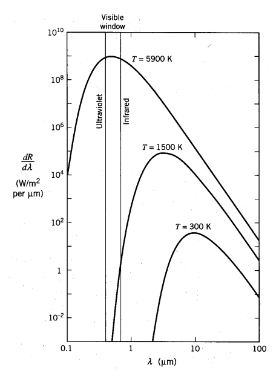

_Figure 4 (p. 65)_

If we heat an object up to about 1500 degrees we will begin to see a dull red glow and we say the object is red hot. If we heat something up to about 5000 degrees, near the temperature of the sun’s surface, it radiates well throughout the visible spectrum and we say it is white hot.

By considering plates in thermal equilibrium it can be shown that the emissive power over the absorption coefficient must be the same as a function of wavelength, even for plates of different materials.

```math
\frac{E_{1} ( \lambda ,T )}{A_{1} ( \lambda )} = \frac{E_{2} ( \lambda ,T )}{A_{2} ( \lambda )}
```

It there were differences, there could be a net energy flow from one plate to the other, violating the equilibrium condition.

<div align="right"><a href="book.pdf#page=65" target="_blank" title="This page in the PDF"><sup>[p. 65]</sup></a></div>
<hr class="page" style="height:2px;border:0;background:currentColor;opacity:0.25">
<a id="p66" href="book.pdf#page=66" target="_blank" title="This page in the PDF"><sup>[p. 66]</sup></a>

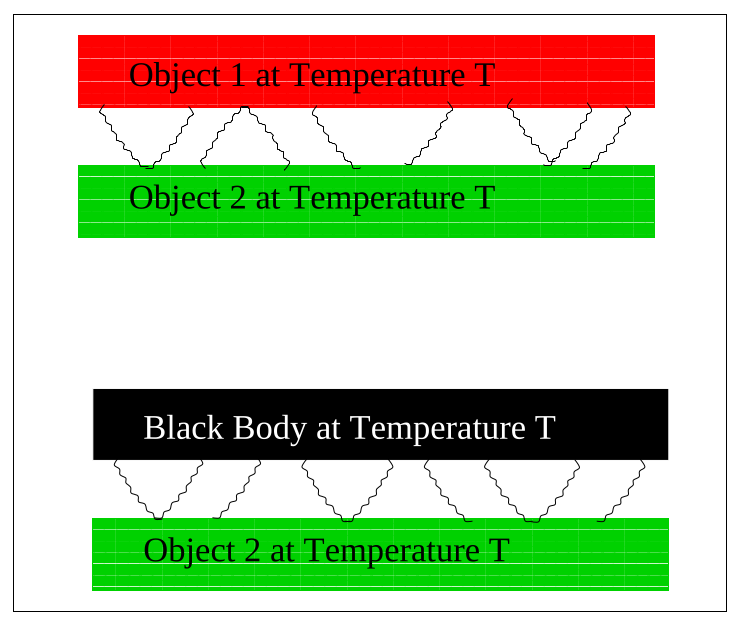

_Figure 5 (p. 66)_

A black body is one that absorbs all radiation incident upon it.

```math
A_{BB} = 1
```

Thus, the black body Emissive power, $`E ( \nu ,T )`$, is universal and can be derived from first principles.

A good example of a black body is a cavity with a small hole in it. Any light incident upon the hole goes into the cavity and is essentially never reflected out since it would have to undergo a very large number of reflections off walls of the cavity. If we make the walls absorptive (perhaps by painting them black), the cavity makes a perfect black body.

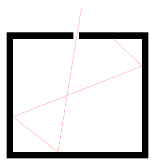

_Figure 6 (p. 66)_

There is a simple relation between the energy density in a cavity, $`u ( \nu ,T )`$, and the black body emissive power of a black body which simply comes from an analysis of how much radiation, traveling at the

<div align="right"><a href="book.pdf#page=66" target="_blank" title="This page in the PDF"><sup>[p. 66]</sup></a></div>
<hr class="page" style="height:2px;border:0;background:currentColor;opacity:0.25">
<a id="p67" href="book.pdf#page=67" target="_blank" title="This page in the PDF"><sup>[p. 67]</sup></a>

speed of light, will flow out of a hole in the cavity in one second.

```math
E ( \nu ,T ) = \frac{c}{4} u ( \nu ,T )
```

The only part that takes a little thinking is the 4 in the equation above.

Rayleigh and Jeans **calculated** (see section 2.5.1) t he energy density (in EM waves) inside a cavity and hence the emission spectrum of a black body. Their calculation was based on simple EM theory and equipartition. It not only did not agree with data; it said that all energy would be instantly radiated away in high frequency EM radiation. This was called the **ultraviolet catastrophe**.

```math
u ( \nu ,T ) = \frac{8 \pi \nu^{2}}{c^{3}} kT
```

Plank found a formula that fit the data well at both long and short wavelength.

```math
u ( \nu ,T ) = \frac{8 \pi \nu^{2}}{c^{3}} \frac{h\nu}{e^{h\nu /kT} - 1}
```

His formula fit the data so well that he tried to find a way to derive it. In a few months he was able to do this, by postulating that energy was emitted in quanta with $`E = h\nu`$. Even though there are a very large number of cavity modes at high frequency, the probability to emit such high energy quanta vanishes exponentially according to the Boltzmann distribution. Plank thus suppressed high frequency radiation in the calculation and brought it into agreement with experiment. Note that Plank’s Black Body formula is the same in the limit that $`h\nu <<kT`$ but goes to zero at large $`\nu`$ while the Rayleigh formula goes to infinity.

<div align="right"><a href="book.pdf#page=67" target="_blank" title="This page in the PDF"><sup>[p. 67]</sup></a></div>
<hr class="page" style="height:2px;border:0;background:currentColor;opacity:0.25">
<a id="p68" href="book.pdf#page=68" target="_blank" title="This page in the PDF"><sup>[p. 68]</sup></a>

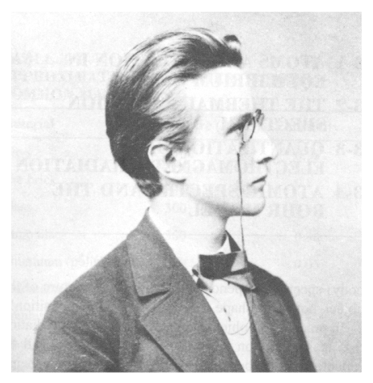

_Figure 7 (p. 68)_

It is interesting to note that classical EM waves would suck all the thermal energy out of matter, making the universe a very cold place for us. The figure below compares the two calculations to some data at $`T`$ = 1600 degrees. (It is also surprising that the start of the Quantum revolution came from Black Body radiation.)

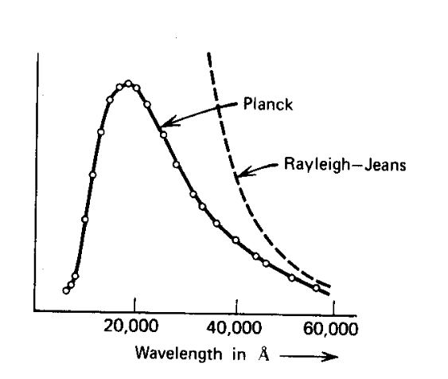

_Figure 8 (p. 68)_

So the emissive power per unit area is

```math
E ( \nu ,T ) = \frac{2 \pi \nu^{2}}{c^{2}} \frac{h\nu}{e^{h\nu /kT} - 1}
```

<div align="right"><a href="book.pdf#page=68" target="_blank" title="This page in the PDF"><sup>[p. 68]</sup></a></div>
<hr class="page" style="height:2px;border:0;background:currentColor;opacity:0.25">
<a id="p69" href="book.pdf#page=69" target="_blank" title="This page in the PDF"><sup>[p. 69]</sup></a>

<div align="center">

We can integrate this over frequency to get the total power radiated per unit area.

</div>

```math
R ( T ) = \frac{\pi^{2} c}{6 0 ( \hbar c )^{3}} k^{4} T^{4} = ( 5 . 6 7 \times 1 0^{- 8} W / m^{2} /^{◦} K^{4} ) T^{4}
```

\* See Example 2.6.1: What is the temperature at the solar surface? Use both the the intensity of radiation on earth and that the spectrum peaks about 500 nm to get answers.\*

\* See Example 2.6.2: The cosmic microwave background is black body radiation with a temperature of 2.7 degrees. For what frequency (and what wavelength) does the intensity peak?\*

# <a id="s-2-2-the-photoelectric-effect"></a>2.2 The Photoelectric Effect

The Photoelectric Effect shows that Plank’s hypothesis, used to fit the Black Body data, is actually correct for EM radiation. Einstein went further and proposed, in 1905, that light was made up of particles with energy related to the frequency of the light, $`E = h\nu`$. (He got his Nobel prize for the Photoelectric effect, not for Special or General Relativity.)

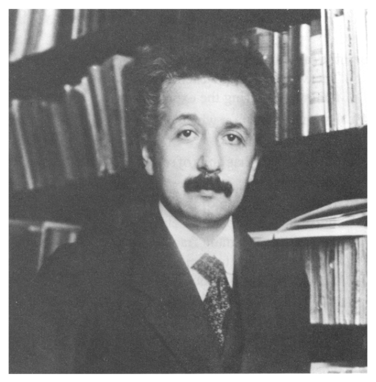

_Figure 9 (p. 69)_

<div align="right"><a href="book.pdf#page=69" target="_blank" title="This page in the PDF"><sup>[p. 69]</sup></a></div>
<hr class="page" style="height:2px;border:0;background:currentColor;opacity:0.25">
<a id="p70" href="book.pdf#page=70" target="_blank" title="This page in the PDF"><sup>[p. 70]</sup></a>

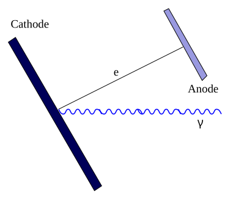

_Figure 10 (p. 70)_

When **light strikes a polished (metal) surface** electrons are ejected.

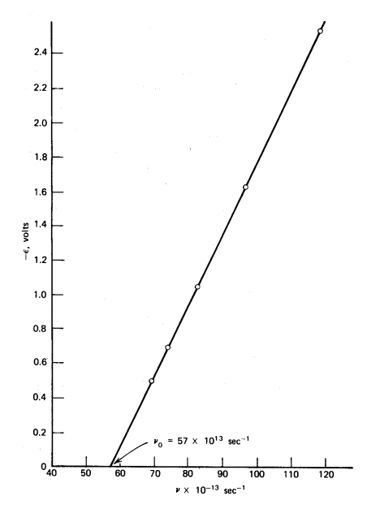

_Figure 11 (p. 70)_

Measurements were made of the **maximum electron energy versus light frequency** and light intensity. Classical physics predicted that the electron energy should increase with intensity, as the electric field increases. This is not observed. The electron energy is independent of intensity and depends linearly on the light frequency, as seen the the figure above. The kinetic energy of the electrons is given by Plank’s constant times the light frequency minus a **work function** $`W`$ which depends on the material.

```math
1 mv^{2} = h\nu - W
```

<div align="right"><a href="book.pdf#page=70" target="_blank" title="This page in the PDF"><sup>[p. 70]</sup></a></div>
<hr class="page" style="height:2px;border:0;background:currentColor;opacity:0.25">
<a id="p71" href="book.pdf#page=71" target="_blank" title="This page in the PDF"><sup>[p. 71]</sup></a>

This equation just expresses conservation of energy with $`h\nu`$ being the photon energy and $`W`$ the binding energy of electrons in the solid. Data from the Photoelectric effect strongly supported the hypothesis that light is composed of particles (photons).

# <a id="s-2-3-the-rutherford-atom"></a>2.3 The Rutherford Atom \*

The classical theory of atoms held that electrons were bound to a large positive charge about the size of the atom. Rutherford scattered charged $`( \alpha )`$ particles from atoms to see what the positive charge distribution was. With a approximately uniform charge distribution, his 5.5 MeV $`\alpha`$ particles should never have backscattered because they had enough energy to overcome the coulomb force from a charge distribution, essentially plowing right through the middle.

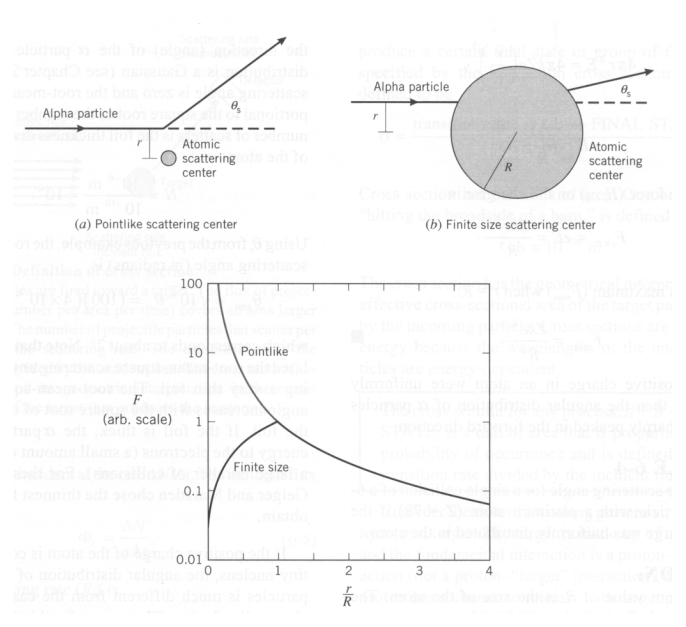

_Figure 12 (p. 71)_

He found that the $`\alpha`$ particles often scattered at angles larger than 90 degrees. His data can be explained if the **positive nucleus** of an atom is very small. For a very small nucleus, the Coulomb force continues to increase as the $`\alpha`$ approaches the nucleus, and backscattering is possible.

<div align="right"><a href="book.pdf#page=71" target="_blank" title="This page in the PDF"><sup>[p. 71]</sup></a></div>
<hr class="page" style="height:2px;border:0;background:currentColor;opacity:0.25">
<a id="p72" href="book.pdf#page=72" target="_blank" title="This page in the PDF"><sup>[p. 72]</sup></a>

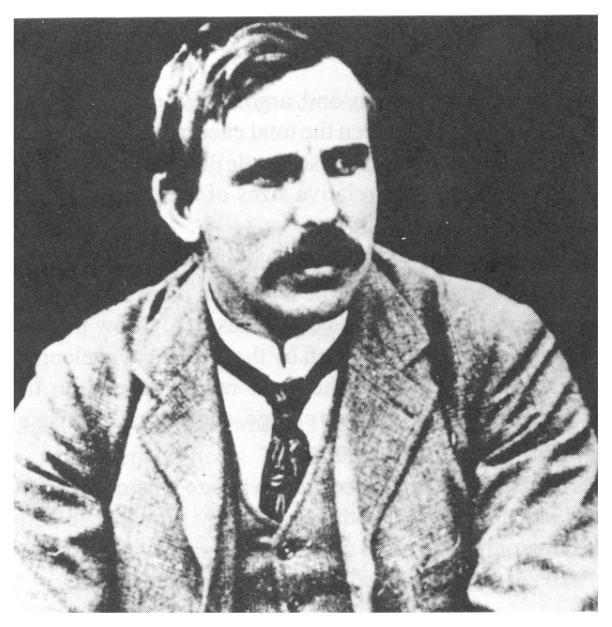

_Figure 13 (p. 72)_

\* See Example 2.6.4: Use Electrostatics to estimate how small a gold nucleus must be to backscatter a 5.5 MeV alpha particle.\*

This brought up a new problem. The atomic size was known from several types of experiments. If **electrons orbit around the atomic nucleus**, according to Maxwell’s equations, they should **radiate energy** as they accelerate. This radiation is not observed and the ground states of atoms are stable.

In Quantum Mechanics, the **localization of the electron around a nucleus is limited because** **of the wave nature of the electron**. For hydrogen, where there is no multi-body problem to make the calculation needlessly difficult, the energy levels can be calculated very accurately. Hydrogen was used to test Quantum Mechanics as it developed. We will also use hydrogen a great deal in this course.

Scattering of the high energy $`\alpha`$ particles allowed Rutherford to **“see” inside the atom** and determine that the atomic nucleus is very small. (He probably destroyed all the atoms he “saw”.) The figure below shows Rutherford’s angular distribution in his scattering experiment along with several subsequent uses of the same technique, with higher and higher energy particles. We see Rutherford’s discovery of the **tiny nucleus**, the discovery of **nuclear structure**, the discovery of a point-like **proton inside the nucleus**, the discovery of **proton structure**, the discovery of **quarks inside** **the proton**, and finally the lack of discovery, so far, of any **quark structure**.

<div align="right"><a href="book.pdf#page=72" target="_blank" title="This page in the PDF"><sup>[p. 72]</sup></a></div>
<hr class="page" style="height:2px;border:0;background:currentColor;opacity:0.25">
<a id="p73" href="book.pdf#page=73" target="_blank" title="This page in the PDF"><sup>[p. 73]</sup></a>

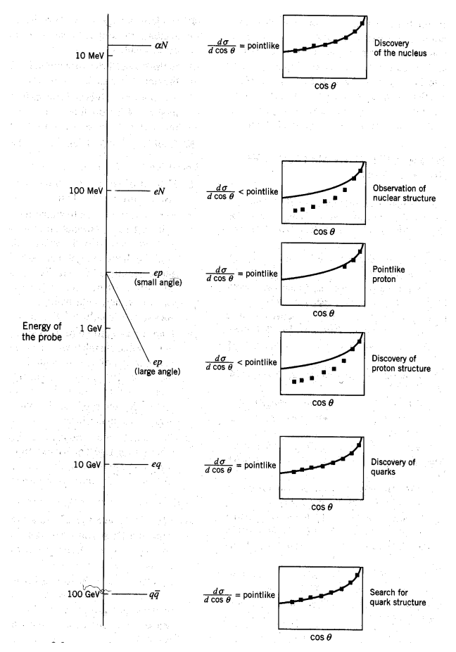

_Figure 14 (p. 73)_

To “see” these things at smaller and smaller distances, we needed to use beams of particles with smaller and smaller wavelength, and hence, higher energy.

# <a id="s-2-4-atomic-spectra"></a>2.4 Atomic Spectra \*

Hydrogen was ultimately the true test of the quantum theory. Very high accuracy measurements were made using diffraction gratings. These were well understood in non-relativistic QM and understood even better in the fully relativistic Quantum Field Theory, Quantum Electrodynamics.

The figure below show the **energy levels in Hydrogen**, the **transitions** between energy levels, and the wavelength of light produced in the transition. The **Lyman series** covers transitions to<span class="page" style="float:left;width:100%;margin:0.4em 0 0.6em"><span style="display:block;text-align:right"><a href="book.pdf#page=73" target="_blank" title="This page in the PDF"><sup>[p. 73]</sup></a></span><span style="display:block;height:2px;background:currentColor;opacity:0.25"></span><a id="p74" href="book.pdf#page=74" target="_blank" title="This page in the PDF"><sup>[p. 74]</sup></a></span> the ground state and is beyond the visible part of the spectrum. The **Balmer series** is due to transitions to the first excited state and is in the visible.

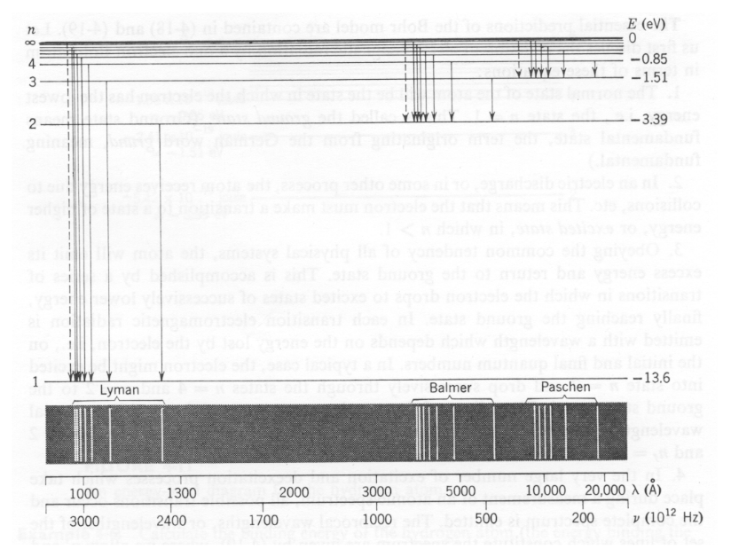

_Figure 15 (p. 74)_

By the time of Plank’s $`E = h\nu`$, **a great deal of data existed on the discrete energies** at which atoms radiated. Each atom had its own unique radiation fingerprint. Absorption at discrete energies had also been observed.

The **Rydberg formula** for the energies of photons emitted by Hydrogen was developed well before the QM explanation came along.

```math
E = 1 3 . 6 \text{ eV } \left( \frac{1}{n_{1}^{2}} - \frac{1}{n_{2}^{2}} \right)
```

Some of the states in heavier atoms followed the same type of formula. Better experiments showed that the spectral lines were often split into a multiplet of lines. We will understand these splitting much later in the course.

Heavier atoms provide a even richer spectrum but are much more difficult to calculate. Very good approximation techniques have been developed. With computers and good technique, the energy levels of more complex atoms can be calculated. The spectrum of mercury shown below has many more lines than seen in Hydrogen.

<div align="right"><a href="book.pdf#page=74" target="_blank" title="This page in the PDF"><sup>[p. 74]</sup></a></div>
<hr class="page" style="height:2px;border:0;background:currentColor;opacity:0.25">
<a id="p75" href="book.pdf#page=75" target="_blank" title="This page in the PDF"><sup>[p. 75]</sup></a>

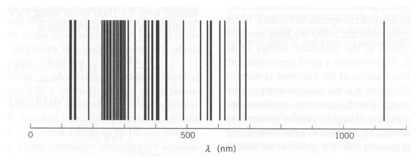

_Figure 16 (p. 75)_

The figure below shows the visible part of the spectrum for several atomic or molecular sources. For Hydrogen, we mainly see the Balmer series, with a line from Paschen-Bach. The spectra of different atoms are quite distinct. Molecules have many other types of excitations and can produce many frequencies of light.

## <a id="s-2-4-1-the-bohr-atom"></a>2.4.1 The Bohr Atom \*

Bohr postulated that electrons orbited the nucleus like planets orbiting the sun. He managed to fit the data for Hydrogen by postulating that **electrons orbited the nucleus in circular orbits,**<span class="page" style="float:left;width:100%;margin:0.4em 0 0.6em"><span style="display:block;text-align:right"><a href="book.pdf#page=75" target="_blank" title="This page in the PDF"><sup>[p. 75]</sup></a></span><span style="display:block;height:2px;background:currentColor;opacity:0.25"></span><a id="p76" href="book.pdf#page=76" target="_blank" title="This page in the PDF"><sup>[p. 76]</sup></a></span> **and that angular momentum is quantized** such that $`L = n \hbar`$, for $`n`$ = 1$`, 2 , 3 \dots`$. This is natural since $`\hbar`$ has units of angular momentum. Bohr correctly postdicted the Hydrogen energies and the size of the atom.

Balance of forces for circular orbits.

```math
\frac{mv^{2}}{r} = \frac{1}{4 \pi \epsilon_{0}} \frac{e^{2}}{r^{2}}
```

Angular momentum quantization assumption.

```math
L = mvr = n \hbar
```

Solve for velocity.

```math
v = \frac{n \hbar}{mr}
```

Plug into force equation to get formula for $`r`$.

```math
\frac{mn^{2} \hbar^{2} r^{2}}{m^{2} r^{2} r} = \frac{e^{2}}{4 \pi \epsilon_{0}}
```

```math
\frac{n^{2} \hbar^{2}}{mr} = \frac{e^{2}}{4 \pi \epsilon_{0}}
```

```math
\frac{1}{r} = \frac{me^{2}}{4 \pi \epsilon_{0} \hbar^{2}} \frac{1}{n^{2}}
```

Now we just want to plug $`v`$ and $`r`$ into the energy formula. We write the Hydrogen potential in terms of the fine structure constant (See section 2.5.2): $`\alpha_{SI} = \tfrac{1}{4 \pi \epsilon_{0}} \tfrac{e^{2}}{\hbar c} \approx \tfrac{1}{1 3 7}`$ .

```math
V ( r ) = \frac{- \alpha \hbar c}{r}
```

```math
\frac{1}{r} = \frac{\alpha mc}{\hbar} \frac{1}{n^{2}}
```

We now compute the energy levels.

```math
E = \frac{1}{2} mv^{2} + V ( r )
```

```math
E = \frac{1}{2} m \left( \frac{n \hbar}{mr} \right)^{2} - \frac{\alpha \hbar c}{r}
```

```math
E = \frac{1}{2} m \left( \frac{\alpha n \hbar c}{n^{2} \hbar} \right)^{2} - \frac{\alpha^{2} \hbar mc^{2}}{n^{2} \hbar}
```

```math
E = \frac{1}{2} m \left( \frac{\alpha c}{n} \right)^{2} - \frac{\alpha^{2} mc^{2}}{n^{2}}
```

```math
E = \frac{1}{2} \left( \frac{\alpha^{2} mc^{2}}{n^{2}} \right) - \frac{\alpha^{2} mc^{2}}{n^{2}} = - \frac{\alpha^{2} mc^{2}}{2 n^{2}}
```

The constant $`\frac{\alpha^{2} mc^{2}}{2}`$ = $`\frac{5 1 1 0 0 0}{2 ( 1 3 7 )^{2}}`$ = 13$`. 6`$ eV. Bohr’s formula gives the **right Hydrogen energy** **spectrum**.

<div align="right"><a href="book.pdf#page=76" target="_blank" title="This page in the PDF"><sup>[p. 76]</sup></a></div>
<hr class="page" style="height:2px;border:0;background:currentColor;opacity:0.25">
<a id="p77" href="book.pdf#page=77" target="_blank" title="This page in the PDF"><sup>[p. 77]</sup></a>

We can also compute the ground state radius of the Bohr orbit.

```math
\frac{1}{r} = \frac{\alpha mc^{2}}{\hbar c}
```

```math
r = \frac{( 1 3 7 ) ( 1 9 7 3 )}{5 1 1 0 0 0} = 0 . 5 3 ˚ A
```

This is also about the right radius. The name for this number, the **Bohr radius**, persists to this day despite the fact that Bohr’s assumption is wrong.

Although angular momentum is quantized in units of $`\hbar`$, **the ground state of Hydrogen has zero** **angular momentum**. This would put Bohr’s electron in the nucleus.

**Bohr fit the data, with some element of truth, but his model is WRONG**.

# <a id="s-2-5-derivations-and-computations"></a>2.5 Derivations and Computations

## <a id="s-2-5-1-black-body-radiation-formulas"></a>2.5.1 Black Body Radiation Formulas \*

(Not yet available.)

## <a id="s-2-5-2-the-fine-structure-constant-and-the-coulomb-potential"></a>2.5.2 The Fine Structure Constant and the Coulomb Potential

We will now grapple for the first time with the problem of which set of units to use. Advanced texts typically use **CGS units** in which the potential energy is

```math
V ( r ) = \frac{- e^{2}}{r}
```

while the **Standard International units**

```math
V ( r ) = \frac{1}{4 \pi \epsilon_{0}} \frac{- e^{2}}{r}
```

We can circumvent the problem by defining the dimensionless **fine structure constant** $`\alpha`$.

```math
\alpha_{SI} = \frac{1}{4 \pi \epsilon_{0}} \frac{e^{2}}{\hbar c} \approx \frac{1}{1 3 7}
```

```math
\alpha_{CGS} = \frac{e^{2}}{\hbar c} \approx \frac{1}{1 3 7}
```

So in either set of units the Hydrogen potential is

```math
V ( r ) = \frac{- \alpha \hbar c}{r}
```

<div align="right"><a href="book.pdf#page=77" target="_blank" title="This page in the PDF"><sup>[p. 77]</sup></a></div>
<hr class="page" style="height:2px;border:0;background:currentColor;opacity:0.25">
<a id="p78" href="book.pdf#page=78" target="_blank" title="This page in the PDF"><sup>[p. 78]</sup></a>

# <a id="s-2-6-examples"></a>2.6 Examples

**2.6.1 The Solar Temperature \***

## <a id="s-2-6-1-the-solar-temperature"></a>Estimate the solar temperature using

$`•`$ the solar radiation intensity on the earth of 1.4 kilowatts per square meter. $`( r_{sun}`$ = $`7 \times 1 0`$<sup>8</sup>

```math
m , d_{sun} = 1 . 5 \times 1 0^{1 1} m )
```

$`•`$ and the solar spectrum which peaks at about 500 nm.

First we compute the power radiated per unit area on the solar surface.

```math
R = ( 1 4 0 0 W / m^{2} ) ( 4 \pi d_{sun}^{2} ) / ( 4 \pi r_{sun}^{2} ) = 6 . 4 \times 1 0^{7} W / m^{2}
```

We compare this to the expectation as a function of temperature.

```math
R ( T ) = ( 5 . 6 7 \times 1 0^{- 8} W / m^{2} /^{◦} K^{4} ) T^{4}
```

and get

```math
T^{4} = \frac{6 . 4 \times 1 0^{7}}{5 . 6 7 \times 1 0^{- 8}}
```

```math
T = 5 8 0 0^{◦} K
```

Lets assume that $`E ( \lambda ,T )`$ peaks at 500 nm as one of the graphs shows. We need to transform $`E ( \nu ,T )`$. Remember $`f ( \nu ) d\nu = g ( \lambda ) d\lambda`$ for distribution functions.

```math
E ( \nu ,T ) = \frac{2 \pi \nu^{2}}{c^{2}} \frac{h\nu}{e^{h\nu /kT} - 1}
```

```math
E ( \lambda ,T ) = \left| \frac{d\nu}{d\lambda} \right| \frac{2 \pi \nu^{2}}{c^{2}} \frac{h\nu}{e^{h\nu /kT} - 1}
```

```math
= \frac{\nu^{2}}{c} \frac{2 \pi \nu^{2}}{c^{2}} \frac{h\nu}{e^{h\nu /kT} - 1} = \frac{2 \pi \nu^{4}}{c^{3}} \frac{h\nu}{e^{h\nu /kT} - 1}
```

This peaks when

```math
\frac{\nu^{5}}{e^{h\nu /kT} - 1}
```

is maximum.

```math
\frac{5 \nu^{4}}{e^{h\nu /kT} - 1} - \frac{\nu^{5} ( h/kT ) e^{h\nu /kT}}{( e^{h\nu /kT} - 1 )^{2}} = 0
```

```math
\frac{5}{e^{h\nu /kT} - 1} = \frac{\nu ( h/kT ) e^{h\nu /kT}}{( e^{h\nu /kT} - 1 )^{2}}
```

```math
\frac{5 ( e^{h\nu /kT} - 1 )}{e^{h\nu /kT}} = h\nu /kT
```

```math
5 ( 1 - e^{- h\nu /kT} ) = h\nu /kT
```

<div align="right"><a href="book.pdf#page=78" target="_blank" title="This page in the PDF"><sup>[p. 78]</sup></a></div>
<hr class="page" style="height:2px;border:0;background:currentColor;opacity:0.25">
<a id="p79" href="book.pdf#page=79" target="_blank" title="This page in the PDF"><sup>[p. 79]</sup></a>

Lets set $`y = h\nu /kT`$ and solve the equation

```math
y = 5 ( 1 - e^{- y} )
```

I solved this iteratively starting at y=5 and got $`y`$ = 4$`. 97`$ implying

```math
h\nu = 4 . 9 7 kT
```

If we take $`\lambda`$ = 500 nm, them $`\nu`$ = $`6 \times 1 0`$<sup>14</sup>.

```math
T = \frac{h\nu}{5 k} = \frac{( 6 . 6 \times 1 0^{- 3 4} ) ( 6 \times 1 0^{1 4} )}{( 5 ) ( 1 . 4 \times 1 0^{- 2 3} )} = 6 \times 1 0^{3} = 5 7 0 0
```

That’s agrees well.

## <a id="s-2-6-2-black-body-radiation-from-the-early-universe"></a>2.6.2 Black Body Radiation from the Early Universe \*

Find the frequency $`\nu`$ at which the the Emissive $`E ( \nu ,T )`$ is a maximum for the 2.7 degree cosmic background radiation. Find the wavelength $`\lambda`$ for which $`E ( \lambda ,T )`$ is a maximum.

The cosmic background radiation was produced when the universe was much hotter than it is now. Most of the atoms in the universe were ionized and photons interacted often with the ions or free electrons. As the universe cooled so that neutral atoms formed, the photons decoupled from matter and just propagated through space. We see these photons today as the background radiation. Because the universe is expanding, the radiation has been red shifted down to a much lower temperature. We observe about 2.7 degrees. The background radiation is very uniform but we are beginning to observe non-uniformities at the $`1 0^{- 5}`$ level.

From the previous problem, we can say that the peak $`\lambda`$ occurs when

```math
h\nu = 5 kT
```

```math
\nu = 5 kT/h
```

```math
\lambda = ch/ ( 5 kT ) = \frac{( 3 \times 1 0^{8} ) ( 6 . 6 \times 1 0^{- 3 4} )}{( 5 ) ( 1 . 4 \times 1 0^{- 2 3} ) ( 2 . 7 )} = 1 mm
```

Similarly the peak in $`\nu`$ occurs when

```math
\nu = 2 . 8 kT/h = \frac{( 1 . 4 \times 1 0^{- 2 3} ) ( 2 . 7 )}{( 6 . 6 \times 1 0^{- 3 4} )} = 6 \times 1 0^{1 0} Hz
```

## <a id="s-2-6-3-compton-scattering"></a>2.6.3 Compton Scattering \*

**Compton scattered high energy photons from (essentially) free electrons** in 1923. He measured the wavelength of the scattered photons as a function of the scattering angle. The figure below shows both the initial state (a) and the final state, with the photon scattered by an angle $`\theta`$ and the electron recoiling at an angle $`\varphi`$. The photons were from nuclear decay and so they were of high enough energy that it didn’t matter that the electrons were actually bound in atoms. We wish to derive the formula for the **wavelength of the scattered photon as a function of angle**.

<div align="right"><a href="book.pdf#page=79" target="_blank" title="This page in the PDF"><sup>[p. 79]</sup></a></div>
<hr class="page" style="height:2px;border:0;background:currentColor;opacity:0.25">
<a id="p80" href="book.pdf#page=80" target="_blank" title="This page in the PDF"><sup>[p. 80]</sup></a>

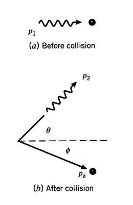

_Figure 17 (p. 80)_

We solve the problem using only conservation of energy and momentum. Lets work in **units in** **which** $`c`$ = 1 for now. We’ll put the $`c`$ back in at the end. Assume the photon is initially moving in the $`z`$ direction with energy E and that it scatters in the $`yz`$ plane so that $`p_{x}`$ = 0. **Conservation of** **momentum** gives

```math
E = E^{\prime} \cos \theta + p_{e} \cos \varphi
```

**and**

```math
E^{\prime} \sin \theta = p_{e} \sin \varphi .
```

**Conservation of energy** gives

```math
E + m = E^{\prime} + \sqrt{p_{e}^{2} + m^{2}}
```

Our goal is to solve for $`E^{\prime}`$ in terms of $`\cos \theta`$ so lets make sure we eliminate the $`\varphi`$. Continuing from the energy equation

```math
E - E^{\prime} + m = \sqrt{p_{e}^{2} + m^{2}}
```

squaring and calculating $`p_{e}^{2}`$ from the components

```math
E^{2} + E^{\prime 2} + m^{2} - 2 EE^{\prime} + 2 mE - 2 mE^{\prime} = ( E - E^{\prime} \cos \theta )^{2} + ( E^{\prime} \sin \theta )^{2} + m^{2}
```

and writing out the squares on the right side

```math
E^{2} + E^{\prime 2} + m^{2} - 2 EE^{\prime} + 2 mE - 2 mE^{\prime} = E^{2} + E^{\prime 2} - 2 EE^{\prime} \cos \theta + m^{2}
```

and removing things that appear on both sides

```math
- 2 EE^{\prime} + 2 mE - 2 mE^{\prime} = - 2 EE^{\prime} \cos \theta
```

and grouping

```math
m ( E - E^{\prime} ) = EE^{\prime} ( 1 - \cos \theta )
```

```math
\frac{( E - E^{\prime} )}{EE^{\prime}} = \frac{( 1 - \cos \theta )}{m}
```

```math
\frac{1}{E^{\prime}} - \frac{1}{E} = \frac{( 1 - \cos \theta )}{m}
```

<div align="right"><a href="book.pdf#page=80" target="_blank" title="This page in the PDF"><sup>[p. 80]</sup></a></div>
<hr class="page" style="height:2px;border:0;background:currentColor;opacity:0.25">
<a id="p81" href="book.pdf#page=81" target="_blank" title="This page in the PDF"><sup>[p. 81]</sup></a>

Since $`\lambda = h/p = h/E`$ in our fine units,

```math
\lambda^{\prime} - \lambda = \frac{h}{m} ( 1 - \cos \theta ) .
```

We now apply the speed of light to make the units come out to be a length.

```math
\lambda^{\prime} - \lambda = \frac{hc}{mc^{2}} ( 1 - \cos \theta )
```

These calculations can be fairly frustrating if you don’t decide which variables you want to keep and which you need to eliminate from your equations. In this case we eliminated $`\varphi`$ by using the energy equation and computing $`p_{e}^{2}`$.

## <a id="s-2-6-4-rutherford-s-nuclear-size"></a>2.6.4 Rutherford’s Nuclear Size \*

If the positive charge in gold atoms were uniformly distributed over a sphere or radius 5 Angstroms, what is the maximum $`\alpha`$ particle kinetic energy for which the $`\alpha`$ can be scattered right back in the direction from which it came?

To solve this, we need to compute the potential at the center of the charge distribution relative to the potential at infinity (which we will say is zero). This tells us directly the kinetic energy in eV needed to plow right through the charge distribution.

The potential at the surface of the nucleus is $`\frac{1}{4 \pi \epsilon_{0}} \frac{Ze}{R}`$ where Z is the number of protons in the atom and R is the nuclear radius. That’s the easy part. Now we need to integrate our way into the center.

```math
V = \frac{1}{4 \pi \epsilon_{0}} \frac{Ze}{R} - \int_{R}^{0} \frac{1}{4 \pi \epsilon_{0}} \frac{r^{3}}{R^{3}} \frac{Ze}{r^{2}} dr
```

The $`\frac{r^{3}}{R^{3}}`$ gives the fraction of the nuclear charge inside a radius $`r`$.

```math
V = \frac{1}{4 \pi \epsilon_{0}} \frac{Ze}{R} - \frac{1}{4 \pi \epsilon_{0} R^{3}} \int_{R}^{0} Zerdr
```

```math
V = \frac{1}{4 \pi \epsilon_{0}} \left( \frac{Ze}{R} + \frac{Ze}{2 R} \right) = \frac{3 Ze}{8 \pi \epsilon_{0} R}
```

So

```math
V = \frac{( 3 ) ( 7 9 ) ( 1 . 6 \times 1 0^{- 1 9} C )}{8 \pi ( 8 . 8 5 \times 1 0^{- 1 2} C^{2} / \text{ Nm }^{2} ) R} = \frac{1 . 7 \times 1 0^{- 7}}{R} \text{ Nm } / C
```

The is then the kinetic energy in eV needed for a particle of charge +$`e`$ to plow right through the center of a spherical charge distribution. The $`\alpha`$ particle actually has charge +2$`e`$ so we need to multiply by 2. For a nuclear radius of 5 ˚Aor $`5 \times 1 0^{- 1 0}`$ meters, we need about 680 eV to plow through the nucleus. For the actual nuclear radius of about 5 Fermis or $`5 \times 1 0^{- 1 5}`$ meters, we need 68 MeV to plow through.

<div align="right"><a href="book.pdf#page=81" target="_blank" title="This page in the PDF"><sup>[p. 81]</sup></a></div>
<hr class="page" style="height:2px;border:0;background:currentColor;opacity:0.25">
<a id="p82" href="book.pdf#page=82" target="_blank" title="This page in the PDF"><sup>[p. 82]</sup></a>

**Lets compare the above SI units numbers to my suggested method of using the fine** **structure constant...** Putting in the alpha charge of 2$`e`$.

```math
U = \frac{6 Ze^{2}}{8 \pi \epsilon_{0} R} = \frac{3 Z\alpha \hbar c}{R} = \frac{( 3 ) ( 7 9 ) ( 1 9 7 3 )}{( 1 3 7 ) ( 5 )} \text{ eV } = 6 8 3 \text{ eV }
```

This is easier.

# <a id="s-2-7-sample-test-problems"></a>2.7 Sample Test Problems

1. What is the maximum wavelength of electromagnetic radiation which can eject electrons from a metal having a work function of 3 eV? (3 points)<br>
**Answer**<br>
The minimum photon energy needed to knock out an electron is 3 eV. We just need to convert that to wavelength.

```math
E = h\nu = 3 eV
```

```math
\nu = \frac{c}{\lambda}
```

```math
\frac{2 \pi \hbar c}{\lambda} = 3 eV
```

```math
\lambda = \frac{2 \pi \hbar c}{3 eV} = \frac{2 \pi ( 1 9 7 3 eV ˚ A )}{3 eV} \approx 4 0 0 0 ˚ A
```

2. **\*** Based on classical electromagnetism and statistical mechanics, Rayleigh computed the energy density inside a cavity. He found that, at a temperature T, the energy density as a function of frequency was

```math
u ( \nu ,T ) = \frac{8 \pi \nu^{2}}{c^{3}} k_{B} T.
```

Why is this related to black body radiation? Why was this in obvious disagreement with observation?

3. What is the maximum wavelength of electromagnetic radiation which can eject electrons from

a metal having a work function of 2 eV?

4. **\*** State simply what problem with black-body radiation caused Plank to propose the relation

$`E = h\nu`$ for light.

5. The work function of a metal is 2 eV. Assume a beam of light of wavelength $`\lambda`$ is incident upon a polished surface of the metal. Plot the maximum electron energy (in eV) of electrons ejected from the metal versus $`\lambda`$ in Angstroms. Be sure to label both axes with some numerical values.

6.

---

[← 1 Course Summary](01-course-summary.md) · [3 Diffraction →](03-diffraction.md)
