[← 2 The Problems with Classical Physics](02-the-problems-with-classical-physics.md) · [4 The Solution: Probability Amplitudes →](04-the-solution-probability-amplitudes.md)

---

<hr class="page" style="height:2px;border:0;background:currentColor;opacity:0.25">
<a id="p83" href="book.pdf#page=83" target="_blank" title="This page in the PDF"><sup>[p. 83]</sup></a>

# 3 Diffraction

**Feynman Lectures, Volume III, Chapter I.**

**Gasciorawicz does not really this.**

**Rohlf Chapters 5**

**Griffiths doesn’t cover this.**

# <a id="s-3-1-diffraction-from-two-slits"></a>3.1 Diffraction from Two Slits

**Water waves** will exhibit a diffractive interference pattern in a 2 slit experiment as diagrammed below. The diagram shows the crests of the water waves at some time. Downstream from the slits, we will see constructive interference where the waves from the slits are in phase and destructive interference where they are 180 degrees out of phase, for example where a crest from one slit meets a trough from the other. The plot labeled $`I_{1 2}`$ shows the interference pattern at the location of the absorber. **Diffraction is a simple wave phenomenon**.

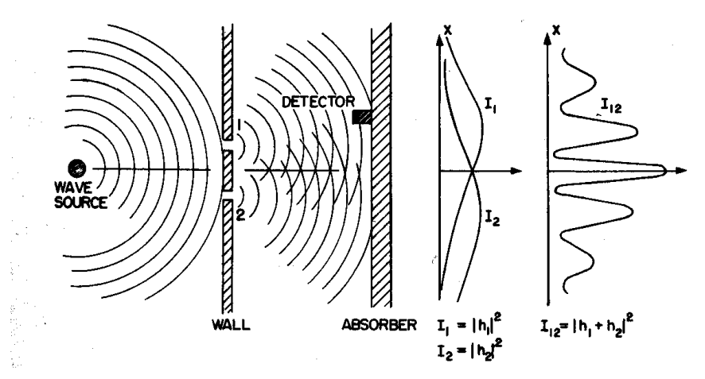

_Figure 18 (p. 83)_

The **diffraction of light** was a well known phenomenon by the end of the 19th century and was well explained in classical ElectroMagnetic theory since light was held to be a EM wave. The diffraction pattern from two narrow slits is particularly easy to understand in terms of waves. The setup is shown in the diagram below.

<div align="right"><a href="book.pdf#page=83" target="_blank" title="This page in the PDF"><sup>[p. 83]</sup></a></div>
<hr class="page" style="height:2px;border:0;background:currentColor;opacity:0.25">
<a id="p84" href="book.pdf#page=84" target="_blank" title="This page in the PDF"><sup>[p. 84]</sup></a>

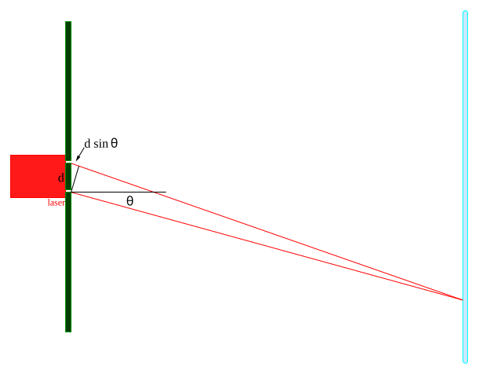

_Figure 19 (p. 84)_

EM waves of wavelength $`\lambda`$ are emitted from a single light-source, like a laser. They travel to two narrow slits, (for simplicity) equidistant from the source, and a distance $`d`$ apart. Light travels from the slits to a detection screen. A diffraction pattern can be seen on the detection screen, like the one shown in the picture below.

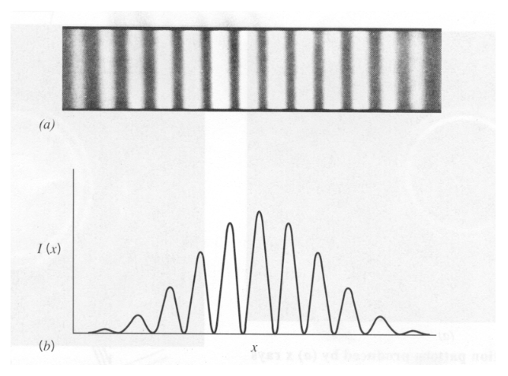

_Figure 20 (p. 84)_

The center of the diffraction pattern occurs at the location on the screen equidistant from each slit where the **waves from the two slits are in phase** (because they have traveled exactly the same distance) and the fields add, so the waves **interfere constructively** and there is an intensity maximum. Some distance off this center of the diffraction pattern, there will be destructive interference between waves from the two slits and the intensity will be zero. This will occur when

<div align="right"><a href="book.pdf#page=84" target="_blank" title="This page in the PDF"><sup>[p. 84]</sup></a></div>
<hr class="page" style="height:2px;border:0;background:currentColor;opacity:0.25">
<a id="p85" href="book.pdf#page=85" target="_blank" title="This page in the PDF"><sup>[p. 85]</sup></a>

the distance traveled by two waves differs by $`\lambda / 2`$, so the **waves are 180 degrees out of phase** **and the fields from the two slits cancel**.

We can compute this location by looking at the above diagram. We assume that the distance to the screen is much greater than $`d`$. For light detected at an angle $`\theta`$, the extra distance traveled from slit 1 is just $`d \sin \theta`$. So the angle of the **first minimum** (or null) can be found from the equation $`d \sin \theta = \tfrac{\lambda}{2}`$.

More generally we will get a **maximum if the paths from the slits differ by an integer** **number of wavelengths** $`d \sin \theta = n\lambda`$ and we will get a **null when the paths differ by a half** **integer number wavelengths**. $`d \sin \theta_{null} = \tfrac{( n + 1 ) \lambda}{2}`$.

Although it is very difficult because electrons are charged, **2 slit electron diffraction** has also been observed.

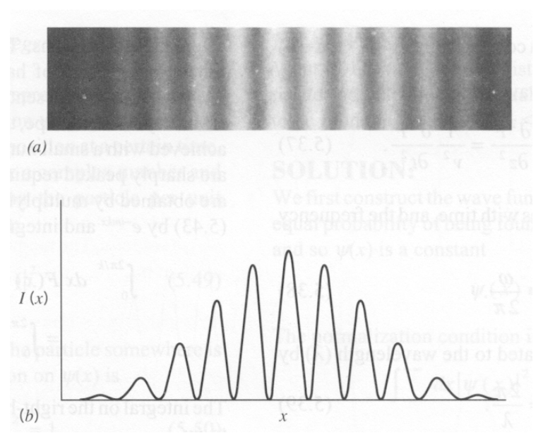

_Figure 21 (p. 85)_

So, all kinds of particles seem to diffract indicating there is some kind of wave involved. We will now continue with some thought experiments on diffraction to illustrate the physics that Quantum Mechanics needed to match.

\* See Example 3.6.1: Derive the location of the nodes in the diffraction pattern from two narrow slits a distance $`d`$ apart. Now try to compute the intensity distribution.\*

<div align="right"><a href="book.pdf#page=85" target="_blank" title="This page in the PDF"><sup>[p. 85]</sup></a></div>
<hr class="page" style="height:2px;border:0;background:currentColor;opacity:0.25">
<a id="p86" href="book.pdf#page=86" target="_blank" title="This page in the PDF"><sup>[p. 86]</sup></a>

# <a id="s-3-2-single-slit-diffraction"></a>3.2 Single Slit Diffraction

There are many other examples of diffraction. The picture below shows diffraction from a single slit where waves from different parts of the slit interfere with each other. To get the field at some point on the detection screen, one should integrate over the slit.

\* See Example 3.6.2: Derive the location of the nodes in the diffraction pattern from one slit of width $`a`$. Now try to compute the intensity distribution for single slit diffraction.\*

# <a id="s-3-3-diffraction-from-crystals"></a>3.3 Diffraction from Crystals

**Electron waves were first demonstrated by measuring diffraction from crystals**. Davison and Germer observed diffraction of electrons from a Nickel crystal in 1928. They varied the electron energy to measure the electron wavelength, agreeing well with the deBroglie expectation.

First we see diffraction from a **single crystal**.

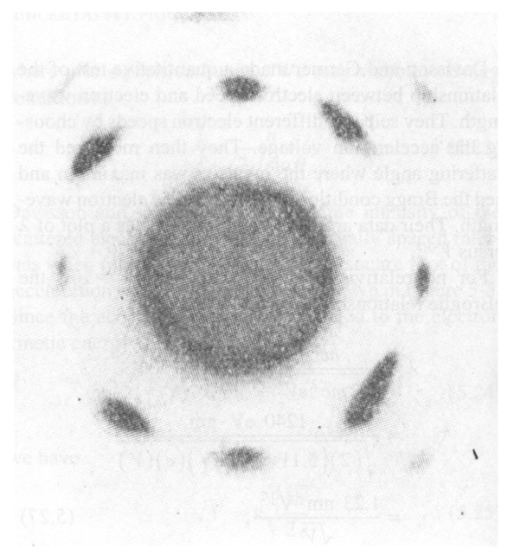

_Figure 22 (p. 86)_

Diffraction off **polycrystalline material** gives concentric rings instead of spots.

<div align="right"><a href="book.pdf#page=86" target="_blank" title="This page in the PDF"><sup>[p. 86]</sup></a></div>
<hr class="page" style="height:2px;border:0;background:currentColor;opacity:0.25">
<a id="p87" href="book.pdf#page=87" target="_blank" title="This page in the PDF"><sup>[p. 87]</sup></a>

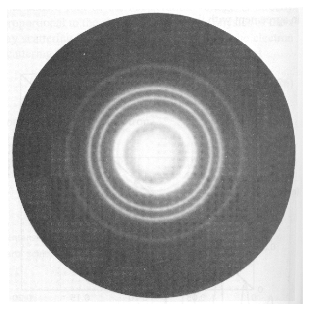

_Figure 23 (p. 87)_

Diffraction from crystals is a powerful tool. First we see **x-ray diffraction from a single Sodium** **Crystal** which has periodic locations of the atoms.

<div align="right"><a href="book.pdf#page=87" target="_blank" title="This page in the PDF"><sup>[p. 87]</sup></a></div>
<hr class="page" style="height:2px;border:0;background:currentColor;opacity:0.25">
<a id="p88" href="book.pdf#page=88" target="_blank" title="This page in the PDF"><sup>[p. 88]</sup></a>

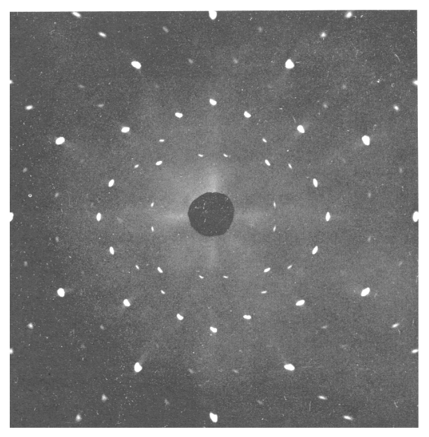

_Figure 24 (p. 88)_

Another example of diffraction is shown below. Here **neutrons diffract from a single Sodium** **crystal**.

<div align="right"><a href="book.pdf#page=88" target="_blank" title="This page in the PDF"><sup>[p. 88]</sup></a></div>
<hr class="page" style="height:2px;border:0;background:currentColor;opacity:0.25">
<a id="p89" href="book.pdf#page=89" target="_blank" title="This page in the PDF"><sup>[p. 89]</sup></a>

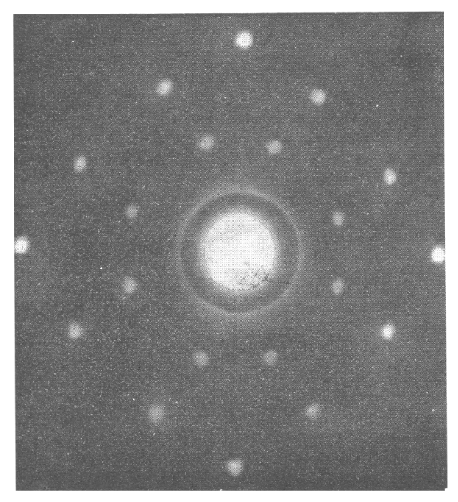

_Figure 25 (p. 89)_

# <a id="s-3-4-the-debroglie-wavelength"></a>3.4 The DeBroglie Wavelength

The Lorentz transformation had been postulated for ElectroMagnetic waves before Einstein developed Special Relativity. The EM waves were entirely consistent with Relativity. For example, the phase of an EM wave at some point is the same as at the Lorentz transformed point.

**DeBroglie applied this Lorentz invariance requirement on the phase of matter waves** to determine what the wavelength must be. Its easy for us to derive the wavelength using 4-vectors. Position and time form one 4-vector.

```math
x^{\mu} = ( c t , \vec{x} )
```

Energy and momentum form another.

```math
p^{\mu} = ( E, \vec{p} c )
```

Recall that Lorentz vectors must be transformed but **Lorentz scalars are automatically invari-** **ant** under transformations. For example the scalar formed by dotting the 4-momentum into itself is

```math
p^{\mu} p_{\mu} = - E^{2} + p^{2} c^{2} = - m^{2} c^{4} .
```

The mass of a particle is clearly Lorentz invariant.

To compute the wavelength for our matter waves, lets use the scalar

```math
p^{\mu} x_{\mu} /c = - Et + \vec{p} \cdot \vec{x}
```

<div align="right"><a href="book.pdf#page=89" target="_blank" title="This page in the PDF"><sup>[p. 89]</sup></a></div>
<hr class="page" style="height:2px;border:0;background:currentColor;opacity:0.25">
<a id="p90" href="book.pdf#page=90" target="_blank" title="This page in the PDF"><sup>[p. 90]</sup></a>

Its already easy to see that the phase in a wave like

```math
e^{i ( \vec{p} \cdot \vec{x} - Et ) / \hbar}
```

is Lorentz invariant.

To read off the wavelength, lets pick off the part of the expression that corresponds to $`e^{2 \pi i ( x/\lambda - \nu t )}`$. We see that<sup>2</sup>$`\tfrac{\pi}{\lambda} = \tfrac{p}{\hbar}`$ and therefore the DeBroglie wavelength is.

```math
\lambda = \frac{2 \pi \hbar}{p} = \frac{h}{p}
```

DeBroglie derived this result in 1923.

We can also read off the frequency $`\nu`$.

```math
\nu = \frac{E}{2 \pi \hbar} = E/h
```

This was in some sense the input to our calculation.

The deBroglie wavelength will be our **primary physics input** for the development of Quantum Mechanics. Its not that this work was the most significant, but, this wavelength summarizes most of what happened before 1923.

## <a id="s-3-4-1-computing-debroglie-wavelengths"></a>3.4.1 Computing DeBroglie Wavelengths

We usually quote the energy of a particle in terms of its **kinetic energy** in electron Volts, eV (or Million electron Volts, MeV). The reason for this is that particles are usually accelerated to some energy by an electric field. If I let an electron (or proton...) be accelerated through a 100 Volt potential difference, it will have a kinetic energy of 100eV.

The whole problem of computing a deBroglie wavelength is to convert from kinetic energy to momentum. If you always want to be correct without any need for thinking, use the **relativistically** **correct formula** for the kinetic energy

```math
T = \sqrt{( mc^{2} )^{2} + p^{2} c^{2}} - mc^{2}
```

and solve it for $`pc`$,

```math
pc = \sqrt{( T + mc^{2} )^{2} - ( mc^{2} )^{2}}
```

then use this handy formula to get the answer.

```math
\lambda = \frac{h}{p} = \frac{2 \pi \hbar c}{pc}
```

I remember that $`\hbar c`$ = 1973 eV˚A allowing me to keep the whole calculation in eV. I also know the masses of the particles.

```math
m_{e} c^{2} = 0 . 5 1 \text{ MeV }
```

```math
m_{p} c^{2} = 9 3 8 . 3 \text{ MeV }
```

<div align="right"><a href="book.pdf#page=90" target="_blank" title="This page in the PDF"><sup>[p. 90]</sup></a></div>
<hr class="page" style="height:2px;border:0;background:currentColor;opacity:0.25">
<a id="p91" href="book.pdf#page=91" target="_blank" title="This page in the PDF"><sup>[p. 91]</sup></a>

(If $`T<<<mc^{2}`$, make sure the **precision** of your calculator sufficient or use the non-relativistic method below.)

If you know that the particle is **super-relativistic**, so that $`T>>mc^{2}`$, then just use $`pc = T`$ and life is easy.

If you know that the particle is highly **non-relativistic**, $`T<<mc^{2}`$, then you can use $`T = \tfrac{p^{2}}{2 m}`$ =

```math
\tfrac{( pc )^{2}}{2 mc^{2}} \text{ giving } pc = \sqrt{2 mc^{2} T} .
```

So, for example, compute the wavelength of a 100 eV electron. This is non-relativistic since 100 eV ¡¡ 510000 eV. So $`pc = \sqrt{1 0}`$<sup>6</sup> $`\times 100`$ eV or 10000 eV.

```math
\lambda = \frac{2 \pi 1 9 7 3}{pc} = \frac{1 2 0 0 0}{1 0 0 0 0} = 1 . 2 ˚ A
```

# <a id="s-3-5-wave-particle-duality-thought-experiments"></a>3.5 Wave Particle Duality (Thought Experiments)

Richard Feynman (Nobel Prize for Quantum ElectroDynamics...) presents several thought experiments in his Lectures on Physics, third volume.

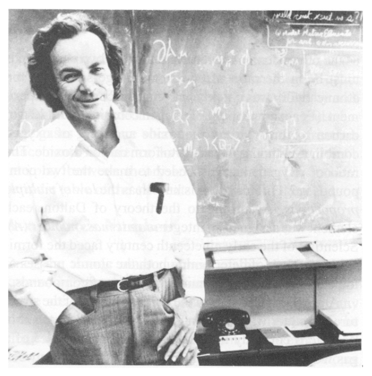

_Figure 26 (p. 91)_

For our first thought experiment, we will consider **two silt diffraction of light**. Assume that instead of using the screen, I use a **sensitive photo-detector**. I measure the intensity of light as a function of position near the screen and find the same set of maxima and minima that I did using my eyes.

<div align="right"><a href="book.pdf#page=91" target="_blank" title="This page in the PDF"><sup>[p. 91]</sup></a></div>
<hr class="page" style="height:2px;border:0;background:currentColor;opacity:0.25">
<a id="p92" href="book.pdf#page=92" target="_blank" title="This page in the PDF"><sup>[p. 92]</sup></a>

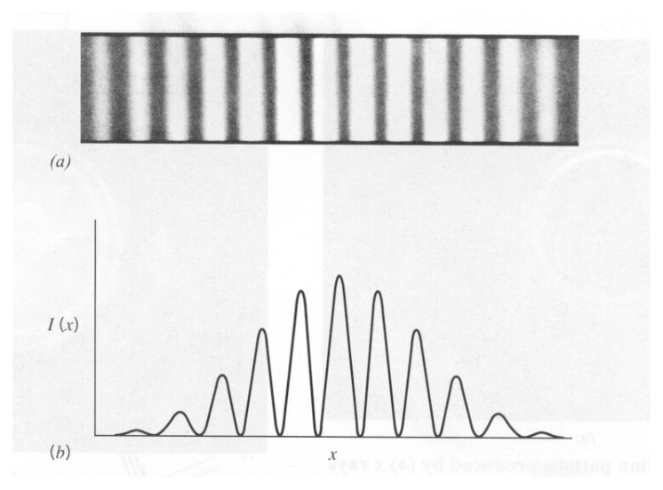

_Figure 27 (p. 92)_

Now lets turn down the intensity of the light source. For very low intensity I find that my detector collects **one photon at a time**. It never collects half a photon. (With the right detector, I could again verify that for each photon, the Photoelectric effect is seen and that $`E = h\nu`$.) So the waves that are diffracting are somehow made up of photons. With a **low enough intensity**, I can assure that **only one photon** is present in the apparatus at any time. I can operate my detector and collect data over a long time, summing up the number of photons detected as a function of position. What will I get for the distribution? I get exactly the same distribution as before with maxima and minima. No matter how low the intensity, (1 particle/ minute!) **we still see diffraction**. We never detect a fraction of an electron or a photon, **only integer numbers**.

How does a single photon interfere with itself? It must somehow travel through both slits.

Lets turn to **electron diffraction** for a minute. In our thought experiment we again have two slits.

<div align="right"><a href="book.pdf#page=92" target="_blank" title="This page in the PDF"><sup>[p. 92]</sup></a></div>
<hr class="page" style="height:2px;border:0;background:currentColor;opacity:0.25">
<a id="p93" href="book.pdf#page=93" target="_blank" title="This page in the PDF"><sup>[p. 93]</sup></a>

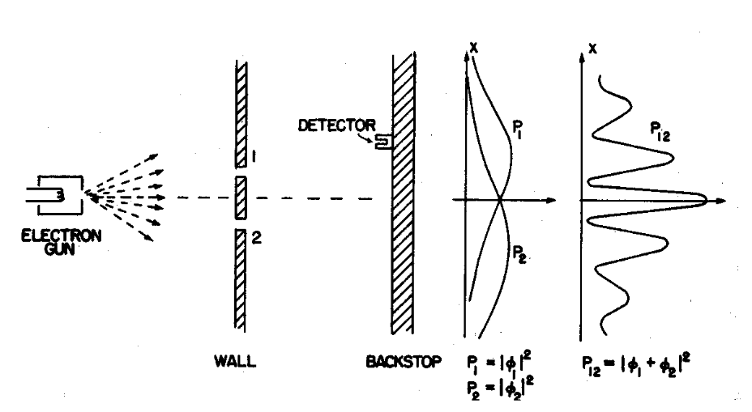

_Figure 28 (p. 93)_

We use our detector to measure the diffraction pattern similar to the one for photons labeled $`P_{1 2}`$ below. If we **cover up slit 2** we get the distribution labeled $`P_{1}`$ and if we /emphtextcover up slit 1 we get the intensity distribution labeled $`P_{2}`$. We could have done the same with our photons above.

Now we will try to see which slit each electron passes through. We put a **bright light source near** **the slits** and detect light bouncing off the electron so we can see which slit it passes through.

<div align="right"><a href="book.pdf#page=93" target="_blank" title="This page in the PDF"><sup>[p. 93]</sup></a></div>
<hr class="page" style="height:2px;border:0;background:currentColor;opacity:0.25">
<a id="p94" href="book.pdf#page=94" target="_blank" title="This page in the PDF"><sup>[p. 94]</sup></a>

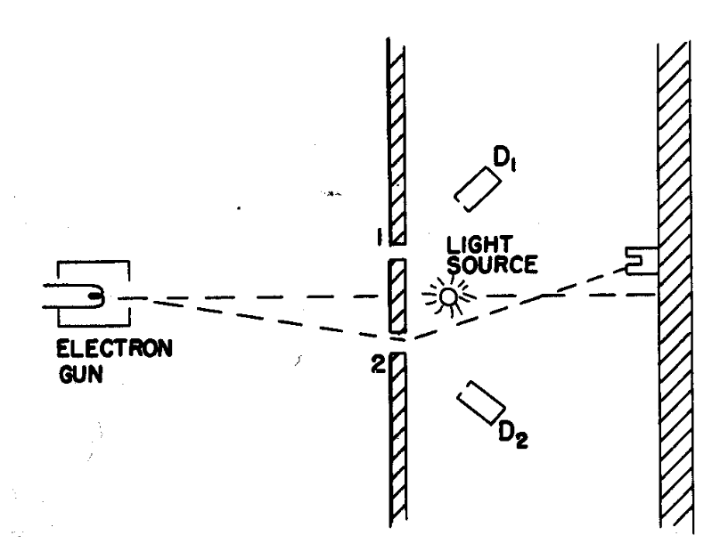

_Figure 29 (p. 94)_

What distribution do we see now? Actually we will see $`P_{1} + P_{2}`$ if we can tell which slit the electron went through. Our **observation of the electron as it passes through the slit has changed** **the resulting intensity distribution**. If we turn the light off, we go back to measuring $`P_{1 2}`$.

Can you explain why the light causes the diffraction pattern to disappear?

Is it the mere observation? Does the light change the phase of the electron?

There are many examples of an observer changing the result of a Quantum experiment. Indeed, it is held that when a state is observed, its wave function collapses into the state “seen”. In this case, all we had to do is turn on the light. We didn’t have to look.

Finally, we will do a two slit **diffraction experiment with bullets**. We must make slits big enough for the bullets to pass through.

<div align="right"><a href="book.pdf#page=94" target="_blank" title="This page in the PDF"><sup>[p. 94]</sup></a></div>
<hr class="page" style="height:2px;border:0;background:currentColor;opacity:0.25">
<a id="p95" href="book.pdf#page=95" target="_blank" title="This page in the PDF"><sup>[p. 95]</sup></a>

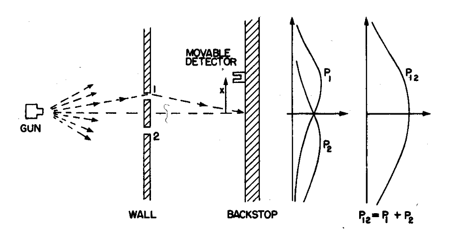

_Figure 30 (p. 95)_

No matter what distance between the slits we choose, we **never observe diffraction** for the bullets. They always give the $`P_{1} + P_{2}`$ pattern (probably different for the bullets). Can you explain this? The bullet’s wavelength is much much smaller than the actual size of the bullet.

Why didn’t we see diffraction for the bullets. Bullets are **macroscopic objects** with huge momenta compared to individual particles. High momentum implies a small deBroglie wavelength. So to see diffraction, we must make the distance between the slits much smaller than we did for the photons (perhaps 10<sup>20</sup> times smaller). But bullets are also big. They only fit through big slits which must them be further apart than the slits used for photons. For bullets, **the wavelength is tiny** **compared to any slit a bullet would fit through**. Therefore no bullet diffraction is possible.

**Feynman Lectures on Physics, Vol. III Chapter 1**

# <a id="s-3-6-examples"></a>3.6 Examples

## <a id="s-3-6-1-intensity-distribution-for-two-slit-diffraction"></a>3.6.1 Intensity Distribution for Two Slit Diffraction \*

Derive the location of the nodes in the diffraction pattern from two narrow slits a distance $`d`$ apart. Now try to compute the intensity distribution.

**This is an in lab exercise**.

## <a id="s-3-6-2-intensity-distribution-for-single-slit-diffraction"></a>3.6.2 Intensity Distribution for Single Slit Diffraction \*

Derive the location of the nodes in the diffraction pattern from one slit of width $`a`$. Now try to compute the intensity distribution for single slit diffraction.

**This is an in lab exercise**.

<div align="right"><a href="book.pdf#page=95" target="_blank" title="This page in the PDF"><sup>[p. 95]</sup></a></div>
<hr class="page" style="height:2px;border:0;background:currentColor;opacity:0.25">
<a id="p96" href="book.pdf#page=96" target="_blank" title="This page in the PDF"><sup>[p. 96]</sup></a>

# <a id="s-3-7-sample-test-problems"></a>3.7 Sample Test Problems

1. What is the deBroglie wavelength of an electron with 13.6 eV of kinetic energy? What is the deBroglie wavelength of an electron with 10 MeV of kinetic energy?

**Answer**<br>
13.6 eV is much less than $`mc^{2}`$ = 0$`. 5 1 1 MeV`$ so this is non-relativistic.

```math
\frac{p^{2}}{2 m} = 1 3 . 6
```

```math
\frac{p^{2} c^{2}}{2 mc^{2}} = 1 3 . 6
```

```math
pc = \sqrt{2 mc^{2} ( 1 3 . 6 )}
```

```math
\lambda = \frac{h}{p} = \frac{2 \pi \hbar}{p} = \frac{2 \pi \hbar c}{pc} = \frac{2 \pi \hbar c}{\sqrt{2 mc^{2} ( 1 3 . 6 )}}
```

```math
= \frac{2 \pi ( 1 9 7 3 eV ˚ A )}{\sqrt{2 ( 0 . 5 1 1 \times 1 0^{6} eV ) ( 1 3 . 6 eV )}} \approx 3 . 3 3 ˚ A
```

10 MeV is much bigger than $`mc^{2}`$ for an electron so it is super-relativistic and we can use

```math
E = pc .
```

```math
\lambda = \frac{2 \pi \hbar c}{pc} = \frac{2 \pi ( 1 9 7 . 3 ) MeVF )}{1 0 MeV} \approx 1 2 0 F
```

2. What is the DeBroglie wavelength for each of the following particles? The energies given are the kinetic energies.

a) a 10 eV electron b) a 1 MeV electron c) a 10 MeV proton

3. A 2 slit electron diffraction experiment is set up as (not) shown below. The observed electron intensity distribution is plotted in the figure. Now an intense light source is introduced near the two slits. With this light, it can be ”seen” which slit each electron goes through. Qualitatively plot the new electron intensity distribution from each slit and from the 2 slits combined. What is the condition on the wavelength of the light for this effect to occur?

4. What is the DeBroglie wavelength for each of the following particles? The energies given are the kinetic energies.

a) a 1 eV electron b) a 10<sup>4</sup> MeV proton

5. What K.E. must a Hydrogen atom have so that its DeBroglie wavelength is smaller than the

size of the atom? (Factors of 2 are not important.)

6. Calculate the DeBroglie wavelength for (a) a proton with 10 MeV kinetic energy, (b) An electron with 10 MeV kinetic energy, and (c) a 1 gram lead ball moving with a velocity of 10 cm/sec (one erg is one gram cm<sup>2</sup>/sec<sup>2</sup>). Be sure to take account of relativity where needed.

7.

---

[← 2 The Problems with Classical Physics](02-the-problems-with-classical-physics.md) · [4 The Solution: Probability Amplitudes →](04-the-solution-probability-amplitudes.md)
