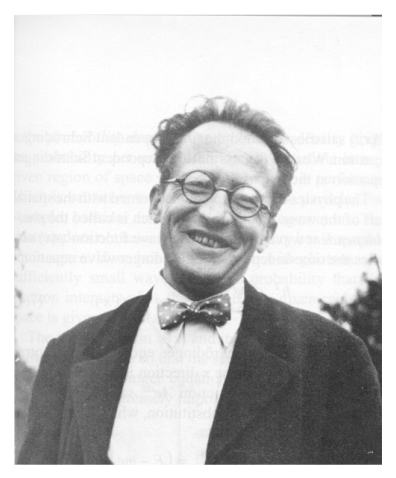

[← 6 Operators](06-operators.md) · [8 Eigenfunctions, Eigenvalues and Vector Spaces →](08-eigenfunctions-eigenvalues-and-vector-spaces.md)

---

<hr class="page" style="height:2px;border:0;background:currentColor;opacity:0.25">
<a id="p126" href="book.pdf#page=126" target="_blank" title="This page in the PDF"><sup>[p. 126]</sup></a>

# 7 The Schrödinger Equation

Schrödinger developed a **differential equation for the time development of a wave function**. Since the Energy operator has a time derivative, the kinetic energy operator has space derivatives, and we expect the solutions to be traveling waves, it is natural to try an energy equation. The Schrödinger equation is the **operator statement that the kinetic energy plus the potential** **energy is equal to the total energy**.



_Figure 31 (p. 126)_

# <a id="s-7-1-deriving-the-equation-from-operators"></a>7.1 Deriving the Equation from Operators

For a **free particle**, we have

```math
\frac{p^{2}}{2 m} = E
```

```math
- \frac{\hbar^{2}}{2 m} \frac{\partial^{2}}{\partial x^{2}} \psi = i \hbar \frac{\partial}{\partial t} \psi
```

Lets **try this equation on our states of definite momentum**.

```math
- \frac{\hbar^{2}}{2 m} \frac{\partial^{2}}{\partial x^{2}} \frac{1}{\sqrt{2 \pi \hbar}} e^{i ( p_{0} x - E_{0} t ) / \hbar} = i \hbar \frac{\partial}{\partial t} \frac{1}{\sqrt{2 \pi \hbar}} e^{i ( p_{0} x - E_{0} t ) / \hbar}
```

The constant in front of the wave function can be removed from both sides. Its there for normalization, not part of the solution. We will go ahead and do the differentiation.

```math
- \frac{\hbar^{2}}{2 m} \frac{- p_{0}^{2}}{\hbar^{2}} e^{i ( p_{0} x - E_{0} t ) / \hbar} = i \hbar \frac{- iE_{0}}{\hbar} e^{i ( p_{0} x - E_{0} t ) / \hbar}
```

```math
\frac{p_{0}^{2}}{2 m} e^{i ( p_{0} x - E_{0} t ) / \hbar} = E_{0} e^{i ( p_{0} x - E_{0} t ) / \hbar}
```

<div align="right"><a href="book.pdf#page=126" target="_blank" title="This page in the PDF"><sup>[p. 126]</sup></a></div>
<hr class="page" style="height:2px;border:0;background:currentColor;opacity:0.25">
<a id="p127" href="book.pdf#page=127" target="_blank" title="This page in the PDF"><sup>[p. 127]</sup></a>

Our wave function will be a solution of the free particle Schrödinger equation provided $`E_{0} = \tfrac{p_{0}^{2}}{2 m}`$ . This is exactly what we wanted. So we have constructed an equation that has the expected wave-functions as solutions. It is a wave equation based on the total energy.

Adding in potential energy, we have **the Schrödinger Equation**

```math
\frac{- \hbar^{2}}{2 m} \frac{\partial^{2} \psi ( x,t )}{\partial x^{2}} + V ( x ) \psi ( x,t ) = i \hbar \frac{\partial \psi ( x,t )}{\partial t}
```

or

```math
H\psi ( x,t ) = E\psi ( x,t )
```

where

```math
H = \frac{p^{2}}{2 m} + V ( x )
```

is the Hamiltonian operator.

In **three dimensions**, this becomes.

```math
H\psi ( \vec{x} , t ) = \frac{- \hbar^{2}}{2 m} \nabla^{2} \psi ( \vec{x} , t ) + V ( \vec{x} ) \psi ( \vec{x} , t ) = i \hbar \frac{\partial \psi ( \vec{x} , t )}{\partial t}
```

We will use it to solve many problems in this course.

So the Schrödinger Equation is, in some sense, simply the statement (in operators) that the kinetic energy plus the potential energy equals the total energy.

# <a id="s-7-2-the-flux-of-probability"></a>7.2 The Flux of Probability \*

In analogy to the Poynting vector for EM radiation, we may want to know the **probability current** in some physical situation. For example, in our free particle solution, the probability density is uniform over all space, but there is a net flow along the direction of the momentum.

We can derive an equation showing conservation of probability (See section 7.5.2), by differentiating $`P ( x,t ) = \psi^{*} \psi`$ and using the Schrödinger Equation.

```math
\frac{\partial P ( x,t )}{\partial t} + \frac{\partial j ( x,t )}{\partial x} = 0
```

This is the usual conservation equation if $`j ( x,t )`$ is identified as the probability current.

```math
j ( x,t ) = \frac{\hbar}{2 mi} \left[ \psi^{*} \frac{\partial \psi}{\partial x} - \frac{\partial \psi^{*}}{\partial x} \psi \right]
```

This current can be computed from the wave function.

<div align="right"><a href="book.pdf#page=127" target="_blank" title="This page in the PDF"><sup>[p. 127]</sup></a></div>
<hr class="page" style="height:2px;border:0;background:currentColor;opacity:0.25">
<a id="p128" href="book.pdf#page=128" target="_blank" title="This page in the PDF"><sup>[p. 128]</sup></a>

If we **integrate if over some interval** in $`x`$

```math
\int_{a}^{b} \frac{\partial P ( x,t )}{\partial t} dx = - \int_{a}^{b} \frac{\partial j ( x,t )}{\partial x}
```

```math
\frac{\partial}{\partial t} \int_{a}^{b} P ( x,t ) dx = j ( x = a,t ) - j ( x = b,t )
```

the equation says that the rate of change of probability in an interval is equal to the probability flux into the integral minus the flux out.

Extending this analysis to **3 dimensions**,

```math
\frac{\partial P ( x,t )}{\partial t} + \vec{\nabla} \cdot \vec{j} ( \vec{r} , t ) = 0
```

with

```math
\vec{j} ( \vec{r} , t ) = \frac{\hbar}{2 mi} \left[ \psi^{*} ( \vec{r} , t ) \vec{\nabla} \psi ( \vec{r} , t ) - \psi ( \vec{r} , t ) \vec{\nabla} \psi^{*} ( \vec{r} , t ) \right]
```

# <a id="s-7-3-the-schrodinger-wave-equation"></a>7.3 The Schrödinger Wave Equation

The normal equation we get, for waves on a string or on water, relates the second space derivative to the second time derivative. The Schrödinger equation uses **only the first time derivative**, however, the addition of the $`i`$ relates the real part of the wave function to the imaginary part, in effect shifting the phase by 90 degrees as the 2nd derivative would do.

```math
\frac{- \hbar^{2}}{2 m} \frac{\partial^{2} \psi ( x,t )}{\partial x^{2}} + V ( x ) \psi ( x,t ) = i \hbar \frac{\partial \psi ( x,t )}{\partial t}
```

The Schrödinger equation is **built for complex wave functions**.

When Dirac tried to make a relativistic version of the equation, where the energy relation is a bit more complicated, he discovered new physics.

## <a id="s-gasiorowicz-chapter-3"></a>Gasiorowicz Chapter 3

## <a id="s-griffiths-chapter-1"></a>Griffiths Chapter 1

## <a id="s-cohen-tannoudji-et-al-chapter"></a>Cohen-Tannoudji et al. Chapter

# <a id="s-7-4-the-time-independent-schrodinger-equation"></a>7.4 The Time Independent Schrödinger Equation

Second order differential equations, like the Schrödinger Equation, can be solved by **separation of** **variables**. These separated solutions can then be used to solve the problem in general.

<div align="right"><a href="book.pdf#page=128" target="_blank" title="This page in the PDF"><sup>[p. 128]</sup></a></div>
<hr class="page" style="height:2px;border:0;background:currentColor;opacity:0.25">
<a id="p129" href="book.pdf#page=129" target="_blank" title="This page in the PDF"><sup>[p. 129]</sup></a>

Assume that we can **factorize** the solution between time and space.

```math
\psi ( x,t ) = u ( x ) T ( t )
```

Plug this into the Schrödinger Equation.

```math
\left( \frac{- \hbar^{2}}{2 m} \frac{\partial^{2} u ( x )}{\partial x^{2}} + V ( x ) u ( x ) \right) T ( t ) = i \hbar u ( x ) \frac{\partial T ( t )}{\partial t}
```

Put everything that depends on $`x`$ on the left and everything that depends on $`t`$ on the right.

```math
\frac{\left( \tfrac{\hbar^{2}}{2 m}^{-} \tfrac{\partial^{2} u ( x )}{\partial x^{2}} + V ( x ) u ( x ) \right)}{u ( x )} = \frac{i \hbar^{\partial T} \tfrac{( t )}{\partial t}}{T ( t )} = const. = E
```

Since we have a function of only $`x`$ set equal to a function of only $`t`$, they **both must equal a** **constant**. In the equation above, we call the constant $`E`$, (with some knowledge of the outcome). We now have an equation in $`t`$ set equal to a constant

```math
i \hbar \frac{\partial T ( t )}{\partial t} = ET ( t )
```

which has a simple **general solution**,

```math
T ( t ) = Ce^{- iEt/ \hbar}
```

and an equation in $`x`$ set equal to a constant

```math
\frac{- \hbar^{2}}{2 m} \frac{\partial^{2} u ( x )}{\partial x^{2}} + V ( x ) u ( x ) = Eu ( x )
```

which depends on the problem to be solved (through $`V ( x ) ) .`$

<div align="center">

The $`x`$ equation is often called the **Time Independent Schrödinger Equation**.

</div>

```math
\frac{- \hbar^{2}}{2 m} \frac{\partial^{2} u ( x )}{\partial x^{2}} + V ( x ) u ( x ) = Eu ( x )
```

Here, $`E`$ is a constant. The **full time dependent solution** is.

```math
\psi ( x,t ) = u ( x ) e^{- iEt/ \hbar}
```

<div align="center">

\* See Example 7.6.1: Solve the Schrödinger equation for a constant potential $`V_{0} . *`$

</div>

# <a id="s-7-5-derivations-and-computations"></a>7.5 Derivations and Computations

## <a id="s-7-5-1-linear-operators"></a>7.5.1 Linear Operators

**Linear operators** $`L`$ satisfy the equation

<div align="right"><a href="book.pdf#page=129" target="_blank" title="This page in the PDF"><sup>[p. 129]</sup></a></div>
<hr class="page" style="height:2px;border:0;background:currentColor;opacity:0.25">
<a id="p130" href="book.pdf#page=130" target="_blank" title="This page in the PDF"><sup>[p. 130]</sup></a>

```math
L ( a\psi + b\varphi ) = aL\psi + bL\varphi
```

where $`a`$ and $`b`$ are arbitrary constants and $`\psi`$ and $`\varphi`$ are arbitrary wave-functions. A multiplicative constant is a simple linear operator. Differential operators clearly are linear also.

An example of a non-linear operator (which we will not use) is $`N`$ which has the property

```math
N\psi = \psi^{2} .
```

## <a id="s-7-5-2-probability-conservation-equation"></a>7.5.2 Probability Conservation Equation \*

Start from the probability and differentiate with respect to time.

```math
\frac{\partial P ( x,t )}{\partial t} = \frac{\partial}{\partial t} ( \psi^{*} ( x,t ) \psi ( x,t ) ) = \left[ \frac{\partial \psi^{*}}{\partial t} \psi - \psi^{*} \frac{\partial \psi}{\partial t} \right]
```

Use the Schrödinger Equation

```math
\frac{- \hbar^{2}}{2 m} \frac{\partial^{2} \psi}{\partial x^{2}} + V ( x ) \psi = i \hbar \frac{\partial \psi}{\partial t}
```

and its complex conjugate

```math
\frac{- \hbar^{2}}{2 m} \frac{\partial^{2} \psi^{*}}{\partial x^{2}} + V ( x ) \psi^{*} = - i \hbar \frac{\partial \psi^{*}}{\partial t} .
```

(We assume $`V ( x )`$ is real. Imaginary potentials do cause probability not to be conserved.)

Now we need to plug those equations in.

```math
\frac{\partial P ( x,t )}{\partial t} = \frac{1}{i \hbar} \left[ \frac{\hbar^{2}}{2 m} \frac{\partial^{2} \psi^{*}}{\partial x^{2}} \psi - V ( x ) \psi^{*} \psi + \frac{- \hbar^{2}}{2 m} \psi^{*} \frac{\partial^{2} \psi}{\partial x^{2}} + V ( x ) \psi^{*} \psi \right]
```

```math
= \frac{1}{i \hbar} \frac{\hbar^{2}}{2 m} \left[ \frac{\partial^{2} \psi^{*}}{\partial x^{2}} \psi - \psi^{*} \frac{\partial^{2} \psi}{\partial x^{2}} \right] = \frac{\hbar}{2 mi} \frac{\partial}{\partial x} \left[ \frac{\partial \psi^{*}}{\partial x} \psi - \psi^{*} \frac{\partial \psi}{\partial x} \right]
```

This is the usual conservation equation if $`j ( x,t )`$ is identified as the probability current.

```math
\frac{\partial P ( x,t )}{\partial t} + \frac{\partial j ( x,t )}{\partial x} = 0
```

```math
j ( x,t ) = \frac{\hbar}{2 mi} \left[ \psi^{*} \frac{\partial \psi}{\partial x} - \frac{\partial \psi^{*}}{\partial x} \psi \right]
```

# <a id="s-7-6-examples"></a>7.6 Examples

## <a id="s-7-6-1-solution-to-the-schrodinger-equation-in-a-constant-potential"></a>7.6.1 Solution to the Schrödinger Equation in a Constant Potential

Assume we want to solve the Schrödinger Equation in a region in which the potential is constant and equal to $`V_{0}`$. We will find two solutions for each energy $`E`$.

<div align="right"><a href="book.pdf#page=130" target="_blank" title="This page in the PDF"><sup>[p. 130]</sup></a></div>
<hr class="page" style="height:2px;border:0;background:currentColor;opacity:0.25">
<a id="p131" href="book.pdf#page=131" target="_blank" title="This page in the PDF"><sup>[p. 131]</sup></a>

We have the equation.

```math
\frac{- \hbar^{2}}{2 m} \frac{\partial^{2} \psi ( x )}{\partial x^{2}} + V_{0} \psi ( x ) = E\psi ( x )
```

```math
\frac{\partial^{2} \psi ( x )}{\partial x^{2}} = - \frac{2 m}{\hbar^{2}} ( E - V_{0} ) \psi ( x )
```

Remember that $`x`$ is an independent variable in the above equation while $`p`$ and $`E`$ are constants to be determined in the solution.

For $`E>V_{0}`$, there are solutions

```math
e^{ikx}
```

and

```math
e^{- ikx}
```

if we define $`k`$ by the equation $`\hbar k`$ = +$`\sqrt{2 m ( E - V_{0} )}`$. These are waves traveling in opposite directions with the same energy (and magnitude of momentum).

We could also use the linear combinations of the above two solutions

```math
\sin ( kx )
```

and

```math
\cos ( kx ) .
```

There are only two linearly independent solutions. We need to choose either the exponentials or the trig functions, not both. The sin and cos solutions represent states of definite energy but contain particles moving to the left and to the right. They are not definite momentum states. They will be useful to us for some solutions.

The solutions are also technically correct for $`E<V_{0}`$ but $`k`$ becomes imaginary. Lets write the solutions in terms of $`\hbar \kappa = i \hbar k = \sqrt{2 m ( V_{0} - E )}`$ The solutions are

```math
e^{\kappa x}
```

and

```math
e^{- \kappa x} .
```

These are not waves at all, but real exponentials. Note that these are solutions for regions where the particle is not allowed classically, due to energy conservation; the total energy is less than the potential energy. We will use these solutions in Quantum Mechanics.

# <a id="s-7-7-sample-test-problems"></a>7.7 Sample Test Problems

```math
1 .
```

```math
2 .
```

---

[← 6 Operators](06-operators.md) · [8 Eigenfunctions, Eigenvalues and Vector Spaces →](08-eigenfunctions-eigenvalues-and-vector-spaces.md)
