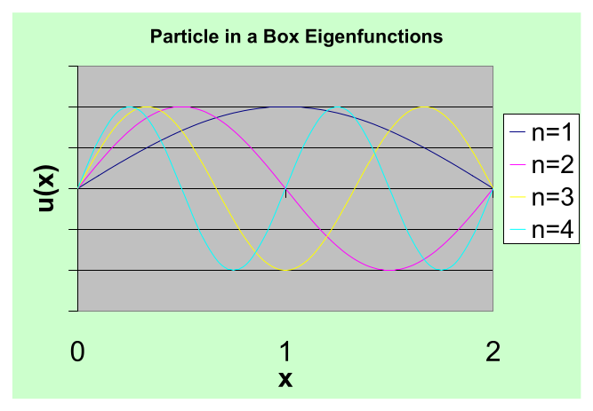

[← 7 The Schrödinger Equation](07-the-schrodinger-equation.md) · [9 One Dimensional Potentials →](09-one-dimensional-potentials.md)

---

<hr class="page" style="height:2px;border:0;background:currentColor;opacity:0.25">
<a id="p132" href="book.pdf#page=132" target="_blank" title="This page in the PDF"><sup>[p. 132]</sup></a>

# 8 Eigenfunctions, Eigenvalues and Vector Spaces

# <a id="s-8-1-eigenvalue-equations"></a>8.1 Eigenvalue Equations

The time independent Schrödinger Equation is an example of an Eigenvalue equation.

```math
Hu ( x ) = Eu ( x )
```

The Hamiltonian operates on $`u ( x )`$ **the eigenfunction**, giving a constant $`E`$ **the eigenvalue**, times the same function. (Eigen just means the same in German.)

Usually, for bound states, there are **many eigenfunction solutions** (denoted here by the index $`i )`$.

```math
H\psi_{i} = E_{i} \psi_{i}
```

For states representing one particle (particularly bound states) we must **require that the solutions** **be normalizable**. Solutions that are not normalizable must be discarded. A normalizable wave function must go to zero at infinity.

```math
\psi ( \infty ) \to 0
```

In fact, all the derivatives of $`\psi`$ must go to zero at infinity in order for the wave function to stay at zero.

We will prove later that the eigenfunctions are orthogonal (See section 8.7.1) to each other.

```math
\langle \psi_{i} | \psi_{j} \rangle = \delta_{ij}
```

```math
\int_{-\infty}^{\infty} \psi^{*} ( x ) \psi ( x ) dx = 1
```

We will assume that the **eigenfunctions form a complete set** so that any function can be written as a linear combination of them.

```math
\psi = \alpha_{1} \psi_{1} + \alpha_{2} \psi_{2} + \alpha_{3} \psi_{3} + \dots
```

```math
\psi = \sum_{i = 1}^{\infty} \alpha_{i} \psi_{i}
```

(This can be proven for many of the eigenfunctions we will use.)<span class="page" style="float:left;width:100%;margin:0.4em 0 0.6em"><span style="display:block;text-align:right"><a href="book.pdf#page=132" target="_blank" title="This page in the PDF"><sup>[p. 132]</sup></a></span><span style="display:block;height:2px;background:currentColor;opacity:0.25"></span><a id="p133" href="book.pdf#page=133" target="_blank" title="This page in the PDF"><sup>[p. 133]</sup></a></span> Since the eigenfunctions are orthogonal, we can easily **compute the coefficients** in the expansion of an arbitrary wave function $`\psi`$.

```math
\alpha_{i} = \langle \psi_{i} | \psi \rangle = \langle \psi_{i} | \sum_{j} \alpha_{j} \psi_{j} \rangle = \sum_{j} \langle \psi_{i} | \psi_{j} \rangle \alpha_{j} = \sum_{j} \delta_{ij} \alpha_{j} = \alpha_{i}
```

We will later think of the eigenfunctions as unit vectors in a vector space (See section 8.4). The arbitrary wave function $`\psi`$ is then a vector in that space.

```math
\psi = \begin{pmatrix} \alpha_{1} \\ \alpha_{2} \\ \alpha_{3} \\ \dots \end{pmatrix}
```

It is instructive to compute the **expectation value of the Hamiltonian** using the expansion of $`\psi`$ and the orthonormality of the eigenfunctions.

```math
\langle \psi | H | \psi \rangle = \sum_{ij} \langle \alpha_{i} \psi_{i} | H | \alpha_{j} \psi_{j} \rangle = \sum_{ij} \langle \alpha_{i} \psi_{i} | \alpha_{j} H\psi_{j} \rangle
```

```math
= \sum_{ij} \alpha_{i}^{*} \alpha_{j} E_{j} \langle \psi_{i} | \psi_{j} \rangle = \sum_{ij} \alpha_{i}^{*} \alpha_{j} E_{j} \delta_{ij}
```

```math
= \sum_{i} \alpha_{i}^{*} \alpha_{i} E_{i} = \sum_{i} | \alpha_{i} |^{2} E_{i}
```

We can see that the **coefficients of the eigenstates represent probability amplitudes to be** **in those states**, since the absolute squares of the coefficients $`\alpha_{i}^{*} \alpha_{i}`$ obviously give the probability.

# <a id="s-8-2-hermitian-conjugate-of-an-operator"></a>8.2 Hermitian Conjugate of an Operator

First let us define the **Hermitian Conjugate** of an operator $`H`$ to be $`H^{\dagger}`$. The meaning of this conjugate is given in the following equation.

```math
\langle \psi | H | \psi \rangle = \int_{-\infty}^{\infty} \psi^{*} ( x ) H\psi ( x ) dx = \langle \psi | H\psi \rangle \equiv \langle H^{\dagger} \psi | \psi \rangle
```

That is, $`H^{\dagger}`$ must operate on the conjugate of $`\psi`$ and give the same result for the integral as when $`H`$ operates on $`\psi`$.

The definition of the **Hermitian Conjugate of an operator** can be simply written in Bra-Ket notation.

```math
\langle A^{\dagger} \varphi | \psi \rangle = \langle \varphi | A\psi \rangle
```

Starting from this definition, we can prove some simple things. Taking the complex conjugate

```math
\langle \psi | A^{\dagger} \varphi \rangle = \langle A\psi | \varphi \rangle
```

<div align="right"><a href="book.pdf#page=133" target="_blank" title="This page in the PDF"><sup>[p. 133]</sup></a></div>
<hr class="page" style="height:2px;border:0;background:currentColor;opacity:0.25">
<a id="p134" href="book.pdf#page=134" target="_blank" title="This page in the PDF"><sup>[p. 134]</sup></a>

Now taking the Hermitian conjugate of $`A^{\dagger}`$.

```math
\langle \left( A^{\dagger} \right)^{\dagger} \psi | \varphi \rangle = \langle A\psi | \varphi \rangle
```

```math
\left( A^{\dagger} \right)^{\dagger} = A
```

If we take the Hermitian conjugate twice, we get back to the same operator.

Its easy to show that

```math
( \lambda A )^{\dagger} = \lambda^{*} A^{\dagger}
```

and

```math
( A + B )^{\dagger} = A^{\dagger} + B^{\dagger}
```

just from the properties of the dot product.

We can also show that

```math
( AB )^{\dagger} = B^{\dagger} A^{\dagger} .
```

```math
\langle \varphi | AB\psi \rangle = \langle A^{\dagger} \varphi | B\psi \rangle = \langle B^{\dagger} A^{\dagger} \varphi | \psi \rangle
```

\* See Example 8.8.1: Find the Hermitian conjugate of the operator $`a + ib . *`$

\* See Example 8.8.2: Find the Hermitian conjugate of the operator $`\partial x \partial`$ .\*

# <a id="s-8-3-hermitian-operators"></a>8.3 Hermitian Operators

A **physical variable must have real expectation values** (and eigenvalues). This implies that the operators representing physical variables have some special properties.

By computing the complex conjugate of the expectation value of a physical variable, we can easily **show that physical operators are their own Hermitian conjugate**.

```math
\langle \psi | H | \psi \rangle^{*} = \left[ \int_{-\infty}^{\infty} \psi^{*} ( x ) H\psi ( x ) dx \right]^{*} = \int_{-\infty}^{\infty} \psi ( x ) ( H\psi ( x ) )^{*} dx = \langle H\psi | \psi \rangle
```

```math
\langle H\psi | \psi \rangle = \langle \psi | H\psi \rangle = \langle H^{\dagger} \psi | \psi \rangle
```

```math
H^{\dagger} = H
```

Operators that are their own Hermitian Conjugate are called **Hermitian Operators**.

```math
H^{\dagger} = H
```

<div align="right"><a href="book.pdf#page=134" target="_blank" title="This page in the PDF"><sup>[p. 134]</sup></a></div>
<hr class="page" style="height:2px;border:0;background:currentColor;opacity:0.25">
<a id="p135" href="book.pdf#page=135" target="_blank" title="This page in the PDF"><sup>[p. 135]</sup></a>

# <a id="s-8-4-eigenfunctions-and-vector-space"></a>8.4 Eigenfunctions and Vector Space

Wavefunctions are analogous to vectors in 3D space. The unit vectors of our vector space are eigenstates.

In **normal 3D space**, we represent a vector by its components.

```math
\vec{r} = x \hat{x} + y \hat{y} + z \hat{z} = \sum_{i = 1}^{3} r_{i} \hat{u}_{i}
```

The unit vectors $`\hat{u}_{i}`$ are orthonormal,

```math
\hat{u}_{i} \cdot \hat{u}_{j} = \delta_{ij}
```

where $`\delta_{ij}`$ is the usual Kroneker delta, equal to 1 if $`i = j`$ and otherwise equal to zero.

**Eigenfunctions – the unit vectors of our space** – are orthonormal.

```math
\langle \psi_{i} | \psi_{j} \rangle = \delta_{ij}
```

We represent our **wavefunctions – the vectors in our space** – as linear combinations of the eigenstates (unit vectors). $`\infty`$

```math
\psi = \sum_{i = 1} \alpha_{i} \psi_{i}
```

```math
\varphi = \sum_{j = 1}^{\infty} \beta_{j} \psi_{j}
```

In normal 3D space, we can compute the **dot product between two vectors** using the components.

```math
\vec{r}_{1} \cdot \vec{r}_{2} = x_{1} x_{2} + y_{1} y_{2} + z_{1} z_{2}
```

In our vector space, we **define the dot product** to be

```math
\langle \psi | \varphi \rangle = \langle \sum_{i = 1}^{\infty} \alpha_{i} \psi_{i} | \sum_{j = 1}^{\infty} \beta_{j} \psi_{j} \rangle = \sum_{i = 1 j = 1}^{\infty} \sum^{\infty} \alpha_{i}^{*} \beta_{j} \langle \psi_{i} | \psi_{j} \rangle
```

```math
= \sum_{i = 1 j = 1}^{\infty} \sum^{\infty} \alpha_{i}^{*} \beta_{j} \delta_{ij} = \sum_{i = 1}^{\infty} \alpha_{i}^{*} \beta_{i}
```

We also can compute the dot product from the components of the vectors. Our vector space is a little bit different because of the complex conjugate involved in the definition of our dot product.

From a more mathematical point of view, the square integrable functions form a (vector) Hilbert Space. The scalar product is defined as above.

```math
\langle \varphi | \psi \rangle = \int_{-\infty}^{\infty} d^{3} r\varphi^{*} \psi
```

The properties of the scalar product are easy to derive from the integral.

```math
\langle \varphi | \psi \rangle = \langle \psi | \varphi \rangle^{*}
```

<div align="right"><a href="book.pdf#page=135" target="_blank" title="This page in the PDF"><sup>[p. 135]</sup></a></div>
<hr class="page" style="height:2px;border:0;background:currentColor;opacity:0.25">
<a id="p136" href="book.pdf#page=136" target="_blank" title="This page in the PDF"><sup>[p. 136]</sup></a>

```math
\langle \varphi | \lambda_{1} \psi_{1} + \lambda_{2} \psi_{2} \rangle = \lambda_{1} \langle \varphi | \psi_{1} \rangle + \lambda_{2} \langle \varphi | \psi_{2} \rangle
```

```math
\langle \lambda_{1} \varphi_{1} + \lambda_{2} \varphi_{2} | \psi \rangle = \lambda_{1}^{*} \langle \varphi_{1} | \psi \rangle + \lambda_{2}^{*} \langle \varphi_{2} | \psi \rangle
```

$`\langle \psi | \psi \rangle`$ is real and greater than 0. It equals zero iff $`\psi`$ = 0. We may also derive the Schwartz inequality.

```math
\langle \psi_{1} | \psi_{2} \rangle \leq \sqrt{\langle \psi_{1} | \psi_{1} \rangle \langle \psi_{2} | \psi_{2} \rangle}
```

Linear operators take vectors in the space into other vectors.

```math
\psi^{\prime} = A\psi
```

# <a id="s-8-5-the-particle-in-a-1d-box"></a>8.5 The Particle in a 1D Box

As a simple example, we will solve the 1D **Particle in a Box** problem. That is a particle confined to a region $`0 <x<a`$. We can do this with the (unphysical) potential which is zero with in those limits and +$`\infty`$ outside the limits.

```math
V ( x ) = \begin{cases} 0 & 0 <x<a \\ \infty & \text{ elsewhere } \end{cases}
```

Because of the infinite potential, this problem has very **unusual boundary conditions**. (Normally we will require continuity of the wave function and its first derivative.) The wave function must be zero at $`x`$ = 0 and $`x = a`$ since it must be continuous and it is zero in the region of infinite potential. The first derivative does not need to be continuous at the boundary (unlike other problems), because of the infinite discontinuity in the potential.

The time independent **Schrödinger equation** (also called the energy eigenvalue equation) is

```math
Hu_{j} = E_{j} u_{j}
```

with the Hamiltonian (inside the box)

```math
H = - \frac{\hbar^{2}}{2 m} \frac{d^{2}}{dx^{2}}
```

Our solutions will have

```math
u_{j} = 0
```

outside the box.

The **solution inside the box** could be written as

```math
u_{j} = e^{ikx}
```

where $`k`$ can be positive or negative. We do **need to choose linear combinations that satisfy** **the boundary condition** that $`u_{j} ( x`$ = 0) = $`u_{j} ( x = a )`$ = 0.

We can do this easily by **choosing**

```math
u_{j} = C \sin ( kx )
```

<div align="right"><a href="book.pdf#page=136" target="_blank" title="This page in the PDF"><sup>[p. 136]</sup></a></div>
<hr class="page" style="height:2px;border:0;background:currentColor;opacity:0.25">
<a id="p137" href="book.pdf#page=137" target="_blank" title="This page in the PDF"><sup>[p. 137]</sup></a>

which automatically satisfies the BC at 0. To satisfy the BC at $`x = a`$ we need the argument of sine

```math
\text{ to be } n\pi \text{ there } . \quad u_{n} = C \sin \left( \frac{n\pi x}{a} \right)
```

Plugging this back into the Schrödinger equation, we get

```math
\frac{- \hbar^{2}}{2 m} ( - \frac{n^{2} \pi^{2}}{a^{2}} ) C \sin ( kx ) = EC \sin ( kx ) .
```

There will only be a solution which satisfies the BC for a **quantized set of energies**.

```math
E_{n} = \frac{n^{2} \pi^{2} \hbar^{2}}{2 ma^{2}}
```

We have solutions to the Schrödinger equation that satisfy the boundary conditions. Now we need to set the constant $`C`$ to **normalize** them to 1.

```math
\langle u_{n} | u_{n} \rangle = | C |^{2} \int_{0}^{a} \sin^{2} \left( \frac{n\pi x}{a} \right) dx = | C |^{2} \frac{a}{2}
```

Remember that the average value of sin<sup>2</sup> is one half (over half periods). So we set $`C`$ giving us the eigenfunctions

```math
u_{n} = \sqrt{\frac{2}{a}} \sin \left( \frac{n\pi x}{a} \right)
```

The first four eigenfunctions are graphed below. The ground state has the least curvature and the fewest zeros of the wavefunction.



_Figure 32 (p. 137)_

<div align="right"><a href="book.pdf#page=137" target="_blank" title="This page in the PDF"><sup>[p. 137]</sup></a></div>
<hr class="page" style="height:2px;border:0;background:currentColor;opacity:0.25">
<a id="p138" href="book.pdf#page=138" target="_blank" title="This page in the PDF"><sup>[p. 138]</sup></a>

Note that these states would have a definite parity if $`x`$ = 0 were at the center of the box.

The **expansion** of an arbitrary wave function in these eigenfunctions is essentially our **original** **Fourier Series**. This is a good example of the energy eigenfunctions being orthogonal and covering the space.

## <a id="s-8-5-1-the-same-problem-with-parity-symmetry"></a>8.5.1 The Same Problem with Parity Symmetry

If we simply **redefine the position of the box** so that $`- \tfrac{a}{2} <x< \tfrac{a}{2}`$, then our problem has **symmetry under the Parity operation**.

```math
x \to - x
```

The Hamiltonian remains unchanged if we make the above transformation. The Hamiltonian commutes with the Parity operator.

```math
[ H,P ] = 0
```

This means that $`( Pu_{i} )`$ is an eigenfunction of $`H`$ with the same energy eigenvalue.

```math
H ( Pu_{i} ) = P ( Hu_{i} ) = PE_{i} u_{i} = E_{i} ( Pu_{i} )
```

Thus, it must be a constant times the same energy eigenfunction.

```math
Pu_{i} = cu_{i}
```

The equations says the **energy eigenfunctions are also eigenfunctions of the parity operator**.

If we operate twice with parity, we get back to the original function,

```math
P^{2} u_{i} = u_{i}
```

so the **parity eigenvalues must be** $`\pm 1`$.

```math
Pu_{i} = \pm 1 u_{i}
```

The boundary conditions are

```math
\psi ( \pm \frac{a}{2} ) = 0 .
```

This gives **two types of solutions**.

```math
u_{n}^{+} ( x ) = \sqrt{\frac{2}{a}} \cos \left( \frac{( 2 n - 1 ) \pi x}{a} \right)
```

```math
u_{n}^{-} ( x ) = \sqrt{\frac{2}{a}} \sin \left( \frac{2 n\pi x}{a} \right)
```

```math
E_{n}^{+} = ( 2 n - 1 )^{2} \frac{\pi^{2} \hbar^{2}}{2 ma^{2}}
```

```math
E_{n}^{-} = ( 2 n )^{2} \frac{\pi^{2} \hbar^{2}}{2 ma^{2}}
```

<div align="right"><a href="book.pdf#page=138" target="_blank" title="This page in the PDF"><sup>[p. 138]</sup></a></div>
<hr class="page" style="height:2px;border:0;background:currentColor;opacity:0.25">
<a id="p139" href="book.pdf#page=139" target="_blank" title="This page in the PDF"><sup>[p. 139]</sup></a>

Together, these are **exactly equivalent to the set of solutions we had with the box defined** **to be from 0 to** $`a`$. The $`u_{n}^{+} ( x )`$ have eigenvalue +1 under the parity operator. The $`u_{n}^{-} ( x )`$ have eigenvalue -1 under the parity operator.

This is an **example of a symmetry** of the problem, causing an operator to commute with the Hamiltonian. We can then have simultaneous eigenfunctions of that operator and $`H`$. In this case all the energy eigenfunctions are also eigenstates of parity. Parity is conserved.

An arbitrary wave function can be written as a sum of the energy eigenfunctions recovering the **Fourier series in its standard form**.

```math
\psi ( x ) = \sum_{n = 1}^{\infty} [ A_{n}^{+} u_{n}^{+} ( x ) + A_{n}^{-} u_{n}^{-} ( x ) ]
```

# <a id="s-8-6-momentum-eigenfunctions"></a>8.6 Momentum Eigenfunctions

We can also look at the **eigenfunctions of the momentum operator**.

```math
p_{op} u_{p} ( x ) = pu_{p} ( x )
```

```math
\frac{\hbar}{i} \frac{d}{dx} u_{p} ( x ) = pu_{p} ( x )
```

The **eigenstates** are

```math
u_{p} ( x ) = Ce^{ipx/ \hbar}
```

with $`p`$ allowed to be positive or negative.

These solutions do not go to zero at infinity so they are not normalizable to one particle.

```math
\langle p | p \rangle = \langle u_{p} | u_{p} \rangle = \infty
```

This is a common problem for this type of state.

We will use a **different type of normalization for the momentum eigenstates** (and the position eigenstates).

```math
\langle p^{\prime} | p \rangle = | C |^{2} \int_{-\infty}^{\infty} e^{i ( p - p^{\prime} ) x/ \hbar} dx = 2 \pi \hbar | C |^{2} \delta ( p - p^{\prime} )
```

Instead of the Kronecker delta, we use the Dirac delta function. The momentum eigenstates have a continuous range of eigenvalues so that they cannot be indexed like the energy eigenstates of a bound system. This means the Kronecker delta could not work anyway.

These are the **momentum eigenstates**

```math
u_{p} ( x ) = \frac{1}{\sqrt{2 \pi \hbar}} e^{ipx/ \hbar}
```

<div align="right"><a href="book.pdf#page=139" target="_blank" title="This page in the PDF"><sup>[p. 139]</sup></a></div>
<hr class="page" style="height:2px;border:0;background:currentColor;opacity:0.25">
<a id="p140" href="book.pdf#page=140" target="_blank" title="This page in the PDF"><sup>[p. 140]</sup></a>

satisfying the **normalization condition**

```math
\langle p^{\prime} | p \rangle = \delta ( p - p^{\prime} )
```

For a **free particle Hamiltonian**, both momentum and parity commute with $`H`$. So we can make simultaneous eigenfunctions.

```math
[ H,p ] = 0
```

```math
[ H,P ] = 0
```

We **cannot make eigenfunctions of all three operators** since

```math
[ P,p ] \neq 0 .
```

So we have the **choice** of the $`e^{ikx}`$ states which are eigenfunctions of $`H`$ and of $`p`$, but contain positive and negative parity components. or we have the sin$`( kx )`$ and cos($`kx )`$ states which contain two momenta but are eigenstates of $`H`$ and Parity. These are just different linear combinations of the same solutions.

# <a id="s-8-7-derivations-and-computations"></a>8.7 Derivations and Computations

## <a id="s-8-7-1-eigenfunctions-of-hermitian-operators-are-orthogonal"></a>8.7.1 Eigenfunctions of Hermitian Operators are Orthogonal

We wish to prove that eigenfunctions of Hermitian operators are orthogonal. In fact we will first do this **except in the case of equal eigenvalues**.

Assume we have a **Hermitian operator** $`A`$ **and two of its eigenfunctions** such that

```math
A\psi_{1} = a_{1} \psi_{1}
```

```math
A\psi_{2} = a_{2} \psi_{2} .
```

Now we compute $`\langle \psi_{2} | A | \psi_{1} \rangle`$ two ways.

```math
\langle \psi 2 | A\psi 1 \rangle = a 1 \langle \psi 2 | \psi 1 \rangle
```

```math
\langle \psi_{2} | A\psi_{1} \rangle = \langle A\psi_{2} | \psi_{1} \rangle = a_{2} \langle \psi_{2} | \psi_{1} \rangle
```

Remember the **eigenvalues are real** so there’s no conjugation needed.

Now we **subtract the two equations**. The left hand sides are the same so they give zero.

```math
0 = ( a_{2} - a_{1} ) \langle \psi_{2} | \psi_{1} \rangle
```

If $`a_{1} \neq a_{2}`$ then

```math
\langle \psi_{2} | \psi_{1} \rangle = 0 .
```

<div align="right"><a href="book.pdf#page=140" target="_blank" title="This page in the PDF"><sup>[p. 140]</sup></a></div>
<hr class="page" style="height:2px;border:0;background:currentColor;opacity:0.25">
<a id="p141" href="book.pdf#page=141" target="_blank" title="This page in the PDF"><sup>[p. 141]</sup></a>

The **eigenfunctions are orthogonal**.

What if two of the eigenfunctions have the **same eigenvalue**? Then, our proof doesn’t work. Assume $`\langle \psi_{2} | \psi_{1} \rangle`$ is real, since we can always adjust a phase to make it so. Since any linear combination of $`\psi_{1}`$ and $`\psi_{2}`$ has the same eigenvalue, we can use any linear combination. Our aim will be to **choose** **two linear combinations which are orthogonal**. Lets try

```math
\psi_{+} = \frac{1}{\sqrt{2}} ( \psi_{1} + \psi_{2} )
```

```math
\psi_{-} = \frac{1}{\sqrt{2}} ( \psi_{1} - \psi_{2} )
```

so

```math
\langle \psi_{+} | \psi_{-} \rangle = \frac{1}{2} ( 1 - 1 + ( \langle \psi_{1} | \psi_{2} \rangle - \langle \psi_{2} | \psi_{1} \rangle ) )
```

```math
= \frac{1}{2} ( \langle \psi_{1} | \psi_{2} \rangle - \langle \psi_{2} | \psi_{1} \rangle ) = 0 .
```

This is zero under the assumption that the dot product is real.

We have thus found an **orthogonal set of eigenfunctions even in the case that some of the** **eigenvalues are equal** (degenerate). From now on we will just assume that we are working with an orthogonal set of eigenfunctions.

## <a id="s-8-7-2-continuity-of-wavefunctions-and-derivatives"></a>8.7.2 Continuity of Wavefunctions and Derivatives

We can use the Schrödinger Equation to show that the **first derivative of the wave function** **should be continuous**, unless the potential is infinite at the boundary.

```math
\frac{- \hbar^{2}}{2 m} \frac{d^{2} \psi}{dx^{2}} = ( E - V ( x ) ) \psi
```

```math
\frac{d^{2} \psi}{dx^{2}} = \frac{2 m}{\hbar^{2}} ( V ( x ) - E ) \psi
```

Integrate both sides from just below a boundary (assumed to be at $`x`$ = 0) to just above.

```math
\int_{- \epsilon}^{+ \epsilon} \frac{d^{2} \psi}{dx^{2}} dx = \frac{2 m}{\hbar^{2}} \int_{- \epsilon}^{+ \epsilon} ( V ( x ) - E ) \psi dx \to 0
```

Let $`\epsilon`$ go to zero and the right hand side must go to zero for finite potentials.

```math
\frac{d\psi}{dx} \left| {}_{+ \epsilon} - \frac{d\psi}{dx} \right|_{- \epsilon} \to 0
```

Infinite potentials are unphysical but often handy. The delta function potential is very handy, so we will derive a special continuity equation for it. Assume $`V ( x ) = V_{0} \delta ( x )`$. Integrating the Schrödinger Equation, we get

```math
\int_{- \epsilon}^{+ \epsilon} \frac{d^{2} \psi}{dx^{2}} dx = \frac{2 m}{\hbar^{2}} \int_{- \epsilon}^{+ \epsilon} ( V_{0} \delta ( x ) - E ) \psi dx
```

<div align="right"><a href="book.pdf#page=141" target="_blank" title="This page in the PDF"><sup>[p. 141]</sup></a></div>
<hr class="page" style="height:2px;border:0;background:currentColor;opacity:0.25">
<a id="p142" href="book.pdf#page=142" target="_blank" title="This page in the PDF"><sup>[p. 142]</sup></a>

As before, finite terms in the right hand integral go to zero as $`\epsilon \to 0`$, but now the delta function gives a fixed contribution to the integral.

```math
\frac{d\psi}{dx} \left| {}_{+ \epsilon} - \frac{d\psi}{dx} \right|_{- \epsilon} = \frac{2 m}{\hbar^{2}} V_{0} \psi ( 0 )
```

There is a **discontinuity in the derivative of the wave function** proportional to the wave function at that point (and to the strength of the delta function potential).

# <a id="s-8-8-examples"></a>8.8 Examples

## <a id="s-8-8-1-hermitian-conjugate-of-a-constant-operator"></a>8.8.1 Hermitian Conjugate of a Constant Operator

If we have the operator $`O = a + ib`$ where $`a`$ and $`b`$ are real, what is its Hermitian conjugate? By the definition of the Hermitian conjugate

```math
\langle \varphi | O\psi \rangle = \langle O^{\dagger} \varphi | \psi \rangle .
```

It is easy to see from the integral that

```math
\langle ( a - ib ) \varphi | \psi \rangle = \langle \varphi | ( a + ib ) \psi \rangle = ( a + ib ) \langle \varphi | \psi \rangle
```

So the Hermitian conjugate of a constant operator is its complex conjugate.

## <a id="s-8-8-2-hermitian-conjugate-of-partial-x-partial"></a>8.8.2 Hermitian Conjugate of $`\frac{\partial}{\partial x}`$

We wish to compute the Hermitian conjugate of the operator $`\frac{\partial}{\partial x}`$ . We will use the integral to derive the result. $`\infty`$

```math
\langle \varphi \left| \frac{\partial}{\partial x} \psi \right\rangle \rangle = \int_{-\infty} \varphi^{*} ( x ) \frac{\partial \psi ( x )}{\partial x} dx
```

We can integrate this by parts, differentiating the $`\varphi`$ and integrating to get $`\psi`$.

```math
\left\langle \varphi \left| \frac{\partial}{\partial x} \psi \right\rangle = [ \varphi^{*} ( x ) \psi ( x ) ]_{-\infty}^{\infty} - \int_{-\infty}^{\infty} \frac{\partial \varphi^{*} ( x )}{\partial x} \psi ( x ) dx = \left\langle \frac{- \partial}{\partial x} \varphi \right| \psi \right\rangle
```

So the Hermitian conjugate of $`\frac{\partial}{\partial x}`$ is $`- \tfrac{\partial}{\partial x}`$ .

Note that the Hermitian conjugate of the momentum operator is $`\frac{\hbar}{- i} \frac{\partial}{\partial x} -`$ which is the same as the original operator. So the momentum operator is Hermitian.

# <a id="s-8-9-sample-test-problems"></a>8.9 Sample Test Problems

1. A particle is confined to a box of length $`L`$ in one dimension. It is initially in the ground state. Suddenly, one wall of the box is moved outward making a new box of length 3$`L`$. What is the probability that the particle is in the ground state of the new box? You may find it useful to

<div align="right"><a href="book.pdf#page=142" target="_blank" title="This page in the PDF"><sup>[p. 142]</sup></a></div>
<hr class="page" style="height:2px;border:0;background:currentColor;opacity:0.25">
<a id="p143" href="book.pdf#page=143" target="_blank" title="This page in the PDF"><sup>[p. 143]</sup></a>

```math
\text{ know that } \int \sin ( Ax ) \sin ( Bx ) dx = \tfrac{\sin ( ( A - B ) x )}{2 ( A - B )} - \tfrac{\sin ( ( A + B ) x )}{2 ( A + B )}
```

**Answer**

```math
P = | \langle_{L} u_{0}^{( L )} | u_{0}^{( 3 L )} \rangle |_{L}^{2}
```

```math
\langle u_{0}^{( L )} | u_{0}^{( 3 L )} \rangle = \int_{0} \sqrt{\frac{2}{L}} \sin \frac{\pi x}{L} \sqrt{\frac{2}{3 L}} \sin \frac{\pi x}{3 L} = \frac{2}{\sqrt{3 L}} \int_{0} \sin \frac{\pi x}{L} \sin \frac{\pi x}{3 L} dx
```

```math
= \frac{2}{\sqrt{3 L}} \left[ \frac{\sin \tfrac{2 \pi x}{3 L}}{2 \tfrac{2 \pi}{3 L}} - \frac{\sin \tfrac{4 \pi x}{3 L}}{2 \tfrac{4 \pi}{3 L}} \right] \frac{L}{0} = \frac{2}{\sqrt{3 L}} \frac{3 L}{4 \pi} \left( \sin \frac{2 \pi}{3} - \frac{1}{2} \sin \frac{4 \pi}{3} \right)
```

```math
= \frac{\sqrt{3}}{2 \pi} \left( \frac{\sqrt{3}}{2} - \frac{1}{2} \frac{- \sqrt{3}}{2} \right) = \frac{9}{8 \pi}
```

```math
P = \frac{8 1}{6 4 \pi^{2}}
```

2. A particle of mass $`m`$ is in a 1 dimensional box of length L. The particle is in the ground state. The size of the box is suddenly (symmetrically) expanded to length 3L. Find the probability for the particle to be in the ground state of the new potential. (Your answer may include an integral which you need not evaluate.) Find the probability to be in the first excited state of the new potential.

3. Two degenerate eigenfunctions of the Hamiltonian are properly normalized and have the following properties.

```math
H\psi_{1} = E_{0} \psi_{1}
```

```math
H\psi_{2} = E_{0} \psi_{2}
```

```math
P\psi_{1} = - \psi_{2}
```

```math
P\psi_{2} = - \psi_{1}
```

What are the properly normalized states that are eigenfunctions of H and P? What are their energies?

4. Find the first (lowest) three Energy eigenstates for a particle localized in a box such that $`0 <x<a`$. That is, the potential is zero inside the box and infinite outside. State the boundary conditions and show that your solutions satisfy them. Normalize the solutions to represent one particle in the box.

5. A particle is in the first excited state of a box of length $`L`$. What is that state? Now one wall of the box is suddenly moved outward so that the new box has length $`D`$. What is the probability for the particle to be in the ground state of the new box? What is the probability for the particle to be in the first excited state of the new box?

6. **\*** Assume that $`\varphi ( p ) = \delta ( p - p_{0} )`$. What is $`\psi ( x )`$? What is $`<p^{2} >`$? What is $`<x^{2} >`$?

7. For a free particle, the Hamiltonian operator H is given by $`H = p_{op}^{2} / 2 m`$. Find the functions, $`\psi ( x )`$, which are eigenfunction of both the Hamiltonian and of $`p`$. Write the eigenfunction that has energy eigenvalue $`E_{0}`$ and momentum eigenvalue $`p_{0}`$. Now write the corresponding eigenfunctions in momentum space.

<div align="right"><a href="book.pdf#page=143" target="_blank" title="This page in the PDF"><sup>[p. 143]</sup></a></div>
<hr class="page" style="height:2px;border:0;background:currentColor;opacity:0.25">
<a id="p144" href="book.pdf#page=144" target="_blank" title="This page in the PDF"><sup>[p. 144]</sup></a>

8. **\*** A particle of mass $`m`$ is in a 1 dimensional box of length L. The particle is in the ground state. A measurement is made of the particle’s momentum. Find the probability that the value measured is between $`p_{0}`$ and $`p_{0} + dp`$.

9. A particle of mass $`m`$ is in a constant potential $`V ( x ) = - V_{0}`$ for all x. What two operators commute with the Hamiltonian and can therefore be made constants of the motion? Since these two operators do not commute with each other, there must be two ways to write the energy eigenfunctions, one corresponding to each commuting operator. Write down these two forms of the eigenfunctions of the Hamiltonian that are also eigenfunctions of these two operators.

10. A particle is confined to a ”box” in one dimension. That is the potential is zero for $`x`$ between 0 and $`L`$, and the potential is infinite for $`x`$ less than zero or $`x`$ greater than $`L`$.

a) Give an expression for the eigenfunctions of the Hamiltonian operator. These are the time independent solutions of this problem. (Hint: Real functions will be simplest to use here.)

b) Assume that a particle is in the ground state of this box. Now one wall of the box is suddenly moved from $`x = L`$ to $`x = W`$ where $`W>L`$. What is the probability that the particle is found in the ground state of the new potential? (You may leave your answer in the form containing a clearly specified integral.)

11. A particle of mass $`m`$ is in a 1 dimensional box of length $`L`$. The particle is in the ground state. The size of the box is suddenly expanded to length 3$`L`$. Find the probability for the particle to be in the ground state of the new potential. (Your answer may include an integral which you need not evaluate.) Find the probability to be in the first excited state of the new potential.

12.

---

[← 7 The Schrödinger Equation](07-the-schrodinger-equation.md) · [9 One Dimensional Potentials →](09-one-dimensional-potentials.md)
