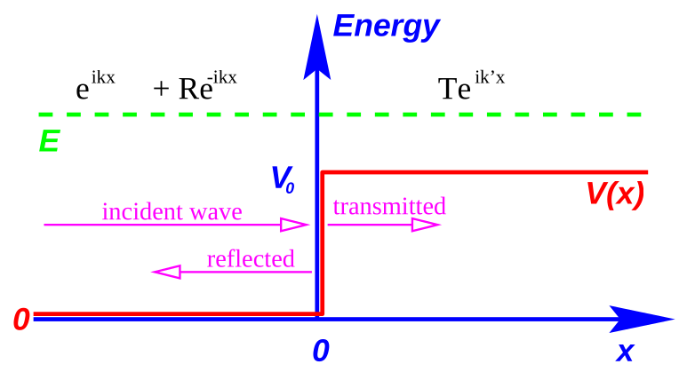
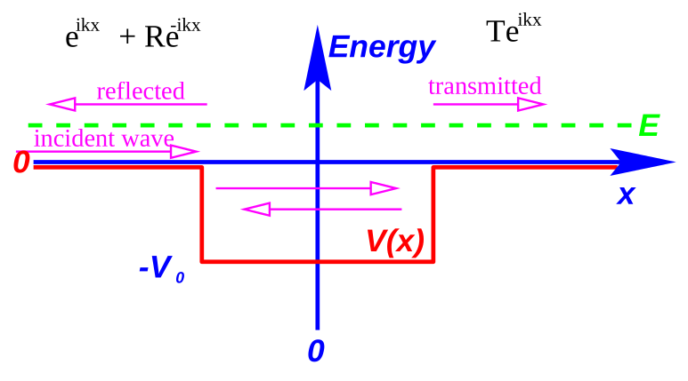
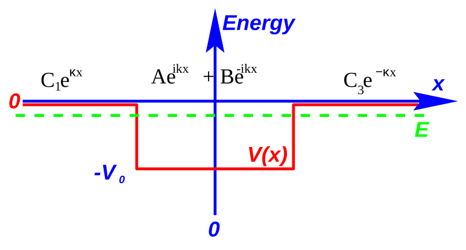
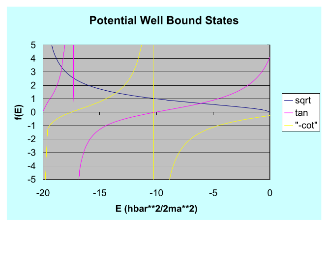
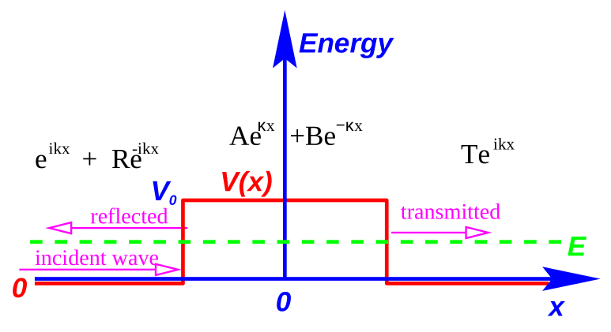
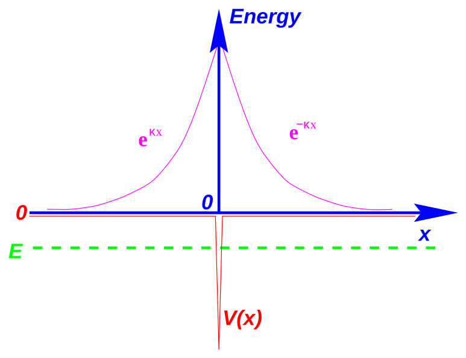
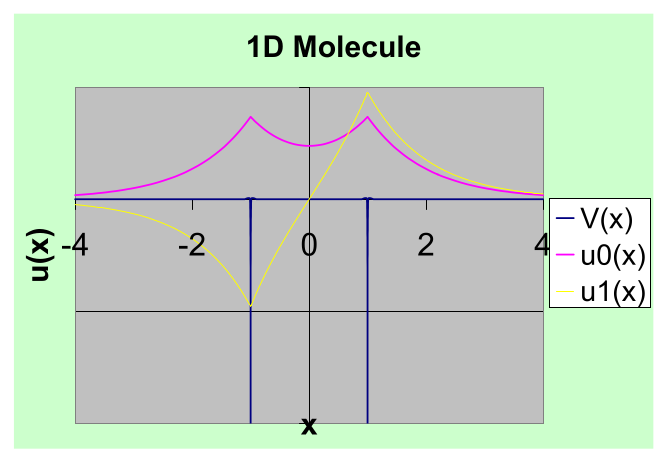
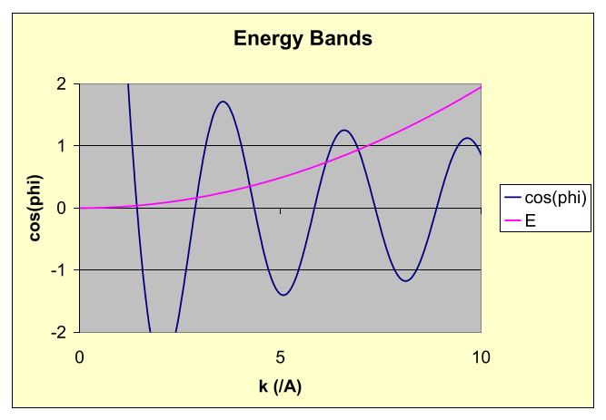
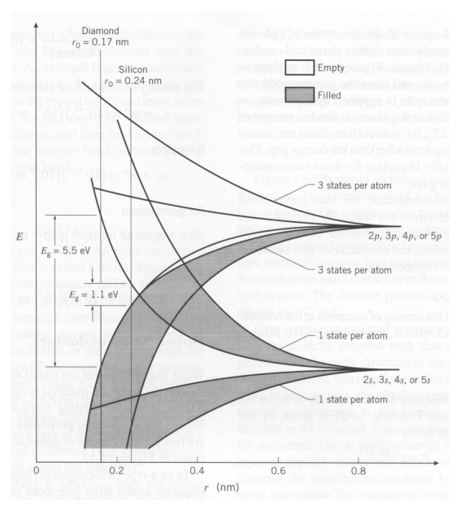

[← 8 Eigenfunctions, Eigenvalues and Vector Spaces](08-eigenfunctions-eigenvalues-and-vector-spaces.md) · [10 Harmonic Oscillator Solution using Operators →](10-harmonic-oscillator-solution-using-operators.md)

---

<hr class="page" style="height:2px;border:0;background:currentColor;opacity:0.25">
<a id="p145" href="book.pdf#page=145" target="_blank" title="This page in the PDF"><sup>[p. 145]</sup></a>

# 9 One Dimensional Potentials

# <a id="s-9-1-piecewise-constant-potentials-in-1d"></a>9.1 Piecewise Constant Potentials in 1D

Several standard problems can be understood conceptually using two or three regions with constant potentials. We will find solutions in each region of the potential. These potentials have **simple** **solutions to the Schrödinger equation**. We must then match the solutions at the boundaries between the regions. Because of the multiple regions, these problems will require **more work with** **boundary conditions** than is usual.

## <a id="s-9-1-1-the-general-solution-for-a-constant-potential"></a>9.1.1 The General Solution for a Constant Potential

We have found the general solution of the Schrödinger Equation in a region in which the potential is constant (See section 7.6.1). Assume the potential is equal to $`V_{0}`$ and the total energy is equal to $`E`$. Assume further that we are solving the time independent equation.

```math
\frac{- \hbar^{2}}{2 m} \frac{d^{2} u ( x )}{dx^{2}} + V_{0} u ( x ) = Eu ( x )
```

```math
\frac{d^{2} u ( x )}{dx^{2}} = - \frac{2 m ( E - V_{0} )}{\hbar^{2}} u ( x )
```

For $`E>V_{0}`$, the general solution is

```math
u ( x ) = Ae^{+ ikx} + Be^{- ikx}
```

with $`k = \sqrt{2 m ( E \hbar_{2} - V_{0} )}`$ positive and real. We could also use the linear combination of the above two solutions.

```math
u ( x ) = A \sin ( kx ) + B \cos ( kx )
```

We should use one set of solutions or the other in a region, not both. There are only two linearly independent solutions.

The solutions are also technically correct for $`E<V_{0}`$ but $`k`$ becomes imaginary. For simplicity, lets write the solutions in terms of $`\kappa = \sqrt{2 m ( V \hbar_{0 2} - E )}`$, which again is real and positive. The general solution is

```math
u ( x ) = Ae^{+ \kappa x} + Be^{- \kappa x} .
```

These are not waves at all, but real exponentials. Note that these are solutions for regions where the particle is not allowed classically, due to energy conservation; the total energy is less than the potential energy. Nevertheless, we will need these solutions in Quantum Mechanics.

## <a id="s-9-1-2-the-potential-step"></a>9.1.2 The Potential Step

We wish to study the physics of a potential step for the case $`E>V_{0}`$.

```math
V ( x ) = \begin{cases} 0 & x< 0 \\ + V_{0} & x> 0 \end{cases}
```

<div align="right"><a href="book.pdf#page=145" target="_blank" title="This page in the PDF"><sup>[p. 145]</sup></a></div>
<hr class="page" style="height:2px;border:0;background:currentColor;opacity:0.25">
<a id="p146" href="book.pdf#page=146" target="_blank" title="This page in the PDF"><sup>[p. 146]</sup></a>

For this problem, both regions have $`E>V`$, so we will use the complex exponential solutions in both regions. This is essentially a 1D scattering problem. Assume there is a **beam of particles with** **definite momentum** coming in from the left and assume there is no flux of particles coming from the right.

For $`x< 0`$, the solution is

```math
u ( x ) = e^{ikx} + \sqrt{Re^{- ikx}}
```

```math
k = \frac{2 mE}{\hbar^{2}} .
```

Note we have assumed the coefficient of the incident beam is 1. (Multiplying by some number does not change the physics.) For $`x> 0`$ the solution is

```math
\sqrt{u^{\prime} ( x} ) = Te^{ik^{\prime} x}
```

```math
k^{\prime} = \frac{2 m ( E - V_{0} )}{\hbar^{2}}
```

(Note that a beam coming from the right, would have given a $`e^{- ik^{\prime} x}`$ term for $`x> 0`$.)



_Figure 33 (p. 146)_

There are **two unknown coefficients** $`R`$ and $`T`$ which will be determined by matching boundary conditions. We will not require normalization to one particle, since we have a beam with definite momentum, which cannot be so normalized. (A more physical problem to solve would use an incoming wave packet with a spread in momentum.)

**Continuity of the wave function** at $`x`$ = 0 implies

```math
1 + R = T.
```

The exponentials are all equal to 1 there so the equation is simple.

<div align="right"><a href="book.pdf#page=146" target="_blank" title="This page in the PDF"><sup>[p. 146]</sup></a></div>
<hr class="page" style="height:2px;border:0;background:currentColor;opacity:0.25">
<a id="p147" href="book.pdf#page=147" target="_blank" title="This page in the PDF"><sup>[p. 147]</sup></a>

**Continuity of the derivative of the wavefunction** at $`x`$ = 0 gives

```math
[ ike^{ikx} - ikRe^{- ikx} ]_{x = 0} = [ ik^{\prime} Te^{ik^{\prime} x} ]_{x = 0}
```

Evaluate and plug in $`T`$ from the equation above. We can solve the problem.

```math
k ( 1 - R ) = k^{\prime} ( 1 + R )
```

```math
( k + k^{\prime} ) R = ( k - k^{\prime} )
```

The coefficients are

```math
R = \frac{k - k^{\prime}}{k + k^{\prime}}
```

```math
T = 1 + R = \frac{2 k}{k + k^{\prime}} .
```

We now have the **full solution**, given our assumption of particles incident from the left.

```math
u ( x ) = \begin{cases} e^{ikx} + \tfrac{k \quad k^{\prime}}{k + k ik^{\prime}}^{-} e^{- ikx} & x< 0 \\ \tfrac{2 k}{k + k^{\prime}} e^{{}^{\prime} x} & x> 0 \end{cases}
```

**Classically**, all of the particles would be transmitted, continuing on to infinity.

**In Quantum Mechanics, some probability is reflected**.

```math
P_{\text{ reflection }} = | R |^{2} = \left( \frac{k - k^{\prime}}{k + k^{\prime}} \right)^{2}
```

(Note that we can simply use the coefficient of $`e^{- ikx}`$ because the incoming term has a coefficient of 1 and because the reflected particles are moving with the same velocity as the incoming beam.)

If we wish to compute the **transmission probability**, the easy way to do it is to say that its

```math
P_{\text{ transmission }} = 1 - P_{\text{ reflection }} = \frac{4 kk^{\prime}}{( k + k^{\prime} )^{2}} .
```

We’ll get the same answers for the reflection and transmission coefficients using the probability flux (See section 9.7.1) to solve the problem.

The transmission probability goes to 1 one $`k = k^{\prime}`$ (since there is no step). The transmission probability goes to 0 for $`k^{\prime}`$ = 0 (since the kinetic energy is zero).

## <a id="s-9-1-3-the-potential-well-with-e-0"></a>9.1.3 The Potential Well with $`E> 0`$ \*

With positive energy, this is again a scattering type problem, now with three regions of the potential,

```math
\text{ all with } E>V .
```

```math
V ( x ) = \begin{cases} 0 & x< - a \\ - V_{0} & - a<x<a \\ 0 & x>a \end{cases}
```

<div align="right"><a href="book.pdf#page=147" target="_blank" title="This page in the PDF"><sup>[p. 147]</sup></a></div>
<hr class="page" style="height:2px;border:0;background:currentColor;opacity:0.25">
<a id="p148" href="book.pdf#page=148" target="_blank" title="This page in the PDF"><sup>[p. 148]</sup></a>

Numbering the three regions from left to right,

```math
u_{1} ( x ) = e^{ikx} + Re^{- ikx}
```

```math
u_{2} ( x ) = Ae^{ik^{\prime} x} + Be^{- ik^{\prime} x}
```

```math
u_{3} ( x ) = Te^{ikx}
```

Again we have assumed a **beam of definite momentum incident from the left and no wave** **incident from the right**.

Ae + Be ik’x -ik’x



_Figure 34 (p. 148)_

There are **four unknown coefficients**. We now match the wave function and its first derivative at the two boundaries yielding **4 equations**.

Some hard work yields reflection and transmission amplitudes (See section 9.7.2)

```math
R = ie^{- 2 ika} \frac{( k^{\prime 2} - k^{2} ) \sin ( 2 k^{\prime} a )}{2 kk^{\prime} \cos ( 2 k^{\prime} a ) - i ( k^{\prime 2} + k^{2} ) \sin ( 2 k^{\prime} a )}
```

```math
T = e^{- 2 ika} \frac{2 kk^{\prime}}{2 kk^{\prime} \cos ( 2 k^{\prime} a ) - i ( k^{\prime 2} + k^{2} ) \sin ( 2 k^{\prime} a )} .
```

The squares of these give **the reflection and transmission probability**, since the potential is the same in the two regions.

Again, **classically, everything would be transmitted** because the energy is larger than the potential. Quantum mechanically, there is a probability to be transmitted and a probability to be reflected. The **reflection probability will go to zero for certain energies**: $`R \to 0`$ if

```math
2 k^{\prime} a = n\pi
```

<div align="right"><a href="book.pdf#page=148" target="_blank" title="This page in the PDF"><sup>[p. 148]</sup></a></div>
<hr class="page" style="height:2px;border:0;background:currentColor;opacity:0.25">
<a id="p149" href="book.pdf#page=149" target="_blank" title="This page in the PDF"><sup>[p. 149]</sup></a>

```math
k^{\prime} = \sqrt{2 m ( E \hbar^{2} - V_{0} )}
```

```math
E = - V_{0} + \frac{n^{2} \pi^{2} \hbar^{2}}{8 ma^{2}}
```

There are analogs of this in 3D. The scattering cross section often goes to zero for certain particular energies. For example, electrons scattering off atoms may have nearly zero cross section at some particular energy. Again this is a wave property.

## <a id="s-9-1-4-bound-states-in-a-potential-well"></a>9.1.4 Bound States in a Potential Well \*

We will work with the same potential well as in the previous section but assume that $`- V_{0} <E< 0`$, making this a **bound state problem**. Note that this potential has a Parity symmetry. In the left and right regions the general solution is

```math
u ( x ) = Ae^{\kappa x} + Be^{- \kappa x}
```

with

```math
\kappa = \sqrt{- 2 \hbar^{2} mE} .
```

The $`e^{- \kappa x}`$ term will not be acceptable at $`-\infty`$ and the $`e^{\kappa x}`$ term will not be acceptable at +$`\infty`$ since they diverge and we could never normalize to one bound particle.

```math
u_{1} ( x ) = C_{1} e^{\kappa x}
```

```math
u_{3} ( x ) = C_{3} e^{- \kappa x}
```

<div align="center">

In the center we’ll use the sine and cosine solutions anticipating parity eigenstates.

</div>

```math
u_{2} ( x ) = A \cos ( kx \sqrt{) + B \sin ( kx )}
```

```math
k = \frac{2 m ( E + V_{0} )}{\hbar^{2}}
```

Again we will have 4 equations in 4 unknown coefficients.

<div align="right"><a href="book.pdf#page=149" target="_blank" title="This page in the PDF"><sup>[p. 149]</sup></a></div>
<hr class="page" style="height:2px;border:0;background:currentColor;opacity:0.25">
<a id="p150" href="book.pdf#page=150" target="_blank" title="This page in the PDF"><sup>[p. 150]</sup></a>



_Figure 35 (p. 150)_

The calculation (See section 9.7.3) shows that either $`A`$ or $`B`$ must be zero for a solution. This means that the **solutions separate into even parity and odd parity states**. We could have guessed this from the potential.

The **even states** have the (quantization) constraint on the energy that

```math
\begin{aligned} \kappa &= \tan ( ka ) k \\ \sqrt{- 2 \hbar^{2} mE} &= \tan \begin{pmatrix} \sqrt{2 m ( E \hbar^{2} + V_{0} )} \\ a \end{pmatrix} \sqrt{2 m ( E \hbar^{2} + V_{0} )} \\ \sqrt{E - E + V_{0}} &= \tan \begin{pmatrix} \sqrt{2 m ( E \hbar^{2} + V_{0} )} \\ a \end{pmatrix} \end{aligned}
```

and the **odd states** have the constraint

```math
\begin{aligned} \kappa &= - \cot ( ka ) k \\ \sqrt{E - E + V_{0}} &= - \cot \begin{pmatrix} \sqrt{2 m ( E \hbar^{2} + V_{0} )} \\ a \end{pmatrix} \end{aligned}
```

These are transcendental equations, so we will solve them graphically. The plot below compares the square root on the left hand side of the transcendental equations to the tangent on the right for the event states and to “-cotangent” on the right for odd states. Where the curves intersect (not including the asymptote), is an allowed energy. There is always one even solution for the 1D potential well. In the graph shown, there are 2 even and one odd solution. The wider and deeper the well, the more solutions.

<div align="right"><a href="book.pdf#page=150" target="_blank" title="This page in the PDF"><sup>[p. 150]</sup></a></div>
<hr class="page" style="height:2px;border:0;background:currentColor;opacity:0.25">
<a id="p151" href="book.pdf#page=151" target="_blank" title="This page in the PDF"><sup>[p. 151]</sup></a>



_Figure 36 (p. 151)_

Try this 1D Potential Applet. It allows you to vary the potential and see the eigenstates.

## <a id="s-9-1-5-the-potential-barrier"></a>9.1.5 The Potential Barrier

With an analysis of the Potential Barrier problem, we can understand the phenomenon of **quantum** **tunneling**.

```math
V ( x ) = \begin{cases} 0 & x< - a \\ + V_{0} & - a<x<a \\ 0 & x>a \end{cases}
```

Numbering the three regions from left to right,

```math
u_{1} ( x ) = e^{ikx} + Re^{- ikx}
```

```math
u_{2} ( x ) = Ae^{\kappa x} + Be^{- \kappa x}
```

```math
u_{3} ( x ) = Te^{ikx}
```

Again we assume a beam of definite momentum incident from the left and no wave incident from the right. For the solutions outside the barrier,

```math
k = \sqrt{\frac{2 mE}{\hbar^{2}} .}
```

<div align="right"><a href="book.pdf#page=151" target="_blank" title="This page in the PDF"><sup>[p. 151]</sup></a></div>
<hr class="page" style="height:2px;border:0;background:currentColor;opacity:0.25">
<a id="p152" href="book.pdf#page=152" target="_blank" title="This page in the PDF"><sup>[p. 152]</sup></a>

Inside the barrier,

```math
\kappa = \sqrt{\frac{2 m ( V_{0} - E )}{\hbar^{2}} .}
```



_Figure 37 (p. 152)_

This is actually the same as the (unbound) potential well problem with the substitution

```math
k^{\prime} \to i\kappa
```

in the center region.

The **amplitude to be transmitted** is

```math
T = e^{- 2 ika} \frac{2 k\kappa}{2 k\kappa \cosh ( 2 \kappa a ) - i ( k^{2} - \kappa^{2} ) \sinh ( 2 \kappa a )} .
```

We can compute the probability to be transmitted.

```math
| T |^{2} = \frac{( 2 k\kappa )^{2}}{( k^{2} + \kappa^{2} )^{2} \sinh^{2} ( 2 \kappa a ) + ( 2 k\kappa )^{2}} \to \left( \frac{4 k\kappa}{k^{2} + \kappa^{2}} \right)^{2} e^{- 4 \kappa a}
```

An **approximate probability** is sometimes useful.

```math
| T |^{2} \approx e^{- 2 \kappa ( 2 a )} = e \int^{{}^{- 2} \frac{a}{- a} \sqrt{\tfrac{2 m}{\hbar 2} [ V ( x ) - E ]}} dx
```

**Classically the transmission probability would be zero**. In Quantum Mechanics, the particle is **allowed to violate energy conservation for a short time** and so has a chance to tunnel through the barrier.

Tunneling can be applied to cold emission of electrons from a metal, alpha decay of nuclei, semiconductors, and many other problems.

<div align="right"><a href="book.pdf#page=152" target="_blank" title="This page in the PDF"><sup>[p. 152]</sup></a></div>
<hr class="page" style="height:2px;border:0;background:currentColor;opacity:0.25">
<a id="p153" href="book.pdf#page=153" target="_blank" title="This page in the PDF"><sup>[p. 153]</sup></a>

# <a id="s-9-2-the-1d-harmonic-oscillator"></a>9.2 The 1D Harmonic Oscillator

The **harmonic oscillator is an extremely important physics problem**. Many potentials look like a harmonic oscillator near their minimum. This is the first non-constant potential for which we will solve the Schrödinger Equation.

The harmonic oscillator Hamiltonian is given by

```math
H = \frac{p^{2}}{2 m} + \frac{1}{2} kx^{2}
```

which makes the **Schrödinger Equation for energy eigenstates**

```math
\frac{- \hbar^{2}}{2 m} \frac{d^{2} u}{dx^{2}} + \frac{1}{2} kx^{2} u = Eu.
```

Note that this potential also has a Parity symmetry. The potential is unphysical because it does not go to zero at infinity, however, it is often a very good approximation, and this potential can be solved exactly.

It is standard to remove the spring constant $`k`$ from the Hamiltonian, replacing it with the **classical** **oscillator frequency**.

```math
\omega = \sqrt{\frac{k}{m}}
```

The **Harmonic Oscillator Hamiltonian** becomes.

```math
H = \frac{p^{2}}{2 m} + \frac{1}{2} m\omega^{2} x^{2}
```

The **differential equation to be solved is**

```math
\frac{- \hbar^{2}}{2 m} \frac{d^{2} u}{dx^{2}} + \frac{1}{2} m\omega^{2} x^{2} u = Eu.
```

To solve the Harmonic Oscillator equation (See section 9.7.4), we will first change to dimensionless variables, then find the form of the solution for $`x \to \pm \infty`$, then multiply that solution by a polynomial, derive a recursion relation between the coefficients of the polynomial, show that the polynomial series must terminate if the solutions are to be normalizable, derive the energy eigenvalues, then finally derive the functions that are solutions.

The **energy eigenvalues** are

```math
E_{n} = \left( n + \frac{1}{2} \right) \hbar \omega
```

for $`n`$ = 0$`, 1 , 2 ,\dots`$. There are a countably infinite number of solutions with **equal energy spacing**. We have been forced to have quantized energies by the requirement that the wave functions be normalizable.

The **ground state wave function** is.

<div align="right"><a href="book.pdf#page=153" target="_blank" title="This page in the PDF"><sup>[p. 153]</sup></a></div>
<hr class="page" style="height:2px;border:0;background:currentColor;opacity:0.25">
<a id="p154" href="book.pdf#page=154" target="_blank" title="This page in the PDF"><sup>[p. 154]</sup></a>

```math
u_{0} ( x ) = \left( \frac{m\omega}{\pi \hbar} \right)^{\tfrac{1}{4}} e^{- m\omega x^{2} / 2 \hbar}
```

This is a Gaussian (minimum uncertainty) distribution. Since the HO potential has a parity symmetry, the **solutions either have even or odd parity**. The ground state is even parity.

The **first excited state** is an odd parity state, with a first order polynomial multiplying the same Gaussian.

```math
u_{1} ( x ) = \left( \frac{m\omega}{\pi \hbar} \right) \tfrac{1}{4} \sqrt{\frac{2 m\omega}{\hbar}} xe^{- m\omega x^{2} / 2 \hbar}
```

The **second excited state** is even parity, with a second order polynomial multiplying the same Gaussian.

```math
u_{2} ( x ) = C \left( 1 - 2 \frac{m\omega x^{2}}{\hbar} \right) e^{- m\omega x^{2} / 2 \hbar}
```

Note that $`n`$ is equal to the number of zeros of the wavefunction. This is a common trend. With more zeros, a wavefunction has more curvature and hence more kinetic energy.

The general solution can be written as

```math
u_{n} ( x ) = \sum_{k = 0}^{\infty} a_{k} y^{k} e^{- y^{2} / 2}
```

with the coefficients determined by the recursion relation

```math
a_{k + 2} = \frac{2 ( k - n )}{( k + 1 ) ( k + 2 )} a_{k}
```

and the dimensionless variable $`y`$ given by.

```math
y = \sqrt{\frac{m\omega}{\hbar}} x
```

The series terminates with the last nonzero term having $`k = n`$.

<div align="right"><a href="book.pdf#page=154" target="_blank" title="This page in the PDF"><sup>[p. 154]</sup></a></div>
<hr class="page" style="height:2px;border:0;background:currentColor;opacity:0.25">
<a id="p155" href="book.pdf#page=155" target="_blank" title="This page in the PDF"><sup>[p. 155]</sup></a>

# <a id="s-9-3-the-delta-function-potential"></a>9.3 The Delta Function Potential \*

Take a simple, **attractive delta function potential** and look for the bound states.

```math
V ( x ) = - aV_{0} \delta ( x )
```

These will have energy less than zero so the solutions are

```math
\psi ( x ) = \begin{cases} Ae^{\kappa x} & x< 0 \\ Ae^{- \kappa x} & x> 0 \end{cases}
```

where

```math
\kappa = \sqrt{- 2 \hbar^{2} mE} .
```

There are only two regions, above and below the delta function. We don’t need to worry about the one point at $`x`$ = 0 – the two solutions will match there. We have already made the wave function continuous at $`x`$ = 0 by using the same coefficient, $`A`$, for the solution in both regions.



_Figure 38 (p. 155)_

We now need to meet the boundary condition on the first derivative at $`x`$ = 0. Recall that the delta function causes a known discontinuity in the first derivative (See section 8.7.2).

```math
\frac{d\psi}{dx} \left| {}_{+ \epsilon} - \frac{d\psi}{dx} \right|_{- \epsilon} = - \frac{2 maV_{0}}{\hbar^{2}} \psi ( 0 )
```

```math
- \kappa - \kappa = - \frac{2 maV_{0}}{\hbar^{2}}
```

```math
\kappa = \frac{maV_{0}}{\hbar^{2}}
```

<div align="right"><a href="book.pdf#page=155" target="_blank" title="This page in the PDF"><sup>[p. 155]</sup></a></div>
<hr class="page" style="height:2px;border:0;background:currentColor;opacity:0.25">
<a id="p156" href="book.pdf#page=156" target="_blank" title="This page in the PDF"><sup>[p. 156]</sup></a>

Putting in the formula for $`\kappa`$ in terms of the energy.

```math
\frac{- 2 mE}{\hbar^{2}} = \frac{m^{2} a^{2} V_{0}^{2}}{\hbar^{4}}
```

```math
E = - \frac{ma^{2} V_{0}^{2}}{2 \hbar^{2}}
```

There is only one energy for which we can satisfy the boundary conditions. There is only **one** **bound state** in an attractive delta function potential.

# <a id="s-9-4-the-delta-function-model-of-a-molecule"></a>9.4 The Delta Function Model of a Molecule \*

The use of two delta functions allows us to see, to some extent, how **atoms bind into molecules**. Our potential is

```math
V ( x ) = - aV_{0} ( \delta ( x + d ) + \delta ( x - d ) )
```

with attractive delta functions at $`x = \pm d`$. This is a parity symmetric potential, so we can assume that our solutions will be parity eigenstates.

**For even parity, our solution in the three regions** is

```math
\begin{aligned} \psi ( x ) &= \begin{cases} e^{\kappa x} & x< - d \\ A ( e^{\kappa x} + e^{- \kappa x} ) & - d<x<d \\ e^{- \kappa x} & x>d \end{cases} \\ \kappa &= \sqrt{- 2 \hbar^{2} mE} . \end{aligned}
```

Since the solution is designed to be symmetric about $`x`$ = 0, the boundary conditions at $`- d`$ are the same as at $`d`$. The boundary conditions determine the constant $`A`$ and constrain $`\kappa`$.

A little calculation gives (See section 9.7.5)

```math
\frac{2 maV_{0}}{\kappa \hbar^{2}} = 1 + \tanh ( \kappa d )
```

This is a transcendental equation, but we can limit the energy.

```math
\frac{2 maV_{0}}{\kappa \hbar^{2}} < 2
```

```math
\kappa > \frac{maV_{0}}{\hbar^{2}}
```

Since $`\kappa = \tfrac{maV_{0}}{\hbar^{2}}`$ for the single delta function, this $`\kappa = \sqrt{- 2 \hbar mE_{2}}`$ is larger than the one for the single delta function. This means that $`E`$ is more negative and there is **more binding energy**.

```math
E_{molecule} <E_{atom}
```

Basically, the electron doesn’t have to be a localized with two atoms as it does with just one. This allows the kinetic energy to be lower.

The figure below shows the two solutions plotted on the same graph as the potential.

<div align="right"><a href="book.pdf#page=156" target="_blank" title="This page in the PDF"><sup>[p. 156]</sup></a></div>
<hr class="page" style="height:2px;border:0;background:currentColor;opacity:0.25">
<a id="p157" href="book.pdf#page=157" target="_blank" title="This page in the PDF"><sup>[p. 157]</sup></a>



_Figure 39 (p. 157)_

Two Hydrogen atoms bind together to form a molecule with a separation of 0.74 Angstroms, just larger than the Bohr radius of 0.53 Angstroms. The binding energy (for the two electrons) is about 4.5 eV. If we approximate the Coulomb potential by with a delta function, setting $`aV_{0}`$ = (0$`. 5 3 ) ( 2 ) ( 1 3 . 6 )`$ eV Angstroms, our very naive calculation would give 1.48 eV for one electron, which is at least the right order of magnitude.

The **odd parity solution** has an energy that satisfies the equation

```math
\frac{2 maV_{0}}{\kappa \hbar^{2}} = 1 + \coth ( \kappa d ) .
```

```math
\frac{2 maV_{0}}{\kappa \hbar^{2}} > 2
```

```math
\kappa < \frac{maV_{0}}{\hbar^{2}}
```

This energy is larger than for one delta function. This state would be called **anti-bonding**.

# <a id="s-9-5-the-delta-function-model-of-a-crystal"></a>9.5 The Delta Function Model of a Crystal \*

The Kronig-Penny model of a solid crystal contains an **infinite array of repulsive delta func-** **tions**. $`\infty`$

```math
V ( x ) = aV_{0} \sum_{n = -\infty} \delta ( x - na )
```

<div align="right"><a href="book.pdf#page=157" target="_blank" title="This page in the PDF"><sup>[p. 157]</sup></a></div>
<hr class="page" style="height:2px;border:0;background:currentColor;opacity:0.25">
<a id="p158" href="book.pdf#page=158" target="_blank" title="This page in the PDF"><sup>[p. 158]</sup></a>

Our states will have positive energy.

This potential has a new symmetry, that a **translation by the lattice spacing** $`a`$ leaves the problem unchanged. The probability distributions must therefore have this symmetry

```math
| \psi ( x + a ) |^{2} = | \psi ( x ) |^{2} ,
```

which means that the wave function differs by a phase at most.

```math
\psi ( x + a ) = e^{i\varphi} \psi ( x )
```

The general solution in the region $`( n - 1 ) a<x<na`$ is

```math
\psi_{n} ( x ) = A_{n} \sin ( k [ x - na ] ) + B_{n} \cos ( k [ x - na ] )
```

```math
k = \sqrt{2 mE \hbar^{2}}
```

By matching the boundary conditions and requiring that the probability be periodic, we derive a constraint on $`k`$ (See section 9.7.6) similar to the quantized energies for bound states.

```math
\cos ( \varphi ) = \cos ( ka ) + \frac{maV_{0}}{\hbar^{2} k} \sin ( ka )
```

Since cos$`( \varphi )`$ can only take on values between -1 and 1, there are **allowed bands of** $`k`$ **and gaps** **between those bands**.

The graph below shows cos$`( ka ) + \tfrac{maV_{0}}{\hbar^{2} k}`$ sin$`( ka )`$ as a function of $`k`$. If this is not between -1 and 1, there is no solution, that value of $`k`$ and the corresponding energy are not allowed.



_Figure 40 (p. 158)_

<div align="right"><a href="book.pdf#page=158" target="_blank" title="This page in the PDF"><sup>[p. 158]</sup></a></div>
<hr class="page" style="height:2px;border:0;background:currentColor;opacity:0.25">
<a id="p159" href="book.pdf#page=159" target="_blank" title="This page in the PDF"><sup>[p. 159]</sup></a>



_Figure 41 (p. 159)_

This energy band phenomenon is found in solids. Solids with partially filled bands are conductors. Solids with filled bands are insulators. Semiconductors have a small number of charge carriers (or holes) in a band.

# <a id="s-9-6-the-quantum-rotor"></a>9.6 The Quantum Rotor

It is useful to simply investigate **angular momentum with just one free rotation angle**. This might be the quantum plane propeller. We will do a good job of this in 3 dimensions later.

Lets assume we have a **mass** $`m`$ **constrained to move in a circle of radius** $`r`$. Assume the motion in the circle is free, so there is no potential. The kinetic energy is $`\tfrac{1}{2} mv^{2} = \tfrac{p^{2}}{2 m}`$ for $`p = mr \tfrac{d\varphi}{dt}`$.

If we measure distance around the circle, then $`x = r\varphi`$ and the one problem we have is that once I go completely around the circle, I am back to $`x`$ = 0. Lets just go ahead and write our wavefunction.

```math
e^{i ( px - Et ) / \hbar} = e^{i ( pr\varphi - Et ) / \hbar}
```

Remembering angular momentum, lets call the combination $`pr = L`$. Our wave is $`e^{i ( L\varphi - Et ) / \hbar}`$.

This must be **single valued** so we need to require that

```math
e^{i ( 2 \pi L - Et ) / \hbar} = e^{i ( 0 - Et ) / \hbar}
```

```math
e^{i ( 2 \pi L ) / \hbar} = 1
```

```math
L = n \hbar
```

<div align="right"><a href="book.pdf#page=159" target="_blank" title="This page in the PDF"><sup>[p. 159]</sup></a></div>
<hr class="page" style="height:2px;border:0;background:currentColor;opacity:0.25">
<a id="p160" href="book.pdf#page=160" target="_blank" title="This page in the PDF"><sup>[p. 160]</sup></a>

```math
n = 0 , 1 , 2 , 3 \dots
```

The **angular momentum must be quantized in units of** $`\hbar`$.

This will prove to be true for 3 dimensions too, however, the 3 components of angular momentum do not commute with each other, leading to all kinds of fun.

# <a id="s-9-7-derivations-and-computations"></a>9.7 Derivations and Computations

## <a id="s-9-7-1-probability-flux-for-the-potential-step"></a>9.7.1 Probability Flux for the Potential Step \*

The probability flux is given by

```math
j ( x,t ) = \frac{\hbar}{2 mi} \left[ \psi^{*} \frac{\partial \psi}{\partial x} - \frac{\partial \psi^{*}}{\partial x} \psi \right] .
```

We can save some effort by noticing that this contains an expression minus its complex conjugate. (This assures that term in brackets is imaginary and the flux is then real.)

```math
j = \frac{\hbar}{2 im} \left[ u^{*} \frac{du}{dx} - \frac{du^{*}}{dx} u \right] = \frac{\hbar}{2 im} \left[ u^{*} \frac{du}{dx} - CC \right]
```

For $`x< 0`$

```math
j = \frac{\hbar}{2 im} [ ( e^{- ikx} + R^{*} e^{ikx} ) ( ike^{ikx} - ikRe^{- ikx} ) - CC ]
```

```math
j = \frac{i \hbar k}{2 im} [ 1 - Re^{- 2 ikx} + R^{*} e^{2 ikx} - R^{*} R ] + CC
```

```math
j = [ 1 -| R |^{2} ] \frac{\hbar k}{m} .
```

The probability to be reflected is the reflected flux divided by the incident flux. In this case its easy to see that its $`| R |^{2}`$ as we said. For $`x> 0`$

```math
j = | T |^{2} \frac{\hbar k^{\prime}}{m} .
```

The probability to be transmitted is the transmitted flux divided by the incident flux.

```math
| T |^{2} \frac{\hbar k^{\prime}}{m} \frac{m}{\hbar k} = \frac{4 k^{2}}{( k + k^{\prime} )^{2}} \frac{k^{\prime}}{k} = \frac{4 kk^{\prime}}{( k + k^{\prime} )^{2}}
```

again as we had calculated earlier.

## <a id="s-9-7-2-scattering-from-a-1d-potential-well"></a>9.7.2 Scattering from a 1D Potential Well \*

```math
V ( x ) = \begin{cases} 0 & x< - a \\ - V_{0} & - a<x<a \\ 0 & x>a \end{cases}
```

<div align="right"><a href="book.pdf#page=160" target="_blank" title="This page in the PDF"><sup>[p. 160]</sup></a></div>
<hr class="page" style="height:2px;border:0;background:currentColor;opacity:0.25">
<a id="p161" href="book.pdf#page=161" target="_blank" title="This page in the PDF"><sup>[p. 161]</sup></a>

Numbering the three regions from left to right,

```math
u_{1} ( x ) = e^{ikx} + Re^{- ikx}
```

```math
u_{2} ( x ) = Ae^{ik^{\prime} x} + Be^{- ik^{\prime} x}
```

```math
u_{3} ( x ) = Te^{ikx}
```

Again we have assumed no wave incident from the right (but we could add that solution if we wanted).

We now match the wave function and its first derivative at the two boundaries yielding 4 equations. That’s good since we have 4 constants to determine. At $`x = a`$ we have 2 equations which we can use to eliminate $`A`$ and $`B`$.

```math
Te^{ika} = Ae^{ik^{\prime} a} + Be^{- ik^{\prime} a}
```

```math
ikTe^{ika} = ik^{\prime} Ae^{ik^{\prime} a} - ik^{\prime} Be^{- ik^{\prime} a}
```

```math
\frac{k}{k^{\prime}} Te^{ika} = Ae^{ik^{\prime} a} - Be^{- ik^{\prime} a}
```

```math
Ae^{ik^{\prime} a} = \frac{1}{2} Te^{ika} \left( 1 + \frac{k}{k^{\prime}} \right)
```

```math
Be^{- ik^{\prime} a} = \frac{1}{2} Te^{ika} \left( 1 - \frac{k}{k^{\prime}} \right)
```

At $`x = - a`$ we have 2 equations which can now be written in terms of $`R`$ and $`T`$ by using the above.

```math
e^{- ika} + Re^{ika} = Ae^{- ik^{\prime} a} + Be^{ik^{\prime} a}
```

```math
ike^{- ika} - ikRe^{ika} = ik^{\prime} Ae^{- ik^{\prime} a} - ik^{\prime} Be^{ik^{\prime} a}
```

```math
e^{- ika} + Re^{ika} = \frac{1}{2} Te^{ika} \left[ \left( 1 + \frac{k}{k^{\prime}} \right) e^{- 2 ik^{\prime} a} + \left( 1 - \frac{k}{k^{\prime}} \right) e^{2 ik^{\prime} a} \right]
```

```math
ke^{- ika} - kRe^{ika} = \frac{1}{2} Te^{ika} k^{\prime} \left[ \left( 1 + \frac{k}{k^{\prime}} \right) e^{- 2 ik^{\prime} a} - \left( 1 - \frac{k}{k^{\prime}} \right) e^{2 ik^{\prime} a} \right]
```

```math
e^{- ika} - Re^{ika} = \frac{1}{2} Te^{ika} \left[ \left( \frac{k^{\prime}}{k} + 1 \right) e^{- 2 ik^{\prime} a} - \left( \frac{k^{\prime}}{k} - 1 \right) e^{2 ik^{\prime} a} \right]
```

We can add equations to eliminate $`R`$.

```math
e^{- ika} + Re^{ika} = \frac{1}{2} Te^{ika} \left[ \left( 1 + \frac{k}{k^{\prime}} \right) e^{- 2 ik^{\prime} a} + \left( 1 - \frac{k}{k^{\prime}} \right) e^{2 ik^{\prime} a} \right]
```

```math
e^{- ika} - Re^{ika} = \frac{1}{2} Te^{ika} \left[ \left( \frac{k^{\prime}}{k} + 1 \right) e^{- 2 ik^{\prime} a} - \left( \frac{k^{\prime}}{k} - 1 \right) e^{2 ik^{\prime} a} \right]
```

```math
2 e^{- ika} = \frac{1}{2} Te^{ika} \left[ \left( 2 + \frac{k^{\prime}}{k} + \frac{k}{k^{\prime}} \right) e^{- 2 ik^{\prime} a} + \left( 2 - \frac{k^{\prime}}{k} - \frac{k}{k^{\prime}} \right) e^{2 ik^{\prime} a} \right]
```

```math
4 e^{- 2 ika} = T \left[ 4 \cos ( 2 k^{\prime} a ) - 2 i \left( \frac{k}{k^{\prime}} + \frac{k^{\prime}}{k} \right) \sin ( 2 k^{\prime} a ) \right]
```

```math
T = \frac{2 e^{- 2 ika}}{2 \cos ( 2 k^{\prime} a ) - i \left( \tfrac{k}{k^{\prime}} + \tfrac{k^{\prime}}{k} \right) \sin ( 2 k^{\prime} a )}
```

```math
T = \frac{2 kk^{\prime} e^{- 2 ika}}{2 kk^{\prime} \cos ( 2 k^{\prime} a ) - i ( k^{2} + k^{\prime 2} ) \sin ( 2 k^{\prime} a )}
```

<div align="right"><a href="book.pdf#page=161" target="_blank" title="This page in the PDF"><sup>[p. 161]</sup></a></div>
<hr class="page" style="height:2px;border:0;background:currentColor;opacity:0.25">
<a id="p162" href="book.pdf#page=162" target="_blank" title="This page in the PDF"><sup>[p. 162]</sup></a>

We can subtract the same equations to most easily solve for $`R`$.

```math
2 Re^{ika} = \frac{1}{2} Te^{ika} \left[ \left( \frac{k}{k^{\prime}} - \frac{k^{\prime}}{k} \right) e^{- 2 ik^{\prime} a} + \left( \frac{k^{\prime}}{k} - \frac{k}{k^{\prime}} \right) e^{2 ik^{\prime} a} \right]
```

```math
R = \frac{1}{4} T \left[ - 2 i \frac{k}{k^{\prime}} \sin ( 2 k^{\prime} a ) + 2 i \frac{k^{\prime}}{k} \sin ( 2 k^{\prime} a ) \right]
```

```math
R = \frac{i}{2} T \sin ( 2 k^{\prime} a ) \left[ \frac{k^{\prime}}{k} - \frac{k}{k^{\prime}} \right]
```

```math
R = \frac{ikk^{\prime} e^{- 2 ika} \sin ( 2 k^{\prime} a ) \left[ \tfrac{k^{\prime}}{k} - \tfrac{k}{k^{\prime}} \right]}{2 kk^{\prime} \cos ( 2 k^{\prime} a ) - i ( k^{2} + k^{\prime 2} ) \sin ( 2 k^{\prime} a )}
```

```math
R = \frac{i \left( k^{\prime 2} - k^{2} \right) \sin ( 2 k^{\prime} a ) e^{- 2 ika}}{2 kk^{\prime} \cos ( 2 k^{\prime} a ) - i ( k^{2} + k^{\prime 2} ) \sin ( 2 k^{\prime} a )}
```

We have solved the boundary condition equations to find the reflection and transmission amplitudes

```math
R = ie^{- 2 ika} \frac{( k^{\prime 2} - k^{2} ) \sin ( 2 k^{\prime} a )}{2 kk^{\prime} \cos ( 2 k^{\prime} a ) - i ( k^{\prime 2} + k^{2} ) \sin ( 2 k^{\prime} a )}
```

```math
T = e^{- 2 ika} \frac{2 kk^{\prime}}{2 kk^{\prime} \cos ( 2 k^{\prime} a ) - i ( k^{\prime 2} + k^{2} ) \sin ( 2 k^{\prime} a )} .
```

The squares of these give the reflection and transmission probability, since the potential is the same in the two regions.

## <a id="s-9-7-3-bound-states-of-a-1d-potential-well"></a>9.7.3 Bound States of a 1D Potential Well \*

In the two outer regions we have solutions

```math
u_{1} ( x ) = C_{1} e^{\kappa x}
```

```math
\begin{aligned} u_{3} ( x ) &= C_{3} e^{- \kappa x} \\ \kappa &= \sqrt{- 2 \hbar^{2} mE} . \end{aligned}
```

In the center we have the same solution as before.

```math
u_{2} ( x ) = A \cos ( kx \sqrt{) + B \sin ( kx )}
```

```math
k = \frac{2 m ( E + V_{0} )}{\hbar^{2}}
```

(Note that we have switched from $`k^{\prime}`$ to $`k`$ for economy.) We will have 4 equations in 4 unknown coefficients.

At $`- a`$ we get

```math
C_{1} e^{- \kappa a} = A \cos ( ka ) - B \sin ( ka )
```

```math
\kappa C_{1} e^{- \kappa a} = kA \sin ( ka ) + kB \cos ( ka ) .
```

<div align="right"><a href="book.pdf#page=162" target="_blank" title="This page in the PDF"><sup>[p. 162]</sup></a></div>
<hr class="page" style="height:2px;border:0;background:currentColor;opacity:0.25">
<a id="p163" href="book.pdf#page=163" target="_blank" title="This page in the PDF"><sup>[p. 163]</sup></a>

At $`a`$ we get

```math
C_{3} e^{- \kappa a} = A \cos ( ka ) + B \sin ( ka )
```

```math
- \kappa C_{3} e^{- \kappa a} = - kA \sin ( ka ) + kB \cos ( ka ) .
```

Divide these two pairs of equations to get two expressions for $`\kappa`$.

```math
\begin{aligned} \kappa &= \frac{kA \sin ( ka ) + kB \cos ( ka )}{A \cos ( ka ) - B \sin ( ka )} \\ - \kappa &= \frac{- kA \sin ( ka ) + kB \cos ( ka )}{A \cos ( ka ) + B \sin ( ka )} \end{aligned}
```

Factoring out the $`k`$, we have two expressions for the same quantity.

```math
\frac{\kappa}{k} = \frac{A \sin ( ka ) + B \cos ( ka )}{A \cos ( ka ) - B \sin ( ka )}
```

```math
\frac{\kappa}{k} = \frac{A \sin ( ka ) - B \cos ( ka )}{A \cos ( ka ) + B \sin ( ka )}
```

If we equate the two expressions,

```math
\frac{A \sin ( ka ) + B \cos ( ka )}{A \cos ( ka ) - B \sin ( ka )} = \frac{A \sin ( ka ) - B \cos ( ka )}{A \cos ( ka ) + B \sin ( ka )}
```

and cross multiply, we have

```math
( A \sin ( ka ) + B \cos ( ka ) ) ( A \cos ( ka ) + B \sin ( ka ) )
```

```math
= ( A \cos ( ka ) - B \sin ( ka ) ) ( A \sin ( ka ) - B \cos ( ka ) ) .
```

The $`A^{2}`$ and $`B^{2}`$ terms show up on both sides of the equation and cancel. What’s left is

```math
AB ( \sin^{2} ( ka ) + \cos^{2} ( ka ) ) = AB ( - \cos^{2} ( ka ) - \sin^{2} ( ka ) )
```

```math
AB = - AB
```

Either $`A`$ or $`B`$, but not both, must be zero. We have parity eigenstates, again, derived from the solutions and boundary conditions.

This means that the states separate into even parity and odd parity states. We could have guessed this from the potential.

Now lets use one equation.

```math
\kappa = \frac{A \sin ( ka ) + B \cos ( ka )}{A \cos ( ka ) - B \sin ( ka )} k
```

k If we set $`B`$ = 0, the even states have the constraint on the energy that

```math
\kappa = \tan ( ka ) k
```

and, if we set $`A`$ = 0, the odd states have the constraint

```math
\kappa = - \cot ( ka ) k.
```

<div align="right"><a href="book.pdf#page=163" target="_blank" title="This page in the PDF"><sup>[p. 163]</sup></a></div>
<hr class="page" style="height:2px;border:0;background:currentColor;opacity:0.25">
<a id="p164" href="book.pdf#page=164" target="_blank" title="This page in the PDF"><sup>[p. 164]</sup></a>

## <a id="s-9-7-4-solving-the-ho-differential-equation"></a>9.7.4 Solving the HO Differential Equation \*

The differential equation for the 1D Harmonic Oscillator is.

```math
\frac{- \hbar^{2}}{2 m} \frac{d^{2} u}{dx^{2}} + \frac{1}{2} m\omega^{2} x^{2} u = Eu.
```

By working with dimensionless variables and constants, we can see the basic equation and minimize the clutter. We use the energy in terms of $`\hbar \omega`$.

```math
\epsilon = \frac{2 E}{\hbar \omega}
```

We define a dimensionless coordinate.

```math
y = \sqrt{\frac{m\omega}{\hbar}} x
```

The equation becomes.

```math
\frac{d^{2} u}{dx^{2}} + \frac{2 m}{\hbar^{2}} ( E - \frac{1}{2} m\omega^{2} x^{2} ) u = 0
```

```math
\frac{d^{2} u}{dy^{2}} + ( \epsilon - y^{2} ) u = 0
```

(Its probably easiest to just check the above equation by substituting as below.

```math
\frac{\hbar}{m\omega} \frac{d^{2} u}{dx^{2}} + \left( \frac{2 E}{\hbar \omega} - \frac{m\omega}{\hbar} x^{2} \right) = 0
```

```math
\frac{d^{2} u}{dx^{2}} + \frac{2 m}{\hbar^{2}} ( E - \frac{1}{2} m\omega^{2} x^{2} ) u = 0
```

## <a id="s-it-works"></a>It works.)

Now we want to find the solution for $`y \to \infty`$.

```math
\frac{d^{2} u}{dy^{2}} + ( \epsilon - y^{2} ) u = 0
```

becomes

```math
\frac{d^{2} u}{dy^{2}} - y^{2} u = 0
```

which has the solution (in the large $`y`$ limit)

```math
u = e^{- y^{2} / 2} .
```

This exponential will dominate a polynomial as $`y \to \infty`$ so we can write our general solution as

```math
u ( y ) = h ( y ) e^{- y^{2} / 2}
```

where $`h ( y )`$ is a polynomial.

<div align="right"><a href="book.pdf#page=164" target="_blank" title="This page in the PDF"><sup>[p. 164]</sup></a></div>
<hr class="page" style="height:2px;border:0;background:currentColor;opacity:0.25">
<a id="p165" href="book.pdf#page=165" target="_blank" title="This page in the PDF"><sup>[p. 165]</sup></a>

Take the differential equation

```math
\frac{d^{2} u}{dy^{2}} + ( \epsilon - y^{2} ) u = 0
```

and plug

```math
u ( y ) = h ( y ) e^{- y^{2} / 2}
```

into it to get

```math
d^{2} h ( y )_{- y^{2} / 2} \frac{d^{2}}{dy^{2}} h ( y \frac{{}^{2} / 2}{dh ( y )} ) e_{- y^{2} / 2}^{- y} + \epsilon h ( y ) e^{- y} \frac{{}^{2} / 2}{- y^{2} / 2} - y^{2} h ( y ) e^{- y} \frac{2}{2}_{- y^{2} / 2}^{/ 2} = 0
```

```math
dy^{2} e \quad - 2 dy ye + \epsilon h ( - h ( y )_{{}^{2} / 2} e y ) e^{- y} - y^{2} + h ( y ) y_{2} e h ( y ) e^{- y / 2} = 0
```

```math
\frac{d^{2} h ( y )}{dy^{2}} - 2 y \frac{dh ( y )}{dy} - h ( y ) + y^{2} h ( y ) + \epsilon h ( y ) - y^{2} h ( y ) = 0
```

```math
\frac{d^{2} h ( y )}{dy^{2}} - 2 y \frac{dh ( y )}{dy} + ( \epsilon - 1 ) h ( y ) = 0
```

This is our differential equation for the polynomial $`h ( y )`$.

Write $`h ( y )`$ as a sum of terms. $`\infty`$

```math
h ( y ) = \sum_{m = 0} a_{m} y^{m}
```

Plug it into the differential equation.

```math
\sum_{m = 0}^{\infty} [ a_{m} ( m ) ( m - 1 ) y^{m - 2} - 2 a_{m} ( m ) y^{m} + ( \epsilon - 1 ) a_{m} y^{m} ] = 0
```

We now want ot shift terms in the sum so that we see the coefficient of $`y^{m}`$. To do this, we will shift the term $`a_{m} ( m ) ( m - 1 ) y^{m - 2}`$ down two steps in the sum. It will now show up as $`a_{m + 2} ( m`$+ 2)$`( m`$+ 1)$`y^{m}`$.

```math
\sum_{m = 0}^{\infty} [ a_{m + 2} ( m + 2 ) ( m + 1 ) - 2 a_{m} ( m ) + ( \epsilon - 1 ) a_{m} ] y^{m} = 0
```

(Note that in doing this shift the first term for $`m`$ = 0 and for $`m`$ = 1 get shifted out of the sum. This is OK since $`a_{m} ( m ) ( m - 1 ) y^{m - 2}`$ is zero for $`m`$ = 0 or $`m`$ = 1.)

For the sum to be zero for all $`y`$, each coefficient of $`y^{m}`$ must be zero.

```math
a_{m + 2} ( m + 2 ) ( m + 1 ) + ( \epsilon - 1 - 2 m ) a_{m} = 0
```

Solve for $`a_{m + 2}`$

```math
a_{m + 2} = \frac{2 m + 1 - \epsilon}{( m + 1 ) ( m + 2 )} a_{m}
```

and we have a recursion relation giving us our polynomial.

But, lets see what we have. For large $`m`$,

```math
a_{m + 2} = \frac{2 m + 1 - \epsilon}{( m + 1 ) ( m + 2 )} a_{m} \to \frac{2}{m} a_{m}
```

<div align="right"><a href="book.pdf#page=165" target="_blank" title="This page in the PDF"><sup>[p. 165]</sup></a></div>
<hr class="page" style="height:2px;border:0;background:currentColor;opacity:0.25">
<a id="p166" href="book.pdf#page=166" target="_blank" title="This page in the PDF"><sup>[p. 166]</sup></a>

The series for

```math
y^{2} e^{y^{2} / 2} = \sum \frac{y^{2 n + 2}}{2^{n} n !}
```

has the coefficient of $`y^{2 n + 2}`$ equal to $`\frac{1}{2^{n} n !}`$ and the coefficient of $`y^{2 n}`$ equal to $`\frac{1}{2^{n - 1} ( n - 1 ) !}`$. If $`m`$ = 2$`n`$,

```math
a_{m + 2} = \frac{1}{2 n} a_{m} = \frac{1}{m} a_{m} .
```

So our polynomial solution will approach $`y^{2} e^{y^{2} / 2}`$ and our overall solution will not be normalizable. (Remember $`u ( y ) = h ( y ) e^{- y^{2} / 2}`$.) We must avoid this.

We can avoid the problem if the series terminates and does not go on to infinite $`m`$.

```math
a_{m + 2} = \frac{2 m + 1 - \epsilon}{( m + 1 ) ( m + 2 )} a_{m}
```

The series will terminate if

```math
\epsilon = 2 n + 1
```

for some value of $`n`$. Then the last term in the series will be of order $`n`$.

```math
a_{n + 2} = \frac{0}{( n + 1 ) ( n + 2 )} a_{n} = 0
```

The acceptable solutions then satisfy the requirement

```math
\epsilon = \frac{2 E}{\hbar \omega} = 2 n + 1
```

```math
E = \frac{( 2 n + 1 )}{2} \hbar \omega = \left( n + \frac{1}{2} \right) \hbar \omega
```

Again, we get quantized energies when we satisfy the boundary conditions at infinity.

The ground state wavefunction is particularly simple, having only one term.

```math
u_{0} ( x ) = a_{0} e^{- \tfrac{y 2}{2}} = a_{0} e^{- m\omega x^{2} / 2 \hbar}
```

Lets find $`a_{0}`$ by normalizing the wavefunction.

```math
\int_{-\infty}^{\infty} | a_{0} |^{2} e^{- m\omega x^{2} / \hbar} dy = 1
```

```math
| a 0 |^{2} \sqrt{\frac{\pi \hbar}{m\omega}} = 1
```

```math
u_{0} ( x ) = \left( \frac{m\omega}{\pi \hbar} \right)^{\tfrac{1}{4}} e^{- m\omega x^{2} / 2 \hbar}
```

<div align="right"><a href="book.pdf#page=166" target="_blank" title="This page in the PDF"><sup>[p. 166]</sup></a></div>
<hr class="page" style="height:2px;border:0;background:currentColor;opacity:0.25">
<a id="p167" href="book.pdf#page=167" target="_blank" title="This page in the PDF"><sup>[p. 167]</sup></a>

## <a id="s-9-7-5-1d-model-of-a-molecule-derivation"></a>9.7.5 1D Model of a Molecule Derivation \*

```math
\begin{aligned} \psi ( x ) &= \begin{cases} e^{\kappa x} & x< - d \\ A ( e^{\kappa x} + e^{- \kappa x} ) & - d<x<d \\ e^{- \kappa x} & x>d \end{cases} \\ \kappa &= \sqrt{- 2 \hbar^{2} mE} . \end{aligned}
```

Since the solution is designed to be symmetric about $`x`$ = 0, the boundary conditions at $`- d`$ are the same as at $`d`$. The boundary conditions determine the constant $`A`$ and constrain $`\kappa`$.

Continuity of $`\psi`$ gives.

```math
e^{- \kappa d} = A \left( e^{\kappa d} + e^{- \kappa d} \right)
```

```math
A = \frac{e^{- \kappa d}}{e^{\kappa d} + e^{- \kappa d}}
```

The discontinuity in the first derivative of $`\psi`$ at $`x = d`$ is

```math
- \kappa e^{- \kappa d} - A\kappa \left( e^{\kappa d} - e^{- \kappa d} \right) = - \frac{2 maV_{0}}{\hbar^{2}} e^{- \kappa d}
```

```math
- 1 - A \frac{e^{\kappa d} - e^{- \kappa d}}{e^{- \kappa d}} = - \frac{2 maV_{0}}{\kappa \hbar^{2}}
```

```math
- 1 - \frac{e^{\kappa d} - e^{- \kappa d}}{e^{\kappa d} + e^{- \kappa d}} = - \frac{2 maV_{0}}{\kappa \hbar^{2}}
```

```math
\frac{2 maV_{0}}{\kappa \hbar^{2}} = 1 + \frac{e^{\kappa d} - e^{- \kappa d}}{e^{\kappa d} + e^{- \kappa d}}
```

```math
\frac{2 maV_{0}}{\kappa \hbar^{2}} = 1 + \tanh ( \kappa d )
```

We’ll need to study this transcendental equation to see what the allowed energies are.

## <a id="s-9-7-6-1d-model-of-a-crystal-derivation"></a>9.7.6 1D Model of a Crystal Derivation \*

We are working with the periodic potential

```math
V ( x ) = aV_{0} \sum_{n = -\infty}^{\infty} \delta ( x - na ) .
```

Our states have positive energy. This potential has the symmetry that a translation by the lattice spacing $`a`$ leaves the problem unchanged. The probability distributions must therefore have this symmetry

```math
| \psi ( x + a ) |^{2} = | \psi ( x ) |^{2} ,
```

which means that the wave function differs by a phase at most.

```math
\psi ( x + a ) = e^{i\varphi} \psi ( x )
```

<div align="right"><a href="book.pdf#page=167" target="_blank" title="This page in the PDF"><sup>[p. 167]</sup></a></div>
<hr class="page" style="height:2px;border:0;background:currentColor;opacity:0.25">
<a id="p168" href="book.pdf#page=168" target="_blank" title="This page in the PDF"><sup>[p. 168]</sup></a>

The general solution in the region $`( n - 1 ) a<x<na`$ is

```math
\psi_{n} ( x ) = A_{n} \sin ( k [ x - na ] ) + B_{n} \cos ( k [ x - na ] )
```

```math
k = sqrt \frac{2 mE}{\hbar^{2}}
```

Now lets look at the boundary conditions at $`x = na`$. Continuity of the wave function gives

```math
\psi_{n} ( na ) = \psi_{n + 1} ( na )
```

```math
A_{n} \sin ( 0 ) + B_{n} \cos ( 0 ) = A_{n + 1} \sin ( - ka ) + B_{n + 1} \cos ( - ka )
```

```math
B_{n} = - A_{n + 1} \sin ( ka ) + B_{n + 1} \cos ( ka )
```

```math
B_{n + 1} = \frac{B_{n} + A_{n + 1} \sin ( ka )}{\cos ( ka )} .
```

The discontinuity in the first derivative is

```math
\frac{d\psi_{n + 1}}{dx} \left| {}_{na} - \frac{d\psi_{n}}{dx} \right|_{na} = \frac{2 maV_{0}}{\hbar^{2}} \psi_{n} ( na )
```

```math
k [ A_{n + 1} \cos ( - ka ) - B_{n + 1} \sin ( - ka ) ] - k [ A_{n} \cos ( 0 ) - B_{n} \sin ( 0 ) ] = \frac{2 maV_{0}}{\hbar^{2}} B_{n}
```

```math
k [ A_{n + 1} \cos ( ka ) + B_{n + 1} \sin ( ka ) - A_{n} ] = \frac{2 maV_{0}}{\hbar^{2}} B_{n}
```

Substituting $`B_{n + 1}`$ from the first equation

```math
k [ A_{n + 1} \cos ( ka ) + [ B_{n} + A_{n + 1} \sin ( ka ) ] \tan ( ka ) - A_{n} ] = \frac{2 maV_{0}}{\hbar^{2}} B_{n}
```

```math
A_{n + 1} ( \cos ( ka ) + \sin ( ka ) \tan ( ka ) ) + B_{n} \tan ( ka ) - A_{n} = \frac{2 maV_{0}}{\hbar^{2} k} B_{n}
```

```math
\frac{\cos^{2} ( ka ) + \sin^{2} ( ka )}{\cos ( ka )} A_{n + 1} = \frac{2 maV_{0}}{\hbar^{2} k} B_{n} - B_{n} \tan ( ka ) + A_{n}
```

```math
A_{n + 1} = \frac{2 maV_{0}}{\hbar^{2} k} B_{n} \cos ( ka ) - B_{n} \sin ( ka ) + A_{n} \cos ( ka )
```

Plugging this equation for $`A_{n + 1}`$ back into the equation above for $`B_{n + 1}`$ we get

```math
B_{n + 1} = \frac{B_{n} + A_{n + 1} \sin ( ka )}{\cos ( ka )}
```

```math
B_{n + 1} = \frac{B_{n} + \left( \tfrac{2 maV_{0}}{\hbar^{2} k} B_{n} \cos ( ka ) - B_{n} \sin ( ka ) + A_{n} \cos ( ka ) \right) \sin ( ka )}{\cos ( ka )}
```

$`B_{n + 1}`$ = cos$`\frac{B_{n}}{( ka )} + ( ) \frac{2 maV_{0}}{\hbar^{2} k} B_{n}`$ sin$`( ka ) - B_{n}`$ sincos(<sup>2</sup>$`\frac{( ka )}{ka )} + A_{n}`$ sin$`( ( ka ) )`$

```math
B_{n + 1} = \frac{B_{n}}{\cos ( ka )} + \left( \frac{2 maV_{0}}{\hbar^{2} k} B_{n} \sin ( ka ) - B_{n} \left( \frac{1}{\cos ( ka )} - \cos ( ka ) \right) + A_{n} \sin ( ka ) \right)
```

```math
B_{n + 1} = \frac{2 maV_{0}}{\hbar^{2} k} B_{n} \sin ( ka ) + B_{n} \cos ( ka ) + A_{n} \sin ( ka ) .
```

<div align="right"><a href="book.pdf#page=168" target="_blank" title="This page in the PDF"><sup>[p. 168]</sup></a></div>
<hr class="page" style="height:2px;border:0;background:currentColor;opacity:0.25">
<a id="p169" href="book.pdf#page=169" target="_blank" title="This page in the PDF"><sup>[p. 169]</sup></a>

We now have two pairs of equations for the $`n`$ + 1 coefficients in terms of the $`n`$ coefficients.

```math
A_{n + 1} = \frac{2 maV_{0}}{\hbar^{2} k} B_{n} \cos ( ka ) - B_{n} \sin ( ka ) + A_{n} \cos ( ka )
```

```math
B_{n + 1} = \frac{2 maV_{0}}{\hbar^{2} k} B_{n} \sin ( ka ) + B_{n} \cos ( ka ) + A_{n} \sin ( ka )
```

```math
A_{n + 1} = e^{i\varphi} A_{n}
```

```math
B_{n + 1} = e^{i\varphi} B_{n}
```

Using the second pair of equations to eliminate the $`n`$ + 1 coefficients, we have

```math
( e^{i\varphi} - \cos ( ka ) ) A_{n} = \left( \frac{2 maV_{0}}{\hbar^{2} k} \cos ( ka ) - \sin ( ka ) \right) B_{n}
```

```math
\left( e^{i\varphi} - \cos ( ka ) - \frac{2 maV_{0}}{\hbar^{2} k} \sin ( ka ) \right) B_{n} = \sin ( ka ) A_{n} .
```

Now we can eliminate all the coefficients.

```math
\begin{aligned} \frac{( e^{i\varphi} - \cos ( ka ) ) ( e^{i\varphi} - \cos ( ka ) - \frac{2 maV_{0}}{\hbar^{2} k} \sin ( ka ) )}{2 i\varphi \quad i\varphi} &= \left( \frac{2 maV_{0}}{\hbar^{2} k} \cos ( ka ) - \sin ( ka ) \right) \sin ( ka ) \\ & \quad e \quad - e \quad \begin{pmatrix} \frac{2 maV_{0}}{\hbar^{2} k} \sin ( ka ) + \cos ( ka ) + \cos ( ka ) \\ + \frac{2 maV_{0}}{\hbar^{2} k} \sin ( ka ) \cos ( ka ) + \cos^{2} ( ka \end{pmatrix} ) \end{aligned}
```

```math
= \frac{2 maV_{0}}{\hbar^{2} k} \sin ( ka ) \cos ( ka ) - \sin^{2} ( ka )
```

```math
e^{2 i\varphi} - e^{i\varphi} \left( \frac{2 maV_{0}}{\hbar^{2} k} \sin ( ka ) + 2 \cos ( ka ) \right) + 1 = 0
```

Multiply by $`e^{- i\varphi}`$.

```math
e^{i\varphi} + e^{- i\varphi} - \left( \frac{2 maV_{0}}{\hbar^{2} k} \sin ( ka ) + 2 \cos ( ka ) \right) = 0
```

```math
\cos ( \varphi ) = \cos ( ka ) + \frac{maV_{0}}{\hbar^{2} k} \sin ( ka )
```

This relation puts constraints on $`k`$, like the constraints that give us quantized energies for bound states. Since cos$`( \varphi )`$ can only take on values between -1 and 1, there are allowed bands of $`k`$ and gaps between those bands.

# <a id="s-9-8-examples"></a>9.8 Examples

This whole section is examples.

<div align="right"><a href="book.pdf#page=169" target="_blank" title="This page in the PDF"><sup>[p. 169]</sup></a></div>
<hr class="page" style="height:2px;border:0;background:currentColor;opacity:0.25">
<a id="p170" href="book.pdf#page=170" target="_blank" title="This page in the PDF"><sup>[p. 170]</sup></a>

# <a id="s-9-9-sample-test-problems"></a>9.9 Sample Test Problems

1. A beam of 100 eV (kinetic energy) electrons is incident upon a **potential step** of height

$`V_{0}`$ = 10 eV. Calculate the probability to be transmitted. Get a numerical answer.

2. **\*** Find the energy eigenstates (and energy eigenvalues) of a particle of mass $`m`$ bound in the 1D potential $`V ( x ) = - V_{0} \delta ( x )`$. Assume $`V_{0}`$ is a positive real number. (Don’t assume that $`V_{0}`$ has the units of energy.) You need not normalize the state.

**Answer**

```math
\kappa = \sqrt{- 2 \hbar^{2} mE}
```

```math
\begin{aligned} \frac{du}{dx} \left| {}_{+} - \frac{du}{dx} \right|_{-} &= \frac{- 2 mV_{0}}{\hbar^{2}} e^{\kappa 0} \\ - \kappa - ( + \kappa ) &= \frac{- 2 mV_{0}}{\hbar^{2}} \end{aligned}
```

```math
\kappa = \frac{mV_{0}}{\hbar^{2}}
```

```math
E = - \frac{\hbar^{2} \kappa^{2}}{2 m} = - \frac{\hbar^{2}}{2 m} \frac{m^{2} V_{0}^{2}}{\hbar^{4}} = \frac{mV_{0}^{2}}{2 \hbar^{2}}
```

3. **\*** A beam of particles of wave-number $`k`$ (this means $`e^{ikx} )`$ is incident upon a one dimensional potential $`V ( x ) = a\delta ( x )`$. Calculate the probability to be transmitted. Graph it as a function of $`k`$.

**Answer**<br>
To the left of the origin the solution is $`e^{ikx} + Re^{- ikx}`$. To the right of the origin the solution is $`Te^{ikx}`$. Continuity of $`\psi`$ at the origin implies 1 +$`R = T`$. The discontinuity in the first derivative is

```math
\Delta \frac{d\psi}{dx} = \frac{2 ma}{\hbar^{2}} \psi ( 0 ) .
```

```math
ikT - ( ik - ikR ) = \frac{2 ma}{\hbar^{2}} T
```

```math
2 ik ( T - 1 ) = \frac{2 ma}{\hbar^{2}} T
```

```math
\left( 2 ik - \frac{2 ma}{\hbar^{2}} \right) T = 2 ik
```

```math
T = \frac{2 ik}{2 ik + \tfrac{2 ma}{\hbar^{2}}}
```

```math
P_{T} = | T |^{2} = \frac{4 k^{2}}{4 k^{2} + \tfrac{4 m^{2} a^{2}}{\hbar^{4}}}
```

Transmission probability starts at zero for $`k`$ = 0 then approaches $`P`$ = 1 asymptotically for $`k> \tfrac{ma}{\hbar^{2}}`$ .

4. **\*** A beam of particles of energy $`E> 0`$ coming from $`-\infty`$ is incident upon a delta function potential in one dimension. That is $`V ( x ) = \lambda \delta ( x )`$.

a) Find the solution to the Schrödinger equation for this problem.

<div align="right"><a href="book.pdf#page=170" target="_blank" title="This page in the PDF"><sup>[p. 170]</sup></a></div>
<hr class="page" style="height:2px;border:0;background:currentColor;opacity:0.25">
<a id="p171" href="book.pdf#page=171" target="_blank" title="This page in the PDF"><sup>[p. 171]</sup></a>

b) Determine the coefficients needed to satisfy the boundary conditions.

c) Calculate the probability for a particle in the beam to be reflected by the potential and

the probability to be transmitted.

5. **\*** The Schrödinger equation for the one dimensional harmonic ocillator is reduced to the following equation for the polynomial $`h ( y )`$:

```math
\frac{d^{2} h ( y )}{dy^{2}} - 2 y \frac{dh ( y )}{dy} + ( \frac{E}{\alpha} - 1 ) h ( y ) = 0
```

a) Assume $`h ( y ) = \sum^{\infty} a_{m} y^{m}`$ and find the recursion relation for the coefficients $`a_{m}`$.

```math
m = 0
```

b) Use the requirement that this polynomial series must terminate to find the allowed ener-

gies in terms of $`\alpha`$.

c) Find $`h ( y )`$ for the ground state and second excited state.

6. A beam of particles of energy $`E> 0`$ coming from $`-\infty`$ is incident upon a potential step in one dimension. That is $`V ( x )`$ = 0 for $`x< 0`$ and $`V ( x ) = - V_{0}`$ for $`x> 0`$ where $`V_{0}`$ is a positive real number.

<div align="center">

a) Find the solution to the Schrödinger equation for this problem.

</div>

b) Determine the coefficients needed to satisfy the boundary conditions.

c) Calculate the probability for a particle in the beam to be reflected by the potential step

and the probability to be transmitted.

7. **\*** A particle is in the ground state $`( \psi ( x )`$ = ($`\tfrac{m\omega}{\pi \hbar} ) 4^{1} e \tfrac{- m\omega x 2}{2 \hbar}`$.) of a harmonic oscillator potential. Suddenly the potential is removed without affecting the particle’s state. Find the probability distribution $`P ( p )`$ for the particle’s momentum after the potential has been removed.

8. **\*** A particle is in the third excited state (n=3) of the one dimensional harmonic oscillator potential.

a) Calculate this energy eigenfunction, up to a normalization factor, from the recursion

relations given on the front of the exam.

b) Give, but do not evaluate, the expression for the normalization factor.

c) At $`t`$ = 0 the potential is suddenly removed so that the particle is free. Assume that the wave function of the particle is unchanged by removing the potential. Write an expression for the probability that the particle has momentum in the range $`( p,p + dp )`$ for $`t> 0`$. You need not evaluate the integral.

9. **\*** The Schrödinger equation for the one dimensional harmonic oscillator is reduced to the following equation for the polynomial $`h ( y )`$:

```math
\frac{d^{2} h ( y )}{dy^{2}} - 2 y \frac{dh ( y )}{dy} + ( \frac{E}{\alpha} - 1 ) h ( y ) = 0
```

a) Assume $`h ( y ) = \sum^{\infty} a_{m} y^{m}`$ and find the recursion relation for the coefficients $`a_{m}`$.

```math
m = 0
```

b) Use the requirement that this polynomial series must terminate to find the allowed ener-

gies in terms of $`\alpha`$.

c) Find $`h ( y )`$ for the ground state and second excited state.

10. **\*** Find the energy eigenstates (and energy eigenvalues) of a particle of mass $`m`$ bound in the

```math
1 D \text{ potential } V ( x ) = - \lambda \delta ( x ) .
```

```math
1 1 .
```

---

[← 8 Eigenfunctions, Eigenvalues and Vector Spaces](08-eigenfunctions-eigenvalues-and-vector-spaces.md) · [10 Harmonic Oscillator Solution using Operators →](10-harmonic-oscillator-solution-using-operators.md)
