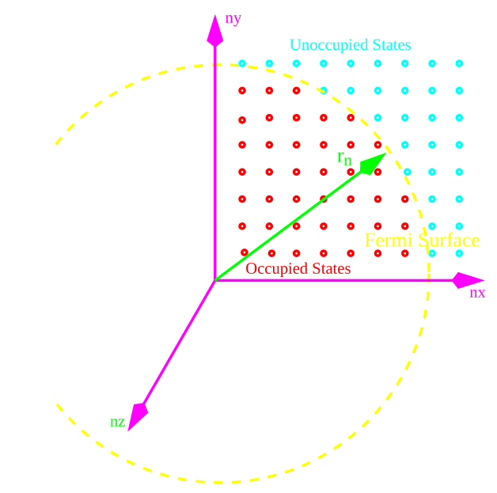

[← 12 Extending QM to Two Particles and Three Dimensions](12-extending-qm-to-two-particles-and-three-dimensions.md) · [14 Angular Momentum →](14-angular-momentum.md)

---

<hr class="page" style="height:2px;border:0;background:currentColor;opacity:0.25">
<a id="p196" href="book.pdf#page=196" target="_blank" title="This page in the PDF"><sup>[p. 196]</sup></a>

# 13 3D Problems Separable in Cartesian Coordinates

We will now look at the case of **potentials that separate in Cartesian coordinates**. These will be of the form.

```math
V ( \vec{r} ) = V_{1} ( x ) + V_{2} ( y ) + V_{3} ( z )
```

In this case, we can solve the problem by **separation of variables**.

```math
H = H_{x} + H_{y} + H_{z}
```

```math
( H_{x} + H_{y} + H_{z} ) u ( x ) v ( y ) w ( z ) = Eu ( x ) v ( y ) w ( z )
```

```math
[ H_{x} u ( x ) ] v ( y ) w ( z ) + u ( x ) ( H_{y} + H_{z} ) v ( y ) w ( z ) = Eu ( x ) v ( y ) w ( z )
```

```math
\frac{Hu ( x )}{u ( x )} = E - \frac{( H_{y} + H_{z} ) v ( y ) w ( z )}{v ( y ) w ( z )} = \epsilon_{x}
```

The left hand side of this equation depends only on $`x`$, while the right side depends on $`y`$ and $`z`$. In order for the two sides to be equal everywhere, they **must both be equal to a constant** which we call $`\epsilon_{x}`$.

The $`x`$ part of the solution satisfies the equation

```math
H_{x} u ( x ) = \epsilon_{x} u ( x ) .
```

Treating the other components similarly we get

```math
H_{y} v ( y ) = \epsilon_{y} v ( y )
```

```math
H_{z} w ( z ) = \epsilon_{z} w ( z )
```

and the total energy is

```math
E = \epsilon_{x} + \epsilon_{y} + \epsilon_{z} .
```

There are only a few problems which can be worked this way but they are important.

# <a id="s-13-1-particle-in-a-3d-box"></a>13.1 Particle in a 3D Box

An example of a problem which has a Hamiltonian of the separable form is the **particle in a 3D** **box**. The potential is zero inside the **cube of side** $`L`$and infinite outside. It can be written as a sum of terms.

```math
H = H_{x} + H_{y} + H_{z}
```

The energies are

```math
E_{nx,ny,nz} = \frac{\pi^{2} \hbar^{2}}{2 mL^{2}} ( n_{x}^{2} + n_{y}^{2} + n_{z}^{2} ) .
```

They depend on **three quantum numbers**, (since there are 3 degrees of freedom).

```math
u_{nx,ny,nz} ( \vec{r} ) = \sin \left( \frac{n_{x} \pi x}{L} \right) \sin \left( \frac{n_{y} \pi y}{L} \right) \sin \left( \frac{n_{z} \pi z}{L} \right)
```

For a cubic box like this one, there will often be degenerate states.

<div align="right"><a href="book.pdf#page=196" target="_blank" title="This page in the PDF"><sup>[p. 196]</sup></a></div>
<hr class="page" style="height:2px;border:0;background:currentColor;opacity:0.25">
<a id="p197" href="book.pdf#page=197" target="_blank" title="This page in the PDF"><sup>[p. 197]</sup></a>

## <a id="s-13-1-1-filling-the-box-with-fermions"></a>13.1.1 Filling the Box with Fermions

If we fill a cold box with $`N`$ fermions, they will all go into different low-energy states. In fact, if the temperature is low enough, they will go into the lowest energy $`N`$ states.

If we fill up all the states up to some energy, that energy is called the **Fermi energy**. All the states with energies lower than $`E_{F}`$ are filled, and all the states with energies larger than $`E_{F}`$ are empty. (Non zero temperature will put some particles in excited states, but, the idea of the Fermi energy is still valid.)

```math
\frac{\pi^{2} \hbar^{2}}{2 mL^{2}} ( n_{x}^{2} + n_{y}^{2} + n_{z}^{2} ) = \frac{\pi^{2} \hbar^{2}}{2 mL^{2}} r_{n}^{2} <E_{F}
```

Since the energy goes like $`n_{x}^{2} + n_{y}^{2} + n_{z}^{2}`$, it makes sense to define a radius $`r_{n}`$ in $`n`$-space out to which the states are filled.



_Figure 42 (p. 197)_

The number of states within the radius is

```math
N = ( 2 )_{spin} \frac{1}{8} \frac{4}{3} \pi r_{n}^{3}
```

where we have added a factor of 2 because fermions have two spin states. This is an **approximate** **counting of the number of states** based on the volume of a sphere in $`n`$-space. The factor of $`\frac{1}{8}`$ indicates that we are just using one eighth of the sphere in $`n`$-space because all the quantum numbers must be positive.

<div align="right"><a href="book.pdf#page=197" target="_blank" title="This page in the PDF"><sup>[p. 197]</sup></a></div>
<hr class="page" style="height:2px;border:0;background:currentColor;opacity:0.25">
<a id="p198" href="book.pdf#page=198" target="_blank" title="This page in the PDF"><sup>[p. 198]</sup></a>

We can now **relate the Fermi energy to the number of particles in the box**.

```math
E_{F} = \frac{\pi^{2} \hbar^{2}}{2 mL^{2}} r_{n}^{2} = \frac{\pi^{2} \hbar^{2}}{2 mL^{2}} \left( \frac{3 N}{\pi} \right)^{\tfrac{2}{3}} = \frac{\pi^{2} \hbar^{2}}{2 m} \left( \frac{3 N}{\pi L^{3}} \right)^{\tfrac{2}{3}} = \frac{\pi^{2} \hbar^{2}}{2 m} \left( \frac{3 n}{\pi} \right)^{\tfrac{2}{3}}
```

We can also integrate to get the **total energy** of all the fermions.

```math
E_{t ot} = 2 \frac{1}{8} \int_{0}^{r_{n}} 4 \pi r^{2} \frac{r^{2} \pi^{2} \hbar^{2}}{2 mL^{2}} dr = \frac{\pi^{3} \hbar^{2}}{2 mL^{2}} \frac{r_{n}^{5}}{5} = \frac{\pi^{3} \hbar^{2}}{1 0 mL^{2}} \left( \frac{3 N}{\pi} \right)^{\tfrac{5}{3}} = \frac{\pi^{3} \hbar^{2}}{1 0 m} \left( \frac{3 n}{\pi} \right)^{\tfrac{5}{3}} L^{3}
```

where the last step shows how the total energy depends on the number of particles per unit volume $`n`$. It makes sense that this energy is proportional to the volume.

The step in which $`E_{F}`$ and $`E_{tot}`$ is related to $`N`$ is often useful.

```math
E_{F} = \frac{\pi^{2} \hbar^{2}}{2 m} \left( \frac{3 N}{\pi L^{3}} \right)^{\tfrac{2}{3}}
```

```math
E_{t ot} = \frac{\pi^{3} \hbar^{2}}{1 0 mL^{2}} \left( \frac{3 N}{\pi} \right)^{\tfrac{5}{3}}
```

## <a id="s-13-1-2-degeneracy-pressure-in-stars"></a>13.1.2 Degeneracy Pressure in Stars

The pressure exerted by fermions squeezed into a small box is what keeps cold stars from collapsing. White Dwarfs are held up by electrons and Neutron Stars are held up by neutrons in a much smaller box.

We can **compute the pressure** from the dependence of the energy on the volume for a fixed number of fermions.

```math
dE = \vec{F} \cdot d \vec{s} = PAds = PdV
```

```math
P = - \frac{\partial E_{t ot}}{\partial V}
```

```math
E_{t ot} = \frac{\pi^{3} \hbar^{2}}{1 0 m} \left( \frac{3 N}{\pi} \right)^{\tfrac{5}{3}} V^{- \tfrac{2}{3}}
```

```math
P = \frac{\pi^{3} \hbar^{2}}{1 5 m} \left( \frac{3 N}{\pi} \right)^{\tfrac{5}{3}} V^{- \tfrac{5}{3}}
```

```math
P = \frac{\pi^{3} \hbar^{2}}{1 5 m} \left( \frac{3 N}{\pi} \right)^{\tfrac{5}{3}} L^{- 5} = \frac{\pi^{3} \hbar^{2}}{1 5 m} \left( \frac{3 n}{\pi} \right)^{\tfrac{5}{3}}
```

The last step verifies that the pressure only depends on the density, not the volume and the $`N`$ independently, as it should. We will use.

```math
P = \frac{\pi^{3} \hbar^{2}}{1 5 m} \left( \frac{3 N}{\pi} \right)^{\tfrac{5}{3}} L^{- 5} = \frac{\pi^{3} \hbar^{2}}{1 5 m} \left( \frac{3 N}{\pi} \right)^{\tfrac{5}{3}} V^{\tfrac{- 5}{3}}
```

<div align="right"><a href="book.pdf#page=198" target="_blank" title="This page in the PDF"><sup>[p. 198]</sup></a></div>
<hr class="page" style="height:2px;border:0;background:currentColor;opacity:0.25">
<a id="p199" href="book.pdf#page=199" target="_blank" title="This page in the PDF"><sup>[p. 199]</sup></a>

To understand the collapse of stars, we must compare this to the **pressure of gravity**. We compute this approximately, ignoring general relativity and, more significantly, the variation of gravitational pressure with radius.

```math
E = - \int_{0}^{R} \frac{GM_{i nside} 4 \pi r^{2} \rho}{r} dr
```

```math
= - \int_{0}^{R} \frac{G ( \tfrac{4}{3} \pi r^{3} \rho ) 4 \pi r^{2} \rho}{r} dr
```

```math
= - \frac{( 4 \pi )^{2}}{1 5} G\rho^{2} R^{5} = - \frac{3 GM^{2}}{5 R}
```

The mass of the star is dominated by nucleons.

```math
M = NM_{N}
```

Putting this into our energy formula, we get.

```math
E = - \frac{3}{5} G ( NM_{N} )^{2} \left( \frac{4 \pi}{3} \right)^{\tfrac{1}{3}} V^{- \tfrac{1}{3}}
```

We can now compute the pressure.

```math
P_{g} = - \frac{\partial E}{\partial V} = - \frac{1}{5} G ( NM_{N} )^{2} \left( \frac{4 \pi}{3} \right)^{\tfrac{1}{3}} V^{- \tfrac{4}{3}}
```

The pressures must balance. For a **white dwarf**, the pressure from electrons is.

```math
P_{e} = \frac{\pi^{3} \hbar^{2}}{1 5 m_{e}} \left( \frac{3 N_{e}}{\pi} \right)^{\tfrac{5}{3}} V^{- \tfrac{5}{3}}
```

We can solve for the radius.

```math
R = \left( \frac{3}{4 \pi} \right)^{\tfrac{2}{3}} \frac{\pi^{3} \hbar^{2}}{3 Gm_{e} M_{N}^{2}} \left( \frac{3}{\pi} \right)^{\tfrac{5}{3}} \frac{N_{e}^{\tfrac{5}{3}}}{N^{2}}
```

There are about two nucleons per electron

```math
N \approx 2 N_{e}
```

so the radius becomes.

```math
R = \left( \frac{8 1 \pi^{2}}{5 1 2} \right)^{\tfrac{1}{3}} \frac{\hbar^{2}}{Gm_{e} M_{N}^{2}} N^{- \tfrac{1}{3}}
```

The radius decreases as we add mass. For one solar mass, $`N = 1 0`$<sup>57</sup>, we get a radius of 7200 km, the size of the earth. The Fermi energy is about 0.2 MeV.

A **white dwarf** is the remnant of a normal star. It has used up its nuclear fuel, fusing light elements into heavier ones, until most of what is left is Fe<sup>56</sup> which is the most tightly bound nucleus. Now the star begins to cool and to shrink. It is stopped by the pressure of electrons. Since the **pressure**<span class="page" style="float:left;width:100%;margin:0.4em 0 0.6em"><span style="display:block;text-align:right"><a href="book.pdf#page=199" target="_blank" title="This page in the PDF"><sup>[p. 199]</sup></a></span><span style="display:block;height:2px;background:currentColor;opacity:0.25"></span><a id="p200" href="book.pdf#page=200" target="_blank" title="This page in the PDF"><sup>[p. 200]</sup></a></span> **from the electrons grows faster than the pressure of gravity**, the star will stay at about earth size even when it cools.

If the star is more massive, the Fermi energy goes up and it becomes possible to absorb the electrons into the nucleons, converting protons into neutrons. The Fermi energy needs to be above 1 MeV. If the electrons disappear this way, the star collapses suddenly down to a size for which the Fermi pressure of the neutrons stops the collapse (with quite a shock). Actually some white dwarfs stay at earth size for a long time as they suck in mass from their surroundings. When they have just enough, they collapse forming a neutron star and making a supernova. The supernovae are all nearly identical since the dwarfs are gaining mass very slowly. The brightness of this type of supernova has been used to **measure the accelerating expansion of the universe**.

We can estimate the **neutron star radius**.

```math
R \to R \frac{M_{N}}{m_{e}} N^{\tfrac{1}{3}} 2^{- \tfrac{5}{3}} = 1 0
```

Its about 10 kilometers. If the pressure at the center of a neutron star becomes too great, it collapses to become a black hole. This collapse is probably brought about by general relativistic effects, aided by strange quarks.

# <a id="s-13-2-the-3d-harmonic-oscillator"></a>13.2 The 3D Harmonic Oscillator

The 3D harmonic oscillator can also be separated in Cartesian coordinates. For the case of a central potential, $`V = \tfrac{1}{2} m\omega^{2} r^{2}`$, this problem can also be solved nicely in spherical coordinates using rotational symmetry. The cartesian solution is easier and better for counting states though.

Lets **assume the central potential** so we can compare to our later solution. We could have three different spring constants and the solution would be as simple. The Hamiltonian is

```math
H = \frac{p^{2}}{2 m} + \frac{1}{2} m\omega^{2} r^{2}
```

```math
H = \frac{p_{x}^{2}}{2 m} + \frac{1}{2} m\omega^{2} x^{2} + \frac{p_{y}^{2}}{2 m} + \frac{1}{2} m\omega^{2} y^{2} + \frac{p_{z}^{2}}{2 m} + \frac{1}{2} m\omega^{2} z^{2}
```

```math
H = H_{x} + H_{y} + H_{z}
```

The problem separates nicely, giving us **three independent harmonic oscillators**.

```math
E = \left( n_{x} + n_{y} + n_{z} + \frac{3}{2} \right) \hbar \omega
```

```math
\psi_{nx,ny,nz} ( x,y,z ) = u_{nx} ( x ) u_{ny} ( y ) u_{nz} ( z )
```

This was really easy.

This problem has a different Fermi surface in $`n`$-space than did the particle in a box. The boundary between filled and unfilled energy levels is a plane defined by

```math
n_{x} + n_{y} + n_{z} = \frac{E_{F}}{\hbar \omega} - \frac{3}{2}
```

<div align="right"><a href="book.pdf#page=200" target="_blank" title="This page in the PDF"><sup>[p. 200]</sup></a></div>
<hr class="page" style="height:2px;border:0;background:currentColor;opacity:0.25">
<a id="p201" href="book.pdf#page=201" target="_blank" title="This page in the PDF"><sup>[p. 201]</sup></a>

# <a id="s-13-3-sample-test-problems"></a>13.3 Sample Test Problems

1. A particle of mass $`m`$ in 3 dimensions is in a potential $`V ( x,y,z ) = \tfrac{1}{2} k ( x^{2}`$ + 2$`y^{2}`$ + 3$`z^{2} )`$. Find the energy eigenstates in terms of **3 quantum numbers**. What is the energy of the ground state and first excited state?

2. **\*** N identical fermions are bound (at low temperature) in a potential $`V ( r ) = \tfrac{1}{2} m\omega^{2} r^{2}`$. Use separation in Cartesian coordinates to find the energy eigenvalues in terms of a set of three quantum numbers (which correspond to 3 mutually commuting operators). Find the Fermi energy of the system. If you are having trouble finding the number of states with energy less than $`E_{F}`$, you may assume that it is $`\alpha ( E_{F} / \hbar \omega )^{3}`$.

3. A particle of mass m is in the potential $`V (`$**r**$`) = \tfrac{1}{2} m\omega^{2} ( x^{2} + y^{2} )`$. Find operators that commute with the Hamiltonian and use them to simplify the Schrödinger equation. Solve this problem in the simplest way possible to find the eigen-energies in terms of a set of ”quantum numbers” that describe the system.

4. A particle is in a cubic box. That is, the potential is zero inside a cube of side L and infinite outside the cube. Find the 3 lowest allowed energies. Find the number of states (level of degeneracy) at each of these 3 energies.

<div align="center">

5. A particle of mass m is bound in the 3 dimensional potential $`V (`$**r**$`) = kr^{2}`$.

</div>

a) Find the energy levels for this particle.

b) Determine the number of degenerate states for the first three energy levels.

6. A particle of mass $`m`$ is in a cubic box. That is, the potential is zero inside a cube of side $`L`$ and infinite outside.

a) Find the three lowest allowed energies.

b) Find the number of states (level of degeneracy) at each of these three energies.

c) Find the Fermi Energy $`E_{F}`$ for $`N`$ particles in the box. (N is large.)

7. A particle is confined in a rectangular box of length $`L`$, width $`W`$, and “tallness” $`T`$. Find the energy eigenvalues in terms of a set of three quantum numbers (which correspond to 3 mutually commuting operators). What are the energies of the three lowest energy states if $`L`$ = 2$`a , W`$ = 1$`a`$, and $`T`$ = 0$`. 5 a`$.

<div align="center">

8. A particle of mass m is bound in the 3 dimensional potential $`V (`$**r**$`) = kr^{2}`$.

</div>

9. a) Find the energy levels for this particle.

10. b) Determine the number of degenerate states for the first three energy levels.

11. In 3 dimensions, a particle of mass $`m`$ is bound in a potential $`V (`$**r**$`) = \tfrac{e^{2}}{\sqrt{x^{2} + z^{2}}}^{-}`$.

a) The definite energy states will, of course, be eigenfunctions of $`H`$. What other operators

can they be eigenfunctions of?

b) Simplify the three dimensional Schrödinger equation by using these operators.

---

[← 12 Extending QM to Two Particles and Three Dimensions](12-extending-qm-to-two-particles-and-three-dimensions.md) · [14 Angular Momentum →](14-angular-momentum.md)
