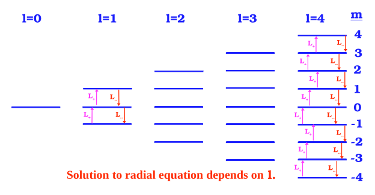
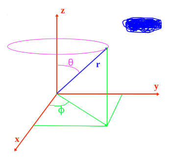

[← 13 3D Problems Separable in Cartesian Coordinates](13-3d-problems-separable-in-cartesian-coordinates.md) · [15 The Radial Equation and Constant Potentials * →](15-the-radial-equation-and-constant-potentials.md)

---

<hr class="page" style="height:2px;border:0;background:currentColor;opacity:0.25">
<a id="p202" href="book.pdf#page=202" target="_blank" title="This page in the PDF"><sup>[p. 202]</sup></a>

# 14 Angular Momentum

# <a id="s-14-1-rotational-symmetry"></a>14.1 Rotational Symmetry

If the potential only depends on the distance between two particles,

```math
V ( \vec{r} ) = V ( r )
```

the Hamiltonian has **Rotational Symmetry**. This is true for the coulomb (and gravitational) potential as well as many others. We know from classical mechanics that these are important problems.

If a the Hamiltonian has rotational symmetry, we can show that the Angular Momentum operators commute with the Hamiltonian (See section 14.4.1).

```math
[ H,L_{i} ] = 0
```

We therefore expect each component of $`\vec{L}`$ to be conserved.

We will not be able to label our states with the quantum numbers for the three components of angular momentum. Recall that we are looking for **a set of mutually commuting operators** to label our energy eigenstates. We actually want two operators plus $`H`$ to give us three quantum numbers for states in three dimensions.

The components of angular momentum do not commute (See section 14.4.2) with each other

```math
[ L_{x} ,L_{y} ] = i \hbar L_{z}
```

```math
1 2 . \quad [ L_{i} ,L_{j} ] = i \hbar \epsilon_{ijk} L_{k}
```

but the **square of the angular momentum commutes** with any of the components

```math
[ L^{2} ,L_{i} ] = 0
```

These commutators lead us to choose the **mutually commuting set of operators** to be $`H , L^{2}`$, and $`L_{z}`$. We could have chosen any component, however, it is most convenient to choose $`L_{z}`$ given the standard definition of spherical coordinates.

The Schrödinger equation can now be rewritten (See section 14.4.3) with only radial derivatives and $`L^{2}`$.

```math
\begin{aligned} \frac{- \hbar^{2}}{2 \mu} \nabla^{2} u_{E} ( \vec{r} ) + V ( r ) u_{E} ( \vec{r} ) &= Eu_{E} ( \vec{r} ) \\ \frac{- \hbar^{2}}{2 \mu} \left[ \frac{1}{r^{2}} \left( r \frac{\partial}{\partial r} \right)^{2} + \frac{1}{r} \frac{\partial}{\partial r} - \frac{L^{2}}{\hbar^{2} r^{2}} \right] u_{E} ( \vec{r} ) + V ( r ) u_{E} ( \vec{r} ) &= Eu_{E} ( \vec{r} ) \end{aligned}
```

<div align="right"><a href="book.pdf#page=202" target="_blank" title="This page in the PDF"><sup>[p. 202]</sup></a></div>
<hr class="page" style="height:2px;border:0;background:currentColor;opacity:0.25">
<a id="p203" href="book.pdf#page=203" target="_blank" title="This page in the PDF"><sup>[p. 203]</sup></a>

This leads to a great simplification of the 3D problem.

It is possible to **separate the Schrödinger equation** since $`r`$ and $`L^{2}`$ appear separately. Write the solution as a product

```math
u_{E} ( \vec{r} ) = R_{E\ell} ( r ) Y_{\ell m} ( \theta ,\varphi )
```

where $`\ell`$ labels the eigenvalue of the $`L^{2}`$ operator and $`m`$ labels the eigenvalue of the $`L_{z}`$ operator. Since $`L_{z}`$ does not appear in the Schrödinger equation, we only label the radial solutions with the energy and the eigenvalues of $`\ell`$.

We get the three equations.

```math
L^{2} Y_{\ell m} ( \theta ,\varphi ) = \ell ( \ell + 1 ) \hbar^{2} Y_{\ell m} ( \theta ,\varphi )
```

```math
\begin{aligned} L_{z} Y_{\ell m} ( \theta ,\varphi ) &= m \hbar Y_{\ell m} ( \theta ,\varphi ) \\ \frac{- \hbar^{2}}{2 \mu} \left[ \frac{1}{r^{2}} \left( r \frac{\partial}{\partial r} \right)^{2} + \frac{1}{r} \frac{\partial}{\partial r} - \frac{\ell ( \ell + 1 )}{r^{2}} \right] R_{E\ell} ( r ) + V ( r ) R_{E\ell} ( r ) &= ER_{E\ell} ( r ) \end{aligned}
```

By assuming the eigenvalues of $`L^{2}`$ have the form $`\ell ( \ell`$ + 1)$`\hbar^{2}`$, we have **anticipated the solution** **but not constrained it**, since the units of angular momentum are those of $`\hbar`$ and since we expect $`L^{2}`$ to have positive eigenvalues.

```math
\langle Y_{\ell m} | L^{2} | Y_{\ell m} \rangle = \langle L_{x} Y_{\ell m} | L_{x} Y_{\ell m} \rangle + \langle L_{y} Y_{\ell m} | L_{y} Y_{\ell m} \rangle + \langle L_{z} Y_{\ell m} | L_{z} Y_{\ell m} \rangle \geq 0
```

The assumption that the eigenvalues of $`L_{z}`$ are some (dimensionless) number times $`\hbar`$ does not constrain our solutions at all.

We will use the algebra of the angular momentum operators to help us **solve the angular part of** **the problem in general**.

For any given problem with rotational symmetry, we will need to **solve a particular differential** **equation in one variable** $`r`$. This radial equation can be simplified a bit.

```math
\frac{- \hbar^{2}}{2 \mu} \left[ \frac{\partial^{2}}{\partial r^{2}} + \frac{2}{r} \frac{\partial}{\partial r} \right] R_{E\ell} ( r ) + \left( V ( r ) + \frac{\ell ( \ell + 1 ) \hbar^{2}}{2 \mu r^{2}} \right) R_{E\ell} ( r ) = ER_{E\ell} ( r )
```

We have grouped the term due to angular momentum with the potential. It is often called a pseudo-potential. For $`\ell \neq 0`$, it is like a repulsive potential.

# <a id="s-14-2-angular-momentum-algebra-raising-and-lowering-operators"></a>14.2 Angular Momentum Algebra: Raising and Lowering Operators

We have already derived the **commutators of the angular momentum operators**

```math
[ L_{x} ,L_{y} ] = i \hbar L_{z}
```

<div align="right"><a href="book.pdf#page=203" target="_blank" title="This page in the PDF"><sup>[p. 203]</sup></a></div>
<hr class="page" style="height:2px;border:0;background:currentColor;opacity:0.25">
<a id="p204" href="book.pdf#page=204" target="_blank" title="This page in the PDF"><sup>[p. 204]</sup></a>

```math
[ L_{i} ,L_{j} ] = i \hbar \epsilon_{ijk} L_{k}
```

```math
[ L^{2} ,L_{i} ] = 0 .
```

We have shown that angular momentum is quantized for a rotor with a single angular variable. To progress toward the possible quantization of angular momentum variables in 3D, we **define the** **operator** $`L_{+}`$ and its Hermitian conjugate $`L_{-}`$.

```math
L_{\pm} \equiv L_{x} \pm iL_{y} .
```

Since $`L^{2}`$ commutes with $`L_{x}`$ and $`L_{y}`$, it commutes with these operators.

```math
[ L^{2} ,L_{\pm} ] = 0
```

The commutator with $`L_{z}`$ is.

```math
[ L_{\pm} ,L_{z} ] = [ L_{x} ,L_{z} ] \pm i [ L_{y} ,L_{z} ] = i \hbar ( - L_{y} \pm iL_{x} ) = \mp \hbar L_{\pm} .
```

From the commutators $`[ L^{2} ,L_{\pm} ]`$ = 0 and [$`L_{\pm} ,L_{z} ] = \mp \hbar L_{\pm}`$, we can derive the effect of the operators (See section 14.4.5) $`L_{\pm}`$ on the eigenstates $`Y_{\ell m}`$, and in so doing, show that $`\ell`$ is an integer greater than or equal to 0, and that $`m`$ is also an integer

```math
\ell = 0 , 1 , 2 ,\dots
```

```math
- \ell \leq m \leq \ell
```

```math
m = - \ell , - \ell + 1 ,\dots ,\ell
```

```math
L_{\pm} Y_{\ell m} = \hbar \sqrt{\ell ( \ell + 1 ) - m ( m \pm 1 ) Y_{\ell ( m \pm 1 )}}
```

Therefore, $`L_{+}`$ raises the $`z`$ component of angular momentum by one unit of $`\hbar`$ and $`L_{-}`$ lowers it by one unit. The raising stops when $`m = \ell`$ and the operation gives zero, $`L_{+} Y_{\ell \ell}`$ = 0. Similarly, the lowering stops because $`L_{-} Y_{\ell - \ell}`$ = 0.



_Figure 43 (p. 204)_

**Angular momentum is quantized**. Any measurement of a component of angular momentum will give some integer times $`\hbar`$. Any measurement of the total angular momentum gives the somewhat curious result **L**

```math
| L | = \sqrt{\ell ( \ell + 1 )} \hbar
```

<div align="right"><a href="book.pdf#page=204" target="_blank" title="This page in the PDF"><sup>[p. 204]</sup></a></div>
<hr class="page" style="height:2px;border:0;background:currentColor;opacity:0.25">
<a id="p205" href="book.pdf#page=205" target="_blank" title="This page in the PDF"><sup>[p. 205]</sup></a>

where $`\ell`$ is an integer.

Note that we can easily write the components of angular momentum in terms of the raising and lowering operators.

```math
L_{x} = \frac{1}{2} ( L_{+} + L_{-} )
```

```math
L_{y} = \frac{1}{2 i} ( L_{+} - L_{-} )
```

We will also find the following equations useful (and easy to compute).

```math
[ L_{+} ,L_{-} ] = i [ L_{y} ,L_{x} ] - i [ L_{x} ,L_{y} ] = \hbar ( L_{z} + L_{z} ) = 2 \hbar L_{z}
```

```math
L^{2} = L_{+} L_{-} + L_{z}^{2} - \hbar L_{z} .
```

\* See Example 14.5.1: What is the expectation value of $`L_{z}`$ in the state $`\psi ( \vec{r} ) = R ( r ) ( \surd_{3}^{2} Y_{1 1} ( \theta ,\varphi ) -`$

```math
i \surd_{3}^{1} Y_{1 - 1} ( \theta ,\varphi ) ) ? *
```

\* See Example 14.5.2: What is the expectation value of $`L_{x}`$ in the state $`\psi ( \vec{r} ) = R ( r ) ( \surd_{3}^{2} Y_{1 1} ( \theta ,\varphi ) -`$

```math
\surd_{3}^{1} Y_{1 0} ( \theta ,\varphi ) ) ? *
```

# <a id="s-14-3-the-angular-momentum-eigenfunctions"></a>14.3 The Angular Momentum Eigenfunctions

The angular momentum eigenstates are **eigenstates of two operators**.

```math
L_{z} Y_{\ell m} ( \theta ,\varphi ) = m \hbar Y_{\ell m} ( \theta ,\varphi )
```

```math
L^{2} Y_{\ell m} ( \theta ,\varphi ) = \ell ( \ell + 1 ) \hbar^{2} Y_{\ell m} ( \theta ,\varphi )
```

All we know about the states are the two quantum numbers $`\ell`$ and $`m`$. We have no additional knowledge about $`L_{x}`$ and $`L_{y}`$ since these operators don’t commute with $`L_{z}`$. The **raising and** **lowering operators** $`L_{\pm} = L_{x} \pm iL_{y}`$ raise or lower $`m`$, leaving $`\ell`$ unchanged.

```math
L_{\pm} Y_{\ell m} = \hbar \sqrt{\ell ( \ell + 1 ) - m ( m \pm 1 )} Y_{\ell ( m \pm 1 )}
```

The differential operators take some work to derive (See section 14.4.4).

```math
L_{z} = \frac{\hbar}{i} \frac{\partial}{\partial \varphi}
```

```math
L_{\pm} = \hbar e^{\pm i\varphi} \left( \pm \frac{\partial}{\partial \theta} + i \cot \theta \frac{\partial}{\partial \varphi} \right)
```

<div align="right"><a href="book.pdf#page=205" target="_blank" title="This page in the PDF"><sup>[p. 205]</sup></a></div>
<hr class="page" style="height:2px;border:0;background:currentColor;opacity:0.25">
<a id="p206" href="book.pdf#page=206" target="_blank" title="This page in the PDF"><sup>[p. 206]</sup></a>

Its easy to find functions that give the eigenvalue of $`L_{z}`$.

```math
Y_{\ell m} ( \theta ,\varphi ) = \Theta ( \theta ) \Phi ( \varphi ) = \Theta ( \theta ) e^{im\varphi}
```

```math
L_{z} Y_{\ell m} ( \theta ,\varphi ) = \frac{\hbar}{i} \frac{\partial}{\partial \varphi} \Theta ( \theta ) e^{im\varphi} = \frac{\hbar}{i} im \Theta ( \theta ) e^{im\varphi} = m \hbar Y_{\ell m} ( \theta ,\varphi )
```

To find the $`\theta`$ dependence, we will use the fact that there are limits on $`m`$. The state with maximum $`m`$ must give zero when raised.

```math
L_{+} Y_{\ell \ell} = \hbar e^{i\varphi} \left( \frac{\partial}{\partial \theta} + i \cot \theta \frac{\partial}{\partial \varphi} \right) \Theta_{\ell} ( \theta ) e^{i\ell \varphi} = 0
```

This gives us a differential equation for that state.

```math
\frac{d \Theta ( \theta )}{d\theta} + i \Theta ( \theta ) \cot \theta ( i\ell ) = 0
```

```math
\frac{d \Theta ( \theta )}{d\theta} = \ell \cot \theta \Theta ( \theta )
```

The solution is

```math
\Theta ( \theta ) = C \sin^{\ell} \theta .
```

Check the solution.

```math
\frac{d \Theta}{d\theta} = C\ell \cos \theta \sin^{\ell - 1} \theta = \ell \cot \theta \Theta
```

Its correct.

Here we should note that only the integer value of $`\ell`$ work for these solutions. If we were to use half-integers, the wave functions would not be single valued, for example at $`\varphi`$ = 0 and $`\varphi`$ = 2$`\pi`$. Even though the probability may be single valued, discontinuities in the amplitude would lead to infinities in the Schrödinger equation. We will find later that the **half-integer angular momentum states** **are used** for internal angular momentum (spin), for which no $`\theta`$ or $`\varphi`$ coordinates exist.

Therefore, **the eigenstate** $`Y_{\ell \ell}`$ **is**.

```math
Y_{\ell \ell} = C \sin^{\ell} ( \theta ) e^{i\ell \varphi}
```

We can compute the next state down by operating with $`L_{-}`$.

```math
Y_{\ell ( \ell - 1 )} = CL_{-} Y_{\ell \ell}
```

We can continue to lower $`m`$ to get all of the eigenfunctions.

We call these eigenstates the **Spherical Harmonics**. The spherical harmonics are **normalized**.

```math
\int_{- 1}^{1} d ( \cos \theta ) \int_{0}^{2 \pi} d\varphi Y_{\ell m}^{*} Y_{\ell m} = 1
```

```math
\int d \Omega Y_{\ell m}^{*} Y_{\ell m} = 1
```

Since they are eigenfunctions of Hermitian operators, they are **orthogonal**.

<div align="right"><a href="book.pdf#page=206" target="_blank" title="This page in the PDF"><sup>[p. 206]</sup></a></div>
<hr class="page" style="height:2px;border:0;background:currentColor;opacity:0.25">
<a id="p207" href="book.pdf#page=207" target="_blank" title="This page in the PDF"><sup>[p. 207]</sup></a>

```math
\int d \Omega Y_{\ell m}^{*} Y_{\ell^{\prime} m^{\prime}} = \delta_{\ell \ell^{\prime}} \delta_{mm^{\prime}}
```

We will use the **actual function** in some problems.

```math
Y_{0 0} = \frac{1}{\sqrt{4 \pi}}
```

```math
Y_{1 1} = - \sqrt{\frac{3}{8 \pi}} e^{i\varphi} \sin \theta
```

```math
Y_{1 0} = \sqrt{\frac{3}{4 \pi}} \cos \theta
```

```math
Y_{2 2} = \sqrt{\frac{1 5}{3 2 \pi}} e^{2 i\varphi} \sin^{2} \theta
```

```math
Y_{2 1} = - \sqrt{\frac{1 5}{8 \pi}} e^{i\varphi} \sin \theta \cos \theta
```

```math
Y_{2 0} = \sqrt{\frac{5}{1 6 \pi}} ( 3 \cos^{2} \theta - 1 )
```

The spherical harmonics with negative $`m`$ can be easily compute from those with positive $`m`$.

```math
Y_{\ell ( - m )} = ( - 1 )^{m} Y_{\ell m}^{*}
```

Any function of $`\theta`$ and $`\varphi`$ can be **expanded in the spherical harmonics**.

```math
f ( \theta ,\varphi ) = \sum_{\ell = 0 m = - \ell}^{\infty} \sum^{\ell} C_{\ell m} Y_{\ell m} ( \theta ,\varphi )
```

The spherical harmonics form a **complete set**.

```math
\sum_{\ell = 0 m = - \ell}^{\infty} \sum^{\ell} | Y_{\ell m} \rangle \langle Y_{\ell m} | = \sum_{\ell = 0 m = - \ell}^{\infty} \sum^{\ell} | \ell m \rangle \langle \ell m | = 1
```

When using bra-ket notation, $`| \ell m \rangle`$ is sufficient to identify the state.

The spherical harmonics are **related to the Legendre polynomials** which are functions of $`\theta`$.

```math
Y_{\ell 0} ( \theta ,\varphi ) = \left( \frac{2 \ell + 1}{4 \pi} \right)^{\tfrac{1}{2}} P_{\ell} ( \cos \theta )
```

```math
Y_{\ell m} = ( - 1 )^{m} \left[ \frac{2 \ell + 1}{4 \pi} \frac{( \ell - m ) !}{( \ell + m ) !} \right]^{\tfrac{1}{2}} P_{\ell}^{m} ( \cos \theta ) e^{im\varphi}
```

<div align="right"><a href="book.pdf#page=207" target="_blank" title="This page in the PDF"><sup>[p. 207]</sup></a></div>
<hr class="page" style="height:2px;border:0;background:currentColor;opacity:0.25">
<a id="p208" href="book.pdf#page=208" target="_blank" title="This page in the PDF"><sup>[p. 208]</sup></a>

## <a id="s-14-3-1-parity-of-the-spherical-harmonics"></a>14.3.1 Parity of the Spherical Harmonics

In spherical coordinates, the **parity operation** is

```math
r \quad \to \quad r
```

```math
\theta \quad \to \quad \pi - \theta
```

```math
\varphi \quad \to \quad \varphi + \pi .
```

The radial part of the wavefunction, therefore, is unchanged and the

```math
R ( r ) \to R ( r )
```

**parity of the state is determined from the angular part**. We know the state $`Y_{\ell \ell}`$ in general. A parity transformation gives.

```math
Y_{\ell \ell} ( \theta ,\varphi ) \to Y_{\ell \ell} ( \pi - \theta ,\varphi + \pi ) = e^{i\ell \varphi} e^{i\ell \pi} \sin^{\ell} ( \theta ) = e^{i\ell \pi} Y_{\ell \ell} = ( - 1 )^{\ell} Y_{\ell \ell}
```

The states are either even or odd parity depending on the quantum number $`\ell`$.

```math
parity = ( - 1 )^{\ell}
```

The angular momentum operators are axial vectors and do not change sign under a parity transformation. Therefore, $`L_{-}`$ does not change under parity and all the $`Y_{\ell m}`$ with have the same parity as $`Y_{\ell \ell}`$

```math
L_{-} Y_{\ell \ell} \to ( - 1 )^{\ell} L_{-} Y_{\ell \ell}
```

```math
Y_{\ell m} ( \pi - \theta ,\varphi + \pi ) = ( - 1 )^{\ell} Y_{\ell m} ( \theta ,\varphi )
```

# <a id="s-14-4-derivations-and-computations"></a>14.4 Derivations and Computations

## <a id="s-14-4-1-rotational-symmetry-implies-angular-momentum-conservation"></a>14.4.1 Rotational Symmetry Implies Angular Momentum Conservation

In three dimensions, this means that we can change our coordinates by rotating about any one of the axes and the equations should not change. Lets try and infinitesimal rotation about the $`z`$ axis. The $`x`$ and $`y`$ coordinates will change.

```math
x^{\prime} = x + d\theta y
```

```math
y^{\prime} = y - d\theta x
```

The original Schrödinger Equation is

```math
H\psi ( x,y,z ) = E\psi ( x,y,z )
```

and the transformed equation is

```math
H\psi ( x + d\theta y,y - d\theta x,z ) = E\psi ( x + d\theta y,y - d\theta x,z ) .
```

<div align="right"><a href="book.pdf#page=208" target="_blank" title="This page in the PDF"><sup>[p. 208]</sup></a></div>
<hr class="page" style="height:2px;border:0;background:currentColor;opacity:0.25">
<a id="p209" href="book.pdf#page=209" target="_blank" title="This page in the PDF"><sup>[p. 209]</sup></a>

Now we Taylor expand this equation.

```math
H\psi ( x,y,z ) + Hd\theta \left( \frac{\partial \psi}{\partial x} y - \frac{\partial \psi}{\partial y} x \right) = E\psi ( x,y,z ) + Ed\theta \left( \frac{\partial \psi}{\partial x} y - \frac{\partial \psi}{\partial y} x \right)
```

Subtract off the original equation.

```math
H \left( \frac{\partial}{\partial x} y - \frac{\partial}{\partial y} x \right) \psi = \left( \frac{\partial}{\partial x} y - \frac{\partial}{\partial y} x \right) H\psi
```

We find an operator that commutes with the Hamiltonian.

```math
\left[ H, \frac{\hbar}{i} \left( x \frac{\partial}{\partial y} - y \frac{\partial}{\partial x} \right) \right] = 0
```

Note that we have inserted the constant $`\frac{\hbar}{i}`$ in anticipation of identifying this operator as the $`z`$ component of angular momentum.

```math
\vec{L} = \vec{r} \times \vec{p}
```

```math
L_{z} = \frac{\hbar}{i} \left( x \frac{\partial}{\partial y} - y \frac{\partial}{\partial x} \right) = xp_{y} - yp_{x}
```

We could have done infinitesimal rotations about the $`x`$ or $`y`$ axes and shown that all the components of the angular momentum operator commute with the Hamiltonian.

```math
[ H,L_{z} ] = [ H,L_{x} ] = [ H,L_{y} ] = 0
```

Remember that operators that commute with the Hamiltonian imply physical quantities that are conserved.

## <a id="s-14-4-2-the-commutators-of-the-angular-momentum-operators"></a>14.4.2 The Commutators of the Angular Momentum Operators

```math
[ L_{x} ,L_{y} ] \neq 0 ,
```

however, the square of the angular momentum vector commutes with all the components.

```math
[ L^{2} ,L_{z} ] = 0
```

This will give us the operators we need to label states in 3D central potentials.

Lets just compute the commutator.

```math
[ L_{x} ,L_{y} ] = [ yp_{z} - zp_{y} ,zp_{x} - xp_{z} ] = y [ p_{z} ,z ] p_{x} + [ z,p_{z} ] p_{y} x
```

```math
= \frac{\hbar}{i} [ yp_{x} - xp_{y} ] = i \hbar L_{z}
```

Since there is no difference between $`x , y`$ and $`z`$, we can generalize this to

```math
[ L_{i} ,L_{j} ] = i \hbar \epsilon_{ijk} L_{k}
```

<div align="right"><a href="book.pdf#page=209" target="_blank" title="This page in the PDF"><sup>[p. 209]</sup></a></div>
<hr class="page" style="height:2px;border:0;background:currentColor;opacity:0.25">
<a id="p210" href="book.pdf#page=210" target="_blank" title="This page in the PDF"><sup>[p. 210]</sup></a>

where $`\epsilon_{ijk}`$ is the completely antisymmetric tensor and we assume a sum over repeated indices.

```math
\epsilon_{ijk} = - \epsilon_{jik} = - \epsilon_{ikj} = - \epsilon_{kji}
```

The tensor is equal to 1 for cyclic permutations of 123, equal to -1 for anti-cyclic permutations, and equal to zero if any index is repeated. It is commonly used for a cross product. For example, if

```math
\vec{L} = \vec{r} \times \vec{p}
```

then

```math
L_{i} = r_{j} p_{k} \epsilon_{ijk}
```

where we again assume a sum over repeated indices.

Now lets compute commutators of the $`L^{2}`$ operator.

```math
L^{2} = L_{x}^{2} + L_{y}^{2} + L_{z}^{2}
```

```math
[ L_{z} ,L^{2} ] = [ L_{z} ,L_{x}^{2} ] + [ L_{z} ,L_{y}^{2} ]
```

```math
= [ L_{z} ,L_{x} ] L_{x} + L_{x} [ L_{z} ,L_{x} ] + [ L_{z} ,L_{y} ] L_{y} + L_{y} [ L_{z} ,L_{y} ]
```

```math
= i \hbar ( L_{y} L_{x} + L_{x} L_{y} - L_{x} L_{y} - L_{y} L_{x} ) = 0
```

We can generalize this to

```math
[ L_{i} ,L^{2} ] = 0 .
```

$`L^{2}`$ commutes with every component of $`\vec{L}`$.

## <a id="s-14-4-3-rewriting-2-p-2-mu-using-l-2"></a>14.4.3 Rewriting $`\frac{p^{2}}{2 \mu}`$ Using $`L^{2}`$

We wish to use the $`L^{2}`$ and $`L_{z}`$ operators to help us solve the central potential problem. If we can rewrite $`H`$ in terms of these operators, and remove all the angular derivatives, problems will be greatly simplified. We will work in Cartesian coordinates for a while, where we know the commutators.

First, write out $`L^{2}`$.

```math
L^{2} = ( \vec{r} \times \vec{p} )^{2}
```

```math
= - \hbar^{2} \left[ \left( y \frac{\partial}{\partial z} - z \frac{\partial}{\partial y} \right)^{2} + \left( z \frac{\partial}{\partial x} - x \frac{\partial}{\partial z} \right)^{2} + \left( x \frac{\partial}{\partial y} - y \frac{\partial}{\partial x} \right)^{2} \right]
```

Group the terms.

```math
\begin{aligned} L^{2} &= - \quad \hbar^{2} \left[ x^{2} \left( \frac{\partial^{2}}{\partial z^{2}} + \frac{\partial^{2}}{\partial y^{2}} \right) + y^{2} \left( \frac{\partial^{2}}{\partial x^{2}} + \frac{\partial^{2}}{\partial z^{2}} \right) + z^{2} \left( \frac{\partial^{2}}{\partial x^{2}} + \frac{\partial^{2}}{\partial y^{2}} \right) \right. \\ & \quad \left. - \left( 2 xy \frac{\partial^{2}}{\partial x\partial y} + 2 yz \frac{\partial^{2}}{\partial y\partial z} + 2 xz \frac{\partial^{2}}{\partial x\partial z} + 2 x \frac{\partial}{\partial x} + 2 y \frac{\partial}{\partial y} + 2 z \frac{\partial}{\partial z} \right) \right] \end{aligned}
```

<div align="right"><a href="book.pdf#page=210" target="_blank" title="This page in the PDF"><sup>[p. 210]</sup></a></div>
<hr class="page" style="height:2px;border:0;background:currentColor;opacity:0.25">
<a id="p211" href="book.pdf#page=211" target="_blank" title="This page in the PDF"><sup>[p. 211]</sup></a>

We expect to need to keep the radial derivatives so lets identify those by dotting $`\vec{r}`$ into $`\vec{p}`$. This will also make the units match $`L^{2}`$.

```math
( \vec{r} \cdot \vec{p} )^{2} = - \hbar^{2} \left( x \frac{\partial}{\partial x} + y \frac{\partial}{\partial y} + z \frac{\partial}{\partial z} \right)^{2}
```

```math
\begin{aligned} &= - \hbar^{2} \left( x^{2} \frac{\partial^{2}}{\partial x^{2}} + y^{2} \frac{\partial^{2}}{\partial y^{2}} + z^{2} \frac{\partial^{2}}{\partial z^{2}} + 2 xy \frac{\partial^{2}}{\partial x\partial y} + 2 yz \frac{\partial^{2}}{\partial y\partial z} + 2 xz \frac{\partial^{2}}{\partial x\partial z} \right. \\ & \quad \left. + x \frac{\partial}{\partial x} + y \frac{\partial}{\partial y} + z \frac{\partial}{\partial z} \right) \end{aligned}
```

By adding these two expressions, things simplify a lot.

```math
L^{2} + ( \vec{r} \cdot \vec{p} )^{2} = r^{2} p^{2} + i \hbar \vec{r} \cdot \vec{p}
```

We can now solve for $`p^{2}`$ and we have something we can use in the Schrödinger equation.

```math
p^{2} = \frac{1}{r^{2}} \left( L^{2} + ( \vec{r} \cdot \vec{p} )^{2} - i \hbar \vec{r} \cdot \vec{p} \right)
```

```math
= \frac{1}{r^{2}} L^{2} - \frac{\hbar^{2}}{r^{2}} \left( r \frac{\partial}{\partial r} \right)^{2} - \hbar^{2} \frac{1}{r} \frac{\partial}{\partial r}
```

<div align="center">

The Schrödinger equation now can be written with only radial derivatives and $`L^{2}`$.

</div>

```math
\frac{- \hbar^{2}}{2 \mu} \left[ \frac{1}{r^{2}} \left( r \frac{\partial}{\partial r} \right)^{2} + \frac{1}{r} \frac{\partial}{\partial r} - \frac{L^{2}}{\hbar^{2} r^{2}} \right] u_{E} ( \vec{r} ) + V ( r ) u_{E} ( \vec{r} ) = Eu_{E} ( \vec{r} )
```

<div align="center">

## <a id="s-14-4-4-spherical-coordinates-and-the-angular-momentum-operators"></a>14.4.4 Spherical Coordinates and the Angular Momentum Operators

</div>

The transformation from spherical coordinates to Cartesian coordinate is.

```math
\begin{array}{lccl}
x & = & r \sin & \theta \cos \varphi \\ 
y & = & r \sin & \theta \sin \varphi \\ 
z & = & r \cos & \theta \\ 
\end{array}
```

The transformation from Cartesian coordinates to spherical coordinates is.

```math
r = \sqrt{x^{2} + y^{2} + z^{2}}
```

```math
\cos \theta = \frac{z}{\sqrt{x^{2} + y^{2} + z^{2}}}
```

```math
\tan \varphi = y
```

<div align="right"><a href="book.pdf#page=211" target="_blank" title="This page in the PDF"><sup>[p. 211]</sup></a></div>
<hr class="page" style="height:2px;border:0;background:currentColor;opacity:0.25">
<a id="p212" href="book.pdf#page=212" target="_blank" title="This page in the PDF"><sup>[p. 212]</sup></a>


_Figure 44 (p. 212)_


_Figure 45 (p. 212)_



_Figure 46 (p. 212)_

We now proceed to calculate the angular momentum operators in spherical coordinates. The first step is to write the $`\frac{\partial}{\partial x_{i}}`$ in spherical coordinates. We use the chain rule and the above transformation from Cartesian to spherical. We have used $`d \cos \theta = - \sin \theta d\theta`$ and $`d \tan \varphi = \tfrac{1}{\cos^{2} \varphi} d\varphi`$. Ultimately all of these should be written in the sperical cooridnates but its convenient to use $`x`$ for example in intermediate steps of the calculation.

```math
\frac{\partial}{\partial x} = \frac{\partial r}{\partial x} \frac{\partial}{\partial r} + \frac{\partial \cos \theta}{\partial x} \frac{\partial}{\partial \cos \theta} + \frac{\partial \tan \varphi}{\partial x} \frac{\partial}{\partial \tan \varphi}
```

```math
= \frac{x}{r} \frac{\partial}{\partial r} + \frac{- xz}{r^{3}} \frac{- 1}{\sin \theta} \frac{\partial}{\partial \theta} - \frac{y}{x^{2}} \cos^{2} \varphi \frac{\partial}{\partial \varphi}
```

```math
= \sin \theta \cos \varphi \frac{\partial}{\partial r} + \frac{1}{r} \sin \theta \cos \varphi \cos \theta \frac{1}{\sin \theta} \frac{\partial}{\partial \theta} - \frac{1}{r} \frac{\sin \theta \sin \varphi}{\sin^{2} \theta \cos^{2} \varphi} \cos^{2} \varphi \frac{\partial}{\partial \varphi}
```

```math
= \sin \theta \cos \varphi \frac{\partial}{\partial r} + \frac{1}{r} \cos \varphi \cos \theta \frac{\partial}{\partial \theta} - \frac{1}{r} \frac{\sin \varphi}{\sin \theta} \frac{\partial}{\partial \varphi}
```

```math
\frac{\partial}{\partial y} = \frac{\partial r}{\partial y} \frac{\partial}{\partial r} + \frac{\partial \cos \theta}{\partial y} \frac{\partial}{\partial \cos \theta} + \frac{\partial \tan \varphi}{\partial y} \frac{\partial}{\partial \tan \varphi}
```

```math
= \frac{y}{r} \frac{\partial}{\partial r} + \frac{- yz}{r^{3}} \frac{- 1}{\sin \theta} \frac{\partial}{\partial \theta} + \frac{1}{x} \cos^{2} \varphi \frac{\partial}{\partial \varphi}
```

```math
= \sin \theta \sin \varphi \frac{\partial}{\partial r} + \frac{1}{r} \sin \theta \sin \varphi \cos \theta \frac{1}{\sin \theta} \frac{\partial}{\partial \theta} + \frac{1}{r} \frac{1}{\sin \theta \cos \varphi} \cos^{2} \varphi \frac{\partial}{\partial \varphi}
```

```math
= \sin \theta \sin \varphi \frac{\partial}{\partial r} + \frac{1}{r} \sin \varphi \cos \theta \frac{\partial}{\partial \theta} + \frac{1}{r} \frac{\cos \varphi}{\sin \theta} \frac{\partial}{\partial \varphi}
```

```math
\frac{\partial}{\partial z} = \frac{\partial r}{\partial z} \frac{\partial}{\partial r} + \frac{\partial \cos \theta}{\partial z} \frac{\partial}{\partial \cos \theta} + \frac{\partial \tan \varphi}{\partial z} \frac{\partial}{\partial \tan \varphi}
```

```math
= \frac{z}{r} \frac{\partial}{\partial r} + \left( \frac{1}{r} - \frac{z^{2}}{r^{3}} \right) \frac{- 1}{\sin \theta} \frac{\partial}{\partial \theta}
```

```math
= \cos \theta \frac{\partial}{\partial r} + \frac{1}{r} \left( 1 - \cos^{2} \theta \right) \frac{- 1}{\sin \theta} \frac{\partial}{\partial \theta}
```

```math
= \cos \theta \frac{\partial}{\partial r} - \frac{1}{r} \sin \theta \frac{\partial}{\partial \theta}
```

<div align="right"><a href="book.pdf#page=212" target="_blank" title="This page in the PDF"><sup>[p. 212]</sup></a></div>
<hr class="page" style="height:2px;border:0;background:currentColor;opacity:0.25">
<a id="p213" href="book.pdf#page=213" target="_blank" title="This page in the PDF"><sup>[p. 213]</sup></a>

Bringing together the above results, we have.

```math
\frac{\partial}{\partial x} = \sin \theta \cos \varphi \frac{\partial}{\partial r} + \frac{1}{r} \cos \varphi \cos \theta \frac{\partial}{\partial \theta} - \frac{1}{r} \frac{\sin \varphi}{\sin \theta} \frac{\partial}{\partial \varphi}
```

```math
\frac{\partial}{\partial y} = \sin \theta \sin \varphi \frac{\partial}{\partial r} + \frac{1}{r} \sin \varphi \cos \theta \frac{\partial}{\partial \theta} + \frac{1}{r} \frac{\cos \varphi}{\sin \theta} \frac{\partial}{\partial \varphi}
```

```math
\frac{\partial}{\partial z} = \cos \theta \frac{\partial}{\partial r} - \frac{1}{r} \sin \theta \frac{\partial}{\partial \theta}
```

Now simply plug these into the angular momentum formulae.

```math
L_{z} = \frac{\hbar}{i} \left( x \frac{\partial}{\partial y} - y \frac{\partial}{\partial x} \right) = \frac{\hbar}{i} \frac{\partial}{\partial \varphi}
```

```math
L_{\pm} = L_{x} \pm iL_{y} = \frac{\hbar}{i} \left( y \frac{\partial}{\partial z} - z \frac{\partial}{\partial y} \pm i \left( z \frac{\partial}{\partial x} - x \frac{\partial}{\partial z} \right) \right) = \frac{\hbar}{i} \left( ( y \mp ix ) \frac{\partial}{\partial z} - z \left( \frac{\partial}{\partial y} \mp i \frac{\partial}{\partial x} \right) \right)
```

```math
= \hbar \left( \mp ( x \pm iy ) \frac{\partial}{\partial z} \pm z \left( \frac{\partial}{\partial x} \pm i \frac{\partial}{\partial y} \right) \right)
```

```math
= \hbar r \left( \mp \sin \theta e^{\pm i\varphi} \frac{\partial}{\partial z} \pm \cos \theta \left( \frac{\partial}{\partial x} \pm i \frac{\partial}{\partial y} \right) \right)
```

```math
= \hbar \left( \mp \sin \theta e^{\pm i\varphi} \left( r \cos \theta \frac{\partial}{\partial r} - \sin \theta \frac{\partial}{\partial \theta} \right) \pm \cos \theta \left( r \sin \theta e^{\pm i\varphi} \frac{\partial}{\partial r} + \cos \theta e^{\pm i\varphi} \frac{\partial}{\partial \theta} \pm \frac{ie^{\pm i\varphi}}{\sin \theta} \frac{\partial}{\partial \varphi} \right) \right)
```

```math
= \hbar e^{\pm i\varphi} \left( \pm \sin^{2} \theta \frac{\partial}{\partial \theta} \pm \left( \cos^{2} \theta \frac{\partial}{\partial \theta} \pm \frac{i \cos \theta}{\sin \theta} \frac{\partial}{\partial \varphi} \right) \right)
```

```math
= \hbar e^{\pm i\varphi} \left( \pm \frac{\partial}{\partial \theta} + i \cot \theta \frac{\partial}{\partial \varphi} \right)
```

<div align="center">

We will use these results to find the actual eigenfunctions of angular momentum.

</div>

```math
L_{z} = \frac{\hbar}{i} \frac{\partial}{\partial \varphi}
```

```math
L_{\pm} = \hbar e^{\pm i\varphi} \left( \pm \frac{\partial}{\partial \theta} + i \cot \theta \frac{\partial}{\partial \varphi} \right)
```

## <a id="s-14-4-5-the-operators-l-pm"></a>14.4.5 The Operators $`L_{\pm}`$

The next step is to figure out how the $`L_{\pm}`$ operators change the eigenstate $`Y_{\ell m}`$. What eigenstates of $`L^{2}`$ are generated when we operate with $`L_{+}`$ or $`L_{-}`$?

```math
L^{2} ( L_{\pm} Y_{\ell m} ) = L_{\pm} L^{2} Y_{\ell m} = \ell ( \ell + 1 ) \hbar^{2} ( L_{\pm} Y_{\ell m} )
```

Because $`L^{2}`$ commutes with $`L_{\pm}`$, we see that we have the same $`\ell ( \ell`$ + 1) after operation. This is also true for operations with $`L_{z}`$.

```math
L^{2} ( L_{z} Y_{\ell m} ) = L_{z} L^{2} Y_{\ell m} = \ell ( \ell + 1 ) \hbar^{2} ( L_{z} Y_{\ell m} )
```

<div align="right"><a href="book.pdf#page=213" target="_blank" title="This page in the PDF"><sup>[p. 213]</sup></a></div>
<hr class="page" style="height:2px;border:0;background:currentColor;opacity:0.25">
<a id="p214" href="book.pdf#page=214" target="_blank" title="This page in the PDF"><sup>[p. 214]</sup></a>

The operators $`L_{+} , L_{-}`$ and $`L_{Z}`$ do not change $`\ell`$. That is, after we operate, the new state is still an eigenstate of $`L^{2}`$ with the same eigenvalue, $`\ell ( \ell`$ + 1).

The eigenvalue of $`L_{z}`$ is changed when we operate with $`L_{+}`$ or $`L_{-}`$.

```math
L_{z} ( L_{\pm} Y_{\ell m} ) = L_{\pm} L_{z} Y_{\ell m} + [ L_{z} ,L_{\pm} ] Y_{\ell m}
```

```math
= m \hbar ( L_{\pm} Y_{\ell m} ) \pm \hbar L_{\pm} Y_{\ell m} = ( m \pm 1 ) \hbar ( L_{\pm} Y_{\ell m} )
```

(This should remind you of the raising and lowering operators in the HO solution.)

From the above equation we can see that $`( L_{\pm} Y_{\ell m} )`$ is an eigenstate of $`L_{z}`$.

```math
L_{\pm} Y_{\ell m} = C_{\pm} ( \ell ,m ) Y_{\ell ( m \pm 1 )}
```

These operators raise or lower the $`z`$ component of angular momentum by one unit of $`\hbar`$.

Since $`L_{\pm}^{\dagger} \langle \rangle = L_{\mp}`$, its easy to show that the following is greater than zero.

```math
\langle L_{\pm} Y_{\ell m} | L_{\pm} Y_{\ell m} \rangle \geq 0
```

```math
\langle Y_{\ell m} | L_{\mp} L_{\pm} Y_{\ell m} \rangle \geq 0
```

Writing $`L_{+} L_{-}`$ in terms of our chosen operators,

```math
L_{\mp} L_{\pm} = ( L_{x} \mp iL_{y} ) ( L_{x} \pm iL_{y} ) = L_{x}^{2} + L_{y}^{2} \pm iL_{x} L_{y} \mp iL_{y} L_{x}
```

```math
= L_{x}^{2} + L_{y}^{2} \pm i [ L_{x} ,L_{y} ] = L^{2} - L_{z}^{2} \mp \hbar L_{z}
```

we can derive limits on the quantum numbers.

```math
\langle Y_{\ell m} | ( L^{2} - L_{z}^{2} \mp \hbar L_{z} ) Y_{\ell m} \rangle \geq 0
```

```math
( \ell ( \ell + 1 ) - m^{2} \mp m ) \hbar^{2} \geq 0
```

```math
\ell ( \ell + 1 ) \geq m ( m \pm 1 )
```

We know that the eigenvalue $`\ell ( \ell`$ + 1)$`\hbar^{2}`$ is greater than zero. We can assume that

```math
\ell \geq 0
```

because negative values just repeat the same eigenvalues of $`\ell ( \ell`$ + 1)$`\hbar^{2}`$.

The condition that $`\ell ( \ell`$ + 1) $`\geq m ( m \pm`$ 1) then becomes a limit on $`m`$.

```math
- \ell \leq m \leq \ell
```

Now, $`L_{+}`$ raises $`m`$ by one and $`L_{-}`$ lowers $`m`$ by one, and does not change $`\ell`$. Since $`m`$ is limited to be in the range $`- \ell \leq m \leq \ell`$, the raising and lowering must stop for $`m = \pm \ell`$,

```math
L_{-} Y_{\ell ( - \ell )} = 0
```

```math
L_{+} Y_{\ell \ell} = 0
```

<div align="right"><a href="book.pdf#page=214" target="_blank" title="This page in the PDF"><sup>[p. 214]</sup></a></div>
<hr class="page" style="height:2px;border:0;background:currentColor;opacity:0.25">
<a id="p215" href="book.pdf#page=215" target="_blank" title="This page in the PDF"><sup>[p. 215]</sup></a>

The raising and lowering operators change $`m`$ in integer steps, so, starting from $`m = - \ell`$, there will be states in integer steps up to $`\ell`$.

```math
m = - \ell , - \ell + 1 ,\dots ,\ell - 1 ,\ell
```

Having the minimum at $`- \ell`$ and the maximum at +$`\ell`$ with integer steps only works if $`\ell`$ **is an integer** **or a half-integer**. There are 2$`\ell`$+ 1 states with the same $`\ell`$ and different values of $`m`$. We now know what eigenstates are allowed.

The eigenstates of $`L^{2}`$ and $`L_{z}`$ should be normalized

```math
\langle Y_{\ell m} | Y_{\ell m} \rangle = 1 .
```

The raising and lowering operators acting on $`Y_{\ell m}`$ give

```math
L_{\pm} Y_{\ell m} = C_{\pm} ( \ell ,m ) Y_{\ell ( m \pm 1 )}
```

The coefficient $`C_{\pm} ( \ell ,m )`$ can be computed.

```math
\langle L_{\pm} Y_{\ell m} | L_{\pm} Y_{\ell m} \rangle = | C ( \ell ,m ) |^{2} \langle Y_{\ell ( m \pm 1 )} | Y_{\ell ( m \pm 1 )} \rangle
```

```math
= | C ( \ell ,m ) |^{2}
```

```math
\langle L_{\pm} Y_{\ell m} | L_{\pm} Y_{\ell m} \rangle = \langle Y_{\ell m} | L_{\mp} L_{\pm} Y_{\ell m} \rangle
```

```math
= \langle Y_{\ell m} | ( L^{2} - L_{z}^{2} \mp \hbar L_{z} ) Y_{\ell m} \rangle
```

```math
= ( \ell ( \ell + 1 ) - m^{2} \mp m ) \hbar^{2}
```

```math
| C ( \ell ,m ) |^{2} = \left( \ell ( \ell + 1 ) - m^{2} \mp m \right) \hbar^{2}
```

```math
C_{\pm} ( l,m ) = \hbar \sqrt{\ell ( \ell + 1 ) - m ( m \pm 1 )}
```

We now have the effect of the raising and lowering operators in terms of the normalized eigenstates.

```math
L_{\pm} Y_{\ell m} = \hbar \sqrt{\ell ( \ell + 1 ) - m ( m \pm 1 )} Y_{\ell ( m \pm 1 )}
```

# <a id="s-14-5-examples"></a>14.5 Examples

## <a id="s-14-5-1-the-expectation-value-of-l-z"></a>14.5.1 The Expectation Value of $`L_{z}`$

What is the expectation value of $`L_{z}`$ in the state $`\psi ( \vec{r} ) = R ( r ) ( \sqrt{\frac{2}{3}} Y_{1 1} ( \theta ,\varphi ) - i \sqrt{\frac{1}{3}} Y_{1 - 1} ( \theta ,\varphi )`$)?

The radial part plays no role. The angular part is properly normalized.

```math
\langle \psi | L_{z} | \psi \rangle = \left\langle \sqrt{\frac{2}{3}} Y_{1 1} - i \sqrt{\frac{1}{3}} Y_{1 - 1} | L_{z} | \sqrt{\frac{2}{3}} Y_{1 1} - i \sqrt{\frac{1}{3}} Y_{1 - 1} \right\rangle
```

```math
= \begin{pmatrix} \sqrt{\frac{2}{3}} \quad \sqrt{\frac{1}{3}} \quad \sqrt{\frac{2}{3}} & \sqrt{\frac{1}{3}} \\ Y_{1 1} - i \quad Y_{1 - 1} | & \hbar Y_{1 1} + i \quad \hbar Y_{1 - 1} \end{pmatrix}
```

```math
= \left( \frac{2}{3} - \frac{1}{3} \right) \hbar = \frac{1}{3} \hbar
```

<div align="right"><a href="book.pdf#page=215" target="_blank" title="This page in the PDF"><sup>[p. 215]</sup></a></div>
<hr class="page" style="height:2px;border:0;background:currentColor;opacity:0.25">
<a id="p216" href="book.pdf#page=216" target="_blank" title="This page in the PDF"><sup>[p. 216]</sup></a>

## <a id="s-14-5-2-the-expectation-value-of-l-x"></a>14.5.2 The Expectation Value of $`L_{x}`$

What is the expectation value of $`L_{x}`$ in the state $`\psi ( \vec{r} ) = R ( r ) ( \sqrt{\frac{2}{3}} Y_{1 1} ( \theta ,\varphi ) - \sqrt{\frac{1}{3}} Y_{1 0} ( \theta ,\varphi )`$)?

We need $`L_{x} = ( L_{+} + L_{-} ) / 2 .`$

```math
\langle \psi | L_{x} | \psi \rangle = \frac{1}{2} \left\langle \sqrt{\frac{2}{3}} Y_{1 1} - \sqrt{\frac{1}{3}} Y_{1 0} | L_{+} + L_{-} | \sqrt{\frac{2}{3}} Y_{1 1} - \sqrt{\frac{1}{3}} Y_{1 0} \right\rangle
```

```math
= \frac{1}{2} \left\langle \sqrt{\frac{2}{3}} Y_{1 1} - \sqrt{\frac{1}{3}} Y_{1 0} | \sqrt{\frac{2}{3}} L_{-} Y_{1 1} - \sqrt{\frac{1}{3}} L_{+} Y_{1 0} \right\rangle
```

```math
= \frac{\hbar}{2} \left\langle \sqrt{\frac{2}{3}} Y_{1 1} - \sqrt{\frac{1}{3}} Y_{1 0} | \sqrt{\frac{2}{3}} \sqrt{2} Y_{1 0} - \sqrt{\frac{1}{3}} \sqrt{2} Y_{1 1} \right\rangle
```

```math
= \frac{\hbar}{2} \frac{2}{3} ( - 1 - 1 ) = - \frac{2}{3} \hbar
```

# <a id="s-14-6-sample-test-problems"></a>14.6 Sample Test Problems

1. Derive the commutators $`[ L^{2} ,L_{+} ]`$ and [$`L_{z} ,L_{+} ]`$. Now show that $`L_{+} Y_{\ell m} = CY_{\ell ( m + 1 )}`$, that is, $`L_{+}`$ raises the $`L_{z}`$ eigenvalue but does not change the $`L^{2}`$ eigenvalue.

**Answer**

```math
L_{+} = L_{x} + iL_{y}
```

Since $`L^{2}`$ commutes with both $`L_{x}`$ and $`L_{y}`$,

```math
[ L^{2} ,L_{+} ] = 0 .
```

```math
[ L_{z} ,L_{+} ] = [ L_{z} ,L_{x} + iL_{y} ] = [ L_{z} ,L_{x} ] + i [ L_{z} ,L_{y} ] = i \hbar ( L_{y} - iL_{x} ) = \hbar ( L_{x} + iL_{y} ) = \hbar L_{+}
```

We have the commutators. Now we apply them to a $`Y_{\ell m}`$.

```math
[ L^{2} ,L_{+} ] Y_{\ell m} = L^{2} L_{+} Y_{\ell m} - L_{+} L^{2} Y_{\ell m} = 0
```

```math
L^{2} ( L_{+} Y_{\ell m} ) = \ell ( \ell + 1 ) \hbar^{2} ( L_{+} Y_{\ell m} )
```

So, $`L_{+} Y_{\ell m}`$ is also an eigenfunction of $`L^{2}`$ with the same eigenvalue. $`L_{+}`$ does not change $`\ell`$.

```math
[ L_{z} ,L_{+} ] Y_{\ell m} = L_{z} L_{+} Y_{\ell m} - L_{+} L_{z} Y_{\ell m} = \hbar L_{+} Y_{\ell m}
```

```math
L_{z} ( L_{+} Y_{\ell m} ) - m \hbar ( L_{+} Y_{\ell m} ) = \hbar ( L_{+} Y_{\ell m} )
```

```math
L_{z} ( L_{+} Y_{\ell m} ) = ( m + 1 ) \hbar ( L_{+} Y_{\ell m} )
```

So, $`L_{+}`$ raises the eigenvalue of $`L_{z}`$.

2. Write the (normalized) state which is an eigenstate of $`L^{2}`$ with eigenvalue $`\ell ( \ell`$ + 1)$`\hbar^{2}`$ = 2$`\hbar^{2}`$ and also an **eigenstate of** $`L_{x}`$ with eigenvalue 0$`\hbar`$ in terms of the usual $`Y_{\ell m}`$.

**Answer**<span class="page" style="float:left;width:100%;margin:0.4em 0 0.6em"><span style="display:block;text-align:right"><a href="book.pdf#page=216" target="_blank" title="This page in the PDF"><sup>[p. 216]</sup></a></span><span style="display:block;height:2px;background:currentColor;opacity:0.25"></span><a id="p217" href="book.pdf#page=217" target="_blank" title="This page in the PDF"><sup>[p. 217]</sup></a></span> An eigenvalue of $`\ell ( \ell`$ + 1)$`\hbar^{2}`$ = 2$`\hbar^{2}`$ implies $`\ell`$ = 1. We will need a linear combination of the $`Y_{1 m}`$ to get the eigenstate of $`L_{x} = \tfrac{L_{+} + L_{-}}{2}`$.

```math
\frac{L_{+} + L_{-}}{2} ( AY_{1 1} + BY_{1 0} + CY_{1 - 1} ) = 0
```

```math
\frac{\hbar}{\sqrt{2}} ( AY_{1 0} + BY_{1 1} + BY_{1 - 1} + CY_{1 0} ) = 0
```

```math
( BY_{1 1} + ( A + C ) Y_{1 0} + BY_{1 - 1} ) = 0
```

Since this is true for all $`\theta`$ and $`\varphi`$, each term must be zero.

```math
B = 0
```

```math
A = - C
```

The state is

```math
\frac{1}{\sqrt{2}} ( Y_{1 1} - Y_{1 - 1} )
```

The trivial solution that $`A = B = C`$ = 0 is just a zero state, not normalizable to 1.

3. Write the (normalized) state which is an eigenstate of $`L^{2}`$ with eigenvalue $`\ell ( \ell`$ + 1)$`\hbar^{2}`$ = 2$`\hbar^{2}`$ and

<div align="center">

also an **eigenstate of** $`L_{y}`$ with eigenvalue 1$`\hbar`$ in terms of the usual $`Y_{\ell m}`$.

</div>

4. Calculate the **commutators** $`[ p_{z} ,L_{x} ]`$ and [$`L_{x}^{2} ,L_{z} ]`$.

5. **Derive** the relation $`L_{+} Y_{\ell m} = \hbar \sqrt{\ell ( \ell}`$ + 1) $`- m ( m`$ + 1)$`Y_{\ell ( m + 1 )}`$.

6. A particle is in a $`l`$ = 1 state and is known to have angular momentum in the $`x`$ direction equal to +$`\hbar`$. That is $`L_{x} \psi = \hbar \psi`$. Since we know $`l`$ = 1, $`\psi`$ must have the form $`\psi = R ( r ) ( aY_{1 , 1} + bY_{1 , 0} + cY_{1 , - 1} )`$. Find the coefficients $`a,b,`$ and $`c`$ for $`\psi`$ normalized.

7. Calculate the following commutators: $`[ x,L_{z} ]`$, [$`L_{+} ,L^{2} ]`$, [$`\tfrac{1}{2} m\omega^{2} r^{2} ,p_{x} ]`$.

8. Prove that, if the Hamiltonian is symmetric under rotations, then $`[ H,L_{z} ]`$ = 0.

9. In 3 dimensions, a particle is in the state:

```math
\psi ( \boldsymbol{r} ) = C ( iY_{3 3} - 2 Y_{3 0} + 3 Y_{3 1} ) R ( r )
```

<div align="center">

where $`R ( r )`$ is some arbitrary radial wave function normalized such that

</div>

```math
\int_{0}^{\infty} R^{*} ( r ) R ( r ) r^{2} dr = 1 .
```

a) Find the value of C that will normalize this wave function.

b) If a measurement of $`L_{z}`$ is made, what are the possible measured values and what are

probabilities for each.

c) Find the expected value of $`<L_{x} >`$ in the above state.

10. Two (different) atoms of masses $`M_{1}`$ and $`M_{2}`$ are bound together into the ground state of a diatomic molecule. The binding is such that radial excitations can be neglected at low energy and that the atoms can be assumed to be a constant distance $`a`$ = 3˚$`A`$ apart. (We will ignore the small spread around $`r = a . )`$

<div align="center">

a) What is the energy spectrum due to rotations of the molecule?

</div>

<div align="right"><a href="book.pdf#page=217" target="_blank" title="This page in the PDF"><sup>[p. 217]</sup></a></div>
<hr class="page" style="height:2px;border:0;background:currentColor;opacity:0.25">
<a id="p218" href="book.pdf#page=218" target="_blank" title="This page in the PDF"><sup>[p. 218]</sup></a>

b) Assuming that $`R ( r )`$ is given, write down the energy eigenfunctions for the ground state

and the first excited state.

c) Assuming that both masses are about 1000 MeV, how does the excitation energy of the

first excited state compare to thermal energies at $`3 0 0^{◦}`$K.

---

[← 13 3D Problems Separable in Cartesian Coordinates](13-3d-problems-separable-in-cartesian-coordinates.md) · [15 The Radial Equation and Constant Potentials * →](15-the-radial-equation-and-constant-potentials.md)
