[← 14 Angular Momentum](14-angular-momentum.md) · [16 Hydrogen →](16-hydrogen.md)

---

# 15 The Radial Equation and Constant Potentials *

# <a id="s-15-1-the-radial-equation"></a>15.1 The Radial Equation \*

After separation of variables, the radial equation depends on $`\ell`$.

```math
\frac{- \hbar^{2}}{2 \mu} \left[ \frac{1}{r^{2}} \left( r \frac{\partial}{\partial r} \right)^{2} + \frac{1}{r} \frac{\partial}{\partial r} - \frac{\ell ( \ell + 1 )}{r^{2}} \right] R_{E\ell} ( r ) + V ( r ) R_{E\ell} ( r ) = ER_{E\ell} ( r )
```

It can be simplified a bit.

```math
\frac{- \hbar^{2}}{2 \mu} \left[ \frac{\partial^{2}}{\partial r^{2}} + \frac{2}{r} \frac{\partial}{\partial r} - \frac{\ell ( \ell + 1 )}{r^{2}} \right] R_{E\ell} ( r ) + V ( r ) R_{E\ell} ( r ) = ER_{E\ell} ( r )
```

The **term due to angular momentum** is often included with the potential.

```math
1 1 . \quad \frac{- \hbar^{2}}{2 \mu} \left[ \frac{\partial^{2}}{\partial r^{2}} + \frac{2}{r} \frac{\partial}{\partial r} \right] R_{n\ell} ( r ) + \left( V ( r ) + \frac{\ell ( \ell + 1 ) \hbar^{2}}{2 \mu r^{2}} \right) R_{n\ell} ( r ) = ER_{n\ell} ( r )
```

This pseudo-potential repels the particle from the origin.

# <a id="s-15-2-behavior-at-the-origin"></a>15.2 Behavior at the Origin \*

The **pseudo-potential dominates the behavior of the wavefunction at the origin** if the potential is less singular than $`\frac{1}{r^{2}}`$.

```math
\frac{- \hbar^{2}}{2 \mu} \left[ \frac{\partial^{2}}{\partial r^{2}} + \frac{2}{r} \frac{\partial}{\partial r} \right] R_{n\ell} ( r ) + \left( V ( r ) + \frac{\ell ( \ell + 1 ) \hbar^{2}}{2 \mu r^{2}} \right) R_{n\ell} ( r ) = ER_{n\ell} ( r )
```

For small $`r`$, the equation becomes

```math
\left[ \frac{\partial^{2}}{\partial r^{2}} + \frac{2}{r} \frac{\partial}{\partial r} \right] R_{n\ell} ( r ) - \frac{\ell ( \ell + 1 )}{r^{2}} R_{n\ell} ( r ) = 0
```

The dominant term at the origin will be given by some power of $`r`$

```math
R ( r ) = r^{s} .
```

<div align="right"><a href="book.pdf#page=218" target="_blank" title="This page in the PDF"><sup>[p. 218]</sup></a></div>
<hr class="page" style="height:2px;border:0;background:currentColor;opacity:0.25">
<a id="p219" href="book.pdf#page=219" target="_blank" title="This page in the PDF"><sup>[p. 219]</sup></a>

Higher powers of $`r`$ are OK, but are not dominant. Plugging this into the equation we get

```math
\left[ s ( s - 1 ) r^{s - 2} + 2 sr^{s - 2} \right] - \ell ( \ell + 1 ) r^{s - 2} = 0 .
```

```math
s ( s - 1 ) + 2 s = \ell ( \ell + 1 )
```

```math
s ( s + 1 ) = \ell ( \ell + 1 )
```

There are actually two solutions to this equation, $`s = \ell`$ and $`s = - \ell -`$ 1. The first solution, $`s = \ell`$, is well behaved at the origin (**regular solution**). The second solution, $`s = - \ell - 1`$, causes normalization problems at the origin (**irregular solution**).

# <a id="s-15-3-spherical-bessel-functions"></a>15.3 Spherical Bessel Functions \*

We will now give the full solutions in terms of

```math
\rho = kr.
```

These are written for $`E>V`$ but can be are also valid for $`E<V`$ where $`k`$ becomes imaginary.

```math
\rho = kr \to i\kappa r
```

The **full regular solution** of the radial equation for a constant potential for a given $`\ell`$ is

```math
j_{\ell} ( \rho ) = ( - \rho )^{\ell} \left( \frac{1}{\rho} \frac{d}{d\rho} \right)^{\ell} \frac{\sin \rho}{\rho}
```

the **spherical Bessel function**. For small $`r`$, the Bessel function has the following behavior.

```math
j_{\ell} ( \rho ) \to \frac{\rho^{\ell}}{1 \cdot 3 \cdot 5 \cdot \dots ( 2 \ell + 1 )}
```

The full **irregular solution** of the radial equation for a constant potential for a given $`\ell`$ is

```math
n_{\ell} ( \rho ) = - ( - \rho )^{\ell} \left( \frac{1}{\rho} \frac{d}{d\rho} \right)^{\ell} \frac{\cos \rho}{\rho}
```

the **spherical Neumann function**. For small $`r`$, the Neumann function has the following behavior.

```math
n_{\ell} ( \rho ) \to \frac{1 \cdot 3 \cdot 5 \cdot \dots ( 2 \ell + 1 )}{\rho^{\ell + 1}}
```

<div align="center">

The lowest $`\ell`$ **Bessel functions** (regular at the origin) solutions are listed below.

</div>

```math
j_{0} ( \rho ) = \frac{\sin \rho}{\rho}
```

```math
j_{1} ( \rho ) = \frac{\sin \rho}{\rho^{2}} - \frac{\cos \rho}{\rho}
```

```math
j_{2} ( \rho ) = \frac{3 \sin \rho}{\rho^{3}} - \frac{3 \cos \rho}{\rho^{2}} - \frac{\sin \rho}{\rho}
```

<div align="right"><a href="book.pdf#page=219" target="_blank" title="This page in the PDF"><sup>[p. 219]</sup></a></div>
<hr class="page" style="height:2px;border:0;background:currentColor;opacity:0.25">
<a id="p220" href="book.pdf#page=220" target="_blank" title="This page in the PDF"><sup>[p. 220]</sup></a>

The lowest $`\ell`$ **Neumann functions** (irregular at the origin) solutions are listed below.

```math
n_{0} ( \rho ) = - \frac{\cos \rho}{\rho}
```

```math
n_{1} ( \rho ) = - \frac{\cos \rho}{\rho^{2}} - \frac{\sin \rho}{\rho}
```

```math
n_{2} ( \rho ) = - \frac{3 \cos \rho}{\rho^{3}} - \frac{3 \sin \rho}{\rho^{2}} + \frac{\cos \rho}{\rho}
```

The most **general solution is a linear combination** of the Bessel and Neumann functions. The Neumann function should not be used in a region containing the origin. The Bessel and Neumann functions are analogous the sine and cosine functions of the 1D free particle solutions. The linear combinations analogous to the complex exponentials of the 1D free particle solutions are the **spherical Hankel functions**.

```math
h_{\ell}^{( 1 )} ( \rho ) = j_{\ell} ( \rho ) + in_{\ell} ( \rho ) = ( - \rho )^{\ell} \left( \frac{1}{\rho} \frac{d}{d\rho} \right)^{\ell} \frac{\sin \rho - i \cos \rho}{\rho} \to - \frac{i}{\rho} e^{i ( \rho - \tfrac{\ell \pi}{2} )}
```

```math
h_{\ell}^{( 2 )} ( \rho ) = j_{\ell} ( \rho ) - in_{\ell} ( \rho ) = h_{\ell}^{( 1 ) *} ( \rho )
```

The functional for for large $`r`$ is given. The **Hankel functions of the first type** are the ones that will decay exponentially as $`r`$ goes to infinity if $`E<V`$, so it is **right for bound state solutions**.

The lowest $`\ell`$ Hankel functions of the first type are shown below.

```math
h_{0}^{( 1 )} ( \rho ) = \frac{e^{i\rho}}{i\rho}
```

```math
h_{1}^{( 1 )} ( \rho ) = - \frac{e^{i\rho}}{\rho} \left( 1 + \frac{i}{\rho} \right)
```

```math
h_{2}^{( 1 )} ( \rho ) = \frac{ie^{i\rho}}{\rho} \left( 1 + \frac{3 i}{\rho} - \frac{3}{\rho^{2}} \right)
```

We should also give the **limits for large** $`r , ( \rho >>\ell )`$,of the Bessel and Neumann functions.

```math
n j_{\ell} ( \rho ) \to_{\ell} ( \rho ) \to \frac{\cos \left( \rho - \tfrac{\ell \pi}{2} \right)}{\rho} \frac{\sin \left( \rho - \tfrac{\ell \pi}{2} \right)}{\rho}
```

Decomposing the sine in the Bessel function at large $`r`$, we see that the Bessel function is composed of an incoming spherical wave and an outgoing spherical wave of the **same magnitude**.

```math
j_{\ell} ( \rho ) \to - \frac{1}{2 ikr} \left( e^{- i ( kr - \ell \pi / 2 )} - e^{i ( kr - \ell \pi / 2 )} \right)
```

This is important. If the fluxes were not equal, probability would build up at the origin. All our solutions must have equal flux in and out.

<div align="right"><a href="book.pdf#page=220" target="_blank" title="This page in the PDF"><sup>[p. 220]</sup></a></div>
<hr class="page" style="height:2px;border:0;background:currentColor;opacity:0.25">
<a id="p221" href="book.pdf#page=221" target="_blank" title="This page in the PDF"><sup>[p. 221]</sup></a>

# <a id="s-15-4-particle-in-a-sphere"></a>15.4 Particle in a Sphere \*

This is **like the particle in a box** except now the particle is confined to the inside of a sphere of radius $`a`$. Inside the sphere, the solution is a Bessel function. Outside the sphere, the wavefunction is zero. The boundary condition is that the wave function go to zero on the sphere.

```math
j_{\ell} ( ka ) = 0
```

There are an infinite number of solutions for each $`\ell`$. We only need to find the zeros of the Bessel functions. The table below gives the lowest values of $`ka = \sqrt{2 ma \hbar_{2}^{2} E}`$ which satisfy the boundary condition.

```math
\ell 4 \frac{2 \frac{1 0}{3}}{5} \quad n 8 . 1 8 \frac{5 . 7 2 \frac{4 . 4 9 3 . 1 4}{6 . 9 9}}{9 . 3 2} = 1 \quad n \frac{7 . 7 3 6 . 2 8}{1 0 . 4 2} 9 . 1 0 = 2 \quad n 9 . 4 2 = 3
```

We can see both **angular and radial excitations**.

# <a id="s-15-5-bound-states-in-a-spherical-potential-well"></a>15.5 Bound States in a Spherical Potential Well \*

We now wish to find the **energy eigenstates** for a spherical potential well of radius $`a`$ and potential $`- V_{0}`$.

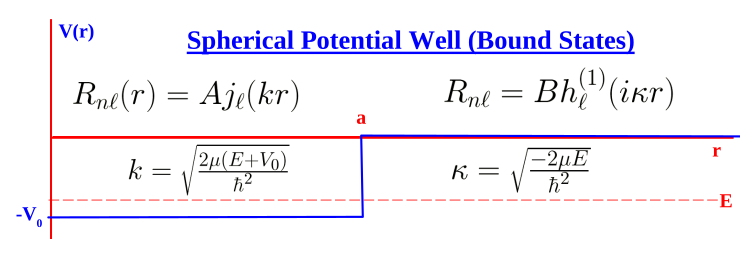

_Figure 47 (p. 221)_

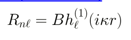

_Figure 48 (p. 221)_

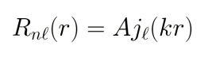

_Figure 49 (p. 221)_

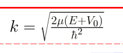

_Figure 50 (p. 221)_

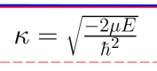

_Figure 51 (p. 221)_

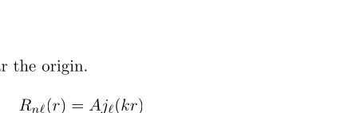

_Figure 52 (p. 221)_

We must use the Bessel function near the origin.

```math
R_{n\ell} \sqrt{( r} ) = Aj_{\ell} ( kr )
```

```math
k = \frac{2 \mu ( E + V_{0} )}{\hbar^{2}}
```

<div align="right"><a href="book.pdf#page=221" target="_blank" title="This page in the PDF"><sup>[p. 221]</sup></a></div>
<hr class="page" style="height:2px;border:0;background:currentColor;opacity:0.25">
<a id="p222" href="book.pdf#page=222" target="_blank" title="This page in the PDF"><sup>[p. 222]</sup></a>

We must use the Hankel function of the first type for large $`r`$.

```math
\begin{aligned} \rho &= kr \to i\kappa r \\ \kappa &= \sqrt{- 2 \hbar^{2} \mu E} \end{aligned}
```

```math
R_{n\ell} = Bh_{\ell}^{( 1 )} ( i\kappa r )
```

To solve the problem, we have to match the solutions at the boundary. First match the wavefunction.

```math
A [ j_{\ell} ( \rho ) ]_{\rho = ka} = B [ h_{\ell} ( \rho ) ]_{\rho = i\kappa a}
```

Then match the first derivative.

```math
Ak \left[ \frac{dj_{\ell} ( \rho )}{d\rho} \right]_{\rho = ka} = B ( i\kappa ) \left[ \frac{dh_{\ell} ( \rho )}{d\rho} \right]_{\rho = i\kappa a}
```

We can divide the two equations to eliminate the constants to get a condition on the energies.

```math
k \left[ \frac{\frac{dj_{\ell} ( \rho )}{d\rho}}{j_{\ell} ( \rho )} \right]_{\rho = ka} = ( i\kappa ) \left[ {}^{\tfrac{dh_{\ell} ( \rho )}{d\rho}} h_{\ell} ( \rho ) \right]_{\rho = i\kappa a}
```

This is often called matching the **logarithmic derivative**.

Often, the $`\ell`$ = 0 term will be sufficient to describe scattering. For $`\ell`$ = 0, the boundary condition is

```math
k \left[ \frac{\tfrac{\cos \rho}{\rho} - \tfrac{\sin \rho}{\rho^{2}}}{\frac{\sin \rho}{\rho}} \right]_{\rho = ka} = ( i\kappa ) \left[ \frac{\tfrac{ie^{i\rho}}{i\rho} - \tfrac{e^{i\rho}}{i\rho^{2}}}{\frac{e^{i\rho}}{i\rho}} \right]_{\rho = i\kappa a} .
```

Dividing and substituting for $`\rho`$, we get

```math
k \left( \cot ( ka ) - \frac{1}{ka} \right) = i\kappa \left( i - \frac{1}{i\kappa a} \right) .
```

```math
ka \cot ( ka ) - 1 = - \kappa a - 1
```

```math
k \cot ( ka ) = - \kappa
```

This is the **same transcendental equation that we had for the odd solution in one dimen-** **sion**.

```math
- \cot \begin{pmatrix} \sqrt{2 \mu ( E \hbar^{2} + V_{0} )} \\ a \end{pmatrix} = \sqrt{V_{0} - E + E}
```

The number of solutions depends on the depth and radius of the well. There can even be no solution.

<div align="right"><a href="book.pdf#page=222" target="_blank" title="This page in the PDF"><sup>[p. 222]</sup></a></div>
<hr class="page" style="height:2px;border:0;background:currentColor;opacity:0.25">
<a id="p223" href="book.pdf#page=223" target="_blank" title="This page in the PDF"><sup>[p. 223]</sup></a>

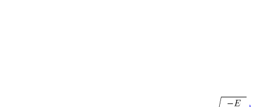

_Figure 53 (p. 223)_

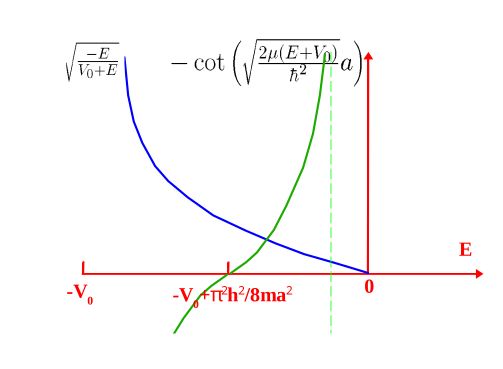

_Figure 54 (p. 223)_

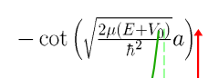

_Figure 55 (p. 223)_

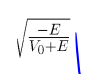

_Figure 56 (p. 223)_

# <a id="s-15-6-partial-wave-analysis-of-scattering"></a>15.6 Partial Wave Analysis of Scattering \*

We can take a quick look at **scattering from a potential in 3D** We assume that $`V`$ = 0 far from the origin so the incoming and outgoing waves can be written in terms of our solutions for a constant potential.

In fact, an **incoming plane wave along the** $`z`$ **direction** can be expanded in Bessel functions.

```math
e^{ikz} = e^{ikr \cos \theta} = \sum_{\ell = 0}^{\infty} \sqrt{4 \pi ( 2 \ell + 1 )} i^{\ell} j_{\ell} ( kr ) Y_{\ell 0}
```

Each angular momentum $`( \ell )`$ term is called a **partial wave**. The scattering for each partial wave can be computed independently.

For large $`r`$ the Bessel function becomes

```math
j_{\ell} ( \rho ) \to - \frac{1}{2 ikr} \left( e^{- i ( kr - \ell \pi / 2 )} - e^{i ( kr - \ell \pi / 2 )} \right) ,
```

so our plane wave becomes

```math
e^{ikz} \to - \sum_{\ell = 0}^{\infty} \sqrt{4 \pi ( 2 \ell + 1 )} i^{\ell} \frac{1}{2 ikr} \left( e^{- i ( kr - \ell \pi / 2 )} - e^{i ( kr - \ell \pi / 2 )} \right) Y_{\ell 0}
```

The scattering potential will modify the plane wave, particularly the outgoing part. To maintain the outgoing flux equal to the incoming flux, the most the scattering can do is **change the relative** **phase of the incoming an outgoing waves**.

```math
R_{\ell} ( r ) \to - \frac{1}{2 ikr} = \frac{\sin ( kr - \ell \pi / 2 + \delta_{\ell} ( k ) )}{kr} \left( e^{- i ( kr - \ell \pi / 2 )} - e^{2 i\delta_{\ell} ( k )} e^{i ( kr - \ell \pi / 2 )} \right) e^{i\delta_{\ell} ( k )}
```

<div align="right"><a href="book.pdf#page=223" target="_blank" title="This page in the PDF"><sup>[p. 223]</sup></a></div>
<hr class="page" style="height:2px;border:0;background:currentColor;opacity:0.25">
<a id="p224" href="book.pdf#page=224" target="_blank" title="This page in the PDF"><sup>[p. 224]</sup></a>

The $`\delta_{\ell} ( k )`$ is called the **phase shift** for the partial wave of angular momentum $`\ell`$. We can compute the **differential cross section** for scattering

$`d\sigma`$ scattered flux into $`d`$Ω $`d`$Ω $`\equiv`$ incident flux<br>
in terms of the phase shifts.

```math
\frac{d\sigma}{d \Omega} = \frac{1}{k^{2}} \left( \sum_{\ell = 0}^{\infty} ( 2 \ell + 1 ) e^{i\delta_{\ell}} \sin ( \delta_{\ell} ) P_{\ell} ( \cos \theta ) \right)^{2}
```

The phase shifts must be computed by actually solving the problem for the particular potential.

In fact, for low energy scattering and short range potentials, the first term $`\ell`$ = 0 is often enough to solve the problem.

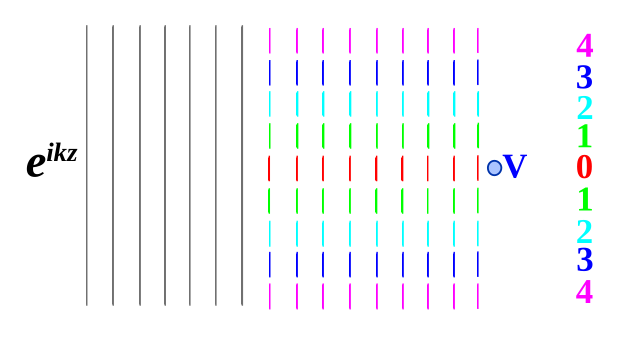

_Figure 57 (p. 224)_

Only the low $`\ell`$ partial waves get close enough to the origin to be affected by the potential.

# <a id="s-15-7-scattering-from-a-spherical-well"></a>15.7 Scattering from a Spherical Well \*

For the scattering problem, the energy is greater than zero. We must choose the Bessel function in the region containing the origin.

```math
\sqrt{R_{\ell}} = Aj_{\ell} ( k^{\prime} r )
```

```math
k^{\prime} = \frac{2 \mu ( E + V_{0} )}{\hbar^{2}}
```

For large $`r`$, we can have a linear combination of functions.

```math
R_{\ell} = Bj_{\ell} ( kr ) + Cn \surd_{\ell} ( kr )
```

```math
k = \frac{2 \mu E}{\hbar^{2}}
```

<div align="right"><a href="book.pdf#page=224" target="_blank" title="This page in the PDF"><sup>[p. 224]</sup></a></div>
<hr class="page" style="height:2px;border:0;background:currentColor;opacity:0.25">
<a id="p225" href="book.pdf#page=225" target="_blank" title="This page in the PDF"><sup>[p. 225]</sup></a>

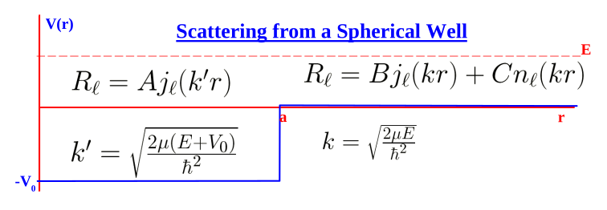

_Figure 58 (p. 225)_

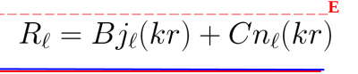

_Figure 59 (p. 225)_

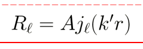

_Figure 60 (p. 225)_

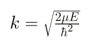

_Figure 61 (p. 225)_

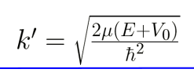

_Figure 62 (p. 225)_

Matching the logarithmic derivative, we get

```math
k^{\prime} \left[ \frac{\frac{dj_{\ell} ( \rho )}{d\rho}}{j_{\ell} ( \rho )} \right]_{\rho = k^{\prime} a} = k \left[ \frac{B \tfrac{dj_{\ell} ( \rho )}{d\rho} + C \tfrac{dn_{\ell} ( \rho )}{d\rho}}{Bj_{\ell} ( \rho ) + Cn_{\ell} ( \rho )} \right]_{\rho = ka} .
```

Recalling that for $`r \to \infty`$,

```math
n_{\ell} \to j_{\ell} \to \frac{\sin ( \rho - \tfrac{\ell \pi}{2} )}{\frac{- \cos ( \rho - \tfrac{\ell \pi}{2} )}{\rho} \rho}
```

and that our formula with the phase shift is

```math
R ( r ) = \propto \quad \frac{1 \frac{\sin \left( \rho - \tfrac{\ell \pi}{2} + \delta_{\ell} ( k ) \right)}{\rho}}{\rho} \left[ \cos \delta_{\ell} \sin ( \rho - \frac{\ell \pi}{2} ) + \sin \delta_{\ell} \cos ( \rho - \frac{\ell \pi}{2} ) \right] ,
```

we can **identify the phase shift** easily.

```math
\tan \delta_{\ell} = - \frac{C}{B}
```

We need to use the boundary condition to get this phase shift.

For $`\ell`$ = 0, we get

```math
k^{\prime} \frac{\cos ( k^{\prime} a )}{\sin ( k^{\prime} a )} = k \frac{B \cos ( ka ) + C \sin ( ka )}{B \sin ( ka ) - C \cos ( ka )}
```

```math
\frac{k^{\prime}}{k} \cot ( k^{\prime} a ) ( B \sin ( ka ) - C \cos ( ka ) ) = B \cos ( ka ) + C \sin ( ka )
```

```math
\left( \frac{k^{\prime}}{k} \cot ( k^{\prime} a ) \sin ( ka ) - \cos ( ka ) \right) B = \left( \sin ( ka ) + \frac{k^{\prime}}{k} \cot ( k^{\prime} a ) \cos ( ka ) \right) C
```

We can now get the phase shift.

```math
\tan \delta_{0} = - \frac{C}{B} = \frac{k \cos ( ka ) \sin ( k^{\prime} a ) - k^{\prime} \cos ( k^{\prime} a ) \sin ( ka )}{k \sin ( ka ) \sin ( k^{\prime} a ) + k^{\prime} \cos ( k^{\prime} a ) \cos ( ka )}
```

<div align="right"><a href="book.pdf#page=225" target="_blank" title="This page in the PDF"><sup>[p. 225]</sup></a></div>
<hr class="page" style="height:2px;border:0;background:currentColor;opacity:0.25">
<a id="p226" href="book.pdf#page=226" target="_blank" title="This page in the PDF"><sup>[p. 226]</sup></a>

With just the $`\ell`$ = 0 term, the differential scattering cross section is.

```math
\frac{d\sigma}{d \Omega} \to \frac{\sin^{2} ( \delta_{\ell} )}{k^{2}}
```

The cross section will have zeros when

```math
\frac{k^{\prime}}{k} = \cot ( ka ) \tan ( k^{\prime} a )
```

```math
k^{\prime} \cot ( k^{\prime} a ) = k \cot ( ka ) .
```

There will be many solutions to this and the cross section will look like diffraction.

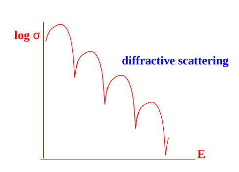

_Figure 63 (p. 226)_

# <a id="s-15-8-the-radial-equation-for-u-r-rr-r"></a>15.8 The Radial Equation for $`u ( r ) = rR ( r )`$ \*

It is sometimes useful to use

```math
u_{n\ell} ( r ) = rR_{n\ell} ( r )
```

to solve a radial equation problem. We can rewrite the equation for $`u`$.

```math
\left( \frac{d^{2}}{dr^{2}} + \frac{2}{r} \frac{d}{dr} \right) \frac{u ( r )}{r} = \frac{d}{dr} \left( \frac{1}{r} \frac{du}{dr} - \frac{u}{r^{2}} \right) + \frac{2}{r^{2}} \frac{du}{dr} - \frac{2 u}{r^{3}}
```

```math
= \frac{1}{r} \frac{d^{2} u}{dr^{2}} - \frac{1}{r^{2}} \frac{du}{dr} - \frac{1}{r^{2}} \frac{du}{dr} + \frac{2 u}{r^{3}} + \frac{2}{r^{2}} \frac{du}{dr} - \frac{2 u}{r^{3}} = \frac{1}{r} \frac{d^{2} u}{dr^{2}}
```

```math
\frac{1}{r} \frac{d^{2} u ( r )}{dr^{2}} + \frac{2 \mu}{\hbar^{2}} \left[ E - V ( r ) - \frac{\ell ( \ell + 1 ) \hbar^{2}}{2 \mu r^{2}} \right] \frac{u ( r )}{r} = 0
```

```math
\frac{d^{2} u ( r )}{dr^{2}} + \frac{2 \mu}{\hbar^{2}} \left[ E - V ( r ) - \frac{\ell ( \ell + 1 ) \hbar^{2}}{2 \mu r^{2}} \right] u ( r ) = 0
```

This now looks just like the one dimensional equation except the pseudo potential due to angular momentum has been added.

We do get the additional condition that

```math
u ( 0 ) = 0
```

to keep $`R`$ normalizable.

<div align="right"><a href="book.pdf#page=226" target="_blank" title="This page in the PDF"><sup>[p. 226]</sup></a></div>
<hr class="page" style="height:2px;border:0;background:currentColor;opacity:0.25">
<a id="p227" href="book.pdf#page=227" target="_blank" title="This page in the PDF"><sup>[p. 227]</sup></a>

For the case of a constant potential $`V_{0}`$, we define $`k = \sqrt{2 \mu ( E \hbar - {}_{2} V_{0} )}`$ and $`\rho = kr`$, and the radial equation becomes.

```math
\frac{d^{2} u ( r )}{dr^{2}} + \frac{2 \mu}{\hbar^{2}} \left[ E - V_{0} - \frac{\ell ( \ell + 1 ) \hbar^{2}}{2 \mu r^{2}} \right] u ( r ) = 0
```

```math
\frac{d^{2} u ( r )}{dr^{2}} + k^{2} u ( r ) - \frac{\ell ( \ell + 1 )}{r^{2}} u ( r ) = 0
```

```math
\frac{d^{2} u ( \rho )}{d\rho^{2}} - \frac{\ell ( \ell + 1 )}{\rho^{2}} u ( \rho ) + u ( \rho ) = 0
```

For $`\ell`$ = 0, its easy to see that $`\sin \rho`$ and $`\cos \rho`$ are solutions. Dividing by $`r`$ to get $`R ( \rho )`$, we see that these are $`j_{0}`$ and $`n_{0}`$. The solutions can be checked for other $`\ell`$, with some work.

# <a id="s-15-9-sample-test-problems"></a>15.9 Sample Test Problems

1. A particle has orbital angular momentum quantum number $`l`$ = 1 and is bound in the potential well $`V ( r ) = - V_{0}`$ for $`r<a`$ and $`V ( r )`$ = 0 elsewhere. Write down the form of the solution (in terms of known functions) in the two regions. Your solution should satisfy constraints at the origin and at infinity. Be sure to include angular dependence. Now use the boundary condition at $`r = a`$ to get one equation, the solution of which will quantize the energies. Do not bother to solve the equation.

2. A particle of mass $`m`$ with 0 total angular momentum is in a 3 dimensional potential well

```math
V ( r ) = - V_{0} \text{ for } r<a ( \text{ otherwise } V ( r ) = 0 ) .
```

a) Write down the form of the $`( l`$ = 0) solution, to the time independent Schrödinger equation, inside the well, which is well behaved at at $`r`$ = 0. Specify the relationship between the particles energy and any parameters in your solution.

b) Write down the form of the solution to the time independent Schrödinger equation, outside the well, which has the right behavior as $`r \to \infty`$. Again specify how the parameters depend on energy.

c) Write down the boundary conditions that must be satisfied to match the two regions.

Use $`u ( r ) = rR ( r )`$ to simplify the calculation.

d) Find the transcendental equation which will determine the energy eigenvalues.

3. A particle has orbital angular momentum quantum number $`l`$ = 1 and is bound in the potential well $`V ( r ) = - V_{0}`$ for $`r<a`$ and $`V ( r )`$ = 0 elsewhere. Write down the form of the solution (in terms of known functions) in the two regions. Your solution should satisfy constraints at the origin and at infinity. Be sure to include angular dependence. Now use the boundary condition at $`r = a`$ to get one equation, the solution of which will quantize the energies. Do not bother to solve the equation.

4. A particle is confined to the inside of a sphere of radius $`a`$. Find the energies of the two lowest energy states for $`\ell`$ = 0. Write down (but do not solve) the equation for the energies for $`\ell`$ = 1.

```math
5 .
```

---

[← 14 Angular Momentum](14-angular-momentum.md) · [16 Hydrogen →](16-hydrogen.md)
