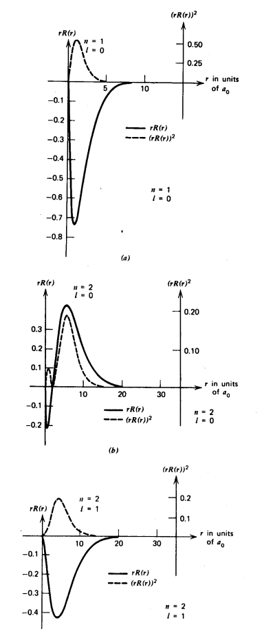
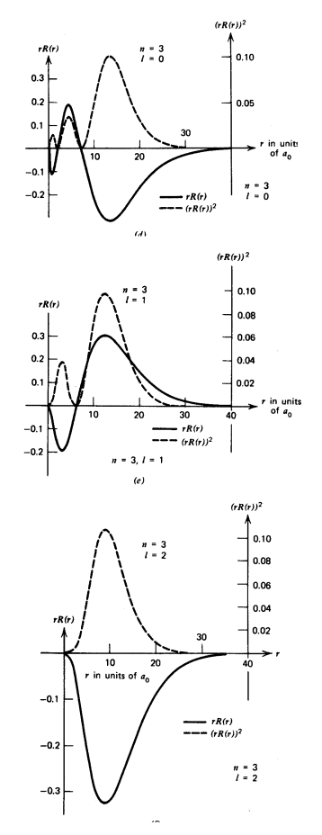
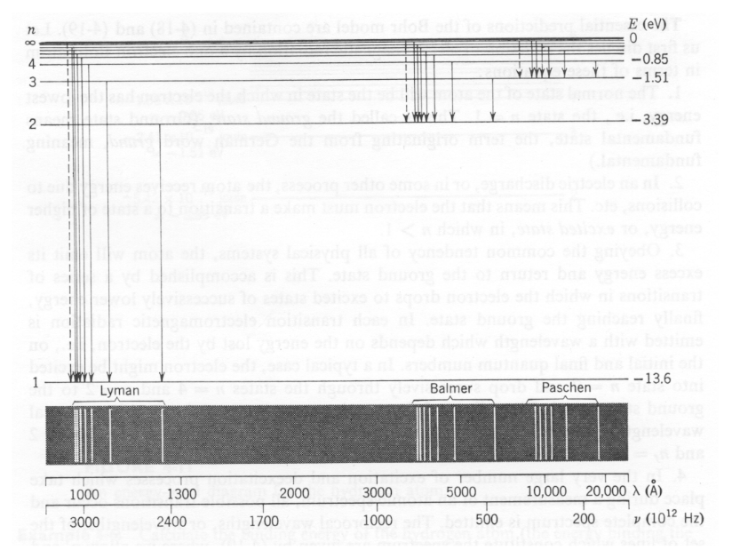
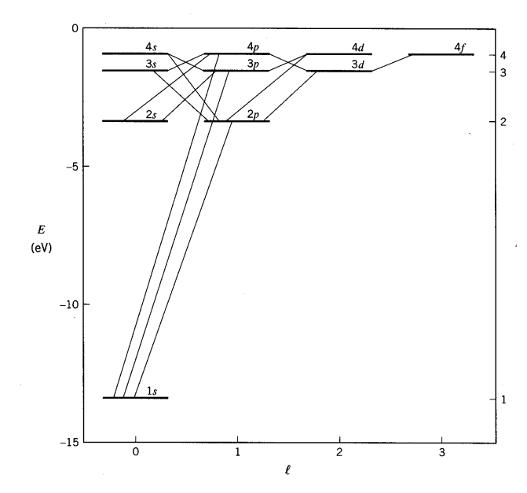

[← 15 The Radial Equation and Constant Potentials *](15-the-radial-equation-and-constant-potentials.md) · [17 3D Symmetric HO in Spherical Coordinates * →](17-3d-symmetric-ho-in-spherical-coordinates.md)

---

<hr class="page" style="height:2px;border:0;background:currentColor;opacity:0.25">
<a id="p228" href="book.pdf#page=228" target="_blank" title="This page in the PDF"><sup>[p. 228]</sup></a>

# 16 Hydrogen

The Hydrogen atom consists of an electron bound to a proton by the **Coulomb potential**.

```math
V ( r ) = - \frac{e^{2}}{r}
```

We can generalize the potential to a nucleus of charge $`Ze`$ without complication of the problem.

```math
V ( r ) = - \frac{Ze^{2}}{r}
```

Since the potential is **spherically symmetric**, the problem separates and the solutions will be a product of a radial wavefunction and one of the spherical harmonics.

```math
\psi_{n\ell m} ( \vec{r} ) = R_{n\ell} ( r ) Y_{\ell m} ( \theta ,\varphi )
```

We have already studied the spherical harmonics.

The **radial wavefunction** satisfies the differential equation that depends on the angular momentum quantum number $`\ell`$,

```math
\left( \frac{d^{2}}{dr^{2}} + \frac{2}{r} \frac{d}{dr} \right) R_{E\ell} ( r ) + \frac{2 \mu}{\hbar^{2}} \left( E + \frac{Ze^{2}}{r} - \frac{\ell ( \ell + 1 ) \hbar^{2}}{2 \mu r^{2}} \right) R_{E\ell} ( r ) = 0
```

where $`\mu`$ is the reduced mass of the nucleus and electron.

```math
\mu = \frac{m_{e} m_{N}}{m_{e} + m_{N}}
```

The differential equation can be solved (See section 16.3.1) using **techniques similar to those** **used to solve the 1D harmonic oscillator** equation. We find the **eigen-energies**

```math
E = - \frac{1}{2 n^{2}} Z^{2} \alpha^{2} \mu c^{2}
```

and the **radial wavefunctions**

```math
R_{n\ell} ( \rho ) = \rho^{\ell} \sum_{k = 0}^{\infty} a_{k} \rho^{k} e^{- \rho / 2}
```

where the coefficients of the polynomials can be found from the **recursion relation**

```math
a_{k + 1} = \frac{k + \ell + 1 - n}{( k + 1 ) ( k + 2 \ell + 2 )} a_{k}
```

<div align="right"><a href="book.pdf#page=228" target="_blank" title="This page in the PDF"><sup>[p. 228]</sup></a></div>
<hr class="page" style="height:2px;border:0;background:currentColor;opacity:0.25">
<a id="p229" href="book.pdf#page=229" target="_blank" title="This page in the PDF"><sup>[p. 229]</sup></a>

and

```math
\rho = \sqrt{- 8 \hbar^{2} \mu E} r.
```

The **principle quantum number** $`n`$ is an integer from 1 to infinity.

```math
n = 1 , 2 , 3 ,\dots
```

This principle quantum number is actually the sum of the radial quantum number plus $`\ell`$ plus 1.

```math
n = n_{r} + \ell + 1
```

<div align="center">

and therefore, the total angular momentum quantum number $`\ell`$ must be less than $`n`$.

</div>

```math
\ell = 0 , 1 , 2 ,\dots ,n - 1
```

This unusual way of labeling the states comes about because a radial excitation has the same energy as an angular excitation for Hydrogen. This is often referred to as an **accidental degeneracy**.

# <a id="s-16-1-the-radial-wavefunction-solutions"></a>16.1 The Radial Wavefunction Solutions

Defining the **Bohr radius**

```math
a_{0} = \frac{\hbar}{\alpha mc} ,
```

we can compute the radial wave functions (See section 16.3.2) Here is a list of the first several radial wave functions $`R_{n\ell} ( r )`$.

```math
R_{1 0} = 2 \left( \frac{Z}{a_{0}} \right)^{\tfrac{3}{2}} e^{- Zr/a_{0}}
```

```math
R_{2 1} = \frac{1}{\sqrt{3}} \left( \frac{Z}{2 a_{0}} \right)^{\tfrac{3}{2}} \left( \frac{Zr}{a_{0}} \right) e^{- Zr/ 2 a_{0}}
```

```math
R_{2 0} = 2 \left( \frac{Z}{2 a_{0}} \right)^{\tfrac{3}{2}} \left( 1 - \frac{Zr}{2 a_{0}} \right) e^{- Zr/ 2 a_{0}}
```

```math
R_{3 2} = \frac{2 \sqrt{2}}{2 7 \sqrt{5}} \left( \frac{Z}{3 a_{0}} \right)^{\tfrac{3}{2}} \left( \frac{Zr}{a_{0}} \right)^{2} e^{- Zr/ 3 a_{0}}
```

```math
R_{3 1} = \frac{4 \sqrt{2}}{3} \left( \frac{Z}{3 a_{0}} \right)^{\tfrac{3}{2}} \left( \frac{Zr}{a_{0}} \right) \left( 1 - \frac{Zr}{6 a_{0}} \right) e^{- Zr/ 3 a_{0}}
```

```math
R_{3 0} = 2 \left( \frac{Z}{3 a_{0}} \right)^{\tfrac{3}{2}} \left( 1 - \frac{2 Zr}{3 a_{0}} + \frac{2 ( Zr )^{2}}{2 7 a_{0}^{2}} \right) e^{- Zr/ 3 a_{0}}
```

For a given principle quantum number $`n`$,the largest $`\ell`$ radial wavefunction is given by

```math
R_{n,n - 1} \propto r^{n - 1} e^{- Zr/na_{0}}
```

<div align="right"><a href="book.pdf#page=229" target="_blank" title="This page in the PDF"><sup>[p. 229]</sup></a></div>
<hr class="page" style="height:2px;border:0;background:currentColor;opacity:0.25">
<a id="p230" href="book.pdf#page=230" target="_blank" title="This page in the PDF"><sup>[p. 230]</sup></a>

The radial wavefunctions should be **normalized** as below.

```math
\int_{0}^{\infty} r^{2} R_{n\ell}^{*} R_{n\ell} dr = 1
```

\* See Example 16.4.2: Compute the expected values of $`E , L^{2} , L_{z}`$, and $`L_{y}`$ in the Hydrogen state

```math
\frac{1}{6} ( 4 \psi_{1 0 0} + 3 \psi_{2 1 1} - i\psi_{2 1 0} + \sqrt{1 0 \psi_{2 1 - 1} ) . *}
```

The pictures below depict the probability distributions in space for the Hydrogen wavefunctions.

The graphs below show the radial wave functions. Again, for a given $`n`$ the maximum $`\ell`$ state has no radial excitation, and hence no nodes in the radial wavefunction. As $`ell`$ gets smaller for a fixed $`n`$, we see more radial excitation.

<div align="right"><a href="book.pdf#page=230" target="_blank" title="This page in the PDF"><sup>[p. 230]</sup></a></div>
<hr class="page" style="height:2px;border:0;background:currentColor;opacity:0.25">
<a id="p231" href="book.pdf#page=231" target="_blank" title="This page in the PDF"><sup>[p. 231]</sup></a>

```math
2 3 1
```



_Figure 64 (p. 231)_

<div align="right"><a href="book.pdf#page=231" target="_blank" title="This page in the PDF"><sup>[p. 231]</sup></a></div>
<hr class="page" style="height:2px;border:0;background:currentColor;opacity:0.25">
<a id="p232" href="book.pdf#page=232" target="_blank" title="This page in the PDF"><sup>[p. 232]</sup></a>



_Figure 65 (p. 232)_

A **useful integral** for Hydrogen atom calculations is.

```math
\int_{0}^{\infty} dxx^{n} e^{- ax} = \frac{n !}{a^{n + 1}}
```

\* See Example 16.4.2: What is the expectation value of $`r 1`$ in the state $`\psi_{1 0 0}`$?\*

\* See Example 16.4.3: What is the expectation value of $`r`$ in the state $`\psi_{1 0 0}`$?\*

\* See Example 16.4.4: What is the expectation value of the radial component of velocity in the state

<div align="right"><a href="book.pdf#page=232" target="_blank" title="This page in the PDF"><sup>[p. 232]</sup></a></div>
<hr class="page" style="height:2px;border:0;background:currentColor;opacity:0.25">
<a id="p233" href="book.pdf#page=233" target="_blank" title="This page in the PDF"><sup>[p. 233]</sup></a>

```math
\psi_{1 0 0} ? *
```

# <a id="s-16-2-the-hydrogen-spectrum"></a>16.2 The Hydrogen Spectrum

The figure shows the transitions between Hydrogen atom states.



_Figure 66 (p. 233)_

The ground state of Hydrogen has $`n`$ = 1 and $`\ell`$ = 0. This is conventionally called the 1s state. The convention is to name $`\ell`$ = 0 states “s”, $`\ell`$ = 1 states “p”, $`\ell`$ = 2 states “d”, and $`\ell`$ = 3 states “f”. From there on follow the alphabet with g, h, i, ...

The first excited state of Hydrogen has $`n`$ = 2. There are actually four degenerate states (not counting different spin states) for $`n`$ = 2. In terms of $`\psi_{n\ell m}`$, these are $`\psi_{2 0 0} , \psi_{2 1 1} , \psi_{2 1 0}`$, and $`\psi_{2 1 - 1}`$. These would be called the 2s and 2p states. Remember, all values of $`\ell <n`$ are allowed.

The second excited state has $`n`$ = 3 with the 3s, 3p and 3d states being degenerate. This totals 9 states with the different allowed $`m`$ values.

<div align="center">

In general there are $`n^{2}`$ degenerate states, again not counting different spin states.

</div>

The Hydrogen spectrum was primarily investigated by measuring the energy of photons emitted in transitions between the states, as depicted in the figures above and below.

<div align="right"><a href="book.pdf#page=233" target="_blank" title="This page in the PDF"><sup>[p. 233]</sup></a></div>
<hr class="page" style="height:2px;border:0;background:currentColor;opacity:0.25">
<a id="p234" href="book.pdf#page=234" target="_blank" title="This page in the PDF"><sup>[p. 234]</sup></a>



_Figure 67 (p. 234)_

Transitions which change $`\ell`$ by one unit are strongly preferred, as we will later learn.

# <a id="s-16-3-derivations-and-calculations"></a>16.3 Derivations and Calculations

## <a id="s-16-3-1-solution-of-hydrogen-radial-equation"></a>16.3.1 Solution of Hydrogen Radial Equation \*

The differential equation we wish to solve is.

```math
\left( \frac{d^{2}}{dr^{2}} + \frac{2}{r} \frac{d}{dr} \right) R_{E\ell} ( r ) + \frac{2 \mu}{\hbar^{2}} \left( E + \frac{Ze^{2}}{r} - \frac{\ell ( \ell + 1 ) \hbar^{2}}{2 \mu r^{2}} \right) R_{E\ell} ( r ) = 0
```

First we change to a **dimensionless variable** $`\rho`$,

```math
\rho = \sqrt{- 8 \hbar^{2} \mu E} r,
```

giving the differential equation

```math
\frac{d^{2} R}{d\rho^{2}} + \frac{2}{\rho} \frac{dR}{d\rho} - \frac{\ell ( \ell + 1 )}{\rho^{2}} R + \left( \frac{\lambda}{\rho} - \frac{1}{4} \right) R = 0 ,
```

where the constant

```math
\lambda = \frac{Ze^{2}}{\hbar} \sqrt{\frac{- \mu}{2 E}} = Z\alpha \sqrt{- \mu c^{2} 2 E} .
```

<div align="right"><a href="book.pdf#page=234" target="_blank" title="This page in the PDF"><sup>[p. 234]</sup></a></div>
<hr class="page" style="height:2px;border:0;background:currentColor;opacity:0.25">
<a id="p235" href="book.pdf#page=235" target="_blank" title="This page in the PDF"><sup>[p. 235]</sup></a>

Next we look at the equation for **large** $`r`$.

```math
\frac{d^{2} R}{d\rho^{2}} - \frac{1}{4} R = 0
```

This can be solved by $`R = e \tfrac{- \rho}{2}`$, so we explicitly include this.

```math
R ( \rho ) = G ( \rho ) e^{\tfrac{- \rho}{2}}
```

We should also pick of the **small** $`r`$ behavior.

```math
\frac{d^{2} R}{d\rho^{2}} + \frac{2}{\rho} \frac{dR}{d\rho} - \frac{\ell ( \ell + 1 )}{\rho^{2}} R = 0
```

Assuming $`R = \rho^{s}`$, we get

```math
s ( s - 1 ) \frac{R}{\rho^{2}} + 2 s \frac{R}{\rho^{2}} - \ell ( \ell + 1 ) \frac{R}{\rho^{2}} = 0 .
```

```math
s^{2} - s + 2 s = \ell ( \ell + 1 )
```

```math
s ( s + 1 ) = \ell ( \ell + 1 )
```

So either $`s = \ell`$ or $`s = - \ell -`$ 1. The second is not well normalizable. We **write** $`G`$ **as a sum**.

```math
G ( \rho ) = \rho^{\ell} \sum_{k = 0}^{\infty} a_{k} \rho^{k} = \sum_{k = 0}^{\infty} a_{k} \rho^{k + \ell}
```

The differential equation for $`G ( \rho )`$ is

```math
\frac{d^{2} G}{d\rho^{2}} - \left( 1 - \frac{2}{\rho} \right) \frac{dG}{d\rho} + \left( \frac{\lambda - 1}{\rho} - \frac{\ell ( \ell + 1 )}{\rho^{2}} \right) G ( \rho ) = 0 .
```

We plug the sum into the differential equation.

```math
\sum_{k = 0}^{\infty} a_{k} \left( ( k + \ell ) ( k + \ell - 1 ) \rho^{k + \ell - 2} - ( k + \ell ) \rho^{k + \ell - 1} + 2 ( k + \ell ) \rho^{k + \ell - 2} \right.
```

```math
\left. + ( \lambda - 1 ) \rho^{k + \ell - 1} - \ell ( \ell + 1 ) \rho^{k + \ell - 2} \right) = 0
```

```math
\sum_{k = 0}^{\infty} a_{k} ( ( k + \ell ) ( k + \ell - 1 ) + 2 ( k + \ell ) - \ell ( \ell + 1 ) ) \rho^{k + \ell - 2}
```

```math
= \sum_{k = 0}^{\infty} a_{k} ( ( k + \ell ) - ( \lambda - 1 ) ) \rho^{k + \ell - 1}
```

Now we **shift the sum** so that each term contains $`\rho^{k + \ell - 1}`$.

```math
\sum_{k = - 1}^{\infty} a_{k + 1} ( ( k + \ell + 1 ) ( k + \ell ) + 2 ( k + \ell + 1 ) - \ell ( \ell + 1 ) ) \rho^{k + \ell - 1} = \sum_{k = 0}^{\infty} a_{k} ( ( k + \ell ) - ( \lambda - 1 ) ) \rho^{k + \ell - 1}
```

<div align="right"><a href="book.pdf#page=235" target="_blank" title="This page in the PDF"><sup>[p. 235]</sup></a></div>
<hr class="page" style="height:2px;border:0;background:currentColor;opacity:0.25">
<a id="p236" href="book.pdf#page=236" target="_blank" title="This page in the PDF"><sup>[p. 236]</sup></a>

The **coefficient of each power of** $`\rho`$ **must be zero**, so we can derive the **recursion relation** for the constants $`a_{k}`$.

```math
\frac{a_{k + 1}}{a_{k}} = \frac{k + \ell + 1 - \lambda}{( k + \ell + 1 ) ( k + \ell ) + 2 ( k + \ell + 1 ) - \ell ( \ell + 1 )}
```

```math
= \frac{k + \ell + 1 - \lambda}{k ( k + 2 \ell + 1 ) + 2 ( k + \ell + 1 )} = \frac{k + \ell + 1 - \lambda}{k ( k + 2 \ell + 2 ) + ( k + 2 \ell + 2 )}
```

```math
= \frac{k + \ell + 1 - \lambda}{( k + 1 ) ( k + 2 \ell + 2 )} \to \frac{1}{k}
```

This is then the power series for

```math
G ( \rho ) \to \rho^{\ell} e^{\rho}
```

unless it somehow terminates. We can **terminate the series** if for some value of $`k = n_{r}`$,

```math
\lambda = n_{r} + \ell + 1 \equiv n.
```

The number of nodes in $`G`$ will be $`n_{r}`$. We will call $`n`$ the principal quantum number, since the energy will depend only on $`n`$.

Plugging in for $`\lambda`$ we get the **energy eigenvalues**.

```math
Z\alpha \sqrt{- \mu c^{2} 2 E} = n.
```

```math
E = - \frac{1}{2 n^{2}} Z^{2} \alpha^{2} \mu c^{2}
```

The **solutions** are $`\infty`$

```math
R_{n\ell} ( \rho ) = \rho^{\ell} \sum_{k = 0} a_{k} \rho^{k} e^{- \rho / 2} .
```

The recursion relation is

```math
a_{k + 1} = \frac{k + \ell + 1 - n}{( k + 1 ) ( k + 2 \ell + 2 )} a_{k} .
```

We can rewrite $`\rho`$, substituting the energy eigenvalue.

```math
\rho = \sqrt{- 8 \hbar^{2} \mu E} r = \sqrt{4 \mu^{2} \hbar^{2} n^{2} c^{2} Z^{2} \alpha^{2}} r = \frac{2 \mu cZ\alpha}{\hbar n} r = \frac{2 Z}{na_{0}} r
```

## <a id="s-16-3-2-computing-the-radial-wavefunctions"></a>16.3.2 Computing the Radial Wavefunctions \*

The radial wavefunctions are given by

```math
R ( \rho ) = \rho^{\ell} \sum_{k = 0}^{n - \ell - 1} a_{k} \rho^{k} e^{- \rho / 2}
```

<div align="right"><a href="book.pdf#page=236" target="_blank" title="This page in the PDF"><sup>[p. 236]</sup></a></div>
<hr class="page" style="height:2px;border:0;background:currentColor;opacity:0.25">
<a id="p237" href="book.pdf#page=237" target="_blank" title="This page in the PDF"><sup>[p. 237]</sup></a>

where

```math
\rho = \frac{2 Z}{na_{0}} r
```

and the coefficients come from the recursion relation

```math
a_{k + 1} = \frac{k + \ell + 1 - n}{( k + 1 ) ( k + 2 \ell + 2 )} a_{k} .
```

The series terminates for $`k = n - \ell - 1 .`$

Lets start with $`R_{1 0}`$.

```math
R_{1 0} ( r ) = \rho^{0} \sum_{k = 0}^{0} a_{k} \rho^{k} e^{- \rho / 2}
```

```math
R_{1 0} ( r ) = Ce^{- Zr/a_{0}}
```

We determine $`C`$ from the normalization condition.

```math
\int_{0}^{\infty} r^{2} R_{n\ell}^{*} R_{n\ell} dr = 1
```

```math
| C |^{2} \int_{0}^{\infty} r^{2} e^{- 2 Zr/a_{0}} dr = 1
```

This can be integrated by parts twice.

```math
2 \left( \frac{a_{0}}{2 Z} \right)^{2} | C |^{2} \int_{0}^{\infty} e^{- 2 Zr/a_{0}} dr = 1
```

```math
2 \left( \frac{a_{0}}{2 Z} \right)^{3} | C |^{2} = 1
```

```math
C^{2} = \frac{1}{2} \left( \frac{2 Z}{a_{0}} \right)^{3}
```

```math
C = \frac{1}{\sqrt{2}} \left( \frac{2 Z}{a_{0}} \right)^{\tfrac{3}{2}}
```

```math
R_{1 0} ( r ) = 2 \left( \frac{Z}{a_{0}} \right)^{\tfrac{3}{2}} e^{- Zr/a_{0}}
```

$`R_{2 1}`$ can be computed in a similar way. No recursion is needed.

Lets try $`R_{2 0}`$.

```math
R_{2 0} ( r ) = \rho^{0} \sum_{k = 0}^{1} a_{k} \rho^{k} e^{- \rho / 2}
```

```math
R_{2 0} ( r ) = ( a_{0} + a_{1} \rho ) e^{- \rho / 2}
```

<div align="right"><a href="book.pdf#page=237" target="_blank" title="This page in the PDF"><sup>[p. 237]</sup></a></div>
<hr class="page" style="height:2px;border:0;background:currentColor;opacity:0.25">
<a id="p238" href="book.pdf#page=238" target="_blank" title="This page in the PDF"><sup>[p. 238]</sup></a>

```math
a_{k + 1} = \frac{k + \ell + 1 - n}{( k + 1 ) ( k + 2 \ell + 2 )} a_{k}
```

```math
a_{1} = \frac{0 + 0 + 1 - 2}{( 0 + 1 ) ( 0 + 2 ( 0 ) + 2 )} a_{0} = \frac{- 1}{2} a_{0}
```

```math
R_{2 0} ( r ) = C \left( 1 - \frac{Zr}{2 a_{0}} \right) e^{- Zr/ 2 a_{0}}
```

We again normalize to determine the constant.

# <a id="s-16-4-examples"></a>16.4 Examples

## <a id="s-16-4-1-expectation-values-in-hydrogen-states"></a>16.4.1 Expectation Values in Hydrogen States

An **electron in the Coulomb field of a proton** is in the state described by the wave function

$`\tfrac{1}{6} ( 4 \psi_{1 0 0}`$ + 3$`\psi_{2 1 1} - i\psi_{2 1 0} + \sqrt{1 0} \psi_{2 1 - 1} )`$. Find the expected value of the Energy, $`L^{2} , L_{z}`$, and $`L_{y}`$.

First check the normalization.

```math
\frac{| 4 |^{2} + | 3 |^{2} + |- i |^{2} + | \sqrt{1 0 |}^{2}}{3 6} = \frac{3 6}{3 6} = 1
```

The terms are eigenstates of $`E , L^{2}`$, and $`L_{z}`$, so we can easily compute expectation values of those operators.

```math
E_{n} = - \frac{1}{2} \alpha^{2} \mu c^{2} \frac{1}{n^{2}}
```

```math
\langle E \rangle = - \frac{1}{2} \alpha^{2} \mu c^{2} \frac{1 6 \tfrac{1}{1^{2}} + 9 \tfrac{1}{2^{2}} + 1 \tfrac{1}{2^{2}} + 1 0_{2} \tfrac{1}{2}}{3 6} = - \frac{1}{2} \alpha^{2} \mu c^{2} \frac{2 1}{3 6} = - \frac{1}{2} \alpha^{2} \mu c^{2} \frac{7}{1 2}
```

Similarly, we can just square probability amplitudes to compute the expectation value of $`L^{2}`$. The eigenvalues are $`\ell ( \ell`$ + 1)$`\hbar^{2}`$.

```math
\langle L^{2} \rangle = \hbar^{2} \frac{1 6 ( 0 ) + 9 ( 2 ) + 1 ( 2 ) + 1 0 ( 2 )}{3 6} = \frac{1 0}{9} \hbar^{2}
```

The Eigenvalues of $`L_{z}`$ are $`m \hbar`$.

```math
\langle L_{z} \rangle = \hbar \frac{1 6 ( 0 ) + 9 ( 1 ) + 1 ( 0 ) + 1 0 ( - 1 )}{3 6} = \frac{- 1}{3 6} \hbar
```

Computing the expectation value of $`L_{y}`$ is harder because the states are not eigenstates of $`L_{y}`$. We must write $`L_{y} = ( L_{+} - L_{-} ) / 2 i`$ and compute.

```math
\langle L_{y} \rangle = \frac{1}{7 2 i} \langle 4 \psi_{1 0 0} + 3 \psi_{2 1 1} - i\psi_{2 1 0} + \sqrt{1 0} \psi_{2 1 - 1} | L_{+} - L_{-} | 4 \psi_{1 0 0} + 3 \psi_{2 1 1} - i\psi_{2 1 0} + \sqrt{1 0} \psi_{2 1 - 1} \rangle
```

```math
= \frac{1}{7 2 i} \langle 4 \psi_{1 0 0} + 3 \psi_{2 1 1} - i\psi_{2 1 0} + \sqrt{1 0} \psi_{2 1 - 1} |- 3 L_{-} \psi_{2 1 1} - i ( L_{+} - L_{-} ) \psi_{2 1 0} + \sqrt{1 0} L_{+} \psi_{2 1 - 1} \rangle
```

<div align="right"><a href="book.pdf#page=238" target="_blank" title="This page in the PDF"><sup>[p. 238]</sup></a></div>
<hr class="page" style="height:2px;border:0;background:currentColor;opacity:0.25">
<a id="p239" href="book.pdf#page=239" target="_blank" title="This page in the PDF"><sup>[p. 239]</sup></a>

```math
= \sqrt{\frac{\hbar}{7 2 i} \langle 4 \psi_{1 0 0} + 3 \psi_{2 1 1} - i\psi_{2 1 0} + \sqrt{1 0} \psi_{2 1 - 1} |- 3 \sqrt{2} \psi_{2 1 0} - i \sqrt{2} \psi_{2 1 1} + i \sqrt{2} \psi_{2 1 - 1} + \sqrt{1 0} \sqrt{2} \psi_{2 1 0} \rangle}
```

```math
= \sqrt{\frac{2 \hbar}{7 2 i} \langle 4 \psi_{1 0 0} + 3 \psi_{2 1 1} - i\psi_{2 1 0} + \sqrt{1 0} \psi_{2 1 - 1} |- \surd 3 \psi_{2 1 0} \surd - i\psi_{2 1 1} + \surd i\psi_{2 1 -} \surd_{1} + \sqrt{1 0} \psi_{2 1 0} \rangle}
```

```math
= \frac{2 \hbar}{7 2 i} ( - 3 i - 3 i + \sqrt{1 0} i + \sqrt{1 0} i ) = \frac{( - 6 + 2 1 0 ) i 2 \hbar}{7 2 i} = \frac{( 2 5 - 3 2 ) \hbar}{3 6}
```

## <a id="s-16-4-2-the-expectation-of-r-1-in-the-ground-state"></a>16.4.2 The Expectation of $`\frac{1}{r}`$ in the Ground State

```math
R_{1 0} = 2 \left( \frac{Z}{a_{0}} \right)^{\tfrac{3}{2}} e^{- Zr/a_{0}}
```

```math
\langle \psi_{1 0 0} | \frac{1}{r} | \psi_{1 0 0} \rangle = \int Y_{0 0}^{*} Y_{0 0} d \Omega \int_{0}^{\infty} r^{2} \frac{1}{r} R_{1 0}^{*} R_{1 0} dr
```

```math
= \int_{0}^{\infty} rR_{1 0}^{*} R_{1 0} dr = 4 \left( \frac{Z}{a_{0}} \right)^{3} \int_{0}^{\infty} re^{- 2 Zr/a_{0}} dr = 4 \left( \frac{Z}{a_{0}} \right)^{3} \left( \frac{a_{0}}{2 Z} \right)^{2} 1 !
```

```math
= \frac{Z}{a_{0}}
```

We can compute the expectation value of the potential energy.

```math
\langle \psi_{1 0 0} |- \frac{Ze^{2}}{r} | \psi_{1 0 0} \rangle = - \frac{Z^{2} e^{2}}{a_{0}} = Z^{2} e^{2} \frac{\alpha mc}{\hbar} = - Z^{2} \alpha^{2} mc^{2} = 2 E_{1 0 0}
```

## <a id="s-16-4-3-the-expectation-value-of-r-in-the-ground-state"></a>16.4.3 The Expectation Value of $`r`$ in the Ground State

```math
\langle \psi_{1 0 0} | r | \psi_{1 0 0} \rangle = \int_{0}^{\infty} r^{3} R_{1 0}^{*} R_{1 0} dr = 4 \left( \frac{Z}{a_{0}} \right)^{3} \int_{0}^{\infty} r^{3} e^{- 2 Zr/a_{0}} dr = 3 ! \frac{1}{4} \frac{a_{0}}{Z} = \frac{3}{2} \frac{a_{0}}{Z}
```

## <a id="s-16-4-4-the-expectation-value-of-v-r-in-the-ground-state"></a>16.4.4 The Expectation Value of $`v_{r}`$ in the Ground State

For $`\ell`$ = 0, there is no angular dependence to the wavefunction so no velocity except in the radial direction. So it makes sense to compute the radial component of the velocity which is the full velocity.

We can find the term for $`\frac{p_{r}^{2}}{2 m}`$ in the radial equation.

```math
\langle \psi_{1 0 0} | ( v_{r} )^{2} | \psi_{1 0 0} \rangle = \int^{\infty} r^{2} R_{1 0}^{*} \frac{- \hbar^{2}}{m^{2}} \left( \frac{d^{2}}{dr^{2}} + \frac{2}{r} \frac{d}{dr} \right) R_{1 0} dr
```

<div align="right"><a href="book.pdf#page=239" target="_blank" title="This page in the PDF"><sup>[p. 239]</sup></a></div>
<hr class="page" style="height:2px;border:0;background:currentColor;opacity:0.25">
<a id="p240" href="book.pdf#page=240" target="_blank" title="This page in the PDF"><sup>[p. 240]</sup></a>

```math
\begin{aligned} &= \frac{- \hbar^{2}}{m^{2}} 4 \left( \frac{Z}{a_{0}} \right)^{3} \int^{\infty} r^{2} e^{\tfrac{- Zr}{a 0}} \left( \frac{Z^{2}}{a_{0}^{2}} - \frac{2 Z}{a_{0} r} \right) e^{\tfrac{- Zr}{a 0}} dr \\ &= \frac{- \hbar^{2}}{m^{2}} 4 \left( \frac{Z}{a_{0}} \right)^{3 0} \left( \frac{Z^{2}}{a_{0}^{2}} 2 \left( \frac{a_{0}}{2 Z} \right)^{3} - \frac{2 Z}{a_{0}} \left( \frac{a_{0}}{2 Z} \right)^{2} \right) \end{aligned}
```

```math
= \frac{\hbar^{2}}{m^{2}} \left( \frac{Z}{a_{0}} \right)^{2}
```

Since $`a_{0} = \tfrac{\hbar}{\alpha mc}`$ , we get

```math
\langle \psi_{1 0 0} | ( v_{r} )^{2} | \psi_{1 0 0} \rangle = Z^{2} \alpha^{2} c^{2}
```

For $`Z`$ = 1, the RMS velocity is $`\alpha c`$ or

```math
\beta = \alpha = \frac{1}{1 3 7}
```

We can compute the expected value of the kinetic energy.

```math
K.E. = \frac{1}{2} mv^{2} = \frac{\hbar^{2}}{2 m} \frac{Z^{2}}{a_{0}^{2}} = \frac{1}{2} Z^{2} \alpha^{2} mc^{2} = - E_{1 0 0}
```

This is what we expect from the Virial theorem.

# <a id="s-16-5-sample-test-problems"></a>16.5 Sample Test Problems

1. A Hydrogen atom is in its 4D state $`( n`$ = 4$`,\ell`$ = 2). The atom decays to a lower state by emitting a photon. Find the possible photon energies that may be observed. Give your answers in eV. **Answer**The $`n`$<br>
= 4 state can decay into states with $`n`$ = 1$`, 2 ,`$ 3. (Really the $`n`$ = 1 state will be suppressed due to selection rules but this is supposed to be a simple question.) The energies of the states are

```math
E_{n} = - \frac{1 3 . 6}{n^{2}} eV.
```

The photon energy is given by the energy difference between the states.

```math
E_{\gamma} = 1 3 . 6 \left( \frac{1}{n^{2}} - \frac{1}{4^{2}} \right)
```

For the $`n`$ = 1 final state, $`E =`$<sup>15</sup>$`1 3 . 6`$ = 12$`. 8`$ eV.

For the $`n`$ = 2 final state, $`E =`$<sup>16</sup>$`{}^{3} 1 3 . 6`$ = 2$`. 6`$ eV.

For the $`n`$ = 3 final state, $`E = \tfrac{1 6 7}{1 4 4} 1 3 . 6`$ = 0$`. 7`$ eV.

2. Using the $`\psi_{n\ell m}`$ notation, list all the $`n`$ = 1$`, 2 ,`$ 3 hydrogen states. (Neglect the existence of spin.)<br>
**Answer**The states are,

```math
\psi_{3 2 - 2} . \quad \psi_{1 0 0} , \psi_{2 0 0} , \psi_{2 1 1} , \psi_{2 1 0} , \psi_{2 1 - 1} , \psi_{3 0 0} , \psi_{3 1 1} , \psi_{3 1 0} , \psi_{3 1 - 1} , \psi_{3 2 2} , \psi_{3 2 1} , \psi_{3 2 0} , \psi_{3 2 - 1} ,
```

3. Find the difference in wavelength between light emitted from the 3$`P \to 2 S`$ transition in **Hydrogen** and light from the same transition in Deuterium. (Deuterium is an isotope of Hydrogen with a proton and a neutron in the nucleus.) Get a numerical answer.

<div align="right"><a href="book.pdf#page=240" target="_blank" title="This page in the PDF"><sup>[p. 240]</sup></a></div>
<hr class="page" style="height:2px;border:0;background:currentColor;opacity:0.25">
<a id="p241" href="book.pdf#page=241" target="_blank" title="This page in the PDF"><sup>[p. 241]</sup></a>

4. An **electron in the Coulomb field of a proton** is in the state described by the wave function $`\tfrac{1}{6} ( 4 \psi_{1 0 0}`$ + 3$`\psi_{2 1 1} - \psi_{2 1 0} + \sqrt{1 0} \psi_{2 1 - 1} )`$. Find the expected value of the Energy, $`L^{2}`$ and $`L_{z}`$. Now find the expected value of $`L_{y}`$.

<div align="center">

5. **\*** Write out the (normalized) **hydrogen energy eigenstate** $`\psi_{3 1 1} ( r,\theta ,\varphi )`$.

</div>

6. Calculate the **expected value of** $`r`$ in the Hydrogen state $`\psi_{2 0 0}`$.

7. Write down the wave function of the hydrogen atom state $`\psi_{3 2 1} (`$**r**).

8. A Hydrogen atom is in its 4$`D`$ state $`( n`$ = 4$`,l`$ = 2). The atom decays to a lower state by emitting

a photon. Find the possible photon energies that may be observed. Give your answers in $`eV`$.

9. A Hydrogen atom is in the state:

```math
\psi ( \boldsymbol{r} ) = \frac{1}{\sqrt{3 0}} ( \psi_{1 0 0} + 2 \psi_{2 1 1} - \psi_{3 2 2} - 2 i\psi_{3 1 0} + 2 i\psi_{3 0 0} - 4 \psi_{4 3 3} )
```

For the Hydrogen eigenstates, $`\langle \psi_{nlm} | \tfrac{1}{r} | \psi_{nlm} \rangle = \tfrac{Z}{a_{0} n^{2}}`$. Find the expected value of the potential energy for this state. Find the expected value of $`L_{x}`$.

10. A Hydrogen atom is in its 3$`D`$ state $`( n`$ = 3$`,l`$ = 2). The atom decays to a lower state by emitting

a photon. Find the possible photon energies that may be observed. Give your answers in $`eV`$.

11. The hydrogen atom is made up of a proton and an electron bound together by the Coulomb force. The electron has a mass of 0.51 MeV/$`c^{2}`$. It is possible to make a hydrogen-like atom from a proton and a muon. The force binding the muon to the proton is identical to that for the electron but the muon has a mass of 106 MeV/$`c^{2}`$.

a) What is the ground state energy of muonic hydrogen (in eV).

b) What is the“Bohr Radius” of the ground state of muonic hydrogen.

12. A hydrogen atom is in the state: $`\psi (`$**r**$`) = \frac{1}{\langle \rangle 1 0} \sqrt{( \psi_{3 2 2}}`$ + 2$`\psi_{2 2 1}`$ + 2$`i\psi_{2 2 0} + \psi_{1 1 - 1} )`$ Find the possible

measured energies and the probabilities of each. Find the expected value of $`L_{z}`$.

13. Find the difference in frequency between light emitted from the 2$`P \to 1 S`$ transition in Hydrogen and light from the same transition in Deuterium. (Deuterium is an isotope of Hydrogen with a proton and a neutron in the nucleus.)

14. Tritium is an isotope of hydrogen having 1 proton and 2 neutrons in the nucleus. The nucleus is unstable and decays by changing one of the neutrons into a proton with the emission of a positron and a neutrino. The atomic electron is undisturbed by this decay process and therefore finds itself in exactly the same state immediately after the decay as before it. If the electron started off in the $`\psi_{2 0 0} ( n`$ = 2, $`l`$ = 0) state of tritium, compute the probability to find the electron in the ground state of the new atom with Z=2.

15. At $`t`$ = 0 a hydrogen atom is in the state $`\psi ( t`$ = 0) = $`\tfrac{1}{\sqrt{2}} ( \psi_{1 0 0} - \psi_{2 0 0} )`$. Calculate the expected value of $`r`$ as a function of time.

**Answer**

```math
\psi ( t ) = \frac{1}{\sqrt{2}} ( \psi_{1 0 0} e^{- iE_{1} t/ \hbar} - \psi_{2 0 0} e^{- iE_{2} t/ \hbar} ) = e^{- iE_{1} t/ \hbar} \frac{1}{\sqrt{2}} ( \psi_{1 0 0} - \psi_{2 0 0} e^{i ( E_{1} - E_{2} ) t/ \hbar} )
```

```math
\langle \psi | r | \psi \rangle = 1 \langle \psi_{1 0 0} - \psi_{2 0 0} e^{i ( E_{1} - E_{2} ) t/ \hbar} | r | \psi_{1 0 0} - \psi_{2 0 0} e^{i ( E_{1} - E_{2} ) t/ \hbar} \rangle
```

<div align="right"><a href="book.pdf#page=241" target="_blank" title="This page in the PDF"><sup>[p. 241]</sup></a></div>
<hr class="page" style="height:2px;border:0;background:currentColor;opacity:0.25">
<a id="p242" href="book.pdf#page=242" target="_blank" title="This page in the PDF"><sup>[p. 242]</sup></a>

The angular part of the integral can be done. All the terms of the wavefunction contain a $`Y_{0 0}`$ and $`r`$ does not depend on angles, so the angular integral just gives 1.

```math
\langle \psi | r | \psi \rangle = \frac{1}{2} \int_{0}^{\infty} ( R_{1 0} - R_{2 0} e^{- i ( E_{2} - E_{1} ) t/ \hbar} )^{*} r ( R_{1 0} - R_{2 0} e^{- i ( E_{2} - E_{1} ) t/ \hbar} ) r^{2} dr
```

The cross terms are not zero because of the $`r`$.

```math
\langle \psi | r | \psi \rangle = \frac{1}{2} \int_{0}^{\infty} \left( R_{1 0}^{2} + R_{2 0}^{2} - R_{1 0} R_{2 0} \left( e^{i ( E_{2} - E_{1} ) t/ \hbar} + e^{- i ( E_{2} - E_{1} ) t/ \hbar} \right) \right) r^{3} dr
```

```math
\langle \psi | r | \psi \rangle = \frac{1}{2} \int_{0}^{\infty} \left( R_{1 0}^{2} + R_{2 0}^{2} - 2 R_{1 0} R_{2 0} \cos \left( \frac{E_{2} - E_{1}}{\hbar} t \right) \right) r^{3} dr
```

Now we will need to put in the actual radial wavefunctions.

```math
R_{1 0} = 2 \left( \frac{1}{a_{0}} \right)^{\tfrac{3}{2}} e^{- r/a_{0}}
```

```math
R_{2 0} = \frac{1}{\sqrt{2}} \left( \frac{1}{a_{0}} \right)^{\tfrac{3}{2}} \left( 1 - \frac{r}{2 A_{0}} \right) e^{- r/ 2 a_{0}}
```

```math
\begin{aligned} \langle \psi | r | \psi \rangle &= \frac{1}{2 a_{0}^{3}} \int_{0}^{\infty} \left( 4 e^{- 2 r/a_{0}} + \frac{1}{2} \left( 1 - \frac{r}{a_{0}} + \frac{r^{2}}{4 a_{0}^{2}} \right) e^{- r/a_{0}} \right. \\ & \quad \left. - \quad 2 \sqrt{2} \left( 1 - \frac{r}{2 a_{0}} \right) e^{- 3 r/ 2 a_{0}} \cos \left( \frac{E_{2} - E_{1}}{\hbar} t \right) \right) r^{3} dr \end{aligned}
```

```math
\begin{aligned} &= \frac{1}{2 a_{0}^{3}} \int_{0}^{\infty} \left( 4 r^{3} e^{\tfrac{- 2 r}{a 0}} + \frac{1}{2} r^{3} e^{\tfrac{- r}{a 0}} - \frac{1}{2 a_{0}} r^{4} e^{\tfrac{- r}{a 0}} + \frac{1}{8 a_{0}^{2}} r^{5} e^{\tfrac{- r}{a 0}} \right. \\ & \quad \left. + \quad \left( - 2 \sqrt{2} r^{3} e^{\tfrac{- 3 r}{2 a 0}} + \frac{\sqrt{2}}{a_{0}} r^{4} e^{{}^{-} \tfrac{3 r}{2 a 0}} \right) \cos \left( \frac{E_{2} - E_{1}}{\hbar} t \right) \right) dr \end{aligned}
```

```math
\begin{aligned} &= \frac{1}{2 a_{0}^{3}} \left[ 2 4 \left( \frac{a_{0}}{2} \right)^{4} + 3 a_{0}^{4} - \frac{1}{2 a_{0}} 2 4 a_{0}^{5} + \frac{1}{8 a_{0}^{2}} 1 2 0 a_{0}^{5} \right. \\ & \quad \left. + \quad \left( - 2 \sqrt{2} 6 \left( \frac{2 a_{0}}{3} \right)^{4} + \frac{\sqrt{2}}{a_{0}} 2 4 \left( \frac{2 a_{0}}{3} \right)^{5} \right) \cos \left( \frac{E_{2} - E_{1}}{\hbar} t \right) \right] \end{aligned}
```

```math
= \frac{a_{0}}{2} \left[ \frac{3}{2} + 3 - 1 2 + 1 5 + \left( - 1 2 \sqrt{2} \frac{1 6}{8 1} + \frac{\sqrt{2}}{a_{0}} 2 4 \frac{3 2}{2 4 3} \right) \cos \left( \frac{E_{2} - E_{1}}{\hbar} t \right) \right]
```

```math
= \frac{a_{0}}{2} \left[ \frac{3}{2} + 3 - 1 2 + 1 5 + \left( - \sqrt{2} \frac{6 4}{2 7} + \frac{2 5 6 \sqrt{2}}{8 1} \right) \cos \left( \frac{E_{2} - E_{1}}{\hbar} t \right) \right]
```

```math
= a_{0} \left[ \frac{1 5}{4} + \frac{3 2 \sqrt{2}}{8 1} \cos \left( \frac{E_{2} - E_{1}}{\hbar} t \right) \right]
```

---

[← 15 The Radial Equation and Constant Potentials *](15-the-radial-equation-and-constant-potentials.md) · [17 3D Symmetric HO in Spherical Coordinates * →](17-3d-symmetric-ho-in-spherical-coordinates.md)
