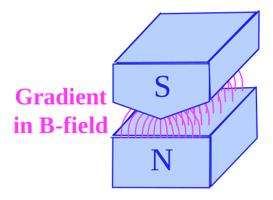
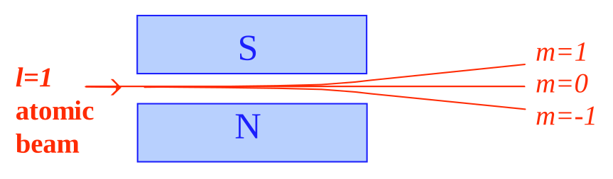
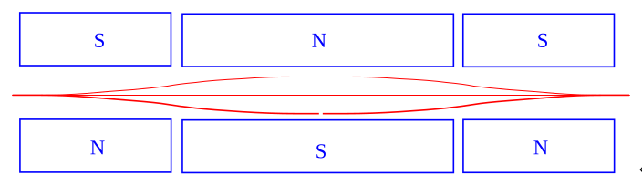
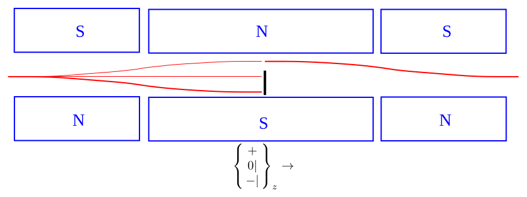
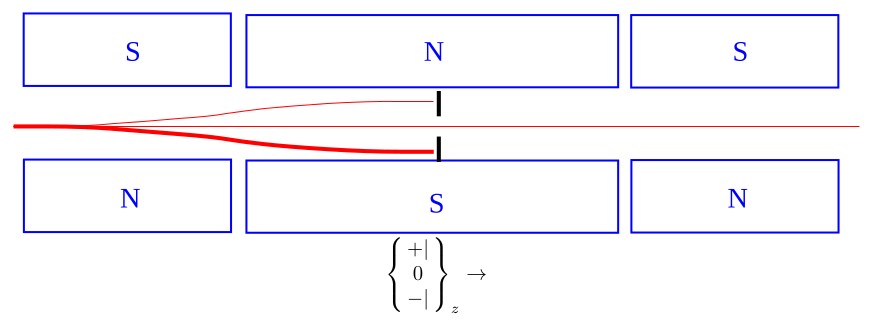
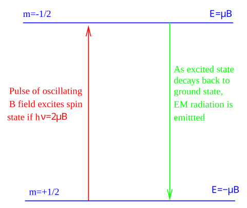

[← 17 3D Symmetric HO in Spherical Coordinates *](17-3d-symmetric-ho-in-spherical-coordinates.md) · [19 Homework Problems 130A →](19-homework-problems-130a.md)

---

<hr class="page" style="height:2px;border:0;background:currentColor;opacity:0.25">
<a id="p247" href="book.pdf#page=247" target="_blank" title="This page in the PDF"><sup>[p. 247]</sup></a>

# 18 Operators Matrices and Spin

We have already solved many problems in Quantum Mechanics using wavefunctions and differential operators. Since the eigenfunctions of Hermitian operators are orthogonal (and we normalize them) we can now use the standard linear algebra to solve quantum problems with vectors and matrices. To include the spin of electrons and nuclei in our discussion of atomic energy levels, we will need the matrix representation.

These topics are covered at very different levels in **Gasiorowicz Chapter 14, Griffiths Chapters** **3, 4** and, more rigorously, in **Cohen-Tannoudji et al. Chapters II, IV and IX.**

# <a id="s-18-1-the-matrix-representation-of-operators-and-wavefunctions"></a>18.1 The Matrix Representation of Operators and Wavefunctions

We will define our vectors and matrices using a complete set of, orthonormal basis states (See Section8.1) $`u_{i}`$, usually the set of eigenfunctions of a Hermitian operator. These basis states are analogous to the orthonormal unit vectors in Euclidean space $`\hat{x}_{i}`$.

```math
\langle u_{i} | u_{j} \rangle = \delta_{ij}
```

Define the **components of a state vector** $`\psi`$ (analogous to $`x_{i} )`$.

```math
\psi_{i} \equiv \langle u_{i} | \psi \rangle \quad | \psi \rangle = \sum_{i} \psi_{i} | u_{i} \rangle
```

The wavefunctions are therefore represented as **vectors.** Define the **matrix element**

```math
O_{ij} \equiv \langle u_{i} | O | u_{j} \rangle .
```

We know that an **operator acting on a wavefunction** gives a wavefunction.

```math
| O\psi \rangle = O | \psi \rangle = O \sum_{j} \psi_{j} | u_{j} \rangle = \sum_{j} \psi_{j} O | u_{j} \rangle
```

If we dot $`\langle u_{i} |`$ into this equation from the left, we get

```math
( O\psi )_{i} = \langle u_{i} | O\psi \rangle = \sum_{j} \psi_{j} \langle u_{i} | O | u_{j} \rangle = \sum_{j} O_{ij} \psi_{j}
```

This is exactly the formula for a state vector equals a **matrix operator** times a state vector.

```math
\begin{pmatrix} ( O\psi )_{1} \\ ( O\psi )_{2} \\ \dots \\ ( O\psi )_{i} \\ \dots \end{pmatrix} = \begin{pmatrix} O_{1 1} & O_{1 2} & \dots & O_{1 j} & \dots \\ O_{2 1} & O_{2 2} & \dots & O_{2 j} & \dots \\ \dots & \dots & \dots & \dots & \dots \\ O_{i 1} & O_{i 2} & \dots & O_{ij} & \dots \\ \dots & \dots & \dots & \dots & \dots \end{pmatrix} \begin{pmatrix} \psi_{1} \\ \psi_{2} \\ \dots \\ \psi_{j} \\ \dots \end{pmatrix}
```

Similarly, we can look at the **product of two operators** (using the identity $`\sum | u_{k} \rangle \langle u_{k} |`$ = 1).

```math
( OP )_{ij} = \langle u_{i} | OP | u_{j} \rangle = \sum_{k} \langle u_{i} | O | u_{k} \rangle \langle u_{k} | P | u_{j} \rangle = \sum_{k} O_{ik} P_{kj}^{k}
```

<div align="right"><a href="book.pdf#page=247" target="_blank" title="This page in the PDF"><sup>[p. 247]</sup></a></div>
<hr class="page" style="height:2px;border:0;background:currentColor;opacity:0.25">
<a id="p248" href="book.pdf#page=248" target="_blank" title="This page in the PDF"><sup>[p. 248]</sup></a>

This is exactly the formula for the product of two matrices.

```math
\frac{\dots \dots}{\frac{\dots}{\begin{pmatrix} O_{1 1} & \dots P_{1 j} & \dots \\ O_{2 1} & \dots P_{2 j} & \dots \\ \dots & \begin{pmatrix} ( OP )_{1 j} & \dots \\ ( OP )_{2 j} & \dots \\ \dots & \dots \\ ( OP )_{ij} & \dots \\ \dots & \dots \\ P_{1 1} \quad P_{1 2} & \\ P_{2 1} \quad P_{2 2} & \\ \dots \quad \dots & \dots \\ P_{i 1} \quad P_{i 2} & \dots \\ \dots \quad \dots & \dots \end{pmatrix} \dots & \dots \\ O_{i 1} & P_{ij} & \dots \\ \dots & \dots & \dots \end{pmatrix}} \dots} \begin{pmatrix} ( OP )_{1 1} & ( OP )_{1 2} \\ ( OP )_{2 1} & ( OP )_{2 2} \\ \dots & \dots \\ ( OP )_{i 1} & ( OP )_{i 2} \\ \dots & \dots \\ O_{1 2} \quad \dots & O_{1 j} \quad \dots \\ O_{2 2} \quad \dots & O_{2 j} \quad \dots \\ \dots \quad \dots & \dots \quad \dots \\ O_{i 2} \quad \dots & O_{ij} \quad \dots \\ \dots \quad \dots & \dots \quad \dots \end{pmatrix} \dots =
```

**So, wave functions are represented by vectors and operators by matrices,** all in the space of orthonormal functions.

```math
\begin{array}{ll}
\text{* See Example 18.10.1:} & \text{The Harmonic Oscillator Hamiltonian Matrix. *} \\ 
\text{* See Example 18.10.2:} & \text{The harmonic oscillator raising operator. *} \\ 
\text{* See Example 18.10.3:} & \text{The harmonic oscillator lowering operator. *} \\ 
\end{array}
```

Now compute the matrix for the Hermitian Conjugate (See Section8.2) of an operator.

```math
( O^{\dagger} )_{ij} = \langle u_{i} | O^{\dagger} | u_{j} \rangle = \langle Ou_{i} | u_{j} \rangle = \langle u_{j} | Ou_{i} \rangle^{*} = O_{ji}^{*}
```

The Hermitian Conjugate matrix is the (complex) **conjugate transpose.**

Check that this is true for $`A`$ and $`A^{\dagger}`$.

We know that there is a difference between a **bra vector** and a ket vector. This becomes explicit in the matrix representation. If $`\psi = \sum \psi_{j} u_{j}`$ and $`\varphi = \sum \varphi_{k} u_{k}`$ then, the dot product is

```math
\langle \psi | \varphi \rangle = \sum_{j,k} \psi_{j}^{* j} \varphi_{k} \langle u_{j} | u_{k} \rangle = \sum_{j,k}^{k} \psi_{j}^{*} \varphi_{k} \delta_{jk} = \sum_{k} \psi_{k}^{*} \varphi_{k} .
```

We can write this in **dot product in matrix notation** as

```math
\langle \psi | \varphi \rangle = ( \psi_{1}^{*} \quad \psi_{2}^{*} \quad \psi_{3}^{*} \quad \dots ) \begin{pmatrix} \varphi_{1} \\ \varphi_{2} \\ \varphi_{3} \\ \dots \end{pmatrix}
```

The bra vector is the conjugate transpose of the ket vector. The both represent the same state but are different mathematical objects.

# <a id="s-18-2-the-angular-momentum-matrices"></a>18.2 The Angular Momentum Matrices\*

An important case of the use of the matrix form of operators is that of Angular Momentum (See Section14.1) Assume we have an atomic state with $`\ell`$ = 1 (fixed) but $`m`$ free. We may use the

<div align="right"><a href="book.pdf#page=248" target="_blank" title="This page in the PDF"><sup>[p. 248]</sup></a></div>
<hr class="page" style="height:2px;border:0;background:currentColor;opacity:0.25">
<a id="p249" href="book.pdf#page=249" target="_blank" title="This page in the PDF"><sup>[p. 249]</sup></a>

eigenstates of $`L_{z}`$ as a basis for our states and operators. Ignoring the (fixed) radial part of the wavefunction, our state vectors for $`\ell`$ = 1 must be a linear combination of the $`Y_{1 m}`$

```math
\psi = \psi_{+} Y_{1 1} + \psi_{0} Y_{1 0} + \psi_{-} Y_{1 1}
```

where $`\psi_{+}`$, for example, is just the numerical coefficient of the eigenstate.

We will write our **3 component vectors** like

```math
\psi = \begin{pmatrix} \psi_{+} \\ \psi_{0} \\ \psi_{-} \end{pmatrix} .
```

The angular momentum operators are therefore 3X3 matrices. We can easily **derive** (see section 18.11.1) the matrices representing the angular momentum operators for $`\ell`$ = 1.

<a id="eq-1"></a>

```math
L_{x} = \frac{\hbar}{\sqrt{2}} \begin{pmatrix} 0 & 1 & 0 \\ 1 & 0 & 1 \\ 0 & 1 & 0 \end{pmatrix} \quad L_{y} = \frac{\hbar}{\sqrt{2 i}} \begin{pmatrix} 0 & 1 & 0 \\ - 1 & 0 & 1 \\ 0 & - 1 & 0 \end{pmatrix} \quad L_{z} = \hbar \begin{pmatrix} 1 & 0 & 0 \\ 0 & 0 & 0 \\ 0 & 0 & - 1 \end{pmatrix} \qquad \text{(1)}
```

The matrices must satisfy the same **commutation relations** as the differential operators.

```math
[ L_{x} ,L_{y} ] = i \hbar L_{z}
```

We verify this with an **explicit computation of the commutator.** (see section 18.11.2)

Since these matrices represent physical variables, we expect them to be **Hermitian.** That is, they are equal to their conjugate transpose. Note that they are also **traceless.**

As an example of the use of these matrices, let’s compute an **expectation value** of $`L_{x}`$ in the matrix representation for the general state $`\psi`$.

```math
\langle \psi | L_{x} | \psi \rangle = ( \psi_{1}^{*} \quad \psi_{2}^{*} \quad \psi_{3}^{*} \quad ) \frac{\hbar}{\sqrt{2}} \begin{pmatrix} 0 & 1 & 0 \\ 1 & 0 & 1 \\ 0 & 1 & 0 \end{pmatrix} \begin{pmatrix} \psi_{1} \\ \psi_{2} \\ \psi_{3} \end{pmatrix}
```

```math
= \frac{\hbar}{\sqrt{2}} ( \psi_{1}^{*} \quad \psi_{2}^{*} \quad \psi_{3}^{*} ) \begin{pmatrix} \psi_{2} \\ \psi_{1} + \psi_{3} \\ \psi_{2} \end{pmatrix}
```

```math
= \frac{\hbar}{\sqrt{2}} ( \psi_{1}^{*} \psi_{2} + \psi_{2}^{*} ( \psi_{1} + \psi_{3} ) + \psi_{3}^{*} \psi_{2} )
```

# <a id="s-18-3-eigenvalue-problems-with-matrices"></a>18.3 Eigenvalue Problems with Matrices

It is often convenient to solve **eigenvalue problems** like $`A\psi = a\psi`$ using matrices. Many problems in Quantum Mechanics are solved by limiting the calculation to a finite, manageable, number of states, then finding the linear combinations which are the energy eigenstates. The calculation is simple in principle but large dimension matrices are difficult to work with by hand. Standard<span class="page" style="float:left;width:100%;margin:0.4em 0 0.6em"><span style="display:block;text-align:right"><a href="book.pdf#page=249" target="_blank" title="This page in the PDF"><sup>[p. 249]</sup></a></span><span style="display:block;height:2px;background:currentColor;opacity:0.25"></span><a id="p250" href="book.pdf#page=250" target="_blank" title="This page in the PDF"><sup>[p. 250]</sup></a></span> computer utilities are readily available to help solve this problem.

```math
\begin{pmatrix} A_{1 1} & A_{1 2} & A_{1 3} & \dots \\ A_{2 1} & A_{2 2} & A_{2 3} & \dots \\ A_{3 1} & A_{3 2} & A_{3 3} & \dots \\ \dots & \dots & \dots & \dots \end{pmatrix} \begin{pmatrix} \psi_{1} \\ \psi_{2} \\ \psi_{3} \\ \dots \end{pmatrix} = a \begin{pmatrix} \psi_{1} \\ \psi_{2} \\ \psi_{3} \\ \dots \end{pmatrix}
```

Subtracting the right hand side of the equation, we have

```math
\begin{pmatrix} A_{1 1} - a & A_{1 2} & A_{1 3} & \dots \\ A_{2 1} & A_{2 2} - a & A_{2 3} & \dots \\ A_{3 1} & A_{3 2} & A_{3 3} - a & \dots \\ \dots & \dots & \dots & \dots \end{pmatrix} \begin{pmatrix} \psi_{1} \\ \psi_{2} \\ \psi_{3} \\ \dots \end{pmatrix} = 0 .
```

For the product to be zero, the **determinant** of the matrix must be zero. We solve this equation to get the eigenvalues.

```math
\begin{vmatrix} A_{1 1} - a & A_{1 2} & A_{1 3} & \dots \\ A_{2 1} & A_{2 2} - a & A_{2 3} & \dots \\ A_{3 1} & A_{3 2} & A_{3 3} - a & \dots \\ \dots & \dots & \dots & \dots \end{vmatrix} = 0
```

\* See Example 18.10.4: Eigenvectors of $`L_{x} . *`$

The eigenvectors computed in the above example show that the x axis is not really any different than the z axis. The **eigenvalues** are +$`\hbar`$, 0, and $`- \hbar`$, the same as for z. The normalized **eigenvectors** of $`L_{x}`$ are

```math
\psi_{+ \hbar}^{( x )} = \left( \tfrac{\frac{1}{2} 1}{\frac{\frac{\surd}{1} 2}{2}} \right) \quad \psi_{0 \hbar}^{( x )} = \begin{pmatrix} {}^{\surd} \frac{1}{0^{2}} \\ - \sqrt{\tfrac{1}{2}} \end{pmatrix} \quad \psi_{- \hbar}^{( x )} = \begin{pmatrix} {}^{- 1} \tfrac{1 2}{\sqrt{2}} \\ {}^{-} \tfrac{1}{2} \end{pmatrix} .
```

These vectors, and any $`\ell`$ = 1 vectors, can be written in terms of the eigenvectors of $`S_{z}`$.

We can check whether the **eigenvectors are orthogonal,** as they must be.

```math
\langle \psi_{0 \hbar} | \psi_{+ \hbar} \rangle = \left( \tfrac{1}{\sqrt{2}}^{*} \quad 0 \quad - \tfrac{1}{\sqrt{2}}^{*} \right) \left( {}^{\surd} \tfrac{1 \frac{1}{2}}{\frac{1}{2} 2} \right) = 0
```

The others will also prove orthogonal.

Should $`\psi_{+ \hbar}^{( x )}`$ and $`\psi_{- \hbar}^{( z )}`$ be orthogonal?

NO. They are eigenvectors of different hermitian operators.

The eigenvectors may be used to compute the probability or amplitude of a particular measurement. For example, if a particle is in a angular momentum state $`\chi`$ and the angular momentum in the x direction is measured, the probability to measure +$`\hbar`$ is

```math
P_{+ \hbar} = \left| \langle \psi_{+ \hbar}^{( x )} | \chi \rangle \right|^{2}
```

<div align="right"><a href="book.pdf#page=250" target="_blank" title="This page in the PDF"><sup>[p. 250]</sup></a></div>
<hr class="page" style="height:2px;border:0;background:currentColor;opacity:0.25">
<a id="p251" href="book.pdf#page=251" target="_blank" title="This page in the PDF"><sup>[p. 251]</sup></a>

# <a id="s-18-4-an-ell-1-system-in-a-magnetic-field"></a>18.4 An $`\ell`$ = 1 System in a Magnetic Field\*

We will derive the Hamiltonian terms added when an atom is put in a magnetic field in section 20. For now, we can be satisfied with the classical explanation that the circulating current associated with nonzero angular momentum generates a **magnetic moment,** as does a classical current loop. This magnetic moment has the same interaction as in classical EM,

```math
H = - \vec{\mu} \cdot \vec{B} .
```

<div align="center">

For the **orbital angular momentum** in a normal atom, the magnetic moment is

</div>

```math
\vec{\mu} = \frac{- e}{2 mc} \vec{L} .
```

For the electron mass, in normal atoms, the magnitude of $`\vec{\mu}`$ is one **Bohr magneton,**

```math
\mu_{B} = \frac{e \hbar}{2 m_{e} c} .
```

If we choose the direction of $`B`$ to be the $`z`$ direction, then the **magnetic moment term in the** **Hamiltonian** becomes

```math
H = \frac{\mu_{B} B}{\hbar} L_{z} = \mu_{B} B \begin{pmatrix} 1 & 0 & 0 \\ 0 & 0 & 0 \\ 0 & 0 & - 1 \end{pmatrix} .
```

So the eigenstates of this magnetic interaction are the eigenstates of $`L_{z}`$ and the **energy eigenvalues** are +$`\mu_{B} B`$, 0, and $`- \mu_{B} B`$.

\* See Example 18.10.6: The energy eigenstates of an $`\ell`$ = 1 system in a B-field.\*<br>
\* See Example 18.10.8: Time development of a state in a B field.\*

# <a id="s-18-5-splitting-the-eigenstates-with-stern-gerlach"></a>18.5 Splitting the Eigenstates with Stern-Gerlach

A beam of atoms can be split into the eigenstates of $`L_{z}`$ with a **Stern-Gerlach apparatus**. A magnetic moment is associated with angular momentum.

```math
\vec{\mu} = \frac{- e}{2 mc} \vec{L} = \mu_{B} \frac{\vec{L}}{\hbar}
```

This magnetic moment interacts with an external field, adding a term to the Hamiltonian.

```math
H = - \vec{\mu} \cdot \vec{B}
```

If the magnetic field has a gradient in the z direction, there is a force exerted (classically).

```math
F = - \frac{\partial U}{\partial z} = \mu_{z} \frac{\partial B}{\partial z}
```

A magnet with a **strong gradient to the field** is shown below.

<div align="right"><a href="book.pdf#page=251" target="_blank" title="This page in the PDF"><sup>[p. 251]</sup></a></div>
<hr class="page" style="height:2px;border:0;background:currentColor;opacity:0.25">
<a id="p252" href="book.pdf#page=252" target="_blank" title="This page in the PDF"><sup>[p. 252]</sup></a>



_Figure 68 (p. 252)_

Lets assume the field gradient is in the z direction.

In the Stern-Gerlach experiment, a **beam of atoms** (assume $`\ell`$ = 1) is sent into a magnet with a strong field gradient. The atoms come from an oven through some collimator to form a beam. The beam is said to be unpolarized since the three m states are equally likely no particular state has been prepared. An unpolarized, $`\ell`$ = 1 beam of atoms will be split into the three beams (of equal intensity) corresponding to the different eigenvalues of $`L_{z}`$.



_Figure 69 (p. 252)_

The atoms in the top beam are in the $`m`$ = 1 state. If we put them through another Stern-Gerlach apparatus, they will **all** go into the top beam again. Similarly for the middle beam in the $`m`$ = 0 state and the lower beam in the $`m = - 1`$ state.

We can make a **fancy Stern-Gerlach apparatus** which puts the beam back together as shown below.



_Figure 70 (p. 252)_

```math
\begin{Bmatrix} + \\ 0 \\ - \end{Bmatrix}_{z} \to
```

We can represent the apparatus by the symbol to the right.

<div align="right"><a href="book.pdf#page=252" target="_blank" title="This page in the PDF"><sup>[p. 252]</sup></a></div>
<hr class="page" style="height:2px;border:0;background:currentColor;opacity:0.25">
<a id="p253" href="book.pdf#page=253" target="_blank" title="This page in the PDF"><sup>[p. 253]</sup></a>

We can use this apparatus to **prepare an eigenstate**. The apparatus below picks out the $`m`$ = 1 state



_Figure 71 (p. 253)_

```math
-| 0 |_{z} \to
```

again representing the apparatus by the symbol at the right. We could also represent our apparatus plus blocking by an operator

```math
O = | + \rangle \langle + |
```

where we are writing the states according to the $`m`$ value, either +, -, or 0. This is a projection operator onto the + state.

An apparatus which blocks both the + and - beams



_Figure 72 (p. 253)_

```math
0_{z} \to
```

would be represented by the projection operator

```math
O = | 0 \rangle \langle 0 |
```

Similarly, an apparatus with no blocking could be written as the sum of the three projection operators.

```math
\begin{Bmatrix} + \\ 0 \\ - \end{Bmatrix}_{z} \to = | + \rangle \langle + | + | 0 \rangle \langle 0 | \quad + | - \rangle \langle - | = \sum_{m = - 1}^{+ 1} | z_{m} \rangle \langle z_{m} | = 1
```

<div align="right"><a href="book.pdf#page=253" target="_blank" title="This page in the PDF"><sup>[p. 253]</sup></a></div>
<hr class="page" style="height:2px;border:0;background:currentColor;opacity:0.25">
<a id="p254" href="book.pdf#page=254" target="_blank" title="This page in the PDF"><sup>[p. 254]</sup></a>

If we block only the $`m`$ = 1 beam, the apparatus would be represented by

```math
\begin{Bmatrix} + | \\ 0 \\ - \end{Bmatrix}_{z} \to = | 0 \rangle \langle 0 | \quad + | - \rangle \langle - | .
```

\* See Example 18.10.7: A series of Stern-Gerlachs.\*

# <a id="s-18-6-rotation-operators-for-ell-1"></a>18.6 Rotation operators for $`\ell`$ = 1 \*

We have chosen the $`z`$ axis arbitrarily. We could choose any other direction to define our basis states. We wish to know how to **transform from one coordinate system to another.** Experience has shown that knowing how an object transforms under rotations is important in classifying the object: scalars, vectors, tensors...

We can **derive** (see section 18.11.3) the operator for rotations about the z-axis. This operator transforms an angular momentum state vector into an angular momentum state vector in the rotated system.

```math
R_{z} ( \theta_{z} ) = e^{i\theta_{z} L_{z} / \hbar}
```

```math
\psi^{\prime} = R_{z} ( \theta_{z} ) \psi
```

Since there is nothing special about the z-axis, rotations about the other axes follow the same form.

```math
R_{x} ( \theta_{x} ) = e^{i\theta_{x} L_{x} / \hbar}
```

```math
R_{y} ( \theta_{y} ) = e^{i\theta_{y} L_{y} / \hbar}
```

The above formulas for the **rotation operators** must apply in both the matrix representation and in the differential operator representation.

Redefining the coordinate axes cannot change any scalars, like dot products of state vectors. Operators which preserve dot products are called **unitary.** We proved that operators of the above form, (with hermitian matrices in the exponent) are unitary.

A **computation** (see section 18.11.4) of the operator for rotations about the z-axis gives

```math
R_{z} ( \theta_{z} ) = \begin{pmatrix} e^{i\theta_{z}} & 0 & 0 \\ 0 & 1 & 0 \\ 0 & 0 & e^{- i\theta_{z}} \end{pmatrix} .
```

A **computation** (see section 18.11.5) of the operator for rotations about the y-axis yields

```math
R_{y} ( \theta_{y} ) = \begin{pmatrix} \tfrac{1}{2} ( 1 + \cos ( \theta_{y} ) ) & \tfrac{1}{2}^{\surd} \sin ( \theta_{y} ) & \tfrac{1}{2} ( 1 - \cos ( \theta_{y} ) ) \\ - \sqrt{\tfrac{1}{2} \sin ( \theta_{y} )} & c \text{ os } ( \theta_{y} ) & \tfrac{1}{\sqrt{2}} \sin ( \theta_{y} ) \\ \tfrac{1}{2} ( 1 - \cos ( \theta_{y} ) ) & - \sqrt{\tfrac{1}{2} \sin ( \theta_{y} )} & \tfrac{1}{2} ( 1 + \cos ( \theta_{y} ) ) \end{pmatrix} .
```

Try calculating the rotation operator for the x-axis yourself.

<div align="right"><a href="book.pdf#page=254" target="_blank" title="This page in the PDF"><sup>[p. 254]</sup></a></div>
<hr class="page" style="height:2px;border:0;background:currentColor;opacity:0.25">
<a id="p255" href="book.pdf#page=255" target="_blank" title="This page in the PDF"><sup>[p. 255]</sup></a>

Note that both of the above **rotation matrices** reduce to the identity matrix for rotations of 2$`\pi`$ radians. For a rotation of $`\pi`$ radians, $`R_{y}`$ interchanges the plus and minus components (and changes the sign of the zero component), which is consistent with what we expect. Note also that the above rotation matrices are quite different than the ones used to transform vectors and tensors in normal Euclidean space. Hence, the states here are of a new type and are referred to as **spinors.**

\* See Example 18.10.5: A 90 degree rotation about the z axis.\*

# <a id="s-18-7-a-rotated-stern-gerlach-apparatus"></a>18.7 A Rotated Stern-Gerlach Apparatus\*

Imagine a Stern-Gerlach apparatus that first separates an $`\ell`$ = 1 atomic beam with a strong B-field gradient in the z-direction. Let’s assume the beam has atoms moving in the y-direction. The apparatus blocks two separated beams, leaving only the eigenstate of $`L_{z}`$ with eigenvalue +$`\hbar`$. We follow this with an apparatus which separates in the u-direction, which is at an angle $`\theta`$ from the z-direction, but still perpendicular to the direction of travel of the beam, y. **What fraction of the** **(remaining) beam will go into each of the three beams which are split in the u-direction?**

We could represent this problem with the following **diagram**.

```math
\text{ Oven } \to \begin{Bmatrix} + \\ 0 | \\ -| \end{Bmatrix}_{z} \to \begin{Bmatrix} + D_{+} \\ 0 D_{0} \\ - D_{-} \end{Bmatrix}_{u}
```

We put a detector in each of the beams split in $`u`$ to determine the intensity.

To solve this with the rotation matrices, we first determine the **state after the first apparatus**.

```math
( ) 1
```

It is just $`\psi_{+}^{( z )} = ( 0 )`$ with the usual basis. Now we **rotate to a new (primed) set of basis**

```math
( ) 0
```

**states** with the $`z^{\prime}`$ along the $`u`$ direction. This means a rotation through an angle $`\theta`$ about the y direction. The problem didn’t clearly define whether it is +$`\theta`$ or $`- \theta`$, but, if we only need to know the intensities, it doesn’t matter. So the **state coming out of the second apparatus** is

```math
R_{y} ( \theta ) \psi_{+}^{( z )} = \begin{pmatrix} \tfrac{1}{2} ( 1 + \cos ( \theta_{y} ) ) & \tfrac{1}{\sqrt{2}} \sin ( \theta_{y} ) & \tfrac{1}{2} ( 1 - \cos ( \theta_{y} ) ) \\ - \tfrac{1}{2} \sqrt{\sin ( \theta_{y} )} & c \text{ os } ( \theta_{y} ) & \tfrac{1}{2}^{\surd} \sin ( \theta_{y} ) \\ \tfrac{1}{2} ( 1 - \cos ( \theta_{y} ) ) & - \tfrac{1}{\sqrt{2}} \sin ( \theta_{y} ) & \tfrac{1}{2} ( 1 + \cos ( \theta_{y} ) ) \end{pmatrix} \begin{pmatrix} 1 \\ 0 \\ 0 \end{pmatrix}
```

```math
= \begin{pmatrix} {}_{\tfrac{1}{2}} \quad \theta_{y} ) ) \\ - \frac{( 1 + \cos ( {}_{1}}{\sqrt{2}} \sin ( \theta_{y} ) \\ \tfrac{1}{2} ( 1 - \cos ( \theta_{y} ) ) \end{pmatrix}
```

The 3 amplitudes in this vector just need to be (absolute) **squared to get the 3 intensities**.

```math
I_{+} = \frac{1}{4} ( 1 + \cos ( \theta_{y} ) )^{2} \quad I_{0} = \frac{1}{2} \sin^{2} ( \theta_{y} ) \quad I_{-} = \frac{1}{4} ( 1 - \cos ( \theta_{y} ) )^{2}
```

These add up to 1.

An alternate solution would be to use the $`L_{u} = \hat{u} \cdot \vec{L} = \cos \theta L_{z} + \sin \theta L_{x}`$ operator. Find the eigenvectors of this operator, like $`\psi_{+}^{( u )}`$. The intensity in the + beam is then $`I_{+} = | \langle \psi_{+}^{( u )} | \psi_{+}^{( z )} \rangle |^{2}`$.

<div align="right"><a href="book.pdf#page=255" target="_blank" title="This page in the PDF"><sup>[p. 255]</sup></a></div>
<hr class="page" style="height:2px;border:0;background:currentColor;opacity:0.25">
<a id="p256" href="book.pdf#page=256" target="_blank" title="This page in the PDF"><sup>[p. 256]</sup></a>

# <a id="s-18-8-spin-2-1"></a>18.8 Spin $`\frac{1}{2}`$

Earlier, we showed that both integer and half integer angular momentum could satisfy (See section 14.4.5) the commutation relations for angular momentum operators but that there is no single valued functional representation for the half integer type.

Some particles, like electrons, neutrinos, and quarks have half integer **internal angular momen-** **tum,** also called **spin.** We will now develop a **spinor representation** for spin $`\frac{1}{2}`$. There are no coordinates $`\theta`$ and $`\varphi`$ associated with internal angular momentum so the only thing we have is our spinor representation.

Electrons, for example, have total spin one half. There are no spin 3/2 electrons so there are only two possible spin states for an electron. The usual basis states are the eigenstates of $`S_{z}`$. We know from our study of angular momentum, that the eigenvalues of $`S_{z}`$ are +$`\tfrac{1}{2} \hbar`$ and $`- \tfrac{1}{2} \hbar`$. We will simply represent the +$`\tfrac{1}{2} \hbar`$ eigenstate as the upper component of a 2-component vector. The $`- \tfrac{1}{2} \hbar`$ eigenstate amplitude is in the lower component. So the pure eigenstates are.

```math
\chi_{+} = \begin{pmatrix} 1 \\ 0 \end{pmatrix}
```

```math
\chi_{-} = \begin{pmatrix} 0 \\ 1 \end{pmatrix}
```

An arbitrary spin one half state can be represented by a spinor.

```math
\chi = \begin{pmatrix} a \\ b \end{pmatrix}
```

with the normalization condition that $`| a |^{2} + | b |^{2}`$ = 1.

It is easy to **derive** (see section 18.11.6) the matrix operators for spin.

```math
S_{x} = \frac{\hbar}{2} \begin{pmatrix} 0 & 1 \\ 1 & 0 \end{pmatrix} \quad S_{y} = \frac{\hbar}{2} \begin{pmatrix} 0 & - i \\ i & 0 \end{pmatrix} \quad S_{z} = \frac{\hbar}{2} \begin{pmatrix} 1 & 0 \\ 0 & - 1 \end{pmatrix}
```

These satisfy the usual commutation relations from which we derived the properties of angular momentum operators. For example lets calculate the basic commutator.

```math
[ S_{x} ,S_{y} ] = \frac{\hbar^{2}}{4} \left[ \begin{pmatrix} 0 & 1 \\ 1 & 0 \end{pmatrix} \begin{pmatrix} 0 & - i \\ i & 0 \end{pmatrix} - \begin{pmatrix} 0 & - i \\ i & 0 \end{pmatrix} \begin{pmatrix} 0 & 1 \\ 1 & 0 \end{pmatrix} \right]
```

```math
= \frac{\hbar^{2}}{4} \left[ \begin{pmatrix} i & 0 \\ 0 & - i \end{pmatrix} - \begin{pmatrix} - i & 0 \\ 0 & i \end{pmatrix} \right] = \frac{\hbar^{2}}{2} \begin{pmatrix} i & 0 \\ 0 & - i \end{pmatrix} = i \hbar \frac{\hbar}{2} \begin{pmatrix} 1 & 0 \\ 0 & - 1 \end{pmatrix} = i \hbar S_{z}
```

The spin operators are an (axial) **vector of matrices**. To form the spin operator for an arbitrary direction $`\hat{u}`$, we simply dot the unit vector into the vector of matrices.

```math
S_{u} = \hat{u} \cdot \vec{S}
```

The **Pauli Spin Matrices,** $`\sigma_{i}`$, are simply defined and have the following properties.

```math
S_{i} \equiv \frac{\hbar}{2} \sigma_{i}
```

<div align="right"><a href="book.pdf#page=256" target="_blank" title="This page in the PDF"><sup>[p. 256]</sup></a></div>
<hr class="page" style="height:2px;border:0;background:currentColor;opacity:0.25">
<a id="p257" href="book.pdf#page=257" target="_blank" title="This page in the PDF"><sup>[p. 257]</sup></a>

```math
\vec{S} = \frac{\hbar}{2} \vec{\sigma}
```

```math
\sigma_{x} = \begin{pmatrix} 0 & 1 \\ 1 & 0 \end{pmatrix} \quad \sigma_{y} = \begin{pmatrix} 0 & - i \\ i & 0 \end{pmatrix} \quad \sigma_{z} = \begin{pmatrix} 1 & 0 \\ 0 & - 1 \end{pmatrix}
```

```math
[ \sigma_{i} ,\sigma_{j} ] = 2 i\epsilon_{ijk} \sigma_{k}
```

```math
\sigma_{i}^{2} = 1
```

They also **anti-commute.**

```math
\sigma_{x} \sigma_{y} = - \sigma_{y} \sigma_{x} \quad \sigma_{x} \sigma_{z} = - \sigma_{z} \sigma_{x} \quad \sigma_{z} \sigma_{y} = - \sigma_{y} \sigma_{z}
```

```math
\{ \sigma_{i} ,\sigma_{j} \} = 2 \delta_{ij}
```

The $`\sigma`$ matrices are the **Hermitian, Traceless matrices** of dimension 2. Any 2 by 2 matrix can be written as a linear combination of the $`\sigma`$ matrices and the identity.

\* See Example 18.10.9: The expectation value of $`S_{x} . *`$<br>
\* See Example 18.10.10: The eigenvectors of $`S_{x} . *`$<br>
\* See Example 18.10.11: The eigenvectors of $`S_{y} . *`$

The (passive) **rotation operators,** for rotations of the coordinate axes can be **computed** (see section 18.11.7) from the formula $`R_{i} ( \theta_{i} ) = e^{iS_{i} \theta_{i} / \hbar}`$.

```math
R_{z} ( \theta ) = \begin{pmatrix} e^{i\theta / 2} & 0 \\ 0 & e^{- i\theta / 2} \end{pmatrix} \quad R_{x} ( \theta ) = \begin{pmatrix} \cos \tfrac{\theta}{2 \theta} & i \sin \tfrac{\theta}{\theta 2} \\ i \sin_{2} & \cos_{2} \end{pmatrix} \quad R_{y} ( \theta ) = \begin{pmatrix} \cos \tfrac{\theta}{2} & \sin \tfrac{\theta}{\theta 2} \\ - \sin \tfrac{\theta}{2} & \cos_{2} \end{pmatrix}
```

Note that the operator for a rotation through 2$`\pi`$ radians is minus the identity matrix for any of the axes (because $`\frac{\theta}{2}`$ appears everywhere). The **surprising result** is that the sign of the wave function of all fermions is changed if we **rotate through 360 degrees.**

\* See Example 18.10.12: The eigenvectors of $`S_{u} . *`$

As for orbital angular momentum $`( \vec{L} )`$, there is also a **magnetic moment** associated with internal

```math
\text{ angular momentum } ( \vec{S} ) .
```

```math
\vec{\mu}_{spin} = - \frac{eg}{2 mc} \vec{S}
```

This formula has an additional factor of $`g`$, the **gyromagnetic ratio,** compared to the formula for orbital angular momenta. For point-like particles, like the electron, $`g`$ has been computed in Quantum ElectroDynamics to be a bit over 2, $`g`$ = 2 + $`\tfrac{\alpha}{\pi} + \dots`$. For particles with structure, like the proton or neutron, $`g`$ is hard to compute, but has been measured. Because the factor of 2 from $`g`$ cancels the factor of 2 from $`s = \tfrac{1}{2}`$, the magnetic moment due to the spin of an electron is almost exactly equal to the magnetic moment due to the orbital angular momentum in an $`\ell`$ = 1 state. Both are 1 **Bohr Magneton,** $`\mu_{B} = \tfrac{e \hbar}{2 mc}`$ .

```math
H = - \vec{\mu} \cdot \vec{B} = \frac{eg \hbar}{4 mc} \vec{\sigma} \cdot \vec{B} = \mu_{B} \vec{\sigma} \cdot \vec{B}
```

If we choose the $`z`$ axis to be in the direction of $`B`$, then this reduces to

```math
H = \mu_{B} B\sigma_{z} .
```

\* See Example 18.10.13: The time development of an arbitrary electron state in a magnetic field.\* \* See Example 18.10.14: Nuclear Magnetic Resonance (NMR and MRI).\*<span class="page" style="float:left;width:100%;margin:0.4em 0 0.6em"><span style="display:block;text-align:right"><a href="book.pdf#page=257" target="_blank" title="This page in the PDF"><sup>[p. 257]</sup></a></span><span style="display:block;height:2px;background:currentColor;opacity:0.25"></span><a id="p258" href="book.pdf#page=258" target="_blank" title="This page in the PDF"><sup>[p. 258]</sup></a></span> A beam of spin one-half particles can also be separated by a Stern-Gerlach apparatus (See section 18.5) which uses a large gradient in the magnetic field to exert a force on particles proprtional to the component of spin along the field gradient. Thus, we can measure the component of spin along a direction we choose. A field gradient will separate a beam of spin one-half particles into two beams. The particles in each of those beams will be in a definite spin state, the eigenstate with the component of spin along the field gradient direction either up or down, depending on which beam the particle is in.

We may represent a Stern-Gerlach appartatus which blocks the lower beam by the symbol below.

```math
\begin{Bmatrix} + \\ -| \end{Bmatrix}_{z} \to
```

This apparatus is equivalent to the operator that projects out the +$`\frac{\hbar}{2}`$ eigenstate.

```math
| + \rangle \langle + | = \begin{pmatrix} 1 \\ 0 \end{pmatrix} ( 1^{*} \quad 0^{*} ) = \begin{pmatrix} 1 & 0 \\ 0 & 0 \end{pmatrix}
```

We can perform several thought experiments. The appartus below starts with an unpolarized beam. In such a beam we don’t know the state of any of the particles. For a really unpolarized beam, half of the particles will go into each of the separated beams. (Note that an unpolarized beam cannot be simply represented by a state vector.) In the apparatus below, we block the upper beam so that only half of the particles come out of the first part of the apparatus and all of those particles are in the definite state having spin down along the z axis. The second part of the apparatus blocks the lower separated beam. All of the particles are in the lower beam so nothing is left coming out of the apparatus.

```math
\text{ Unpolarized Beam } ( N \text{ particles } ) \to \begin{Bmatrix} + | \\ - \end{Bmatrix}_{z} \to \frac{N}{2} \begin{pmatrix} 0 \\ 1 \end{pmatrix} \to \begin{Bmatrix} + \\ -| \end{Bmatrix}_{z} \to 0
```

The result is unaffected if we insert an additional apparatus that separates in the x direction in the middle of the apparatus above. While the apparatus separates, neither beam is blocked (and we assume we cannot observe which particles go into which beam). This apparatus does not change the state of the beam!

```math
( N \text{ particles } ) \to \begin{Bmatrix} + | \\ - \end{Bmatrix}_{z} \to \frac{N}{2} \begin{pmatrix} 0 \\ 1 \end{pmatrix} \to \begin{Bmatrix} + \\ - \end{Bmatrix}_{x} \to \frac{N}{2} \begin{pmatrix} 0 \\ 1 \end{pmatrix} \to \begin{Bmatrix} + \\ -| \end{Bmatrix}_{z} \to 0
```

Now if we block one of the beams separated according to the x direction, particles can get through the whole apparatus. The middle part of the apparatus projects the state onto the positive eigenstate of $`S_{x}`$. This state has equal amplitudes to have spin up and spin down along the z direction. So now, 1/8 of the particles come out of the apparatus. By blocking one beam, the number of particles coming out increased from 0 to $`N/ 8`$. This seems a bit strange but the simple explanation is that the upper and lower beams of the middle part of the apparatus were interfering to give zero particles. With one beam blocked, the inteference is gone.

```math
( N ) \to \begin{Bmatrix} + | \\ - \end{Bmatrix}_{z} \to \frac{N}{2} \begin{pmatrix} 0 \\ 1 \end{pmatrix} \to \begin{Bmatrix} + \\ -| \end{Bmatrix}_{x} \to \frac{N}{4} \left( \tfrac{\tfrac{1}{\sqrt{2}} 1}{\sqrt{2}} \right) \to \begin{Bmatrix} + \\ -| \end{Bmatrix}_{z} \to \frac{N}{8} \begin{pmatrix} 1 \\ 0 \end{pmatrix} \to
```

Note that we can compute the number of particles coming out of the second (and third) part by squaring the amplitude to go from the input state to the output state

```math
\frac{N}{2} \left| \left( \sqrt{\tfrac{1}{2} \quad \tfrac{1}{2} \surd} \right) \begin{pmatrix} 0 \\ 1 \end{pmatrix} \right|^{2} = \frac{N}{4}
```

<div align="right"><a href="book.pdf#page=258" target="_blank" title="This page in the PDF"><sup>[p. 258]</sup></a></div>
<hr class="page" style="height:2px;border:0;background:currentColor;opacity:0.25">
<a id="p259" href="book.pdf#page=259" target="_blank" title="This page in the PDF"><sup>[p. 259]</sup></a>

```math
\frac{1}{\sqrt{1 2}} \quad 1 \frac{1}{2} \quad \frac{1}{2} 1
```

or we can just use the projection operator $`\left( \tfrac{1}{\sqrt{2}} \quad \tfrac{1}{\sqrt{2}} \right) =`$.

```math
\begin{pmatrix} \tfrac{1}{1 2} & \tfrac{1}{1 2} \\ 2 & 2 \end{pmatrix} \frac{N}{2} \sqrt{2} \begin{pmatrix} 0 \\ 1 \end{pmatrix} = \frac{N}{4} \left( \frac{\tfrac{1}{2} \frac{\surd}{1}}{\sqrt{2}} \right)^{2 2}
```

# <a id="s-18-9-other-two-state-systems"></a>18.9 Other Two State Systems\*

## <a id="s-18-9-1-the-ammonia-molecule-maser"></a>18.9.1 The Ammonia Molecule (Maser)

The Feynman Lectures (Volume III, chapters 8 and 9) makes a complete study of the two ground states of the Ammonia Molecule. Feynman’s discussion is very instructive. Feynman starts with two states, one with the Nitrogen atom above the plane defined by the three Hydrogen atoms, and the other with the Nitrogen below the plane. There is clearly symmetry between these two states. They have identical properties. This is an example of an SU(2) symmetry, like that in angular momentum (and the weak interactions). We just have two states which are different but completely symmetric.

Since the Nitrogen atom can tunnel from one side of the molecule to the other, there are cross terms in the Hamiltonian (limiting ourselves to the two symmetric ground states).

```math
\langle \psi_{above} | H | \psi_{above} \rangle = \langle \psi_{below} | H | \psi_{below} \rangle = E_{0}
```

```math
\langle \psi_{above} | H | \psi_{below} \rangle = - A
```

```math
H = \begin{pmatrix} E_{0} & - A \\ - A & E_{0} \end{pmatrix}
```

We can adjust the phases of the above and below states to make $`A`$ real.

The energy eigenvalues can be found from the usual equation.

```math
\begin{vmatrix} E_{0} - E & - A \\ - A & E_{0} - E \end{vmatrix} = 0
```

```math
( E_{0} - E )^{2} = A^{2}
```

```math
E - E_{0} = \pm A
```

```math
E = E_{0} \pm A
```

Now find the eigenvectors.

```math
H\psi = E\psi
```

```math
\begin{pmatrix} E_{0} & - A \\ - A & E_{0} \end{pmatrix} \begin{pmatrix} a \\ b \end{pmatrix} = ( E_{0} \pm A ) \begin{pmatrix} a \\ b \end{pmatrix}
```

```math
\begin{pmatrix} E_{0} a - Ab \\ E_{0} b - Aa \end{pmatrix} = \begin{pmatrix} ( E_{0} \pm A ) a \\ ( E_{0} \pm A ) b \end{pmatrix}
```

These are solved if $`b = \mp a`$. Substituting auspiciously, we get.

```math
\begin{pmatrix} E_{0} a \pm Aa \\ E_{0} b \pm Ab \end{pmatrix} = \begin{pmatrix} ( E_{0} \pm A ) a \\ ( E_{0} \pm A ) b \end{pmatrix}
```

<div align="right"><a href="book.pdf#page=259" target="_blank" title="This page in the PDF"><sup>[p. 259]</sup></a></div>
<hr class="page" style="height:2px;border:0;background:currentColor;opacity:0.25">
<a id="p260" href="book.pdf#page=260" target="_blank" title="This page in the PDF"><sup>[p. 260]</sup></a>

So the eigenstates are

```math
E = E_{0} - A \quad \left( \tfrac{\tfrac{1}{\sqrt{2}} 1}{\sqrt{2}} \right)
```

```math
E = E_{0} + A \quad \left( - \sqrt{\tfrac{\tfrac{1}{\sqrt{2}} 1}{2}} \right)
```

The states are split by the interaction term.

Feynman goes on to further split the states by putting the molecules in an electric field. This makes the diagonal terms of the Hamiltonian slightly different, like a magnetic field does in the case of spin.

Finally, Feynman studies the effect of Ammonia in an oscillating Electric field, the Ammonia Maser.

## <a id="s-18-9-2-the-neutral-kaon-system"></a>18.9.2 The Neutral Kaon System\*

The neutral Kaons, $`K^{0}`$ and $`\bar{K}^{0}`$ form a very interesting two state system. As in the Ammonia molecule, there is a small amplitude to make a transition form one to the other. The Energy (mass) eigenstates are similar to those in the example above, but the CP (Charge conjugation times Parity) eigenstates are important because they determine how the particles can decay. A violation of CP symmetry is seen in the decays of these particles.

# <a id="s-18-10examples"></a>18.10 Examples

## <a id="s-18-10-1-harmonic-oscillator-hamiltonian-matrix"></a>18.10.1 Harmonic Oscillator Hamiltonian Matrix

We wish to find the matrix form of the Hamiltonian for a 1D harmonic oscillator.

The basis states are the harmonic oscillator energy eigenstates. We know the eigenvalues of $`H`$.

```math
Hu_{j} = E_{j} u_{j}
```

```math
\langle i | H | j \rangle = E_{j} \delta_{ij} = \left( j + \frac{1}{2} \right) \hbar \omega \delta_{ij}
```

The Kronecker delta gives us a diagonal matrix.

```math
H = \hbar \omega \begin{pmatrix} \frac{1}{0^{2}} & 0 \quad 0 \quad \dots \\ & \frac{0_{3}}{0^{2}} \quad 0 \quad \dots \\ 0 & \frac{0_{5}}{0^{2}} \quad \dots \\ 0 & 0 \quad \frac{0_{7}}{2} \quad \dots \\ \dots & \dots \dots \dots \dots \end{pmatrix}
```

## <a id="s-18-10-2-harmonic-oscillator-raising-operator"></a>18.10.2 Harmonic Oscillator Raising Operator

We wish to find the matrix representing the 1D harmonic oscillator raising operator.

<div align="right"><a href="book.pdf#page=260" target="_blank" title="This page in the PDF"><sup>[p. 260]</sup></a></div>
<hr class="page" style="height:2px;border:0;background:currentColor;opacity:0.25">
<a id="p261" href="book.pdf#page=261" target="_blank" title="This page in the PDF"><sup>[p. 261]</sup></a>

We use the raising operator (See section 10) equation for an energy eigenstate.

```math
A^{\dagger} u_{n} = \sqrt{n + 1} u_{n + 1}
```

Now simply compute the matrix element.

```math
A_{ij}^{\dagger} = \langle i | A^{\dagger} | j \rangle = \sqrt{j + 1} \delta_{i ( j + 1 )}
```

Now this Kronecker delta puts us one off the diagonal. As we have it set up, i gives the row and j gives the column. Remember that in the Harmonic Oscillator we start counting at 0. For i=0, there is no allowed value of j so the first row is all 0. For i=1, j=0, so we have an entry for $`A_{1 0}^{\dagger}`$ in the second row and first column. All he entries will be on a diagonal from that one.

```math
A^{\dagger} = \begin{pmatrix} 0 & 0 & 0 & 0 & \dots \\ \sqrt{1} & 0 & 0 & 0 & \dots \\ 0 & \sqrt{2} & 0 & 0 & \dots \\ 0 & 0 & \sqrt{3} & 0 & \dots \\ 0 & 0 & 0 & \sqrt{4} & \dots \\ \dots & \dots & \dots & \dots & \dots \end{pmatrix}
```

## <a id="s-18-10-3-harmonic-oscillator-lowering-operator"></a>18.10.3 Harmonic Oscillator Lowering Operator

We wish to find the matrix representing the 1D harmonic oscillator lowering operator. This is similar to the last section.

The lowering operator (See section 10) equation is.

```math
Au_{n} = \sqrt{n} u_{n - 1}
```

Now we compute the matrix element from the definition.

```math
A_{ij} = \sqrt{\langle i | A | j \rangle} = \sqrt{j} \delta_{i ( j - 1 )}
```

```math
A = \begin{pmatrix} 0 & 1 & 0 & 0 & 0 & \dots \\ 0 & 0 & \sqrt{2} & 0 & 0 & \dots \\ 0 & 0 & 0 & \sqrt{3} & 0 & \dots \\ 0 & 0 & 0 & 0 & \sqrt{4} & \dots \\ \dots & \dots & \dots & \dots & \dots & \dots \end{pmatrix}
```

This should be the Hermitian conjugate of $`A^{\dagger}`$.

## <a id="s-18-10-4-eigenvectors-of-l-x"></a>18.10.4 Eigenvectors of $`L_{x}`$

We will do it as if we don’t already know that the eigenvalues are $`m \hbar`$.

```math
L_{x} \psi = a\psi
```

```math
\begin{pmatrix} 0 & 1 & 0 \\ 1 & 0 & 1 \\ 0 & 1 & 0 \end{pmatrix} \begin{pmatrix} \psi_{1} \\ \psi_{2} \\ \psi_{3} \end{pmatrix} = \tfrac{\sqrt{2} a}{\hbar} \begin{pmatrix} \psi_{1} \\ \psi_{2} \\ \psi_{3} \end{pmatrix} \equiv b \begin{pmatrix} \psi_{1} \\ \psi_{2} \\ \psi_{3} \end{pmatrix}
```

<div align="right"><a href="book.pdf#page=261" target="_blank" title="This page in the PDF"><sup>[p. 261]</sup></a></div>
<hr class="page" style="height:2px;border:0;background:currentColor;opacity:0.25">
<a id="p262" href="book.pdf#page=262" target="_blank" title="This page in the PDF"><sup>[p. 262]</sup></a>

```math
\begin{vmatrix} - b & 1 & 0 \\ 1 & - b & 1 \\ 0 & 1 & - b \end{vmatrix} = 0
```

where $`a = \tfrac{\hbar}{\sqrt{2}} b`$.

```math
- b ( b^{2} - 1 ) - 1 ( - b - 0 ) = 0
```

```math
b ( b^{2} - 2 ) = 0
```

There are three solutions to this equation: $`b`$ = 0, $`b`$ = +$`\sqrt{2}`$, and $`b = - \sqrt{2}`$ or $`a`$ = 0, $`a`$ = +$`\hbar`$, and $`a = - \hbar`$. These are the eigenvalues we expected for $`\ell`$ = 1. For each of these three eigenvalues, we should go back and find the corresponding eigenvector by using the matrix equation.

```math
\begin{pmatrix} 0 & 1 & 0 \\ 1 & 0 & 1 \\ 0 & 1 & 0 \end{pmatrix} \begin{pmatrix} \psi_{1} \\ \psi_{2} \\ \psi_{3} \end{pmatrix} = b \begin{pmatrix} \psi_{1} \\ \psi_{2} \\ \psi_{3} \end{pmatrix}
```

```math
\begin{pmatrix} \psi_{2} \\ \psi_{1} + \psi_{3} \\ \psi_{2} \end{pmatrix} = b \begin{pmatrix} \psi_{1} \\ \psi_{2} \\ \psi_{3} \end{pmatrix}
```

Up to a normalization constant, the solutions are:

```math
\psi_{+ \hbar} = c \left( \frac{\surd}{\sqrt{\tfrac{1}{2}}} \frac{1}{1^{2}} \right) \quad \psi_{0 \hbar} = c \begin{pmatrix} 1 \\ 0 \\ - 1 \end{pmatrix} \quad \psi_{- \hbar} = c \left( \frac{- 1}{1^{2}} \frac{\surd}{\tfrac{- 1}{2} \surd} \right) .
```

We should normalize these eigenvectors to represent one particle. For example:

```math
\langle \psi_{+ \hbar} | \psi_{+ \hbar} \rangle = 1
```

```math
| c |^{2} \left( \tfrac{1}{\sqrt{2}}^{*} \quad 1^{*} \quad \tfrac{1}{\sqrt{2}}^{*} \right) \left( \frac{1}{\sqrt{2} 1}_{\tfrac{1}{\sqrt{2}}} \right) = 2 | c |^{2} = 1
```

```math
c = \frac{1}{\sqrt{2}} .
```

Try calculating the eigenvectors of $`L_{y}`$.

You already know what the eigenvalues are.

## <a id="s-18-10-5-a-90-degree-rotation-about-the-z-axis"></a>18.10.5 A 90 degree rotation about the z axis.

If we rotate our coordinate system by 90 degrees about the z axis, the old x axis becomes the new -y axis. So we would expect that the state with angular momentum +$`\hbar`$ in the x direction, $`\psi_{+}^{( x )}`$, will rotate into $`\psi_{-}^{( y )}`$ within a phase factor. Lets do the rotation.

```math
R_{z} ( \theta_{z} ) = \begin{pmatrix} e^{i\theta_{z}} & 0 & 0 \\ 0 & 1 & 0 \\ 0 & 0 & e^{- i\theta_{z}} \end{pmatrix} .
```

```math
R_{z} ( \theta_{z} = 9 0 ) = \begin{pmatrix} i & 0 & 0 \\ 0 & 1 & 0 \\ 0 & 0 & - i \end{pmatrix} .
```

<div align="right"><a href="book.pdf#page=262" target="_blank" title="This page in the PDF"><sup>[p. 262]</sup></a></div>
<hr class="page" style="height:2px;border:0;background:currentColor;opacity:0.25">
<a id="p263" href="book.pdf#page=263" target="_blank" title="This page in the PDF"><sup>[p. 263]</sup></a>

Before rotation the state is $`1`$

```math
\psi_{+ \hbar}^{( x )} = \left( \tfrac{1 2}{\frac{1}{2} 2}^{\surd} \right)
```

The rotated state is.

```math
\psi^{\prime} = \begin{pmatrix} i & 0 & 0 \\ 0 & 1 & 0 \\ 0 & 0 & - i \end{pmatrix} \left( \tfrac{\frac{1}{2} 1}{\sqrt{\frac{1}{2} 2}} \right) = \left( \tfrac{1 \frac{i}{2}}{- \frac{\sqrt{2 i}}{2}} \right)
```

Now, what remains is to check whether this state is the one we expect. What is $`\psi_{-}^{( y )}`$? We find that state by solving the eigenvalue problem.

```math
L_{y} \psi_{-}^{( y )} = - \hbar \psi_{-}^{( y )}
```

```math
\frac{\hbar}{\sqrt{2} i} \begin{pmatrix} 0 & 1 & 0 \\ - 1 & 0 & 1 \\ 0 & - 1 & 0 \end{pmatrix} \begin{pmatrix} a \\ b \\ c \end{pmatrix} = - \hbar \begin{pmatrix} a \\ b \\ c \end{pmatrix}
```

```math
\left( \tfrac{i ( c \frac{ib}{\sqrt{2}} - a )}{\frac{- ib 2}{2} \surd}^{\surd} \right) = \begin{pmatrix} a \\ b \\ c \end{pmatrix}
```

Setting $`b`$ = 1, we get the unnormalized result.

```math
\psi_{-}^{( y )} = C \left( \frac{i}{\sqrt{1^{2}}}_{\tfrac{i}{\sqrt{2}} -} \right)
```

Normalizing, we get. $`i`$

```math
\psi_{-}^{( y )} = \left( {}^{\surd} \tfrac{1 2}{\frac{2 i}{2} -} \right)
```

This is exactly the same as the rotated state. A 90 degree rotation about the z axis changes $`\psi_{+}^{( x )}`$ into $`\psi_{-}^{( y )}`$.

## <a id="s-18-10-6-energy-eigenstates-of-an-ell-1-system-in-a-b-field"></a>18.10.6 Energy Eigenstates of an $`\ell`$ = 1 System in a B-field

Recall that the Hamiltonian for a magnetic moment in an external B-field is

```math
H = \frac{\mu_{B} B}{\hbar} L_{z} .
```

As usual, we find the eigenstates (eigenvectors) and eigenvalues of a system by solving the timeindependent Schrödinger equation $`H\psi = E\psi`$. We see that everything in the Hamiltonian above is a (scalar) constant except the operator $`L_{z}`$, so that

```math
H\psi = \frac{\mu_{B} B}{\hbar} L_{z} \psi = constant * ( L_{z} \psi ) .
```

<div align="right"><a href="book.pdf#page=263" target="_blank" title="This page in the PDF"><sup>[p. 263]</sup></a></div>
<hr class="page" style="height:2px;border:0;background:currentColor;opacity:0.25">
<a id="p264" href="book.pdf#page=264" target="_blank" title="This page in the PDF"><sup>[p. 264]</sup></a>

Now if $`\psi_{m}`$ is an eigenstate of $`L_{z}`$, then $`L_{z} \psi_{m} = m \hbar \psi_{m}`$, thus

```math
H\psi_{m} = \frac{\mu_{B} B}{\hbar} * ( m \hbar \psi_{m} ) = ( m\mu_{B} B ) \psi_{m}
```

Hence the normalized eigenstates must be just those of the operator $`L_{z}`$ itself, i.e., for the three values of $`m`$ (eigenvalues of $`L_{z} )`$, we have

```math
\psi_{m = + 1} = \begin{pmatrix} 1 \\ 0 \\ 0 \end{pmatrix} \quad \psi_{m = 0} = \begin{pmatrix} 0 \\ 1 \\ 0 \end{pmatrix} \quad \psi_{m = - 1} = \begin{pmatrix} 0 \\ 0 \\ 1 \end{pmatrix} .
```

and the energy eigenvalues are just the values that $`E = m\mu_{B} B`$ takes on for the three values of m i.e.,

```math
E_{m = + 1} = + \mu_{B} B \quad E_{m = 0} = 0 \quad E_{m = - 1} = - \mu_{B} B.
```

## <a id="s-18-10-7-a-series-of-stern-gerlachs"></a>18.10.7 A series of Stern-Gerlachs

Now that we have the **shorthand notation for a Stern-Gerlach** apparatus, we can put some together and think about what happens. The following is a simple example in which three successive apparati separate the atomic beam using a field gradient along the z direction.

```math
\text{ Oven } ( I_{0} ) \to \begin{Bmatrix} + | \\ 0 \\ - \end{Bmatrix}_{z} ( I_{1} ) \to \begin{Bmatrix} + \\ 0 | \\ - \end{Bmatrix}_{z} ( I_{2} ) \to \begin{Bmatrix} + | \\ 0 \\ -| \end{Bmatrix}_{z} ( I_{3} ) \to
```

**If the intensity coming out of the oven is** $`I_{0}`$**, what are the intensities at positions 1,** **2, and 3?** We assume an unpolarized beam coming out of the oven so that 1/3 of the atoms will go into each initial beam in apparatus 1. This is essentially a classical calculation since we don’t know the exact state of the particles coming from the oven. Now apparatus 1 removes the $`m`$ = 1 component of the beam, leaving a state with a mixture of $`m`$ = 0 and $`m = - 1 .`$

```math
I_{1} = \frac{2}{3} I_{0}
```

We still don’t know the relative phase of those two components and, in fact, different atoms in the beam will have different phases.

The beam will split into only two parts in the second apparatus since there is no $`m`$ = 1 component left. Apparatus 2 blocks the $`m`$ = 0 part, now leaving us with a state that we can write.

```math
I_{2} = \frac{1}{3} I_{0}
```

All the particles in the beam are in the same state.

```math
\psi = \psi_{-}^{( z )}
```

<div align="right"><a href="book.pdf#page=264" target="_blank" title="This page in the PDF"><sup>[p. 264]</sup></a></div>
<hr class="page" style="height:2px;border:0;background:currentColor;opacity:0.25">
<a id="p265" href="book.pdf#page=265" target="_blank" title="This page in the PDF"><sup>[p. 265]</sup></a>

The beam in apparatus 3 all goes along the same path, the lower one. Apparatus 3 blocks that path.

```math
I_{3} = 0
```

The following is a more complex example using a field gradients in the z and x directions (assuming the beam is moving in y).

```math
\text{ Oven } ( I_{0} ) \to \begin{Bmatrix} + \\ 0 | \\ -| \end{Bmatrix}_{z} ( I_{1} ) \to \begin{Bmatrix} + | \\ 0 | \\ - \end{Bmatrix}_{x} ( I_{2} ) \to \begin{Bmatrix} + | \\ 0 \\ - \end{Bmatrix}_{z} ( I_{3} ) \to
```

**If the intensity coming out of the oven is** $`I_{0}`$**, what are the intensities at positions 1, 2,** **and 3?**

Now we have a Quantum Mechanics problem. After the first apparatus, we have an intensity as before

```math
I_{1} = \frac{1}{3} I_{0}
```

and all the particles are in the state

```math
\psi_{+}^{( z )} = \begin{pmatrix} 1 \\ 0 \\ 0 \end{pmatrix} .
```

The second apparatus is oriented to separate the beam in the x direction. The beam separates into 3 parts. We can compute the intensity of each but lets concentrate on the bottom one because we block the other two. $`2`$

```math
I_{2} = \left| \langle \psi_{-}^{( x )} | \psi_{+}^{( z )} \rangle \right| I_{1}
```

We have written the probability that one particle, initially in the the state $`\psi_{+}^{( z )}`$, goes into the state $`\psi_{-}^{( x )}`$ when **measured** in the x direction (times the intensity coming into the apparatus). Lets compute that probability.

```math
\langle \psi_{-}^{( x )} | \psi_{+}^{( z )} \rangle = \left( - \tfrac{1}{2} \quad \tfrac{1}{2}^{\surd} \quad - \tfrac{1}{2} \right) \begin{pmatrix} 1 \\ 0 \\ 0 \end{pmatrix} = - \frac{1}{2}
```

So the probability is $`\frac{1}{4}`$.

```math
I_{2} = \frac{1}{4} I_{1} = \frac{1}{1 2} I_{0}
```

The third apparatus goes back to a separation in z and blocks the $`m`$ = 1 component. The incoming state is

```math
\psi_{-}^{( x )} = \left( \frac{- \tfrac{1}{1 2}}{- \tfrac{2 1}{2}}^{\surd} \right)
```

Remember that the components of this vector are just the amplitudes to be in the different $`m`$ states (using the z axis). The probability to get through this apparatus is just the probability to be in the $`m`$ = 0 beam plus the probability to be in the $`m = - 1`$ beam.

```math
P = \left| - \frac{1}{\sqrt{2}} \right|^{2} + \left| \frac{1}{2} \right|^{2} = \frac{3}{4}
```

<div align="right"><a href="book.pdf#page=265" target="_blank" title="This page in the PDF"><sup>[p. 265]</sup></a></div>
<hr class="page" style="height:2px;border:0;background:currentColor;opacity:0.25">
<a id="p266" href="book.pdf#page=266" target="_blank" title="This page in the PDF"><sup>[p. 266]</sup></a>

```math
I_{3} = \frac{3}{4} I_{2} = \frac{1}{1 6} I_{0}
```

Now lets see what happens if we remove the blocking in apparatus 2.

```math
\text{ Oven } ( I_{0} ) \to \begin{Bmatrix} + \\ 0 | \\ -| \end{Bmatrix}_{z} ( I_{1} ) \to \begin{Bmatrix} + \\ 0 \\ - \end{Bmatrix}_{x} ( I_{2} ) \to \begin{Bmatrix} + | \\ 0 \\ - \end{Bmatrix}_{z} ( I_{3} ) \to
```

Assuming there are no bright lights in apparatus 2, the beam splits into 3 parts then recombines yielding the same state as was coming in, $`\psi_{+}^{( z )}`$. The intensity coming out of apparatus 2 is $`I_{2} = I_{1}`$. Now with the pure state $`\psi_{+}^{( z )}`$ going into apparatus 3 and the top beam being blocked there, no particles come out of apparatus 3.

```math
I_{3} = 0
```

**By removing the blocking in apparatus 2, the intensity dropped** from $`\tfrac{1}{1 6} I_{0}`$ to zero. How could this happen?

## <a id="s-what-would-happen-if-there-were-bright-lights-in-apparatus-2"></a>What would happen if there were bright lights in apparatus 2?

## <a id="s-18-10-8-time-development-of-an-ell-1-system-in-a-b-field-version-i"></a>18.10.8 Time Development of an $`\ell`$ = 1 System in a B-field: Version I

We wish to determine how an angular momentum 1 state develops with time (See Section 7.4), develops with time, in an applied B field. In particular, if an atom is in the state with x component of angular momentum equal to +$`\hbar , \psi_{+}^{( x )}`$, what is the state at a later time $`t`$? What is the expected value of $`L_{x}`$ as a function of time?

We will choose the z axis so that the B field is in the z direction. Then we know the energy eigenstates are the eigenstates of $`L_{z}`$ and are the basis states for our vector representation of the wave function. Assume that we start with a general state which is known at $`t`$ = 0.

```math
\psi ( t = 0 ) = \begin{pmatrix} \psi_{+} \\ \psi_{0} \\ \psi_{-} \end{pmatrix} .
```

But we know how each of the energy eigenfunctions develops with time so its easy to write

```math
\psi ( t ) = \begin{pmatrix} \psi_{+} e^{- t/ \hbar} \\ \psi_{0} e^{-} \begin{matrix} iE_{+} \\ iE_{0} \\ iE_{-} \end{matrix}^{t/ \hbar} \\ \psi_{-} e^{- t/ \hbar} \end{pmatrix} = \begin{pmatrix} \psi_{+} e^{- i\mu_{B} Bt/ \hbar} \\ \psi_{0} \\ \psi_{-} e^{i\mu_{B} Bt/ \hbar} \end{pmatrix} .
```

As a concrete example, let’s assume we start out in the eigenstate of $`L_{x}`$ with eigenvalue +$`\hbar`$.

```math
\psi ( t = 0 ) = \psi_{x +} = \left( {}^{\surd} \tfrac{1 \frac{1}{2}}{\frac{1}{2} 2} \right)
```

```math
\psi ( t ) = \psi_{x +} = \left( \tfrac{e^{- i\mu BBt/ \hbar}}{e^{i\mu BB} \frac{1 2}{\sqrt{2}}^{t/ \hbar}} \right)
```

<div align="right"><a href="book.pdf#page=266" target="_blank" title="This page in the PDF"><sup>[p. 266]</sup></a></div>
<hr class="page" style="height:2px;border:0;background:currentColor;opacity:0.25">
<a id="p267" href="book.pdf#page=267" target="_blank" title="This page in the PDF"><sup>[p. 267]</sup></a>

```math
\langle \psi ( t ) | L_{x} | \psi ( t ) \rangle = \left( \tfrac{e^{+ i\mu BBt/ \hbar}}{2} \quad \tfrac{1}{\sqrt{2}} \quad \tfrac{e^{- i\mu BBt/ \hbar}}{2} \right) \frac{\hbar}{\sqrt{2}} \begin{pmatrix} 0 & 1 & 0 \\ 1 & 0 & 1 \\ 0 & 1 & 0 \end{pmatrix} \left( \tfrac{e^{- i\mu BBt/ \hbar}}{e^{i\mu BB t/ \hbar} \sqrt{\frac{1 2}{2}}}_{2} \right)
```

```math
\langle \psi ( t ) | L_{x} | \psi ( t ) \rangle = \frac{\hbar}{\sqrt{2}} \left( \frac{e^{+ i\mu_{B} Bt/ \hbar}}{2} \frac{1}{\sqrt{2}} + \frac{1}{\sqrt{2}} \left( \frac{e^{- i\mu_{B} Bt/ \hbar}}{2} + \frac{e^{i\mu_{B} Bt/ \hbar}}{2} \right) + \frac{e^{- i\mu_{B} Bt/ \hbar}}{2} \frac{1}{\sqrt{2}} \right)
```

```math
= \frac{\hbar}{4} ( 4 \cos ( \frac{\mu_{B} Bt}{\hbar} ) ) = \hbar \cos ( \frac{\mu_{B} Bt}{\hbar} )
```

Note that this agrees with what we expect at $`t`$ = 0 and is consistent with the angular momentum precessing about the z axis. If we checked $`\langle \psi | L_{y} | \psi \rangle`$, we would see a sine instead of a cosine, confirming the precession.

## <a id="s-18-10-9-expectation-of-s-x-in-general-spin-2-1-state"></a>18.10.9 Expectation of $`S_{x}`$ in General Spin $`\frac{1}{2}`$ State

```math
\alpha_{+}
```

Let $`\chi =`$, be some arbitrary spin $`\frac{1}{2}`$ state. Then the expectation value of the operator

```math
\alpha_{-} \quad \langle S_{x} \rangle = \langle \chi | S_{x} | \chi \rangle
```

```math
= ( \alpha_{+}^{*} \quad \alpha_{-}^{*} ) \frac{\hbar}{2} \begin{pmatrix} 0 & 1 \\ 1 & 0 \end{pmatrix} \begin{pmatrix} \alpha_{+} \\ \alpha_{-} \end{pmatrix}
```

```math
= \frac{\hbar}{2} ( \alpha_{+}^{*} \quad \alpha_{-}^{*} ) \begin{pmatrix} \alpha_{-} \\ \alpha_{+} \end{pmatrix} = \frac{\hbar}{2} ( \alpha_{+}^{*} \alpha_{-} + \alpha_{-}^{*} \alpha_{+} ) .
```

## <a id="s-18-10-10eigenvectors-of-s-x-for-spin-2-1"></a>18.10.10 Eigenvectors of $`S_{x}`$ for Spin $`\frac{1}{2}`$

First the quick solution. Since there is no difference between x and z, we know the eigenvalues of $`S_{x}`$ must be $`\pm \tfrac{\hbar}{2}`$. So, factoring out the constant, we have

```math
\begin{pmatrix} 0 & 1 \\ 1 & 0 \end{pmatrix} \begin{pmatrix} a \\ b \end{pmatrix} = \pm \begin{pmatrix} a \\ b \end{pmatrix}
```

```math
\begin{pmatrix} b \\ a \end{pmatrix} = \pm \begin{pmatrix} a \\ b \end{pmatrix}
```

```math
a = \pm b
```

```math
\chi_{+}^{( x )} = \begin{pmatrix} \tfrac{\sqrt{\tfrac{1}{2} 1}}{2} \\ \surd \end{pmatrix}
```

```math
\chi_{-}^{( x )} = \begin{pmatrix} \tfrac{- \tfrac{1}{\sqrt{2}} 1}{2} \\ \surd \end{pmatrix}
```

These are the eigenvectors of $`S_{x}`$. We see that if we are in an eigenstate of $`S_{x}`$ the spin measured in the z direction is equally likely to be up and down since the absolute square of either amplitude is

```math
\tfrac{1}{2} .
```

The remainder of this section goes into more detail on this calculation but is currently notationally challenged.

<div align="right"><a href="book.pdf#page=267" target="_blank" title="This page in the PDF"><sup>[p. 267]</sup></a></div>
<hr class="page" style="height:2px;border:0;background:currentColor;opacity:0.25">
<a id="p268" href="book.pdf#page=268" target="_blank" title="This page in the PDF"><sup>[p. 268]</sup></a>

Recall the standard method of finding eigenvectors and eigenvalues:

```math
A\psi = \alpha \psi
```

```math
( A - \alpha ) \psi = 0
```

For spin $`\frac{1}{2}`$ system we have, in matrix notation,

```math
\begin{pmatrix} a_{1} & a_{2} \\ a_{3} & a_{4} \end{pmatrix} \begin{pmatrix} \chi_{1} \\ \chi_{2} \end{pmatrix} = \alpha \begin{pmatrix} 1 & 0 \\ 0 & 1 \end{pmatrix} \begin{pmatrix} \chi_{1} \\ \chi_{2} \end{pmatrix}
```

```math
\Rightarrow \quad \begin{pmatrix} a_{1} - \alpha & a_{2} \\ a_{3} & a_{4} - \alpha \end{pmatrix} \begin{pmatrix} \chi_{1} \\ \chi_{2} \end{pmatrix} = 0
```

For a matrix times a nonzero vector to give zero, the determinant of the matrix must be zero. This gives the “characteristic equation” which for spin $`\frac{1}{2}`$ systems will be a quadratic equation in the eigenvalue $`\alpha`$:

```math
\begin{vmatrix} a_{1} - \alpha & a_{2} \\ a_{3} & a_{4} - \alpha \end{vmatrix} = ( a_{1} - \alpha ) ( a_{4} - \alpha ) - a_{2} a_{3} = 0
```

```math
\alpha^{2} - ( a_{1} + a_{4} ) \alpha + ( a_{1} a_{4} - a_{2} a_{3} ) = 0
```

whose solution is

```math
\alpha_{\pm} = \frac{( a_{1} + a_{4} )}{4} \pm \sqrt{\frac{( a_{1} + a_{4} )}{2}^{2} - ( a_{1} a_{4} - a_{2} a_{3} )}
```

To find the eigenvectors, we simply replace (one at a time) each of the eigenvalues above into the equation

```math
\begin{pmatrix} a_{1} - \alpha & a_{2} \\ a_{3} & a_{4} - \alpha \end{pmatrix} \begin{pmatrix} \chi_{1} \\ \chi_{2} \end{pmatrix} = 0
```

and solve for $`\chi_{1}`$ and $`\chi_{2}`$.

```math
0 1
```

Now specifically, for the operator $`A = S_{x} = \tfrac{\hbar}{2}`$, the eigenvalue equation $`( S_{x} - \alpha ) \chi`$ = 0

```math
1 0
```

becomes, in matrix notation,

```math
\begin{aligned} \frac{\hbar}{2} \begin{pmatrix} 0 & 1 \\ 1 & 0 \end{pmatrix} \begin{pmatrix} \chi_{1} \\ \chi_{2} \end{pmatrix} - \begin{pmatrix} \alpha & 0 \\ 0 & \alpha \end{pmatrix} \begin{pmatrix} \chi_{1} \\ \chi_{2} \end{pmatrix} &= 0 \\ \Rightarrow \quad \begin{pmatrix} - \alpha & \hbar / 2 \\ \hbar / 2 & - \alpha \end{pmatrix} \begin{pmatrix} \chi_{1} \\ \chi_{2} \end{pmatrix} &= 0 \end{aligned}
```

The characteristic equation is $`det | S_{x} - \alpha |`$ = 0, or

```math
\alpha^{2} - \frac{\hbar^{2}}{4} = 0 \quad \Rightarrow \quad \alpha = \pm \frac{\hbar}{2}
```

These are the two eigenvalues (we knew this, of course). Now, substituting $`\alpha_{+}`$ back into the eigenvalue equation, we obtain

```math
\begin{pmatrix} - \alpha_{+} & \hbar / 2 \\ \hbar / 2 & - \alpha_{+} \end{pmatrix} \begin{pmatrix} \chi_{1} \\ \chi_{2} \end{pmatrix} = \begin{pmatrix} - \hbar / 2 & \hbar / 2 \\ \hbar / 2 & - \hbar / 2 \end{pmatrix} \begin{pmatrix} \chi_{1} \\ \chi_{2} \end{pmatrix} = \frac{\hbar}{2} \begin{pmatrix} - 1 & 1 \\ 1 & - 1 \end{pmatrix} \begin{pmatrix} \chi_{1} \\ \chi_{2} \end{pmatrix} = 0
```

<div align="right"><a href="book.pdf#page=268" target="_blank" title="This page in the PDF"><sup>[p. 268]</sup></a></div>
<hr class="page" style="height:2px;border:0;background:currentColor;opacity:0.25">
<a id="p269" href="book.pdf#page=269" target="_blank" title="This page in the PDF"><sup>[p. 269]</sup></a>

The last equality is satisfied only if $`\chi_{1} = \chi_{2}`$ (just write out the two component equations to see this). Hence the normalized eigenvector corresponding to the eigenvalue $`\alpha`$ = +$`\hbar / 2`$ is

```math
\chi_{+}^{( x )} = \frac{1}{\sqrt{2}} \begin{pmatrix} 1 \\ 1 \end{pmatrix} .
```

Similarly, we find for the eigenvalue $`\alpha = - \hbar / 2 ,`$

```math
\chi_{-}^{( x )} = \frac{1}{\sqrt{2}} \begin{pmatrix} 1 \\ - 1 \end{pmatrix} .
```

## <a id="s-18-10-11eigenvectors-of-s-y-for-spin-2-1"></a>18.10.11 Eigenvectors of $`S_{y}`$ for Spin $`\frac{1}{2}`$

To find the eigenvectors of the operator $`S_{y}`$ we follow precisely the same procedure as we did for $`S_{x}`$ (see previous example for details). The steps are:

1. Write the eigenvalue equation $`( S_{y} - \alpha ) \chi`$ = 0

2. Solve the characteristic equation for the eigenvalues $`\alpha_{\pm}`$

3. Substitute the eigenvalues back into the original equation

4. Solve this equation for the eigenvectors

Here we go! The operator $`S = \tfrac{\hbar}{2}`$ 0 $`- i`$ , so that, in matrix notation the eigenvalue equation

```math
{}_{y} \quad \left( i \quad 0 \right)
```

becomes

```math
\begin{pmatrix} - \alpha & - i \hbar / 2 \\ i \hbar / 2 & - \alpha \end{pmatrix} \begin{pmatrix} \chi_{1} \\ \chi_{2} \end{pmatrix} = 0
```

The characteristic equation is $`det | S y - \alpha |`$ = 0, or

```math
\alpha^{2} - \frac{\hbar^{2}}{4} = 0 \quad \Rightarrow \quad \alpha = \pm \frac{\hbar}{2}
```

These are the same eigenvalues we found for $`S_{x}`$ (no surprise!) Plugging $`\alpha_{+}`$ back into the equation, we obtain

```math
\begin{pmatrix} - \alpha_{+} & - i \hbar / 2 \\ i \hbar / 2 & - \alpha_{+} \end{pmatrix} \begin{pmatrix} \chi_{1} \\ \chi_{2} \end{pmatrix} = \frac{\hbar}{2} \begin{pmatrix} - 1 & - i \\ i & - 1 \end{pmatrix} \begin{pmatrix} \chi_{1} \\ \chi_{2} \end{pmatrix} = 0
```

Writing this out in components gives the pair of equations

```math
- \chi_{1} - i\chi_{2} = 0 \quad and \quad i\chi_{1} - \chi_{2} = 0
```

which are both equivalent to $`\chi_{2} = i\chi_{1}`$. Repeating the process for $`\alpha_{-}`$, we find that $`\chi_{2} = - i\chi_{1}`$. Hence the two eigenvalues and their corresponding normalized eigenvectors are

```math
\alpha_{+} = + \hbar / 2 \quad \chi_{+}^{( y )} = \frac{1}{\sqrt{2}} \begin{pmatrix} 1 \\ i \end{pmatrix}
```

```math
\alpha_{-} = - \hbar / 2 \quad \chi_{-}^{( y )} = \frac{1}{\surd} \begin{pmatrix} 1 \\ - i \end{pmatrix}
```

<div align="right"><a href="book.pdf#page=269" target="_blank" title="This page in the PDF"><sup>[p. 269]</sup></a></div>
<hr class="page" style="height:2px;border:0;background:currentColor;opacity:0.25">
<a id="p270" href="book.pdf#page=270" target="_blank" title="This page in the PDF"><sup>[p. 270]</sup></a>

## <a id="s-18-10-12eigenvectors-of-s-u"></a>18.10.12 Eigenvectors of $`S_{u}`$

As an example, lets take the $`u`$ direction to be in the $`xz`$ plane, between the positive $`x`$ and $`z`$ axes, 30 degrees from the x axis. The unit vector is then $`\hat{u}`$ = (cos(30)$`, 0 ,`$ sin(30)) = $`( \sqrt{\tfrac{3}{4} ,} 0 , \tfrac{1}{2} )`$. We may simply calculate the matrix $`S_{u} = \hat{u} \cdot \vec{S}`$.

```math
S_{u} = \sqrt{\frac{3}{4}} S_{x} + \frac{1}{2} S_{z} = \frac{\hbar}{2} \left( \sqrt{\frac{3}{4}}^{\tfrac{1}{2}} \quad \frac{\sqrt{\frac{3}{4}}}{- \tfrac{1}{2}} \right)
```

We expect the eigenvalues to be $`\pm \tfrac{\hbar}{2}`$ as for all axes.

Factoring out the $`\frac{\hbar}{2}`$, the equation for the eigenvectors is.

```math
\begin{pmatrix} \tfrac{1}{2} & \sqrt{1 \frac{3}{4}} \\ \sqrt{\frac{3}{4}} & - {}_{2} \end{pmatrix} \begin{pmatrix} a \\ b \end{pmatrix} = \pm \begin{pmatrix} a \\ b \end{pmatrix}
```

```math
\begin{pmatrix} \tfrac{1}{2} a + \sqrt{\frac{3}{4}} b \\ \sqrt{\frac{3}{4}} a^{1} b \\ - {}_{2} \end{pmatrix} \surd = \pm \begin{pmatrix} a \\ b \end{pmatrix}_{( u )} \quad \sqrt{\frac{3}{4}}
```

For the positive eigenvalue, we have $`a`$ = $`3 b`$, giving the eigenvector $`\chi_{+}`$ = $`\left( 1 \right)`$. For the

```math
{}_{( u )} \quad - \tfrac{1}{2}^{2}
```

negative eigenvalue, we have $`a = - \sqrt{\frac{1}{3}} b`$, giving the eigenvector $`\chi_{-}`$ = . Of course each of

```math
\sqrt{\frac{3}{4}}
```

these could be multiplied by an arbitrary phase factor.

There is an alternate way to solve the problem using rotation matrices. We take the states $`\chi_{\pm}^{( z )}`$ and rotate the axes so that the $`u`$ axis is where the $`z`$ axis was. We must think carefully about exacty what rotation to do. Clearly we need a rotation about the $`y`$ axis. Thinking about the signs carefully, we see that a rotation of -60 degrees moves the $`u`$ axis to the old $`z`$ axis.

```math
\begin{aligned} R_{y} &= \begin{pmatrix} \cos \tfrac{\theta}{2} & \sin \tfrac{\theta}{2} \\ - \sin \tfrac{\theta}{2} & \cos \tfrac{\theta}{2} \end{pmatrix} \\ R_{y} ( - 6 0 ) &= \begin{pmatrix} \cos ( 3 0 ) & - \sin ( 3 0 ) \\ \sin ( 3 0 ) & \cos ( 3 0 ) \end{pmatrix} = \left( \frac{\sqrt{\frac{3}{4}}}{\tfrac{1}{2}} \quad \sqrt{\frac{3}{4}} - \tfrac{1}{2} \right) \end{aligned}
```

```math
\chi_{+}^{( u )} = \left( \frac{\sqrt{\frac{3}{4}}}{\tfrac{1}{2}} \quad \sqrt{\frac{3}{4}} - \tfrac{1}{2} \right) \begin{pmatrix} 1 \\ 0 \end{pmatrix} = \left( \sqrt{\frac{3}{4}}_{\tfrac{1}{2}} \right)
```

```math
\chi_{-}^{( u )} = \left( \frac{\sqrt{\frac{3}{4}}}{\tfrac{1}{2}} \quad \sqrt{\frac{3}{4}} - \tfrac{1}{2} \right) \begin{pmatrix} 0 \\ 1 \end{pmatrix} = \begin{pmatrix} - \tfrac{1}{2} \\ \sqrt{\frac{3}{4}} \end{pmatrix}
```

This gives the same answer. By using the rotation operator, the phase of the eigenvectors is consistent with the choice made for $`\chi_{\pm}^{( z )}`$. For most problems, this is not important but it is for some.

<div align="right"><a href="book.pdf#page=270" target="_blank" title="This page in the PDF"><sup>[p. 270]</sup></a></div>
<hr class="page" style="height:2px;border:0;background:currentColor;opacity:0.25">
<a id="p271" href="book.pdf#page=271" target="_blank" title="This page in the PDF"><sup>[p. 271]</sup></a>

## <a id="s-18-10-13time-development-of-a-spin-2-1-state-in-a-b-field"></a>18.10.13 Time Development of a Spin $`\frac{1}{2}`$ State in a B field

```math
a
```

Assume that we are in an arbitrary spin state $`\chi ( t`$ = 0) = and we have chosen the z axis to

```math
b
```

be in the field direction. The upper component of the vector (a) is the amplitude to have spin up along the z direction, and the lower component (b) is the amplitude to have spin down. Because of our choice of axes, the spin up and spin down states are also the energy eigenstates with energy eigenvalues of $`\mu_{B} B`$ and $`- \mu_{B} B`$ respectively. We know that the energy eigenstates evolve with time quite simply (recall the separation of the Schrödinger equation where $`T ( t ) = e^{- iEt/ \hbar} )`$. So its simple to write down the time evolved state vector.

```math
\chi ( t ) = \begin{pmatrix} ae^{- i\mu_{B} Bt/ \hbar} \\ be^{i\mu_{B} Bt/ \hbar} \end{pmatrix} = \begin{pmatrix} ae^{- i\omega t} \\ be^{i\omega t} \end{pmatrix}
```

where $`\omega = \tfrac{\mu_{B} B}{\hbar}`$.

```math
\frac{1}{\sqrt{1 2}}
```

So let’s say we start out in the state with spin up along the x axis, $`\chi`$(0) = . We then have

```math
\chi ( t ) = \left( \frac{1}{{}^{\sqrt{2}} \frac{{}_{1} e}{\sqrt{2}}} e^{- i\omega t i\omega t} \right) . \quad \sqrt{2}
```

```math
\langle \chi ( t ) | S_{x} | \chi ( t ) \rangle = \left( \tfrac{1}{\sqrt{2}} e^{+ i\omega t} \quad \tfrac{1}{\sqrt{2}} e^{- i\omega t} \right) \frac{\hbar}{2} \begin{pmatrix} 0 & 1 \\ 1 & 0 \end{pmatrix} \left( {}^{\surd} \frac{1}{\frac{{}_{1} e}{\sqrt{2}}^{2}} e^{- i\omega t i\omega t} \right)
```

```math
= \frac{\hbar}{2} \left( {}^{\surd} \tfrac{1}{2} e^{+ i\omega t} \quad \tfrac{1}{2}^{\surd} e^{- i\omega t} \right) \begin{pmatrix} e^{+ i\omega t} \\ \frac{\frac{\surd}{1} \tfrac{1}{2}}{\sqrt{2}} e^{- i\omega t} \end{pmatrix}
```

```math
= \frac{\hbar}{2} \frac{1}{2} \left( e^{+ 2 i\omega t} + e^{- 2 i\omega t} \right) = \frac{\hbar}{2} \cos ( 2 \mu_{B} Bt/ \hbar )
```

So again the spin precesses around the magnetic field. Because $`g`$ = 2 the rate is twice as high as for $`\ell`$ = 1.

## <a id="s-18-10-14nuclear-magnetic-resonance-nmr-and-mri"></a>18.10.14 Nuclear Magnetic Resonance (NMR and MRI)

**Nuclear Magnetic Resonance** is an important tool in chemical analysis. As the name implies, it uses the spin magnetic moments of nuclei (particularly hydrogen) and resonant excitation. **Mag-** **netic Resonance Imaging** uses the same principle to get an image (of the inside of the body for example).

In basic NMR, a strong static B field is applied. A spin $`\frac{1}{2}`$ proton in a hydrogen nucleus then has two energy eigenstates. After some time, most of the protons fall into the lower of the two states. We now use an electromagnetic wave (RF pulse) to excite some of the protons back into the higher energy state. Surprisingly, we can calculate this process already. The proton’s magnetic moment interacts with the oscillating B field of the EM wave.

<div align="right"><a href="book.pdf#page=271" target="_blank" title="This page in the PDF"><sup>[p. 271]</sup></a></div>
<hr class="page" style="height:2px;border:0;background:currentColor;opacity:0.25">
<a id="p272" href="book.pdf#page=272" target="_blank" title="This page in the PDF"><sup>[p. 272]</sup></a>



_Figure 73 (p. 272)_

As we derived, the Hamiltonian is

```math
H = - \vec{\mu} \cdot \vec{B} = - \frac{g_{p} e}{2 m_{p} c} \vec{S} \cdot \vec{B} = \frac{g_{p} e \hbar}{4 m_{p} c} \vec{\sigma} \cdot \vec{B} = - \frac{g_{p}}{2} \mu_{N} \vec{\sigma} \cdot \vec{B}
```

Note that the gyromagnetic ratio of the proton is about +5.6. The magnetic moment is 2.79 $`\mu_{N}`$ (**Nuclear Magnetons**). Different nuclei will have different gyromagnetic ratios, giving us more tools to work with. Let’s choose our strong static B field to be in the z direction and the polarization on our oscillating EM wave so that the B field points in the x direction. The EM wave has (angular) frequency $`\omega`$.

```math
H = - \frac{g_{p}}{2} \mu_{N} ( B_{z} \sigma_{z} + B_{x} \cos ( \omega t ) \sigma_{x} ) = - \frac{g_{p}}{2} \mu_{N} \begin{pmatrix} B_{z} & B_{x} \cos \omega t \\ B_{x} \cos \omega t & - B_{z} \end{pmatrix}
```

Now we apply the time dependent Schrödinger equation.

```math
i \hbar \frac{d\chi}{dt} = H\chi
```

```math
i \hbar \begin{pmatrix} \dot{a} \\ \dot{b} \end{pmatrix} = - \frac{g_{p}}{2} \mu_{N} \begin{pmatrix} B_{z} & B_{x} \cos \omega t \\ B_{x} \cos \omega t & - B_{z} \end{pmatrix} \begin{pmatrix} a \\ b \end{pmatrix}
```

```math
\begin{pmatrix} \dot{a} \\ \dot{b} \end{pmatrix} = i \frac{g_{p} \mu_{N}}{2 \hbar} \begin{pmatrix} B_{z} & B_{x} \cos \omega t \\ B_{x} \cos \omega t & - B_{z} \end{pmatrix} \begin{pmatrix} a \\ b \end{pmatrix}
```

```math
= i \begin{pmatrix} \omega_{0} & \omega_{1} \cos \omega t \\ \omega_{1} \cos \omega t & - \omega_{0} \end{pmatrix} \begin{pmatrix} a \\ b \end{pmatrix}
```

The **solution** (see section 18.11.8) of these equations represents and early example of time dependent perturbation theory.

```math
\frac{d}{dt} ( be^{i\omega_{0} t} ) = \frac{i\omega_{1}}{2} ( e^{i ( \omega + 2 \omega_{0} ) t} + e^{- i ( \omega - 2 \omega_{0} t )} )
```

Terms that oscillate rapidly will average to zero. The first term oscillates very rapidly. The second term will only cause significant transitions if $`\omega \approx 2 \omega_{0}`$. Note that this is exactly the condition that

<div align="right"><a href="book.pdf#page=272" target="_blank" title="This page in the PDF"><sup>[p. 272]</sup></a></div>
<hr class="page" style="height:2px;border:0;background:currentColor;opacity:0.25">
<a id="p273" href="book.pdf#page=273" target="_blank" title="This page in the PDF"><sup>[p. 273]</sup></a>

requires the energy of the photons in the EM field $`E = \hbar \omega`$ to be equal to the energy difference between the two spin states ∆$`E`$ = 2$`\hbar \omega_{0}`$. The conservation of energy condition must be satisfied well enough to get a significant transition rate. Actually we will find later that for rapid transitions, energy conservation does not have to be exact.

So we have proven that we should set the frequency $`\omega`$ of our EM wave according to the energy difference between the two spin states. This allows us to cause transitions to the higher energy state. In NMR, we observe the transitions back to the lower energy state. These emit EM radiation at the same frequency and we can detect it after the stronger input pulse ends (or by more complex methods). We don’t yet know why the higher energy state will spontaneously decay to the lower energy state. To calculate this, we will have to quantize the field. But we already see that the energy terms $`e^{- iEt/ \hbar}`$ of standard wave mechanics will require energy conservation with photon energies of $`E = \hbar \omega`$.

NMR is a powerful tool in chemical analysis because the molecular field adds to the external B field so that the resonant frequency depends on the molecule as well as the nucleus. We can learn about molecular fields or just use NMR to see what molecules are present in a sample.

In MRI, we typically concentrate on one nucleus like hydrogen. We can put a gradient in $`B_{z}`$ so that only a thin slice of the material has $`\omega`$ tuned to the resonant frequency. Therefore we can excite transitions to the higher energy state in only a slice of the sample. If we vary (in the orthogonal direction!) the B field during the decay of the excited state, we can get a two dimensional picture. If we vary B as a function of time during the decay, we can get to 3D. While there are more complex methods used in MRI, we now understand the basis of the technique. MRIs are a very safe way to examine the inside of the body. All the field variation takes some time though. Ultimately, a very powerful tool for scanning materials (a la Star Trek) is possible.

# <a id="s-18-11derivations-and-computations"></a>18.11 Derivations and Computations

## <a id="s-18-11-1-the-ell-1-angular-momentum-operators"></a>18.11.1 The $`\ell`$ = 1 Angular Momentum Operators\*

We will use states of definite $`L_{z}`$, the $`Y_{1 m}`$.

```math
\langle \ell m^{\prime} | L_{z} | \ell m \rangle = m \hbar \delta_{m^{\prime} m}
```

```math
L_{z} = \hbar \begin{pmatrix} 1 & 0 & 0 \\ 0 & 0 & 0 \\ 0 & 0 & - 1 \end{pmatrix}
```

```math
\langle \ell m^{\prime} | L_{\pm} | \ell m \rangle = \sqrt{\ell ( \ell + 1 ) \sqrt{- m ( m \pm 1 )}} \hbar \delta_{m^{\prime} ( m \pm 1 )}
```

```math
L_{+} = \hbar \begin{pmatrix} 0 & 2 & 0 \\ 0 & 0 & \sqrt{2} \\ 0 & 0 & 0 \end{pmatrix}
```

```math
L_{-} = \hbar \begin{pmatrix} 0 & 0 & 0 \\ \sqrt{2} & 0 & 0 \\ 0 & \sqrt{2} & 0 \end{pmatrix}
```

<div align="right"><a href="book.pdf#page=273" target="_blank" title="This page in the PDF"><sup>[p. 273]</sup></a></div>
<hr class="page" style="height:2px;border:0;background:currentColor;opacity:0.25">
<a id="p274" href="book.pdf#page=274" target="_blank" title="This page in the PDF"><sup>[p. 274]</sup></a>

```math
L_{x} = \frac{1}{2} ( L_{+} + L_{-} ) = \frac{\hbar}{\sqrt{2}} \begin{pmatrix} 0 & 1 & 0 \\ 1 & 0 & 1 \\ 0 & 1 & 0 \end{pmatrix}
```

```math
L_{y} = \frac{1}{2 i} ( L_{+} - L_{-} ) = \frac{\hbar}{\sqrt{2} i} \begin{pmatrix} 0 & 1 & 0 \\ - 1 & 0 & 1 \\ 0 & - 1 & 0 \end{pmatrix}
```

What is the dimension of the matrices for $`\ell`$ = 2?

Dimension 5. Derive the matrix operators for $`\ell`$ = 2.

Just do it.

## <a id="s-18-11-2-compute-l-x-l-y-using-matrices"></a>18.11.2 Compute $`[ L_{x} ,L_{y} ]`$ Using Matrices \*

```math
[ L_{x} ,L_{y} ] = \frac{\hbar^{2}}{2 i} \left( \begin{pmatrix} 0 & 1 & 0 \\ 1 & 0 & 1 \\ 0 & 1 & 0 \end{pmatrix} \begin{pmatrix} 0 & 1 & 0 \\ - 1 & 0 & 1 \\ 0 & - 1 & 0 \end{pmatrix} - \begin{pmatrix} 0 & 1 & 0 \\ - 1 & 0 & 1 \\ 0 & - 1 & 0 \end{pmatrix} \begin{pmatrix} 0 & 1 & 0 \\ 1 & 0 & 1 \\ 0 & 1 & 0 \end{pmatrix} \right)
```

```math
\frac{\hbar^{2}}{2 i} \left( \begin{pmatrix} - 1 & 0 & 1 \\ 0 & 0 & 0 \\ - 1 & 0 & 1 \end{pmatrix} - \begin{pmatrix} 1 & 0 & 1 \\ 0 & 0 & 0 \\ - 1 & 0 & - 1 \end{pmatrix} \right) = \frac{\hbar^{2}}{2 i} \begin{pmatrix} - 2 & 0 & 0 \\ 0 & 0 & 0 \\ 0 & 0 & 2 \end{pmatrix} = i \hbar \hbar \begin{pmatrix} 1 & 0 & 0 \\ 0 & 0 & 0 \\ 0 & 0 & - 1 \end{pmatrix} = i \hbar L_{z}
```

The other relations will prove to be correct too, as they must. Its a reassuring check and a calculational example.

## <a id="s-18-11-3-derive-the-expression-for-rotation-operator-r-z"></a>18.11.3 Derive the Expression for Rotation Operator $`R_{z}`$ \*

The laws of physics do not depend on what axes we choose for our coordinate system- There is rotational symmetry. If we make an infinitesimal rotation (through and angle $`d\varphi )`$ about the z-axis, we get the transformed coordinates

```math
x^{\prime} = x - d\varphi y
```

```math
y^{\prime} = y + d\varphi x.
```

We can Taylor expand any function $`f`$,

```math
f ( x^{\prime} ,y^{\prime} ) = f ( x,y ) - \frac{\partial f}{\partial x} d\varphi y + \frac{\partial f}{\partial y} d\varphi x = ( 1 + \frac{i}{\hbar} d\varphi L_{z} ) f ( x,y ) .
```

So the rotation operator for the function is

```math
R_{z} ( d\varphi ) = ( 1 + \frac{i}{\hbar} d\varphi L_{z} )
```

A finite rotation can be made by applying the operator for an infinitesimal rotation over and over. Let $`\theta_{z} = nd\varphi`$. Then

```math
R_{z} ( \theta_{z} ) = \lim_{n \to \infty} ( 1 + \frac{i}{\hbar} \frac{\theta_{z}}{n} L_{z} )^{n} = e^{i\theta_{z} L_{z} / \hbar} .
```

The last step, converting the limit to an exponential is a known identity. We can verify it by using the log of the quantity. First we expand $`ln ( x )`$ about $`x`$ = 1: $`ln ( x ) = ln`$(1) + $`\left( \tfrac{1}{x} \right)_{x = 1} ( x - 1`$) = $`( x - 1 ) .`$

```math
\lim_{n \to \infty} ln ( 1 + \frac{i}{\hbar} \frac{\theta_{z}}{n} L_{z} )^{n} = n ( \frac{i}{\hbar} \frac{\theta_{z}}{n} L_{z} ) = \frac{i}{\hbar} \theta_{z} L_{z}
```

So exponentiating, we get the identity.

<div align="right"><a href="book.pdf#page=274" target="_blank" title="This page in the PDF"><sup>[p. 274]</sup></a></div>
<hr class="page" style="height:2px;border:0;background:currentColor;opacity:0.25">
<a id="p275" href="book.pdf#page=275" target="_blank" title="This page in the PDF"><sup>[p. 275]</sup></a>

## <a id="s-18-11-4-compute-the-ell-1-rotation-operator-r-z-theta-z"></a>18.11.4 Compute the $`\ell`$ = 1 Rotation Operator $`R_{z} ( \theta_{z} )`$ \*

```math
e^{i\theta L_{z} / \hbar} = \sum_{n = 0}^{\infty} \frac{\left( \frac{i\theta L_{z}}{\hbar} \right) n}{n !}
```

```math
\left( \frac{L_{z}}{\hbar} \right)^{0} = \begin{pmatrix} 1 & 0 & 0 \\ 0 & 1 & 0 \\ 0 & 0 & 1 \end{pmatrix}
```

```math
\left( \frac{L_{z}}{\hbar} \right)^{1} = \begin{pmatrix} 1 & 0 & 0 \\ 0 & 0 & 0 \\ 0 & 0 & - 1 \end{pmatrix}
```

```math
\left( \frac{L_{z}}{\hbar} \right)^{2} = \begin{pmatrix} 1 & 0 & 0 \\ 0 & 0 & 0 \\ 0 & 0 & 1 \end{pmatrix}
```

```math
\left( \frac{L_{z}}{\hbar} \right)^{3} = \begin{pmatrix} 1 & 0 & 0 \\ 0 & 0 & 0 \\ 0 & 0 & - 1 \\ & \dots & \end{pmatrix} = L_{z} / \hbar
```

All the odd powers are the same. All the nonzero even powers are the same. The $`\hbar`$s all cancel out. We now must look at the sums for each term in the matrix and identify the function it represents. If we look at the sum for the upper left term of the matrix, we get a 1 times $`\frac{( i\theta )^{n}}{n !}`$. This is just $`e^{i\theta}`$. There is only one contribution to the middle term, that is a one from $`n`$ = 0. The lower right term is like the upper left except the odd terms have a minus sign. We get $`\frac{( - i\theta )^{n}}{n !}`$ term n. This is just $`e^{- i\theta}`$. The rest of the terms are zero.

```math
R_{z} ( \theta_{z} ) = \begin{pmatrix} e^{i\theta_{z}} & 0 & 0 \\ 0 & 1 & 0 \\ 0 & 0 & e^{- i\theta_{z}} \end{pmatrix} .
```

## <a id="s-18-11-5-compute-the-ell-1-rotation-operator-r-y-theta-y"></a>18.11.5 Compute the $`\ell`$ = 1 Rotation Operator $`R_{y} ( \theta_{y} )`$ \*

```math
e^{i\theta L_{y} / \hbar} = \sum_{n = 0}^{\infty} \frac{\left( \frac{i\theta L_{y}}{\hbar} \right) n}{n !}
```

```math
\left( \frac{L_{y}}{\hbar} \right)^{0} = \begin{pmatrix} 1 & 0 & 0 \\ 0 & 1 & 0 \\ 0 & 0 & 1 \end{pmatrix}
```

```math
\left( \frac{L_{y}}{\hbar} \right)^{1} = \frac{1}{\sqrt{2} i} \begin{pmatrix} 0 & 1 & 0 \\ - 1 & 0 & 1 \\ 0 & - 1 & 0 \end{pmatrix}
```

```math
\left( \frac{L_{y}}{\hbar} \right)^{2} = \frac{1}{2} \begin{pmatrix} 1 & 0 & - 1 \\ 0 & 2 & 0 \\ - 1 & 0 & 1 \end{pmatrix}
```

<div align="right"><a href="book.pdf#page=275" target="_blank" title="This page in the PDF"><sup>[p. 275]</sup></a></div>
<hr class="page" style="height:2px;border:0;background:currentColor;opacity:0.25">
<a id="p276" href="book.pdf#page=276" target="_blank" title="This page in the PDF"><sup>[p. 276]</sup></a>

```math
\left( \frac{L_{y}}{\hbar} \right)^{3} = \frac{1}{\sqrt{2} i} \frac{1}{2} \begin{pmatrix} 0 & 2 & 0 \\ - 2 & 0 & 2 \\ 0 & - 2 & 0 \\ \dots & & \end{pmatrix} = \left( \frac{L_{y}}{\hbar} \right)
```

All the odd powers are the same. All the nonzero even powers are the same. The $`\hbar`$s all cancel out. We now must look at the sums for each term in the matrix and identify the function it represents.

$`•`$ The $`n`$ = 0 term contributes 1 on the diagonals.

$`•`$ The $`n`$ = 1$`, 3 , 5 ,\dots`$ terms sum to sin$`( \theta ) \left( \tfrac{iL_{y}}{\hbar} \right)`$.

$`•`$ The $`n`$ = 2$`, 4 , 6 ,\dots`$ terms (with a -1 in the matrix) are nearly the series for $`\frac{1}{2}`$ cos$`( \theta )`$. The $`n`$ = 0 term is is missing so subtract 1. The middle matrix element is twice the other even terms.

```math
e^{i\theta L_{y} / \hbar} = \begin{pmatrix} 1 & 0 & 0 \\ 0 & 1 & 0 \\ 0 & 0 & 1 \end{pmatrix} + \sin ( \theta ) \frac{1}{\sqrt{2}} \begin{pmatrix} 0 & 1 & 0 \\ - 1 & 0 & 1 \\ 0 & - 1 & 0 \end{pmatrix} + \frac{1}{2} ( \cos ( \theta ) - 1 ) \begin{pmatrix} 1 & 0 & - 1 \\ 0 & 2 & 0 \\ - 1 & 0 & 1 \end{pmatrix}
```

Putting this all together, we get

```math
R_{y} ( \theta_{y} ) = \begin{pmatrix} \tfrac{1}{2} ( 1 + \cos ( \theta_{y} ) ) & \tfrac{1}{\sqrt{2}} \sin ( \theta_{y} ) & \tfrac{1}{2} ( 1 - \cos ( \theta_{y} ) ) \\ - \sqrt{\tfrac{1}{2} \sin ( \theta_{y} )} & c \text{ os } ( \theta_{y} ) & \tfrac{1}{\sqrt{2}} \sin ( \theta_{y} ) \\ \tfrac{1}{2} ( 1 - \cos ( \theta_{y} ) ) & - \sqrt{\tfrac{1}{2} \sin ( \theta_{y} )} & \tfrac{1}{2} ( 1 + \cos ( \theta_{y} ) ) \end{pmatrix} .
```

## <a id="s-18-11-6-derive-spin-2-1-operators"></a>18.11.6 Derive Spin $`\frac{1}{2}`$ Operators

We will again use eigenstates of $`S_{z}`$, as the basis states.

```math
\chi_{+} = \begin{pmatrix} 1 \\ 0 \end{pmatrix}
```

```math
\chi_{-} = \begin{pmatrix} 0 \\ 1 \end{pmatrix}
```

```math
S_{z} \chi_{\pm} = \pm \frac{\hbar}{2} \chi_{\pm}
```

```math
S_{z} = \frac{\hbar}{2} \begin{pmatrix} 1 & 0 \\ 0 & - 1 \end{pmatrix}
```

Its easy to see that this is the only matrix that works. It must be diagonal since the basis states are eigenvectors of the matrix. The correct eigenvalues appear on the diagonal.

Now we do the raising and lowering operators.

```math
S_{+} \chi_{+} = 0
```

```math
S_{+} \chi_{-} = \sqrt{s ( s + 1 ) - m ( m + 1 )} \hbar \chi_{+} = \hbar \chi_{+}
```

<div align="right"><a href="book.pdf#page=276" target="_blank" title="This page in the PDF"><sup>[p. 276]</sup></a></div>
<hr class="page" style="height:2px;border:0;background:currentColor;opacity:0.25">
<a id="p277" href="book.pdf#page=277" target="_blank" title="This page in the PDF"><sup>[p. 277]</sup></a>

```math
S_{+} = \hbar \begin{pmatrix} 0 & 1 \\ 0 & 0 \end{pmatrix}
```

```math
S_{-} \chi_{-} = 0
```

```math
S_{-} \chi_{+} = \sqrt{s ( s + 1 ) - m ( m - 1 )} \hbar \chi_{-} = \hbar \chi_{-}
```

```math
S_{-} = \hbar \begin{pmatrix} 0 & 0 \\ 1 & 0 \end{pmatrix}
```

We can now calculate $`S_{x}`$ and $`S_{y}`$.

```math
S_{x} = \frac{1}{2} ( S_{+} + S_{-} ) = \frac{\hbar}{2} \begin{pmatrix} 0 & 1 \\ 1 & 0 \end{pmatrix}
```

```math
S_{y} = \frac{1}{2 i} ( S_{+} - S_{-} ) = \frac{\hbar}{2} \begin{pmatrix} 0 & - i \\ i & 0 \end{pmatrix}
```

These are again Hermitian, Traceless matrices.

## <a id="s-18-11-7-derive-spin-2-1-rotation-matrices"></a>18.11.7 Derive Spin $`\frac{1}{2}`$ Rotation Matrices \*

In section 18.11.3, we derived the expression for the rotation operator for orbital angular momentum vectors. The rotation operators for internal angular momentum will follow the same formula.

```math
R_{z} ( \theta ) = e^{\tfrac{i\theta Sz}{\hbar}} = e^{i \tfrac{\theta}{2} \sigma_{z}}
```

```math
R_{x} ( \theta ) = e^{i \tfrac{\theta}{2} \sigma_{x}}
```

```math
R_{y} ( \theta ) = e_{\infty n}^{i \tfrac{\theta}{2} \sigma_{y}}
```

```math
e^{i \tfrac{\theta}{2} \sigma_{j}} = \sum_{n = 0} \frac{\left( \frac{i\theta}{2} \right)}{n !} \sigma_{j}^{n}
```

We now can compute the series by looking at the behavior of $`\sigma_{j}^{n}`$.

```math
\sigma_{z} = \begin{pmatrix} 1 & 0 \\ 0 & - 1 \end{pmatrix} \quad \sigma_{z}^{2} = \begin{pmatrix} 1 & 0 \\ 0 & 1 \end{pmatrix}
```

```math
\sigma_{y} = \begin{pmatrix} 0 & - i \\ i & 0 \end{pmatrix} \quad \sigma_{y}^{2} = \begin{pmatrix} 1 & 0 \\ 0 & 1 \end{pmatrix}
```

```math
\sigma_{x} = \begin{pmatrix} 0 & 1 \\ 1 & 0 \end{pmatrix} \quad \sigma_{x}^{2} = \begin{pmatrix} 1 & 0 \\ 0 & 1 \end{pmatrix}
```

Doing the sums

```math
R_{z} ( \theta ) = e^{i \tfrac{\theta}{2} \sigma_{z}} = \begin{pmatrix} \sum_{n = 0}^{\infty} \frac{( \tfrac{i\theta}{2} )^{n}}{n !} & 0 \\ 0 & \sum_{n = 0}^{\infty} \frac{( \tfrac{- i\theta}{2} )^{n}}{n !} \end{pmatrix} = \begin{pmatrix} e^{i \tfrac{\theta}{2}} & 0 \\ 0 & e^{- i \tfrac{\theta}{2}} \end{pmatrix}
```

```math
R_{y} ( \theta ) = \begin{pmatrix} \sum_{n = 0 , 2 , 4 \dots}^{\infty} \frac{( \tfrac{i\theta}{2} )^{n}}{n !} & - i_{n = 1} \sum^{\infty}_{, 3 , 5} \frac{( \tfrac{i\theta}{2} )^{n}}{n !} \\ i \sum_{n = 1 , 3 , 5 \dots}^{\infty} \frac{( \tfrac{i\theta}{2} )^{n}}{n !} & \sum_{n = 0 , 2 , 4 \dots}^{\infty} \frac{{}^{\dots} ( \tfrac{i\theta}{2} )^{n}}{n !} \end{pmatrix} = \begin{pmatrix} \cos \tfrac{\theta}{2} & \sin \tfrac{\theta}{2} \\ - \sin \tfrac{\theta}{2} & \cos \tfrac{\theta}{2} \end{pmatrix}
```

<div align="right"><a href="book.pdf#page=277" target="_blank" title="This page in the PDF"><sup>[p. 277]</sup></a></div>
<hr class="page" style="height:2px;border:0;background:currentColor;opacity:0.25">
<a id="p278" href="book.pdf#page=278" target="_blank" title="This page in the PDF"><sup>[p. 278]</sup></a>

```math
R_{x} ( \theta ) = \begin{pmatrix} \sum_{n = 0 , 2 , 4 \dots}^{\infty} \frac{( \tfrac{i\theta}{2} )^{n}}{n !} & \sum_{n = 1 , 3 , 5 \dots}^{\infty} \frac{( \tfrac{i\theta}{2} )^{n}}{n !} \\ \sum_{n = 1 , 3 , 5 \dots}^{\infty} \frac{( \tfrac{i\theta}{2} )^{n}}{n !} & \sum_{n = 0 , 2 , 4 \dots}^{\infty} \frac{( \tfrac{i\theta}{2} )^{n}}{n !} \end{pmatrix} = \begin{pmatrix} \cos \tfrac{\theta}{2} & i \sin \tfrac{\theta}{2} \\ i \sin \tfrac{\theta}{2} & \cos \tfrac{\theta}{2} \end{pmatrix}
```

Note that all of these rotation matrices become the identity matrix for rotations through 720 degrees and are minus the identity for rotations through 360 degrees.

## <a id="s-18-11-8-nmr-transition-rate-in-a-oscillating-b-field"></a>18.11.8 NMR Transition Rate in a Oscillating B Field

We have the time dependent Schrödinger equation for a proton in a static field in the z direction plus an oscillating field in the x direction.

```math
i \hbar \frac{d\chi}{dt} = H\chi
```

```math
i \hbar \begin{pmatrix} \dot{a} \\ \dot{b} \end{pmatrix} = - \frac{g_{p}}{2} \mu_{N} \begin{pmatrix} B_{z} & B_{x} \cos \omega t \\ B_{x} \cos \omega t & - B_{z} \end{pmatrix} \begin{pmatrix} a \\ b \end{pmatrix}
```

```math
\begin{pmatrix} \dot{a} \\ \dot{b} \end{pmatrix} = i \frac{g_{p} \mu_{N}}{2 \hbar} \begin{pmatrix} B_{z} & B_{x} \cos \omega t \\ B_{x} \cos \omega t & - B_{z} \end{pmatrix} \begin{pmatrix} a \\ b \end{pmatrix} = i \begin{pmatrix} \omega_{0} & \omega_{1} \cos \omega t \\ \omega_{1} \cos \omega t & - \omega_{0} \end{pmatrix} \begin{pmatrix} a \\ b \end{pmatrix}
```

So far all we have done is plugged things into the Schrödinger equation. Now we have to solve this system of two equations. This could be hard but we will do it only near $`t`$ = 0, when the EM wave starts. Assume that at $`t`$ = 0, $`a`$ = 1 and $`b`$ = 0, that is, the nucleus is in the lower energy state. Then we have

```math
\dot{a} = i\omega_{0} a
```

```math
a = 1 e^{i\omega_{0} t}
```

```math
\dot{b} = i\omega_{1} \cos \omega ta - i\omega_{0} b = i\omega_{1} \cos \omega te^{i\omega_{0} t} - i\omega_{0} b
```

```math
\dot{b} = \frac{i\omega_{1}}{2} ( e^{i ( \omega + \omega_{0} ) t} + e^{- i ( \omega - \omega_{0} ) t} ) - i\omega_{0} b
```

Now comes the one tricky part of the calculation. The diagonal terms in the Hamiltonian cause a very rapid time dependence to the amplitudes. To get b to grow, we need to keep adding $`\dot{b}`$ in phase with b. To see that clearly, let’s compute the time derivative of $`be^{i\omega_{0} t}`$.

```math
\frac{d}{dt} ( be^{i\omega_{0} t} ) = \frac{i\omega_{1}}{2} ( e^{i ( \omega + 2 \omega_{0} ) t} + e^{- i ( \omega - 2 \omega_{0} ) t} ) - i\omega_{0} be^{i\omega_{0} t} + i\omega_{0} be^{i\omega_{0} t}
```

```math
= \frac{i\omega_{1}}{2} ( e^{i ( \omega + 2 \omega_{0} ) t} + e^{- i ( \omega - 2 \omega_{0} ) t} )
```

Terms that oscillate rapidly will average to zero. To get a net change in $`be^{i\omega_{0} t}`$, we need to have $`\omega \approx 2 \omega_{0}`$. Then the first term is important and we can neglect the second which oscillates with a frequency of the order of 10<sup>11</sup>. Note that this is exactly the condition that requires the energy of the photons in the EM field $`E = \hbar \omega`$ to be equal to the energy difference between the two spin states ∆$`E`$ = 2$`\hbar \omega_{0}`$.

<div align="right"><a href="book.pdf#page=278" target="_blank" title="This page in the PDF"><sup>[p. 278]</sup></a></div>
<hr class="page" style="height:2px;border:0;background:currentColor;opacity:0.25">
<a id="p279" href="book.pdf#page=279" target="_blank" title="This page in the PDF"><sup>[p. 279]</sup></a>

```math
\frac{d}{dt} ( be^{i\omega_{0} t} ) = \frac{i\omega_{1}}{2}
```

```math
be^{i\omega_{0} t} = \frac{i\omega_{1}}{2} t
```

It appears that the amplitude grows linearly with time and hence the probability would grow like $`t^{2}`$. Actually, once we do the calculation (only a bit) more carefully, we will see that the probability increases linearly with time and there is a delta function of energy conservation. We will do this more generally in the section on time dependent perturbation theory.

In any case, we can only cause transitions if the EM field is tuned so that $`\omega \approx 2 \omega_{0}`$ which means the photons in the EM wave have an energy equal to the difference in energy between the spin down state and the spin up state. The transition rate increases as we increase the strength of the oscillating B field.

# <a id="s-18-12homework-problems"></a>18.12 Homework Problems

```math
1
```

1. An angular momentum 1 system is in the state $`\chi = \tfrac{1}{\sqrt{2 6}} \left( 3 \right)`$. What is the probability that

```math
a \text{ measurement of } L_{x} \text{ yields a value of } 0 ? \quad 4
```

2. A spin $`\frac{1}{2}`$ particle is in an eigenstate of $`S_{y}`$ with eigenvalue +$`\frac{\hbar}{2}`$ at time $`t`$ = 0. At that time it is placed in a constant magnetic field $`B`$ in the $`z`$ direction. The spin is allowed to precess for a time $`T`$. At that instant, the magnetic field is very quickly switched to the $`x`$ direction. After another time interval $`T`$, a measurement of the $`y`$ component of the spin is made. What is the probability that the value $`- \tfrac{\hbar}{2}`$ will be found?

3. Consider a system of spin $`\frac{1}{2}`$. What are the eigenstates and eigenvalues of the operator $`S_{x} + S_{y}`$? Suppose a measurement of this quantity is made, and the system is found to be in the eigenstate with the larger eigenvalue. What is the probability that a subsequent measurement of $`S_{y}`$ yields

```math
\tfrac{\hbar}{2} ?
```

4. The Hamiltonian matrix is given to be

```math
H = \hbar \omega \begin{pmatrix} 8 & 4 & 6 \\ 4 & 1 0 & 4 \\ 6 & 4 & 8 \end{pmatrix} .
```

What are the eigen-energies and corresponding eigenstates of the system? (This isn’t too messy.)

5. What are the eigenfunctions and eigenvalues of the operator $`L_{x} L_{y} + L_{y} L_{x}`$ for a spin 1 system?

6. Calculate the $`\ell`$ = 1 operator for arbitrary rotations about the x-axis. Use the usual $`L_{z}`$

eigenstates as a basis.

7. An electron is in an eigenstate of $`S_{x}`$ with eigenvalue $`\frac{\hbar}{2}`$. What are the amplitudes to find the electron with a) $`S_{z}`$ = +$`\frac{\hbar}{2}`$, b) $`S_{z} = - \tfrac{\hbar}{2} , S_{y}`$ = +$`\tfrac{\hbar}{2} , S_{u}`$ = +$`\frac{\hbar}{2}`$, where the $`u`$-axis is assumed to be in the $`x - y`$ plane rotated by and angle $`\theta`$ from the $`x`$-axis.

<div align="right"><a href="book.pdf#page=279" target="_blank" title="This page in the PDF"><sup>[p. 279]</sup></a></div>
<hr class="page" style="height:2px;border:0;background:currentColor;opacity:0.25">
<a id="p280" href="book.pdf#page=280" target="_blank" title="This page in the PDF"><sup>[p. 280]</sup></a>

8. Particles with angular momentum 1 are passed through a Stern-Gerlach apparatus which separates them according to the z-component of their angular momentum. Only the $`m = - 1`$ component is allowed to pass through the apparatus. A second apparatus separates the beam according to its angular momentum component along the u-axis. The u-axis and the z-axis are both perpendicular to the beam direction but have an angle $`\theta`$ between them. Find the relative intensities of the three beams separated in the second apparatus.

9. Find the eigenstates of the harmonic oscillator lowering operator $`A`$. They should satisfy the equation $`A | \alpha \rangle = \alpha | \alpha \rangle`$. Do this by finding the coefficients $`\langle n | \alpha \rangle`$ where $`| n \rangle`$ is the $`n^{th}`$ energy eigenstate. Make sure that the states $`| \alpha \rangle`$ are normalized so that $`\langle \alpha | \alpha \rangle`$ = 1. Suppose $`| \alpha^{\prime} \rangle`$ is another such state with a different eigenvalue. Compute $`\langle \alpha^{\prime} | \alpha \rangle`$. Would you expect these states to be orthogonal?

10. Find the matrix which represents the $`p^{2}`$ operator for a 1D harmonic oscillator. Write out the

upper left $`5 \times 5`$ part of the matrix.

11. Let’s define the u axis to be in the x-z plane, between the positive x and z axes and at an angle of 30 degrees to the x axis. Given an unpolarized spin $`\frac{1}{2}`$ beam of intensity $`I`$ going into the following Stern-Gerlach apparati, what intensity comes out?

```math
\frac{I \to}{I \to} I \to \frac{\frac{I \to \begin{Bmatrix} + \\ -| \\ + \end{Bmatrix}_{z} \to}{\begin{Bmatrix} + \\ -| \end{Bmatrix}_{z}} I \to \left\{ -| \right\} \to \frac{\begin{Bmatrix} + \\ -| \end{Bmatrix}_{x} \to ?}{\begin{Bmatrix} {}^{z} + | \\ - \end{Bmatrix}_{u} \to} \to \begin{Bmatrix} + | \\ - \end{Bmatrix} \to ? {}_{z} \to ?}{\left\{ \begin{Bmatrix} + \\ -| \\ + \\ -| \end{Bmatrix} \right\} \frac{z}{z} \to \left\{ - \right\}_{u} \to \left\{ - \right\}_{x} \to ?} \to \begin{Bmatrix} + \\ - \\ + | \end{Bmatrix}_{u} \to \left\{ \begin{Bmatrix} {}^{u} + | \\ - \\ + | \\ - \\ + | \end{Bmatrix} \right\}_{z} \to ?
```

# <a id="s-18-13sample-test-problems"></a>18.13 Sample Test Problems

1. **\*** We have shown that the Hermitian conjugate of a rotation operator $`R ( \vec{\theta} )`$ is $`R ( - \vec{\theta} )`$. Use this to prove that if the $`\varphi_{i}`$ form an orthonormal complete set, then the set $`\varphi_{i}^{\prime} = R ( \vec{\theta} ) \varphi_{i}`$ are also orthonormal and complete.

2. Given that $`u_{n}`$ is the $`n^{th}`$ one dimensional harmonic oscillator energy eigenstate: a) Evaluate the matrix element $`\langle u_{m} | p^{2} | u_{n} \rangle`$. b) Write the upper left 5 by 5 part of the $`p^{2}`$ matrix.

```math
\sqrt{2}
```

3. A spin 1 system is in the following state in the usual $`Lz`$ basis: $`\chi = {}^{\surd} \tfrac{1}{5} ( )`$ 1 + $`( i )`$. What

```math
- i
```

is the probability that a measurement of the $`x`$ component of spin yields zero? What is the probability that a measurement of the $`y`$ component of spin yields +$`\hbar`$?

4. In a three state system, the matrix elements are given as $`\langle \psi_{1} | H | \psi_{1} \rangle = E_{1} , \langle \psi_{2} | H | \psi_{2} \rangle = \langle \psi_{3} | H | \psi_{3} \rangle = E_{2} , \langle \psi_{1} | H | \psi_{2} \rangle`$ = 0, $`\langle \psi_{1} | H | \psi_{3} \rangle`$ = 0, and $`\langle \psi_{2} | H | \psi_{3} \rangle = \alpha`$. Assume all of the matrix elements are real. What are the energy eigenvalues and eigenstates of the system? At $`t`$ = 0 the system is in the state $`\psi_{2}`$. What is $`\psi ( t )`$?

<div align="right"><a href="book.pdf#page=280" target="_blank" title="This page in the PDF"><sup>[p. 280]</sup></a></div>
<hr class="page" style="height:2px;border:0;background:currentColor;opacity:0.25">
<a id="p281" href="book.pdf#page=281" target="_blank" title="This page in the PDF"><sup>[p. 281]</sup></a>

5. Find the (normalized) eigenvectors and eigenvalues of the $`S_{x}`$ (matrix) operator for $`s`$ = 1 in

the usual $`( S_{z} )`$ basis.

6. **\*** A spin $`\frac{1}{2}`$ particle is in a magnetic field in the $`x`$ direction giving a Hamiltonian $`H = \mu_{B} B\sigma_{x}`$.

```math
1
```

Find the time development (matrix) operator $`e^{- iHt/ \hbar}`$ in the usual basis. If $`\chi ( t`$ = 0) = ,

```math
0
```

```math
\text{ find } \chi ( t ) . \quad \sqrt{3}
```

7. A spin $`\frac{1}{2}`$ system is in the following state in the usual $`S_{z}`$ basis: $`\chi = \tfrac{1}{\sqrt{5}}`$. What is the

```math
1 + i
```

<div align="center">

probability that a measurement of the $`x`$ component of spin yields +$`\frac{1}{2}`$?

</div>

```math
i
```

8. A spin $`\frac{1}{2}`$ system is in the state $`\chi = \sqrt{\tfrac{1}{5} ( )}`$ (in the usual $`S_{z}`$ eigenstate basis). What is the

```math
2
```

probability that a measurement of $`S_{x}`$ yields$`( ) \frac{- \hbar}{2}`$? What is the probability that a measurement of $`S_{y}`$ yields $`\frac{\hbar}{2} -`$?

9. A spin $`\frac{1}{2}`$ object is in an eigenstate of $`S_{y}`$ with eigenvalue $`\frac{\hbar}{2}`$ at t=0. The particle is in a magnetic field **B** = (0$`, 0 ,B )`$ which makes the Hamiltonian for the system $`H = \mu_{B} B\sigma_{z}`$. Find the probability to measure $`S_{y} = \tfrac{\hbar}{2}`$ as a function of time.

10. Two degenerate eigenfunctions of the Hamiltonian are properly normalized and have the following properties.

```math
H\psi_{1} = E_{0} \psi_{1} \quad H\psi_{2} = E_{0} \psi_{2}
```

```math
P\psi_{1} = - \psi_{2} \quad P\psi_{2} = - \psi_{1}
```

What are the properly normalized states that are eigenfunctions of H and P? What are their energies?

<div align="center">

11. What are the eigenvectors and eigenvalues for the spin $`\frac{1}{2}`$ operator $`S_{x} + S_{z}`$?

</div>

12. A spin $`\frac{1}{2}`$ object is in an eigenstate of $`S_{y}`$ with eigenvalue $`\frac{\hbar}{2}`$ at t=0. The particle is in a magnetic field **B** = (0$`, 0 ,B )`$ which makes the Hamiltonian for the system $`H = \mu_{B} B\sigma_{z}`$. Find the probability to measure $`S_{y} = \tfrac{\hbar}{2}`$ as a function of time.

<div align="center">

13. A spin 1 system is in the following state, (in the usual $`L_{z}`$ eigenstate basis):

</div>

```math
\chi = \frac{1}{\sqrt{5}} \begin{pmatrix} i \\ \sqrt{2} \\ 1 + i \end{pmatrix} .
```

What is the probability that a measurement of $`L_{x}`$ yields 0? What is the probability that a measurement of $`L_{y}`$ yields $`- \hbar`$?

14. A spin $`\frac{1}{2}`$ object is in an eigenstate of $`S_{z}`$ with eigenvalue $`\frac{\hbar}{2}`$ at t=0. The particle is in a magnetic field **B** = (0$`,B, 0`$) which makes the Hamiltonian for the system $`H = \mu_{B} B\sigma_{y}`$. Find the probability to measure $`S_{z} = \tfrac{\hbar}{2}`$ as a function of time.

15. A spin 1 particle is placed in an external field in the $`u`$ direction such that the Hamiltonian is

```math
\text{ given by } \quad H = \alpha \left( \frac{\sqrt{3}}{2} S_{x} + \frac{1}{2} S_{y} \right)
```

Find the energy eigenstates and eigenvalues.

<div align="right"><a href="book.pdf#page=281" target="_blank" title="This page in the PDF"><sup>[p. 281]</sup></a></div>
<hr class="page" style="height:2px;border:0;background:currentColor;opacity:0.25">
<a id="p282" href="book.pdf#page=282" target="_blank" title="This page in the PDF"><sup>[p. 282]</sup></a>

16. A (spin $`\tfrac{1}{2} )`$ electron is in an eigenstate of $`S_{y}`$ with eigenvalue $`- \tfrac{\hbar}{2}`$ at $`t`$ = 0. The particle is in a magnetic field $`\vec{B}`$ = (0$`, 0 ,B )`$ which makes the Hamiltonian for the system $`H = \mu_{B} B\sigma_{z}`$. Find the spin state of the particle as a function of time. Find the probability to measure $`S_{y}`$ = +$`\frac{\hbar}{2}`$ as a function of time.

---

[← 17 3D Symmetric HO in Spherical Coordinates *](17-3d-symmetric-ho-in-spherical-coordinates.md) · [19 Homework Problems 130A →](19-homework-problems-130a.md)
