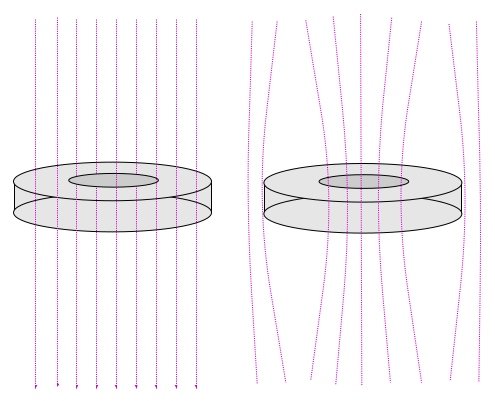
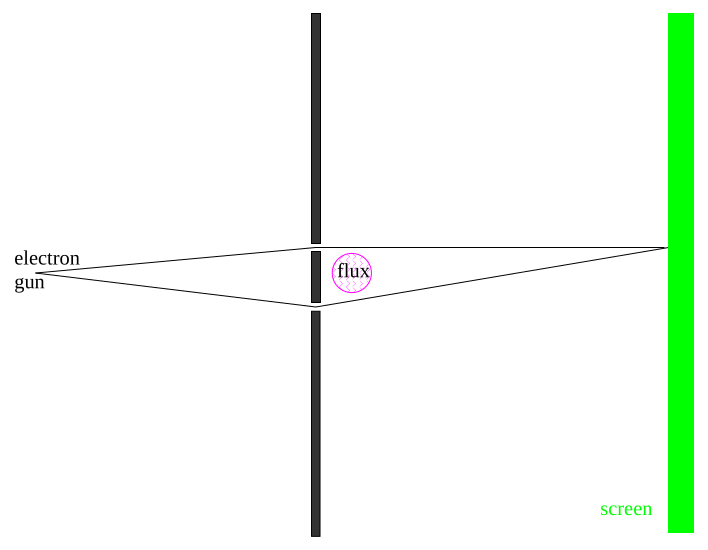
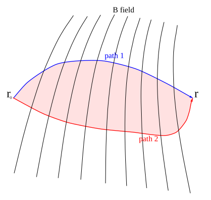

[← 19 Homework Problems 130A](19-homework-problems-130a.md) · [21 Addition of Angular Momentum →](21-addition-of-angular-momentum.md)

---

<hr class="page" style="height:2px;border:0;background:currentColor;opacity:0.25">
<a id="p292" href="book.pdf#page=292" target="_blank" title="This page in the PDF"><sup>[p. 292]</sup></a>

# 20 Electrons in an Electromagnetic Field

In this section, we will study the interactions of electrons in an electromagnetic field. We will compute the additions to the Hamiltonian for magnetic fields. The gauge symmetry exhibited in electromagnetism will be examined in quantum mechanics. We will show that a symmetry allowing us to change the phase of the electron wave function requires the existence of EM interactions (with the gauge symmetry).

These topics are covered in **Gasiorowicz Chapter 13,** and in **Cohen-Tannoudji et al. Com-** **plements** $`E_{VI} \boldsymbol{,} D_{VII}`$ **and** $`H_{III}`$**.**

# <a id="s-20-1-review-of-the-classical-equations-of-electricity-and-magnetism-in-cgs-units"></a>20.1 Review of the Classical Equations of Electricity and Magnetism in CGS Units

You may be most familiar with Maxwell’s equations and the Lorentz force law in SI units as given below.

```math
\vec{\nabla} \cdot \vec{B} = 0
```

```math
\vec{\nabla} \times \vec{E} + \frac{\partial B}{\partial t} = 0
```

```math
\vec{\nabla} \cdot \vec{E} = \frac{\rho}{\epsilon_{0}}
```

```math
\vec{\nabla} \times \vec{B} - \frac{1}{c^{2}} \frac{\partial E}{\partial t} = \mu_{0} \vec{J}
```

```math
\vec{F} = - e ( \vec{E} + \vec{v} \times \vec{B} ) .
```

These equations have needless extra constants (not) of nature in them so we don’t like to work in these units. Since the Lorentz force law depends on the product of the charge and the field, there is the freedom to, for example, increase the field by a factor of 2 but decrease the charge by a factor of 2 at the same time. This will put a factor of 4 into Maxwell’s equations but not change physics. Similar tradeoffs can be made with the magnetic field strength and the constant on the Lorentz force law.

The choices made in CGS units are more physical (but still not perfect). There are no extra constants other than $`\pi`$. Our textbook and many other advanced texts use CGS units and so will we in this chapter. **Maxwell’s Equations** in CGS units are

```math
\vec{\nabla} \cdot \vec{B} = 0
```

```math
\vec{\nabla} \times \vec{E} + \frac{1}{c} \frac{\partial B}{\partial t} = 0
```

```math
\vec{\nabla} \cdot \vec{E} = 4 \pi \rho
```

```math
\vec{\nabla} \times \vec{B} - \frac{1}{c} \frac{\partial E}{\partial t} = \frac{4 \pi}{c} \vec{J} .
```

The **Lorentz Force** is

```math
\vec{F} = - e ( \vec{E} + \frac{1}{c} \vec{v} \times \vec{B} ) .
```

In fact, an even better definition (rationalized Heaviside-Lorentz units) of the charges and fields can be made as shown in the introduction to field theory in chapter 32. For now we will stick with the more standard CGS version of Maxwell’s equations.

<div align="right"><a href="book.pdf#page=292" target="_blank" title="This page in the PDF"><sup>[p. 292]</sup></a></div>
<hr class="page" style="height:2px;border:0;background:currentColor;opacity:0.25">
<a id="p293" href="book.pdf#page=293" target="_blank" title="This page in the PDF"><sup>[p. 293]</sup></a>

If we derive the fields from **potentials,**

```math
\vec{B} = \vec{\nabla} \times \vec{A}
```

```math
\vec{E} = - \vec{\nabla} \varphi - \frac{1}{c} \frac{\partial A}{\partial t}
```

then the first two Maxwell equations are automatically satisfied. Applying the second two equations we get **wave equations** in the potentials.

```math
-\nabla^{2} \varphi - \frac{1}{c} \frac{\partial}{\partial t} ( \vec{\nabla} \cdot \vec{A} ) = 4 \pi \rho
```

```math
-\nabla^{2} \vec{A} + \frac{1}{c^{2}} \frac{\partial^{2} \vec{A}}{\partial t^{2}} + \vec{\nabla} \left( \vec{\nabla} \cdot \vec{A} + \frac{1}{c} \frac{\partial \varphi}{\overline{\partial t}} \right) = \frac{4 \pi}{c} \vec{J}
```

These **derivations** (see section 20.5.1) are fairly simple using Einstein notation.

The two results we want to use as inputs for our study of Quantum Physics are

$`•`$ the classical gauge symmetry and

$`•`$ the classical Hamiltonian.

The Maxwell equations are invariant under a **gauge transformation** of the potentials.

```math
\vec{A} \varphi \quad \to \to \quad \vec{A} \varphi + \frac{1}{c} \frac{\partial f ( \vec{r} , t )}{\partial t} - \vec{\nabla} f ( \vec{r} , t )
```

Note that when we quantize the field, the potentials will play the role that wave functions do for the electron, so this gauge symmetry will be important in quantum mechanics. We can use the gauge symmetry to simplify our equations. For time independent charge and current distributions, the **coulomb gauge,** $`\vec{\nabla} \cdot \vec{A}`$ = 0, is often used. For time dependent conditions, the **Lorentz gauge,** $`\vec{\nabla} \cdot \vec{A} + \tfrac{1}{c} \tfrac{\partial \varphi}{\partial t}`$ = 0, is often convenient. These greatly simplify the above wave equations in an obvious way.

Finally, the classical **Hamiltonian for electrons in an electromagnetic field** becomes

```math
H = \frac{p^{2}}{2 m} \to \frac{1}{2 m} \left( \vec{p} + \frac{e}{c} \vec{A} \right)^{2} - e\varphi
```

The magnetic force is not a conservative one so we cannot just add a scalar potential. We know that there is momentum contained in the field so the additional momentum term, as well as the usual force due to an electric field, makes sense. The electron generates an E-field and if there is a B-field present, $`\vec{E} \times \vec{B}`$ gives rise to momentum density in the field. The evidence that this is the correct classical Hamiltonian is that we can **derive** (see section 20.5.2) the Lorentz Force from it.

# <a id="s-20-2-the-quantum-hamiltonian-including-a-b-field"></a>20.2 The Quantum Hamiltonian Including a B-field

We will quantize the Hamiltonian

```math
H = \frac{1}{2 m} \left( \vec{p} + \frac{e}{c} \vec{A} \right)^{2} - e\varphi
```

<div align="right"><a href="book.pdf#page=293" target="_blank" title="This page in the PDF"><sup>[p. 293]</sup></a></div>
<hr class="page" style="height:2px;border:0;background:currentColor;opacity:0.25">
<a id="p294" href="book.pdf#page=294" target="_blank" title="This page in the PDF"><sup>[p. 294]</sup></a>

in the usual way, by replacing the momentum by the momentum operator, for the case of a constant magnetic field.

Note that the momentum operator will now include momentum in the field, not just the particle’s momentum. As this Hamiltonian is written, $`\vec{p}`$ is the variable conjugate to $`\vec{r}`$ and is related to the velocity by

```math
\vec{p} = m \vec{v} - \frac{e}{c} \vec{A}
```

as seen in our derivation of the Lorentz force (See Section 20.5.2).

The **computation** (see section 20.5.3) yields

```math
\frac{- \hbar^{2}}{2 m} \nabla^{2} \psi + \frac{e}{2 mc} \vec{B} \cdot \vec{L} \psi + \frac{e^{2}}{8 mc^{2}} \left( r^{2} B^{2} - ( \vec{r} \cdot \vec{B} )^{2} \right) \psi = ( E + e\varphi ) \psi .
```

The usual kinetic energy term, the first term on the left side, has been recovered. The standard potential energy of an electron in an Electric field is visible on the right side. We see two additional terms due to the magnetic field. An **estimate** (see section 20.5.4) of the size of the two B field terms for atoms shows that, for realizable magnetic fields, the first term is fairly small (down by a factor of $`\frac{B}{2 . 4 \times 1 0^{9}}`$ gauss compared to hydrogen binding energy), and the second can be neglected. The second term may be important in very high magnetic fields like those produced near neutron stars or if distance scales are larger than in atoms like in a plasma (see example below).

So, for atoms, the dominant additional term is the one we anticipated classically in section 18.4,

```math
H_{B} = \frac{e}{2 mc} \vec{B} \cdot \vec{L} = - \vec{\mu} \cdot \vec{B} ,
```

where $`\vec{\mu} = - \tfrac{e}{2 mc} \vec{L}`$. This is, effectively, the **magnetic moment** due to the electron’s orbital angular momentum. In atoms, this term gives rise to the **Zeeman effect:** otherwise degenerate atomic states split in energy when a magnetic field is applied. Note that the electron spin which is not included here also contributes to the splitting and will be studied later.

The **Zeeman effect**, neglecting electron spin, is particularly simple to calculate because the the hydrogen energy eigenstates are also eigenstates of the additional term in the Hamiltonian. Hence, the correction can be calculated exactly and easily.

\* See Example 20.4.1: Splitting of orbital angular momentum states in a B field.\*

The result is that the shifts in the eigen-energies are

```math
\Delta E = \mu_{B} Bm_{\ell}
```

where $`m_{\ell}`$ is the usual quantum number for the z component of orbital angular momentum. The Zeeman splitting of Hydrogen states, with spin included, was a powerful tool in understanding Quantum Physics and we will discuss it in detail in chapter 23.

The additional magnetic field terms are important in a plasma because the typical radii can be much bigger than in an atom. A **plasma** is composed of ions and electrons, together to make a (usually) electrically neutral mix. The charged particles are essentially free to move in the plasma. If we apply an external magnetic field, we have a quantum mechanics problem to solve. On earth, we use plasmas in magnetic fields for many things, including nuclear fusion reactors. Most regions of space contain plasmas and magnetic fields.

<div align="right"><a href="book.pdf#page=294" target="_blank" title="This page in the PDF"><sup>[p. 294]</sup></a></div>
<hr class="page" style="height:2px;border:0;background:currentColor;opacity:0.25">
<a id="p295" href="book.pdf#page=295" target="_blank" title="This page in the PDF"><sup>[p. 295]</sup></a>

In the example below, we will solve the Quantum Mechanics problem two ways: one using our new Hamiltonian with B field terms, and the other writing the Hamiltonian in terms of A. The first one will exploit both **rotational symmetry about the B field direction and translational** **symmetry along the B field direction**. We will turn the radial equation into the **equation we** **solved for Hydrogen**. In the second solution, we will use **translational symmetry along the B** **field direction as well as translational symmetry transverse** to the B field. We will now turn the remaining 1D part of the Schrödinger equation into the 1D **harmonic oscillator equation**, showing that the two problems we have solved analytically are actually related to each other!

\* See Example 20.4.2: A neutral plasma in a constant magnetic field.\*

The result in either solution for the eigen-energies can be written as

```math
E_{n} = \frac{eB \hbar}{m_{e} c} \left( n + \frac{1}{2} \right) + \frac{\hbar^{2} k^{2}}{2 m_{e}} .
```

which depends on 2 quantum numbers. $`\hbar k`$ is the conserved momentum along the field direction which can take on any value. $`n`$ is an integer dealing with the state in x and y. In the first solution we understand $`n`$ in terms of the radial wavefunction in cylindrical coordinates and the angular momentum about the field direction. In the second solution, the physical meaning is less clear.

# <a id="s-20-3-gauge-symmetry-in-quantum-mechanics"></a>20.3 Gauge Symmetry in Quantum Mechanics

Gauge symmetry in Electromagnetism was recognized before the advent of quantum mechanics. We have seen that symmetries play a very important role in the quantum theory. Indeed, in quantum mechanics, gauge symmetry can be seen as the basis for electromagnetism and conservation of charge.

We know that the all observables are unchanged if we make a global change of the phase of the wavefunction, $`\psi \to e^{i\lambda} \psi`$. We could call this **global phase symmetry.** All relative phases (say for amplitudes to go through different slits in a diffraction experiment) remain the same and no physical observable changes. This is a symmetry in the theory which we already know about. Let’s postulate that there is a bigger symmetry and see what the consequences are.

```math
\psi ( \vec{r} , t ) \to e^{i\lambda ( \vec{r} ,t )} \psi ( \vec{r} , t )
```

That is, we can change the phase by a different amount at each point in spacetime and the physics will remain unchanged. This **local phase symmetry** is bigger than the global one.

Its clear that this transformation leaves the **absolute square of the wavefunction the same**, but what about the Schrödinger equation? It must also be unchanged. The **derivatives in the** **Schrödinger equation** will act on $`\lambda ( \vec{r} , t )`$ changing the equation unless we do something else to cancel the changes.

```math
\frac{1}{2 m} \left( \vec{p} + \frac{e}{c} \vec{A} \right)^{2} \psi = ( E + e\varphi ) \psi
```

A little **calculation** (see section 20.5.7) shows that the equation remains unchanged if we also transform the potentials

```math
\frac{\vec{A}}{\varphi} \quad \frac{\to}{\to} \quad \frac{\vec{A} - \vec{\nabla} f ( \vec{r} , t )}{\varphi +} 1 \partial f ( \vec{r} , t )
```

```math
f ( \vec{r} , t ) = \frac{\hbar c}{e} \lambda ( c \vec{r} , t ) \partial t .
```

<div align="right"><a href="book.pdf#page=295" target="_blank" title="This page in the PDF"><sup>[p. 295]</sup></a></div>
<hr class="page" style="height:2px;border:0;background:currentColor;opacity:0.25">
<a id="p296" href="book.pdf#page=296" target="_blank" title="This page in the PDF"><sup>[p. 296]</sup></a>

This is just the **standard gauge transformation of electromagnetism**, but, we now see that local phase symmetry of the wavefunction requires gauge symmetry for the fields and indeed even requires the existence of the EM fields to cancel terms in the Schrödinger equation. Electromagnetism is called a **gauge theory** because the gauge symmetry actually defines the theory. It turns out that the **weak and the strong interactions are also gauge theories** and, in some sense, have the next simplest possible gauge symmetries after the one in Electromagnetism.

We will write our **standard gauge transformation** in the traditional way to conform a bit better to the textbooks.

```math
\frac{\vec{A}}{\psi ( \vec{r} , t )} \varphi \quad \to \frac{\to}{\to} \quad \varphi \frac{\vec{A} - \vec{\nabla} f ( \vec{r} , t )}{e^{- i} \frac{\frac{1}{{}_{e} c}}{\hbar c} f^{( \vec{r} ,t )} \psi ( \vec{r} , t )} + \frac{\partial f ( \vec{r} , t )}{\partial t}
```

There are measurable **quantum physics consequences** of this symmetry. We can understand a number of them by looking at the **vector potential in a field free regions**. If $`B`$ = 0 then $`\vec{A}`$ can be written as the gradient of a function $`f ( \vec{r} )`$. To be specific, take our gauge transformation of the vector potential. Make a gauge transformation such that $`\vec{A}^{\prime}`$ = 0. This of course is still consistent with $`\vec{B}`$ = 0.

```math
\vec{A}^{\prime} = \vec{A} - \vec{\nabla} f ( \vec{r} ) = 0
```

Then the old vector potential is then given by

```math
\vec{A} = \vec{\nabla} f ( \vec{r} ) .
```

Integrating this equation, we can write the function $`f ( \vec{r} )`$ in terms of $`\vec{A} ( \vec{r} )`$.

```math
\int_{\vec{r}_{0}}^{\vec{r}} d \vec{r} \cdot \vec{A} = \int_{\vec{r}_{0}}^{\vec{r}} d \vec{r} \cdot \vec{\nabla} f = f ( \vec{r} ) - f ( \vec{r}_{0} )
```

If we choose $`f`$ so that $`f ( \vec{r}_{0} )`$ = 0, then we have a **very useful relation between the gauge** **function and the vector potential in a field free region.**

```math
f ( \vec{r} ) = \int_{\vec{r}_{0}}^{\vec{r}} d \vec{r} \cdot \vec{A} .
```

We can **derive** (see section 20.5.8) the quantization of magnetic flux by calculating the line integral of $`\vec{A}`$ around a closed loop in a field free region.

```math
\Phi = \frac{2 n\pi \hbar c}{e}
```

A good example of a $`B`$ = 0 region is a **superconductor**. Magnetic flux is excluded from the superconducting region. If we have a superconducting ring, we have a B=0 region surrounding some flux. We have shown then, that the flux going through a ring of superconductor is quantized.

<div align="right"><a href="book.pdf#page=296" target="_blank" title="This page in the PDF"><sup>[p. 296]</sup></a></div>
<hr class="page" style="height:2px;border:0;background:currentColor;opacity:0.25">
<a id="p297" href="book.pdf#page=297" target="_blank" title="This page in the PDF"><sup>[p. 297]</sup></a>



_Figure 74 (p. 297)_

Flux is observed to be quantized but the charge of the particle seen is 2$`e`$.

```math
\Phi = \frac{2 n\pi \hbar c}{2 e}
```

This is due to the pairing of electrons inside a superconductor.

The **Aharanov Böhm Effect** brings us back to the two slit diffraction experiment but adds magnetic fields.



_Figure 75 (p. 297)_

The electron beams travel through two slits in field free regions but we have the ability to vary a magnetic field enclosed by the path of the electrons. At the screen, the amplitudes from the two<span class="page" style="float:left;width:100%;margin:0.4em 0 0.6em"><span style="display:block;text-align:right"><a href="book.pdf#page=297" target="_blank" title="This page in the PDF"><sup>[p. 297]</sup></a></span><span style="display:block;height:2px;background:currentColor;opacity:0.25"></span><a id="p298" href="book.pdf#page=298" target="_blank" title="This page in the PDF"><sup>[p. 298]</sup></a></span> slits interfere $`\psi = \psi_{1} + \psi_{2}`$. Let’s start with $`B`$ = 0 and $`A`$ = 0 everywhere. When we change the $`B`$ field, the wavefunctions must change.

```math
\psi \psi_{1 2} \psi \quad \to \to = \left( \psi_{1} e^{- i \tfrac{e \Phi}{\hbar c}} + \psi_{2} \right) \int^{\psi \psi_{1} e \frac{- i \tfrac{e}{\hbar c}_{1} d \vec{r} \cdot \vec{A}}{- i \tfrac{e}{\hbar c}_{2} d \vec{r} \cdot \vec{A}}_{2} e} \int e \int^{- i \tfrac{e}{\hbar c}_{2} d \vec{r} \cdot \vec{A}}
```

The relative phase from the two slits depends on the flux between the slits. By varying the $`B`$ field, we will **shift the diffraction pattern** even though $`B`$ = 0 along the whole path of the electrons. While this may at first seem amazing, we have seen similar effects in classical E&M with an EMF induced in a loop by a changing $`B`$ field which does not touch the actual loop.

# <a id="s-20-4-examples"></a>20.4 Examples

## <a id="s-20-4-1-the-naive-zeeman-splitting"></a>20.4.1 The Naive Zeeman Splitting

The additional term we wish to consider in the Hamiltonian is $`\tfrac{e}{2 \mu c} \vec{B} \cdot \vec{L}`$. Choosing the z axis so that the constant field points in the z direction, we have

```math
H_{\text{ Zeeman }} = \frac{eB_{z}}{2 \mu c} L_{z} .
```

In general, the addition of a new term to the Hamiltonian will require us to use an approximation to solve the problem. In this case, however, the energy eigenstates we derived in the Hydrogen problem are **still eigenstates of the full Hamiltonian** $`H = H_{\text{ hydrogen }} + H_{\text{ Zeeman }}`$. Remember, our hydrogen states are eigenstates of H, $`L^{2}`$ and $`L_{z}`$.

```math
( H_{\text{ hydrogen }} + H_{\text{ Zeeman }} ) \psi_{n\ell m} = ( E_{n} + m\mu_{B} B ) \psi_{n\ell m}
```

This would be a really nice tool to study the number of degenerate states in each hydrogen level. When the experiment was done, things did not work our according to plan at all. The magnetic moment of the electron’ s spin greatly complicates the problem. We will solve this later.

## <a id="s-20-4-2-a-plasma-in-a-magnetic-field"></a>20.4.2 A Plasma in a Magnetic Field

An important place where both magnetic terms come into play is in a **plasma.** There, many electrons are not bound to atoms and external Electric fields are screened out. Let’s assume there is a constant (enough) B field in the z direction. We then have cylindrical symmetry and will work in the coordinates, $`\rho , \varphi`$, and $`z`$.

```math
\frac{- \hbar^{2}}{2 m_{e}} \nabla^{2} \psi + \frac{eB}{2 m_{e} c} L_{z} \psi + \frac{e^{2} B^{2}}{8 m_{e} c^{2}} ( x^{2} + y^{2} ) \psi = ( E + e\varphi ) \psi
```

The problem clearly has **translational symmetry along the z direction and rotational sym-** **metry around the z axis**. Given the symmetry, we know that $`L_{z}`$ and $`p_{z}`$ commute with the

<div align="right"><a href="book.pdf#page=298" target="_blank" title="This page in the PDF"><sup>[p. 298]</sup></a></div>
<hr class="page" style="height:2px;border:0;background:currentColor;opacity:0.25">
<a id="p299" href="book.pdf#page=299" target="_blank" title="This page in the PDF"><sup>[p. 299]</sup></a>

Hamiltonian and will give constants of the motion. We therefore will be able to separate variables in the usual way.

```math
\psi ( \vec{r} ) = u_{nmk} ( \rho ) e^{im\varphi} e^{ikz}
```

In **solving** (see section 20.5.5) the equation in $`\rho`$ we may reuse the Hydrogen solution ultimately get the energies

```math
E = \frac{eB \hbar}{m_{e} c} \left( n + \frac{1 + m + | m |}{2} \right) + \frac{\hbar^{2} k^{2}}{2 m}
```

and associated LaGuerre polynomials (as in Hydrogen) in $`\rho^{2}`$ (instead of $`r )`$.

The solution turns out to be **simpler using the Hamiltonian written in terms of** (see section 20.5.6) $`\vec{A}`$ if we choose the right gauge by setting $`\vec{A} = Bx \hat{y}`$.

```math
H = \frac{1}{2 m_{e}} \left( \vec{p} + \frac{e}{c} \vec{A} \right)^{2} = \frac{1}{2 m_{e}} \left( p_{x}^{2} + \left( p_{y} + \frac{eB}{c} x \right)^{2} + p_{z}^{2} \right)
```

```math
= \frac{1}{2 m_{e}} \left( p_{x}^{2} + p_{y}^{2} + \frac{2 eB}{c} xp_{y} + \left( \frac{eB}{c} \right)^{2} x^{2} + p_{z}^{2} \right)
```

This Hamiltonian does not depend on $`y`$ or $`z`$ and therefore has **translational symmetry in both** **x and y** so their conjugate momenta are conserved. We can use this symmetry to write the solution and reduce to a 1D equation in $`v ( x )`$.

```math
\psi = v ( x ) e^{ik_{y} y} e^{ik_{z} z}
```

Then we actually can use our harmonic oscillator solution instead of hydrogen! The energies come out to be

```math
E_{n} = \frac{eB \hbar}{m_{e} c} \left( n + \frac{1}{2} \right) + \frac{\hbar^{2} k^{2}}{2 m_{e}} .
```

Neglecting the free particle behavior in $`z`$, these are called the **Landau Levels.** This is an example of the equivalence of the two real problems we know how to solve.

# <a id="s-20-5-derivations-and-computations"></a>20.5 Derivations and Computations

## <a id="s-20-5-1-deriving-maxwell-s-equations-for-the-potentials"></a>20.5.1 Deriving Maxwell’s Equations for the Potentials

We take Maxwell’s equations and the fields written in terms of the potentials as input. In the left column the equations are given in the standard form while the right column gives the equivalent equation in terms of indexed components. The right column uses the totally antisymmetric tensor in 3D $`\epsilon_{ijk}`$ and assumes summation over repeated indices (Einstein notaton). So in this notation, dot products can be simply written as $`\vec{a} \cdot \vec{b} = a_{i} b_{i}`$ and any component of a cross product is written $`( \vec{a} \times \vec{b} )_{k} = a_{i} b_{j} \epsilon_{ijk}`$.

```math
\vec{\nabla} \cdot \vec{B} = 0 \quad \frac{\partial}{\partial x_{i}} B_{i} = 0
```

```math
\vec{\nabla} \times \vec{E} + \frac{1}{c} \frac{\partial B}{\partial t} = 0 \quad \frac{\partial}{\partial x_{i}} E_{j} \epsilon_{ijk} + \frac{1}{c} \frac{\partial B_{k}}{\partial t} = 0
```

```math
\vec{\nabla} \cdot \vec{E} = 4 \pi \rho \quad \frac{\partial}{\partial x_{k}} E_{k} = 4 \pi \rho
```

<div align="right"><a href="book.pdf#page=299" target="_blank" title="This page in the PDF"><sup>[p. 299]</sup></a></div>
<hr class="page" style="height:2px;border:0;background:currentColor;opacity:0.25">
<a id="p300" href="book.pdf#page=300" target="_blank" title="This page in the PDF"><sup>[p. 300]</sup></a>

```math
\vec{\nabla} \times \vec{B} - \frac{1}{c} \frac{\partial E}{\partial t} = \frac{4 \pi}{c} \vec{J} \quad \frac{\partial}{\partial x_{i}} B_{j} \epsilon_{ijk} - \frac{1}{c} \frac{\partial E_{k}}{\partial t} = \frac{4 \pi}{c} J_{k}
```

```math
\vec{B} = \vec{\nabla} \times \vec{A} \quad B_{j} = \frac{\partial}{\partial x_{m}} A_{n} \epsilon_{mnj}
```

```math
\vec{E} = - \vec{\nabla} \varphi - \frac{1}{c} \frac{\partial A}{\partial t} \quad E_{k} = - \frac{\partial}{\partial x_{k}} \varphi - \frac{1}{c} \frac{\partial A_{k}}{\partial t}
```

If the fields are written in terms of potentials, then the first two Maxwell equations are automatically satisfied. Lets verify the first equation by plugging in the B field in terms of the potential and noticing that we can interchange the order of differentiation.

```math
\vec{\nabla} \cdot \vec{B} = \frac{\partial}{\partial x_{i}} B_{i} = \frac{\partial}{\partial x_{i}} \frac{\partial}{\partial x_{m}} A_{n} \epsilon_{mni} = \frac{\partial}{\partial x_{m}} \frac{\partial}{\partial x_{i}} A_{n} \epsilon_{mni}
```

We could also just interchange the index names $`i`$ and $`m`$ then switch those indices around in the antisymmetric tensor.

```math
\vec{\nabla} \cdot \vec{B} = \frac{\partial}{\partial x_{m}} \frac{\partial}{\partial x_{i}} A_{n} \epsilon_{inm} = - \frac{\partial}{\partial x_{m}} \frac{\partial}{\partial x_{i}} A_{n} \epsilon_{mni}
```

We have the same expression except for a minus sign which means that $`\vec{\nabla} \cdot \vec{B}`$ = 0.

For the second equation, we write it out in terms of the potentials and notice that the first term $`\tfrac{\partial}{\partial x_{i}} \tfrac{\partial}{\partial x_{j}} \varphi \epsilon_{ijk}`$ = 0 for the same reason as above.

```math
\frac{\partial}{\partial x_{i}} E_{j} \epsilon_{ijk} + \frac{1}{c} \frac{\partial B_{k}}{\partial t} = - \frac{\partial}{\partial x_{i}} \left( \frac{\partial}{\partial x_{j}} \varphi + \frac{1}{c} \frac{\partial A_{j}}{\partial t} \right) \epsilon_{ijk} + \frac{1}{c} \frac{\partial}{\partial t} \frac{\partial}{\partial x_{m}} A_{n} \epsilon_{mnk}
```

```math
= \frac{1}{c} \left( - \frac{\partial}{\partial x_{i}} \frac{\partial A_{j}}{\partial t} \epsilon_{ijk} + \frac{\partial}{\partial x_{m}} \frac{\partial A_{n}}{\partial t} \epsilon_{mnk} \right)
```

```math
= \frac{1}{c} \left( - \frac{\partial}{\partial x_{i}} \frac{\partial A_{j}}{\partial t} \epsilon_{ijk} + \frac{\partial}{\partial x_{i}} \frac{\partial A_{j}}{\partial t} \epsilon_{ijk} \right) = 0
```

The last step was simply done by renaming dummy indices (that are summed over) so the two terms cancel.

Similarly we may work with the Gauss’s law equation

```math
\vec{\nabla} \cdot \vec{E} = \frac{\partial}{\partial x_{k}} E_{k} = - \frac{\partial}{\partial x_{k}} \left( \frac{\partial}{\partial x_{k}} \varphi + \frac{1}{c} \frac{\partial A_{k}}{\partial t} \right) = 4 \pi \rho
```

```math
-\nabla^{2} \varphi - \frac{1}{c} \frac{\partial}{\partial t} ( \vec{\nabla} \cdot \vec{A} ) = 4 \pi \rho
```

For the fourth equation we have.

```math
\frac{\partial}{\partial x_{i}} B_{j} \epsilon_{ijk} - \frac{1}{c} \frac{\partial E_{k}}{\partial t} = \frac{4 \pi}{c} J_{k}
```

```math
\frac{\partial}{\partial x_{i}} \frac{\partial}{\partial x_{m}} A_{n} \epsilon_{mnj} \epsilon_{ijk} + \frac{1}{c} \frac{\partial}{\partial t} \left( \frac{\partial}{\partial x_{k}} \varphi + \frac{1}{c} \frac{\partial A_{k}}{\partial t} \right) = \frac{4 \pi}{c} J_{k}
```

Its easy to derive an identity for the product of two totally antisymmetric tensors $`\epsilon_{mnj} \epsilon_{ijk}`$ as occurs above. All the indices of any tensor have to be different in order to get a nonzero result. Since the

<div align="right"><a href="book.pdf#page=300" target="_blank" title="This page in the PDF"><sup>[p. 300]</sup></a></div>
<hr class="page" style="height:2px;border:0;background:currentColor;opacity:0.25">
<a id="p301" href="book.pdf#page=301" target="_blank" title="This page in the PDF"><sup>[p. 301]</sup></a>

$`j`$ occurs in both tensors (and is summed over) we can simplify things. Take the case that $`i`$ = 1 and $`k`$ = 2. We only have a nonzero term if $`j`$ = 3 so the other 2 terms in the sum are zero. But if $`j`$ = 3, we must have either $`m`$ = 1 and $`n`$ = 2 or vice versa. We also must not have $`i = k`$ since all the indices have to be different on each epsilon. So we can write.

```math
\epsilon_{mnj} \epsilon_{ijk} = \epsilon_{mnj} \epsilon_{kij} = ( \delta_{km} \delta_{in} - \delta_{kn} \delta_{im} )
```

Applying this identity to the Maxwell equation above, we get.

```math
\frac{\partial}{\partial x_{i}} \frac{\partial}{\partial x_{k}} A_{i} - \frac{\partial}{\partial x_{i}} \frac{\partial}{\partial x_{i}} A_{k} + \frac{1}{c} \frac{\partial}{\partial x_{k}} \frac{\partial \varphi}{\partial t} + \frac{1}{c^{2}} \frac{\partial^{2} A_{k}}{\partial t^{2}} = \frac{4 \pi}{c} J_{k}
```

```math
\frac{\partial}{\partial x_{k}} \vec{\nabla} \cdot \vec{A} -\nabla^{2} A_{k} + \frac{1}{c} \frac{\partial}{\partial x_{k}} \frac{\partial \varphi}{\partial t} + \frac{1}{c^{2}} \frac{\partial^{2} A_{k}}{\partial t^{2}} = \frac{4 \pi}{c} J_{k}
```

```math
-\nabla^{2} A_{k} + \frac{1}{c^{2}} \frac{\partial^{2} A_{k}}{\partial t^{2}} + \frac{\partial}{\partial x_{k}} \left( \vec{\nabla} \cdot \vec{A} + \frac{1}{c} \frac{\partial \varphi}{\partial t} \right) = \frac{4 \pi}{c} J_{k}
```

```math
-\nabla^{2} \vec{A} + \frac{1}{c^{2}} \frac{\partial^{2} \vec{A}}{\partial t^{2}} + \vec{\nabla} \left( \vec{\nabla} \cdot \vec{A} + \frac{1}{c} \frac{\partial \varphi}{\partial t} \right) = \frac{4 \pi}{c} \vec{J}
```

The last two equations derived are wave equations with source terms obeyed by the potentials. As discussed in the opening section of this chapter, they can be simplified with a choice of gauge.

## <a id="s-20-5-2-the-lorentz-force-from-the-classical-hamiltonian"></a>20.5.2 The Lorentz Force from the Classical Hamiltonian

In this section, we wish to verify that the Hamiltonian

```math
H = \frac{1}{2 m} \left( \vec{p} + \frac{e}{c} \vec{A} \right)^{2} - e\varphi
```

gives the correct Lorentz Force law in classical physics. We will then proceed to use this Hamiltonian in Quantum Mechanics.

**Hamilton’s equations** are

```math
\dot{q} = \frac{\partial H}{\partial p}
```

```math
\dot{p} = - \frac{\partial H}{\partial q}
```

where $`\vec{q} \equiv \vec{r}`$ and the conjugate momentum is already identified correctly $`\vec{p} \equiv \vec{p}`$. Remember that these are applied assuming q and p are independent variables.

Beginning with $`\dot{q} = \partial H/\partial p`$, we have

```math
\frac{d \vec{r}}{dt} = \frac{1}{m} \left( \vec{p} + \frac{e}{c} \vec{A} \right)
```

```math
m \vec{v} = \vec{p} + \frac{e}{c} \vec{A}
```

```math
\vec{p} = m \vec{v} - e \vec{A}
```

<div align="right"><a href="book.pdf#page=301" target="_blank" title="This page in the PDF"><sup>[p. 301]</sup></a></div>
<hr class="page" style="height:2px;border:0;background:currentColor;opacity:0.25">
<a id="p302" href="book.pdf#page=302" target="_blank" title="This page in the PDF"><sup>[p. 302]</sup></a>

Note that $`\vec{p} \neq m \vec{v}`$. The momentum conjugate to $`\vec{r}`$ includes momentum in the field. We now time differentiate this equation and write it in terms of the components of a vector.

```math
\frac{dp_{i}}{dt} = m \frac{dv_{i}}{dt} - \frac{e}{c} \frac{dA_{i}}{dt.}
```

Similarly for the other Hamilton equation (in each vector component) $`\dot{p}_{i} = - \tfrac{\partial H}{i}_{\partial x}`$, we have

```math
\frac{dp_{i}}{dt} = \dot{p}_{i} = - \frac{e}{mc} \left( \vec{p} + \frac{e}{c} \vec{A} \right) \cdot \frac{\partial \vec{A}}{\partial x_{i}} + e \frac{\vec{\partial} \varphi}{\partial x_{i}} .
```

We now have two equations for $`\frac{dp_{i}}{dt}`$ derived from the two Hamilton equations. We equate the two right hand sides yielding

```math
ma_{i} = m \frac{dv_{i}}{dt} = - \frac{e}{mc} \left( \vec{p} + \frac{e}{c} \vec{A} \right) \cdot \frac{\partial \vec{A}}{\partial x_{i}} + e \frac{\partial \varphi}{\partial x_{i}} + \frac{e}{c} \frac{dA_{i}}{dt} .
```

```math
ma_{i} = - \frac{e}{mc} ( m \vec{v} ) \cdot \frac{\partial \vec{A}}{\partial x_{i}} + e \frac{\partial \varphi}{\partial x_{i}} + \frac{e}{c} \frac{dA_{i}}{dt} .
```

The **total time derivative** of $`A`$ has one part from $`A`$ changing with time and another from the particle moving and $`A`$ changing in space.

```math
\frac{d \vec{A}}{dt} = \frac{\partial \vec{A}}{\partial t} + \left( \vec{v} \cdot \vec{\nabla} \right) \vec{A}
```

so that

```math
F_{i} = ma_{i} = - \frac{e}{c} \vec{v} \cdot \frac{\partial \vec{A}}{\partial x_{i}} + e \frac{\partial \varphi}{\partial x_{i}} + \frac{e}{c} \frac{\partial A_{i}}{\partial t} + \frac{e}{c} \left( \vec{v} \cdot \vec{\nabla} \right) A_{i} .
```

We notice the electric field term in this equation.

```math
e \frac{\partial \varphi}{\partial x_{i}} + \frac{e}{c} \frac{\partial A_{i}}{\partial t} = - eE_{i}
```

```math
F_{i} = ma_{i} = - eE_{i} + \frac{e}{c} \left[ - \vec{v} \cdot \frac{\partial \vec{A}}{\partial x_{i}} + \left( \vec{v} \cdot \vec{\nabla} \right) A_{i} \right] .
```

Let’s work with the other two terms to see if they give us the rest of the Lorentz Force.

```math
\frac{e}{c} \left[ \left( \vec{v} \cdot \vec{\nabla} \right) A_{i} - \vec{v} \cdot \frac{\partial \vec{A}}{\partial x_{i}} \right] = \frac{e}{c} \left[ v_{j} \frac{\partial}{\partial x_{j}} A_{i} - v_{j} \frac{\partial A_{j}}{\partial x_{i}} \right] = \frac{e}{c} v_{j} \left[ \frac{\partial A_{i}}{\partial x_{j}} - \frac{\partial A_{j}}{\partial x_{i}} \right]
```

We need only prove that

```math
\left( \vec{v} \times \vec{B} \right)_{i} = v_{j} \left( \frac{\partial A_{j}}{\partial x_{i}} - \frac{\partial A_{i}}{\partial x_{j}} \right) .
```

To prove this, we will expand the expression using the totally antisymmetric tensor.

```math
\left( \vec{v} \times \vec{B} \right)_{i} = \left( \vec{v} \times \left( \nabla \times \vec{A} \right) \right)_{i} = v_{j} \left( \frac{\partial A_{n}}{\partial x_{m}} \epsilon_{mnk} \right) \epsilon_{jki} = v_{j} \frac{\partial A_{n}}{\partial x_{m}} ( \epsilon_{mnk} \epsilon_{jki} )
```

```math
= - v_{j} \frac{\partial A_{n}}{\partial x_{m}} ( \epsilon_{mnk} \epsilon_{jik} ) = - v_{j} \frac{\partial A_{n}}{\partial x_{m}} ( \delta_{mj} \delta_{ni} - \delta_{mi} \delta_{nj} ) = + v_{j} \left( \frac{\partial A_{j}}{\partial x_{i}} - \frac{\partial A_{i}}{\partial x_{j}} \right) .
```

<div align="right"><a href="book.pdf#page=302" target="_blank" title="This page in the PDF"><sup>[p. 302]</sup></a></div>
<hr class="page" style="height:2px;border:0;background:currentColor;opacity:0.25">
<a id="p303" href="book.pdf#page=303" target="_blank" title="This page in the PDF"><sup>[p. 303]</sup></a>

Q.E.D.

So we have

```math
F_{i} = - eE_{i} - \frac{e}{c} \left( \vec{v} \times \vec{B} \right)_{i}
```

which is the Lorentz force law. So this is the right Hamiltonian for an electron in a electromagnetic field. We now need to quantize it.

## <a id="s-20-5-3-the-hamiltonian-in-terms-of-b"></a>20.5.3 The Hamiltonian in terms of B

Start with the **Hamiltonian**

```math
H = \frac{1}{2 \mu} \left( \vec{p} + \frac{e}{c} \vec{A} \right)^{2} - e\varphi
```

Now write the **Schrödinger equation**.

```math
\begin{aligned} \frac{1}{2 \mu} \left( \frac{\hbar}{i} \vec{\nabla} + \frac{e}{c} \vec{A} \right) \cdot \left( \frac{\hbar}{i} \vec{\nabla} \psi + \frac{e}{c} \vec{A} \psi \right) &= ( E + e\varphi ) \psi \\ \frac{- \hbar^{2}}{2 \mu} \nabla^{2} \psi - \frac{ie \hbar}{2 \mu c} \vec{\nabla} \cdot \left( \vec{A} \psi \right) - \frac{ie \hbar}{2 \mu c} \vec{A} \cdot \vec{\nabla} \psi + \frac{e^{2}}{2 mc^{2}} A^{2} \psi &= ( E + e\varphi ) \psi \\ \frac{- \hbar^{2}}{2 \mu} \nabla^{2} \psi - \frac{ie \hbar}{2 \mu c} \left( \vec{\nabla} \cdot \vec{A} \right) \psi - \frac{ie \hbar}{\mu c} \vec{A} \cdot \vec{\nabla} \psi + \frac{e^{2}}{2 mc^{2}} A^{2} \psi &= ( E + e\varphi ) \psi \end{aligned}
```

The second term vanishes in the **Coulomb gauge** i.e., $`\vec{\nabla} \cdot \vec{A}`$ = 0, so

```math
- \frac{\hbar^{2}}{2 \mu} \nabla^{2} \psi - \frac{ie \hbar}{\mu c} \vec{A} \cdot \vec{\nabla} \psi + \frac{e^{2}}{2 mc^{2}} A^{2} \psi = ( E + e\varphi ) \psi
```

Now for constant $`B_{z}`$, we **choose the vector potential**

```math
\vec{A} = - \frac{1}{2} \vec{r} \times \vec{B}
```

since

```math
\left( \vec{\nabla} \times \vec{A} \right)_{k} = \frac{\partial}{\partial x_{i}} A_{j} \epsilon_{ijk} = - \frac{1}{2} \frac{\partial}{\partial x_{i}} ( x_{m} B_{n} \epsilon_{mnj} ) \epsilon_{ijk}
```

```math
= - \frac{1}{2} \delta_{im} B_{n} \epsilon_{mnj} \epsilon_{ijk} = - \frac{1}{2} B_{n} \epsilon_{inj} \epsilon_{ijk}
```

```math
= \frac{1}{2} B_{n} \left( \sum_{i} \sum_{j} \epsilon_{ijn} \epsilon_{ijk} \right) = \frac{1}{2} B_{k} \left( \sum_{i} \sum_{j} \epsilon_{ijk}^{2} \right) = B_{k}
```

it gives the right field and satisfies the Coulomb gauge condition.

Substituting back, we obtain

```math
\frac{- \hbar^{2}}{2 \mu} \nabla^{2} \psi + \frac{ie \hbar}{2 \mu c} \vec{r} \times \vec{B} \cdot \vec{\nabla} \psi + \frac{e^{2}}{8 mc^{2}} \left( \vec{r} \times \vec{B} \right)^{2} \psi = ( E + e\varphi ) \psi
```

Now let’s work on the **vector arithmetic**.

```math
\left( \vec{r} \times \vec{B} \cdot \vec{\nabla} \psi \right) = r_{i} B_{j} \epsilon_{ijk} \frac{\partial \psi}{\partial x_{k}} = - B_{j} \left( r_{i} \frac{\partial \psi}{\partial x_{k}} \epsilon_{ikj} \right) = - \vec{B} \cdot \vec{r} \times \vec{\nabla} \psi = - \frac{i}{\hbar} \vec{B} \cdot \vec{L} \psi
```

<div align="right"><a href="book.pdf#page=303" target="_blank" title="This page in the PDF"><sup>[p. 303]</sup></a></div>
<hr class="page" style="height:2px;border:0;background:currentColor;opacity:0.25">
<a id="p304" href="book.pdf#page=304" target="_blank" title="This page in the PDF"><sup>[p. 304]</sup></a>

```math
\left( \vec{r} \times \vec{B} \right)^{2} = r_{i} B_{j} \epsilon_{ijk} r_{m} B_{n} \epsilon_{mnk} = ( r_{i} B_{j} r_{i} B_{j} - r_{i} B_{j} r_{j} B_{i} )
```

```math
= r^{2} B^{2} - \left( \vec{r} \cdot \vec{B} \right)^{2} - 0
```

So, plugging these two equations in, we get

```math
\frac{- \hbar^{2}}{2 \mu} \nabla^{2} \psi + \frac{e}{2 \mu c} \vec{B} \cdot \vec{L} \psi + \frac{e^{2}}{8 mc^{2}} \left[ r^{2} B^{2} - \left( \vec{r} \cdot \vec{B} \right)^{2} \right] \psi = ( E + e\varphi ) \psi .
```

We see that there are two new terms due to the magnetic field. The first one is the magnetic moment term we have already used and the second will be negligible in atoms.

## <a id="s-20-5-4-the-size-of-the-b-field-terms-in-atoms"></a>20.5.4 The Size of the B field Terms in Atoms

In the equation

```math
\frac{- \hbar^{2}}{2 \mu} \nabla^{2} \psi + \frac{e}{2 \mu c} \vec{B} \cdot \vec{L} \psi + \frac{e^{2}}{8 mc^{2}} \left[ r^{2} B^{2} - \left( \vec{r} \cdot \vec{B} \right)^{2} \right] \psi = ( E + e\varphi ) \psi .
```

the second term divided by $`( e^{2} /a_{0} )`$

```math
\frac{e}{2 \mu c} \vec{B} \cdot \vec{L} / ( e^{2} /a_{0} ) \sim \frac{e}{2 \mu c} B ( m \hbar ) / ( e^{2} /a_{0} )
```

```math
= m \frac{\alpha eBa_{0}}{2} / \left( e^{2} /a_{0} \right) = m \frac{\alpha a_{0}^{2}}{2 e} B
```

```math
= mB \frac{\left( 0 . 5 \times 1 0^{- 8} \text{ cm } \right)^{2}}{( 2 ) ( 1 3 7 ) ( 4 . 8 \times 1 0^{- 1 0} )} = m \frac{B}{5 \times 1 0^{9} \text{ gauss }}
```

```math
\left( \alpha = \frac{e^{2}}{\hbar c} \quad a_{0} = \frac{\hbar}{\alpha mc} \right)
```

Divide the third term by the second:

```math
\frac{B^{2} a_{0}^{2} \tfrac{e^{2}}{8 mc^{2}}}{\tfrac{e}{2 \mu c} B \hbar} = \alpha \frac{a_{0}^{2}}{4 e} B = \frac{\left( 0 . 5 \times 1 0^{- 8} \right)^{2}}{( 4 ) ( 1 3 7 ) ( 4 . 8 \times 1 0^{- 1 0} )} = \frac{B}{1 0^{1 0} \text{ gauss }}
```

## <a id="s-20-5-5-energy-states-of-electrons-in-a-plasma-i"></a>20.5.5 Energy States of Electrons in a Plasma I

```math
- \frac{\hbar^{2}}{2 m_{e}} \nabla^{2} \psi + \frac{eB}{2 m_{e} c} L_{z} \psi + \frac{e^{2} B^{2}}{8 m_{e} c^{2}} \left( x^{2} + y^{2} \right) \psi = E\psi
```

For uniform $`\vec{B}`$ field, cylindrical symmetry $`\Rightarrow`$ apply **cylindrical coordinates** $`\rho , \varphi , z`$. Then

```math
\nabla^{2} = \frac{\partial^{2}}{\partial z^{2}} + \frac{\partial^{2}}{\partial \rho^{2}} + \frac{1}{\rho} \frac{\partial}{\partial \rho} + \frac{1}{\rho^{2}} \frac{\partial^{2}}{\partial \varphi^{2}}
```

<div align="right"><a href="book.pdf#page=304" target="_blank" title="This page in the PDF"><sup>[p. 304]</sup></a></div>
<hr class="page" style="height:2px;border:0;background:currentColor;opacity:0.25">
<a id="p305" href="book.pdf#page=305" target="_blank" title="This page in the PDF"><sup>[p. 305]</sup></a>

From the symmetry of the problem, we can guess (and verify) that $`[ H,p_{z} ]`$ = [$`H,L_{z} ]`$ = 0. These variables will be constants of the motion and we therefore choose

```math
\psi ( \vec{r} ) = u_{mk} ( \rho ) e^{im\varphi} e^{ikz} .
```

```math
L_{z} \psi = \frac{\hbar}{i} \frac{\partial}{\partial \varphi} \psi = m \hbar \psi
```

```math
p_{z} \psi = \frac{\hbar}{i} \frac{\partial}{\partial z} \psi = \hbar k\psi
```

```math
\nabla^{2} \psi = - k^{2} \psi - \frac{m^{2}}{\rho^{2}} \psi + \frac{\partial^{2} u}{\partial \rho^{2}} e^{im\varphi} e^{ikz} + \frac{1}{\rho} \frac{\partial u}{\partial \rho} e^{im\varphi} e^{ikz}
```

```math
\frac{d^{2} u}{d\rho^{2}} + \frac{1}{\rho} \frac{du}{d\rho} - \frac{m^{2}}{\rho^{2}} u - \frac{e^{2} B^{2}}{4 \hbar^{2} c^{2}} \rho^{2} u + \left( \frac{2 m_{e} E}{\hbar^{2}} - \frac{eBm}{\hbar c} - k^{2} \right) u = 0
```

Let $`x = \sqrt{\frac{eB}{2 \hbar c}} \rho`$ (dummy variable, not the coordinate) and $`\lambda =`$<sup>4</sup>$`\frac{m_{e} c}{eB \hbar} \left( E - \tfrac{\hbar^{2} k^{2}}{2 m_{e}} \right) - 2 m`$. Then

```math
\frac{d^{2} u}{dx^{2}} + \frac{1}{x} \frac{du}{dx} - \frac{m^{2}}{x^{2}} u - x^{2} u + \lambda = 0
```

```math
\text{ In the limit } x \to \infty , {}_{2}
```

```math
\frac{d u}{dx^{2}} - x^{2} u = 0 \quad \Rightarrow \quad u \sim e^{- x^{2} / 2}
```

while in the other limit $`x \to 0`$,

```math
\frac{d^{2} u}{dx^{2}} + \frac{1}{x} \frac{du}{dx} - \frac{m^{2}}{x^{2}} u = 0
```

Try a solution of the form $`x^{s}`$. Then

```math
s ( s - 1 ) x^{s - 2} + sx^{s - 2} - m^{2} x^{s - 2} = 0 \quad \Rightarrow \quad s^{2} = m^{2}
```

A well behaved function $`\Rightarrow s \geq 0`$ $`\Rightarrow s = | m |`$

```math
u ( x ) = x^{| m |} e^{- x^{2} / 2} G ( x )
```

Plugging this in, we have

```math
\frac{d^{2} G}{dx^{2}} + \left( \frac{2 | m | + 1}{x} - 2 x \right) \frac{dG}{dx} + ( \lambda - 2 - 2 | m | ) G = 0
```

We can **turn this into the hydrogen equation** for

```math
y = x^{2}
```

and hence

```math
dy = 2 xdx
```

```math
\frac{d}{dy} = \frac{1}{2 x} \frac{d}{dx} .
```

Transforming the equation we get

```math
\frac{d^{2} G}{dy^{2}} + \left( \frac{| m | + 1}{y} - 1 \right) \frac{dG}{dy} + \frac{\lambda - 2 - 2 | m |}{4 y} G = 0 .
```

Compare this to the equation we had for hydrogen

```math
\frac{d^{2} H}{d\rho^{2}} + \left( \frac{2 \ell + 2}{\rho} - 1 \right) \frac{dH}{d\rho} + \frac{\lambda - 1 - \ell}{\rho} H = 0
```

<div align="right"><a href="book.pdf#page=305" target="_blank" title="This page in the PDF"><sup>[p. 305]</sup></a></div>
<hr class="page" style="height:2px;border:0;background:currentColor;opacity:0.25">
<a id="p306" href="book.pdf#page=306" target="_blank" title="This page in the PDF"><sup>[p. 306]</sup></a>

with $`\lambda = n_{r} + \ell`$ + 1. The equations are the same if WE set our $`\tfrac{\lambda}{4} = n_{r} + \tfrac{1 + | m |}{2}`$ where $`n_{r} = 0 , 1 , 2 ,\dots`$. Recall that our $`\lambda =`$<sup>4</sup>$`\tfrac{m_{e} c}{eB \hbar} \left( E - \tfrac{\hbar^{2} k^{2}}{2 m_{e}} \right) - 2 m`$. This gives us the **energy eigenvalues**

```math
\Rightarrow \quad E - \frac{\hbar^{2} k^{2}}{2 m_{e}} = \frac{eB \hbar}{m_{e} c} \left( n_{r} + \frac{1 + | m | + m}{2} \right) .
```

As in Hydrogen, the **eigenfunctions** are

```math
G ( y ) = L_{n_{r}}^{| m |} ( y ) .
```

We can localize electrons in classical orbits for large E and $`n_{r} \approx 0`$. This is the classical limit.

```math
n_{r} = 0 \quad \Rightarrow \quad L_{0} = \operatorname{const} \quad \Rightarrow \quad | \psi |^{2} \sim e^{- x^{2}} x^{2 | m |}
```

Max when

```math
\frac{d | \psi |^{2}}{dx} = 0 = \left( - 2 xe^{- x^{2}} x^{2 | m |} + 2 | m | e^{- x^{2}} x^{2 | m |- 1} \right)
```

```math
| m | = x^{2} \quad \Rightarrow \quad \rho = \left( \frac{2 c}{eB} \hbar m \right)^{1 / 2}
```

Now let’s put in some numbers: Let $`B \approx 20`$ kGauss = $`2 \times 1 0`$<sup>4</sup> Gauss. Then

```math
\rho = \sqrt{\frac{2 \begin{pmatrix} 3 \times 1 0^{1 0} \frac{\text{ cm }}{\sec_{-}} \\ ( 4 . 8 \times 1 0 \end{pmatrix} ( 1 . 0 5 \times 1 0^{- 2 7} \text{ erg } \sec )}{{}^{1 0} \text{ esu } ) ( 2 \times 1 0^{4} g )} m} \approx 2 . 5 \times 1 0^{- 6} \sqrt{m} \text{ cm }
```

This can be compared to the purely classical calculation for an electron with angular momentum $`m \hbar`$ which gives $`\rho = \sqrt{\frac{m \hbar c}{Be}}`$. This simple calculation neglects to count the angular momentum stored in the field.

## <a id="s-20-5-6-energy-states-of-electrons-in-a-plasma-ii"></a>20.5.6 Energy States of Electrons in a Plasma II

We are going to solve the same plasma in a constant B field in a different gauge. If $`\vec{A}`$ = (0$`,Bx, 0 ) ,`$ then

```math
\vec{B} = \vec{\nabla} \times \vec{A} = \frac{\partial A_{y}}{\partial x} \hat{z} = B \hat{z} .
```

This $`A`$ gives us the **same B field**. We can then compute H for a constant B field in the z direction.

```math
H = \frac{1}{2 m_{e}} \left( \vec{p} + \frac{e}{c} \vec{A} \right)^{2} = \frac{1}{2 m_{e}} \left( p_{x}^{2} + \left( p_{y} + \frac{eB}{c} x \right)^{2} + p_{z}^{2} \right)
```

```math
= \frac{1}{2 m_{e}} \left( p_{x}^{2} + p_{y}^{2} + \frac{2 eB}{c} xp_{y} + \left( \frac{eB}{c} \right)^{2} x^{2} + p_{z}^{2} \right)
```

With this version of the same problem, we have

```math
[ H,p_{y} ] = [ H,p_{z} ] = 0 .
```

We can treat $`p_{z}`$ and $`p_{y}`$ as constants of the motion and solve the problem in **Cartesian coordinates!** The terms in $`x`$ and $`p_{y}`$ are actually a perfect square.

<div align="right"><a href="book.pdf#page=306" target="_blank" title="This page in the PDF"><sup>[p. 306]</sup></a></div>
<hr class="page" style="height:2px;border:0;background:currentColor;opacity:0.25">
<a id="p307" href="book.pdf#page=307" target="_blank" title="This page in the PDF"><sup>[p. 307]</sup></a>

```math
\psi = v ( x ) e^{ik_{y} y} e^{ik_{z} z}
```

```math
\begin{aligned} \frac{1}{2 m_{e}} \left( - \hbar^{2} \frac{d^{2}}{dx^{2}} + \left( \frac{eB}{c} \right)^{2} \left( x + \frac{\hbar ck_{y}}{eB} \right)^{2} \right) v ( x ) &= \left( E - \frac{\hbar^{2} k_{z}^{2}}{2 m_{e}} \right) v ( x ) \\ \frac{- \hbar^{2}}{2 m_{e}} \frac{d^{2}}{dx^{2}} + \left( \frac{1}{2} m_{e} \left( \frac{eB}{m_{e} c} \right)^{2} \left( x + \frac{\hbar ck_{y}}{eB} \right)^{2} \right) v ( x ) &= \left( E - \frac{\hbar^{2} k_{z}^{2}}{2 m_{e}} \right) v ( x ) \end{aligned}
```

This is the **same as the 1D harmonic oscillator equation** with $`\omega = \tfrac{eB}{m_{e} c}`$ and $`x_{0} = - \tfrac{\hbar ck}{eB}`$.

```math
E = \left( n + \frac{1}{2} \right) \hbar \omega = \frac{\hbar eB}{m_{e} c} \left( n + \frac{1}{2} \right) + \frac{\hbar^{2} k_{z}^{2}}{2 m_{e}}
```

So we get the **same energies with a much simpler calculation**. The resulting **states are** **somewhat strange** and are not analogous to the classical solutions. (Note that an electron could be circulating about any field line so there are many possible states, just in case you are worrying about the choice of $`k_{y}`$ and $`x_{0}`$ and counting states.)

## <a id="s-20-5-7-a-hamiltonian-invariant-under-wavefunction-phase-or-gauge-transformations307-20-5-8-magnetic-flux-quantization-from-gauge-symmetry"></a>20.5.7 A Hamiltonian Invariant Under Wavefunction Phase (or Gauge) Transforma-

**tions**

We want to investigate what it takes for the **Hamiltonian to be invariant under a local phase** **transformation** of the wave function.

```math
\psi ( \vec{r} , t ) \to e^{i\lambda ( \vec{r} ,t )} \psi ( \vec{r} , t )
```

That is, we can change the phase by a different amount at each point in spacetime and the physics will remain unchanged. We know that the absolute square of the wavefunction is the same. The Schrödinger must also be unchanged.

```math
\left( \vec{p} + \frac{e}{c} \vec{A} \right)^{2} \psi = ( E + e\varphi ) \psi
```

So let’s **postulate the following transformation** then see what we need to keep the equation invariant.

```math
\psi ( \vec{r} , t ) \quad \to \quad e^{i\lambda ( \vec{r} ,t )} \psi ( \vec{r} , t )
```

```math
\vec{A} \quad \to \quad \vec{A} + \vec{\Delta} A
```

```math
\varphi \quad \to \quad \varphi + \Delta \varphi
```

We now need to apply this transformation to the Schrödinger equation.

```math
\left( \frac{\hbar}{i} \vec{\nabla} + \frac{e}{c} \vec{A} + \frac{e}{c} \vec{\Delta} A \right)^{2} e^{i\lambda ( \vec{r} ,t )} \psi = \left( i \hbar \frac{\partial}{\partial t} + e\varphi + e \Delta \varphi \right) e^{i\lambda ( \vec{r} ,t )} \psi
```

<div align="right"><a href="book.pdf#page=307" target="_blank" title="This page in the PDF"><sup>[p. 307]</sup></a></div>
<hr class="page" style="height:2px;border:0;background:currentColor;opacity:0.25">
<a id="p308" href="book.pdf#page=308" target="_blank" title="This page in the PDF"><sup>[p. 308]</sup></a>

Now we will **apply the differential operator to the exponential** to identify the new terms. Note that $`\vec{\nabla} e^{i\lambda ( \vec{r} ,t )} = e^{i\lambda ( \vec{r} ,t )} i \vec{\nabla} \lambda ( \vec{r} , t )`$.

```math
e^{i\lambda ( \vec{r} ,t )} \left( \frac{\hbar}{i} \vec{\nabla} + \frac{e}{c} \vec{A} + \frac{e}{c} \vec{\Delta} A + \hbar \left( \vec{\nabla} \lambda ( \vec{r} , t ) \right) \right)^{2} \psi = e^{i\lambda ( \vec{r} ,t )} \left( i \hbar \frac{\partial}{\partial t} + e\varphi + e \Delta \varphi - \hbar \frac{\partial \lambda ( \vec{r} , t )}{\partial t} \right) \psi
```

```math
\left( \frac{\hbar}{i} \vec{\nabla} + \frac{e}{c} \vec{A} + \frac{e}{c} \vec{\Delta} A + \hbar \left( \vec{\nabla} \lambda ( \vec{r} , t ) \right) \right)^{2} \psi = \left( i \hbar \frac{\partial}{\partial t} + e\varphi + e \Delta \varphi - \hbar \frac{\partial \lambda ( \vec{r} , t )}{\partial t} \right) \psi
```

Its easy to see that we can **leave this equation invariant with the following choices.**

```math
\vec{\Delta} A = - \frac{\hbar c}{e} \vec{\nabla} \lambda ( \vec{r} , t )
```

```math
\Delta \varphi = \frac{\hbar}{e} \frac{\partial \lambda ( \vec{r} , t )}{\partial t}
```

We can argue that **we need Electromagnetism to give us the local phase transformation** **symmetry** for electrons. We now rewrite the gauge transformation in the more conventional way, the convention being set before quantum mechanics.

```math
\psi ( \vec{r} , t ) \quad \to \quad e^{i\lambda ( \vec{r} ,t )} \psi ( \vec{r} , t )
```

```math
\frac{\vec{A}}{\varphi} \quad \frac{\to}{\to} \quad \frac{\vec{A} - \vec{\nabla} f ( \vec{r} , t )}{\varphi +} 1 \partial f ( \vec{r} , t )
```

```math
f ( \vec{r} , t ) = \frac{\hbar c}{e} \lambda ( c \vec{r} , t ) \partial t .
```

**20.5.8 Magnetic Flux Quantization from Gauge Symmetry**

We’ve shown that we can compute the function $`f ( \vec{r} )`$ from the vector potential.

```math
f ( \vec{r} ) = \int_{\vec{r}_{0}}^{\vec{r}} d \vec{r} \cdot \vec{A}
```

A superconductor excludes the magnetic field so we have our field free region. If we take a ring of superconductor, as shown, we get a condition on the magnetic flux through the center.

<div align="right"><a href="book.pdf#page=308" target="_blank" title="This page in the PDF"><sup>[p. 308]</sup></a></div>
<hr class="page" style="height:2px;border:0;background:currentColor;opacity:0.25">
<a id="p309" href="book.pdf#page=309" target="_blank" title="This page in the PDF"><sup>[p. 309]</sup></a>



_Figure 76 (p. 309)_

Consider two different paths from $`\vec{r}_{0}`$ to $`\vec{r}`$.

```math
f_{1} ( \vec{r} ) - f_{2} ( \vec{r} ) = \oint ( ) d \vec{r} \cdot \vec{A} = \int d \vec{S} \cdot \vec{\nabla} \times \vec{A} = \int d \vec{S} \cdot \vec{B} = \Phi
```

**The difference between the two calculations of f is the flux.**

Now $`f`$ is not a physical observable so the $`f_{1} - f_{2}`$ does not have to be zero, but, $`\psi`$ does have to be single valued.

```math
\psi_{1} = \psi_{2}
```

```math
\Rightarrow \quad e^{- i \tfrac{e}{\hbar c} f_{1}} = e^{- i \tfrac{e}{\hbar c} f_{2}}
```

```math
\Rightarrow \quad \frac{e}{\hbar c} ( f_{1} - f_{2} ) = 2 n\pi
```

```math
\Rightarrow \quad \Phi = f_{1} - f_{2} = \frac{2 n\pi \hbar c}{e}
```

**The flux is quantized.**

Magnetic flux is observed to be quantized in a region enclosed by a superconductor. however, the fundamental charge seen is 2$`e`$.

# <a id="s-20-6-homework-problems"></a>20.6 Homework Problems

1. Show that the Hamiltonian $`H = \tfrac{1}{2 \mu} [ \vec{p} + \tfrac{e}{c} \vec{A} ( \vec{r} , t ) ]^{2} - e\varphi ( \vec{r} , t )`$ yields the Lorentz force law for an electron. Note that the fields must be evaluated at the position of the electron. This means that the total time derivative of $`\vec{A}`$ must also account for the motion of the electron.

2. Calculate the wavelengths of the three Zeeman lines in the 3$`d \to 2 p`$ transition in Hydrogen

atoms in a 10<sup>4</sup> gauss field.

3. Show that the probability flux for system described by the Hamiltonian

```math
H = \frac{1}{2 \mu} [ \vec{p} + \frac{e}{c} \vec{A} ]^{2}
```

<div align="right"><a href="book.pdf#page=309" target="_blank" title="This page in the PDF"><sup>[p. 309]</sup></a></div>
<hr class="page" style="height:2px;border:0;background:currentColor;opacity:0.25">
<a id="p310" href="book.pdf#page=310" target="_blank" title="This page in the PDF"><sup>[p. 310]</sup></a>

is given by

```math
\vec{j} = \frac{\hbar}{2 i\mu} [ \psi^{*} \vec{\nabla} \psi - ( \vec{\nabla} \psi^{*} ) \psi + \frac{2 ie}{\hbar c} \vec{A} \psi^{*} \psi ] .
```

Remember the flux satisfies the equations $`\tfrac{\partial ( \psi^{*} \psi )}{\partial t} + \vec{\nabla} \vec{j}`$ = 0.

4. Consider the problem of a charged particle in an external magnetic field $`\vec{B}`$ = (0$`, 0 ,B )`$ with the gauge chosen so that $`\vec{A} = ( - yB, 0 , 0`$). What are the constants of the motion? Go as far as you can in solving the equations of motion and obtain the energy spectrum. Can you explain why the same problem in the gauges $`\vec{A} = ( - yB/ 2 ,xB/ 2 ,`$ 0) and $`\vec{A}`$ = (0$`,xB, 0`$) can represent the same physical situation? Why do the solutions look so different?

5. Calculate the top left $`4 \times 4`$ corner of the matrix representation of $`x^{4}`$ for the harmonic oscillator.

Use the energy eigenstates as the basis states.

6. The Hamiltonian for an electron in a electromagnetic field can be written as $`H`$ = $`\tfrac{1}{2 m} [ \vec{p} + \tfrac{e}{c} \vec{A} ( \vec{r} , t ) ]^{2} - e\varphi ( \vec{r} , t ) + \tfrac{e \hbar}{2 mc} \vec{\sigma} \cdot B ( \vec{\hbar} r,t )`$. Show that this can be written as the Pauli Hamiltonian

```math
H = \frac{1}{2 m} \left( \vec{\sigma} \cdot [ \vec{p} + \frac{e}{c} \vec{A} ( \vec{r} , t ) ] \right)^{2} - e\varphi ( \vec{r} , t ) .
```

# <a id="s-20-7-sample-test-problems"></a>20.7 Sample Test Problems

1. A charged particle is in an external magnetic field. The vector potential is given by **A** = $`( - yB, 0 ,`$ 0). What are the constants of the motion? Prove that these are constants by evaluating their commutator with the Hamiltonian.

2. A charged particle is in an external magnetic field. The vector potential is given by **A** = $`( 0 ,xB,`$ 0). What are the constants of the motion? Prove that these are constants by evaluating their commutator with the Hamiltonian.

3. Gauge symmetry was noticed in electromagnetism before the advent of Quantum Mechanics. What is the symmetry transformation for the wave function of an electron from which the gauge symmetry for EM can be derived?

---

[← 19 Homework Problems 130A](19-homework-problems-130a.md) · [21 Addition of Angular Momentum →](21-addition-of-angular-momentum.md)
