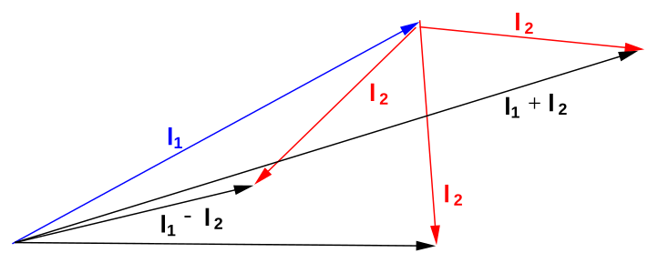

[← 20 Electrons in an Electromagnetic Field](20-electrons-in-an-electromagnetic-field.md) · [22 Time Independent Perturbation Theory →](22-time-independent-perturbation-theory.md)

---

<hr class="page" style="height:2px;border:0;background:currentColor;opacity:0.25">
<a id="p311" href="book.pdf#page=311" target="_blank" title="This page in the PDF"><sup>[p. 311]</sup></a>

# 21 Addition of Angular Momentum

Since total angular momentum is conserved in nature, we will find that eigenstates of the total angular momentum operator are usually energy eigenstates. The exceptions will be when we apply external Fields which break the rotational symmetry. We must therefore learn how to add different components of angular momentum together. One of our first uses of this will be to add the orbital angular momentum in Hydrogen to the spin angular momentum of the electron.

```math
\vec{J} = \vec{L} + \vec{S}
```

audio

Our results can be applied to the addition of all types of angular momentum.

This material is covered in **Gasiorowicz Chapter 15,** in **Cohen-Tannoudji et al. Chapter X** and very briefly in Griffiths Chapter 6.

# <a id="s-21-1-adding-the-spins-of-two-electrons"></a>21.1 Adding the Spins of Two Electrons

The coordinates of two particles commute with each other: $`[ p_{( 1 ) i} ,x_{( 2 ) j} ]`$ = 0. They are independent variables except that the overall wave functions for identical particles must satisfy the (anti)symmetrization requirements. This will also be the case for the spin coordinates.

```math
[ S_{( 1 ) i} ,S_{( 2 ) j} ] = 0
```

We define the **total spin operators**

```math
\vec{S} = \vec{S}_{( 1 )} + \vec{S}_{( 2 )} .
```

Its easy to **show** (see section 21.8.1) the total spin operators obey the same commutation relations as individual spin operators

```math
[ S_{i} ,S_{j} ] = i \hbar \epsilon_{ijk} S_{k} .
```

audio

This is a very important result since we derived everything about angular momentum from the commutators. The sum of angular momentum will be quantized in the same way as orbital angular momentum.

As with the combination of independent spatial coordinates, we can make **product states** to describe the spins of two particles. These products just mean, for example, the spin of particle 1 is up **and** the spin of particle 2 is down. There are four possible (product) spin states when we combine two spin $`\frac{1}{2}`$ particles. These **product states are eigenstates of total** $`S_{z}`$ but not necessarily of total $`S^{2}`$. The states and their $`S_{z}`$ eigenvalues are given below.

Product State Total $`S_{z}`$ eigenvalue

```math
\chi_{+}^{( 1 )} \chi_{+}^{( 2 )} \quad \hbar
```

```math
\chi_{+}^{( 1 )} \chi_{-}^{( 2 )} \quad 0
```

```math
\chi_{-}^{( 1 )} \chi_{+}^{( 2 )} \quad 0
```

```math
\chi_{-}^{( 1 )} \chi_{-}^{( 2 )} \quad - \hbar
```

<div align="right"><a href="book.pdf#page=311" target="_blank" title="This page in the PDF"><sup>[p. 311]</sup></a></div>
<hr class="page" style="height:2px;border:0;background:currentColor;opacity:0.25">
<a id="p312" href="book.pdf#page=312" target="_blank" title="This page in the PDF"><sup>[p. 312]</sup></a>

audio

Verify the quoted eigenvalues by calculation using the operator $`S_{z} = S_{( 1 ) z} + S_{( 2 ) z}`$.

We expect to be able to form **eigenstates of** $`S^{2}`$ from linear combinations of these four states. From pure counting of the number of states for each $`S_{z}`$ eigenvalue, we can guess that we can make one $`s`$ = 1 **multiplet** plus one $`s`$ = 0 multiplet. The $`s`$ = 1 multiplet has three component states, two of which are obvious from the list above. We can use the lowering operator to **derive** (see section 21.8.2) the other eigenstates of $`S^{2}`$.

```math
\chi_{s = 1 ,m = 1} = \chi_{+}^{( 1 )} \chi_{+}^{( 2 )}
```

```math
\chi_{s = 1 ,m = 0} = \frac{1}{\sqrt{2}} \left( \chi_{+}^{( 1 )} \chi_{-}^{( 2 )} + \chi_{-}^{( 1 )} \chi_{+}^{( 2 )} \right)
```

```math
\chi_{s = 1 ,m = - 1} = \chi_{-}^{( 1 )} \chi_{-}^{( 2 )}
```

```math
\chi_{s = 0 ,m = 0} = \frac{1}{\sqrt{2}} \left( \chi_{+}^{( 1 )} \chi_{-}^{( 2 )} - \chi_{-}^{( 1 )} \chi_{+}^{( 2 )} \right)
```

audio

As a necessary check, we operate on these states with $`S^{2}`$ and **verify** (see section 21.8.3) that they are indeed the correct eigenstates.

Note that by deciding to add the spins together, we could not change the nature of the electrons. They are still spin $`\frac{1}{2}`$and hence, these are all still eigenstates of $`S_{( 1 )}^{2}`$ and $`S_{( 2 )}^{2}`$ , however, (some of) the above states are not eigenstates of $`S_{( 1 ) z}`$ and $`S_{( 2 ) z}`$. This will prove to be a general feature of adding angular momenta. Our states of definite total angular momentum and z component of total angular momentum will still also be eigenstates of the individual angular momenta squared.

# <a id="s-21-2-total-angular-momentum-and-the-spin-orbit-interaction"></a>21.2 Total Angular Momentum and The Spin Orbit Interaction

The **spin-orbit interaction** (between magnetic dipoles) will play a role in the fine structure of Hydrogen as well as in other problems. It is a good example of the need for states of total angular momentum. The additional term in the Hamiltonian is

```math
H_{SO} = \frac{Ze^{2}}{2 m^{2} c^{2}} \frac{\vec{L} \cdot \vec{S}}{r^{3}}
```

If we define the **total angular momentum** $`\vec{J}`$ in the obvious way we can write $`\vec{L} \cdot \vec{S}`$ in terms of quantum numbers.

audio

```math
\vec{J} = \vec{L} + \vec{S}
```

```math
J^{2} = L^{2} + 2 \vec{L} \cdot \vec{S} + S_{2}^{2}
```

```math
\vec{L} \cdot \vec{S} = \frac{1}{2} ( J^{2} - L^{2} - S^{2} ) \to \frac{\hbar}{2} ( j ( j + 1 ) - \ell ( \ell + 1 ) - s ( s + 1 ) )
```

<div align="right"><a href="book.pdf#page=312" target="_blank" title="This page in the PDF"><sup>[p. 312]</sup></a></div>
<hr class="page" style="height:2px;border:0;background:currentColor;opacity:0.25">
<a id="p313" href="book.pdf#page=313" target="_blank" title="This page in the PDF"><sup>[p. 313]</sup></a>

Since our eigenstates of $`J^{2}`$ and $`J_{z}`$ are also eigenstates of $`L^{2}`$ and $`S^{2}`$ (but not $`L_{z}`$ or $`S_{z} )`$, these are ideal for computing the spin orbit interaction. In fact, they are going to be the true energy eigenstates, as rotational symmetry tells us they must.

<div align="center">

# <a id="s-21-3-adding-spin-2-1-to-integer-orbital-angular-momentum"></a>21.3 Adding Spin $`\frac{1}{2}`$ to Integer Orbital Angular Momentum

</div>

Our goal is to add orbital angular momentum with quantum number $`\ell`$ to spin $`\frac{1}{2}`$. We can show in several ways that, for $`\ell \neq 0`$, that the total angular momentum quantum number has **two possible** **values** $`j = \ell + \tfrac{1}{2}`$ **or** $`j = \ell - \tfrac{1}{2}`$**.** For $`\ell`$ = 0, only $`j = \tfrac{1}{2}`$ is allowed. First lets argue that this makes sense when we are adding two **vectors.** For example if we add a vector of length 3 to a vector of length 0.5, the resulting vector could take on a length between 2.5 and 3.5 For quantized angular momentum, we will only have the half integers allowed, rather than a continuous range. Also we know that the quantum numbers like $`\ell`$ are not exactly the length of the vector but are close. So these two values make sense physically.

We can also count states for each eigenvalue of $`J_{z}`$ as in the following examples.

\* See Example 21.7.1: Counting states for $`\ell`$ = 3 plus spin $`\frac{1}{2} . *`$<br>
\* See Example 21.7.2: Counting states for any $`\ell`$ plus spin $`\frac{1}{2} . *`$<br>
As in the last section, we could start with the highest $`J_{z}`$ state, $`Y_{\ell \ell} \chi_{+}`$, and apply the **lowering** **operator** to find the rest of the multiplet with $`j = \ell + \tfrac{1}{2}`$. This works well for some specific $`\ell`$ but is hard to generalize.

We can work the problem in general. We know that each eigenstate of $`J^{2}`$ and $`J_{z}`$ will be a **linear** **combination of the two product states** with the right $`m`$.

```math
\psi_{j ( m + \tfrac{1}{2} )} = \alpha Y_{\ell m} \chi_{+} + \beta Y_{\ell ( m + 1 )} \chi_{-}
```

audio

The coefficients $`\alpha`$ and $`\beta`$ must be **determined** (see section 21.8.4) by operating with $`J^{2}`$.

```math
\psi_{( \ell + \tfrac{1}{2} ) ( m + \tfrac{1}{2} )} = \sqrt{\ell + 2 \ell + 1 m + 1} Y_{\ell m} \chi_{+} + \sqrt{2 \ell - m \ell + 1} Y_{\ell ( m + 1 )} \chi_{-}
```

```math
\psi_{( \ell - \tfrac{1}{2} ) ( m + \tfrac{1}{2} )} = \sqrt{2 \ell - m \ell + 1} Y_{\ell m} \chi_{+} - \sqrt{\ell + 2 \ell + 1 m + 1} Y_{\ell ( m + 1 )} \chi_{-}
```

We have made a choice in how to write these equations: $`m`$ must be the same throughout. The negative $`m`$ states are symmetric with the positive ones. These equations will be applied when we calculate the **fine structure of Hydrogen** and when we study the **anomalous Zeeman effect.**

# <a id="s-21-4-spectroscopic-notation"></a>21.4 Spectroscopic Notation

A common way to name states in atomic physics is to use **spectroscopic notation**. It is essentially a standard way to write down the angular momementum quantum numbers of a state. The **general** **form** is $`N^{2 s + 1} L_{j}`$, where $`N`$ is the principal quantum number and will often be omitted, $`s`$ is the total spin quantum number ((2$`s`$ + 1) is the number of spin states), $`L`$ refers to the orbital angular<span class="page" style="float:left;width:100%;margin:0.4em 0 0.6em"><span style="display:block;text-align:right"><a href="book.pdf#page=313" target="_blank" title="This page in the PDF"><sup>[p. 313]</sup></a></span><span style="display:block;height:2px;background:currentColor;opacity:0.25"></span><a id="p314" href="book.pdf#page=314" target="_blank" title="This page in the PDF"><sup>[p. 314]</sup></a></span> momentum quantum number $`\ell`$ but is written as $`S,P,D,F,\dots`$ for $`\ell`$ = 0$`, 1 , 2 , 3 ,\dots`$, and $`j`$ is the total angular momentum quantum number.

A quick example is the single electron states, as we find in Hydrogen. These are:

```math
3^{2} 1^{2} S_{\tfrac{1}{2}} D \tfrac{3}{2} 4^{2} S 2^{2} S_{\tfrac{1}{2}} \tfrac{1}{2} 4^{2} P 2^{2} P_{\tfrac{3}{{}^{2} 2}} \tfrac{3}{2} 4 P 2^{2} P_{1 2} 1_{2} 4^{2} D \tfrac{5}{2} 3^{2} S_{\tfrac{1}{2^{2}}} 4 D 3^{2} P_{3 2} \tfrac{3}{2} 4^{2} F 3^{2} P_{1 2} 7_{2} 4^{2} F 3^{2} D_{\tfrac{5}{2}} \tfrac{5}{2} \dots
```

All of these have the pre-superscript 2 because they are all spin one-half. There are two $`j`$ values for each $`\ell`$.

For atoms with more than one electron, the total spin state has more possibilities and perhaps several ways to make a state with the same quantum numbers.

# <a id="s-21-5-general-addition-of-angular-momentum-the-clebsch-gordan-series"></a>21.5 General Addition of Angular Momentum: The Clebsch-Gordan Se- ries

We have already worked several examples of addition of angular momentum. Lets work one more.

\* See Example 21.7.3: Adding $`\ell`$ = 4 to $`\ell`$ = 2.\*

The result, in agreement with our classical vector model, is multiplets with $`j`$ = 2$`, 3 , 4 , 5 , 6 .`$

The vector model qualitatively explains the limits.

audio



_Figure 77 (p. 314)_

In general, $`j`$ takes on **every value between the maximum an minimum in integer steps.**

```math
| \ell_{1} - \ell_{2} |\leq j \leq \ell_{1} + \ell_{2}
```

The maximum and minimum lengths of the sum of the vectors makes sense physically. Quantum Mechanics tells up that the result is quantized and that, because of the uncertainty principle, the two vectors can never quite achieve the maximum allowed classically. Just like the z component of one vector can never be as great as the full vector length in QM.

<div align="right"><a href="book.pdf#page=314" target="_blank" title="This page in the PDF"><sup>[p. 314]</sup></a></div>
<hr class="page" style="height:2px;border:0;background:currentColor;opacity:0.25">
<a id="p315" href="book.pdf#page=315" target="_blank" title="This page in the PDF"><sup>[p. 315]</sup></a>

We can **check** (see section 21.8.5) that the number of states agrees with the number of product states.

We have been expanding the states of definite total angular momentum $`j`$ in terms of the product states for several cases. The general expansion is called the **Clebsch-Gordan series:**

```math
\psi_{jm} = \sum_{m_{1} m_{2}} \langle \ell_{1} m_{1} \ell_{2} m_{2} | jm\ell_{1} \ell_{2} \rangle Y_{\ell_{1} m_{1}} Y_{\ell_{2} m_{2}}
```

or in terms of the ket vectors

```math
| jm\ell_{1} \ell_{2} \rangle = \sum_{m_{1} m_{2}} \langle \ell_{1} m_{1} \ell_{2} m_{2} | jm\ell_{1} \ell_{2} \rangle | \ell_{1} m_{1} \ell_{2} m_{2} \rangle
```

The Clebsch-Gordan coefficients are tabulated. We have computed some of them here by using the lowering operator and some by making eigenstates of $`J^{2}`$.

# <a id="s-21-6-interchange-symmetry-for-states-with-identical-particles"></a>21.6 Interchange Symmetry for States with Identical Particles

If we are combining the angular momentum from two identical particles, like two electrons in an atom, we will be interested in the symmetry under interchange of the angular momentum state. Lets use the combination of two spin $`\frac{1}{2}`$ particles as an example. We know that we get total spin states of $`s`$ = 1 and $`s`$ = 0. The $`s`$ = 1 state is called a **triplet** because there are three states with different $`m`$ values. The $`s`$ = 0 state is called a **singlet.** The triplet state is symmetric under interchange. The **highest total angular momentum state,** $`s = s_{1} + s_{2}`$, will always be **symmetric under** **interchange.** We can see this by looking at the highest $`m`$ state, $`m = s`$. To get the maximum $`m`$, both spins to have the maximum $`z`$ component. So the product state has just one term and it is symmetric under interchange, in this case,

```math
\chi_{1 1} = \chi_{+}^{( 1 )} \chi_{+}^{( 2 )} .
```

When we lower this state with the (symmetric) lowering operator $`S_{-} = S_{( 1 ) -} + S_{( 2 ) -}`$, the result remains symmetric under interchange. To make the **next highest state,** with two terms, we must choose a state orthogonal to the symmetric state and this will always be **antisymmetric.**

In fact, for identical particles, the **symmetry of the angular momentum wave function will** **alternate,** beginning with a symmetric state for the maximum total angular momentum. For example, if we add two spin 2 states together, the resulting states are: $`4_{S} , 3_{A} , 2_{S} , 1_{A}`$ and $`0_{S}`$. In the language of **group theory,** when we take the **direct product of two representations of** **the the SU(2) group** we get:

```math
5 \otimes 5 = 9_{S} \oplus 7_{A} \oplus 5_{S} \oplus 3_{A} \oplus 1_{S}
```

where the numbers are the number of states in the multiplet.

\* See Example 21.7.4: Two electrons in a P state.\*<br>
\* See Example 21.7.5: The parity of the pion from $`\pi d \to nn . *`$

<div align="right"><a href="book.pdf#page=315" target="_blank" title="This page in the PDF"><sup>[p. 315]</sup></a></div>
<hr class="page" style="height:2px;border:0;background:currentColor;opacity:0.25">
<a id="p316" href="book.pdf#page=316" target="_blank" title="This page in the PDF"><sup>[p. 316]</sup></a>

# <a id="s-21-7-examples"></a>21.7 Examples

## <a id="s-21-7-1-counting-states-for-ell-3-plus-spin-2-1"></a>21.7.1 Counting states for $`\ell`$ = 3 Plus spin $`\frac{1}{2}`$

For $`\ell`$ = 3 there are 2$`\ell`$ + 1 = 7 different eigenstates of $`L_{z}`$. There are two different eigenstates of $`S_{z}`$ for spin $`\frac{1}{2}`$. We can have any combination of these states, implying $`2 \times 7`$ = 14 possible product states like $`Y_{3 1} \chi_{+}`$.

We will argue based on adding vectors... that there will be two total angular momentum states that can be made up from the 14 product states, $`j = \ell \pm \tfrac{1}{2}`$, in this case $`j = \tfrac{5}{2}`$ and $`j = \tfrac{7}{2}`$. Each of these has 2$`j`$ + 1 states, that is 6 and 8 states respectively. Since 6 + 8 = 14 this gives us the right number of states.

## <a id="s-21-7-2-counting-states-for-arbitrary-ell-plus-spin-2-1"></a>21.7.2 Counting states for Arbitrary $`\ell`$ Plus spin $`\frac{1}{2}`$

For angular momentum quantum number $`\ell`$, there are (2$`\ell`$ + 1) different m states, while for spin we have 2 states $`\chi_{\pm}`$. Hence the composite system has 2(2$`\ell`$ + 1) states total.

Max $`j_{z} = \ell + \tfrac{1}{2}`$ so we have a state with $`j = \ell + \tfrac{1}{2}`$. This makes up (2$`j`$ + 1) = (2$`\ell`$ + 2) states, leaving

```math
( 4 \ell + 2 ) - ( 2 \ell + 2 ) = 2 \ell = \left( 2 \left( \ell - \frac{1}{2} \right) + 1 \right)
```

Thus we have a state with $`j = \ell - \tfrac{1}{2}`$ and that’s all.

## <a id="s-21-7-3-adding-ell-4-to-ell-2"></a>21.7.3 Adding $`\ell`$ = 4 to $`\ell`$ = 2

As an example, we count the states for each value of total m (z component quantum number) if we add $`\ell_{1}`$ = 4 to $`\ell_{2}`$ = 2.

audio

```math
\frac{\frac{\frac{\frac{\frac{\frac{\text{ Total } 6 m}{4} 5}{2} 3}{0} 1}{- 2} - 1}{- 4} - 3}{- 6} - 5 \quad ( - 3 , - 2 ) ( - 4 , - 1 ) \frac{( - 1 , - 2 ) ( - 2 , - 1 ) ( - 3 , 0 ) ( - 4 , 1 ) \frac{( 1 , - 2 ) ( 0 , - 1 ) ( - 1 , 0 ) ( - 2 , 1 ) ( - 3 , 2 ) \frac{( - 1 , 2 ) ( 0 , 1 ) ( 1 , 0 ) ( 2 , - 1 ) ( 3 , - 2 ) \frac{( 1 , 2 ) ( 2 , 1 ) ( 3 , 0 ) ( 4 , - 1 ) \frac{( 3 , 2 ) ( 4 , 1 ) \frac{( ( 4 , 2 ) m_{1} ,m_{2} )}{( 2 , 2 ) ( 3 , 1 ) ( 4 , 0 )}}{( 0 , 2 ) ( 1 , 1 ) ( 2 , 0 ) ( 3 , - 1 ) ( 4 , - 2 )}}{( - 2 , 2 ) ( - 1 , 1 ) ( 0 , 0 ) ( 1 , - 1 ) ( 2 , - 2 )}}{( 0 , - 2 ) ( - 1 , - 1 ) ( - 2 , 0 ) ( - 3 , 1 ) ( - 4 , 2 )}}{( - 2 , - 2 ) ( - 3 , - 1 ) ( - 4 , 0 )}}{( - 4 , - 2 )}
```

<div align="right"><a href="book.pdf#page=316" target="_blank" title="This page in the PDF"><sup>[p. 316]</sup></a></div>
<hr class="page" style="height:2px;border:0;background:currentColor;opacity:0.25">
<a id="p317" href="book.pdf#page=317" target="_blank" title="This page in the PDF"><sup>[p. 317]</sup></a>

Since the highest m value is 6, we expect to have a $`j`$ = 6 state which uses up one state for each m value from -6 to +6. Now the highest m value left is 5, so a $`j`$ = 5 states uses up a state at each m value between -5 and +5. Similarly we find a $`j`$ = 4, $`j`$ = 3, and $`j`$ = 2 state. This uses up all the states, and uses up the states at each value of m. So we find in this case,

```math
| \ell_{1} - \ell_{2} |\leq j \leq | \ell_{1} + \ell_{2} |
```

and that $`j`$ takes on every integer value between the limits. This makes sense in the vector model.

## <a id="s-21-7-4-two-electrons-in-an-atomic-p-state"></a>21.7.4 Two electrons in an atomic P state

If we have two atomic electrons in a P state with no external fields applied, **states of definite** **total angular momentum will be the energy eigenstates**. We will learn later that closed shells in atoms (or nuclei) have a total angular momentum of zero, allowing us to treat only the valence electrons. Examples of atoms like this would be Carbon, Silicon, and Germanium.

Our two electrons each have $`ell`$ = 1 (P state) and $`s = \tfrac{1}{2}`$ (electrons). We need to add four angluar momenta together to get the total.

```math
\vec{J} = \vec{L}_{1} + \vec{L}_{2} + \vec{S}_{1} + \vec{S}_{2}
```

We will find it useful to do this addition in two steps. For low Z atoms, it is most useful to add $`\vec{L}_{1} + \vec{L}_{2} = \vec{L}`$ and $`\vec{S}_{1} + \vec{S}_{2} = \vec{S}`$ then to add these results $`\vec{L} + \vec{S} = \vec{J}`$.

Since the electrons are identical particles and they are in the same radial state, the angular momentum part of the wavefunction must be antisymmetric under interchange. This will limit the allowed states. So let’s do the spinor arithmetic.

```math
| \ell_{1} - \ell_{2} |\leq \quad \ell \leq \ell_{1} + \ell_{2}
```

```math
\ell = 0 , 1 , 2
```

```math
s = 0 , 1
```

These states have a definite symmetry under interchange. Before going on to make the total angular momentum states, lets note the symmetry of each of the above states. The maximum allowed state will always need to be symmetric in order to achieve the maximum. The symmetry will alternate as we go down in the quantum number. So, for example, the $`\ell`$ = 2 and $`\ell`$ = 0 states are symmetric, while the $`\ell`$ = 1 state is antisymmetric. The $`s`$ = 1 state is symmetric and the $`s`$ = 0 state is antisymmetric. The overall symmetry of a state will be a product of the these two symmetries (since when we add $`\ell`$ and $`s`$ to give $`j`$ we are not adding identical things anymore). The overall state must be antisymmetic so we can use:

```math
\ell = 1 s = 1 j = 0 , 1 , 2^{3} P_{0} , {}^{3} P_{1} , {}^{3} P_{2}
```

```math
\ell = 2 s = 0 j = 2^{1} D_{2}
```

```math
\ell = 0 s = 0 j = 0^{1} S_{0}
```

Each atomic state will have the angular momentum quantum numbers

```math
\ell_{1} ,\ell_{2} ,s_{1} ,s_{2} ,\ell ,s,j,m.
```

<div align="right"><a href="book.pdf#page=317" target="_blank" title="This page in the PDF"><sup>[p. 317]</sup></a></div>
<hr class="page" style="height:2px;border:0;background:currentColor;opacity:0.25">
<a id="p318" href="book.pdf#page=318" target="_blank" title="This page in the PDF"><sup>[p. 318]</sup></a>

Normally we will not bother to include that the spins are one half since that’s always true for electrons. We will (and must) keep track of the intermediate $`\ell`$ and $`s`$ quantum numbers. As can be seen above, we need them to identify the states.

In the atomic physics section, we will even deal with more than two electrons outside a closed shell.

## <a id="s-21-7-5-the-parity-of-the-pion-from-pi-d-to-nn"></a>21.7.5 The parity of the pion from $`\pi d \to nn`$.

audio

We can determine the internal parity of the pion by studying **pion capture by a deuteron**, $`\pi + d \to n + n.`$ The pion is known to have spin 0, the deuteron spin 1, and the neutron spin $`\frac{1}{2}`$. The internal parity of the deuteron is +1. The pion is captured by the deuteron from a 1S states, implying $`\ell`$ = 0 in the initial state. So the total angular momentum quantum number of the initial state is $`j`$ = 1.

So the parity of the initial state is

```math
( - 1 )^{\ell} P_{\pi} P_{d} = ( - 1 )^{0} P_{\pi} P_{d} = P_{\pi}
```

The parity of the final state is

```math
P_{n} P_{n} ( - 1 )^{\ell} = ( - 1 )^{\ell}
```

Therefore,

```math
P_{\pi} = ( - 1 )^{\ell} .
```

Because the neutrons are identical fermions, the allowed states of two neutrons are<sup>1</sup>$`S_{0}`$,<sup>3</sup>$`P_{0 , 1 , 2}`$,<sup>1</sup>$`D_{2}`$,

<sup>3</sup>$`F_{2 , 3 , 4} \dots`$ The only state with $`j`$ = 1 is the<sup>3</sup>$`P_{1}`$ state, so $`\ell`$ = 1

```math
\Rightarrow P_{\pi} = - 1 .
```

# <a id="s-21-8-derivations-and-computations"></a>21.8 Derivations and Computations

## <a id="s-21-8-1-commutators-of-total-spin-operators"></a>21.8.1 Commutators of Total Spin Operators

```math
\vec{S} = \vec{S}_{( 1 )} + \vec{S}_{( 2 )}
```

```math
[ S_{i} ,S_{j} ] = [ S_{i}^{( 1 )} + S_{i}^{( 2 )} ,S_{j}^{( 1 )} + S_{j}^{( 2 )} ]
```

```math
= [ S_{i}^{( 1 )} ,S_{j}^{( 1 )} ] + [ S_{i}^{( 1 )} ,S_{j}^{( 2 )} ] + [ S_{i}^{( 2 )} ,S_{j}^{( 1 )} ] + [ S_{i}^{( 2 )} ,S_{j}^{( 2 )} ]
```

```math
= i \hbar \epsilon_{ijk} S_{k}^{( 1 )} + 0 + 0 + i \hbar \epsilon_{ijk} S_{k}^{( 2 )} = i \hbar \epsilon_{ijk} S_{k}
```

Q.E.D.

<div align="right"><a href="book.pdf#page=318" target="_blank" title="This page in the PDF"><sup>[p. 318]</sup></a></div>
<hr class="page" style="height:2px;border:0;background:currentColor;opacity:0.25">
<a id="p319" href="book.pdf#page=319" target="_blank" title="This page in the PDF"><sup>[p. 319]</sup></a>

## <a id="s-21-8-2-using-the-lowering-operator-to-find-total-spin-states"></a>21.8.2 Using the Lowering Operator to Find Total Spin States

The total spin lowering operator is

```math
S_{-} = S_{-}^{( 1 )} + S_{-}^{( 2 )} .
```

First lets remind ourselves of what the individual lowering operators do.

```math
S_{-}^{( 1 )} \chi_{+}^{( 1 )} = \hbar \sqrt{\frac{1}{2} \left( \frac{3}{2} \right) - \left( \frac{1}{2} \right) \left( \frac{- 1}{2} \right)} \chi_{-}^{( 1 )} = \hbar \chi_{-}^{( 1 )}
```

Now we want to identify $`\chi_{1 1} = \chi_{+}^{( 1 )} \chi_{+}^{( 2 )}`$ . Lets operate on this equation with $`S_{-}`$. First the RHS gives

```math
S_{-} \chi_{+}^{( 1 )} \chi_{+}^{( 2 )} = \left( S_{-}^{( 1 )} \chi_{+}^{( 1 )} \right) \chi_{+}^{( 2 )} + \chi_{+}^{( 1 )} \left( S_{-}^{( 2 )} \chi_{+}^{( 2 )} \right) = \hbar \left( \chi_{-}^{( 1 )} \chi_{+}^{( 2 )} + \chi_{+}^{( 1 )} \chi_{-}^{( 2 )} \right) .
```

Operating on the LHS gives

```math
S_{-} \chi_{1 1} = \hbar \sqrt{( 1 ) ( 2 ) - ( 1 ) ( 0 )} \chi_{1 0} = \sqrt{2} \hbar \chi_{1 0} .
```

So equating the two we have

```math
\sqrt{2} \hbar \chi_{1 0} = \hbar \left( \chi_{-}^{( 1 )} \chi_{+}^{( 2 )} + \chi_{+}^{( 1 )} \chi_{-}^{( 2 )} \right) .
```

```math
\chi_{1 0} = \frac{1}{\sqrt{2}} \left( \chi_{-}^{( 1 )} \chi_{+}^{( 2 )} + \chi_{+}^{( 1 )} \chi_{-}^{( 2 )} \right) .
```

Now we can lower this state. Lowering the LHS, we get

```math
S_{-} \chi_{1 0} = \hbar \sqrt{( 1 ) ( 2 ) - ( 0 ) ( - 1 )} \chi_{1 ( - 1 )} = \sqrt{2} \hbar \chi_{1 , - 1} .
```

Lowering the RHS, gives

```math
S_{-} \frac{1}{\sqrt{2}} \left( \chi_{+}^{( 1 )} \chi_{-}^{( 2 )} + \chi_{-}^{( 1 )} \chi_{+}^{( 2 )} \right) = \hbar \frac{1}{\sqrt{2}} \left( \chi_{-}^{( 1 )} \chi_{-}^{( 2 )} + \chi_{-}^{( 1 )} \chi_{-}^{( 2 )} \right) = \sqrt{2} \hbar \chi_{-}^{( 1 )} \chi_{-}^{( 2 )}
```

```math
\Rightarrow \quad \chi_{1 , - 1} = \chi_{-}^{( 1 )} \chi_{-}^{( 2 )}
```

Therefore we have found 3 s=1 states that work together. They are all symmetric under interchange of the two particles.

There is one state left over which is orthogonal to the three states we identified. Orthogonal state:

```math
\chi_{0 0} = \frac{1}{\sqrt{2}} \left( \chi_{+}^{( 1 )} \chi_{-}^{( 2 )} - \chi_{-}^{( 1 )} \chi_{+}^{( 2 )} \right)
```

We have guessed that this is an $`s`$ = 0 state since there is only one state and it has m=0. We could verify this by using the $`S^{2}`$ operator.

<div align="right"><a href="book.pdf#page=319" target="_blank" title="This page in the PDF"><sup>[p. 319]</sup></a></div>
<hr class="page" style="height:2px;border:0;background:currentColor;opacity:0.25">
<a id="p320" href="book.pdf#page=320" target="_blank" title="This page in the PDF"><sup>[p. 320]</sup></a>

## <a id="s-21-8-3-applying-the-s-2-operator-to-chi-1-m-and-chi-0-0"></a>21.8.3 Applying the $`S^{2}`$ Operator to $`\chi_{1 m}`$ and $`\chi_{0 0}`$.

We wish to verify that the states we have deduced are really eigenstates of the $`S^{2}`$ operator. We will really compute this in the most brute force.

```math
S^{2} = \left( \vec{S}_{1} + \vec{S}_{2} \right)^{2} = S_{1}^{2} + S_{2}^{2} + 2 \vec{S}_{1} \cdot \vec{S}_{2}
```

```math
S^{2} \chi_{+}^{( 1 )} \chi_{+}^{( 2 )} = s_{1} ( s_{1} + 1 ) \hbar^{2} \chi_{+}^{( 1 )} \chi_{+}^{( 2 )} + s_{2} ( s_{2} + 1 ) \hbar^{2} \chi_{+}^{( 1 )} \chi_{+}^{( 2 )} + 2 \vec{S}_{1} \chi_{+}^{( 1 )} \cdot \vec{S}_{2} \chi_{+}^{( 2 )}
```

```math
= \frac{3}{2} \hbar^{2} \chi_{+}^{( 1 )} \chi_{+}^{( 2 )} + 2 \left( S_{x}^{( 1 )} S_{x}^{( 2 )} + S_{y}^{( 1 )} S_{y}^{( 2 )} + S_{z}^{( 1 )} S_{z}^{( 2 )} \right) \chi_{+}^{( 1 )} \chi_{+}^{( 2 )}
```

```math
S_{x} \chi_{+} = \frac{\hbar}{2} \begin{pmatrix} 0 & 1 \\ 1 & 0 \end{pmatrix} \begin{pmatrix} 1 \\ 0 \end{pmatrix} = \frac{\hbar}{2} \begin{pmatrix} 0 \\ 1 \end{pmatrix} = \frac{\hbar}{2} \chi_{-}
```

```math
S_{y} \chi_{+} = \frac{\hbar}{2} \begin{pmatrix} 0 & - i \\ i & 0 \end{pmatrix} \begin{pmatrix} 1 \\ 0 \end{pmatrix} = \frac{\hbar}{2} \begin{pmatrix} 0 \\ i \end{pmatrix} = i \frac{\hbar}{2} \chi_{-}
```

```math
S_{x} \chi_{-} = \frac{\hbar}{2} \begin{pmatrix} 0 & 1 \\ 1 & 0 \end{pmatrix} \begin{pmatrix} 0 \\ 1 \end{pmatrix} = \frac{\hbar}{2} \begin{pmatrix} 1 \\ 0 \end{pmatrix} = \frac{\hbar}{2} \chi_{+}
```

```math
S_{y} \chi_{-} = \frac{\hbar}{2} \begin{pmatrix} 0 & - i \\ i & 0 \end{pmatrix} \begin{pmatrix} 0 \\ 1 \end{pmatrix} = \frac{\hbar}{2} \begin{pmatrix} - i \\ 0 \end{pmatrix} = - i \frac{\hbar}{2} \chi_{+}
```

```math
S^{2} \chi_{+}^{( 1 )} \chi_{+}^{( 2 )} = \frac{3}{2} \hbar^{2} \chi_{+}^{( 1 )} \chi_{+}^{( 2 )} + \frac{\hbar^{2}}{2} \left[ \begin{pmatrix} 0 \\ 1 \end{pmatrix}_{1} \begin{pmatrix} 0 \\ 1 \end{pmatrix}_{2} + \begin{pmatrix} 0 \\ i \end{pmatrix}_{1} \begin{pmatrix} 0 \\ i \end{pmatrix}_{2} + \begin{pmatrix} 1 \\ 0 \end{pmatrix}_{1} \begin{pmatrix} 1 \\ 0 \end{pmatrix}_{2} \right]
```

```math
= \frac{3}{2} \hbar^{2} \chi_{+}^{( 1 )} \chi_{+}^{( 2 )} + \frac{\hbar^{2}}{2} \left[ \begin{pmatrix} 0 \\ 1 \end{pmatrix}_{1} \begin{pmatrix} 0 \\ 1 \end{pmatrix}_{2} - \begin{pmatrix} 0 \\ 1 \end{pmatrix}_{1} \begin{pmatrix} 0 \\ 1 \end{pmatrix}_{2} + \begin{pmatrix} 1 \\ 0 \end{pmatrix}_{1} \begin{pmatrix} 1 \\ 0 \end{pmatrix}_{2} \right]
```

```math
= \frac{3}{2} \hbar^{2} \chi_{+}^{( 1 )} \chi_{+}^{( 2 )} + \frac{\hbar^{2}}{2} \chi_{+}^{( 1 )} \chi_{+}^{( 2 )} = 2 \hbar^{2} \chi_{+}^{( 1 )} \chi_{+}^{( 2 )}
```

Note that $`s ( s`$ + 1) = 2, so that the 2$`\hbar`$ is what we expected to get. This confirms that we have an s=1 state.

Now lets do the $`\chi_{0 0}`$ state.

```math
S^{2} \chi_{0 0} = \left( S_{1}^{2} + S_{2}^{2} + 2 \vec{S}_{1} \cdot \vec{S}_{2} \right) \chi_{0 0}
```

```math
= \left( S_{1}^{2} + S_{2}^{2} + 2 \left( S_{x}^{( 1 )} S_{x}^{( 2 )} + S_{y}^{( 1 )} S_{y}^{( 2 )} + S_{z}^{( 1 )} S_{z}^{( 2 )} \right) \right) \chi_{0 0}
```

```math
= \left( S_{1}^{2} + S_{2}^{2} + 2 S_{z}^{( 1 )} S_{z}^{( 2 )} + 2 \left( S_{x}^{( 1 )} S_{x}^{( 2 )} + S_{y}^{( 1 )} S_{y}^{( 2 )} \right) \right) \chi_{0 0}
```

```math
= \left( \frac{3}{4} + \frac{3}{4} - 2 \frac{1}{4} \right) \hbar^{2} \chi_{0 0} + 2 \left( S_{x}^{( 1 )} S_{x}^{( 2 )} + S_{y}^{( 1 )} S_{y}^{( 2 )} \right) \chi_{0 0}
```

```math
= \hbar^{2} \chi_{0 0} + 2 \left( S_{x}^{( 1 )} S_{x}^{( 2 )} + S_{y}^{( 1 )} S_{y}^{( 2 )} \right) \frac{1}{\sqrt{2}} \left( \chi_{+}^{( 1 )} \chi_{-}^{( 2 )} - \chi_{-}^{( 1 )} \chi_{+}^{( 2 )} \right)
```

```math
= \hbar^{2} \chi_{0 0} + \frac{\hbar^{2}}{2} \frac{1}{\sqrt{2}} \left( \chi_{-}^{( 1 )} \chi_{+}^{( 2 )} - \chi_{+}^{( 1 )} \chi_{-}^{( 2 )} + i ( - i ) \chi_{-}^{( 1 )} \chi_{+}^{( 2 )} - ( - i ) i\chi_{+}^{( 1 )} \chi_{-}^{( 2 )} \right)
```

<div align="right"><a href="book.pdf#page=320" target="_blank" title="This page in the PDF"><sup>[p. 320]</sup></a></div>
<hr class="page" style="height:2px;border:0;background:currentColor;opacity:0.25">
<a id="p321" href="book.pdf#page=321" target="_blank" title="This page in the PDF"><sup>[p. 321]</sup></a>

```math
= \hbar^{2} \left( \chi_{0 0} - \frac{1}{2 \sqrt{2}} \left( \chi_{+}^{( 1 )} \chi_{-}^{( 2 )} - \chi_{-}^{( 1 )} \chi_{+}^{( 2 )} + \chi_{+}^{( 1 )} \chi_{-}^{( 2 )} - \chi_{-}^{( 1 )} \chi_{+}^{( 2 )} \right) \right)
```

```math
= \hbar^{2} ( 1 - 1 ) \chi_{0 0} = 0 \hbar^{2} \chi_{0 0}
```

## <a id="s-21-8-4-adding-any-ell-plus-spin-2-1"></a>21.8.4 Adding any $`\ell`$ plus spin $`\frac{1}{2}`$.

We wish to write the states of total angular momentum $`j`$ in terms of the product states $`Y_{\ell m} \chi_{\pm}`$. We will do this by operating with the $`J^{2}`$ operator and setting the coefficients so that we have eigenstates.

```math
J^{2} \psi_{jm_{j}} = j ( j + 1 ) \hbar^{2} \psi_{jm_{j}}
```

We choose to write the the quantum number $`m_{j}`$ as $`m + \tfrac{1}{2}`$. This is really just the defintion of the dummy variable $`m`$. (Other choices would have been possible.)

The z component of the total angular momentum is just the sum of the z components from the orbital and the spin.

```math
m_{j} = m_{l} + m_{s}
```

There are only two product states which have the right $`m_{j} = m + \tfrac{1}{2}`$. If the spin is up we need $`Y_{\ell m}`$ and if the spin is down, $`Y_{\ell ( m + 1 )}`$.

```math
\psi_{j ( m + \tfrac{1}{2} )} = \alpha Y_{\ell m} \chi_{+} + \beta Y_{\ell ( m + 1 )} \chi_{-}
```

audio

We will find the coefficients $`\alpha`$ and $`\beta`$ so that $`\psi`$ will be an eigenstate of

```math
J^{2} = ( \vec{L} + \vec{S} )^{2} = L^{2} + S^{2} + 2 L_{z} S_{z} + L_{+} S_{-} + L_{-} S_{+} .
```

So operate on the right hand side with $`J^{2}`$.

```math
\begin{aligned} J^{2} \psi_{j,m + \tfrac{1}{2}} &= \alpha \quad \hbar^{2} \left[ \ell ( \ell + 1 ) Y_{lm} \chi_{+} + \frac{3}{4} Y_{lm} \chi_{+} + 2 m \frac{1}{2} Y_{lm} \chi_{+} \right. \\ & \quad \left. + \sqrt{\ell ( \ell + 1 ) - m ( m + 1 )} \sqrt{1} Y_{l ( m + 1 )} \chi_{-} \right] \\ & \quad + \quad \beta \hbar^{2} \left[ \ell ( \ell + 1 ) Y_{\ell ,m + 1} \chi_{-} + \frac{3}{4} Y_{\ell ,m + 1} \chi_{-} + 2 ( m + 1 ) \left( \frac{- 1}{2} \right) Y_{\ell ,m + 1} \chi_{-} \right. \\ & \quad \left. + \sqrt{\ell ( \ell + 1 ) - ( m + 1 ) m} \sqrt{( 1 )} Y_{lm} \chi_{+} \right] \end{aligned}
```

And operate on the left hand side.

```math
J^{2} \psi_{j,m + \tfrac{1}{2}} = j ( j + 1 ) \hbar^{2} \psi_{j,m + \tfrac{1}{2}} = j ( j + 1 ) \hbar^{2} \left( \alpha Y_{lm} \chi_{+} + \beta Y_{\ell , ( m + 1 )} \chi_{-} \right)
```

Since the two terms are orthogonal, we can equate the coefficients for each term, giving us two equations. The $`Y_{\ell m} \chi_{+}`$ term gives

```math
\alpha j ( j + 1 ) = \alpha \left( \ell ( \ell + 1 ) + 3 + m \right) + \beta \sqrt{\ell ( \ell + 1 ) - m ( m + 1 )} .
```

<div align="right"><a href="book.pdf#page=321" target="_blank" title="This page in the PDF"><sup>[p. 321]</sup></a></div>
<hr class="page" style="height:2px;border:0;background:currentColor;opacity:0.25">
<a id="p322" href="book.pdf#page=322" target="_blank" title="This page in the PDF"><sup>[p. 322]</sup></a>

The $`Y_{\ell ( m + 1 )} \chi_{-}`$ term gives

```math
\beta j ( j + 1 ) = \beta \left( \ell ( \ell + 1 ) + \frac{3}{4} - ( m + 1 ) \right) + \alpha \sqrt{\ell ( \ell + 1 ) - m ( m + 1 ) .}
```

Collecting $`\alpha`$ terms on the LHS and $`\beta`$ terms on the RHS, we get two equations.

```math
\left( j ( j + 1 ) - \ell ( \ell + 1 ) - \frac{3}{4} - m \right) \alpha = \sqrt{( \ell - m ) ( \ell + m + 1 )} \beta
```

```math
\sqrt{( \ell - m ) ( \ell + m + 1 )} \alpha = \left[ j ( j + 1 ) - \ell ( \ell + 1 ) - \frac{3}{4} + ( m + 1 ) \right] \beta
```

Now we just cross multiply so we have one equation with a common factor of $`\alpha \beta`$.

```math
( \ell - m ) ( \ell + m + 1 ) = \left[ j ( j + 1 ) - \ell ( \ell + 1 ) - \frac{3}{4} - m \right] \left[ j ( j + 1 ) - \ell ( \ell + 1 ) - \frac{3}{4} + ( m + 1 ) \right]
```

While this equation looks like a mess to solve, if we notice the similarity between the LHS and RHS, we can solve it if

```math
\ell = j ( j + 1 ) - \ell ( \ell + 1 ) - \frac{3}{4} .
```

If we look a little more carefully at the LHS, we can see that another solution (which just interchanges the two terms in parentheses) is to replace $`\ell`$ by $`- \ell - 1 .`$

```math
- \ell - 1 = j ( j + 1 ) - \ell ( \ell + 1 ) - \frac{3}{4} .
```

These are now simple to solve

```math
j ( j + 1 ) = \ell ( \ell + 1 ) + \ell + \frac{3}{4} \Rightarrow \quad j = \ell + \frac{1}{2}
```

```math
j ( j + 1 ) = \ell ( \ell + 1 ) - \ell - 1 + \frac{3}{4} \Rightarrow \quad j = \ell - \frac{1}{2}
```

So these are (again) the two possible values for $`j`$. We now need to go ahead and find $`\alpha`$ and $`\beta`$.

Plugging $`j = \ell + \tfrac{1}{2}`$ into our first equation,

```math
( \ell - m ) \alpha = \sqrt{( \ell - m ) ( \ell + m + 1 )} \beta
```

we get the ratio between $`\beta`$ and $`\alpha`$. We will normalize the wave function by setting $`\alpha^{2} + \beta^{2}`$ = 1. So lets get the squares.

```math
\beta^{2} = \frac{( \ell - m )^{2}}{( \ell - m ) ( \ell + m + 1 )} \alpha^{2} = \frac{( \ell - m )}{( \ell + m + 1 )} \alpha^{2}
```

```math
\alpha^{2} + \beta^{2} = 1 \Rightarrow \quad \frac{\ell + m + 1 + \ell - m}{\ell + m + 1} \alpha^{2} = 1
```

```math
\alpha = \sqrt{\ell + 2 \ell + 1 m + 1}
```

```math
\beta = \sqrt{\ell + \ell - m m + 1} \sqrt{\ell + 2 \ell + 1 m + 1} = \sqrt{2 \ell - m \ell + 1}
```

<div align="right"><a href="book.pdf#page=322" target="_blank" title="This page in the PDF"><sup>[p. 322]</sup></a></div>
<hr class="page" style="height:2px;border:0;background:currentColor;opacity:0.25">
<a id="p323" href="book.pdf#page=323" target="_blank" title="This page in the PDF"><sup>[p. 323]</sup></a>

So we have completed the calculation of the coefficients. We will make use of these in the hydrogen atom, particularly for the anomalous Zeeman effect.

Writing this in the **notation of matrix elements or Clebsch-Gordan coefficients** of the form,

```math
\langle jm_{j} \ell s | \ell m_{\ell} sm_{s} \rangle
```

we get.

audio

```math
\left\langle \left( \ell + \frac{1}{2} \right) \left( m + \frac{1}{2} \right) \ell \frac{1}{2} \left| \ell m \frac{1}{2} \frac{1}{2} \right\rangle = \alpha = \sqrt{\ell + 2 \ell + 1 m + 1} \right.
```

```math
\left\langle \left( \ell + \frac{1}{2} \right) \left( m + \frac{1}{2} \right) \ell \frac{1}{2} \left| \ell ( m + 1 ) \frac{1}{2} \frac{- 1}{2} \right\rangle = \beta = \sqrt{2 \ell - m \ell + 1} \right.
```

```math
\left\langle \left( \ell + \frac{1}{2} \right) \left( m + \frac{1}{2} \right) \ell \frac{1}{2} \left| \ell m \frac{1}{2} \frac{- 1}{2} \right\rangle = 0 \right.
```

```math
\left\langle \left( \ell + \frac{1}{2} \right) \left( m + \frac{1}{2} \right) \ell \frac{1}{2} \left| \ell ( m + 1 ) \frac{1}{2} \frac{1}{2} \right\rangle = 0 \right.
```

Similarly

```math
\left\langle \left( \ell - \frac{1}{2} \right) \left( m + \frac{1}{2} \right) \ell \frac{1}{2} \left| \ell m \frac{1}{2} \frac{1}{2} \right\rangle = \sqrt{2 \ell - m \ell + 1} \right.
```

```math
\left\langle \left( \ell - \frac{1}{2} \right) \left( m + \frac{1}{2} \right) \ell \frac{1}{2} \left| \ell ( m + 1 ) \frac{1}{2} \frac{- 1}{2} \right\rangle = - \sqrt{\ell + 2 \ell + 1 m + 1} \right.
```

## <a id="s-21-8-5-counting-the-states-for-ell-1-ell-2-leq-j-leq-ell-1-ell-2"></a>21.8.5 Counting the States for $`| \ell_{1} - \ell_{2} |\leq j \leq \ell_{1} + \ell_{2}`$.

If we add $`\ell_{1}`$ to $`\ell_{2}`$ there are (2$`\ell_{1}`$ + 1)(2$`\ell_{2}`$ + 1) product states. Lets add up the number of states of total $`\ell`$. To keep things simple we assume we ordered things so $`\ell_{1} \geq \ell_{2}`$.

```math
\sum_{\ell = \ell_{1} - \ell_{2}}^{\ell_{1} + \ell_{2}} ( 2 \ell + 1 ) = \sum_{n = 0}^{2 \ell_{2}} ( 2 ( \ell_{1} - \ell_{2} + n ) + 1 ) = ( 2 \ell_{2} + 1 ) ( 2 \ell_{1} - 2 \ell_{2} + 1 ) + 2 \sum_{n = 0}^{2 \ell_{2}} n
```

```math
= ( 2 \ell_{2} + 1 ) ( 2 \ell_{1} - 2 \ell_{2} + 1 ) + ( 2 \ell_{2} + 1 ) ( 2 \ell_{2} ) = ( 2 \ell_{2} + 1 ) ( 2 \ell_{1} + 1 )
```

This is what we expect.

# <a id="s-21-9-homework-problems"></a>21.9 Homework Problems

1. Find the allowed total spin states of two spin 1 particles. Explicitly write out the 9 states

which are eigenfunctions of $`S^{2}`$ and $`S_{z}`$.

2. The Hamiltonian of a spin system is given by $`H = A + \tfrac{B \vec{S}_{1} \vec{S}_{2}}{\hbar^{2}}^{\cdot} + {}^{C} \tfrac{( S_{1 z} + S_{2 z} )}{\hbar}`$. Find the eigenvalues and eigenfunctions of the system of two particles (a) when both particles have spin $`\frac{1}{2}`$, (b) when one particle has spin $`\frac{1}{2}`$ and the other spin 1. What happens in (a) when the two particles are identical?

<div align="right"><a href="book.pdf#page=323" target="_blank" title="This page in the PDF"><sup>[p. 323]</sup></a></div>
<hr class="page" style="height:2px;border:0;background:currentColor;opacity:0.25">
<a id="p324" href="book.pdf#page=324" target="_blank" title="This page in the PDF"><sup>[p. 324]</sup></a>

3. Consider a system of two spinless identical particles. Show that the orbital angular momentum of their relative motion can only be even. $`( l`$ = 0$`, 2 , 4 ,\dots )`$ Show by direct calculation that, for the triplet spin states of two spin $`\frac{1}{2}`$ particles, $`\vec{\sigma}_{1} \cdot \vec{\sigma}_{2} \chi_{1 m} = \chi_{1 m}`$ for all allowed $`m`$. Show that for the singlet state $`\vec{\sigma}_{1} \cdot \vec{\sigma}_{2} \chi_{0 0} = - 3 \chi_{0 0}`$.

4. A deuteron has spin 1. What are the possible spin and total angular momentum states of two

deuterons. Include orbital angular momentum and assume the two particles are identical.

5. The state of an electron is given by $`\psi = R ( r ) [ \sqrt{\frac{1}{3}} Y_{1 0} ( \theta ,\varphi ) \chi_{+} + \sqrt{\frac{2}{3}} Y_{1 1} ( \theta ,\varphi ) \chi_{-} ]`$. Find the possible values and the probabilities of the $`z`$ component of the electron’s total angular momentum. Do the same for the total angular momentum squared. What is the probability density for finding an electron with spin up at $`r,\theta ,\varphi`$? What is it for spin down? What is the probability density independent of spin? (Do not leave your answer in terms of spherical harmonics.)

6. The $`n`$ = 2 states of hydrogen have an 8-fold degeneracy due to the various $`l`$ and $`m`$ states allowed and the two spin states of the electron. The spin orbit interaction partially breaks the degeneracy by adding a term to the Hamiltonian $`H_{1}`$ = $`\tfrac{Ae^{2}}{2 m^{2} c^{2} r^{3}} \vec{L} \cdot \vec{S}`$. Use first order perturbation theory to find how the degeneracy is broken under the full Hamiltonian and write the approximate energy eigenstates in terms of $`R_{nl} , Y_{lm}`$, and $`\chi_{\pm}`$.

7. The nucleus of a deuterium (A=2 isotope of H) atom is found to have spin 1. With a neutral atom, we have three angular momenta to add, the nuclear spin, the electron spin, and the orbital angular momentum. Define $`\vec{J} = \vec{L} + \vec{S}`$ in the usual way and $`\vec{F} = \vec{J} + \vec{I}`$ where $`I`$ denotes the nuclear spin operator. What are the possible quantum numbers $`j`$ and $`f`$ for an atom in the ground state? What are the possible quantum numbers for an atom in the 2p state?

# <a id="s-21-10sample-test-problems"></a>21.10 Sample Test Problems

1. Two identical spin $`\frac{3}{2}`$ particles are bound together into a state with total angular momentum $`l`$. a) What are the allowed states of total spin for $`l`$ = 0 and for $`l`$ = 1? b) List the allowed states using spectroscopic notation for $`l`$ = 0 and 1. (<sup>2</sup>$`{}^{s + 1} L_{j} )`$

2. A hydrogen atom is in the state $`\psi = R_{4 3} Y_{3 0} \chi_{+}`$. A combined measurement of of $`J^{2}`$ and of $`J_{z}`$ is made. What are the possible outcomes of this combined measurement and what are the probabilities of each? You may ignore nuclear spin in this problem.

3. We want to find the eigenstates of total $`S^{2}`$ and $`S_{z}`$ for two spin 1 particles which have an $`S_{1} \cdot S_{2}`$ interaction. (**S** = **S**$`{}_{\boldsymbol{1}} +`$ **S**$`{}_{\boldsymbol{2}} )`$

(a) What are the allowed values of $`s`$, the total spin quantum number.

(b) Write down the states of maximum $`m_{s}`$ for the maximum $`s`$ state. Use $`| sm_{s} \rangle`$ notation and

$`| s_{1} m_{1} \rangle | s_{2} m_{2} \rangle`$ for the product states.

(c) Now apply the lowering operator to get the other $`m_{s}`$ states. You only need to go down

to $`m_{s}`$ = 0 because of the obvious symmetry.

(d) Now find the states with the other values of $`s`$ in a similar way.

4. Two (identical) electrons are bound in a Helium atom. What are the allowed states $`| jlsl_{1} l_{2} \rangle`$ if both electrons have principal quantum number $`n`$ = 1? What are the states if one has $`n`$ = 1 and the other $`n`$ = 2?

<div align="right"><a href="book.pdf#page=324" target="_blank" title="This page in the PDF"><sup>[p. 324]</sup></a></div>
<hr class="page" style="height:2px;border:0;background:currentColor;opacity:0.25">
<a id="p325" href="book.pdf#page=325" target="_blank" title="This page in the PDF"><sup>[p. 325]</sup></a>

5. A hydrogen atom is in an eigenstate $`( \psi )`$ of $`J^{2} , L^{2}`$, and of $`J_{z}`$ such that $`J^{2} \psi`$ = $`\tfrac{1 5}{4} \hbar^{2} \psi`$, $`L^{2} \psi`$ = 6$`\hbar^{2} \psi , J_{z} \psi = - \tfrac{1}{2} \hbar \psi`$, and of course the electron’s spin is $`\frac{1}{2}`$. Determine the quantum numbers of this state as well as you can. If a measurement of $`L_{z}`$ is made, what are the possible outcomes and what are the probabilities of each.

6. A hydrogen atom is in the state $`\psi = R_{3 2} Y_{2 1} \chi_{-}`$. If a measurement of $`J^{2}`$ and of $`J_{z}`$ is made, what are the possible outcomes of this measurement and what are the probabilities for each outcome? If a measurement of the energy of the state is made, what are the possible energies and the probabilities of each? You may ignore the nuclear spin in this problem.

7. Two identical spin 1 particles are bound together into a state with orbital angular momentum $`l`$. What are the allowed states of total spin (s) for $`l`$ = 2, for $`l`$ = 1, and for $`l`$ = 0? List all the allowed states giving, for each state, the values of the quantum numbers for total angular momentum $`( j )`$, orbital angular momentum ($`l )`$ and spin angular momentum ($`s )`$ if $`l`$ is 2 or less. You need not list all the different $`m_{j}`$ values.

8. List all the allowed states of total spin and total z-component of spin for 2 identical spin 1 particles. What $`\ell`$ values are allowed for each of these states? Explicitly write down the (2$`s`$+ 1) states for the highest $`s`$ in terms of $`\chi_{+}^{( 1 )} ,\chi_{+}^{( 2 )} ,\chi_{0}^{( 1 )} ,\chi_{0}^{( 2 )} ,\chi_{-}^{( 1 )}`$ , and $`\chi_{-}^{( 2 )}`$ .

9. Two different spin $`\frac{1}{2}`$ particles have a Hamiltonian given by $`H = E_{0} + \tfrac{A}{\hbar^{2}} \vec{S}_{1} \cdot \vec{S}_{2} + \tfrac{B}{\hbar} ( S_{1 z} + S_{2 z} )`$. Find the allowed energies and the energy eigenstates in terms of the four basis states $`|`$ + +$`\rangle`$, $`| + - \rangle , |- + \rangle`$, and $`| - - \rangle`$.

10. A spin 1 particle is in an $`\ell`$ = 2 state. Find the allowed values of the total angular momentum quantum number, $`j`$. Write out the $`| j,m j \rangle`$ states for the largest allowed $`j`$ value, in terms of the $`| m l ,m s \rangle`$ basis. (That is give one state for every $`m_{j}`$ value.) If the particle is prepared in the state $`| m_{l}`$ = 0$`,m_{s}`$ = 0$`\rangle`$, what is the probability to measure $`J^{2}`$ = 12$`\hbar^{2}`$?

11. Two different spin $`\frac{1}{2}`$ particles have a Hamiltonian given by $`H = E_{0} + A \vec{S}_{1} \cdot \vec{S}_{2} + B ( S_{1 z} + S_{2 z} )`$. Find the allowed energies and the energy eigenstates in terms of the four product states $`\chi_{+}^{( 1 )} \chi_{+}^{( 2 )}`$ , $`\chi_{+}^{( 1 )} \chi_{-}^{( 2 )}`$ , $`\chi_{-}^{( 1 )} \chi_{+}^{( 2 )}`$ , and $`\chi_{-}^{( 1 )} \chi_{-}^{( 2 )}`$ .

---

[← 20 Electrons in an Electromagnetic Field](20-electrons-in-an-electromagnetic-field.md) · [22 Time Independent Perturbation Theory →](22-time-independent-perturbation-theory.md)
