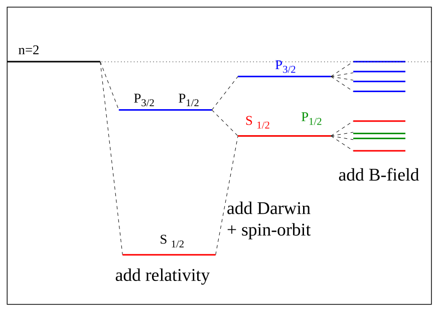

[← 22 Time Independent Perturbation Theory](22-time-independent-perturbation-theory.md) · [24 Hyperfine Structure →](24-hyperfine-structure.md)

---

<hr class="page" style="height:2px;border:0;background:currentColor;opacity:0.25">
<a id="p336" href="book.pdf#page=336" target="_blank" title="This page in the PDF"><sup>[p. 336]</sup></a>

# 23 Fine Structure in Hydrogen

In this section, we will calculate the fine structure corrections to the Hydrogen spectrum. Some of the degeneracy will be broken. Since the Hydrogen problem still has spherical symmetry, states of definite total angular momentum will be the energy eigenstates.

We will break the spherical symmetry by applying a weak magnetic field, further breaking the degeneracy of the energy eigenstates. The effect of a weak magnetic field is known as the anomalous Zeeman effect, because it was hard to understand at the time it was first measured. It will not be anomalous for us.

We will use many of the tools of the last three sections to make our calculations. Nevertheless, a few of the correction terms we use will not be fully derived here.

This material is covered in **Gasiorowicz Chapter 17,** in **Cohen-Tannoudji et al. Chapter** **XII,** and in **Griffiths 6.3 and 6.4**.

# <a id="s-23-1-hydrogen-fine-structure"></a>23.1 Hydrogen Fine Structure

The basic hydrogen problem we have solved has the following Hamiltonian.

```math
H_{0} = \frac{p^{2}}{2 \mu} - \frac{Ze^{2}}{r}
```

To this simple Coulomb problem, we will add **several corrections**:

1. The relativistic correction to the electron’s kinetic energy.

2. The Spin-Orbit correction.

3. The “Darwin Term” correction to s states from Dirac eq.

4. The ((anomalouus) Zeeman) effect of an external magnetic field.

Correction (1) comes from **relativity**. The electron’s velocity in hydrogen is of order $`\alpha c`$. It is not very relativistic but a small correction is in order. By **calculating** (see section 23.4.1) the next order relativistic correction to the kinetic energy we find the additional term in the Hamiltonian

```math
H_{1} = - \frac{1}{8} \frac{p_{e}^{4}}{m^{3} c^{2}} .
```

Our energy eigenstates are not eigenfunctions of this operator so we will have to **treat it as a** **perturbation.**

We can **estimate the size** of this correction compared to the Hydrogen binding energy by taking the ratio to the Hydrogen kinetic energy. (Remember that, in the hydrogen ground state, $`\langle \tfrac{p^{2}}{2 m} \langle \rangle = - E = \tfrac{1}{2} \alpha^{2} mc^{2} . )`$

```math
\frac{p^{4}}{8 m^{3} c^{2}} ÷ \frac{p^{2}}{2 m} = \frac{p^{2}}{4 m^{2} c^{2}} = \frac{( p^{2} / 2 m )}{2 mc^{2}} = \frac{1}{4} \alpha^{2}
```

<div align="right"><a href="book.pdf#page=336" target="_blank" title="This page in the PDF"><sup>[p. 336]</sup></a></div>
<hr class="page" style="height:2px;border:0;background:currentColor;opacity:0.25">
<a id="p337" href="book.pdf#page=337" target="_blank" title="This page in the PDF"><sup>[p. 337]</sup></a>

Like all the fine structure corrections, this is down by a factor of order $`\alpha^{2}`$ from the Hydrogen binding energy.

The second term, due to **Spin-Orbit interactions,** is harder to derive correctly. We understand the basis for this term. The magnetic moment from the electron’s spin interacts with the B field produced by the current seen in the electron’s rest frame from the circulating proton.

```math
H_{2} = - \vec{\mu}_{e} \cdot \vec{B}
```

We can **derive** (see section 23.4.2) B from a Lorentz transformation of the E field of a static proton (We must also add in the Thomas Precession which we will not try to understand here).

```math
H_{2} = \frac{1}{2} \frac{ge^{2}}{2 m^{2} c^{2} r^{3}} \vec{L} \cdot \vec{S}
```

This will be of the same order as the relativistic correction.

Now we **compute** (see section 23.4.3) the relativity correction in first order perturbation theory .

```math
\langle \psi_{nlm} | H_{1} | \psi_{nlm} \rangle = + \frac{E_{n}^{( 0 ) 2}}{2 mc^{2}} \left[ 3 - \frac{4 n}{\ell + \tfrac{1}{2}} \right]
```

The result depends on $`\ell`$ and $`n`$, but not on $`m_{\ell}`$ or $`j`$. This means that we could use either the $`\psi_{njm_{j} \ell s}`$ or the $`\psi_{n\ell m_{\ell} sm_{s}}`$ to calculate the effect of $`H_{1}`$. We will need to use the $`\psi_{njm_{j} \ell s}`$ to add in the spin-orbit.

The first order perturbation **energy shift from the spin orbit correction** is **calculated** (see section 23.4.4) for the states of definite $`j`$.

```math
\langle \psi_{nlm} | H_{2} | \psi_{nlm} \rangle = \frac{ge^{2} \hbar^{2}}{4 m^{2} c^{2}} \frac{1}{2} [ j ( j + 1 ) - \ell ( \ell + 1 ) - s ( s + 1 ) ] \left\langle \frac{1}{r^{3}} \right\rangle_{nlm}
```

```math
= {}^{( 0 ) 2} \quad j = \ell + \tfrac{1}{2}
```

```math
\begin{pmatrix} g \\ 2 \end{pmatrix} E_{n} 2 mc^{2} 2 \left[ ( \ell \frac{n}{\tfrac{+ \tfrac{1}{2} - n ) ( \ell}{\ell ( \ell + \tfrac{1}{2} )}} + 1 ) \right] \quad j = \ell - \tfrac{1}{2}
```

Actually, the $`\vec{L} \cdot \vec{S}`$ term should give 0 for $`\ell`$ = 0! In the above calculation there is an $`\frac{\ell}{\ell}`$ factor which makes the result for $`\ell`$ = 0 undefined. There is an additional Dirac Equation contribution called the **“Darwin term”** (see section 23.4.5) which is important for $`\ell`$ = 0 and surprisingly makes the above calculation right, even for $`\ell`$ = 0!

We will now add these three fine structure corrections together for states of definite $`j`$. We start with a formula which has slightly different forms for $`j = \ell \pm \tfrac{1}{2}`$.

```math
E_{njm_{j} \ell s} = E_{n}^{( 0 )} + \frac{E_{n}^{( 0 )}}{2 mc^{2}}^{2} \left[ 3 - \frac{4 n}{\ell + \tfrac{1}{2}} + \left\{ \frac{2 n}{{}^{( \ell +} - \tfrac{\tfrac{1}{2} ) ( 2 n \ell + 1 )}{\ell ( \ell + \tfrac{1}{2} )}} \right\} \frac{( + )}{( - )} \right]
```

```math
E_{njm_{j} \ell s} = E_{n}^{( 0 )} + \frac{E_{n}^{( 0 )}}{2 mc^{2}}^{2} \left[ 3 - \frac{n}{( \ell + \tfrac{1}{2} )} \begin{Bmatrix} 4 - \tfrac{2}{\ell + 1 \frac{2}{\ell}} \\ 4 + \end{Bmatrix} \frac{( + )}{( - )} \right]
```

<div align="right"><a href="book.pdf#page=337" target="_blank" title="This page in the PDF"><sup>[p. 337]</sup></a></div>
<hr class="page" style="height:2px;border:0;background:currentColor;opacity:0.25">
<a id="p338" href="book.pdf#page=338" target="_blank" title="This page in the PDF"><sup>[p. 338]</sup></a>

```math
E_{njm_{j} \ell s} = E_{n}^{( 0 )} + \frac{E_{n}^{( 0 )}}{2 mc^{2}}^{2} \left[ 3 - n \frac{4 \mp \tfrac{2}{j + \tfrac{1}{2}}}{\ell + \tfrac{1}{2}} \right]
```

We can write $`( \ell + \tfrac{1}{2} )`$ as ($`j + \tfrac{1}{2} \mp \tfrac{1}{2} )`$, so that

```math
\frac{4 \mp \tfrac{2}{j + \tfrac{1}{2}}}{\ell + \tfrac{1}{2}} = \frac{4 j + 2 \mp 2}{( j + \tfrac{1}{2} ) ( j + \tfrac{1}{2} \mp \tfrac{1}{2} )} = 4 \frac{( j + \tfrac{1}{2} \mp \tfrac{1}{2} )}{( j + \tfrac{1}{2} \mp \tfrac{1}{2} ) ( j + \tfrac{1}{2} )}
```

and we get a nice cancellation giving us a simple formula.

```math
E_{nlm} = E_{n}^{( 0 )} + \tfrac{E_{n}^{( 0 ) 2}}{2 mc^{2}} \left[ 3 - \tfrac{4 n}{j + \tfrac{1}{2}} \right]
```

This is independent of $`\ell`$ so the states of different total angular momentum split in energy but there is still a good deal of degeneracy.



_Figure 78 (p. 338)_

We have calculated the fine structure effects in Hydrogen. There are, of course, other, smaller corrections to the energies. A correction from field theory, the Lamb Shift, causes states of different $`\ell`$ to shift apart slightly. Nevertheless, the states of definite total angular momentum are the energy eigenstates until we somehow break spherical symmetry.

<div align="right"><a href="book.pdf#page=338" target="_blank" title="This page in the PDF"><sup>[p. 338]</sup></a></div>
<hr class="page" style="height:2px;border:0;background:currentColor;opacity:0.25">
<a id="p339" href="book.pdf#page=339" target="_blank" title="This page in the PDF"><sup>[p. 339]</sup></a>

# <a id="s-23-2-hydrogen-atom-in-a-weak-magnetic-field"></a>23.2 Hydrogen Atom in a Weak Magnetic Field

One way to break the spherical symmetry is to apply an external B field. Lets assume that the field is weak enough that the energy shifts due to it are smaller than the fine structure corrections. Our Hamiltonian can now be written as $`H = H_{0} + ( H_{1} + H_{2} ) + H_{3}`$, where $`H_{0} = \tfrac{p^{2}}{2 \mu} - \tfrac{Ze^{2}}{r}`$ is the normal Hydrogen problem, $`H_{1} + H_{2}`$ is the fine structure correction, and

```math
H_{3} = \frac{e \vec{B}}{2 mc} \cdot ( \vec{L} + 2 \vec{S} ) = \frac{eB}{2 mc} ( L_{z} + 2 S_{z} )
```

is the term due to the weak magnetic field.

We now run into a problem because $`H_{1} + H_{2}`$ picks eigenstates of $`J^{2}`$ and $`J_{z}`$ while $`H_{3}`$ picks eigenstates of $`L_{z}`$ and $`S_{z}`$. In the weak field limit, we can do perturbation theory using the states of definite $`j`$. A direct **calculation** (see section 23.4.6) of the Anomalous Zeeman Effect gives the energy shifts in a weak B field.

```math
\Delta E = \left\langle \psi_{n\ell jm_{j}} \left| \tfrac{eB}{2 mc} ( L_{z} + 2 S_{z} ) \right| \psi_{n\ell jm_{j}} \right\rangle = \tfrac{e \hbar B}{2 mc} m_{j} \left( 1 \pm \tfrac{1}{2 \ell + 1} \right)
```

This is the correction, due to a weak magnetic field, which we should add to the fine structure energies.

```math
E_{njm_{j} \ell s} = - \frac{1}{2} \alpha^{2} mc^{2} \left( \frac{1}{n^{2}} + \frac{\alpha^{2}}{n^{3}} \left[ \frac{1}{j + \tfrac{1}{2}} - \frac{3}{4 n} \right] \right)
```

Thus, in a weak field, the **the degeneracy is completely broken for the states** $`\psi_{njm_{j} \ell s}`$. All the states can be detected spectroscopically.

<div align="right"><a href="book.pdf#page=339" target="_blank" title="This page in the PDF"><sup>[p. 339]</sup></a></div>
<hr class="page" style="height:2px;border:0;background:currentColor;opacity:0.25">
<a id="p340" href="book.pdf#page=340" target="_blank" title="This page in the PDF"><sup>[p. 340]</sup></a>


_Figure 79 (p. 340)_

The factor $`\left( 1 \pm \tfrac{1}{2 \ell + 1} \right)`$ is known as the **Lande** $`g`$ **Factor** because the state splits as if it had this gyromagnetic ratio. We know that it is in fact a combination of the orbital and spin g factors in a state of definite $`j`$.

In the strong field limit we could use states of definite $`m_{\ell}`$ and $`m_{s}`$ and calculate the effects of the fine structure, $`H_{1} + H_{2}`$, as a correction. We will not calculate this here. If the field is very strong, we can neglect the fine structure entirely. Then the calculation is easy.

```math
E = E_{n}^{0} + \frac{eB \hbar}{2 mc} ( m_{\ell} + 2 m_{s} )
```

In this limit, the field has partially removed the degeneracy in $`m_{\ell}`$ and $`m_{s}`$, but not $`\ell`$. For example, the energies of all these $`n`$ = 3 states are the same.

```math
\ell = 2 \quad m_{\ell} = 0 \quad m_{s} = \tfrac{1}{2}
```

```math
\ell = 1 \quad m_{\ell} = 0 \quad m_{s} = \tfrac{1}{2}
```

```math
\ell = 2 \quad m_{\ell} = 2 \quad m_{s} = - \tfrac{1}{2}
```

<div align="right"><a href="book.pdf#page=340" target="_blank" title="This page in the PDF"><sup>[p. 340]</sup></a></div>
<hr class="page" style="height:2px;border:0;background:currentColor;opacity:0.25">
<a id="p341" href="book.pdf#page=341" target="_blank" title="This page in the PDF"><sup>[p. 341]</sup></a>

# <a id="s-23-3-examples"></a>23.3 Examples

# <a id="s-23-4-derivations-and-computations"></a>23.4 Derivations and Computations

## <a id="s-23-4-1-the-relativistic-correction"></a>23.4.1 The Relativistic Correction

Moving from the non-relativistic formula for the energy of an electron to the relativistic formula we make the change

```math
mc^{2} + \frac{p_{e}^{2}}{2 m} \to \left( p^{2} c^{2} + m^{2} c^{4} \right)^{1 / 2} = mc^{2} \left( 1 + \frac{p^{2} c^{2}}{m^{2} c^{4}} \right)^{1 / 2} .
```

Taylor expanding the square root around $`p^{2}`$ = 0, we find

```math
\left( p^{2} c^{2} + m^{2} c^{4} \right)^{1 / 2} = mc^{2} + \frac{1}{2} \frac{p^{2} c^{2}}{mc^{2}} - \frac{1}{8} \frac{p^{4} c^{4}}{m^{3} c^{6}} + \cdot \cdot \cdot \approx mc^{2} + \frac{p^{2}}{2 m} - \frac{p^{4}}{8 m^{3} c^{2}}
```

So we have our next order correction term. Notice that $`\frac{p^{2}}{2 m}`$ was just the lowest order correction to $`mc^{2}`$.

What about the “reduced mass problem”? The proton is very non-relativistic so only the electron term is important and the reduced mass is very close to the electron mass. We can therefore neglect the small correction to the small correction and use

```math
H_{1} = - \frac{1}{8} \frac{p_{e}^{4}}{m^{3} c^{2}} .
```

## <a id="s-23-4-2-the-spin-orbit-correction"></a>23.4.2 The Spin-Orbit Correction

We calculate the classical Hamiltonian for the spin-orbit interaction which we will later apply as a perturbation. The B field from the proton in the electron’s rest frame is

```math
\vec{B} = - \frac{\vec{v}}{c} \times \vec{E} .
```

Therefore the correction is

```math
H_{2} = \frac{ge}{2 mc} \vec{S} \cdot \vec{B} = - \frac{ge}{2 mc^{2}} \vec{S} \cdot \vec{v} \times \vec{E}
```

```math
= \frac{ge}{2 m^{2} c^{2}} \vec{S} \cdot \vec{p} \times \vec{\nabla} \varphi .
```

$`\varphi`$ only depends on $`r \Rightarrow \nabla \varphi = \hat{r} \tfrac{d\varphi}{dr} = \tfrac{\vec{r}}{r} \tfrac{d\varphi}{dr}`$

```math
H_{2} = \frac{ge}{2 m^{2} c^{2}} \vec{S} \cdot \vec{p} \times \vec{r} \frac{1}{r} \frac{d\varphi}{dr} = \frac{- ge}{2 m^{2} c^{2}} \vec{S} \cdot \vec{L} \frac{1}{r} \frac{d\varphi}{dr}
```

```math
\varphi = \frac{e}{r} \quad \Rightarrow \quad \frac{d\varphi}{dr} = - \frac{e}{r^{2}}
```

```math
H_{2} = \frac{1}{2} \frac{ge^{2}}{2 m^{2} c^{2} r^{3}} \vec{L} \cdot \vec{S}
```

<div align="right"><a href="book.pdf#page=341" target="_blank" title="This page in the PDF"><sup>[p. 341]</sup></a></div>
<hr class="page" style="height:2px;border:0;background:currentColor;opacity:0.25">
<a id="p342" href="book.pdf#page=342" target="_blank" title="This page in the PDF"><sup>[p. 342]</sup></a>

Note that this was just a classical calculation which we will apply to quantum states later. It is correct for the EM forces, but, the electron is actually in a rotating system which gives an additional $`\vec{L} \cdot \vec{S}`$ term (not from the B field!). This term is 1/2 the size and of opposite sign. We have already included this factor of 2 in the answer given above.

Recall that

```math
H_{2} \propto \vec{L} \cdot \vec{S} = \frac{1}{2} \left[ J^{2} - L^{2} - S^{2} \right]
```

and we will therefore want to work with states of definite $`j , \ell`$, and $`s`$.

## <a id="s-23-4-3-perturbation-calculation-for-relativistic-energy-shift"></a>23.4.3 Perturbation Calculation for Relativistic Energy Shift

```math
2
```

Rewriting $`H_{1} = - \tfrac{1}{8} \tfrac{p_{e}^{4}}{m^{3} c^{2}}`$ as $`H_{1} = - \tfrac{1}{2 mc^{2}} \left( \tfrac{p^{2}}{2 m} \right)`$ we calculate the energy shift for a state $`\psi_{njm_{j} \ell s}`$. While there is no spin involved here, we will need to use these states for the spin-orbit interaction

```math
\left\langle \psi_{njm_{j} \ell s} | H_{1} | \psi_{njm_{j} \ell s} \right\rangle = - \frac{1}{2 mc^{2}} \left\langle \psi_{njm_{j} \ell s} \left| \left( \frac{p^{2}}{2 m} \right)^{2} \right| \psi_{njm_{j} \ell s} \right\rangle
```

```math
= - \frac{1}{2 mc^{2}} \left\langle \psi_{njm_{j} \ell s} \left| \left( H_{0} + \frac{e^{2}}{r} \right)^{2} \right| \psi_{njm_{j} \ell s} \right\rangle
```

```math
= - \frac{1}{2 mc^{2}} \left\langle \psi_{njm_{j} \ell s} \left| H_{0}^{2} + \frac{e^{2}}{r} H_{0} + H_{0} \frac{e^{2}}{r} + \frac{e^{4}}{r^{2}} \right| \psi_{njm_{j} \ell s} \right\rangle
```

```math
\begin{aligned} &= - \frac{1}{2 mc^{2}} \left[ E_{n}^{2} + \left\langle \psi_{njm_{j} \ell s} \left| \frac{e^{2}}{r} \right| H_{0} \psi_{njm_{j} \ell s} \right\rangle \right. \\ & \quad + \left\langle H_{0} \psi_{njm_{j} \ell s} \left| \frac{e^{2}}{r} \right| \psi_{njm_{j} \ell s} \right\rangle \\ & \quad \left. + \left\langle \psi_{njm_{j} \ell s} \left| \frac{e^{4}}{r^{2}} \right| \psi_{njm_{j} \ell s} \right\rangle \right] \end{aligned}
```

```math
= - \frac{1}{2 mc^{2}} \left[ E_{n}^{2} + 2 E_{n} e^{2} \left\langle \frac{1}{r} \right\rangle_{n} + e^{4} \left\langle \frac{1}{r^{2}} \right\rangle_{nl} \right]
```

where we can use some of our previous results.

```math
E_{n} = - \frac{1}{2} \alpha^{2} mc^{2} /n^{2} = \frac{- e^{2}}{2 a_{0} n^{2}}
```

```math
\left\langle \frac{1}{r} \right\rangle_{n} = \left( \frac{1}{a_{0} n^{2}} \right)
```

```math
\left\langle \frac{1}{r^{2}} \right\rangle = \left( \frac{1}{a_{0}^{2} n^{3} ( \ell + \tfrac{1}{2} )} \right)
```

```math
\left\langle \psi_{njm_{j} \ell s} | H_{1} | \psi_{njm_{j} \ell s} \right\rangle = - \frac{1}{2 mc^{2}} \left[ \left( \frac{- \tfrac{1}{2} \alpha^{2} mc^{2}}{n^{2}} \right)^{2} + 2 \left( \frac{- \tfrac{1}{2} \alpha^{2} mc^{2}}{n^{2}} \right) \frac{e^{2}}{a_{0} n^{2}} + \frac{e^{4}}{a_{0}^{2} n^{3} ( \ell + \tfrac{1}{2} )} \right]
```

```math
= - \frac{1}{2 mc^{2}} E_{n}^{( 0 ) 2} \left[ 1 - 4 + \frac{4 n}{\ell + \tfrac{1}{2}} \right]
```

```math
= + \frac{E_{n}^{( 0 ) 2}}{2 mc^{2}} \left[ 3 - \frac{4 n}{\ell + \tfrac{1}{2}} \right]
```

<div align="right"><a href="book.pdf#page=342" target="_blank" title="This page in the PDF"><sup>[p. 342]</sup></a></div>
<hr class="page" style="height:2px;border:0;background:currentColor;opacity:0.25">
<a id="p343" href="book.pdf#page=343" target="_blank" title="This page in the PDF"><sup>[p. 343]</sup></a>

Since this does not depend on either $`m_{\ell}`$ or $`j`$, total $`j`$ states and the product states give the same answer. We will choose to use the total $`j`$ states, $`\psi_{njm_{j} \ell s}`$, so that we can combine this correction with the spin-orbit correction.

## <a id="s-23-4-4-perturbation-calculation-for-h2-energy-shift"></a>23.4.4 Perturbation Calculation for H2 Energy Shift

We now calculate the expectation value of $`H_{2}`$. We will immediately use the fact that $`j = \ell \pm \tfrac{1}{2}`$.

```math
\left\langle \psi_{njm_{j} \ell s} | H_{2} | \psi_{njm_{j} \ell s} \right\rangle = \frac{ge^{2} \hbar^{2}}{4 m^{2} c^{2}} \frac{1}{2} [ j ( j + 1 ) - \ell ( \ell + 1 ) - s ( s + 1 ) ] \left\langle \frac{1}{r^{3}} \right\rangle_{nl}
```

```math
= \frac{ge^{2} \hbar^{2}}{8 m^{2} c^{2}} \left[ ( \ell \pm \frac{1}{2} ) ( \ell + 1 \pm \frac{1}{2} ) - \ell ( \ell + 1 ) - \frac{3}{4} \right] \frac{1}{a_{0}^{3}} \left( \frac{1}{n^{3} \ell ( \ell + \tfrac{1}{2} ) ( \ell + 1 )} \right)
```

```math
= - E_{n} \frac{g \hbar^{2}}{4 m^{2} c^{2} a_{0}^{2}} \left[ \ell^{2} + \ell \pm \ell \pm \frac{1}{2} + \frac{1}{4} - \ell^{2} - \ell - \frac{3}{4} \right] \left( \frac{1}{n\ell ( \ell + \tfrac{1}{2} ) ( \ell + 1 )} \right)
```

```math
= \left( \frac{g}{2} \right) \left( \frac{- E_{n}}{2 mc^{2}} \right) \frac{\hbar^{2}}{ma_{0}^{2} n^{2}} \begin{bmatrix} \ell \\ - ( \ell + 1 ) \end{bmatrix} \frac{( + )}{( - )} \frac{n}{\ell ( \ell + \tfrac{1}{2} ) ( \ell + 1 )}
```

```math
= \left( \frac{g}{2} \right) \left( \frac{- E_{n}}{2 mc^{2}} \right) \frac{\hbar^{2} \alpha^{2} m^{2} c^{2}}{m \hbar^{2} n^{2}} \begin{bmatrix} \ell \\ - ( \ell + 1 ) \end{bmatrix} \frac{( + )}{( - )} \frac{n}{\ell ( \ell + \tfrac{1}{2} ) ( \ell + 1 )}
```

```math
= \left( \frac{g}{2} \right) \frac{E_{n}^{( 0 ) 2}}{2 mc^{2}} 2 \left[ \quad j = \ell + \tfrac{1}{2} \right.
```

```math
{}^{( \ell} \tfrac{+ \tfrac{1}{2} - n ) ( \ell}{\ell ( \ell + \tfrac{1}{2} )}^{n} \left. {}^{+ 1 )} \right] \quad j = \ell - \tfrac{1}{2}
```

Note that in the above equation, we have canceled a term $`\frac{\ell}{\ell}`$ which is not defined for $`\ell`$ = 0. We will return to this later.

## <a id="s-23-4-5-the-darwin-term"></a>23.4.5 The Darwin Term

We get a correction at the origin from the **Dirac equation**.

```math
H_{D} = \frac{\pi e^{2} \hbar^{2}}{2 m_{e}^{2} c^{2}} \delta^{3} ( \vec{r} )
```

When we take the expectation value of this, we get the probability for the electron and proton to be at the same point.

```math
\langle \psi | H_{D} | \psi \rangle = {}_{3 / 2} \frac{\pi e^{2} \hbar^{2}}{2 m_{e}^{2} c^{2}} | \psi ( 0 ) |^{2}
```

Now, $`\psi`$(0) = 0 for $`\ell > 0`$ and $`\psi`$(0) = $`\tfrac{1}{\sqrt{4 \pi}} 2 \left( \tfrac{z}{na_{0}} \right)`$ for $`\ell`$ = 0, so

```math
\langle H_{D} \rangle_{n 0 0} = \frac{4 e^{2} \hbar^{2}}{8 n^{3} a_{0}^{3} m^{2} c^{2}} = \frac{e^{2} \hbar^{2} \alpha^{2} m^{2} c^{2}}{2 n^{3} a_{0} m^{2} c^{2} \hbar^{2}} = \frac{2 nE_{n}^{2}}{mc^{2}}
```

This is the same as $`\ell`$ = 0 term that we got for the spin orbit correction. This actually replaces the $`\ell`$ = 0 term in the spin-orbit correction (which should be zero) making the formula correct!<span class="page" style="float:left;width:100%;margin:0.4em 0 0.6em"><span style="display:block;text-align:right"><a href="book.pdf#page=343" target="_blank" title="This page in the PDF"><sup>[p. 343]</sup></a></span><span style="display:block;height:2px;background:currentColor;opacity:0.25"></span><a id="p344" href="book.pdf#page=344" target="_blank" title="This page in the PDF"><sup>[p. 344]</sup></a></span> **23.4.6 The Anomalous Zeeman Effect**

We compute the energy change due to a weak magnetic field using first order Perturbation Theory.

```math
\begin{pmatrix} \psi_{n\ell jm_{j}} \begin{vmatrix} \frac{eB}{2 mc} ( L_{z} + 2 S_{z} ) \\ {}_{z} + 2 S_{z} ) = J_{z} + \end{vmatrix} \psi_{n\ell jm_{j}} \\ ( L \quad S_{z} \end{pmatrix}
```

The $`J_{z}`$ part is easy since we are in eigenstates of that operator.

```math
\left\langle \psi_{n\ell jm_{j}} \left| \frac{eB}{2 mc} J_{z} \right| \psi_{n\ell jm_{j}} \right\rangle = \frac{eB}{2 mc} \hbar m_{j}
```

The $`S_{z}`$ is harder since we are not in eigenstates of that one. We need $`\left\langle \psi_{n\ell jm_{j}} \left| \tfrac{eB}{2 mc} S_{z} \right| \psi_{n\ell jm_{j}} \right\rangle`$, but we don’t know how $`S_{z}`$ acts on these. So, we must write $`\left| \psi_{njm_{j} \ell s} \right\rangle`$ in terms of $`| \psi_{n\ell m_{\ell} sm_{s}} \rangle`$.

```math
E_{n}^{( 1 )} = \left\langle \psi_{nj\ell m_{j}} \left| \frac{eB}{2 mc} ( J_{z} + S_{z} ) \right| \psi_{nj\ell m_{j}} \right\rangle
```

```math
= \frac{eB}{2 mc} \left( m_{j} \hbar + \left\langle \psi_{nj\ell m_{j}} | S_{z} | \psi_{nj\ell m_{j}} \right\rangle \right)
```

We already know how to write in terms of these states of definite $`m_{\ell}`$ and $`m_{s}`$.

```math
\psi_{n ( \ell + \tfrac{1}{2} ) \ell ( m + \tfrac{1}{2} )} = \alpha Y_{\ell m} \chi_{+} + \beta Y_{\ell ( m + 1 )} \chi_{-}
```

```math
\psi_{n ( \ell - \tfrac{1}{2} ) \ell ( m + \tfrac{1}{2} )} = \beta Y_{\ell m} \chi_{+} - \alpha Y_{\ell ( m + 1 )} \chi_{-}
```

```math
\alpha = \sqrt{\frac{\ell + m + 1}{2 \ell + 1}}
```

```math
\beta = \sqrt{2 \ell - m \ell + 1}
```

Let’s do the $`j = \ell + \tfrac{1}{2}`$ state first.

```math
\left\langle \psi_{nj\ell m_{j}} | S_{z} | \psi_{nj\ell m_{j}} \right\rangle = \left\langle \alpha Y_{\ell ( m_{j} - \tfrac{1}{2} )} \chi_{+} + \beta Y_{\ell ( m_{j} + \tfrac{1}{2} )} \chi_{-} | S_{z} | \alpha Y_{\ell ( m_{j} - \tfrac{1}{2} )} \chi_{+} + \beta Y_{\ell ( m_{j} + \tfrac{1}{2} )} \chi_{-} \right\rangle
```

```math
= \frac{1}{2} \hbar \left( \alpha^{2} - \beta^{2} \right)_{m = m_{j} - \tfrac{1}{2}}
```

For $`j = \ell - \tfrac{1}{2}`$,

```math
\left\langle \psi_{nj\ell m_{j}} | S_{z} | \psi_{nj\ell m_{j}} \right\rangle = \frac{1}{2} \hbar \left( \beta^{2} - \alpha^{2} \right)_{m = m_{j} - \tfrac{1}{2}}
```

We can combine the two formulas for $`j = \ell \pm \tfrac{1}{2}`$.

```math
\left\langle \psi_{nj\ell m_{j}} | S_{z} | \psi_{nj\ell m_{j}} \right\rangle = \pm \frac{\hbar}{2} \left( \alpha^{2} - \beta^{2} \right) = \pm \frac{\hbar}{2} \frac{\ell + m + 1 - \ell + m}{2 \ell + 1}
```

```math
= \pm \frac{\hbar}{2} \frac{2 ( m_{j} - \tfrac{1}{2} ) + 1}{2 \ell + 1} = \pm \frac{m_{j} \hbar}{2 \ell + 1}
```

<div align="right"><a href="book.pdf#page=344" target="_blank" title="This page in the PDF"><sup>[p. 344]</sup></a></div>
<hr class="page" style="height:2px;border:0;background:currentColor;opacity:0.25">
<a id="p345" href="book.pdf#page=345" target="_blank" title="This page in the PDF"><sup>[p. 345]</sup></a>

So adding this to the (easier) part above, we have

```math
E_{n}^{( 1 )} = \frac{eB}{2 mc} \left( m_{j} \hbar \pm \frac{m_{j} \hbar}{2 \ell + 1} \right) = \frac{e \hbar B}{2 mc} m_{j} \left( 1 \pm \frac{1}{2 \ell + 1} \right)
```

for $`j = \ell \pm \tfrac{1}{2}`$.

In summary then, we rewrite the fine structure shift.

```math
\Delta E = - \frac{1}{2} mc^{2} ( Z\alpha )^{4} \frac{1}{n^{3}} \left[ \frac{1}{j + \tfrac{1}{2}} - \frac{3}{4 n} \right] .
```

## <a id="s-23-4-6-the-anomalous-zeeman-effect"></a>To this we add the anomalous Zeeman effect

```math
\Delta E = \frac{e \hbar B}{2 mc} m_{j} \left( 1 \pm \frac{1}{2 \ell + 1} \right) .
```

# <a id="s-23-5-homework-problems"></a>23.5 Homework Problems

1. Consider the fine structure of the $`n`$ = 2 states of the hydrogen atom. What is the spectrum in the absence of a magnetic field? How is the spectrum changed when the atom is placed in a magnetic field of 25,000 gauss? Give numerical values for the energy shifts in each of the above cases. Now, try to estimate the binding energy for the lowest energy $`n`$ = 2 state including the relativistic, spin-orbit, and magnetic field.

2. Verify the relations used for $`\tfrac{1}{r} , \tfrac{1}{r^{2}}`$, and $`\frac{1}{r^{3}}`$ for hydrogen atom states up to $`n`$ = 3 and for any

```math
n \text{ if } l = n - 1 .
```

3. Calculate the fine structure of hydrogen atoms for spin 1 electrons for $`n`$ = 1 and $`n`$ = 2.

Compute the energy shifts in eV.

# <a id="s-23-6-sample-test-problems"></a>23.6 Sample Test Problems

1. The relativistic correction to the Hydrogen Hamiltonian is $`H_{1}`$ = $`- {}_{8} \tfrac{p^{4}}{m^{3} c^{2}}`$. Assume that electrons have spin zero and that there is therefore no spin orbit correction. Calculate the energy shifts and draw an energy diagram for the n=3 states of Hydrogen. You may use $`\langle \psi_{nlm} | \tfrac{1}{r} | \psi_{nlm} \rangle = \tfrac{1}{n^{2} a_{0}}`$ and $`\langle \psi_{nlm} | \tfrac{1}{r^{2}} | \psi_{nlm} \rangle = \tfrac{1}{n^{3} a_{0}^{2} ( l + \tfrac{1}{2} )}`$.

2. Calculate the fine structure energy shifts (in eV!) for the $`n`$ = 1, $`n`$ = 2, and $`n`$ = 3 states of Hydrogen. Include the effects of relativistic corrections, the spin-orbit interaction, and the so-called Darwin term (due to Dirac equation). Do not include hyperfine splitting or the effects of an external magnetic field. (Note: I am not asking you to derive the equations.) Clearly list the states in spectroscopic notation and make a diagram showing the allowed electric dipole decays of these states.

3. Calculate and show the splitting of the $`n`$ = 3 states (as in the previous problem) in a weak

magnetic field B. Draw a diagram showing the states before and after the field is applied

4. If the general form of the spin-orbit coupling for a particle of mass $`m`$ and spin $`\vec{S}`$ moving in a potential $`V ( r )`$ is $`H_{SO} = \tfrac{1}{2 m^{2} c^{2}} \vec{L} \cdot \vec{S} \tfrac{1}{r} \tfrac{dV}{dr}`$, what is the effect of that coupling on the spectrum of

<div align="right"><a href="book.pdf#page=345" target="_blank" title="This page in the PDF"><sup>[p. 345]</sup></a></div>
<hr class="page" style="height:2px;border:0;background:currentColor;opacity:0.25">
<a id="p346" href="book.pdf#page=346" target="_blank" title="This page in the PDF"><sup>[p. 346]</sup></a>

an electron bound in a 3D harmonic oscillator? Give the energy shifts and and draw a diagram for the 0$`s`$ and 1$`p`$ states.

```math
V = \tfrac{1}{2} m\omega^{2} r^{2}
```

```math
\tfrac{dV}{dr} = m\omega^{2} r
```

```math
\langle H_{SO} \rangle = \tfrac{\hbar^{2}}{2 m^{2} c^{2}} \tfrac{1}{2} [ j ( j + 1 ) - l ( l + 1 ) - s ( s + 1 ) ] m\omega^{2}
```

```math
\langle H_{SO} \rangle = \tfrac{\hbar^{2} \omega^{2}}{4 mc^{2}} [ j ( j + 1 ) - l ( l + 1 ) - s ( s + 1 ) ]
```

for the 0$`S_{2} 1`$, ∆$`E`$ = 0,

```math
\text{ for the } 1 P_{1 2} , \Delta E = - 2 \tfrac{\hbar^{2} \omega^{2}}{4 mc^{2}} ,
```

for the 1$`P_{3 2}`$, ∆$`E`$ = +1$`\frac{\hbar^{2} \omega^{2}}{4 mc^{2}}`$.

5. We computed that the energies after the fine structure corrections to the hydrogen spectrum are $`E_{nlj} = - \tfrac{\alpha^{2} mc^{2}}{2 n^{2}} + \tfrac{\alpha^{4} mc^{2}}{8 n^{4}} ( 3 - \tfrac{4 n}{j + \tfrac{1}{2}} )`$. Now a weak magnetic field $`B`$ is applied to hydrogen atoms in the 3$`d`$ state. Calculate the energies of all the 3$`d`$ states (ignoring hyperfine effects). Draw an energy level diagram, showing the quantum numbers of the states and the energy splittings.

6. In Hydrogen, the $`n`$ = 3 state is split by fine structure corrections into states of definite $`j , m_{j} , \ell`$, and $`s`$. According to our calculations of the fine structure, the energy only depends on $`j`$. We label these states in spectroscopic notation: $`N^{2 s + 1} L_{j}`$. Draw an energy diagram for the $`n`$ = 3 states, labeling each state in spectroscopic notation. Give the energy shift due to the fine structure corrections in units of $`\alpha^{4} mc^{2}`$.

7. The energies of photons emitted in the Hydrogen atom transition between the 3S and the 2P states are measured, first with no external field, then, with the atoms in a uniform magnetic field B. Explain in detail the spectrum of photons before and after the field is applied. Be sure to give an expression for any relevant energy differences.

---

[← 22 Time Independent Perturbation Theory](22-time-independent-perturbation-theory.md) · [24 Hyperfine Structure →](24-hyperfine-structure.md)
