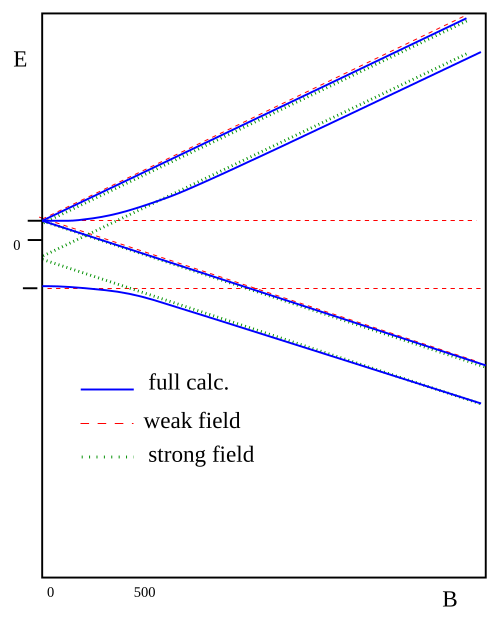

[← 23 Fine Structure in Hydrogen](23-fine-structure-in-hydrogen.md) · [25 The Helium Atom →](25-the-helium-atom.md)

---

<hr class="page" style="height:2px;border:0;background:currentColor;opacity:0.25">
<a id="p347" href="book.pdf#page=347" target="_blank" title="This page in the PDF"><sup>[p. 347]</sup></a>

# 24 Hyperfine Structure

The interaction between the magnetic moment, due to the spin of the nucleus, and the larger magnetic moment, due to the electron’s spin, results in energy shifts which are much smaller than those of the fine structure. They are of order $`\tfrac{m_{e}}{m_{p}} \alpha^{2} E_{n}`$ and are hence called hyperfine.

The hyperfine corrections may be difficult to measure in transitions between states of different $`n`$, however, they are quite measurable and important because they split the ground state. The different hyperfine levels of the ground state are populated thermally. Hyperfine transitions, which emit radio frequency waves, can be used to detect interstellar gas.

This material is covered in **Gasiorowicz Chapter 17,** in **Cohen-Tannoudji et al. Chapter** **XII,** and briefly in **Griffiths 6.5**.

# <a id="s-24-1-hyperfine-splitting"></a>24.1 Hyperfine Splitting

We can think of the nucleus as a single particle with spin $`\vec{I}`$. This particle is actually made up of protons and neutrons which are both spin $`\frac{1}{2}`$ particles. The protons and neutrons in turn are made of spin $`\frac{1}{2}`$ quarks. The magnetic dipole moment due to the nuclear spin is much smaller than that of the electron because the mass appears in the denominator. The magnetic moment of the nucleus is

```math
\vec{\mu}_{N} = \frac{Zeg_{N}}{2 M_{N} c} \vec{I}
```

where $`\vec{I}`$ is the **nuclear spin** vector. Because the nucleus has internal structure, the nuclear gyromagnetic ratio is not just 2. For the proton, it is $`g_{p} \approx 5 . 56`$. This is the nucleus of hydrogen upon which we will concentrate. Even though the neutron is neutral, the gyromagnetic ratio is about -3.83. (The quarks have gyromagnetic ratios of 2 (plus corrections) like the electron but the problem is complicated by the strong interactions which make it hard to define a quark’s mass.) We can compute (to some accuracy) the gyromagnetic ratio of nuclei from that of protons and neutrons as we can compute the proton’s gyromagnetic ratio from its quark constituents.

In any case, the nuclear dipole moment is about 1000 times smaller than that for e-spin or $`\vec{L}`$. We will calculate ∆$`E`$ for $`\ell`$ = 0 states (see Condon and Shortley for more details). This is particularly important because it will break the degeneracy of the Hydrogen ground state.

To get the perturbation, we should find $`\vec{B}`$ from $`\vec{\mu}`$ (see Gasiorowicz page 287) then calculate the energy change in first order perturbation theory ∆$`E = \left\langle - \vec{\mu}_{e} \cdot \vec{B} \right\rangle`$. **Calculating** (see section 24.4.1) the energy shift for $`\ell`$ = 0 states.

```math
\Delta E = \left\langle \frac{e}{mc} \vec{S} \cdot \vec{B} \right\rangle = \frac{4}{3} ( Z\alpha )^{4} \left( \frac{m}{M_{N}} \right) ( mc^{2} ) g_{N} \frac{1}{n^{3}} \frac{\vec{S} \cdot \vec{I}}{\hbar^{2}}
```

Now, just as in the case of the $`\vec{L} \cdot \vec{S}`$, spin-orbit interaction, we will define the total angular momentum

```math
\vec{F} = \vec{S} + \vec{I} .
```

<div align="right"><a href="book.pdf#page=347" target="_blank" title="This page in the PDF"><sup>[p. 347]</sup></a></div>
<hr class="page" style="height:2px;border:0;background:currentColor;opacity:0.25">
<a id="p348" href="book.pdf#page=348" target="_blank" title="This page in the PDF"><sup>[p. 348]</sup></a>

It is in the states of definite $`f`$ and $`m_{f}`$ that the hyperfine perturbation will be diagonal. In essence, we are doing degenerate state perturbation theory. We could diagonalize the 4 by 4 matrix for the perturbation to solve the problem or we can use what we know to pick the right states to start with. Again like the spin orbit interaction, the **total angular momentum states** will be the right states **because we can write the perturbation in terms of quantum numbers of those states.**

```math
\vec{S} \cdot \vec{I} = \frac{1}{2} \left( F^{2} - S^{2} - I^{2} \right) = \frac{1}{2} \hbar^{2} \left( f ( f + 1 ) - \frac{3}{4} - \frac{3}{4} \right)
```

```math
\Delta E = \tfrac{2}{3} ( Z\alpha )^{4} \left( \tfrac{m}{M_{N}} \right) ( mc^{2} ) g_{N} \tfrac{1}{n^{3}} \left( f ( f + 1 ) - \tfrac{3}{2} \right) \equiv \tfrac{\mathcal{A}}{2} \left( f ( f + 1 ) - \tfrac{3}{2} \right)
```

For the hydrogen ground state we are just adding two spin $`\frac{1}{2}`$ particles so the possible values are $`f`$ = 0$`, 1 .`$

\* See Example 24.3.1: The Hyperfine Splitting of the Hydrogen Ground State.\*

The transition between the two states gives rise to EM waves with $`\lambda`$ = 21 cm.

# <a id="s-24-2-hyperfine-splitting-in-a-b-field"></a>24.2 Hyperfine Splitting in a B Field

If we apply a B-field the states will split further. As usual, we choose our coordinates so that the field is in $`\hat{z}`$ direction. The perturbation then is

```math
W_{z} = - \vec{B} \cdot ( \vec{\mu}_{L} + \vec{\mu}_{S} + \vec{\mu}_{I} )
```

```math
= \frac{\mu_{B} B}{\hbar} ( L_{z} + 2 S_{z} ) + \frac{g\mu_{N}}{\hbar} BI_{z}
```

where the magnetic moments from orbital motion, electron spin, and nuclear spin are considered for now. Since we have already specialized to s states, we can drop the orbital term. For fields achievable in the laboratory, we can **neglect the nuclear magnetic moment** in the perturbation. Then we have

```math
W_{z} = 2 \mu_{B} B \frac{S_{z}}{\hbar} .
```

As an examples of perturbation theory, we will work this problem for weak fields, for strong fields, and also work the general case for intermediate fields. Just as in the Zeeman effect, **if one perturbation** **is much bigger than another, we choose the set of states in which the larger perturbation** **is diagonal**. In this case, the hyperfine splitting is diagonal in states of definite $`f`$ while the above perturbation due to the B field is diagonal in states of definite $`m_{s}`$. For a weak field, the hyperfine dominates and we use the states of definite $`f`$. For a strong field, we use the $`m_{s} ,m_{f}`$ states. If the two perturbations are of the same order, we must diagonalize the full perturbation matrix. This calculation will always be correct but more time consuming.

We can estimate the field at which the perturbations are the same size by comparing $`\mu_{B} B`$ to

$`\tfrac{2}{3} \alpha^{4} \tfrac{m_{e}}{m_{p}} mc^{2} g_{N}`$ = 2$`. 9 \times 1 0^{- 6}`$. The weak field limit is achieved if $`B \ll 500`$ gauss.

<div align="right"><a href="book.pdf#page=348" target="_blank" title="This page in the PDF"><sup>[p. 348]</sup></a></div>
<hr class="page" style="height:2px;border:0;background:currentColor;opacity:0.25">
<a id="p349" href="book.pdf#page=349" target="_blank" title="This page in the PDF"><sup>[p. 349]</sup></a>

\* See Example 24.3.2: The Hyperfine Splitting in a Weak B Field.\*

The result of this is example is quite simple $`E = E_{n 0 0} + \tfrac{\mathcal{A}}{2} ( f ( f )`$ + 1) $`- \tfrac{3}{2} ( ) + \mu_{B} Bm_{f}`$. It has the hyperfine term we computed before and adds a term proportional to $`B`$ which depends on $`m_{f}`$.

In the strong field limit we use states $`| m_{s} m_{i} \rangle`$ and treat the hyperfine interaction as a perturbation. The unperturbed energies of these states are $`E = E_{n 0 0}`$ + 2$`\mu_{B} Bm_{s} + g\mu_{N} Bm_{I}`$. We kept the small term due to the nuclear moment in the B field without extra effort.

\* See Example 24.3.3: The Hyperfine Splitting in a Strong B Field.\*

The result in this case is

```math
E = E_{n 0 0} + 2 \mu_{B} Bm_{s} + g\mu_{n} Bm_{I} + \mathcal{A} m_{s} m_{I} .
```

Finally, we do the full calculation.

\* See Example 24.3.4: The Hyperfine Splitting in an Intermediate B Field.\*<br>
The general result consists of four energies which depend on the strength of the B field. Two of the energy eigenstates mix in a way that also depends on B. The four energies are

```math
E = E_{n 0 0} + \frac{\mathcal{A}}{4} \pm \mu_{B} B
```

and

```math
E = E_{n 0 0} - \frac{\mathcal{A}}{4} \pm \sqrt{\left( \frac{\mathcal{A}}{2} \right)^{2} + ( \mu_{B} B )^{2} .}
```

These should agree with the previous calculations in the two limits: B small, or B large. The figure shows how the eigenenergies depend on B.

<div align="right"><a href="book.pdf#page=349" target="_blank" title="This page in the PDF"><sup>[p. 349]</sup></a></div>
<hr class="page" style="height:2px;border:0;background:currentColor;opacity:0.25">
<a id="p350" href="book.pdf#page=350" target="_blank" title="This page in the PDF"><sup>[p. 350]</sup></a>



_Figure 80 (p. 350)_

We can make a more general calculation, in which the interaction of the nuclear magnetic moment is of the same order as the electron. This occurs in muonic hydrogen or positronium. \* See Example 24.3.6: The Hyperfine Splitting in an Intermediate B Field.\*

# <a id="s-24-3-examples"></a>24.3 Examples

## <a id="s-24-3-1-splitting-of-the-hydrogen-ground-state"></a>24.3.1 Splitting of the Hydrogen Ground State

The ground state of Hydrogen has a spin $`\frac{1}{2}`$ electron coupled to a spin $`\frac{1}{2}`$ proton, giving total angular momentum state of $`f`$ = 0$`,`$ 1. We have computed in first order perturbation theory that

```math
\Delta E = \frac{2}{3} ( Z\alpha )^{4} \left( \frac{m}{M_{N}} \right) ( mc^{2} ) g_{N} \frac{1}{n^{3}} \left( f ( f + 1 ) - \frac{3}{2} \right) .
```

The energy difference between the two hyperfine levels determines the wave length of the radiation emitted in hyperfine transitions.

```math
\Delta E_{f = 1} - \Delta E_{f = 0} = \frac{4}{3} ( Z\alpha )^{4} \left( \frac{m}{M_{N}} \right) ( mc^{2} ) g_{N} \frac{1}{n^{3}}
```

For $`n`$ = 1 Hydrogen, this gives

<div align="right"><a href="book.pdf#page=350" target="_blank" title="This page in the PDF"><sup>[p. 350]</sup></a></div>
<hr class="page" style="height:2px;border:0;background:currentColor;opacity:0.25">
<a id="p351" href="book.pdf#page=351" target="_blank" title="This page in the PDF"><sup>[p. 351]</sup></a>

```math
\Delta E_{f = 1} - \Delta E_{f = 0} = \frac{4}{3} \left( \frac{1}{1 3 7} \right)^{4} \left( \frac{. 5 1}{9 3 8} \right) ( . 5 1 \times 1 0^{6} ) ( 5 . 5 6 ) = 5 . 8 4 \times 1 0^{- 6} \text{ eV }
```

Recall that at room temperature, $`k_{B} t`$ is about $`\frac{1}{4 0}`$ eV, so the states have about equal population at room temperature. Even at a few degrees Kelvin, the upper state is populated so that transitions are possible. The wavelength is well known.

```math
\lambda = 2 \pi \frac{\hbar c}{E} = 2 \pi \frac{1 9 7 3}{5 . 8 4 \times 1 0^{- 6}} ˚ A = 2 \times 1 0^{9} ˚ A = 2 1 . 2 \text{ cm }
```

This transition is seen in interstellar gas. The $`f`$ = 1 state is excited by collisions. Electromagnetic transitions are slow because of the selection rule ∆$`\ell = \pm 1`$ we will learn later, and because of the small energy difference. The $`f`$ = 1 state does emit a photon to de-excite and those photons have a long mean free path in the gas.

## <a id="s-24-3-2-hyperfine-splitting-in-a-weak-b-field"></a>24.3.2 Hyperfine Splitting in a Weak B Field

Since the field is weak we work in the states $`| fm_{f} \rangle`$ in which the hyperfine perturbation is diagonal and compute the matrix elements for $`W_{z} = \mu_{B} B\sigma_{z}`$. But to do the computation, we will have to write those states in terms of $`| m_{s} m_{i} \rangle`$ which we will abbreviate like $`| + - \rangle`$, which means the electron’s spin is up and the proton’s spin is down.

```math
\sigma_{z} | 1 1 \rangle = \sigma_{z} | + + \rangle = | 1 1 \rangle
```

```math
\sigma_{z} | 1 - 1 \rangle = \sigma_{z} | - - \rangle = -| 1 - 1 \rangle
```

```math
\sigma_{z} | 1 0 \rangle = \sigma_{z} \tfrac{1}{\sqrt{2}} ( | + - \rangle + |- + \rangle ) = \tfrac{1}{\sqrt{2}} ( | + - \rangle - | - + \rangle ) = | 0 0 \rangle
```

```math
\sigma_{z} | 0 0 \rangle = \sigma_{z} \tfrac{1}{\sqrt{2}} ( | + - \rangle - | - + \rangle ) = \tfrac{1}{\sqrt{2}} ( | + - \rangle + |- + \rangle ) = | 1 0 \rangle
```

Now since the three $`( f`$ = 1) states are degenerate, we have to make sure all the matrix elements between those states are zero, otherwise we should bite the bullet and do the full problem as in the intermediate field case. The $`f`$ = 1 matrix is diagonal, as we could have guessed.

```math
\mu_{B} B \begin{pmatrix} 1 & 0 & 0 \\ 0 & 0 & 0 \\ 0 & 0 & - 1 \end{pmatrix}
```

The only nonzero connection between states is between $`f`$ = 1 and $`f`$ = 0 and we are assuming the hyperfine splitting between these states is large compared to the matrix element.

So the full answer is

```math
E_{z}^{( 1 )} = \mu_{B} Bm_{f}
```

which is correct for both $`f`$ states.

<div align="right"><a href="book.pdf#page=351" target="_blank" title="This page in the PDF"><sup>[p. 351]</sup></a></div>
<hr class="page" style="height:2px;border:0;background:currentColor;opacity:0.25">
<a id="p352" href="book.pdf#page=352" target="_blank" title="This page in the PDF"><sup>[p. 352]</sup></a>

## <a id="s-24-3-3-hydrogen-in-a-strong-b-field"></a>24.3.3 Hydrogen in a Strong B Field

We need to compute the matrix elements of the hyperfine perturbation using $`| m_{s} m_{i} \rangle`$ as a basis with energies $`E = E_{n 0 0}`$ + 2$`\mu_{B} Bm_{s}`$. The perturbation is

```math
H_{hf} = \mathcal{A} \frac{\vec{S} \cdot \vec{I}}{\hbar^{2}}
```

```math
\text{ where } \mathcal{A} = \tfrac{4}{3} ( Z\alpha )^{4} \left( \tfrac{m_{e}}{M_{N}} \right) m_{e} c^{2} g_{N} \tfrac{1}{n^{3}} .
```

Recalling that we can write

```math
\vec{S} \cdot \vec{I} = I_{z} S_{z} + \frac{1}{2} I_{+} S_{-} + \frac{1}{2} I_{-} S_{+} ,
```

the matrix elements can be easily computed. Note that the terms like $`I_{-} S_{+}`$ which change the state will give zero.

```math
\frac{\mathcal{A}}{\hbar^{2}} \left\langle + - \left| \vec{I} \cdot \vec{S} \right| + - \right\rangle = \frac{\mathcal{A}}{\hbar^{2}} \left\langle + - \left| I_{z} S_{z} + \frac{1}{2} I_{+} S_{-} + \frac{1}{2} I_{-} S_{+} \right| + - \right\rangle
```

```math
= \frac{\mathcal{A}}{\hbar^{2}} \langle + -| I_{z} S_{z} | + - \rangle = - \frac{\mathcal{A}}{4}
```

```math
\langle - + | H_{hf} |- + \rangle = - \frac{\mathcal{A}}{4} .
```

```math
\langle + + | H_{hf} | + + \rangle = \frac{\mathcal{A}}{4}
```

```math
\langle - - | H_{hf} | - - \rangle = \frac{\mathcal{A}}{4}
```

We can write all of these in one simple formula that only depends on relative sign of $`m_{s}`$ and $`m_{i}`$.

```math
E = E_{n 0 0} + 2 \mu_{B} Bm_{s} \pm \frac{\mathcal{A}}{4} = E_{n 0 0} + 2 \mu_{B} Bm_{s} + \mathcal{A} ( m_{s} m_{I} )
```

## <a id="s-24-3-4-intermediate-field"></a>24.3.4 Intermediate Field

Now we will work the full problem with no assumptions about which perturbation is stronger. This is really not that hard so if we were just doing this problem on the homework, this assumption free method would be the one to use. The reason we work the problem all three ways is as an example of how to apply degenerate state perturbation theory to other problems.

We continue on as in the last section but work in the states of $`| fm f \rangle`$. The matrix for $`\langle fm_{f} | H_{hf} + H_{B} | f^{\prime} m_{f}^{\prime} \rangle`$ is

```math
1 \frac{1}{0 1} \quad - \frac{1}{0 0} 1 \begin{pmatrix} \frac{\mathcal{A}}{4} + \mu_{B} B & 0 & 0 & 0 \\ 0 & \frac{\mathcal{A}}{4} - \mu_{B} B & 0 & 0 \\ 0 & 0 & \tfrac{\mathcal{A}}{4} & \mu B \\ 0 & 0 & \mu_{B} B & \tfrac{B 3}{4}^{- \mathcal{A}} \end{pmatrix} .
```

<div align="right"><a href="book.pdf#page=352" target="_blank" title="This page in the PDF"><sup>[p. 352]</sup></a></div>
<hr class="page" style="height:2px;border:0;background:currentColor;opacity:0.25">
<a id="p353" href="book.pdf#page=353" target="_blank" title="This page in the PDF"><sup>[p. 353]</sup></a>

The top part is already diagonal so we only need to work in bottom right 2 by 2 matrix, solving the eigenvalue problem.

```math
\begin{pmatrix} A & B \\ B & - 3 A \end{pmatrix} \begin{pmatrix} a \\ b \end{pmatrix} = E \begin{pmatrix} a \\ b \end{pmatrix} \quad w here \quad A \equiv \tfrac{\mathcal{A}}{4}
```

```math
B \equiv \mu_{B} B
```

Setting the determinant equal to zero, we get

```math
( A - E ) ( - 3 A - E ) - B^{2} = 0 .
```

```math
\begin{aligned} E^{2} + 2 AE - 3 A^{2} - B^{2} &= 0 \\ E &= \frac{- 2 A \pm \sqrt{4 A^{2} + 4 ( 3 A^{2} + B^{2} )}}{2} = - A \pm \sqrt{A^{2} + ( 3 A^{2} + B^{2} )} \end{aligned}
```

```math
= - A \pm \sqrt{4 A^{2} + B^{2}}
```

The eigenvalues for the $`m_{f}`$ = 0 states, which mix differently as a function of the field strength, are

```math
E = - \frac{\mathcal{A}}{4} \pm \sqrt{\left( \frac{\mathcal{A}}{2} \right)^{2} + ( \mu_{B} B )^{2} .}
```

The eigenvalues for the other two states which remain eigenstates independent of the field strength are

```math
\frac{\mathcal{A}}{4} + \mu_{B} B
```

and

```math
\frac{\mathcal{A}}{4} - \mu_{B} B.
```

## <a id="s-24-3-5-positronium"></a>24.3.5 Positronium

Positronium, the Hydrogen-like bound state of an electron and a positron, has a “hyperfine” correction which is as large as the fine structure corrections since the magnetic moment of the positron is the same size as that of the electron. It is also an interesting laboratory for the study of Quantum Physics. The two particles bound together are symmetric in mass and all other properties. Positronium can decay by anihilation into two or more photons.

In analyzing positronium, we must take some care to correctly handle the relativistic correction in the case of a reduced mass much different from the electron mass and to correctly handle the large magnetic moment of the positron.

The zero order energy of positronium states is

```math
E_{n} = \frac{1}{2} \alpha^{2} \mu c^{2} \frac{1}{n^{2}}
```

where the reduced mass is given by $`\mu = \tfrac{m_{e}}{2} .`$

The relativistic correction must take account of both the motion of the electron and the positron. We use $`\vec{r} \equiv \vec{r}_{1} - \vec{r}_{2}`$ and $`\vec{p} = \mu \dot{\hbar} r = \tfrac{m \vec{r} ˙_{1} - m \vec{r} ˙_{2}}{2}`$. Since the electron and positron are of equal mass, they<span class="page" style="float:left;width:100%;margin:0.4em 0 0.6em"><span style="display:block;text-align:right"><a href="book.pdf#page=353" target="_blank" title="This page in the PDF"><sup>[p. 353]</sup></a></span><span style="display:block;height:2px;background:currentColor;opacity:0.25"></span><a id="p354" href="book.pdf#page=354" target="_blank" title="This page in the PDF"><sup>[p. 354]</sup></a></span> are always exactly oposite each other in the center of mass and so the momentum vector we use is easily related to an individual momentum.

```math
\vec{p} = \frac{\vec{p}_{1} - \vec{p}_{2}}{2} = \vec{p}_{1}
```

We will add the relativistic correction for both the electron and the positron.

```math
H_{rel} = - \frac{1}{8} \frac{p_{1}^{4} + p_{2}^{4}}{m^{3} c^{2}} = - \frac{1}{4} \frac{p^{4}}{m^{3} c^{2}} = \frac{- 1}{3 2} \frac{p^{4}}{\mu^{3} c^{2}} = \frac{- 1}{8 \mu c^{2}} \left( \frac{p^{2}}{2 \mu} \right)^{2}
```

This is just half the correction we had in Hydrogen (with $`m_{e}`$ essentially replaced by $`\mu )`$.

The spin-orbit correction should be checked also. We had $`H_{SO} = \tfrac{ge}{2 mc^{2}} \vec{S} \cdot \vec{v} \times \vec{\nabla} \varphi`$ as the interaction between the spin and the B field producded by the orbital motion. Since $`\vec{p} = \mu \vec{v}`$, we have

```math
H_{SO} = \frac{ge}{2 m\mu c^{2}} \vec{S} \cdot \vec{p} \times \vec{\nabla} \varphi
```

for the electron. We just need to add the positron. A little thinking about signs shows that we just at the positron spin. Lets assume the Thomas precession is also the same. We have the same fomula as in the fine structure section except that we have $`m\mu`$ in the denominator. The final formula then is

```math
H_{SO} = \frac{1}{2} \frac{ge^{2}}{2 m\mu c^{2} r^{3}} \vec{L} \cdot \left( \vec{S}_{1} + \vec{S}_{2} \right) = \frac{1}{2} \frac{e^{2}}{2 \mu^{2} c^{2} r^{3}} \vec{L} \cdot \left( \vec{S}_{1} + \vec{S}_{2} \right)
```

again just one-half of the Hydrogen result if we write everything in terms of $`\mu`$ for the electron spin, but, we add the interaction with the positron spin.

The calculation of the spin-spin (or hyperfine) term also needs some attention. We had

```math
\Delta E_{SS} = \frac{2}{3} \frac{Ze^{2} g_{N}}{2 m_{e} M_{N} c^{2}} \vec{S} \cdot \vec{I} \frac{4}{n^{3}} \left( \frac{Z\alpha m_{e} c}{\hbar} \right)^{3}
```

where the masses in the deonominator of the first term come from the magnetic moments and thus are correctly the mass of the particle and the mas in the last term comes from the wavefunction and should be replaced by $`\mu`$. For positronium, the result is

```math
\Delta E_{SS} = \frac{2}{3} \frac{e^{2} 2}{2 m_{e}^{2} c^{2}} \vec{S}_{1} \cdot \vec{S}_{2} \frac{4}{n^{3}} \left( \frac{\alpha \mu c}{\hbar} \right)^{3}
```

```math
= \frac{2}{3} \frac{e^{2} 8}{2 \mu^{2} c^{2}} \vec{S}_{1} \cdot \vec{S}_{2} \frac{4}{n^{3}} \left( \frac{\alpha \mu c}{\hbar} \right)^{3}
```

```math
= \frac{3 2}{3} \alpha^{4} \mu c^{2} \frac{1}{n^{3}} \frac{\vec{S}_{1} \cdot \vec{S}_{2}}{\hbar^{2}}
```

## <a id="s-24-3-6-hyperfine-and-zeeman-for-h-muonium-positronium"></a>24.3.6 Hyperfine and Zeeman for H, muonium, positronium

We are able to set up the full hyperfine (plus B field) problem in a general way so that different hydrogen-like systems can be handled. We know that as the masses become more equal, the hyperfine interaction becomes more important.

<div align="right"><a href="book.pdf#page=354" target="_blank" title="This page in the PDF"><sup>[p. 354]</sup></a></div>
<hr class="page" style="height:2px;border:0;background:currentColor;opacity:0.25">
<a id="p355" href="book.pdf#page=355" target="_blank" title="This page in the PDF"><sup>[p. 355]</sup></a>

Let’s define our perturbation $`W`$ as

```math
W \equiv \frac{\mathcal{A}}{\hbar^{2}} \vec{S}_{1} \cdot \vec{S}_{2} + w_{1} S_{1 z} + w_{2} S_{2 z}
```

Here, we have three constants that are determined by the strength of the interactions. We include the interaction of the “nuclear” magnetic moment with the field, which we have so far neglected. This is required because the positron, for example, has a magnetic moment equal to the electron so that it could not be neglected.

```math
1 \frac{1 1}{0} \quad - \frac{1}{0 0} 1 \begin{pmatrix} \frac{\mathcal{A}}{4} + \tfrac{\hbar}{2} ( w_{1} + w_{2} ) & 0 & 0 & 0 \\ 0 & \frac{\mathcal{A}}{4} - \tfrac{\hbar}{2} ( w_{1} + w_{2} ) & 0 & 0 \\ 0 & 0 & \mathcal{A} 4 & \tfrac{\hbar}{2} ( w_{1} - w_{2} ) \\ 0 & 0 & \tfrac{\hbar}{2} ( w_{1} - w_{2} ) & \tfrac{- 3 \mathcal{A}}{4} \end{pmatrix} \sqrt{\left( \frac{\mathcal{A}}{2} \right)^{2} + \left( \frac{\hbar^{2}}{2} ( w_{1} - w_{2} ) \right)^{2}} E_{3} = - \frac{\mathcal{A}}{4} +
```

```math
E_{4} = - \frac{\mathcal{A}}{4} - \sqrt{\left( \frac{\mathcal{A}}{2} \right)^{2} + \left( \frac{\hbar^{2}}{2} ( w_{1} - w_{2} ) \right)^{2}}
```

Like previous hf except now we take (proton) other $`\vec{B} \cdot \vec{S}`$ term into account.

# <a id="s-24-4-derivations-and-computations"></a>24.4 Derivations and Computations

## <a id="s-24-4-1-hyperfine-correction-in-hydrogen"></a>24.4.1 Hyperfine Correction in Hydrogen

We start from the magnetic moment of the nucleus

```math
\vec{\mu} = \frac{Zeg_{N}}{2 M_{N} c} \vec{I} .
```

Now we use the classical vector potential from a point dipole (see (green) Jackson page 147)

```math
\vec{A} ( \vec{r} ) = - ( \vec{\mu} \times \vec{\nabla} ) \frac{1}{r} .
```

We compute the field from this.

```math
\vec{B} = \vec{\nabla} \times \vec{A}
```

```math
B_{k} = \frac{\partial}{\partial x_{i}} A_{j} \epsilon_{ijk} = - \frac{\partial}{\partial x_{i}} \mu_{m} \frac{\partial}{\partial x_{n}} \epsilon_{mnj} \frac{1}{r} \epsilon_{ijk} = - \mu_{m} \frac{\partial}{\partial x_{i}} \frac{\partial}{\partial x_{n}} ( - \epsilon_{mnj} \epsilon_{ikj} ) \frac{1}{r}
```

```math
= - \mu_{m} \frac{\partial}{\partial x_{i}} \frac{\partial}{\partial x_{n}} ( \delta_{km} \delta_{in} - \delta_{kn} \delta_{im} ) \frac{1}{r} = - \left( \mu_{k} \frac{\partial}{\partial x_{n}} \frac{\partial}{\partial x_{n}} - \mu_{i} \frac{\partial}{\partial x_{i}} \frac{\partial}{\partial x_{k}} \right) \frac{1}{r}
```

```math
\vec{B} = - \left( \vec{\mu} \nabla^{2} \frac{1}{r} - \vec{\nabla} ( \vec{\mu} \cdot \vec{\nabla} ) \frac{1}{r} \right)
```

<div align="right"><a href="book.pdf#page=355" target="_blank" title="This page in the PDF"><sup>[p. 355]</sup></a></div>
<hr class="page" style="height:2px;border:0;background:currentColor;opacity:0.25">
<a id="p356" href="book.pdf#page=356" target="_blank" title="This page in the PDF"><sup>[p. 356]</sup></a>

Then we compute the energy shift in first order perturbation theory for s states.

```math
\Delta E = \left\langle \frac{e}{m_{e} c} \vec{S} \cdot \vec{B} \right\rangle = - \frac{Ze^{2} g_{N}}{2 m_{e} M_{N} c^{2}} \left( \vec{S} \cdot \vec{I} \left\langle \nabla^{2} \frac{1}{r} \right\rangle - \left\langle S_{i} I_{j} \frac{\partial}{\partial x_{i}} \frac{\partial}{\partial x_{j}} \frac{1}{r} \right\rangle \right)
```

The second term can be simplified because of the spherical symmetry of s states. (Basically the derivative with respect to x is odd in x so when the integral is done, only the terms where $`i = j`$ are nonzero).

```math
\int d^{3} r | \varphi_{n 0 0} ( \vec{r} ) |^{2} \frac{\partial}{\partial x_{i}} \frac{\partial}{\partial x_{j}} \frac{1}{r} = \frac{\delta_{ij}}{3} \int d^{3} r | \varphi_{n 0 0} ( \vec{r} ) |^{2} \nabla^{2} \frac{1}{r}
```

So we have

```math
\Delta E = - \frac{2}{3} \frac{Ze^{2} g_{N}}{2 m_{e} M_{N} c^{2}} \vec{S} \cdot \vec{I} \left\langle \nabla^{2} \frac{1}{r} \right\rangle .
```

Now working out the $`\nabla^{2}`$ term in spherical coordinates,

```math
\left( \frac{\partial^{2}}{\partial r^{2}} + \frac{2}{r} \frac{\partial}{\partial r} \right) \frac{1}{r} = \frac{2}{r^{3}} + \frac{2}{r} \left( \frac{- 1}{r^{2}} \right) = 0
```

we find that it is zero everywhere but we must be careful at $`r`$ = 0.

To find the effect at $`r`$ = 0 we will integrate.

```math
\begin{aligned} \int_{r = 0}^{\epsilon} \vec{\nabla}^{2} \frac{1}{r} d^{3} r &= \int_{r = 0}^{\epsilon} \vec{\nabla} \cdot ( \vec{\nabla} \frac{1}{r} ) d^{3} r = \int ( \vec{\nabla} \frac{1}{r} ) \cdot d \vec{S} = \int \frac{\partial}{\partial r} \frac{1}{r} dS \\ &= \int_{r = 0}^{\epsilon} \frac{- 1}{r^{2}} dS = ( 4 \pi \epsilon^{2} ) ( \frac{- 1}{\epsilon^{2}} ) = - 4 \pi \end{aligned}
```

So the integral is nonzero for any region including the origin, which implies

```math
\left( \nabla^{2} \frac{1}{r} \right) = - 4 \pi \delta^{3} ( \vec{r} ) .
```

We can now evaluate the expectation value.

```math
\Delta E = - \frac{2}{3} \frac{Ze^{2} g_{N}}{2 m_{e} M_{N} c^{2}} \vec{S} \cdot \vec{I} ( - 4 \pi | \varphi_{n 0 0} ( 0 ) |^{2} )
```

```math
4 \pi | \varphi_{n 0 0} ( 0 ) |^{2} = | R_{n 0} ( 0 ) |^{2} = \frac{4}{n^{3}} \left( \frac{Z\alpha m_{e} c}{\hbar} \right)^{3}
```

```math
\Delta E = \frac{2}{3} \frac{Ze^{2} g_{N}}{2 m_{e} M_{N} c^{2}} \vec{S} \cdot \vec{I} \frac{4}{n^{3}} \left( \frac{Z\alpha m_{e} c}{\hbar} \right)^{3}
```

Simply writing the $`e^{2}`$ in terms of $`\alpha`$ and regrouping, we get

```math
\Delta E = \frac{4}{3} ( Z\alpha )^{4} \left( \frac{m_{e}}{M_{N}} \right) ( m_{e} c^{2} ) g_{N} \frac{1}{n^{3}} \frac{\vec{S} \cdot \vec{I}}{\hbar^{2}} .
```

<div align="right"><a href="book.pdf#page=356" target="_blank" title="This page in the PDF"><sup>[p. 356]</sup></a></div>
<hr class="page" style="height:2px;border:0;background:currentColor;opacity:0.25">
<a id="p357" href="book.pdf#page=357" target="_blank" title="This page in the PDF"><sup>[p. 357]</sup></a>

We will sometimes group the constants such that

```math
\Delta E \equiv \frac{\mathcal{A}}{\hbar^{2}} \vec{S} \cdot \vec{I} .
```

(The textbook has numerous mistakes in this section.)

# <a id="s-24-5-homework-problems"></a>24.5 Homework Problems

1. Calculate the shifts in the hydrogen ground states due to a 1 kilogauss magnetic field.

2. Consider positronium, a hydrogen-like atom consisting of an electron and a positron (antielectron). Calculate the fine structure of positronium for $`n`$ = 1 and $`n`$ = 2. Determine the hyperfine structure for the ground state. Compute the energy shifts in eV.

3. List the spectroscopic states allowed that arise from combining $`( s = \tfrac{1}{2}`$ with $`l`$ = 3), $`( s`$ = 2 with

```math
l = 1 ) , \text{ and } ( s_{1} = \tfrac{1}{2} , \quad s_{2} = 1 \text{ and } l = 4 ) .
```

# <a id="s-24-6-sample-test-problems"></a>24.6 Sample Test Problems

1. Calculate the energy shifts to the four hyperfine ground states of hydrogen in a weak magnetic

field. (The field is weak enough so that the perturbation is smaller than the hyperfine splitting.)

2. Calculate the splitting for the ground state of positronium due to the spin-spin interaction between the electron and the positron. Try to correctly use the reduced mass where required but don’t let this detail keep you from working the problem.

3. A muonic hydrogen atom (proton plus muon) is in a relative 1$`s`$ state in an external magnetic field. Assume that the perturbation due to the hyperfine interaction and the magnetic field is given by $`W = A \vec{S}_{1} \cdot \vec{S}_{2} + \omega_{1} S_{1 z} + \omega_{2} S_{2 z}`$. Calculate the energies of the four nearly degenerate ground states. Do not assume that any terms in the Hamiltonian are small.

4. A hydrogen atom in the ground state is put in a magnetic field. Assume that the energy shift due to the B field is of the same order as the hyperfine splitting of the ground state. Find the eigenenergies of the (four) ground states as a function of the B field strength. Make sure you define any constants (like $`\mathcal{A} )`$ you use in terms of fundamental constants.

---

[← 23 Fine Structure in Hydrogen](23-fine-structure-in-hydrogen.md) · [25 The Helium Atom →](25-the-helium-atom.md)
