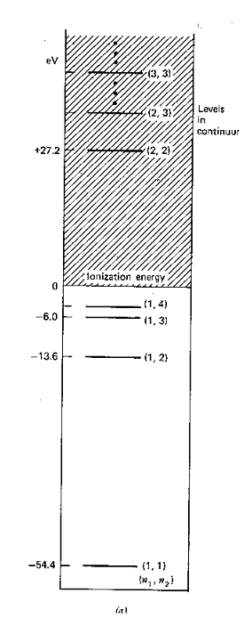
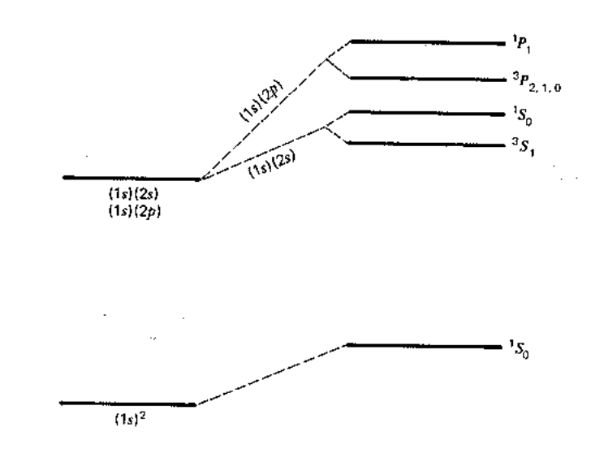
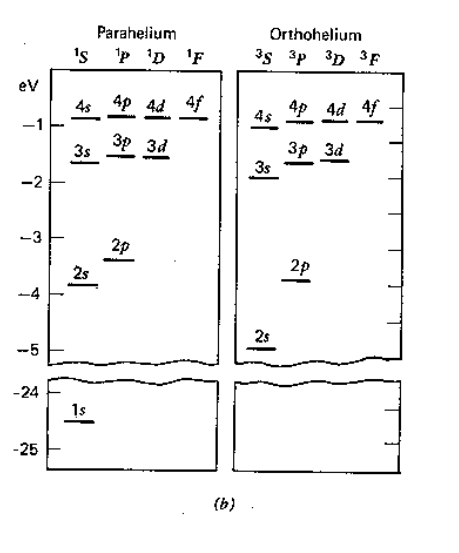
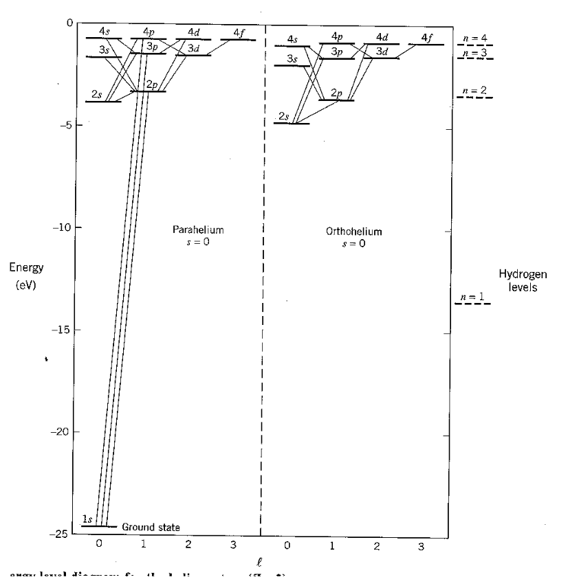

[← 24 Hyperfine Structure](24-hyperfine-structure.md) · [26 Atomic Physics →](26-atomic-physics.md)

---

<hr class="page" style="height:2px;border:0;background:currentColor;opacity:0.25">
<a id="p358" href="book.pdf#page=358" target="_blank" title="This page in the PDF"><sup>[p. 358]</sup></a>

# 25 The Helium Atom

Hydrogen has been a great laboratory for Quantum Mechanics. After Hydrogen, Helium is the simplest atom we can use to begin to study atomic physics. Helium has two protons in the nucleus $`( Z`$ = 2), usually two neutrons $`( A`$ = 4), and two electrons bound to the nucleus.

This material is covered in **Gasiorowicz Chapters 18,** in **Cohen-Tannoudji et al. Comple-** **ment** $`B_{XIV}`$**,** and briefly in Griffiths Chapter 7.

# <a id="s-25-1-general-features-of-helium-states"></a>25.1 General Features of Helium States

We can use the hydrogenic states to begin to understand Helium. The Hamiltonian has the same terms as Hydrogen but has a large perturbation due to the repulsion between the two electrons.

```math
H = \frac{p_{1}^{2}}{2 m} + \frac{p_{2}^{2}}{2 m} - \frac{Ze^{2}}{r_{1}} - \frac{Ze^{2}}{r_{2}} + \frac{e^{2}}{| \vec{r}_{1} - \vec{r}_{2} |}
```

We can write this in terms of the $`( Z`$ = 2) Hydrogen Hamiltonian for each electron plus a perturbation,

```math
H = H_{1} + H_{2} + V
```

where $`V ( \vec{r}_{1} , \vec{r}_{2} ) = \tfrac{e^{2}}{| \vec{r}_{1} - \vec{r}_{2} |}`$. Note that $`V`$ is about the same size as the the rest of the Hamiltonian so first order perturbation theory is unlikely to be accurate.

For our zeroth order energy eigenstates, we will use **product states of Hydrogen wavefunctions**.

```math
u ( \vec{r}_{1} , \vec{r}_{2} ) = \varphi_{n_{1} \ell_{1} m_{1}} ( \vec{r}_{1} ) \varphi_{n_{2} \ell_{2} m_{2}} ( \vec{r}_{2} )
```

These are not eigenfunctions of H because of $`V`$, the electron coulomb repulsion term. Ignoring $`V`$, the problem separates into the energy for electron 1 and the energy for electron 2 and we can solve the problem exactly.

```math
( H_{1} + H_{2} ) u = Eu
```

We can write these **zeroth order energies** in terms of the principal quantum numbers of the two electrons, $`n_{1}`$ and $`n_{2}`$. Recalling that there is a factor of $`Z^{2}`$ = 4 in these energies compared to hydrogen, we get

```math
E = E_{n_{1}} + E_{n_{2}} = - \frac{1}{2} Z^{2} \alpha^{2} m_{e} c^{2} \left( \frac{1}{n_{1}^{2}} + \frac{1}{n_{2}^{2}} \right) = - 5 4 . 4 e V \left( \frac{1}{n_{1}^{2}} + \frac{1}{n_{2}^{2}} \right) .
```

```math
E_{1 1} = E_{gs} = - 1 0 8 . 8 e V
```

```math
E_{1 2} = E_{1 st} = - 6 8 . 0 e V
```

```math
E_{1 \infty} = E_{ionization} = - 5 4 . 4 e V
```

```math
E_{2 2} = - 2 7 . 2 e V
```

Note that $`E_{2 2}`$ is above ionization energy, so the state can decay rapidly by ejecting an electron.

<div align="right"><a href="book.pdf#page=358" target="_blank" title="This page in the PDF"><sup>[p. 358]</sup></a></div>
<hr class="page" style="height:2px;border:0;background:currentColor;opacity:0.25">
<a id="p359" href="book.pdf#page=359" target="_blank" title="This page in the PDF"><sup>[p. 359]</sup></a>



_Figure 81 (p. 359)_

Now let’s look at the (anti) **symmetry of the states** of two identical electrons. For the ground state, the spatial state is symmetric, so the spin state must be antisymmetric $`\Rightarrow s`$ = 0.

```math
u_{0} = \varphi_{1 0 0} \varphi_{1 0 0} \frac{1}{\sqrt{2}} ( \chi_{+} \chi_{-} - \chi_{-} \chi_{+} )
```

For excited states, we can make either symmetric or antisymmetric space states.

```math
u_{1}^{( s )} = \frac{1}{\sqrt{2}} ( \varphi_{1 0 0} \varphi_{2 \ell m} + \varphi_{2 \ell m} \varphi_{1 0 0} ) \frac{1}{\sqrt{2}} ( \chi_{+} \chi_{-} - \chi_{-} \chi_{+} )
```

```math
u_{1}^{( t )} = \frac{1}{\sqrt{2}} ( \varphi_{1 0 0} \varphi_{2 \ell m} - \varphi_{2 \ell m} \varphi_{1 0 0} ) \chi_{+} \chi_{+}
```

The first state is $`s`$ = 0 or spin **singlet**. The second state is $`s`$ = 1 or spin **triplet** and has three $`m_{s}`$ states. Only the +1 state is shown. **Because the large correction due to electron repulsion** **is much larger for symmetric space states, the spin of the state determines the energy.**

We label the states according to the spin quantum numbers, singlet or triplet. We will treat V as a perturbation. It is very large, so first order perturbation theory will be quite inaccurate.

<div align="right"><a href="book.pdf#page=359" target="_blank" title="This page in the PDF"><sup>[p. 359]</sup></a></div>
<hr class="page" style="height:2px;border:0;background:currentColor;opacity:0.25">
<a id="p360" href="book.pdf#page=360" target="_blank" title="This page in the PDF"><sup>[p. 360]</sup></a>

# <a id="s-25-2-the-helium-ground-state"></a>25.2 The Helium Ground State

Calculating the first order correction to the ground state is simple in principle.

```math
\Delta E_{gs} = \langle u_{0} | V | u_{0} \rangle = \int d^{3} r_{1} d^{3} r_{2} | \varphi_{1 0 0} ( \vec{r}_{1} ) |^{2} | \varphi_{1 0 0} ( \vec{r}_{2} ) |^{2} \frac{e^{2}}{| \vec{r}_{1} - \vec{r}_{2} |}
```

```math
= \frac{5}{8} \frac{Ze^{2}}{a_{0}} = \frac{5}{4} Z ( \frac{1}{2} \alpha^{2} mc^{2} ) = \frac{5}{4} ( 2 ) ( 1 3 . 6 ) = 3 4 e V
```

The **calculation** (see section 25.7.1) of the energy shift in first order involves an integral over the coordinates of both electrons.

So the ground state energy to first order is

```math
E_{gs} = - 1 0 8 . 8 + 3 4 = - 7 4 . 8 e V
```

compared to -78.975 eV from experiment. A 10% error is not bad considering the size of the perturbation. First order perturbation theory neglects the change in the electron’s wavefunction due to screening of the nuclear charge by the other electron. Higher order perturbation theory would correct this, however, it is hard work doing that infinite sum. We will find a better way to improve the calculation a bit.

# <a id="s-25-3-the-first-excited-state-s"></a>25.3 The First Excited State(s)

Now we will look at the energies of the excited states. The Pauli principle will cause big energy differences between the different spin states, even though we neglect all spin contribution in $`H_{1}`$ This effect is called the exchange interaction. In the equation below, the $`s`$ stands for singlet corresponding to the plus sign.

```math
E_{1 st}^{( s,t )} = \frac{e^{2}}{2} \left\langle \varphi_{1 0 0} \varphi_{2 \ell m} \pm \varphi_{2 \ell m} \varphi_{1 0 0} \left| \frac{1}{| \vec{r}_{1} - \vec{r}_{2} |} \right| \varphi_{1 0 0} \varphi_{2 \ell m} \pm \varphi_{2 \ell m} \varphi_{1 0 0} \right\rangle
```

```math
= \frac{e^{2}}{2} \left\{ 2 \left\langle \varphi_{1 0 0} \varphi_{2 \ell m} \left| \frac{1}{| \vec{r}_{1} - \vec{r}_{2} |} \right| \varphi_{1 0 0} \varphi_{2 \ell m} \right\rangle \pm 2 \left\langle \varphi_{1 0 0} \varphi_{2 \ell m} \left| \frac{1}{| \vec{r}_{1} - \vec{r}_{2} |} \right| \varphi_{2 \ell m} \varphi_{1 0 0} \right\rangle \right\}
```

```math
\equiv J_{2 \ell} \pm K_{2 \ell}
```

It’s easy to show that $`K_{2 \ell} > 0`$. Therefore, the spin triplet energy is lower. We can write the energy in terms of the Pauli matrices:

```math
\vec{S}_{1} \cdot \vec{S}_{2} = \frac{1}{2} ( S^{2} - S_{1}^{2} - S_{2}^{2} ) = \frac{1}{2} \left[ s ( s + 1 ) - \frac{3}{2} \right] \hbar^{2}
```

```math
\vec{\sigma}_{1} \cdot \vec{\sigma}_{2} = 4 \vec{S}_{1} \cdot \vec{S}_{2} / \hbar^{2} = 2 \left[ s ( s + 1 ) - \frac{3}{2} \right] = \begin{Bmatrix} 1 \quad \text{ triplet } \\ - 3 \text{ singlet } \end{Bmatrix}
```

```math
\frac{1}{2} ( 1 + \vec{\sigma}_{1} \cdot \vec{\sigma}_{2} ) = \begin{Bmatrix} 1 \quad \text{ triplet } \\ - 1 \text{ singlet } \end{Bmatrix}
```

```math
E_{1 st}^{( s,t )} = J_{n\ell} - \frac{1}{2} ( 1 + \vec{\sigma}_{1} \cdot \vec{\sigma}_{2} ) K_{n\ell}
```

<div align="right"><a href="book.pdf#page=360" target="_blank" title="This page in the PDF"><sup>[p. 360]</sup></a></div>
<hr class="page" style="height:2px;border:0;background:currentColor;opacity:0.25">
<a id="p361" href="book.pdf#page=361" target="_blank" title="This page in the PDF"><sup>[p. 361]</sup></a>

Thus we have a large effective spin-spin interaction entirely due to electron repulsion. There is a large difference in energy between the singlet and triplet states. This is due to the exchange antisymmetry and the effect of the spin state on the spatial state (as in ferromagnetism).

The first diagram below shows the result of our calculation. All states increase in energy due to the Coulomb repulsion of the electrons. Before the perturbation, the first excited state is degenerate. After the perturbation, the singlet and triplet spin states split significantly due to the symmetry of the spatial part of the wavefunction. We designate the states with the usual spectroscopic notation.



_Figure 82 (p. 361)_

In addition to the large energy shift between the singlet and triplet states, **Electric Dipole** decay selection rules

```math
\Delta \ell = \pm 1
```

```math
\Delta s = 0
```

cause decays from triplet to singlet states (or vice-versa) to be suppressed by a large factor (compared to decays from singlet to singlet or from triplet to triplet). This caused early researchers to think that there were two separate kinds of Helium. The diagrams below shows the levels for ParaHelium (singlet) and for OtrhoHelium (triplet). The second diagrams shows the dominant decay modes.<span class="page" style="float:left;width:100%;margin:0.4em 0 0.6em"><span style="display:block;text-align:right"><a href="book.pdf#page=361" target="_blank" title="This page in the PDF"><sup>[p. 361]</sup></a></span><span style="display:block;height:2px;background:currentColor;opacity:0.25"></span><a id="p362" href="book.pdf#page=362" target="_blank" title="This page in the PDF"><sup>[p. 362]</sup></a></span> 362



_Figure 83 (p. 362)_

<div align="right"><a href="book.pdf#page=362" target="_blank" title="This page in the PDF"><sup>[p. 362]</sup></a></div>
<hr class="page" style="height:2px;border:0;background:currentColor;opacity:0.25">
<a id="p363" href="book.pdf#page=363" target="_blank" title="This page in the PDF"><sup>[p. 363]</sup></a>



_Figure 84 (p. 363)_

# <a id="s-25-4-the-variational-principle-rayleigh-ritz-approximation"></a>25.4 The Variational Principle (Rayleigh-Ritz Approximation)

Because the ground state has the lowest possible energy, we can vary a test wavefunction, minimizing the energy, to get a good estimate of the ground state energy.

```math
H\psi_{E} = E\psi_{E}
```

for the ground state $`\psi_{E}`$.

```math
E = \frac{\int \psi_{E}^{*} H\psi_{E} dx}{\int \psi_{E}^{*} \psi_{E} dx}
```

For any trial wavefunction $`\psi`$,

```math
E^{\prime} = \frac{\int \psi^{*} H\psi dx}{\int \psi^{*} \psi dx} = \frac{\langle \psi^{*} | H | \psi \rangle}{\langle \psi | \psi \rangle}
```

<div align="right"><a href="book.pdf#page=363" target="_blank" title="This page in the PDF"><sup>[p. 363]</sup></a></div>
<hr class="page" style="height:2px;border:0;background:currentColor;opacity:0.25">
<a id="p364" href="book.pdf#page=364" target="_blank" title="This page in the PDF"><sup>[p. 364]</sup></a>

We wish to show that $`E^{\prime}`$ errors are second order in $`\delta \psi`$

```math
\Rightarrow \quad \frac{\partial E}{\partial \psi} = 0
```

at eigenenergies.

To do this, we will add a variable amount of an arbitrary function $`\varphi`$ to the energy eigenstate.

```math
E^{\prime} = \frac{\langle \psi_{E} + \alpha \varphi | H | \psi_{E} + \alpha \varphi \rangle}{\langle \psi_{E} + \alpha \varphi | \psi_{E} + \alpha \varphi \rangle}
```

Assume $`\alpha`$ is real since we do this for any arbitrary function $`\varphi`$. Now we differentiate with respect to $`\alpha`$ and evaluate at zero.

```math
\frac{dE^{\prime}}{d\alpha} |_{\alpha = 0} = \frac{\langle \psi_{E} | \psi_{E} \rangle ( \langle \varphi | H | \psi_{E} \rangle + \langle \psi_{E} | H | \varphi \rangle ) - \langle \psi_{E} | H | \psi_{E} \rangle ( \langle \varphi | \psi_{E} \rangle + \langle \psi_{E} | \varphi \rangle )}{\langle \psi_{E} | \psi_{E} \rangle^{2}}
```

```math
= E \langle \varphi | \psi_{E} \rangle + E \langle \psi_{E} | \varphi \rangle - E \langle \varphi | \psi_{E} \rangle - E \langle \psi_{E} | \varphi \rangle = 0
```

We find that the derivative is zero around any eigenfunction, proving that variations of the energy are second order in variations in the wavefunction.

That is, $`E^{\prime}`$ is stationary (2nd order changes only) with respect to variation in $`\psi`$. Conversely, it can be shown that $`E^{\prime}`$ is only stationary for eigenfunctions $`\psi_{E}`$. We can use the **variational principle** to approximately find $`\psi_{E}`$ and to find an upper bound on $`E_{0}`$.

```math
\psi = \sum_{E} c_{E} \psi_{E}
```

```math
E^{\prime} = \sum_{E} | c_{E} |^{2} E \geq E_{0}
```

For higher states this also works if trial $`\psi`$ is automatically orthogonal to all lower states due to some symmetry (Parity, $`\ell`$ ...)

\* See Example 25.6.1: Energy of 1D Harmonic Oscillator using a polynomial trail wave function.\* \* See Example 25.6.2: 1D H.O. using Gaussian.\*

# <a id="s-25-5-variational-helium-ground-state-energy"></a>25.5 Variational Helium Ground State Energy

We will now add one parameter to the hydrogenic ground state wave function and optimize that parameter to minimize the energy. We could add more parameters but let’s keep it simple. We will start with the hydrogen wavefunctions but allow for the fact that one electron “screens” the nuclear charge from the other. We will assume that the wave function changes simply by the replacement

```math
Z \to Z^{*} <Z.
```

Of course the $`Z`$ in the Hamiltonian doesn’t change.

So our ground state trial function is

```math
\psi \to \varphi_{1 0 0}^{Z^{*}} ( \vec{r}_{1} ) \varphi_{1 0 0}^{Z^{*}} ( \vec{r}_{2} ) .
```

<div align="right"><a href="book.pdf#page=364" target="_blank" title="This page in the PDF"><sup>[p. 364]</sup></a></div>
<hr class="page" style="height:2px;border:0;background:currentColor;opacity:0.25">
<a id="p365" href="book.pdf#page=365" target="_blank" title="This page in the PDF"><sup>[p. 365]</sup></a>

Minimize the energy.

```math
\langle \psi | H | \psi \rangle = \int d^{3} r_{1} d^{3} r_{2} \varphi_{1 0 0}^{*} ( \vec{r}_{1} ) \varphi_{1 0 0}^{*} ( \vec{r}_{2} ) \left[ \frac{p_{1}^{2}}{2 m} - \frac{Ze^{2}}{r_{1}} + \frac{p_{2}^{2}}{2 m} - \frac{Ze^{2}}{r_{2}} + \frac{e^{2}}{| \vec{r}_{1} - \vec{r}_{2} |} \right] \varphi_{1 0 0} ( \vec{r}_{1} ) \varphi_{1 0 0} ( \vec{r}_{2} )
```

We can recycle our previous work to do these integrals. First, replace the $`Z`$ in $`H_{1}`$ with a $`Z^{*}`$ and put in a correction term. This makes the $`H_{1}`$ part just a hydrogen energy. The correction term is just a constant over $`r`$ so we can also write that in terms of the hydrogen ground state energy.

```math
x = \int d^{3} r_{1} \varphi_{1 0 0}^{*} \left( \frac{p_{1}^{2}}{2 m} - \frac{Ze^{2}}{r_{1}} \right) \varphi_{1 0 0}
```

```math
= \int d^{3} r_{1} \varphi_{1 0 0}^{*} \left( \frac{p_{1}^{2}}{2 m} - \frac{Z^{*} e^{2}}{r_{1}} + \frac{( Z^{*} - Z ) e^{2}}{r_{1}} \right) \varphi_{1 0 0}
```

```math
= Z^{* 2} ( - 1 3 . 6 e V ) + ( Z^{*} - Z ) e^{2} \int d^{3} r_{1} | \varphi_{1 0 0} |^{2} \frac{1}{r_{1}}
```

```math
= Z^{* 2} ( - 1 3 . 6 e V ) + ( Z^{*} - Z ) e^{2} \frac{Z^{*}}{a_{0}}
```

```math
= - Z^{* 2} \frac{1}{2} \alpha^{2} mc^{2} + Z^{*} ( Z^{*} - Z ) \alpha^{2} mc^{2}
```

```math
= \alpha^{2} mc^{2} \left( Z^{*} ( Z^{*} - Z ) - \frac{1}{2} Z^{* 2} \right)
```

Then we reuse the perturbation theory calculation to get the $`V`$ term.

```math
\langle \psi | H | \psi \rangle = 2 [ x ] + \frac{5}{4} Z^{*} \left( \frac{1}{2} \alpha^{2} mc^{2} \right)
```

```math
= - \frac{1}{2} \alpha^{2} mc^{2} \left[ 2 Z^{* 2} - 4 Z^{*} ( Z^{*} - Z ) - \frac{5}{4} Z^{*} \right]
```

```math
= - \frac{1}{2} \alpha^{2} mc^{2} \left[ - 2 Z^{* 2} + 4 ZZ^{*} - \frac{5}{4} Z^{*} \right]
```

Use the variational principle to determine the best $`Z^{*}`$.

```math
\frac{\partial \langle \psi | H | \psi \rangle}{\partial Z^{*}} = 0 \quad \Rightarrow \quad - 4 Z^{*} + 4 Z - \frac{5}{4} = 0
```

```math
Z^{*} = Z - \frac{5}{1 6}
```

Putting these together we get our estimate of the ground state energy.

```math
\langle \psi | H | \psi \rangle = - \frac{1}{2} \alpha^{2} mc^{2} Z^{*} \left[ - 2 Z^{*} + 4 Z - \frac{5}{4} \right]
```

```math
= - \frac{1}{2} \alpha^{2} mc^{2} ( Z - \frac{5}{1 6} ) \left[ - 2 Z + \frac{5}{8} + 4 Z - \frac{5}{4} \right]
```

```math
( really - 7 8 . 9 7 5 eV ) . = - \frac{1}{2} \alpha^{2} mc^{2} \left[ 2 \left( Z - \frac{5}{1 6} \right)^{2} \right] = - 7 7 . 3 8 e V
```

<div align="center">

Now we are within a few percent. We could use more parameters for better results.

</div>

<div align="right"><a href="book.pdf#page=365" target="_blank" title="This page in the PDF"><sup>[p. 365]</sup></a></div>
<hr class="page" style="height:2px;border:0;background:currentColor;opacity:0.25">
<a id="p366" href="book.pdf#page=366" target="_blank" title="This page in the PDF"><sup>[p. 366]</sup></a>

# <a id="s-25-6-examples"></a>25.6 Examples

## <a id="s-25-6-1-1d-harmonic-oscillator"></a>25.6.1 1D Harmonic Oscillator

Use

```math
\psi = \left( a^{2} - x^{2} \right)^{2} \quad | x |\leq a
```

and $`\psi`$ = 0 otherwise as a trial wave function. Recall the actual wave function is $`e^{- m\omega x^{2} / 2 \hbar^{2}}`$. The energy estimate is

```math
E^{\prime} = \frac{\left\langle \left( a^{2} - x^{2} \right)^{2} |^{-} \tfrac{\hbar^{2}}{2 m} \tfrac{d^{2}}{dx^{2}} + \tfrac{1}{2} m\omega^{2} x^{2} | \left( a^{2} - x^{2} \right)^{2} \right\rangle}{\left\langle ( a^{2} - x^{2} )^{2} | ( a^{2} - x^{2} )^{2} \right\rangle} .
```

We need to do some integrals of polynomials to compute

```math
E^{\prime} = \frac{3}{2} \frac{\hbar^{2}}{ma^{2}} + \frac{1}{2 2} m\omega^{2} a^{2} .
```

Now we optimize the parameter.

```math
\frac{dE^{\prime}}{da^{2}} = 0 = \frac{- 3}{2} \frac{\hbar^{2}}{ma^{4}} + \frac{1}{2 2} m\omega^{2} \Rightarrow a^{2} = \sqrt{3 3 \frac{\hbar^{2}}{m\omega^{2}}} = \sqrt{3 3} \frac{\hbar}{m\omega}
```

```math
E^{\prime} = \frac{3}{2} \frac{\hbar \omega}{\sqrt{3 3}} + \frac{1}{2 2} m\omega^{2} \sqrt{3 3} \frac{\hbar}{m\omega} = \left( \frac{3}{2 \sqrt{3 3}} + \frac{\sqrt{3 3}}{2 2} \right) \hbar \omega = \frac{1}{2} \hbar \omega \left( \frac{\sqrt{3 3} + \sqrt{3 3}}{1 1} \right)
```

```math
= \frac{1}{2} \hbar \omega \frac{\sqrt{4 \cdot 3}}{\sqrt{1 1}} = \frac{1}{2} \hbar \omega \sqrt{\frac{1 2}{1 1}}
```

This is close to the right answer. As always, it is treated as an upper limit on the ground state energy.

## <a id="s-25-6-2-1-d-h-o-with-exponential-wavefunction"></a>25.6.2 1-D H.O. with exponential wavefunction

As a check of the procedure, take trial function $`e^{- ax^{2} / 2}`$. This should give us the actual ground state energy. $`\infty`$

```math
E^{\prime} = \frac{\int_{-\infty} \psi^{*} \left[ - \tfrac{\hbar^{2}}{m}_{2} \tfrac{\partial^{2} \psi}{\partial x^{2}} + \tfrac{1}{2} m\omega^{2} x^{2} \psi \right] dx}{\infty}
```

```math
\int_{-\infty} \psi^{*} \psi dx
```

```math
= \frac{\left\{ {}^{-} \tfrac{\hbar^{2}}{2 m} \int_{-\infty}^{\infty} e^{- ax^{2}} \left[ a^{2} x^{2} - a \right] dx + \tfrac{1}{2} m\omega^{2} \int_{-\infty}^{\infty} x^{2} e^{- ax^{2}} dx \right\}}{\int^{\infty} - ax^{2}} {}_{-\infty} e dx
```

<div align="right"><a href="book.pdf#page=366" target="_blank" title="This page in the PDF"><sup>[p. 366]</sup></a></div>
<hr class="page" style="height:2px;border:0;background:currentColor;opacity:0.25">
<a id="p367" href="book.pdf#page=367" target="_blank" title="This page in the PDF"><sup>[p. 367]</sup></a>

```math
= \left[ \frac{- a^{2} \hbar^{2}}{2 m} + \frac{1}{2} m\omega^{2} \right] \frac{-\infty}{\int^{\infty} - ax^{2}} \int_{{}_{-\infty} e}^{\infty} \frac{x^{2} e^{- ax^{2}} dx}{dx} + \left[ \frac{\hbar^{2} a}{2 m} \right]
```

```math
\int_{-\infty}^{\infty} e^{- ax^{2}} dx = \sqrt{\frac{\pi}{a}} = \sqrt{\pi} a^{- 1 / 2}
```

```math
- \int_{-\infty}^{\infty} x^{2} e^{- ax^{2}} dx = \sqrt{\pi} \left( - \frac{1}{2} \right) a^{- 3 / 2}
```

```math
\begin{aligned} \int_{-\infty}^{\infty} x^{2} e^{- ax^{2}} dx &= \frac{1}{2} \sqrt{\frac{\pi}{a^{3}}} = \frac{1}{2 a} \sqrt{\frac{\pi}{a}} \\ E^{\prime} &= \left[ \frac{- a \hbar^{2}}{4 m} + \frac{1}{4 a} m\omega^{2} \right] + \frac{\hbar^{2} a}{2 m} = \frac{1}{4 a} m\omega^{2} + \frac{\hbar^{2}}{4 m} a \end{aligned}
```

```math
\frac{\partial E^{\prime}}{\partial a} = \frac{- m\omega^{2}}{4 a^{2}} + \frac{\hbar^{2}}{4 m} = 0
```

```math
4 a^{2} \hbar^{2} = 4 m^{2} \omega^{2}
```

```math
a = \frac{m\omega}{\hbar}
```

```math
\psi = e^{- \tfrac{m\omega}{2 \hbar} x^{2}}
```

```math
E^{\prime} = \frac{m\omega^{2}}{4} \frac{\hbar}{m\omega} + \frac{\hbar^{2}}{4 m} \frac{m\omega}{\hbar} = \frac{1}{4} \hbar \omega + \frac{1}{4} \hbar \omega
```

OK.

# <a id="s-25-7-derivations-and-computations"></a>25.7 Derivations and Computations

## <a id="s-25-7-1-calculation-of-the-ground-state-energy-shift"></a>25.7.1 Calculation of the ground state energy shift

To calculate the first order correction to the He ground state energy, we gotta do this integral.

```math
\Delta E_{gs} = \langle u_{0} | V | u_{0} \rangle = \int d^{3} r_{1} d^{3} r_{2} | \varphi_{1 0 0} ( \vec{r}_{1} ) |^{2} | \varphi_{1 0 0} ( \vec{r}_{2} ) |^{2} \frac{e^{2}}{| \vec{r}_{1} - \vec{r}_{2} |}
```

First, plug in the Hydrogen ground state wave function (twice).

```math
\Delta E_{gs} = \left[ \frac{1}{4 \pi} 4 \left( \frac{Z}{a_{0}} \right)^{3} \right]^{2} e^{2} \int_{0}^{\infty} r_{1}^{2} dr_{1} e^{- 2 Zr_{1} /a_{0}} \int_{0}^{\infty} r_{2}^{2} dr_{1} e^{- 2 Zr_{2} /a_{0}} \int d \Omega_{1} \int d \Omega_{2} \frac{1}{| \vec{r}_{1} - \vec{r}_{2} |}
```

<div align="right"><a href="book.pdf#page=367" target="_blank" title="This page in the PDF"><sup>[p. 367]</sup></a></div>
<hr class="page" style="height:2px;border:0;background:currentColor;opacity:0.25">
<a id="p368" href="book.pdf#page=368" target="_blank" title="This page in the PDF"><sup>[p. 368]</sup></a>

```math
\frac{1}{| \vec{r}_{1} - \vec{r}_{2} |} = \frac{1}{\sqrt{r_{1}^{2} + r_{2}^{2} - 2 r_{1} r_{2} \cos \theta}}
```

Do the $`d`$Ω$`1`$ integral and prepare the other.

```math
\Delta E_{gs} = \frac{4 \pi}{\pi^{2}} e^{2} \left( \frac{Z}{a_{0}} \right)^{6} \int_{0}^{\infty} r_{1}^{2} dr_{1} e^{- 2 Zr_{1} /a_{0}} \int_{0}^{\infty} r_{2}^{2} dr_{2} e^{- 2 Zr_{2} /a_{0}} \int d\varphi_{2} d \cos \theta_{2} \frac{1}{\sqrt{r_{1}^{2} + r_{2}^{2} - 2 r_{1} r_{2} \cos \theta_{2}}}
```

The angular integrals are not hard to do.

```math
\Delta E_{gs} = \frac{4 \pi}{\pi^{2}} e^{2} \left( \frac{Z}{a_{0}} \right)^{6} \int_{0}^{\infty} r_{1}^{2} dr_{1} e^{- 2 Zr_{1} /a_{0}} \int_{0}^{\infty} r_{2}^{2} dr_{2} e^{- 2 Zr_{2} /a_{0}} 2 \pi \left[ \frac{- 2}{2 r_{1} r_{2}} \sqrt{r_{1}^{2} + r_{2}^{2} - 2 r_{1} r_{2} \cos \theta_{2}} \right] \frac{1}{- 1}
```

```math
\begin{aligned} \Delta E_{gs} &= \frac{4 \pi}{\pi^{2}} e^{2} \left( \frac{Z}{a_{0}} \right)^{6} \int_{0}^{\infty} r_{1}^{2} dr_{1} e^{- 2 Zr_{1} /a_{0}} \int_{0}^{\infty} r_{2}^{2} dr_{2} e^{- 2 Zr_{2} /a_{0}} \frac{2 \pi}{r_{1} r_{2}} \\ & \quad \left[ - \sqrt{r_{1}^{2} + r_{2}^{2} - 2 r_{1} r_{2}} + \sqrt{r_{1}^{2} + r_{2}^{2} + 2 r_{1} r_{2}} \right] \end{aligned}
```

```math
\Delta E_{gs} = \frac{4 \pi}{\pi^{2}} e^{2} \left( \frac{Z}{a_{0}} \right)^{6} \int_{0}^{\infty} r_{1}^{2} dr_{1} e^{- 2 Zr_{1} /a_{0}} \int_{0}^{\infty} r_{2}^{2} dr_{2} e^{- 2 Zr_{2} /a_{0}} \frac{2 \pi}{r_{1} r_{2}} [ -| r_{1} - r_{2} | + ( r_{1} + r_{2} ) ]
```

```math
\Delta E_{gs} = 8 e^{2} \left( \frac{Z}{a_{0}} \right)^{6} \int_{0}^{\infty} r_{1} dr_{1} e^{- 2 Zr_{1} /a_{0}} \int_{0}^{\infty} r_{2} dr_{2} e^{- 2 Zr_{2} /a_{0}} ( r_{1} + r_{2} -| r_{1} - r_{2} | )
```

We can do the integral for $`r_{2} <r_{1}`$ and simplify the expression. Because of the symmetry between $`r_{1}`$ and $`r_{2}`$ the rest of the integral just doubles the result.

```math
\Delta E_{gs} = 1 6 e^{2} \left( \frac{Z}{a_{0}} \right)^{6} \int_{0}^{\infty} r_{1} dr_{1} e^{- 2 Zr_{1} /a_{0}} \int_{0}^{r_{1}} r_{2} dr_{2} e^{- 2 Zr_{2} /a_{0}} ( 2 r_{2} )
```

```math
\Delta E_{gs} = e^{2} \frac{Z}{a_{0}} \int_{0}^{\infty} x_{1} dx_{1} e^{- x_{1}} \int_{0}^{x_{1}} x_{2}^{2} dx_{2} e^{- x_{2}}
```

```math
= \frac{Ze^{2}}{a_{0}} \int_{0}^{\infty} x_{1} dx_{1} e^{- x_{1}} \left\{ - x_{1}^{2} e^{- x_{1}} + \int_{0}^{x_{1}} 2 x_{2} dx_{2} e^{- x_{2}} \right\}
```

```math
= \frac{Ze^{2}}{a_{0}} \int_{0}^{\infty} x_{1} dx_{1} e^{- x_{1}} \left\{ - x_{1}^{2} e^{- x_{1}} - 2 x_{1} e^{- x_{1}} + 2 \int_{0}^{x_{1}} e^{- x_{2}} dx_{2} \right\}
```

```math
= \frac{Ze^{2}}{a_{0}} \int_{0}^{\infty} x_{1} dx_{1} e^{- x_{1}} \left\{ - x_{1}^{2} e^{- x_{1}} - 2 x_{1} e^{- x_{1}} - 2 \left( e^{- x_{1}} - 1 \right) \right\}
```

```math
= - \frac{Ze^{2}}{a_{0}} \int^{\infty} \left[ \left( x_{1}^{3} + 2 x_{1}^{2} + 2 x_{1} \right) e^{- 2 x_{1}} - 2 x_{1} e^{- x_{1}} \right] dx_{1}
```

<div align="right"><a href="book.pdf#page=368" target="_blank" title="This page in the PDF"><sup>[p. 368]</sup></a></div>
<hr class="page" style="height:2px;border:0;background:currentColor;opacity:0.25">
<a id="p369" href="book.pdf#page=369" target="_blank" title="This page in the PDF"><sup>[p. 369]</sup></a>

```math
= - \frac{Ze^{2}}{a_{0}} \left[ \frac{3}{2} \frac{2}{2} \frac{1}{2} \frac{1}{2} + 2 \frac{2}{2} \frac{1}{2} \frac{1}{2} + 2 \frac{1}{2} \frac{1}{2} - 2 \frac{1}{1} \frac{1}{1} \right]
```

```math
\Delta E_{gs} = - \frac{Ze^{2}}{a_{0}} \left[ \frac{3}{8} + \frac{4}{8} + \frac{4}{8} - \frac{1 6}{8} \right] = + \frac{5}{8} \frac{Ze^{2}}{a_{0}}
```

```math
= \frac{5}{4} Z ( 1 3 . 6 e V ) \quad \to 3 4 \text{ eV for Z } = 2
```

# <a id="s-25-8-homework-problems"></a>25.8 Homework Problems

1. Calculate the lowest order energy shift for the (0th order degenerate first) excited states of Helium ∆$`E_{2 ,l}^{( s,t )}`$ where $`\ell`$ = 0$`,`$ 1. This problem is set up in the discussion of the first excited states (See section 25.3). The following formulas will aid you in the computation. First, we can expand the formula for the inverse distance between the two electrons as follows.

```math
\frac{1}{| \vec{r}_{1} - \vec{r}_{2} |} = \sum_{\ell = 0}^{\infty} \frac{r_{<}^{\ell}}{r_{>}^{\ell + 1}} P_{\ell} ( \cos \theta_{1 2} )
```

Here $`r_{<}`$ is the smaller of the two radii and $`r_{>}`$ is the larger. As in the ground state calculation, we can use the symmetry of the problem to specify which radius is the larger. Then we can use a version of the addition theorem to write the Legendre Polynomial $`P_{\ell}`$(cos$`\theta_{1 2} )`$ in terms of the spherical hamonics for each electron.

```math
P_{\ell} ( \cos \theta_{1 2} ) = \frac{4 \pi}{2 \ell + 1} \sum_{m = - \ell}^{\ell} ( - 1 )^{m} Y_{\ell m} ( \theta_{1} ,\varphi_{1} ) Y_{\ell ( - m )} ( \theta_{2} ,\varphi_{2} )
```

Using the equation $`Y_{\ell ( - m )} = ( - 1 )^{\ell} Y_{\ell m}^{*}`$ , this sets us up to do our integrals nicely.

2. Consider the lowest state of ortho-helium. What is the magnetic moment? That is what is

the interaction with an external magnetic field?

3. A proton and neutron are bound together into a deuteron, the nucleus of an isotope of hydrogen. The binding energy is found to be -2.23 MeV for the nuclear ground state, an $`\ell`$ = 0 state. Assuming a potential of the form $`V ( r ) = V_{0} \tfrac{e^{- r/r 0}}{r/r_{0}}`$, with $`r_{0}`$ = 2$`. 8`$ Fermis, use the variational principle to estimate the strength of the potential.

4. Use the variational principle with a gaussian trial wave function to prove that a one dimensional

attractive potential will always have a bound state.

5. Use the variational principle to estimate the ground state energy of the anharmonic oscillator,

```math
H = \tfrac{p^{2}}{2 m} + \lambda x^{4} .
```

# <a id="s-25-9-sample-test-problems"></a>25.9 Sample Test Problems

1. We wish to get a good upper limit on the Helium ground state energy. Use as a trial wave function the 1s hydrogen state with the parameter a screened nuclear charge $`Z^{*}`$ to get this limit. Determine the value of $`Z^{*}`$ which gives the best limit. The integral $`\langle ( 1 s )^{2} |_{|} \tfrac{e^{2}}{\vec{r}_{1} - \vec{r}_{2} |} | ( 1 s )^{2} \rangle =`$

$`\tfrac{5}{8} Z^{*} \alpha^{2} mc^{2}`$ for a nucleus of charge $`Z^{*} e`$.

<div align="right"><a href="book.pdf#page=369" target="_blank" title="This page in the PDF"><sup>[p. 369]</sup></a></div>
<hr class="page" style="height:2px;border:0;background:currentColor;opacity:0.25">
<a id="p370" href="book.pdf#page=370" target="_blank" title="This page in the PDF"><sup>[p. 370]</sup></a>

2. A Helium atom has two electrons bound to a $`Z`$ = 2 nucleus. We have to add the coulomb repulsion term (between the two electrons) to the zeroth order Hamiltonian.

```math
H = \frac{p_{1}^{2}}{2 m} - \frac{Ze^{2}}{r_{1}} + \frac{p_{2}^{2}}{2 m} - \frac{Ze^{2}}{r_{2}} + \frac{e^{2}}{| \vec{r}_{1} - \vec{r}_{2} |} = H_{1} + H_{2} + V
```

The first excited state of Helium has one electron in the 1S state and the other in the 2S state. Calculate the energy of this state to zeroth order in the perturbation V. Give the answer in eV. The spins of the two electrons can be added to give states of total spin $`\vec{S}`$. The possible total spin states are $`s`$ = 0 and $`s`$ = 1. Write out the full first excited Helium state which has $`s`$ = 1 and $`m_{s} = - 1`$. Include the spatial wave function and don’t forget the Pauli principle. Use bra-ket notation to calculate the energy shift to this state in first order perturbation theory. Don’t do any integrals.

---

[← 24 Hyperfine Structure](24-hyperfine-structure.md) · [26 Atomic Physics →](26-atomic-physics.md)
