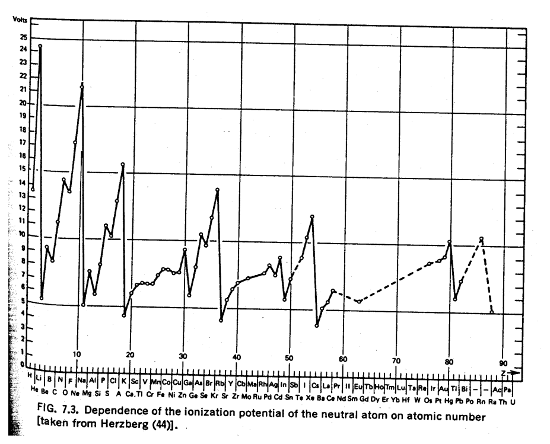
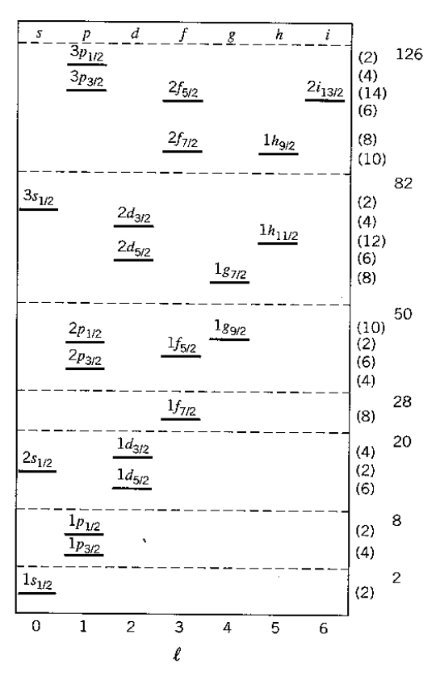
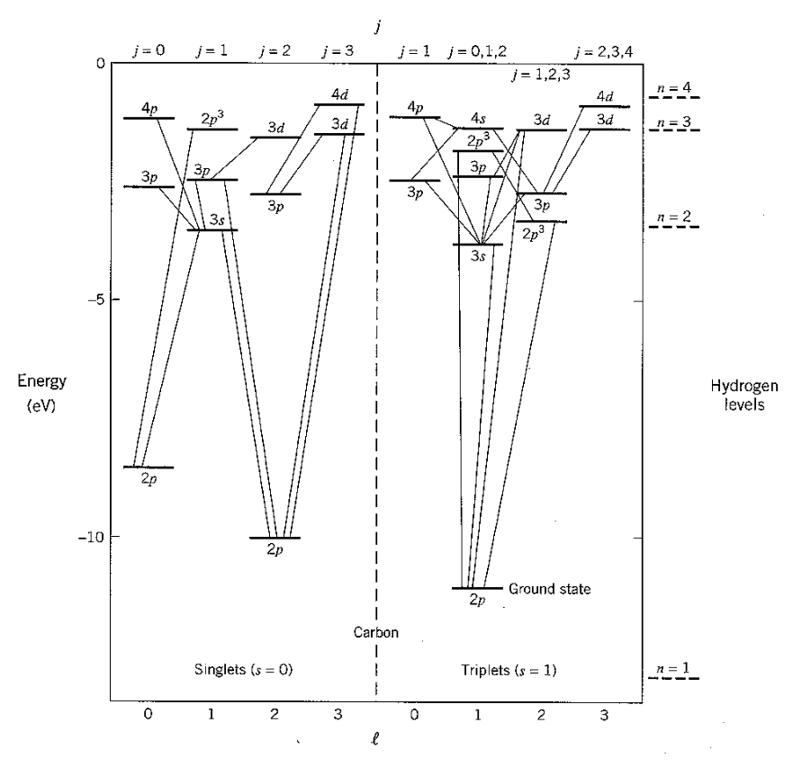
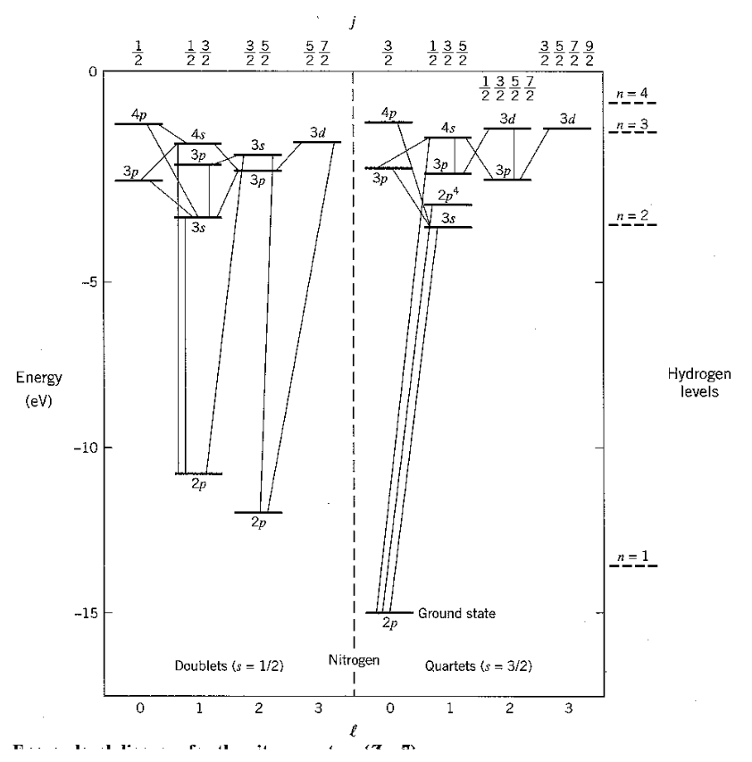

[← 25 The Helium Atom](25-the-helium-atom.md) · [27 Molecular Physics →](27-molecular-physics.md)

---

<hr class="page" style="height:2px;border:0;background:currentColor;opacity:0.25">
<a id="p371" href="book.pdf#page=371" target="_blank" title="This page in the PDF"><sup>[p. 371]</sup></a>

# 26 Atomic Physics

This material is covered in **Gasiorowicz Chapter 19,** and in **Cohen-Tannoudji et al. Com-** **plement** $`A_{XIV}`$**.**

# <a id="s-26-1-atomic-shell-model"></a>26.1 Atomic Shell Model

The Hamiltonian for an atom with $`Z`$ electrons and protons is

```math
\left[ \sum_{i = 1}^{Z} \left( \frac{p_{i}^{2}}{2 m} - \frac{Ze^{2}}{r_{i}} \right) + \sum_{i>j} \frac{e^{2}}{| \vec{r}_{i} - \vec{r}_{j} |} \right] \psi = E\psi .
```

We have seen that the coulomb repulsion between electrons is a very large correction in Helium and that the three body problem in quantum mechanics is only solved by approximation. The states we have from hydrogen are modified significantly. What hope do we have to understand even more complicated atoms?

The physics of **closed shells** and angular momentum enable us to make sense of even the most complex atoms. Because of the Pauli principle, we can put only one electron into each state. When we have enough electrons to fill a shell, say the 1s or 2p, The resulting electron distribution is spherically symmetric because

```math
\sum_{m = - \ell}^{\ell} | Y_{\ell m} ( \theta ,\varphi ) |^{2} = \frac{2 \ell + 1}{4 \pi} .
```

With all the states filled and the relative phases determined by the antisymmetry required by Pauli, the quantum numbers of the closed shell are determined. **There is only one possible state** **representing a closed shell.**

As in Helium, the two electrons in the same spatial state, $`\varphi_{n\ell m}`$, must by symmetric in space and hence antisymmetric in spin. This implies each pair of electrons has a total spin of 0. Adding these together gives a total spin state with $`s`$ = 0, which is antisymmetric under interchange. The spatial state must be totally symmetric under interchange and, since all the states in the shell have the same $`n`$ and $`\ell`$, it is the different $`m`$ states which are symmetrized. This can be shown to give us a total $`\ell`$ = 0 state.

So the **closed shell contributes a spherically symmetric charge and spin distribution** with the quantum numbers

```math
s = 0
```

```math
\ell = 0
```

```math
j = 0
```

The closed shell screens the nuclear charge. Because of the **screening**, the potential no longer has a pure $`\frac{1}{r}`$ behavior. Electrons which are far away from the nucleus see less of the nuclear charge and shift up in energy. This is a large effect and single electron states with larger $`\ell`$ have larger energy. From lowest to highest energy, the atomic shells have the order

```math
1 s, 2 s, 2 p, 3 s, 3 p, 4 s, 3 d, 4 p, 5 s, 4 d, 5 p, 6 s, 4 f, 5 d, 6 p.
```

<div align="right"><a href="book.pdf#page=371" target="_blank" title="This page in the PDF"><sup>[p. 371]</sup></a></div>
<hr class="page" style="height:2px;border:0;background:currentColor;opacity:0.25">
<a id="p372" href="book.pdf#page=372" target="_blank" title="This page in the PDF"><sup>[p. 372]</sup></a>

The effect of screening not only breaks the degeneracy between states with the same $`n`$ but different $`\ell`$, it even moves the 6s state, for example, to have lower energy than the 4f or 5d states. The 4s and 3d states have about the same energy in atoms because of screening.

# <a id="s-26-2-the-hartree-equations"></a>26.2 The Hartree Equations

The Hartree method allows us to to change the 3$`Z`$ dimensional Schrödinger equation $`( Z`$ electrons in 3 dimensions) into a 3 dimensional **equation for each electron**. This equation depends on the wavefunctions of the other electrons but can be solved in a self consistent way using the variational principle and iterating.

```math
\begin{aligned} \psi &= \varphi_{1} ( \vec{r}_{1} ) \varphi_{2} ( \vec{r}_{2} ) \dots \varphi_{Z} ( \vec{r}_{Z} ) \\ \left[ \frac{- \hbar^{2}}{2 m} \nabla_{i}^{2} - \frac{Ze^{2}}{r_{i}} + e^{2} \sum_{j \neq i} \int d^{3} r_{j} \frac{| \varphi_{j} ( \vec{r}_{j} ) |^{2}}{| \vec{r} i - \vec{r} j |} \right] \varphi_{i} ( \vec{r}_{i} ) &= \epsilon_{i} \varphi_{i} ( \vec{r}_{i} ) \end{aligned}
```

In the Hartree equation above, $`\epsilon_{i}`$ represents the energy contribution of electron $`i`$. The term $`e^{2} \sum \int d^{3} r_{j} \tfrac{| \varphi_{j} ( \vec{r}_{j} ) |^{2}}{| \vec{r}_{i} - \vec{r}_{j} |}`$ represents the potential due to the other electrons in which electron $`i`$ moves.

```math
j \neq i
```

In this equation we can formally see the effect of screening by the other electrons. The equation is derived (see Gasiorowicz pp 309-311) from the Schrödinger equation using $`\psi = \varphi_{1} \varphi_{2} \dots \varphi_{Z}`$. Since we will not apply these equations to solve problems, we will not go into the derivation, however, it is useful to know how one might proceed to solve more difficult problems.

An improved formalism known as the Hartree-Fock equations, accounts for the required antisymmetry and gives slightly different results.

# <a id="s-26-3-hund-s-rules"></a>26.3 Hund’s Rules

A set of guidelines, known as Hund’s rules, help us determine the quantum numbers for the ground states of atoms. The hydrogenic shells fill up giving well defined $`j`$ = 0 states for the closed shells. As we add **valence electrons** we follow Hund’s rules to determine the ground state. We get a great simplification by treating nearly closed shells as a closed shell plus positively charged, spin $`\frac{1}{2}`$ **holes**. For example, if an atom is two electrons short of a closed shell, we treat it as a closed shell plus two positive holes.)

1. Couple the valence electrons (or holes) to give **maximum total spin**.

2. Now choose the state of maximum $`\ell`$ (subject to the Pauli principle. The Pauli principle rather

than the rule, often determines everything here.)

3. If the shell is more than half full, pick the highest total angular momentum state $`j = \ell + s`$

otherwise pick the lowest $`j = | \ell - s |`$.

This method of adding up all the spins and all the Ls, is called LS or **Russel-Saunders coupling**. This method and these rule are quite good until the electrons become relativistic in heavy atoms and spin-orbit effects become comparable to the electron repulsion (arond Z=40). We choose the

<div align="right"><a href="book.pdf#page=372" target="_blank" title="This page in the PDF"><sup>[p. 372]</sup></a></div>
<hr class="page" style="height:2px;border:0;background:currentColor;opacity:0.25">
<a id="p373" href="book.pdf#page=373" target="_blank" title="This page in the PDF"><sup>[p. 373]</sup></a>

states in which the total $`s`$ and the total $`\ell`$ are good quantum numbers are best for minimizing the overlap of electrons, and hence the positive contribution to the energy.

For very heavy atoms, we add the total angular momentum from each electron first then add up the Js. This is called **j-j coupling**. For heavy atoms, electrons are relativistic and the spin-orbit interaction becomes more important than the effect of electron repulsion. Thus we need to use states in which the total angular momentum of each electron is a good quantum number.

We can understand Hund’s rules to some extent. The maximum spin state is symmetric under interchange, requiring an antisymmetric spatial wavefunction which has a lower energy as we showed for Helium. We have not demonstated it, but, the larger the total $`\ell`$ the more lobes there are in the overall electron wavefunction and the lower the effect of electron repulsion. Now the spin orbit interaction comes into play. For electrons with their negative charge, larger $`j`$ increases the energy. The reverse is true for holes which have an effective postive charge.

A simpler set of rules has been developed for chemists, who can’t understand addition of angular momentum. It is based on the same principles. The only way to have a totally antisymmetric state is to have no two electrons in the same state. We use the same kind of trick we used to get a feel for addition of angular momentum; that is, we look at the maximum z component we can get consistent with the Pauli principle. Make a table with space for each of the different $`m_{\ell}`$ states in the outer shell. We can put two electrons into each space, one with spin up and one with spin down. Fill the table with the number of valence electrons according to the following rules.

<div align="center">

1. Make as many spins as possible parallel, then compute $`m_{s}`$ and call that $`s`$.

</div>

2. Now set the orbital states to make maximum $`m_{\ell}`$, and call this $`\ell`$, but don’t allow any two

electrons to be in the same state (of $`m_{s}`$ and $`m_{\ell} )`$.

3. Couple to get $`j`$ as before.

This method is rather easy to use compared to the other where addition of more than two angular momenta can make the symmetry hard to determine.

```math
\begin{array}{ll}
\text{* See Example 26.6.1:} & \text{The Boron ground State. *} \\ 
\text{* See Example 26.6.2:} & \text{The Carbon ground State. *} \\ 
\text{* See Example 26.6.3:} & \text{The Nitrogen ground State. *} \\ 
\text{* See Example 26.6.4:} & \text{The Oxygen ground State. *} \\ 
\end{array}
```

# <a id="s-26-4-the-periodic-table"></a>26.4 The Periodic Table

The following table gives the electron configurations for the ground states of light atoms.<span class="page" style="float:left;width:100%;margin:0.4em 0 0.6em"><span style="display:block;text-align:right"><a href="book.pdf#page=373" target="_blank" title="This page in the PDF"><sup>[p. 373]</sup></a></span><span style="display:block;height:2px;background:currentColor;opacity:0.25"></span><a id="p374" href="book.pdf#page=374" target="_blank" title="This page in the PDF"><sup>[p. 374]</sup></a></span> Z El. Electron Configuration $`{}^{2 s + 1} L_{j}`$ Ioniz. Pot.

```math
5 4 \frac{2 6 \frac{2 4 \frac{2 2 \frac{2 0 \frac{1 8 \frac{1 6 \frac{1 2 3 4 5 6 7 8 9 1 0 1 1 1 2 1 3 1 4 1 5}{1 7}}{1 9}}{2 1}}{2 3}}{2 5}}{3 6}}{8 6} \quad \frac{\frac{\frac{\frac{\frac{\frac{\frac{\text{ Mg } \text{ He } \text{ Ne } \text{ Na } \text{ Be } \text{ Li } \text{ Al } O \text{ Si } H B C N F P}{\text{ Cl }} S}{K} \text{ Ar }}{\text{ Sc }} \text{ Ca }}{V} \text{ Ti }}{\text{ Mn }} \text{ Cr }}{\text{ Kr }} \text{ Fe }}{\text{ Rn }} \text{ Xe } \quad ( \text{ Kr } ) ( 5 \frac{\text{ Ar } ( 4 \frac{\text{ Ar } ( 4 \frac{\text{ Ar } ( 4 \frac{\text{ Ne } ( 3 \frac{\text{ Ne } ( 3 \frac{\text{ Ne } ( 3 \frac{( 1 ( 1 \text{ He } ( 2 \text{ He } ( 2 \text{ He } ( 2 \text{ He } ( 2 \text{ He } ( 2 \text{ He } ( 2 \text{ He } ( 2 \text{ He } ( 2 \text{ Ne } ( 3 \text{ Ne } ( 3 \text{ Ne } ( 3 s s ) ) 2 s s s s s s s s s s s ) ) ) ) ) ) ) ) ) ) ) 2 2 2 2 2 2 2 2 2 ( 2 ( 2 ( 2 ( 2 ( 2 ( 2 ( 3 p p p p p p p ) ) ) ) ) ) ) 2 3 4 5 6}{\text{ Ne } ( 3 s ) ( 3 p )} s )_{2}^{2} ( 3 p )_{3}^{2}}{\text{ Ne } ( 3 s ) ( 3 p )} s )_{2}^{2} ( 3 p )_{5}^{4}}{\text{ Ar } ( 4 \text{ Ar } ( 4 s ) s )^{2}} s )^{2} ( 3 p )^{6}}{\text{ Ar } ( 4 s ) ( 3 d )} s )_{2}^{2} ( 3 d )_{2}}{\text{ Ar } ( 4 \text{ Ar } ( 4 s ) ( 3 d ) s )^{2} ( 3 d )^{5}} s )^{2} ( 3 d_{5} )^{3}}{( \text{ Ar } ) ( 4 s )^{2} ( 3 d )^{1 0} ( 4 p )^{6}} s )^{2} ( 3 d )^{6}}{( \text{ Xe } ) ( 6 s ) ( 4 f ) ( 5 d )} s )_{2}^{2} ( 4 d )_{1 4}^{1 0} ( 5 p )_{1 0}^{6} ( 6 p )^{6} \quad \frac{\frac{\frac{\frac{\frac{\frac{\frac{2 2 2 2 2 4 2 4 1 1 3 3 1 1 3 3 S S P S P S P S S S P P S S P 1 1 3 1 3 1 3 1 / 0 / 0 / / / 0 / 0 / / 0 2 0 2 2 2 2 2 2 2 2}{2 1 P 3 / 2} P_{2}}{\frac{2}{1} S_{1 / 2}} S_{0}}{{}^{2} D_{3 3 / 2}} S_{0}}{\tfrac{4}{7} F_{3 / 2}} F_{2}}{\frac{6}{5} S_{3 / 2}} S_{3}}{\frac{1}{1} s_{0}} D_{4}}{{}^{1} s_{0}} s_{0} \quad 1 2 . 1 \frac{\frac{\frac{\frac{\frac{1 5 . 8 \frac{1 0 . 4 \frac{1 3 . 6 2 4 . 6 1 1 . 3 1 4 . 5 1 3 . 6 1 7 . 4 2 1 . 6 1 1 . 0 5 . 4 9 . 3 8 . 3 5 . 1 7 . 6 6 . 0 8 . 1}{1 3 . 0}}{4 . 3}}{6 . 5} 6 . 1}{6 . 7} 6 . 8}{7 . 4} 6 . 7}{1 4 . 0} 7 . 9}{1 0 . 7}
```

We see that the atomic shells fill up in the order 1s, 2s, 2p, 3s, 3p, 4s, 3d, 4p, 5s, 4d, 5p, 6s, 4f, 5d, 6p. The effect of screening increasing the energy of higher $`\ell`$ states is clear. Its no wonder that the periodic table is not completely periodic.

The **Ionization Potential** column gives the energy in eV needed to remove one electron from the atom, essentially the Binding energy of the last electron. The Ionization Potential peaks for atoms with closed shells, as the elctron gains binding energy from more positive charge in the the nucleus without much penalty from repulsion of the other electrons in the shell. As charge is added to the nucleus, the atom shrinks in size and becomes more tightly bound. A single electron outside a closed shell often has the lowest Ionization Potential because it is well screened by the inner electrons. The figure below shows a plot of ionization potential versus Z.

<div align="right"><a href="book.pdf#page=374" target="_blank" title="This page in the PDF"><sup>[p. 374]</sup></a></div>
<hr class="page" style="height:2px;border:0;background:currentColor;opacity:0.25">
<a id="p375" href="book.pdf#page=375" target="_blank" title="This page in the PDF"><sup>[p. 375]</sup></a>

```math
3 7 5
```



_Figure 85 (p. 375)_

<div align="right"><a href="book.pdf#page=375" target="_blank" title="This page in the PDF"><sup>[p. 375]</sup></a></div>
<hr class="page" style="height:2px;border:0;background:currentColor;opacity:0.25">
<a id="p376" href="book.pdf#page=376" target="_blank" title="This page in the PDF"><sup>[p. 376]</sup></a>

The perodic table of elements is based on the fact that atoms with the same number of electrons outside a closed shell have similar properties. The rows of the periodic table contain the following states.

1. 1s

2. 2s, 2p

3. 3s, 3p

4. 4s, 3d, 4p

5. 5s, 4d, 5p

Soon after, the periodicity is broken and special “series” are inserted to contain the 4f and 5f shells.

# <a id="s-26-5-the-nuclear-shell-model"></a>26.5 The Nuclear Shell Model

We see that the atomic shell model works even though the hydrogen states are not very good approximations due to the coulomb repulsion between electrons. It works because of the **tight** **binding and simplicity of closed shells**. This is **based on angular momentum and the** **Pauli principle**.

<div align="right"><a href="book.pdf#page=376" target="_blank" title="This page in the PDF"><sup>[p. 376]</sup></a></div>
<hr class="page" style="height:2px;border:0;background:currentColor;opacity:0.25">
<a id="p377" href="book.pdf#page=377" target="_blank" title="This page in the PDF"><sup>[p. 377]</sup></a>

Even with the strong nuclear force, a shell model describes important features of nuclei. **Nuclei** **have tightly bound closed shells for both protons and neutrons**. Tightly bound nuclei correspond to the most abundant elements. What elements exist is governed by nuclear physics and we can get a good idea from a simple shell model. **Nuclear magic numbers** occur for neutron or proton number of 2, 8, 20, 28, 50, 82, and 126, as indicated in the figure below. Nuclei where the number of protons or neutrons is magic are more tightly bound and often more abundant. Heavier nuclei tend to have **more neutrons than protons because of the coulomb repulsion** of the protons (and the otherwise symmetric strong interactions). Nuclei which are **doubly magic** are very tightly bound compared to neighboring nuclei. $`8 2`$Pb<sup>208</sup> is a good example of a doubly magic nucleus with many more neutrons than protons.

Remember, its only hydrogen states which are labeled with a principle quantum number $`n = n_{r} + \ell`$ + 1. In the nuclear shell model, $`n`$ **refers only to the radial excitation** so states like the 1$`h_{9 2}`$ show up in real nuclei and on the following chart. The other feature of note in the nuclear shell model is that the nuclear **spin orbit interaction is strong** and of the opposite sign to that in atoms. The splitting between states of different $`j`$ is smaller than that but of the same order as splitting between radial or angular excitations. It is this effect and the shell model for which Maria Mayer got her Nobel prize.

<div align="right"><a href="book.pdf#page=377" target="_blank" title="This page in the PDF"><sup>[p. 377]</sup></a></div>
<hr class="page" style="height:2px;border:0;background:currentColor;opacity:0.25">
<a id="p378" href="book.pdf#page=378" target="_blank" title="This page in the PDF"><sup>[p. 378]</sup></a>



_Figure 86 (p. 378)_

Another feature of nuclei not shown in the table is that the **spin-spin force very much favors** **nucleons which are paired**. So nuclear isotopes with odd numbers of protons or odd numbers of neutrons have less binding energy and nuclei with odd numbers of both protons and neutrons are unstable (with one exception).

# <a id="s-26-6-examples"></a>26.6 Examples

## <a id="s-26-6-1-boron-ground-state"></a>26.6.1 Boron Ground State

Boron, with $`Z`$ = 5 has the 1S and 2S levels filled. They add up to $`j`$ = 0 as do all closed shells. The valence electron is in the 2P state and hence has $`\ell`$ = 1 and $`s = \tfrac{1}{2}`$. Since the shell is not half full we couple to the the lowest $`j = | \ell - s | = \tfrac{1}{2}`$. So the ground state is<sup>2</sup>$`P 1_{2}`$.

<div align="right"><a href="book.pdf#page=378" target="_blank" title="This page in the PDF"><sup>[p. 378]</sup></a></div>
<hr class="page" style="height:2px;border:0;background:currentColor;opacity:0.25">
<a id="p379" href="book.pdf#page=379" target="_blank" title="This page in the PDF"><sup>[p. 379]</sup></a>

```math
m_{\ell} \quad e
```

```math
1 \quad ↑
```

```math
\begin{aligned} & \quad 0 \\ & \quad - 1 \end{aligned}
```

```math
s = \sum m_{s} = \tfrac{1}{2}
```

```math
\ell = \sum m_{\ell} = 1
```

## <a id="s-26-6-2-carbon-ground-state"></a>26.6.2 Carbon Ground State

Carbon, with $`Z`$ = 6 has the 1S and 2S levels filled giving $`j`$ = 0 as a base. It has two valence 2P electrons. Hund’s first rule , maximum total $`s`$, tells us to couple the two electron spins to $`s`$ = 1. This is the symmetric spin state so we’ll need to make the space state antisymmetric. Hund’s second rule, maximum $`\ell`$, doesn’t play a role because only the $`\ell`$ = 1 state is antisymmetric. Remember, adding two P states together, we get total $`\ell`$ = 0$`, 1 , 2`$. The maximum state is symmetric, the next antisymmetric, and the $`\ell`$ = 0 state is again symmetric under interchange. This means $`\ell`$ = 1 is the only option. Since the shell is not half full we couple to the the lowest $`j = | \ell - s |`$ = 0. So the ground state is<sup>3</sup>$`P_{0}`$. The simpler way works with a table.

```math
s \frac{m_{\ell} 1}{- 1} 0 = \sum m_{s} ↑ \frac{e}{↑} = 1
```

```math
\ell = \sum m_{\ell} = 1
```

We can take a look at the excited states of carbon to get an appreciation of Hund’s rules. The following chart shows the states of a carbon atom. For most states, a basis of (1$`s )^{2} ( 2 s )^{2} ( 2 p )^{1}`$ is assumed and the state of the sixth electron is given. Some states have other excited electrons and are indicated by a superscript. Different $`j`$ states are not shown since the splitting is small. Electric dipole transitions are shown changing $`\ell`$ by one unit.

<div align="right"><a href="book.pdf#page=379" target="_blank" title="This page in the PDF"><sup>[p. 379]</sup></a></div>
<hr class="page" style="height:2px;border:0;background:currentColor;opacity:0.25">
<a id="p380" href="book.pdf#page=380" target="_blank" title="This page in the PDF"><sup>[p. 380]</sup></a>



_Figure 87 (p. 380)_

The ground state has $`s`$ = 1 and $`\ell`$ = 1 as we predicted. Other states labeled 2$`p`$ are the ones that Hund’s first two rules determined to be of higher energy. They are both spin singlets so its the symmetry of the space wavefunction that is making the difference here.

## <a id="s-26-6-3-nitrogen-ground-state"></a>26.6.3 Nitrogen Ground State

Now, with $`Z`$ = 7 we have three valence 2P electrons and the shell is half full. Hund’s first rule , maximum total $`s`$, tells us to couple the three electron spins to $`s = \tfrac{3}{2}`$. This is again the symmetric spin state so we’ll need to make the space state antisymmetric. We now have the truly nasty problem of figuring out which total $`\ell`$ states are totally antisymmetric. All I have to say is $`3 \otimes`$ $`3 \otimes 3`$ = $`7_{S} \oplus 5_{MS} \oplus 3_{MS} \oplus 5_{MA} \oplus 3_{MA} \oplus 1_{A} \oplus 3_{MS}`$. Here MS means mixed symmetric. That is; it is symmetric under the interchange of two of the electrons but not with the third. Remember, adding two P states together, we get total $`\ell_{1 2}`$ = 0$`, 1 ,`$ 2. Adding another P state to each of these gives total $`\ell`$ = 1 for $`\ell_{1 2}`$ = 0, $`\ell`$ = 0$`, 1 ,`$ 2 for $`\ell_{1 2}`$ = 1, and $`\ell`$ = 1$`, 2 ,`$ 3 for $`\ell_{1 2}`$ = 2. Hund’s second rule, maximum $`\ell`$,

<div align="right"><a href="book.pdf#page=380" target="_blank" title="This page in the PDF"><sup>[p. 380]</sup></a></div>
<hr class="page" style="height:2px;border:0;background:currentColor;opacity:0.25">
<a id="p381" href="book.pdf#page=381" target="_blank" title="This page in the PDF"><sup>[p. 381]</sup></a>

doesn’t play a role, again, because only the $`\ell`$ = 0 state is totally antisymmetric. Since the shell is just half full we couple to the the lowest $`j = | \ell - s | = \tfrac{3}{2}`$. So the ground state is<sup>4</sup>$`S_{\tfrac{3}{2}}`$.

```math
m_{\ell} \quad e
```

```math
1 \quad ↑
```

```math
\begin{aligned} & \quad 0 \quad ↑ \\ & \quad - 1 \quad ↑ \end{aligned}
```

```math
s = \sum m_{s} = \tfrac{3}{2}
```

```math
\ell = \sum m_{\ell} = 0
```

The chart of nitrogen states is similar to the chart in the last section. Note that the chart method is clearly easier to use in this case. Our prediction of the ground state is again correct and a few space symmetric states end up a few eV higher than the ground state.



_Figure 88 (p. 381)_

<div align="right"><a href="book.pdf#page=381" target="_blank" title="This page in the PDF"><sup>[p. 381]</sup></a></div>
<hr class="page" style="height:2px;border:0;background:currentColor;opacity:0.25">
<a id="p382" href="book.pdf#page=382" target="_blank" title="This page in the PDF"><sup>[p. 382]</sup></a>

## <a id="s-26-6-4-oxygen-ground-state"></a>26.6.4 Oxygen Ground State

Oxygen, with $`Z`$ = 8 has the 1S and 2S levels filled giving $`j`$ = 0 as a base. It has four valence 2P electrons which we will treat as two valence 2P holes. Hund’s first rule , maximum total $`s`$, tells us to couple the two hole spins to $`s`$ = 1. This is the symmetric spin state so we’ll need to make the space state antisymmetric. Hund’s second rule, maximum $`\ell`$, doesn’t play a role because only the $`\ell`$ = 1 state is antisymmetric. Since the shell is more than half full we couple to the the highest $`j = \ell + s`$ = 2. So the ground state is<sup>3</sup>$`P_{2}`$.

```math
s \frac{m_{\ell} 1}{- 1} 0 = \sum m \frac{↑↓ e}{↑} ↑_{s} = 1
```

```math
\ell = \sum m_{\ell} = 1
```

# <a id="s-26-7-homework-problems"></a>26.7 Homework Problems

1. List the possible spectroscopic states that can arise in the following electronic configurations: $`( 1 s )^{2}`$, (2$`p )^{2}`$, (2$`p )^{3}`$, (2$`p )^{4}`$, and (3$`d )^{4}`$. Take the exclusion principle into account. Which should be the ground state?

2. Use Hund’s rules to find the spectroscopic description of the ground states of the following

atoms: N$`( Z`$=7), K$`( Z`$=19), Sc$`( Z`$=21), Co$`( Z`$=27). Also determine the electronic configuration.

3. Use Hund’s rules to check the $`( S,L,J )`$ quantum numbers of the elements with $`Z`$ =14, 15, 24,

30, 34.

# <a id="s-26-8-sample-test-problems"></a>26.8 Sample Test Problems

1. Write down the electron configuration and ground state for the elements from $`Z`$ = 1 to $`Z`$ = 10.

Use the standard<sup>2</sup>$`{}^{s + 1} L_{j}`$ notation.

2. Write down the ground state (in spectroscopic notation) for the element Oxygen $`( Z`$ = 8).

---

[← 25 The Helium Atom](25-the-helium-atom.md) · [27 Molecular Physics →](27-molecular-physics.md)
