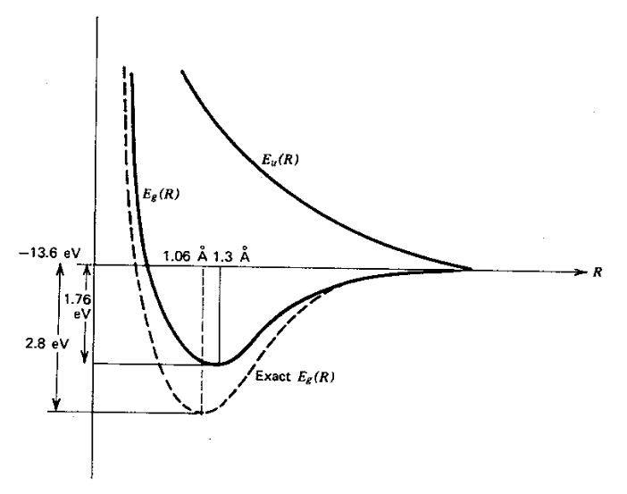
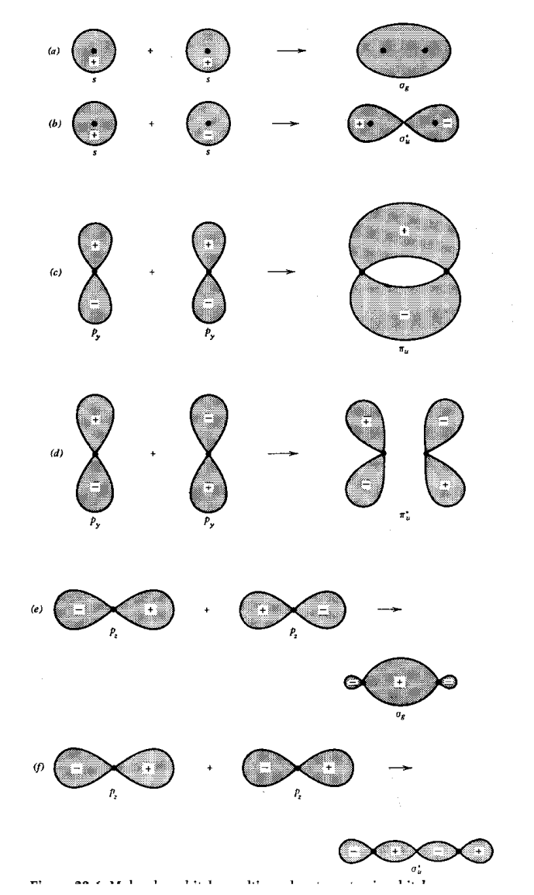
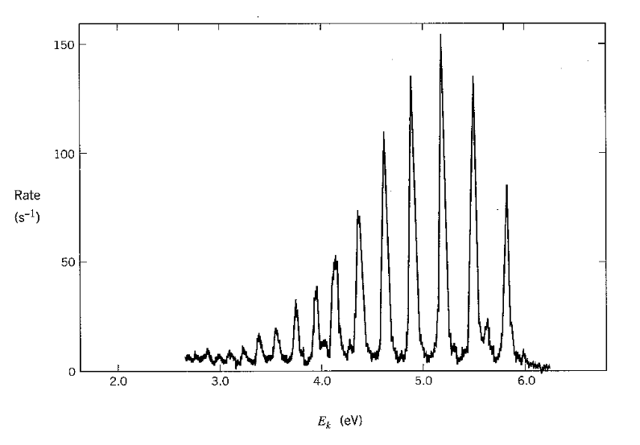
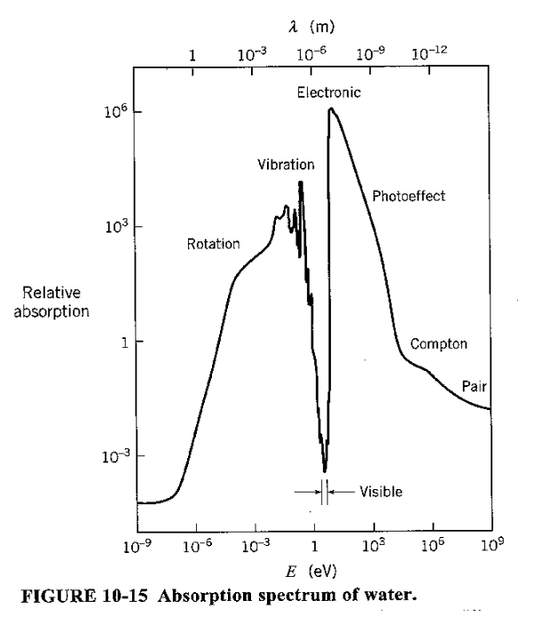

[← 26 Atomic Physics](26-atomic-physics.md) · [28 Time Dependent Perturbation Theory →](28-time-dependent-perturbation-theory.md)

---

<hr class="page" style="height:2px;border:0;background:currentColor;opacity:0.25">
<a id="p383" href="book.pdf#page=383" target="_blank" title="This page in the PDF"><sup>[p. 383]</sup></a>

# 27 Molecular Physics

In this section, we will study the binding and excitation of simple molecules. Atoms bind into molecules by sharing electrons, thus reducing the kinetic energy. Molecules can be excited in three ways.

$`•`$ Excitation of electrons to higher states. $`E \sim 4`$ eV

$`•`$ Vibrational modes (Harmonic Oscillator). Nuclei move slowly in background of electrons. $`E \sim`$

0.1 eV

$`•`$ Rotational modes $`( L = n \hbar )`$. Entire molecule rotates. $`E \sim 0.001`$ eV

Why don’t atoms have rotational states?

The atomic state already accounts for electrons angular momentum around the nucleus.

About which axes can a molecule rotate?

Do you think identical atoms will make a difference?

This material is covered in **Gasiorowicz Chapter 20,** and in **Cohen-Tannoudji et al. Com-** **plements** $`C_{V} I \boldsymbol{,} E_{VII} \boldsymbol{,} C_{XI}`$**.**

# <a id="s-27-1-the-h2-ion"></a>27.1 The H$`2 +`$ Ion

The simplest molecule we can work with is the H$`2 +`$ ion. It has two nuclei (A and B) sharing one electron (1).

```math
H_{0} = \frac{p_{e}^{2}}{2 m} - \frac{e^{2}}{r_{1 A}} - \frac{e^{2}}{r_{1 B}} + \frac{e^{2}}{R_{AB}}
```

$`R_{AB}`$ is the distance between the two nuclei.

The lowest energy wavefunction can be thought of as a (anti)symmetric linear combination of an electron in the ground state near nucleus A and the ground state near nucleus B

```math
\psi_{\pm} \left( \vec{r} , \vec{R} \right) = C_{\pm} ( R ) [ \psi_{A} \pm \psi_{B} ]
```

where $`\psi_{A} = \sqrt{\frac{1}{\pi a_{0}^{3}}} e^{- r_{1 A} /a_{0}}`$ is g.s. around nucleus A. $`\psi_{A}`$ and $`\psi_{B}`$ are not orthogonal; there is overlap. We must compute the normalization constant to estimate the energy.

```math
\frac{1}{C_{\pm}^{2}} = \langle \psi_{A} \pm \psi_{B} | \psi_{A} \pm \psi_{B} \rangle = 2 \pm 2 \langle \psi_{A} | \psi_{B} \rangle \equiv 2 \pm 2 S ( R )
```

where

```math
S ( R ) \equiv \langle \psi_{A} | \psi_{B} \rangle = \left( 1 + \frac{R}{a_{0}} + \frac{R^{2}}{3 a_{0}^{2}} \right) e^{- R/a_{0}}
```

These calculations are “straightforward but tedious” (Gasiorowicz).

<div align="right"><a href="book.pdf#page=383" target="_blank" title="This page in the PDF"><sup>[p. 383]</sup></a></div>
<hr class="page" style="height:2px;border:0;background:currentColor;opacity:0.25">
<a id="p384" href="book.pdf#page=384" target="_blank" title="This page in the PDF"><sup>[p. 384]</sup></a>

We can now compute the energy of these states.

```math
\langle H_{0} \rangle_{\pm} = \frac{1}{2 [ 1 \pm S ( R ) ]} \langle \psi_{A} \pm \psi_{B} | H_{0} | \psi_{A} \pm \psi_{B} \rangle
```

```math
= \frac{1}{2 [ 1 \pm S ( R ) ]} [ \langle \psi_{A} | H_{0} | \psi_{A} \rangle + \langle \psi_{B} | H_{0} | \psi_{B} \rangle \pm \langle \psi_{A} | H_{0} | \psi_{B} \rangle \pm \langle \psi_{B} | H_{0} | \psi_{A} \rangle ]
```

```math
= \frac{\langle \psi_{A} | H_{0} | \psi_{A} \rangle \pm \langle \psi_{A} | H_{0} | \psi_{B} \rangle}{1 \pm S ( R )}
```

We can compute the integrals needed.

```math
\langle \psi_{A} | H_{0} | \psi_{A} \rangle = E_{1} + \frac{e^{2}}{R} \left( 1 + \frac{R}{a_{0}} \right) e^{- 2 R/a_{0}}
```

```math
\langle \psi_{A} | H_{0} | \psi_{B} \rangle = \left( E_{1} + \frac{e^{2}}{R} \right) S ( R ) - \frac{e^{2}}{a_{0}} \left( 1 + \frac{R}{a_{0}} \right) e^{- R/a_{0}}
```

We have reused the calculation of $`S ( R )`$ in the above. Now, we plug these in and rewrite things in terms of $`y = R/a_{0}`$, the distance between the atoms in units of the Bohr radius.

```math
\langle H_{0} \rangle_{\pm} = \frac{E_{1} + \tfrac{e^{2}}{R} ( 1 + R/a_{0} ) e^{- 2 R/a_{0}} \pm \left( E_{1} + \tfrac{e^{2}}{R} \right) S ( R ) - \tfrac{e^{2}}{a_{0}} ( 1 + R/a_{0} ) e^{- R/a_{0}}}{1 \pm S ( R )}
```

```math
\langle H_{0} \rangle_{\pm} = E_{1} \frac{1 - ( 2 /y ) ( 1 + y ) e^{- 2 y} \pm \left[ ( 1 - 2 /y ) ( 1 + y + y^{2} / 3 ) e^{- y} - 2 ( 1 + y ) e^{- y} \right]}{1 \pm ( 1 + y + y^{2} / 3 ) e^{- y}}
```

The symmetric (bonding) state has a large probability for the electron to be found between nuclei. The antisymmetric (antibonding) state has a small probability there, and hence, a much larger energy.

The graph below shows the energies from our calculation for the space symmetric $`( E_{g} )`$ and antisymmetric $`( E_{u} )`$ states as well as the result of a more complete calculation (Exact $`E_{g} )`$ as a function of the distance between the protons $`R`$. Our calculation for the symmetric state shows a minimum arount 1.3 Angstroms between the nuclei and a Binding Energy of 1.76 eV. We could get a better estimate by introduction some parameters in our trial wave function and using the variational method.

The antisymmetric state shows no minimum and never goes below -13.6 eV so there is no binding in this state.

<div align="right"><a href="book.pdf#page=384" target="_blank" title="This page in the PDF"><sup>[p. 384]</sup></a></div>
<hr class="page" style="height:2px;border:0;background:currentColor;opacity:0.25">
<a id="p385" href="book.pdf#page=385" target="_blank" title="This page in the PDF"><sup>[p. 385]</sup></a>



_Figure 89 (p. 385)_

By setting $`\frac{d \langle H \rangle}{dy}`$ = 0, we can get the distance between atoms and the energy.

Distance Energy

Calculated 1.3 ˚A -1.76 eV Actual 1.06 ˚A -2.8 eV

<div align="center">

Its clear we would need to introduce some wfn. parameters to get good precision.

</div>

# <a id="s-27-2-the-h2-molecule"></a>27.2 The H$`2`$ Molecule

The H$`2`$ molecule consists of four particles bound together: $`e_{1} , e_{2}`$, proton$`A`$, and proton$`B`$. The Hamiltonian can be written in terms of the H$`2 +`$ Hamiltonian, the repulsion between electrons, plus a correction term for double counting the repulsion between protons.

```math
H = H_{1} + H_{2} + \frac{e^{2}}{r_{1 2}} - \frac{e^{2}}{R_{AB}}
```

```math
H_{1} = \frac{p_{1}^{2}}{2 m} - \frac{e^{2}}{r_{A 1}} - \frac{e^{2}}{r_{B 1}} + \frac{e^{2}}{R_{AB}}
```

We wish to compute variational upper bound on $`R_{AB}`$ and the energy.

We will again use symmetric electron wavefunctions,

```math
\psi ( r_{1} ,r_{2} ) = \frac{1}{2 [ 1 + S ( R_{AB} ) ]} [ \psi_{A} ( \vec{r}_{1} ) + \psi_{B} ( \vec{r}_{1} ) ] [ \psi_{A} ( \vec{r}_{2} ) + \psi_{B} ( \vec{r}_{2} ) ] \chi_{s}
```

<div align="right"><a href="book.pdf#page=385" target="_blank" title="This page in the PDF"><sup>[p. 385]</sup></a></div>
<hr class="page" style="height:2px;border:0;background:currentColor;opacity:0.25">
<a id="p386" href="book.pdf#page=386" target="_blank" title="This page in the PDF"><sup>[p. 386]</sup></a>

where the spin singlet is required because the spatial wfn is symmetric under interchange.

The space symmetric state will be the ground state as before.

```math
\langle \psi | H | \psi \rangle = 2 E_{H_{2}^{+}} ( R_{AB} ) - \frac{e^{2}}{R_{AB}} + \left\langle \psi \left| \frac{e^{2}}{r_{1 2}} \right| \psi \right\rangle
```

## <a id="s-from-this-point-we-can-do-the-calculation-to-obtain"></a>From this point, we can do the calculation to obtain

Distance Energy

<div align="center">

Calculated 0.85 ˚A -2.68 eV<br>
Actual 0.74 ˚A -4.75 eV.

</div>

wIth a multiterm wavefunction, we could get good agreement.

# <a id="s-27-3-importance-of-unpaired-valence-electrons"></a>27.3 Importance of Unpaired Valence Electrons

Inner (closed shell) electrons stick close to nucleus so they do not get near to other atoms. The outer (valence) electrons may participate in bonding either by sharing or migrating to the other atom. **Electrons which are paired into spin singlets don’t bond**. If we try to share one of the paired electrons, in a bonding state, with another atom, the electron from the other atom is not antisymmetric with the (other) paired electron. Therefore only the antibonding (or some excited state) will work and binding is unlikely. Unpaired electrons don’t have this problem.

$`↓↑↓↑↑`$ . . . first four don’t bond!

The strongest bonds come from s and p orbitals (not d,f).

# <a id="s-27-4-molecular-orbitals"></a>27.4 Molecular Orbitals

Even with additional parameters, parity symmetry in diatomic molecules implies we will have symmetric and antisymmetric wavefunctions for single electrons. The **symmetric or bonding state** **has a larger probability to be between the two nuclei**, sees more positive charge, and is therefore lower energy. As in our simple model of a molecule, the kinetic energy can be lowered by sharing an electron.

There is an axis of symmetry for **diatomic molecules**. This means $`L_{z}`$ commutes with $`H`$ and $`m_{\ell}`$ is a good quantum number. The different $`m_{\ell}`$ states, we have seen, have quite different shapes therefore bond differently. Imagine that a valence electron is in a $`d`$ state. The $`m_{\ell}`$ = 0$`, \pm 1 , \pm 2`$ are called molecular orbitals $`\sigma ,\pi ,\delta`$ respectively. Each has a bonding and an antibonding state.

Pictures of **molecular orbitals** are shown for $`s`$ and $`p`$ states in the following figure. Both bonding and antibonding orbitals are shown first as atomic states then as molecular. The antibonding states are denoted by a \*.

<div align="right"><a href="book.pdf#page=386" target="_blank" title="This page in the PDF"><sup>[p. 386]</sup></a></div>
<hr class="page" style="height:2px;border:0;background:currentColor;opacity:0.25">
<a id="p387" href="book.pdf#page=387" target="_blank" title="This page in the PDF"><sup>[p. 387]</sup></a>

```math
3 8 7
```



_Figure 90 (p. 387)_

<div align="right"><a href="book.pdf#page=387" target="_blank" title="This page in the PDF"><sup>[p. 387]</sup></a></div>
<hr class="page" style="height:2px;border:0;background:currentColor;opacity:0.25">
<a id="p388" href="book.pdf#page=388" target="_blank" title="This page in the PDF"><sup>[p. 388]</sup></a>

# <a id="s-27-5-vibrational-states"></a>27.5 Vibrational States

We have seen that the energy of a molecule has a minimum for some particular separation between atoms. This **looks just like a harmonic oscillator potential** for small variations from the minimum. The molecule can “vibrate” in this potential giving rise to a harmonic oscillator energy spectrum.

We can **estimate the energy of the vibrational levels**. If $`E_{e} \sim \hbar \omega = \hbar \sqrt{\frac{k}{m_{e}}}`$, then crudely the proton has the same spring constant $`\sqrt{k} \approx \tfrac{E_{e} \sqrt{m_{e}}}{\hbar}`$.

```math
E_{vib} \sim \hbar \sqrt{\frac{k}{M}} = \sqrt{\frac{m}{M}} E_{e} \sim \frac{1}{1 0} \text{ eV }
```

Recalling that room temperature is about $`\frac{1}{4 0}`$ eV, this is approximately thermal energy, infrared. The energy levels are simply

```math
E = ( n + \frac{1}{2} ) \hbar \omega_{vib}
```

Complex molecules can have many different modes of vibration. Diatomic molecules have just one.

The graph below shows the energy spectrum of electrons knocked out of molecular hydrogen by UV photons (photoelectric effect). The **different peaks correspond to the vibrational state of** **the final H**$`2 +`$ **ion**.



_Figure 91 (p. 388)_

Can you calculate the number of vibrational modes for a molecule compose of $`N> 3`$ atoms.

<div align="right"><a href="book.pdf#page=388" target="_blank" title="This page in the PDF"><sup>[p. 388]</sup></a></div>
<hr class="page" style="height:2px;border:0;background:currentColor;opacity:0.25">
<a id="p389" href="book.pdf#page=389" target="_blank" title="This page in the PDF"><sup>[p. 389]</sup></a>

# <a id="s-27-6-rotational-states"></a>27.6 Rotational States

Molecules can rotate like classical rigid bodies subject to the constraint that angular momentum is quantized in units of $`\hbar`$. We can estimate the energy of these rotations to be

```math
E_{rot} = \frac{1}{2} \frac{L^{2}}{I} = \frac{\ell ( \ell + 1 ) \hbar^{2}}{2 I} \approx \frac{\hbar^{2}}{2 Ma_{0}^{2}} = \frac{m}{M} \frac{\alpha^{2} mc^{2}}{2} \approx \frac{m}{M} E \approx \frac{1}{1 0 0 0} eV
```

where we have used $`a_{0} = \tfrac{\hbar}{\alpha mc}`$ . These states are strongly excited at room temperature.

Let’s look at the energy changes between states as we might get in a radiative transition with ∆$`\ell`$ = 1..

```math
E = \frac{\ell ( \ell + 1 ) \hbar^{2}}{2 I}
```

```math
\Delta E = \frac{\hbar^{2}}{2 I} [ \ell ( \ell + 1 ) - ( \ell - 1 ) \ell ] = \frac{\hbar^{2}}{2 I} ( 2 \ell ) = \frac{\hbar^{2} \ell}{I}
```

These also have equal energy steps in emitted photon energy.

With identical nuclei, $`\ell`$ is required to be even for (nuclear) spin singlet and odd for triplet. This means steps will be larger.

A complex molecule will have three principle axes, and hence, three moments of inertia to use in our quantized formula.

Counting degrees of freedom, which should be equal to the number of quantum numbers needed to describe the state, we have 3 coordinates to give the position of the center of mass, 3 for the rotational state, and 3N-6 for vibrational. This formula should be modified if the molecule is too simple to have three principle axes.

The graph below shows the absorption coefficient of water for light of various energies. For low energies, rotational and vibrational states cause the absorption of light. At higher energies, electronic excitation and photoelectric effect take over. It is only in the region around the visible spectrum that water transmits light well. Can you think of a reason for that?

<div align="right"><a href="book.pdf#page=389" target="_blank" title="This page in the PDF"><sup>[p. 389]</sup></a></div>
<hr class="page" style="height:2px;border:0;background:currentColor;opacity:0.25">
<a id="p390" href="book.pdf#page=390" target="_blank" title="This page in the PDF"><sup>[p. 390]</sup></a>



_Figure 92 (p. 390)_

# <a id="s-27-7-examples"></a>27.7 Examples

# <a id="s-27-8-derivations-and-computations"></a>27.8 Derivations and Computations

# <a id="s-27-9-homework-problems"></a>27.9 Homework Problems

1. In HCl, absorption lines with wave numbers in inverse centimeters of 83.03, 103.73, 124.30, 145.05, 165.51 and 185.86 have been observed. Are these rotational or vibrational transitions? Estimate some physical parameters of the molecule from these data.

2. What is the ratio of the number of HCl molecules in the $`j`$ = 10 rotational state to that in the

$`j`$ = 0 state if the gas is at room temperature?

# <a id="s-27-10sample-test-problems"></a>27.10 Sample Test Problems

---

[← 26 Atomic Physics](26-atomic-physics.md) · [28 Time Dependent Perturbation Theory →](28-time-dependent-perturbation-theory.md)
