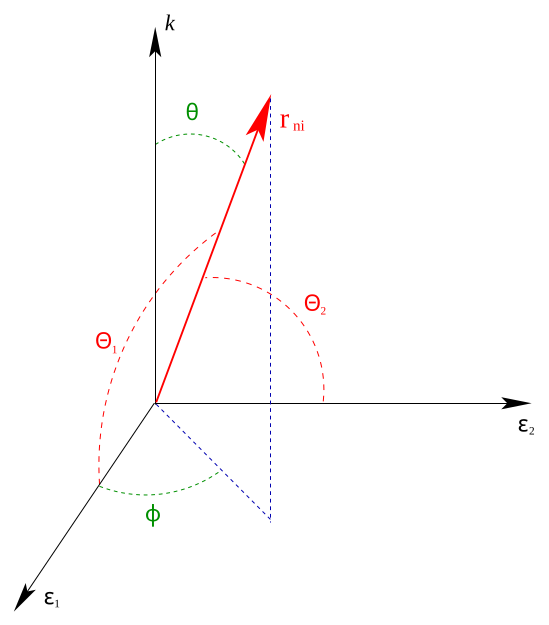
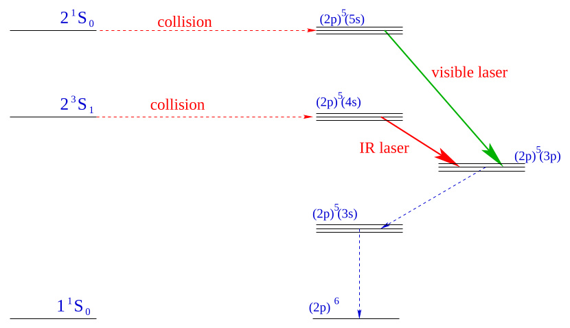
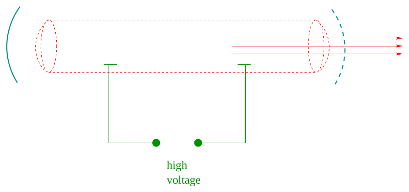

[← 28 Time Dependent Perturbation Theory](28-time-dependent-perturbation-theory.md) · [30 Scattering →](30-scattering.md)

---

<hr class="page" style="height:2px;border:0;background:currentColor;opacity:0.25">
<a id="p398" href="book.pdf#page=398" target="_blank" title="This page in the PDF"><sup>[p. 398]</sup></a>

# 29 Radiation in Atoms

Now we will go all the way back to **Plank** who proposed that the emission of radiation be in quanta with $`E = \hbar \omega`$ to solve the problem of Black Body Radiation. So far, in our treatment of atoms, we have not included the possibility to **emit or absorb real photons** nor have we worried about the fact that Electric and Magnetic fields are made up of virtual photons. This is really the realm of Quantum Electrodynamics, but we do have the tools to understand what happens as we quantize the EM field.

We now have the solution of the Harmonic Oscillator problem using operator methods. Notice that the **emission of a quantum of radiation** with energy of $`\hbar \omega`$ is **like the raising of a Harmonic** **Oscillator state**. Similarly the absorption of a quantum of radiation is like the lowering of a HO state. Plank was already integrating over an infinite number of photon (like HO) states, the same integral we would do if we had an infinite number of Harmonic Oscillator states. Plank was also correctly counting this infinite number of states to get the correct Black Body formula. He did it by considering a cavity with some volume, setting the boundary conditions, then letting the volume go to infinity.

This material is covered in **Gasiorowicz Chapter 22,** in **Cohen-Tannoudji et al. Chapter** **XIII,** and briefly in Griffiths Chapter 9.

# <a id="s-29-1-the-photon-field-in-the-quantum-hamiltonian"></a>29.1 The Photon Field in the Quantum Hamiltonian

The Hamiltonian for a charged particle in an ElectroMagnetic field (See Section 20.1) is given by

```math
H = \frac{1}{2 m} \left( \vec{p} + \frac{e}{c} \vec{A} \right)^{2} + V ( r ) .
```

Lets **assume that there is some ElectroMagnetic field around the atom**. The field is not extremely strong so that the $`A^{2}`$ term can be neglected (for our purposes) and we will work in the **Coulomb gauge** for which $`\vec{p} \cdot \vec{A} = \tfrac{\hbar}{i} \vec{\nabla} \cdot \vec{A}`$ = 0. The Hamiltonian then becomes

```math
H \approx \frac{p^{2}}{2 m} + \frac{e}{mc} \vec{A} \cdot \vec{p} + V ( r ) .
```

Now we have **a potentially time dependent perturbation** that may drive transitions between the atomic states.

```math
\mathcal{V} = \frac{e}{mc} \vec{A} \cdot \vec{p}
```

Lets also assume that the field has **some frequency** $`\omega`$ and corresponding wave vector $`\vec{k}`$. (In fact, and arbitrary field would be a linear combination of many frequencies, directions of propagation, and polarizations.)

```math
\vec{A} ( \vec{r} , t ) \equiv 2 \vec{A}_{0} \cos ( \vec{k} \cdot \vec{r} - \omega t )
```

where $`\vec{A}_{0}`$ is a real vector and we have again introduced the factor of 2 for convenience of splitting the cosine into two exponentials.

We need to quantize the EM field into photons satisfying Plank’s original hypothesis, $`E = \hbar \omega`$. Lets start by writing $`A`$ **in terms of the number of photons in the field** (at frequency $`\omega`$ and wave

<div align="right"><a href="book.pdf#page=398" target="_blank" title="This page in the PDF"><sup>[p. 398]</sup></a></div>
<hr class="page" style="height:2px;border:0;background:currentColor;opacity:0.25">
<a id="p399" href="book.pdf#page=399" target="_blank" title="This page in the PDF"><sup>[p. 399]</sup></a>

vector $`\vec{k} )`$. Using classical E&M to compute the energy in a field (See Section 29.14.1) represented by a vector potential $`\vec{A} ( \vec{r} , t )`$ = 2$`\vec{A}_{0}`$ cos$`( \vec{k} \cdot \vec{r} - \omega t )`$, we find that the energy inside a volume $`V`$ is

```math
Energy = \frac{\omega^{2}}{2 \pi c^{2}} V | A_{0} |^{2} = N \hbar \omega .
```

We may then turn this around and write $`\vec{A}`$ **in terms of the number of photons** $`N`$.

```math
| A_{0} |^{2} = N \hbar \omega \frac{2 \pi c^{2}}{\omega^{2} V} = \frac{2 \pi \hbar c^{2} N}{\omega V}
```

```math
\vec{A} ( \vec{r} , t ) = \left[ \frac{2 \pi \hbar c^{2} N}{\omega V} \right]^{\tfrac{1}{2}} \hat{\epsilon} \left( 2 \cos ( \vec{k} \cdot \vec{r} - \omega t ) \right)
```

```math
\vec{A} ( \vec{r} , t ) = \left[ \frac{2 \pi \hbar c^{2} N}{\omega V} \right]^{\tfrac{1}{2}} \hat{\epsilon} \left( e^{i ( \vec{k} \cdot \vec{r} - \omega t )} + e^{- i ( \vec{k} \cdot \vec{r} - \omega t )} \right)
```

We have introduced the unit vector $`\hat{\epsilon}`$ to give the direction (or polarization) of the vector potential. We now have a perturbation that may induce radiative transitions. There are terms with both negative and positive $`\omega`$ so that we expect to see **both stimulated emission of quanta and** **absorption of quanta** in the the presence of a time dependent EM field.

But what about decays of atoms with no applied field? Here we need to go beyond our classical E&M calculation and quantize the field. Since the terms in the perturbation above emit or absorb a photon, and the photon has energy $`\hbar \omega`$, lets **assume the number of photons in the field is** **the** $`n`$ **of a harmonic oscillator**. It has the right steps in energy. Essentially, we are postulating that the vacuum contains an infinite number of harmonic oscillators, one for each wave vector (or frequency...) of light.

We now want to go from a classical harmonic oscillator to a quantum oscillator, in which the ground state energy is not zero, and the hence the perturbing field is never really zero. We do this by **changing** $`N`$ **to** $`N`$ + 1 **in the term that creates a photon** in analogy to the raising operator $`A^{\dagger}`$ in the HO. With this change, our **perturbation becomes**

```math
\vec{A} ( \vec{r} , t ) = \left[ \frac{2 \pi \hbar c^{2}}{\omega V} \right]^{\tfrac{1}{2}} \hat{\epsilon} \left( \sqrt{N} e^{i ( \vec{k} \cdot \vec{r} - \omega t )} + \sqrt{N + 1} e^{- i ( \vec{k} \cdot \vec{r} - \omega t )} \right)
```

Remember that one exponential corresponds to the emission of a photon and the other corresponds to the the absorption of a photon. We view $`\vec{A}`$ as an operator which either creates or absorbs a photon, raising or lowering the harmonic oscillator in the vacuum.

Now there is a **perturbation even with no applied field** $`( N`$ = 0).

```math
\mathcal{V}_{N = 0} = V_{N = 0} e^{i\omega t} = \frac{e}{mc} \vec{A} \cdot \vec{p} = \frac{e}{mc} \left[ \frac{2 \pi \hbar c^{2}}{\omega V} \right]^{\tfrac{1}{2}} e^{- i ( \vec{k} \cdot \vec{r} - \omega t )} \hat{\epsilon} \cdot \vec{p}
```

We can plug this right into our expression for the decay rate (removing the $`e^{i\omega t}`$ into the delta function as was done when we considered a general sinusoidal time dependent perturbation). Of course we have this for all frequencies, not just the one we have been assuming without justification. Also note that **our perturbation still depends on the volume** we assume. This factor will be canceled when we correctly compute the density of final states.

<div align="right"><a href="book.pdf#page=399" target="_blank" title="This page in the PDF"><sup>[p. 399]</sup></a></div>
<hr class="page" style="height:2px;border:0;background:currentColor;opacity:0.25">
<a id="p400" href="book.pdf#page=400" target="_blank" title="This page in the PDF"><sup>[p. 400]</sup></a>

We have taken a step toward quantization of the EM field, at least when we emit or absorb a photon. With this step, we can correctly compute the EM transition rates in atoms. Note that we have postulated that the vacuum has an infinite number of oscillators corresponding to the different possible modes of EM waves. When we quantize these oscillators, the vacuum has a ground state energy density in the EM field (equivalent to half a photon of each type). That vacuum EM field is then responsible for the spontaneous decay of excited states of atoms through the emission of a photon. We have not yet written the quantum equations that the EM field must satisfy, although they are closely related to Maxwell’s equations.

# <a id="s-29-2-decay-rates-for-the-emission-of-photons"></a>29.2 Decay Rates for the Emission of Photons

Our **expression for the decay rate** of an initial state $`\varphi_{i}`$ into some particular final state $`\varphi_{n}`$ is

```math
\Gamma_{i \to n} = \frac{2 \pi V_{ni}^{2}}{\hbar} \delta ( E_{n} - E_{i} + \hbar \omega ) .
```

The delta function reminds us that we will have to integrate over final states to get a sensible answer. Nevertheless, we proceed to include the matrix element of the perturbing potential.

Taking out the harmonic time dependence (to the delta function) as before, we have the **matrix** **element of the perturbing potential**.

```math
V_{ni} = \langle \varphi_{n} | \frac{e}{mc} \vec{A} \cdot \vec{p} | \varphi_{i} \rangle = \frac{e}{mc} \left[ \frac{2 \pi \hbar c^{2}}{\omega V} \right]^{\tfrac{1}{2}} \langle \varphi_{n} | e^{- i \vec{k} \cdot \vec{r}} \hat{\epsilon} \cdot \vec{p} | \varphi_{i} \rangle
```

We just put these together to get

```math
\Gamma_{i \to n} = \frac{2 \pi}{\hbar} \frac{e^{2}}{m^{2} c^{2}} \left[ \frac{2 \pi \hbar c^{2}}{\omega V} \right] | \langle \varphi_{n} | e^{- i \vec{k} \cdot \vec{r}} \hat{\epsilon} \cdot \vec{p} | \varphi_{i} \rangle |^{2} \delta ( E_{n} - E_{i} + \hbar \omega )
```

```math
\Gamma_{i \to n} = \frac{( 2 \pi )^{2} e^{2}}{m^{2} \omega V} | \langle \varphi_{n} | e^{- i \vec{k} \cdot \vec{r}} \hat{\epsilon} \cdot \vec{p} | \varphi_{i} \rangle |^{2} \delta ( E_{n} - E_{i} + \hbar \omega )
```

We must sum (or integrate) over final states. The states are distinguishable so we add the decay rates, not the amplitudes. We will integrate over photon energies and directions, with the aid of the delta function. We will sum over photon polarizations. We will sum over the final atomic states when that is applicable. All of this is quite doable. Our first step is to understand the number of states of photons as Plank (and even Rayleigh) did to get the Black Body formulas.

# <a id="s-29-3-phase-space-the-density-of-final-states"></a>29.3 Phase Space: The Density of Final States

We have some experience with calculating the number of states for fermions in a 3D box (See Section 13.1.1). For the box we had boundary conditions that the wavefunction go to zero at the wall of the box. Now we wish to know how many photon states are in a region of **phase space** centered on the wave vector $`\vec{k}`$ with (small) volume in k-space of $`d^{3} \vec{k}`$. (Remember $`\omega = | \vec{k} | c`$ for light.) We will assume for the sake of calculation that the photons are confined to a cubic volume in position space of $`V = L^{3}`$ and impose **periodic boundary conditions** on our fields. (Really we could require the fields to be zero on the boundaries of the box by choosing a sine wave. The PBC are equivalent to

<div align="right"><a href="book.pdf#page=400" target="_blank" title="This page in the PDF"><sup>[p. 400]</sup></a></div>
<hr class="page" style="height:2px;border:0;background:currentColor;opacity:0.25">
<a id="p401" href="book.pdf#page=401" target="_blank" title="This page in the PDF"><sup>[p. 401]</sup></a>

this but allow us to deal with single exponentials instead of real functions.) Our final result, the decay rate, will be independent of volume so we can let the volume go to infinity.

```math
k_{x} L = 2 \pi n_{x} \quad dn_{x} = \tfrac{L}{2 \pi} dk_{x}
```

```math
k_{y} L = 2 \pi n_{y} \quad dn_{y} = \tfrac{L}{2 \pi} dk_{y}
```

```math
k_{z} L = 2 \pi n_{z} \quad dn_{z} = \tfrac{L}{2 \pi} dk_{z}
```

```math
d^{3} n = \tfrac{L^{3}}{( 2 \pi )^{3}} d^{3} k = \tfrac{V}{( 2 \pi )^{3}} d^{3} k
```

That was easy. We will use **this phase space formula** for decays of atoms emitting a photon. A more general phase space formula (See Section 29.14.2) based on our calculation can be used with more than one free particle in the final state. (In fact, even our simple case, the atom recoils in the final state, however, its momentum is fixed due to momentum conservation.)

# <a id="s-29-4-total-decay-rate-using-phase-space"></a>29.4 Total Decay Rate Using Phase Space

Now we are ready to sum over final (photon) states to get the total transition rate. Since both the momentum of the photon and the electron show up in this equation, we will label the electron’s momentum to avoid confusion.

```math
\Gamma_{tot} = \sum_{\vec{k} ,pol} \Gamma_{i \to n} \to \sum_{pol.} \int \frac{Vd^{3} k}{( 2 \pi )^{3}} \Gamma_{i \to n} = \sum_{pol.} \int \frac{Vd^{3} p}{( 2 \pi \hbar )^{3}} \Gamma_{i \to n}
```

```math
= \sum_{\lambda} \int \frac{Vd^{3} p}{( 2 \pi \hbar )^{3}} \frac{( 2 \pi )^{2} e^{2}}{m^{2} \omega V} | \langle \varphi_{n} | e^{- i \vec{k} \cdot \vec{r}} \hat{\epsilon}^{( \lambda )} \cdot \vec{p}_{e} | \varphi_{i} \rangle |^{2} \delta ( E_{n} - E_{i} + \hbar \omega )
```

```math
= \frac{e^{2}}{2 \pi \hbar^{3} m^{2}} \sum_{\lambda} \int \frac{d^{3} p}{\omega} | \langle \varphi_{n} | e^{- i \vec{k} \cdot \vec{r}} \hat{\epsilon}^{( \lambda )} \cdot \vec{p}_{e} | \varphi_{i} \rangle |^{2} \delta ( E_{n} - E_{i} + \hbar \omega )
```

```math
= \frac{e^{2}}{2 \pi \hbar^{3} m^{2}} \sum_{\lambda} \int \frac{p^{2} d ( \hbar \omega ) d \Omega_{\gamma}}{pc} \frac{\hbar}{c} | \langle \varphi_{n} | e^{- i \vec{k} \cdot \vec{r}} \hat{\epsilon}^{( \lambda )} \cdot \vec{p}_{e} | \varphi_{i} \rangle |^{2} \delta ( E_{n} - E_{i} + \hbar \omega )
```

```math
= \frac{e^{2}}{2 \pi \hbar^{2} m^{2} c^{2}} \sum_{\lambda} \int pd ( \hbar \omega ) d \Omega_{\gamma} | \langle \varphi_{n} | e^{- i \vec{k} \cdot \vec{r}} \hat{\epsilon}^{( \lambda )} \cdot \vec{p}_{e} | \varphi_{i} \rangle |^{2} \delta ( E_{n} - E_{i} + \hbar \omega )
```

```math
= \frac{e^{2}}{2 \pi \hbar^{2} m^{2} c^{2}} \sum_{\lambda} \int \frac{E_{i} - E_{n}}{c} d \Omega_{\gamma} | \langle \varphi_{n} | e^{- i \vec{k} \cdot \vec{r}} \hat{\epsilon}^{( \lambda )} \cdot \vec{p}_{e} | \varphi_{i} \rangle |^{2}
```

```math
\Gamma_{tot} = \frac{e^{2} ( E_{i} - E_{n} )}{2 \pi \hbar^{2} m^{2} c^{3}} \sum_{\lambda} \int d \Omega_{\gamma} | \langle \varphi_{n} | e^{- i \vec{k} \cdot \vec{r}} \hat{\epsilon}^{( \lambda )} \cdot \vec{p}_{e} | \varphi_{i} \rangle |^{2}
```

This is the general formula for the decay rate emitting one photon. Depending on the problem, we may also need to sum over final states of the atom. The two polarizations are transverse to the photon direction, so they must vary inside the integral.

A quick estimate of the decay rate of an atom (See Section 29.14.3) gives

```math
\tau \approx 5 0 p sec.
```

<div align="right"><a href="book.pdf#page=401" target="_blank" title="This page in the PDF"><sup>[p. 401]</sup></a></div>
<hr class="page" style="height:2px;border:0;background:currentColor;opacity:0.25">
<a id="p402" href="book.pdf#page=402" target="_blank" title="This page in the PDF"><sup>[p. 402]</sup></a>

# <a id="s-29-5-electric-dipole-approximation-and-selection-rules"></a>29.5 Electric Dipole Approximation and Selection Rules

We can now expand the $`e^{- i \vec{k} \cdot \vec{r}} \approx 1`$ $`- i \vec{k} \cdot \vec{r} + \dots`$ term to allow us to compute matrix elements more easily. Since $`\vec{k} \cdot \vec{r} \approx \tfrac{\alpha}{2}`$ and the matrix element is squared, our expansion will be in powers of $`\alpha^{2}`$ which is a small number. The dominant decays will be those from the zeroth order approximation which is

```math
e^{- i \vec{k} \cdot \vec{r}} \approx 1 .
```

This is called the **Electric dipole approximation**.

In this Electric Dipole approximation, we can make general progress on computation of the matrix element. If the Hamiltonian is of the form $`H = \tfrac{p^{2}}{2 m} + V`$ and $`[ V , \vec{r} ]`$ = 0, then

```math
[ H , \vec{r} ] = \frac{\hbar}{i} \frac{p}{m}
```

and we can write $`\vec{p} = \tfrac{im}{\hbar} [ H , \vec{r} ]`$ in terms of the commutator.

```math
\langle \varphi_{n} | e^{- i \vec{k} \cdot \vec{r}} \hat{\epsilon} \cdot \vec{p}_{e} | \varphi_{i} \rangle \approx \hat{\epsilon} \cdot \langle \varphi_{n} | \vec{p}_{e} | \varphi_{i} \rangle
```

```math
= \frac{im}{\hbar} \hat{\epsilon} \cdot \langle \varphi_{n} | [ H , \vec{r} ] | \varphi_{i} \rangle
```

```math
= \frac{im}{\hbar} ( E_{n} - E_{i} ) \hat{\epsilon} \cdot \langle \varphi_{n} | \vec{r} | \varphi_{i} \rangle
```

```math
= \frac{im ( E_{n} - E_{i} )}{\hbar} \langle \varphi_{n} | \hat{\epsilon} \cdot \vec{r} | \varphi_{i} \rangle
```

This equation indicates the origin of the name Electric Dipole: the matrix element is of the vector $`\vec{r}`$ which is a dipole.

We can proceed further, with the angular part of the (matrix element) integral.

```math
\langle \varphi_{n} | \hat{\epsilon} \cdot \vec{r} | \varphi_{i} \rangle = \int_{0}^{\infty} r^{2} drR_{n_{n} \ell_{n}}^{*} R_{n_{i} \ell_{i}} \int d \Omega Y_{\ell_{n} m_{n}}^{*} \hat{\epsilon} \cdot \vec{r} Y_{\ell_{i} m_{i}}
```

```math
= \int^{\infty} r^{3} drR_{n_{n} \ell_{n}}^{*} R_{n_{i} \ell_{i}} \int d \Omega Y_{\ell_{n} m_{n}}^{*} \hat{\epsilon} \cdot \hat{r} Y_{\ell_{i} m_{i}}
```

```math
\hat{\epsilon} \cdot \hat{r} = \epsilon_{x}^{0} \sin \theta \cos \varphi + \epsilon_{y} \sin \theta \sin \varphi + \epsilon_{z} \cos \theta
```

```math
= \sqrt{\frac{4 \pi}{3} \left( \epsilon_{z} Y_{1 0} + \frac{- \epsilon_{x} + i\epsilon_{y}}{\sqrt{2}} Y_{1 1} + \frac{\epsilon_{x} + i\epsilon_{y}}{\sqrt{2}} Y_{1 - 1} \right)}
```

```math
\langle \varphi_{n} | \hat{\epsilon} \cdot \vec{r} | \varphi_{i} \rangle = \int_{0}^{\sqrt{\frac{4 \pi}{3}}^{\infty}} r^{3} drR_{n_{n} \ell_{n}}^{*} R_{n_{i} \ell_{i}} \int d \Omega Y_{\ell_{n} m_{n}}^{*} \left( \epsilon_{z} Y_{1 0} + \frac{- \epsilon_{x} + i\epsilon_{y}}{\sqrt{2}} Y_{1 1} + \frac{\epsilon_{x} + i\epsilon_{y}}{\sqrt{2}} Y_{1 - 1} \right) Y_{\ell_{i} m_{i}}
```

At this point, lets bring all the terms in the formula back together so we know what we are doing.

```math
\Gamma_{tot} = \frac{e^{2} ( E_{i} - E_{n} )}{2 \pi \hbar^{2} m^{2} c^{3}} \sum_{\lambda} \int d \Omega_{\gamma} | \langle \varphi_{n} | e^{- i \vec{k} \cdot \vec{r}} \hat{\epsilon}^{( \lambda )} \cdot \vec{p}_{e} | \varphi_{i} \rangle |^{2}
```

<div align="right"><a href="book.pdf#page=402" target="_blank" title="This page in the PDF"><sup>[p. 402]</sup></a></div>
<hr class="page" style="height:2px;border:0;background:currentColor;opacity:0.25">
<a id="p403" href="book.pdf#page=403" target="_blank" title="This page in the PDF"><sup>[p. 403]</sup></a>

```math
= \frac{e^{2} ( E_{i} - E_{n} )}{2 \pi \hbar^{2} m^{2} c^{3}} \sum_{\lambda} \int d \Omega_{\gamma} \left| \frac{im ( E_{n} - E_{i} )}{\hbar} \langle \varphi_{n} | \hat{\epsilon} \cdot \vec{r} | \varphi_{i} \rangle \right|^{2}
```

```math
= \frac{\alpha \omega_{in}^{3}}{2 \pi c^{2}} \sum_{\lambda} \int d \Omega_{\gamma} | \langle \varphi_{n} | \hat{\epsilon} \cdot \vec{r} | \varphi_{i} \rangle |^{2}
```

This is a useful version of the **total decay rate formula** to remember.

```math
\Gamma_{tot} = \frac{\alpha \omega_{in}^{3}}{2 \pi c^{2}} \sum_{\lambda} \int d \Omega_{\gamma} | \langle \varphi_{n} | \hat{\epsilon} \cdot \vec{r} | \varphi_{i} \rangle |^{2}
```

We proceed with the calculation to find the E1 selection rules.

```math
= \frac{\alpha \omega_{in}^{3}}{2 \pi c^{2}} \sum_{\lambda} \int d \Omega_{\gamma} \left| \sqrt{\frac{4 \pi}{3}} \left\langle \varphi_{n} \right| \epsilon_{z} Y_{1 0} + \frac{- \epsilon_{x} + i\epsilon_{y}}{\sqrt{2}} Y_{1 1} + \frac{\epsilon_{x} + i\epsilon_{y}}{\sqrt{2}} Y_{1 - 1} \left| \varphi_{i} \right\rangle \right|^{2}
```

```math
= \frac{\alpha \omega_{in}^{3}}{2 \pi c^{2}} \sum_{\lambda} \int d \Omega_{\gamma} \left| \int_{0}^{\sqrt{\frac{4 \pi}{3}}^{\infty}} r^{3} drR_{n_{n} \ell_{n}}^{*} R_{n_{i} \ell_{i}} \int d \Omega Y_{\ell_{n} m_{n}}^{*} \left( \epsilon_{z} Y_{1 0} + \frac{- \epsilon_{x} + i\epsilon_{y}}{\sqrt{2}} Y_{1 1} + \frac{\epsilon_{x} + i\epsilon_{y}}{\sqrt{2}} Y_{1 - 1} \right) Y_{\ell_{i} m_{i}} \right|^{2}
```

We will attempt to clearly separate the terms due to $`\langle \varphi_{n} | \hat{\epsilon} \cdot \vec{r} | \varphi_{i} \rangle`$ for the sake of modularity of the calculation.

The integral with **three spherical harmonics** in each term looks a bit difficult, but, we can use<br>
a **Clebsch-Gordan series like the one in addition of angular momentum** to help us solve the problem. We will write the product of two spherical harmonics in terms of a sum of spherical harmonics. Its very similar to adding the angular momentum from the two $`Y`$ s. **Its the same** **series as we had for addition of angular momentum (up to a constant)**. (Note that things will be very simple if either the initial or the final state have $`\ell`$ = 0, a case we will work out below for transitions to s states.) The general formula for rewriting the product of two spherical harmonics (which are functions of the same coordinates) is

```math
Y_{\ell_{1} m_{1}} ( \theta ,\varphi ) Y_{\ell_{2} m_{2}} ( \theta ,\varphi ) = \sum_{\ell = | \ell_{1} - \ell_{2} |}^{\ell_{1} + \ell_{2}} \sqrt{( 2 \ell_{1} + 1 ) ( 2 \ell_{2} + 1 ) 4 \pi ( 2 \ell + 1 )} \langle \ell 0 | \ell_{1} \ell_{2} 0 0 \rangle \langle \ell ( m_{1} + m_{2} ) | \ell_{1} \ell_{2} m_{1} m_{2} \rangle Y_{\ell ( m_{1} + m_{2} )} ( \theta ,\varphi )
```

The square root and $`\langle \ell 0 | \ell_{1} \ell_{2} 0 0 \rangle`$ can be thought of as a normalization constant in an otherwise normal Clebsch-Gordan series. (Note that the normal addition of the orbital angular momenta of two particles would have product states of two spherical harmonics in **different coordinates**, the coordinates of particle one and of particle two.) (The derivation of the above equation involves a somewhat detailed study of the properties of rotation matrices and would take us pretty far off the current track (See Merzbacher page 396).)

First add the angular momentum from the initial state $`( Y_{\ell_{i} m_{i}} )`$ and the photon ($`Y_{1 m} )`$ using the Clebsch-Gordan series, with the usual notation for the **Clebsch-Gordan coefficients** $`\langle \ell_{n} m_{n} | \ell_{i} 1 m_{i} m \rangle`$.

```math
Y_{1 m} ( \theta ,\varphi ) Y_{\ell_{i} m_{i}} ( \theta ,\varphi ) = \sum_{\ell = | \ell - 1 |}^{\ell_{i} + 1} \sqrt{4 3 ( 2 \ell_{i} + 1 ) \pi ( 2 \ell + 1 )} \langle \ell 0 | \ell_{i} 1 0 0 \rangle \langle \ell ( m + m_{i} ) | \ell_{i} 1 m_{i} m \rangle Y_{\ell ( m_{i} + m )} ( \theta ,\varphi )
```

<div align="right"><a href="book.pdf#page=403" target="_blank" title="This page in the PDF"><sup>[p. 403]</sup></a></div>
<hr class="page" style="height:2px;border:0;background:currentColor;opacity:0.25">
<a id="p404" href="book.pdf#page=404" target="_blank" title="This page in the PDF"><sup>[p. 404]</sup></a>

```math
\begin{aligned} \int d \Omega Y_{\ell_{n} m_{n}}^{*} Y_{1 m} Y_{\ell_{i} m_{i}} &= \sqrt{4 3 ( 2 \ell_{i} + 1 ) \pi ( 2 \ell_{n} + 1 )} \langle \ell_{n} 0 | \ell_{i} 1 0 0 \rangle \langle \ell_{n} m_{n} | \ell_{i} 1 m_{i} m \rangle \\ & \quad \int d \Omega Y_{\ell_{n} m_{n}}^{*} \left( \epsilon_{z} Y_{1 0} + \frac{- \epsilon_{x} + i\epsilon_{y}}{\sqrt{2}} Y_{1 1} + \frac{\epsilon_{x} + i\epsilon_{y}}{\sqrt{2}} Y_{1 - 1} \right) Y_{\ell_{i} m_{i}} \end{aligned}
```

```math
= \sqrt{4 3 ( 2 \ell_{i} + 1 ) \pi ( 2 \ell_{n} + 1 )} \langle \ell_{n} 0 | \ell_{i} 1 0 0 \rangle \left( \epsilon_{z} \langle \ell_{n} m_{n} | \ell_{i} 1 m_{i} 0 \rangle + \frac{- \epsilon_{x} + i\epsilon_{y}}{\sqrt{2}} \langle \ell_{n} m_{n} | \ell_{i} 1 m_{i} 1 \rangle + \frac{\epsilon_{x} + i\epsilon_{y}}{\sqrt{2}} \langle \ell_{n} m_{n} | \ell_{i} 1 m_{i} - 1 \rangle \right)
```

I remind you that the Clebsch-Gordan coefficients in these equations are just numbers which are less than one. They can often be shown to be zero if the angular momentum doesn’t add up. The equation we derive can be used to give us a great deal of information.

```math
\begin{aligned} \langle \varphi_{n} | \hat{\epsilon} \cdot \vec{r} | \varphi_{i} \rangle &= \sqrt{( 2 ( 2 \ell_{i} + 1 ) \ell_{n} + 1 )} \langle \ell_{n} 0 | \ell_{i} 1 0 0 \rangle \int^{\infty} r^{3} drR_{n_{n} \ell_{n}}^{*} R_{n_{i} \ell_{i}} \\ & \quad \left( \epsilon_{z} \langle \ell_{n} m_{n} | \ell_{i} 1 m_{i} 0 \rangle + \frac{- \epsilon_{x} + i\epsilon_{y}}{\sqrt{2}}^{0} \langle \ell_{n} m_{n} | \ell_{i} 1 m_{i} 1 \rangle + \frac{\epsilon_{x} + i\epsilon_{y}}{\sqrt{2}} \langle \ell_{n} m_{n} | \ell_{i} 1 m_{i} - 1 \rangle \right) \end{aligned}
```

We know, from the addition of angular momentum, that adding angular momentum 1 to $`\ell_{1}`$ can only give answers in the range $`| \ell_{1} - 1 | <\ell_{n} <\ell_{1}`$ + 1 so the change in in $`\ell`$ between the initial and final state can only be ∆$`\ell`$ = 0$`, \pm 1`$. For other values, all the Clebsch-Gordan coefficients above will be zero.

We also know that the $`Y_{1 m}`$ are odd under parity so the other two spherical harmonics must have opposite parity to each other implying that $`\ell_{n} \neq \ell_{i}`$, therefore

```math
\Delta \ell = \pm 1 .
```

We also know from the addition of angular momentum that the z components just add like integers, so the three Clebsch-Gordan coefficients allow

```math
\Delta m = 0 , \pm 1 .
```

We can also easily note that we have no operators which can change the spin here. So certainly

```math
\Delta s = 0 .
```

We actually haven’t yet included the interaction between the spin and the field in our calculation, but, it is a small effect compared to the Electric Dipole term.

The above selection rules apply only for the Electric Dipole (E1) approximation. Higher order terms in the expansion, like the Electric Quadrupole (E2) or the Magnetic Dipole (M1), allow other decays but the rates are down by a factor of $`\alpha^{2}`$ or more. There is one absolute selection rule coming from angular momentum conservation, since the photon is spin 1. **No** $`j`$ = 0 **to** $`j`$ = 0 **transitions in** **any order of approximation.**

As a summary of our calculations in the Electric Dipole approximation, lets write out the decay rate formula.

<div align="right"><a href="book.pdf#page=404" target="_blank" title="This page in the PDF"><sup>[p. 404]</sup></a></div>
<hr class="page" style="height:2px;border:0;background:currentColor;opacity:0.25">
<a id="p405" href="book.pdf#page=405" target="_blank" title="This page in the PDF"><sup>[p. 405]</sup></a>

# <a id="s-29-6-explicit-2p-to-1s-decay-rate"></a>29.6 Explicit 2p to 1s Decay Rate

Starting from the summary equation for electric dipole transitions, above,

```math
\Gamma_{tot} = \frac{\alpha \omega_{in}^{3}}{2 \pi c^{2}} \sum_{\lambda} \int d \Omega_{\gamma} \left| \int_{0}^{\sqrt{\frac{4 \pi}{3}}^{\infty}} r^{3} drR_{n_{n} \ell_{n}}^{*} R_{n_{i} \ell_{i}} \int d \Omega Y_{\ell_{n} m_{n}}^{*} \left( \epsilon_{z} Y_{1 0} + \frac{- \epsilon_{x} + i\epsilon_{y}}{\sqrt{2}} Y_{1 1} + \frac{\epsilon_{x} + i\epsilon_{y}}{\sqrt{2}} Y_{1 - 1} \right) Y_{\ell_{i} m_{i}} \right|^{2}
```

we specialize to the 2p to 1s decay,

```math
\Gamma_{tot} = \frac{\alpha \omega_{in}^{3}}{2 \pi c^{2}} \sum_{\lambda} \int d \Omega_{\gamma} \left| \int_{0}^{\sqrt{\frac{4 \pi}{3}}^{\infty}} r^{3} drR_{1 0}^{*} R_{2 1} \int d \Omega Y_{0 0}^{*} \left( \epsilon_{z} Y_{1 0} + \frac{- \epsilon_{x} + i\epsilon_{y}}{\sqrt{2}} Y_{1 1} + \frac{\epsilon_{x} + i\epsilon_{y}}{\sqrt{2}} Y_{1 - 1} \right) Y_{1 m_{i}} \right|^{2}
```

perform the radial integration,

```math
\int_{0}^{\infty} r^{3} drR_{1 0}^{*} R_{2 1} = \int_{0}^{\infty} r^{3} dr \left[ 2 \left( \frac{1}{a_{0}} \right)^{\tfrac{3}{2}} e^{- r/a_{0}} \right] \left[ \frac{1}{\sqrt{2 4}} \left( \frac{1}{a_{0}} \right)^{\tfrac{5}{2}} re^{- r/ 2 a_{0}} \right]
```

```math
= \frac{1}{\sqrt{6}} \left( \frac{1}{a_{0}} \right)^{4} \int_{0}^{\infty} r^{4} dre^{- 3 r/ 2 a_{0}}
```

```math
= \frac{1}{\sqrt{6}} \left( \frac{1}{a_{0}} \right)^{4} \left( \frac{2 a_{0}}{3} \right)^{5} \int_{0}^{\infty} x^{4} dxe^{- x}
```

```math
= \frac{1}{\sqrt{6}} \left( \frac{2}{3} \right)^{5} a_{0} ( 4 ! )
```

```math
= 4 \sqrt{6} \left( \frac{2}{3} \right)^{5} a_{0}
```

and perform the angular integration.

```math
\int d \Omega \quad Y_{0 0}^{*} = \begin{pmatrix} \epsilon_{z} Y_{1 0} + \quad Y_{1 m_{i}} \\ \frac{1}{\sqrt{4 \pi}} \int d \Omega \begin{pmatrix} \epsilon_{x} + i\epsilon_{y} \\ \frac{- \epsilon_{x} + i\epsilon_{y}}{\sqrt{2}} Y_{1 1} + \quad \sqrt{\quad Y_{1 - 1}} \\ 2 \\ \epsilon_{z} Y_{1 0} + \frac{- \epsilon_{x} + i\epsilon_{y}}{\sqrt{2}} Y_{1 1} + \end{pmatrix} \frac{\epsilon_{x} + i\epsilon_{y}}{\sqrt{2}} Y_{1 - 1} \end{pmatrix} Y_{1 m_{i}}
```

```math
\begin{aligned} &= \frac{1}{\sqrt{4 \pi}} \left( \epsilon_{z} \delta_{m_{i} 0} + \frac{- \epsilon_{x} + i\epsilon_{y}}{\sqrt{2}} \delta_{m_{i} ( - 1 )} + \frac{\epsilon_{x} + i\epsilon_{y}}{\sqrt{2}} \delta_{m_{i} 1} \right) \\ & \quad \left| \int d \Omega \quad Y_{0 0}^{*} \quad \left( \epsilon_{z} Y_{1 0} + \frac{- \epsilon_{x} + i\epsilon_{y}}{\sqrt{2}} Y_{1 1} + \frac{\epsilon_{x} + i\epsilon_{y}}{\sqrt{2}} Y_{1 - 1} \right) Y_{1 m_{i}} \right|^{2} \end{aligned}
```

```math
= \frac{1}{4 \pi} \left( \epsilon_{z}^{2} \delta_{m_{i} 0} + \frac{1}{2} ( \epsilon_{x}^{2} + \epsilon_{y}^{2} ) ( \delta_{m_{i} ( - 1 )} + \delta_{m_{i} 1} ) \right)
```

Lets assume the initial state is unpolarized, so we will sum over $`m_{i}`$ and divide by 3, the number of different $`m_{i}`$ allowed.

```math
\frac{1}{3} \sum_{m_{i}} \left| \int d \Omega \quad Y_{\ell_{n} m_{n}}^{*} \quad \left( \epsilon_{z} Y_{1 0} + \frac{- \epsilon_{x} + i\epsilon_{y}}{\sqrt{2}} Y_{1 1} + \frac{\epsilon_{x} + i\epsilon_{y}}{\sqrt{2}} Y_{1 - 1} \right) Y_{\ell_{i} m_{i}} \right|^{2}
```

<div align="right"><a href="book.pdf#page=405" target="_blank" title="This page in the PDF"><sup>[p. 405]</sup></a></div>
<hr class="page" style="height:2px;border:0;background:currentColor;opacity:0.25">
<a id="p406" href="book.pdf#page=406" target="_blank" title="This page in the PDF"><sup>[p. 406]</sup></a>

```math
= \frac{1}{4 \pi} \frac{1}{3} \sum_{m_{i}} \left( \epsilon_{z}^{2} \delta_{m_{i} 0} + \frac{1}{2} ( \epsilon_{x}^{2} + \epsilon_{y}^{2} ) ( \delta_{m_{i} ( - 1 )} + \delta_{m_{i} 1} ) \right)
```

```math
= \frac{1}{1 2 \pi} \left( \epsilon_{z}^{2} + \frac{1}{2} ( \epsilon_{x}^{2} + \epsilon_{y}^{2} ) ( 1 + 1 ) \right)
```

```math
= \frac{1}{1 2 \pi} \left( \epsilon_{z}^{2} + \epsilon_{x}^{2} + \epsilon_{y}^{2} \right)
```

```math
= \frac{1}{1 2 \pi}
```

Our result is independent of photon polarization since we assumed the initial state was unpolarized, but, we must still sum over photon polarization. Lets assume that we are not interested in measuring the photon’s polarization. The polarization vector is constrained to be perpendicular to the photons direction

```math
\hat{\epsilon} \cdot \vec{k}_{p} = 0
```

so there are two linearly independent polarizations to sum over. This just introduces a factor of two as we sum over final polarization states.

The integral over photon direction clearly just gives a factor of 4$`\pi`$ since there is no direction dependence left in the integrand (due to our assumption of an unpolarized initial state).

```math
\Gamma_{tot} = \frac{2 \alpha \omega_{in}^{3}}{3 c^{2}} ( 2 ) ( 4 \pi ) \left| 4 \sqrt{6} \left( \frac{2}{3} \right)^{5} a_{0} \right|^{2} \frac{1}{1 2 \pi} = \frac{4 \alpha \omega_{in}^{3}}{9 c^{2}} \left| 4 \sqrt{6} \left( \frac{2}{3} \right)^{5} a_{0} \right|^{2}
```

# <a id="s-29-7-general-unpolarized-initial-state"></a>29.7 General Unpolarized Initial State

If we are just interested in the total decay rate, we can go further. The decay rate should not depend on the polarization of the initial state, based on the rotational symmetry of our theory. Usually we only want the total decay rate to some final state so we sum over polarizations of the photon, integrate over photon directions, and (eventually) sum over the different $`m_{n}`$ of the final state atoms. We begin with a simple version of the total decay rate formula in the E1 approximation.

```math
\Gamma_{tot} = \frac{\alpha \omega_{in}^{3}}{2 \pi c^{2}} \sum_{\lambda} \int d \Omega_{\gamma} | \langle \varphi_{n} | \hat{\epsilon} \cdot \vec{r} | \varphi_{i} \rangle |^{2}
```

```math
\Gamma_{tot} = \frac{\alpha \omega_{in}^{3}}{2 \pi c^{2}} \sum_{\lambda} \int d \Omega_{\gamma} | \langle \varphi_{n} | \vec{r} | \varphi_{i} \rangle \cdot \hat{\epsilon} |^{2}
```

```math
\Gamma_{tot} = \frac{\alpha \omega_{in}^{3}}{2 \pi c^{2}} \sum_{\lambda} \int d \Omega_{\gamma} | \vec{r}_{ni} \cdot \hat{\epsilon} |^{2}
```

```math
\Gamma_{tot} = \frac{\alpha \omega_{in}^{3}}{2 \pi c^{2}} \sum_{\lambda} \int d \Omega_{\gamma} | \vec{r}_{ni} |^{2} \cos^{2} \Theta
```

Where Θ is the angle between the matrix element of the position vector $`\vec{r}_{ni}`$ and the polarization vector $`\hat{\epsilon}`$. It is far easier to understand the sum over polarizations in terms of familiar vectors in 3-space than by using sums of Clebsch-Gordan coefficients.

<div align="right"><a href="book.pdf#page=406" target="_blank" title="This page in the PDF"><sup>[p. 406]</sup></a></div>
<hr class="page" style="height:2px;border:0;background:currentColor;opacity:0.25">
<a id="p407" href="book.pdf#page=407" target="_blank" title="This page in the PDF"><sup>[p. 407]</sup></a>

Lets pick two transverse polarization vectors (to sum over) that form a right handed system with the direction of photon propagation.

```math
\hat{\epsilon}^{( 1 )} \times \hat{\epsilon}^{( 2 )} = \hat{k}
```

The figure below shows the angles, basically picking the photon direction as the polar axis, and the $`\hat{\epsilon}^{( 1 )}`$ direction as what is usually called the x-axis.



_Figure 93 (p. 407)_

The projection of the vector $`\vec{r}_{ni}`$ into the transverse plan gives a factor of $`\sin \theta`$. It is then easy to see that

cos Θ$`1`$ = $`\sin \theta \cos \varphi`$ cos Θ$`2`$ = $`\sin \theta \sin \varphi`$

The sum of cos<sup>2</sup> Θ over the two polarizations then just gives sin<sup>2</sup> $`\theta`$. Therefore the decay rate becomes

```math
\Gamma_{tot} = \frac{\alpha \omega_{in}^{3}}{2 \pi c^{2}} \sum_{\lambda} \int d \Omega_{\gamma} | \vec{r}_{ni} |^{2} \cos^{2} \Theta
```

```math
\Gamma_{tot} = \frac{\alpha \omega_{in}^{3}}{2 \pi c^{2}} | \vec{r}_{ni} |^{2} \int d \Omega_{\gamma} \sin^{2} \theta
```

```math
\Gamma_{tot} = \frac{\alpha \omega_{in}^{3}}{2 \pi c^{2}} | \vec{r}_{ni} |^{2} 2 \pi \int d ( \cos \theta ) \sin^{2} \theta
```

```math
\Gamma_{tot} = \frac{\alpha \omega_{in}^{3}}{2 \pi c^{2}} | \vec{r}_{ni} |^{2} 2 \pi \int_{- 1}^{1} d ( \cos \theta ) ( 1 - \cos^{2} \theta ) \theta
```

<div align="right"><a href="book.pdf#page=407" target="_blank" title="This page in the PDF"><sup>[p. 407]</sup></a></div>
<hr class="page" style="height:2px;border:0;background:currentColor;opacity:0.25">
<a id="p408" href="book.pdf#page=408" target="_blank" title="This page in the PDF"><sup>[p. 408]</sup></a>

```math
\Gamma_{tot} = \frac{\alpha \omega_{in}^{3}}{2 \pi c^{2}} | \vec{r}_{ni} |^{2} 2 \pi \int_{- 1}^{1} dx ( 1 - x^{2} )
```

```math
\Gamma_{tot} = \frac{\alpha \omega_{in}^{3}}{2 \pi c^{2}} | \vec{r}_{ni} |^{2} 2 \pi \left[ x - \frac{x^{3}}{3} \right] \frac{1}{- 1}
```

```math
\Gamma_{tot} = \frac{\alpha \omega_{in}^{3}}{2 \pi c^{2}} | \vec{r}_{ni} |^{2} 2 \pi \left[ 2 - \frac{2}{3} \right]
```

```math
\Gamma_{tot} = \frac{\alpha \omega_{in}^{3}}{2 \pi c^{2}} | \vec{r}_{ni} |^{2} \frac{8 \pi}{3}
```

```math
\Gamma_{tot} = \frac{4 \alpha \omega_{in}^{3}}{3 c^{2}} | \vec{r}_{ni} |^{2}
```

This is now a very nice and simple result for the total decay rate of a state, summed over photon polarizations and integrated over photon direction.

```math
\Gamma_{tot} = \frac{4 \alpha \omega_{in}^{3}}{3 c^{2}} | \vec{r}_{ni} |^{2}
```

We still need to sum over the final atomic states as necessary. For the case of a transition in a single electron atom $`\psi_{n\ell m} \to \psi_{n^{\prime} \ell^{\prime} m^{\prime}} + \gamma`$, summed over $`m^{\prime}`$, the properties of the Clebsch-Gordan coefficients can be used to show (See Merzbacher, second edition, page 467).

```math
\Gamma_{tot} = \frac{4 \alpha \omega_{in}^{3}}{3 c^{2}} \begin{Bmatrix} \tfrac{\ell + 1}{2 \ell + 1} \\ \tfrac{\ell}{2 \ell + 1} \end{Bmatrix} \left| \int_{0}^{\infty} R_{n^{\prime} \ell^{\prime}}^{*} R_{n\ell} r^{3} dr \right|^{2} \quad f or \quad \ell^{\prime} = \{ \} \frac{\ell + 1}{\ell - 1}
```

The result is independent of $`m`$ as we would expect from rotational symmetry.

As a simple check, lets recompute the 2p to 1s decay rate for hydrogen. We must choose the $`\ell^{\prime} = \ell - 1`$ case and $`\ell`$ = 1.

```math
\Gamma_{tot} = \frac{4 \alpha \omega_{in}^{3}}{3 c^{2}} \frac{\ell}{2 \ell + 1} \left| \int_{0}^{\infty} R_{1 0}^{*} R_{2 1} r^{3} dr \right|^{2} = \frac{4 \alpha \omega_{in}^{3}}{9 c^{2}} \left| \int_{0}^{\infty} R_{1 0}^{*} R_{2 1} r^{3} dr \right|^{2}
```

This is the same result we got in the explicit calculation.

# <a id="s-29-8-angular-distributions"></a>29.8 Angular Distributions

We may also deduce the angular distribution of photons from our calculation. Lets take the 2p to 1s calculation as an example. We had the equation for the decay rate.

```math
\Gamma_{tot} = \frac{\alpha \omega_{in}^{3}}{2 \pi c^{2}} \sum_{\lambda} \int d \Omega_{\gamma} \left| \int^{\sqrt{\frac{4 \pi}{3}}^{\infty}} r^{3} drR_{1 0}^{*} R_{2 1} \int d \Omega Y_{0 0}^{*} \left( \epsilon_{z} Y_{1 0} + \frac{- \epsilon_{x} + i\epsilon_{y}}{\sqrt{2}} Y_{1 1} + \frac{\epsilon_{x} + i\epsilon_{y}}{\sqrt{2}} Y_{1 - 1} \right) Y_{1 m_{i}} \right|^{2}
```

<div align="right"><a href="book.pdf#page=408" target="_blank" title="This page in the PDF"><sup>[p. 408]</sup></a></div>
<hr class="page" style="height:2px;border:0;background:currentColor;opacity:0.25">
<a id="p409" href="book.pdf#page=409" target="_blank" title="This page in the PDF"><sup>[p. 409]</sup></a>

We have performed that radial integration which will be unchanged. Assume that we start in a polarized state with $`m_{i}`$ = 1. We then look at our result for the angular integration in the matrix element

```math
| \int d \Omega Y_{0 0}^{*} \begin{pmatrix} \epsilon_{z} Y_{1 0} + \quad Y_{1 m_{i}} \\ = \frac{1}{4 \pi} \begin{pmatrix} \frac{- \epsilon_{x} + i\epsilon_{y}}{\sqrt{2}} Y_{1 1} + \frac{\epsilon_{x} + i\epsilon_{y}}{\sqrt{2}} Y_{1 - 1} \\ \epsilon_{z}^{2} \delta_{m_{i} 0} + \frac{1}{2} ( \epsilon_{x}^{2} + \epsilon_{y}^{2} ) ( \delta_{m_{i} ( - 1 )} + \end{pmatrix} \delta_{m_{i} 1} ) \end{pmatrix} |^{2}
```

```math
= \frac{1}{4 \pi} \left( \frac{1}{2} ( \epsilon_{x}^{2} + \epsilon_{y}^{2} ) \right)
```

where we have set $`m_{i}`$ = 1 eliminating two terms.

Lets study the rate as a function of the angle of the photon from the z axis, $`\theta_{\gamma}`$. The rate will be independent of the azimuthal angle. We see that the rate is proportional to $`\epsilon_{x}^{2} + \epsilon_{y}^{2}`$. We still must sum over the two independent transverse polarizations. For clarity, assume that $`\varphi`$ = 0 and the photon is therefore emitted in the x-z plane. One transverse polarization can be in the y direction. The other is in the x-z plane perpendicular to the direction of the photon. The x component is proportional to $`\cos \theta_{\gamma}`$. So the rate is proportional to $`\epsilon_{x}^{2} + \epsilon_{y}^{2}`$ = 1 + cos<sup>2</sup> $`\theta_{\gamma}`$.

If we assume that $`m_{i}`$ = 0 then only the $`\epsilon_{z}`$ term remains and the rate is proportional to $`\epsilon_{z}^{2}`$. The angular distribution then goes like sin<sup>2</sup> $`\theta_{\gamma}`$.

# <a id="s-29-9-vector-operators-and-the-wigner-eckart-theorem"></a>29.9 Vector Operators and the Wigner Eckart Theorem

There are some general features that we can derive about operators which are vectors, that is, operators that transform like a vector under rotations. We have seen in the sections on the Electric Dipole approximation and subsequent calculations that the vector operator $`\vec{r}`$ could be written as its magnitude $`r`$ and the spherical harmonics $`Y_{1 m}`$. We found that the $`Y_{1 m}`$ could change the orbital angular momentum (from initial to final state) by zero or one unit. This will be true for any vector operator.

In fact, because the vector operator is very much like adding an additional $`\ell`$ = 1 to the initial state angular momentum, Wigner and Eckart proved that all matrix elements of vector operators can be written as a **reduced matrix element** which does not depend on any of the $`m`$, and Clebsch-Gordan coefficients. The basic reason for this is that all vectors transform the same way under rotations, so all have the same angular properties, being written in terms of the $`Y_{1 m}`$.

Note that it makes sense to write a vector $`\vec{V}`$ in terms of the spherical harmonics using

```math
V_{\pm} = \mp \frac{V_{x} \pm iV_{y}}{\sqrt{2}}
```

and

```math
V_{0} = V_{z} .
```

We have already done this for angular momentum operators.

Lets consider our vector $`V^{q}`$ where the integer $`q`$ runs from -1 to +1. The Wigner-Eckart theorem says

```math
\langle \alpha^{\prime} j^{\prime} m^{\prime} | V^{q} | \alpha jm \rangle = \langle j^{\prime} m^{\prime} | j 1 mq \rangle \langle \alpha^{\prime} j^{\prime} || V || \alpha j \rangle
```

<div align="right"><a href="book.pdf#page=409" target="_blank" title="This page in the PDF"><sup>[p. 409]</sup></a></div>
<hr class="page" style="height:2px;border:0;background:currentColor;opacity:0.25">
<a id="p410" href="book.pdf#page=410" target="_blank" title="This page in the PDF"><sup>[p. 410]</sup></a>

Here $`\alpha`$ represents all the (other) quantum numbers of the state, not the angular momentum quantum numbers. $`jm`$ represent the usual angular momentum quantum numbers of the states. $`\langle \alpha^{\prime} j^{\prime} || V || \alpha j \rangle`$ is a reduced matrix element. Its the same for all values of $`m`$ and $`q`$. (Its easy to understand that if we take a matrix element of 10$`r`$ it will be 10 times the matrix element of $`r`$. Nevertheless, all the angular part is the same. This theorem states that all vectors have essentially the same angular behavior. This theorem again allows us to deduce that ∆$`\ell = - 1 , 0 .`$ + 1.

The theorem can be generalized for spherical tensors of higher (or even lower) rank than a vector.

# <a id="s-29-10exponential-decay"></a>29.10 Exponential Decay

We have computed transition rates using our theory of radiation. In doing this, we have assumed that our calculations need only be valid near $`t`$ = 0. More specifically, we have assumed that we start out in some initial state $`i`$ and that the amplitude to be in that initial state is one. The probability to be in the initial state will become depleted for times on the order of the lifetime of the state. We can account for this in terms of the probability to remain in the initial state.

Assume we have computed the total transition rate.

```math
\Gamma_{tot} = \sum_{n} \Gamma_{i \to n}
```

This transition rate is the probability per unit time to make a transition away from the initial state evaluated at $`t`$ = 0. Writing this as an equation we have.

```math
\frac{dP_{i}}{dt} |_{t = 0} = - \Gamma_{tot}
```

For larger times we can assume that the probability to make a transition away from the initial state is proportional to the probability to be in the initial state.

```math
\frac{dP_{i} ( t )}{dt} = - \Gamma_{tot} P_{i} ( t )
```

The solution to this simple first order differential equation is

```math
P_{i} ( t ) = P_{i} ( t = 0 ) e^{- \Gamma_{tot} t}
```

If you are having any trouble buying this calculation, think of a large ensemble of hydrogen atoms prepared to be in the 2p state at $`t`$ = 0. Clearly the number of atoms remaining in the 2p state will obey the equation

```math
\frac{dN_{2 p} ( t )}{dt} = - \Gamma_{tot} N_{2 p} ( t )
```

and we will have our exponential time distribution.

We may define the lifetime of a state to the the time after which only $`\frac{1}{e}`$ of the decaying state remains.

```math
\tau = \frac{1}{\Gamma_{tot}}
```

<div align="right"><a href="book.pdf#page=410" target="_blank" title="This page in the PDF"><sup>[p. 410]</sup></a></div>
<hr class="page" style="height:2px;border:0;background:currentColor;opacity:0.25">
<a id="p411" href="book.pdf#page=411" target="_blank" title="This page in the PDF"><sup>[p. 411]</sup></a>

# <a id="s-29-11lifetime-and-line-width"></a>29.11 Lifetime and Line Width

Now we have computed the lifetime of a state. For some atomic, nuclear, or particle states, this lifetime can be very short. We know that energy conservation can be violated for short times according to the uncertainty principle

```math
\Delta E \Delta t \leq \frac{\hbar}{2} .
```

This means that a unstable state can have an energy width on the order of

```math
\Delta E \approx \frac{\hbar \Gamma_{tot}}{2} .
```

We may be more quantitative. If the probability to be in the initial state is proportional to $`e^{- \Gamma t}`$, then we have

```math
| \psi_{i} ( t ) |^{2} = e^{- \Gamma t}
```

```math
\psi_{i} ( t ) \propto e^{- \Gamma t/ 2}
```

```math
\psi_{i} ( t ) \propto e^{- iE_{i} t/ \hbar} e^{- \Gamma t/ 2}
```

We may take the Fourier transform of this time function to the the amplitude as a function of frequency.

```math
\varphi_{i} ( \omega ) \quad \propto \int_{0}^{\infty} \psi_{i} ( t ) e^{i\omega t} dt
```

```math
\propto \int_{0}^{\infty} e^{- iE_{i} t/ \hbar} e^{- \Gamma t/ 2} e^{i\omega t} dt
```

```math
= \int_{0}^{\infty} e^{- i\omega_{0} t} e^{- \Gamma t/ 2} e^{i\omega t} dt
```

```math
= \int_{0}^{\infty} e^{i ( \omega - \omega_{0} + i \tfrac{\Gamma}{2} ) t} dt
```

```math
= \left[ \frac{1}{i ( \omega - \omega_{0} + i \tfrac{\Gamma}{2} )} e^{i ( \omega - \omega_{0} + i \tfrac{\Gamma}{2} ) t} \right] \frac{\infty}{0}
```

```math
= \frac{i}{( \omega - \omega_{0} + i \tfrac{\Gamma}{2} )}
```

We may square this to get the probability or intensity as a function of $`\omega`$ (and hence $`E = \hbar \omega )`$.

```math
I_{i} ( \omega ) = | \varphi_{i} ( \omega ) |^{2} = \frac{1}{( \omega - \omega_{0} )^{2} + \tfrac{\Gamma^{2}}{4}}
```

This gives the energy distribution of an unstable state. It is called **the Breit-Wigner line shape**. It can be characterized by its Full Width at Half Maximum (FWHM) of Γ.

The Breit-Wigner will be the observed line shape as long as the density of final states is nearly constant over the width of the line.

<div align="right"><a href="book.pdf#page=411" target="_blank" title="This page in the PDF"><sup>[p. 411]</sup></a></div>
<hr class="page" style="height:2px;border:0;background:currentColor;opacity:0.25">
<a id="p412" href="book.pdf#page=412" target="_blank" title="This page in the PDF"><sup>[p. 412]</sup></a>

As Γ $`\to 0`$ this line shape approaches a delta function, $`\delta ( \omega - \omega_{0} )`$.

For the 2p to 1s transition in hydrogen, we’ve calculated a decay rate of 0$`. 6 \times 1 0`$<sup>9</sup> per second. We can compute the FWHM of the width of the photon line.

```math
\Delta E = \hbar \Gamma = \frac{( 1 . 0 5 \times 1 0^{- 2 7} ergsec ) ( 0 . 6 \times 1 0^{9} sec^{- 1} )}{1 . 6 0 2 \times 1 0^{- 1 2} erg/eV} \approx 0 . 4 \times 1 0^{- 6} eV
```

Since the energy of the photon is about 10 eV, the width is about $`1 0^{- 7}`$ of the photon energy. Its narrow but not enough for example make an atomic clock. Weaker transitions, like those from E2 or M1 will be relatively narrower, allowing use in precision systems.

## <a id="s-29-11-1-other-phenomena-influencing-line-width"></a>29.11.1 Other Phenomena Influencing Line Width

We have calculated the line shape due to the finite lifetime of a state. If we attempt to measure line widths, other phenomena, both of a quantum and non-quantum nature, can play a role in the observed line width. These are:

$`•`$ Collision broadening,

$`•`$ Doppler broadening, and

$`•`$ Recoil.

Collision broadening occurs when excited atoms or molecules have a large probability to change state when they collide with other atoms or molecules. If this is true, and it usually is, the mean time to collision is an important consideration when we are assessing the lifetime of a state. If the mean time between collisions is less than the lifetime, then the line-width will be dominated by collision broadening.

An atom or molecule moving through a gas sweeps through a volume per second proportional to its cross section $`\sigma`$ and velocity. The number of collisions it will have per second is then

```math
\Gamma_{c} = N_{collision/sec} = nv\sigma
```

where $`n`$ is the number density of molecules to collide with per unit volume. We can estimate the velocity from the temperature.

```math
\frac{1}{2} mv^{2} = \frac{3}{2} kT
```

```math
v_{RMS} = \sqrt{\frac{3 kT}{m}}
```

```math
\Gamma_{c} = n \sqrt{\frac{3 kT}{m}} \sigma
```

The width due to collision broadening increases with he pressure of the gas. It also depends on temperature. This is basically a quantum mechanical effect broadening a state because the state only exists for a short period of time.

<div align="right"><a href="book.pdf#page=412" target="_blank" title="This page in the PDF"><sup>[p. 412]</sup></a></div>
<hr class="page" style="height:2px;border:0;background:currentColor;opacity:0.25">
<a id="p413" href="book.pdf#page=413" target="_blank" title="This page in the PDF"><sup>[p. 413]</sup></a>

Doppler broadening is a simple non-quantum effect. We know that the frequency of photons is shifted if the source is moving – shifted higher if the source is moving toward the detector, and shifted lower if it is moving away.

```math
\Delta \omega = \frac{v_{\|}}{c} \omega
```

```math
\frac{\Delta \omega}{\omega} = \frac{\sqrt{kT/m}}{c} = \sqrt{\frac{kT}{mc^{2}}}
```

This becomes important when the temperature is high.

Finally, we should be aware of the effect of recoil. When an atom emits a photon, the atom must recoil to conserve momentum. Because the atom is heavy, it can carry a great deal of momentum while taking little energy, still the energy shift due to recoil can be bigger than the natural line width of a state. The photon energy is shifted downward compared to the energy difference between initial and final atomic states. This has the consequence that a photon emitted by an atom will not have the right energy to be absorbed by another atom, raising it up to the same excited state that decayed. The same recoil effect shifts the energy need to excite a state upward. Lets do the calculation for Hydrogen.

```math
\vec{p}_{H} = \vec{p}_{\gamma}
```

```math
p_{\gamma} \approx \frac{E}{c}
```

```math
E_{H} = \frac{p^{2}}{2 m_{p}} = \frac{E^{2}}{2 m_{p} c^{2}}
```

```math
\frac{\Delta E}{E} = \frac{E}{2 m_{p} c^{2}}
```

For our 2p to 1s decay in Hydrogen, this is about 10 eV over 1860 MeV, or less than one part in 10<sup>8</sup>. One can see that the effect of recoil becomes more important as the energy radiated increases. The energy shift due to recoil is more significant for nuclear decays.

# <a id="s-29-12phenomena-of-radiation-theory"></a>29.12 Phenomena of Radiation Theory

## <a id="s-29-12-1-the-mossbauer-effect"></a>29.12.1 The Mössbauer Effect

In the case of the emission of x-rays from atoms, the recoil of the atom will shift the energy of the x-ray so that it is not reabsorbed. For some experiments it is useful to be able to measure the energy of the x-ray by reabsorbing it. One could move the detector at different velocities to find out when re-absorption was maximum and thus make a very accurate measurement of energy shifts. One example of this would be to measure the gravitational red (blue) shift of x-rays.

Mössbauer discovered that atoms in a crystal need not recoil significantly. In fact, the whole crystal, or at least a large part of it may recoil, making the energy shift very small. Basically, the atom emitting an x-ray is in a harmonic oscillator (ground) state bound to the rest of the crystal. When the x-ray is emitted, there is a good chance the HO remains in the ground state. An analysis shows that the probability is approximately

```math
P_{0} = e^{- E_{recoil} / \hbar \omega_{HO}}
```

<div align="right"><a href="book.pdf#page=413" target="_blank" title="This page in the PDF"><sup>[p. 413]</sup></a></div>
<hr class="page" style="height:2px;border:0;background:currentColor;opacity:0.25">
<a id="p414" href="book.pdf#page=414" target="_blank" title="This page in the PDF"><sup>[p. 414]</sup></a>

Thus a large fraction of the radiation is emitted (and reabsorbed) without a large energy shift. (Remember that the crystal may have 10<sup>23</sup> atoms in it and that is a large number.

The Mössbauer effect has be used to measure the gravitational red shift on earth. The red shift was compensated by moving a detector, made from the same material as the emitter, at a velocity (should be equal to the free fall velocity). The blue shift was measured to be

```math
\frac{\Delta \omega}{\omega} = ( 5 . 1 3 \pm 0 . 5 1 ) \times 1 0^{- 1 5}
```

when 4$`. 9 2 \times 1 0^{- 1 5}`$ was expected based upon the general principle of equivalence.

## <a id="s-29-12-2-lasers"></a>29.12.2 LASERs

Light Amplification through Stimulated Emission of Radiation is the phenomenon with the acronym LASER. As the name would indicate, the LASER uses stimulated emission to genrate an intense pulse of light. Our equations show that the decay rate of a state by emission of a photon is proportional to the number (plus one) of photons in the field (with the same wave-number as the photon to be emitted).

```math
\vec{A} ( \vec{r} , t ) = \left[ \frac{2 \pi \hbar c^{2}}{\omega V} \right]^{\tfrac{1}{2}} \hat{\epsilon} \left( \sqrt{N} e^{i ( \vec{k} \cdot \vec{r} - \omega t )} + \sqrt{N + 1} e^{- i ( \vec{k} \cdot \vec{r} - \omega t )} \right)
```

Here “plus one” is not really important since the number of photons is very large.

Lets assume the material we wish to use is in a cavity. Assume this material has an excited state that can decay by the emission of a photon to the ground state. In normal equilibrium, there will be many more atoms in the ground state and transitions from one state to the other will be in equilibrium and black body radiation will exist in the cavity. We need to circumvent equilibrium to make the LASER work. To cause many more photons to be emitted than are reabsorbed a LASER is designed to produce a **poplation inversion**. That is, we find a way to put many more atoms in the excited state than would be the case in equilibrium.

If this population inversion is achieved, the emission from one atom will increase the emission rate from the other atoms and that emission will stimulate more. In a pulsed laser, the population of the excited state will become depleted and the light pulse will end until the inversion can be achieved again. If the population of the excited state can be continuously pumped up, then the LASER can run continously.

This optical pumping to achieve a population inversion can be done in a number of ways. For example, a Helium-Neon LASER has a mixture of the two gasses. If a high voltage is applied and an electric current flows through the gasses, both atoms can be excited. It turns out that the first and second excited states of Helium have almost the same excitation energy as the 4s and 5s excitations of Neon. The Helium states can’t make an E1 transition so they are likely to excite a Neon atom instead. An excited Helium atom can de-excite in a collision with a Neon atom, putting the Neon in a highly excited state. Now there is a population inversion in the Neon. The Neon decays more quickly so its de-excitation is dominated by photon emission.

<div align="right"><a href="book.pdf#page=414" target="_blank" title="This page in the PDF"><sup>[p. 414]</sup></a></div>
<hr class="page" style="height:2px;border:0;background:currentColor;opacity:0.25">
<a id="p415" href="book.pdf#page=415" target="_blank" title="This page in the PDF"><sup>[p. 415]</sup></a>



_Figure 94 (p. 415)_

He Ne

Another way to get the population inversion is just the use of a metastable state as in a ruby laser. A normal light sorce can excite a higher excited state which decays to a metastable excited state. The metastable state will have a much larger population than in equilibrium.

A laser with a beam coming out if it would be made in a cavity with a half silvered mirror so that the radiation can build up inside the cavity, but some of the radiation leaks out to make the beam.



_Figure 95 (p. 415)_

<div align="right"><a href="book.pdf#page=415" target="_blank" title="This page in the PDF"><sup>[p. 415]</sup></a></div>
<hr class="page" style="height:2px;border:0;background:currentColor;opacity:0.25">
<a id="p416" href="book.pdf#page=416" target="_blank" title="This page in the PDF"><sup>[p. 416]</sup></a>

# <a id="s-29-13examples"></a>29.13 Examples

## <a id="s-29-13-1-the-2p-to-1s-decay-rate-in-hydrogen"></a>29.13.1 The 2P to 1S Decay Rate in Hydrogen

# <a id="s-29-14derivations-and-computations"></a>29.14 Derivations and Computations

## <a id="s-29-14-1-energy-in-field-for-a-given-vector-potential"></a>29.14.1 Energy in Field for a Given Vector Potential

We have the vector potential

```math
\vec{A} ( \vec{r} , t ) \equiv 2 \vec{A}_{0} \cos ( \vec{k} \cdot \vec{r} - \omega t ) .
```

First find the fields.

```math
\begin{array}{ll}
\vec{\jmath} & 1 \partial \vec{A} \quad \vec{k} \\ 
E = - & c \partial t = 2 \frac{\omega}{c} \vec{A}_{0} \sin ( \cdot \vec{r} - \omega t ) \\ 
\vec{B} = 2 & \vec{\nabla} \times \vec{A} = 2 \vec{k} \times \vec{A}_{0} \sin ( \vec{k} \cdot \vec{r} - \omega t ) \\ 
\end{array}
```

Note that, for an EM wave, the vector potential is transverse to the wave vector. The energy density in the field is

```math
U = \frac{1}{8 \pi} \left( E^{2} + B^{2} \right) = \frac{1}{8 \pi} 4 \left( \frac{\omega^{2}}{c^{2}} + k^{2} \right) A_{0}^{2} \sin^{2} ( \vec{k} \cdot \vec{r} - \omega t ) = \frac{2 \omega^{2}}{2 \pi c^{2}} A_{0}^{2} \sin^{2} ( \vec{k} \cdot \vec{r} - \omega t )
```

Averaging the sine square gives one half, so, the energy in a volume $`V`$ is

```math
Energy = \frac{\omega^{2} A_{0}^{2} V}{2 \pi c^{2}}
```

## <a id="s-29-14-2-general-phase-space-formula"></a>29.14.2 General Phase Space Formula

If there are $`N`$ particles in the final state, we must consider the number of states available for each one. Our phase space calculation for photons was correct even for particles with masses.

```math
d^{3} n = \frac{Vd^{3} p}{( 2 \pi \hbar )^{3}}
```

Using Fermi’s Golden Rule as a basis, we include the general phase space formula into our formula for transition rates.

```math
\Gamma_{i \to f} = \int \prod_{k = 1}^{N} \left( \frac{Vd^{3} p_{k}}{( 2 \pi \hbar )^{3}} \right) | M_{fi} |^{2} \delta \left( E_{i} - E_{f} - \sum_{k} E_{k} \right) \delta^{3} \left( \vec{p}_{i} - \vec{p}_{f} - \sum^{k} \vec{p}_{k} \right)
```

In our case, for example, of an atom decaying by the emission of one photon, we have two particles in the final state and the delta function of momentum conservation will do one of the 3D integrals getting us back to the same result. We have not bothered to deal with the free particle wave function of the recoiling atom, which will give the factor of $`\frac{1}{V}`$ to cancel the $`V`$ in the phase space for the atom.

<div align="right"><a href="book.pdf#page=416" target="_blank" title="This page in the PDF"><sup>[p. 416]</sup></a></div>
<hr class="page" style="height:2px;border:0;background:currentColor;opacity:0.25">
<a id="p417" href="book.pdf#page=417" target="_blank" title="This page in the PDF"><sup>[p. 417]</sup></a>

## <a id="s-29-14-3-estimate-of-atomic-decay-rate"></a>29.14.3 Estimate of Atomic Decay Rate

We have the formula

```math
\Gamma_{tot} = \frac{e^{2} ( E_{i} - E_{n} )}{2 \pi \hbar^{2} m^{2} c^{3}} \int d \Omega_{\gamma} | \langle \varphi_{n} | e^{- i ( \vec{k} \cdot \vec{r} )} \hat{\epsilon} \cdot \vec{p}_{e} | \varphi_{i} \rangle |^{2}
```

Lets make some approximations.

```math
\hat{\epsilon} \cdot \vec{p} \approx | p | = m | v |\approx m\alpha c_{1} = \alpha mc
```

```math
\vec{k} \cdot \vec{r} \approx ka_{0} = \frac{\hbar \omega}{\hbar c} a_{0} \approx \frac{{}_{2} \alpha^{2} mc^{2}}{\hbar c} a_{0} = \frac{\alpha^{2} mc^{2}}{2 \hbar c} \frac{\hbar}{\alpha mc} = \frac{\alpha}{2}
```

```math
e^{- i ( \vec{k} \cdot \vec{r} )} \approx e^{\tfrac{i\alpha}{2}} \approx 1 + \frac{i\alpha}{2} \approx 1
```

```math
\Gamma_{tot} = \frac{e^{2} ( E_{i} - E_{n} )}{2 \pi \hbar^{2} m^{2} c^{3}} ( 4 \pi ) | \alpha mc |^{2}
```

```math
= \frac{\alpha ( E_{i} - E_{n} )}{2 \pi \hbar m^{2} c^{2}} ( 4 \pi ) | \alpha mc |^{2}
```

```math
= \frac{\alpha ( \tfrac{1}{2} \alpha^{2} mc^{2} )}{2 \pi \hbar m^{2} c^{2}} ( 4 \pi ) | \alpha mc |^{2}
```

```math
= \frac{\alpha^{5} mc^{2}}{\hbar}
```

```math
= \frac{\alpha^{5} mc^{2} c}{\hbar c}
```

```math
= \frac{( 0 . 5 1 M eV ) 3 \times 1 0^{1 0} c m/sec}{( 1 3 7^{5} ) ( 1 9 7 M eVF )} ( 1 0^{- 1 3} F /cm ) \approx 2 \times 1 0^{1 0} s ec^{- 1}
```

This gives a life time of about 50 psec.

# <a id="s-29-15homework-problems"></a>29.15 Homework Problems

1. The interaction term for Electric Quadrupole transitions correspond to a linear combination

of spherical harmonics, $`Y_{2 m}`$, and are parity even. Find the selection rules for E2 transitions.

2. Magnetic dipole transitions are due to an axial vector operator and hence are proportional to

the $`Y_{1 m}`$ but do not change parity (unlike a vector operator). What are the M1 selection rules?

3. Draw the energy level diagram for hydrogen up to $`n`$ = 3. Show the allowed E1 transitions.

Use another color to show the allowed E2 and M1 transitions.

4. Calculate the decay rate for the 3$`p \to 1 s`$ transition.

5. Calculate the decay rate for the 3$`d \to 2 p`$ transition in hydrogen.

6. Assume that we prepare Hydrogen atoms in the $`\psi_{n\ell m} = \psi_{2 1 1}`$ state. We set up an experiment with the atoms at the origin and detectors sensitive to the polariztion along each of the 3 coordinate axes. What is the probability that a photon with its wave vector pointing along the axis will be Left Circularly Polarized?

7. Photons from the 3$`p \to 1 s`$ transition are observed coming from the sun. Quantitatively compare the natural line width to the widths from Doppler broadening and collision broadening expected for radiation from the sun’s surface.

<div align="right"><a href="book.pdf#page=417" target="_blank" title="This page in the PDF"><sup>[p. 417]</sup></a></div>
<hr class="page" style="height:2px;border:0;background:currentColor;opacity:0.25">
<a id="p418" href="book.pdf#page=418" target="_blank" title="This page in the PDF"><sup>[p. 418]</sup></a>

# <a id="s-29-16sample-test-problems"></a>29.16 Sample Test Problems

1. A hydrogen atom is in the $`n`$ = 5, $`{}^{3} D_{\tfrac{5}{2}}`$ state. To which states is it allowed to decay via electric dipole transitions? What will be the polarization for a photon emitted along the $`z`$-axis if $`m_{l}`$ decreases by one unit in the decay?

2. Derive the selection rules for radiative transitions between hydrogen atom states in the electric

dipole approximation. These are rules for the change in $`l,m`$, and $`s`$.

3. State the selection rules for radiative transitions between hydrogen atom states in the electric dipole approximation. These are rules for the allowed changes in $`l,m , s`$, and parity. They can be easily derived from the matrix element given on the front of the test. Draw an energy level diagram (up to $`n`$ = 3) for hydrogen atoms in a weak $`B`$ field. Show the allowed E1 transitions from $`n`$ = 3 to $`n`$ = 1 on that diagram.

4. Calculate the differential cross section, $`\frac{d\sigma}{d \Omega}`$, for high energy scattering of particles of momentum p, from a spherical shell delta function

```math
V ( \boldsymbol{r} ) = \lambda \delta ( r - r_{0} )
```

Assume that the potential is weak so that perturbation theory can be used. Be sure to write your answer in terms of the scattering angles.

5. Assume that a heavy nucleus attracts $`K_{0}`$ mesons with a weak Yakawa potential $`V ( r ) = \tfrac{V_{0}}{r} e^{- \alpha r}`$. Calculate the differential cross section, $`\frac{d\sigma}{d \Omega}`$, for scattering high energy $`K_{0}`$ mesons (mass $`m_{K} )`$ from that nucleus. Give your answer in terms of the scattering angle $`\theta`$.

---

[← 28 Time Dependent Perturbation Theory](28-time-dependent-perturbation-theory.md) · [30 Scattering →](30-scattering.md)
