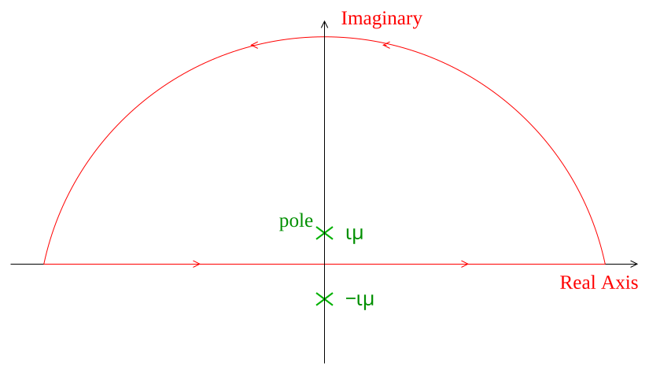

[← 30 Scattering](30-scattering.md) · [32 Classical Maxwell Fields →](32-classical-maxwell-fields.md)

---

<hr class="page" style="height:2px;border:0;background:currentColor;opacity:0.25">
<a id="p426" href="book.pdf#page=426" target="_blank" title="This page in the PDF"><sup>[p. 426]</sup></a>

# 31 Classical Scalar Fields

The **non-relativistic quantum mechanics** that we have studied so far developed largely between 1923 and 1925, based on the hypothesis of Plank from the late 19th century. It assumes that a particle has a probability that integrates to one over all space and that the particles are not created or destroyed. The theory neither deals with the **quantized electromagnetic field** nor with the relativistic energy equation.

It was not long after the non-relativistic theory was completed that Dirac introduced a **relativistic** **theory for electrons**. By about 1928, relativistic theories, in which the electromagnetic field was quantized and the creation and absorption of particles was possible, had been developed by Dirac.

Quantum Mechanics became a **quantum theory of fields**, with the fields for **bosons and fermions** **treated in a symmetric way**, yet behaving quite differently. In 1940, Pauli proved the spinstatistics theorem which showed why spin one-half particles should behave like fermions and spin zero or spin one particles should have the properties of bosons.

**Quantum Field Theory** (QFT) was quite successful in describing all detailed experiments in electromagnetic interactions and many aspects of the weak interactions. Nevertheless, by the 1960s, when our textbook was written, most particle theorists were doubtful that QFT was suitable for describing the strong interactions and some aspects of the weak interactions. This all changed dramatically around 1970 when very **successful Gauge Theories of the strong and weak** **interactions** were introduced. By now, the physics of the electromagnetic, weak, and strong interactions are well described by Quantum Field (Gauge) Theories that together from the Standard Model.

Dirac’s relativistic theory of electrons introduced many new ideas such as antiparticles and four component spinors. As we quantize the EM field, we must treat the propagation of photons relativistically. Hence we will work toward understanding relativistic QFT.

In this chapter, we will review classical field theory, learn to write our equations in a covariant way in four dimensions, and recall aspects of Lagrangian and Hamiltonian formalisms for use in field theory. The emphasis will be on learning how all these things work and on getting practice with calculations, not on mathematical rigor. While we already have a good deal of knowledge about classical electromagnetism, we will start with simple field theories to get some practice.

# <a id="s-31-1-simple-mechanical-systems-and-fields"></a>31.1 Simple Mechanical Systems and Fields

This section is a **review of mechanical systems** largely from the point of view of Lagrangian dynamics. In particular, we review the equations of a string as an example of a field theory in one dimension.

We start with the **Lagrangian of a discrete system** like a single particle.

```math
L ( q, \dot{q} ) = T - V
```

Lagrange’s equations are

```math
\frac{d}{dt} \left( \frac{\partial L}{\partial \dot{q}_{i}} \right) - \frac{\partial L}{\partial q_{i}} = 0
```

<div align="right"><a href="book.pdf#page=426" target="_blank" title="This page in the PDF"><sup>[p. 426]</sup></a></div>
<hr class="page" style="height:2px;border:0;background:currentColor;opacity:0.25">
<a id="p427" href="book.pdf#page=427" target="_blank" title="This page in the PDF"><sup>[p. 427]</sup></a>

where the $`q_{i}`$ are the coordinates of the particle. This equation is derivable from the **principle of**

```math
\text{ least action } ._{t_{2}}
```

```math
\delta \int_{t_{1}} L ( q_{i} , \dot{q}_{i} ) dt = 0
```

Similarly, we can define the **Hamiltonian**

```math
H ( q_{i} ,p_{i} ) = \sum_{i} p_{i} \dot{q}_{i} - L
```

where $`p_{i}`$ are the momenta conjugate to the coordinates $`q_{i}`$.

```math
p_{i} = \frac{\partial L}{\partial \dot{q}_{i}}
```

For a continuous system, like a **string**, the Lagrangian is an integral of a Lagrangian density function.

```math
L = \int \mathcal{L} dx
```

For example, for a string,

```math
\mathcal{L} = \frac{1}{2} \left[ \mu \dot{\eta}^{2} - Y \left( \frac{\partial \eta}{\partial x} \right)^{2} \right]
```

where $`Y`$ is Young’s modulus for the material of the string and $`\mu`$ is the mass density. The **Euler-** **Lagrange Equation** for a continuous system is also derivable from the principle of least action states above. For the string, this would be.

```math
\frac{\partial}{\partial x} \left( \frac{\partial \mathcal{L}}{\partial ( \partial \eta /\partial x )} \right) + \frac{\partial}{\partial t} \left( \frac{\partial \mathcal{L}}{\partial ( \partial \eta /\partial t )} \right) - \frac{\partial \mathcal{L}}{\partial \eta} = 0
```

Recall that the Lagrangian is a function of $`\eta`$ and its space and time derivatives.

The **Hamiltonian density** can be computed from the Lagrangian density and is a function of the coordinate $`\eta`$ and its conjugate momentum.

```math
\mathcal{H} = \dot{\eta} \frac{\partial \mathcal{L}}{\partial \dot{\eta}} - \mathcal{L}
```

In this example of a string, $`\eta ( x,t )`$ is a **simple scalar field**. The string has a displacement at each point along it which varies as a function of time.

If we apply the **Euler-Lagrange equation, we get a differential equation** that the string’s displacement will satisfy.

```math
\mathcal{L} = \frac{1}{2} \left[ \mu \dot{\eta}^{2} - Y \left( \frac{\partial \eta}{\partial x} \right)^{2} \right]
```

```math
\frac{\partial}{\partial x} \left( \frac{\partial \mathcal{L}}{\partial ( \partial \eta /\partial x )} \right) + \frac{\partial}{\partial t} \left( \frac{\partial \mathcal{L}}{\partial ( \partial \eta /\partial t )} \right) - \frac{\partial \mathcal{L}}{\partial \eta} = 0
```

```math
\frac{\partial \mathcal{L}}{\partial ( \partial \eta /\partial x )} = - Y \frac{\partial \eta}{\partial x}
```

<div align="right"><a href="book.pdf#page=427" target="_blank" title="This page in the PDF"><sup>[p. 427]</sup></a></div>
<hr class="page" style="height:2px;border:0;background:currentColor;opacity:0.25">
<a id="p428" href="book.pdf#page=428" target="_blank" title="This page in the PDF"><sup>[p. 428]</sup></a>

```math
\frac{\partial \mathcal{L}}{\partial ( \partial \eta /\partial t )} = \mu \dot{\eta}
```

```math
- Y \frac{\partial^{2} \eta}{\partial x^{2}} + \mu \ddot{\eta} + 0 = 0
```

```math
\ddot{\eta} = \frac{Y}{\mu} \frac{\partial^{2} \eta}{\partial x^{2}}
```

This is the **wave equation for the string**. There are easier ways to get to this wave equation, but, as we move away from simple mechanical systems, a formal way of proceeding will be very helpful.

# <a id="s-31-2-classical-scalar-field-in-four-dimensions"></a>31.2 Classical Scalar Field in Four Dimensions

Assume we have a **field defined everywhere in space and time**. For simplicity we will start with a **scalar field** (instead of the vector... fields of E&M).

```math
\varphi ( \vec{r} , t )
```

The property that makes this a true scalar field is that it is **invariant under rotations and** **Lorentz boosts**.

```math
\varphi ( \vec{r} , t ) = \varphi^{\prime} ( \vec{r}^{\prime} ,t^{\prime} )
```

The Euler-Lagrange equation derived from the principle of least action is

```math
\sum_{k} \frac{\partial}{\partial x_{k}} \left( \frac{\partial \mathcal{L}}{\partial ( \partial \varphi /\partial x_{k} )} \right) + \frac{\partial}{\partial t} \left( \frac{\partial \mathcal{L}}{\partial ( \partial \varphi /\partial t )} \right) - \frac{\partial \mathcal{L}}{\partial \varphi} = 0 .
```

Note that since there is only one field, there is only one equation.

Since we are aiming for a description of relativistic quantum mechanics, it will benefit us to write our equations in a **covariant way**. I think this also simplifies the equations. We will follow the **notation** **of Sakurai**. (The convention does not really matter and one should not get hung up on it.) As usual the Latin indices like $`i,j,k\dots`$ will run from 1 to 3 and represent the space coordinates. The Greek indices like $`\mu ,\nu ,\sigma ,\lambda \dots`$ will run from 1 to 4. Sakurai would give the **spacetime coordinate** **vector** either as

```math
( x_{1} ,x_{2} ,x_{3} ,x_{4} ) = ( x,y,z,ict )
```

or as

```math
( x_{0} ,x_{1} ,x_{2} ,x_{3} ) = ( t,x,y,z )
```

and use the former to do real computations.

We will not use the so called covariant and contravariant indices. Instead we will put an $`i`$ on the fourth component of a vector which give that component a $`-`$ sign in a dot product.

```math
x_{\mu} x_{\mu} = x^{2} + y^{2} + z^{2} - c^{2} t^{2}
```

Note we can have all lower indices. As Sakurai points out, there is no need for the complication of a metric tensor to raise and lower indices unless general relativity comes into play and the geometry of space-time is not flat. We can assume the $`i`$ in the fourth component is a calculational convenience, not an indication of the need for complex numbers in our coordinate systems. So while we may have said “farewell to ict” some time in the past, we will use it here because the notation is less

<div align="right"><a href="book.pdf#page=428" target="_blank" title="This page in the PDF"><sup>[p. 428]</sup></a></div>
<hr class="page" style="height:2px;border:0;background:currentColor;opacity:0.25">
<a id="p429" href="book.pdf#page=429" target="_blank" title="This page in the PDF"><sup>[p. 429]</sup></a>

complicated. The $`i`$ here should never really be used to multiply an $`i`$ in the complex wave function, but, everything will work out so that doesn’t happen unless we make an algebra mistake.

The spacetime coordinate $`x_{\mu}`$ is a Lorentz vector transforming under rotations and boosts as follows.

```math
x_{\mu}^{\prime} = a_{\mu \nu} x_{\nu}
```

(Note that we will always **sum over repeated indices**, Latin or Greek.) The **Lorentz transfor-** **mation** is done with a 4 by 4 matrix with the property that the **inverse is the transpose of the** **matrix**.

```math
a_{\mu \nu}^{- 1} = a_{\nu \mu}
```

The $`a_{ij}`$ and $`a_{4 4}`$ are real while the $`a_{4 j}`$ and $`a_{j 4}`$ are imaginary in our convention. Thus we may compute the coordinate using the **inverse transformation**.

```math
x_{\mu} = a_{\nu \mu} x_{\nu}^{\prime}
```

Vectors transform as we change our reference system by rotating or boosting. Higher rank tensors also transform with one Lorentz transformation matrix per index on the **tensor**.

The Lorentz transformation matrix to a coordinate system boosted along the x direction is.

```math
a_{\mu \nu} = \begin{pmatrix} \gamma & 0 & 0 & i\beta \gamma \\ 0 & 1 & 0 & 0 \\ 0 & 0 & 1 & 0 \\ - i\beta \gamma & 0 & 0 & \gamma \end{pmatrix}
```

The $`i`$ shows up on space-time elements to deal with the $`i`$ we have put on the time components of 4-vectors. It is interesting to note the similarity between Lorentz boosts and rotations. A rotation in the $`xy`$ plane through an angle $`\theta`$ is implemented with the transformation

```math
a_{\mu \nu} = \begin{pmatrix} \cos \theta & \sin \theta & 0 & 0 \\ - \sin \theta & \cos \theta & 0 & 0 \\ 0 & 0 & 1 & 0 \\ 0 & 0 & 0 & 1 \end{pmatrix} .
```

A boost along the $`x`$ direction is like a rotation in the $`xt`$ through an angle of $`\theta`$ where $`\tanh \theta = \beta`$. Since we are in Minkowski space where we need a minus sign on the time component of dot products, we need to add an $`i`$ in this rotation too.

```math
a_{\mu \nu} = \begin{pmatrix} \cos i\theta & 0 & 0 & \sin i\theta \\ 0 & 1 & 0 & 0 \\ 0 & 0 & 1 & 0 \\ - \sin i\theta & 0 & 0 & \cos i\theta \end{pmatrix} = \begin{pmatrix} \cosh \theta & 0 & 0 & i \sinh \theta \\ 0 & 1 & 0 & 0 \\ 0 & 0 & 1 & 0 \\ - i \sinh \theta & 0 & 0 & \cosh \theta \end{pmatrix} = \begin{pmatrix} \gamma & 0 & 0 & i\beta \gamma \\ 0 & 1 & 0 & 0 \\ 0 & 0 & 1 & 0 \\ - i\beta \gamma & 0 & 0 & \gamma \end{pmatrix}
```

Effectively, a Lorentz boost is a rotation in which $`\tan i\theta = \beta`$. We will make essentially no use of Lorentz transformations because **we will write our theories in terms of Lorentz scalars** whenever possible. For example, our Lagrangian density should be invariant.

```math
\mathcal{L}^{\prime} ( x^{\prime} ) = \mathcal{L} ( x )
```

The Lagrangians we have seen so far have derivatives with respect to the coordinates. The 4-vector way of writing this will be $`\frac{\partial}{\partial x_{\mu}}`$. We need to know what the transformation properties of this are. We can compute this from the transformations and the chain rule.

```math
x_{\nu} = a_{\mu \nu} x_{\mu}^{\prime}
```

```math
\frac{\partial}{\partial x_{\mu}^{\prime}} = \frac{\partial x_{\nu}}{\partial x_{\mu}^{\prime}} \frac{\partial}{\partial x_{\nu}} = a_{\mu \nu} \frac{\partial}{\partial x_{\nu}}
```

<div align="right"><a href="book.pdf#page=429" target="_blank" title="This page in the PDF"><sup>[p. 429]</sup></a></div>
<hr class="page" style="height:2px;border:0;background:currentColor;opacity:0.25">
<a id="p430" href="book.pdf#page=430" target="_blank" title="This page in the PDF"><sup>[p. 430]</sup></a>

This means that it **transforms like a vector**. Compare it to our original transformation formula for $`x_{\mu}`$.

```math
x_{\mu}^{\prime} = a_{\mu \nu} x_{\nu}
```

We may safely assume that all our derivatives with one index transform as a vector.

With this, lets work on the Euler-Lagrange equation to get it into covariant shape. Remember that the field $`\varphi`$ is a Lorentz scalar.

```math
\sum_{k} \frac{\partial}{\partial x_{k}} \left( \frac{\partial \mathcal{L}}{\partial ( \partial \varphi /\partial x_{k} )} \right) + \frac{\partial}{\partial t} \left( \frac{\partial \mathcal{L}}{\partial ( \partial \varphi /\partial t )} \right) - \frac{\partial \mathcal{L}}{\partial \varphi} = 0
```

```math
\sum_{k} \frac{\partial}{\partial x_{k}} \left( \frac{\partial \mathcal{L}}{\partial ( \partial \varphi /\partial x_{k} )} \right) + \frac{\partial}{\partial ( ict )} \left( \frac{\partial \mathcal{L}}{\partial ( \partial \varphi /\partial ( ict ) )} \right) - \frac{\partial \mathcal{L}}{\partial \varphi} = 0
```

```math
\frac{\partial}{\partial x_{\mu}} \left( \frac{\partial \mathcal{L}}{\partial ( \partial \varphi /\partial x_{\mu} )} \right) - \frac{\partial \mathcal{L}}{\partial \varphi} = 0
```

This is the **Euler-Lagrange equation for a single scalar field**. Each term in this equation is a Lorentz scalar, if $`\mathcal{L}`$ is a scalar.

```math
\frac{\partial}{\partial x_{\mu}} \left( \frac{\partial \mathcal{L}}{\partial ( \partial \varphi /\partial x_{\mu} )} \right) - \frac{\partial \mathcal{L}}{\partial \varphi} = 0
```

Now we want to **find a reasonable Lagrangian for a scalar field**. The Lagrangian depends on the $`\varphi`$ and its derivatives. It **should not depend explicitly on the coordinates** $`x_{\mu}`$, since that would violate translation and/or rotation invariance. We also want to come out with a **linear wave** **equation** so that high powers of the field should not appear. The only Lagrangian we can choose (up to unimportant constants) is

```math
\mathcal{L} = - \frac{1}{2} \left( \frac{\partial \varphi}{\partial x_{\nu}} \frac{\partial \varphi}{\partial x_{\nu}} + \mu^{2} \varphi^{2} \right)
```

The one constant $`\mu`$ sets the ratio of the two terms. The overall constant is not important except to match the $`T - V`$ definition. Remember that $`\varphi`$ is a function of the coordinates.

With this Lagrangian, the Euler-Lagrange equation is.

```math
\frac{\partial}{\partial x_{\mu}} \left( - \frac{\partial \varphi}{\partial x_{\mu}} \right) + \mu^{2} \varphi = 0
```

```math
\frac{\partial}{\partial x_{\mu}} \frac{\partial}{\partial x_{\mu}} \varphi - \mu^{2} \varphi = 0
```

```math
✷ \varphi - \mu^{2} \varphi = 0
```

This is the known as the **Klein-Gordon equation**. It is a good relativistic equation for a **massive** **scalar field**. It was also an early candidate for the relativistic equivalent of the Schrödinger equation for electrons because it basically has the **relativistic analog of the energy relation** inherent in

<div align="right"><a href="book.pdf#page=430" target="_blank" title="This page in the PDF"><sup>[p. 430]</sup></a></div>
<hr class="page" style="height:2px;border:0;background:currentColor;opacity:0.25">
<a id="p431" href="book.pdf#page=431" target="_blank" title="This page in the PDF"><sup>[p. 431]</sup></a>

the Schrödinger equation. Writing that relation in the order terms appear in the Klein-Gordon equation above we get (letting $`c`$ = 1 briefly).

```math
- p^{2} + E^{2} - m^{2} = 0
```

Its worth noting that this equation, unlike the non-relativistic Schrödinger equation, relates the second spatial derivative of the field to the **second time derivative**. (Remember the Schrödinger equation has $`i`$ times the first time derivative as the energy operator.)

So far we have the Lagrangian and wave equation for a **“free” scalar field**. There are **no sources** of the field (the equivalent of charges and currents in electromagnetism.) Lets assume the source density is $`\rho ( x_{\mu} )`$. The source term must be a scalar function so, we add the term $`\varphi \rho`$ to the Lagrangian.

```math
\mathcal{L} = - \frac{1}{2} \left( \frac{\partial \varphi}{\partial x_{\nu}} \frac{\partial \varphi}{\partial x_{\nu}} + \mu^{2} \varphi^{2} \right) + \varphi \rho
```

This adds a term to the wave equation.

```math
✷ \varphi - \mu^{2} \varphi = \rho
```

Any source density can be built up from point sources so it is useful to understand the **field gen-** **erated by a point source** as we do for electromagnetism.

```math
\rho ( \vec{x} , t ) = \rho ( x_{\mu} ) = G\delta^{3} ( \vec{x} )
```

This is a source of strength $`G`$ at the origin. It does not change with time so we expect a static field.

```math
\frac{\partial \varphi}{\partial t} = 0
```

The Euler-Lagrange equation becomes.

```math
\nabla^{2} \varphi - \mu^{2} \varphi = G\delta^{3} ( \vec{x} )
```

We will solve this for the **field from a point source** below and get the result

```math
\varphi ( \vec{x} ) = \frac{- Ge^{- \mu r}}{4 \pi r} .
```

This solution should be familiar to us from the scalar potential for an electric point charge which satisfies the same equation with $`\mu`$ = 0, $`\nabla^{2} \varphi = - \rho = - Q\delta^{3} ( \vec{x} )`$. This is a field that falls off much faster than $`\frac{1}{r}`$. **A massive scalar field falls off exponentially** and the larger the mass, the faster the fall off. (We also get a mathematical result which is useful in several applications. This is worked out another way in the section on hyperfine splitting) $`\nabla_{\overline{r}}^{2 1} = - 4 \pi \delta^{3} ( \vec{x} ) .`$

Now we solve for the scalar field from a point source by Fourier transforming the wave equation. Define the Fourier transforms to be.

```math
\tilde{\varphi} ( \vec{k} ) = \frac{1}{( 2 \pi ) 2^{3}} \int d^{3} xe^{- i \vec{k} \cdot \vec{x}} \varphi ( \vec{x} )
```

```math
\varphi ( \vec{x} ) = \frac{1}{( 2 \pi ) 2^{3}} \int d^{3} ke^{i \vec{k} \cdot \vec{x}} \tilde{\varphi} ( \vec{k} )
```

<div align="right"><a href="book.pdf#page=431" target="_blank" title="This page in the PDF"><sup>[p. 431]</sup></a></div>
<hr class="page" style="height:2px;border:0;background:currentColor;opacity:0.25">
<a id="p432" href="book.pdf#page=432" target="_blank" title="This page in the PDF"><sup>[p. 432]</sup></a>

We now **take the transform of both sides** of the equation.

```math
\nabla^{2} \varphi - \mu^{2} \varphi = G\delta^{3} ( \vec{x} )
```

```math
\frac{1}{( 2 \pi )^{3} 2} \int d^{3} xe^{- i \vec{k} \cdot \vec{x}} ( \nabla^{2} \varphi - \mu^{2} \varphi ) = \frac{1}{( 2 \pi ) \tfrac{3}{2}} \int d^{3} xe^{- i \vec{k} \cdot \vec{x}} G\delta^{3} ( \vec{x} )
```

```math
\frac{1}{( 2 \pi )^{3} 2} \int d^{3} xe^{- i \vec{k} \cdot \vec{x}} ( \nabla^{2} \varphi - \mu^{2} \varphi ) = \frac{G}{( 2 \pi ) \tfrac{3}{2}}
```

```math
\frac{1}{( 2 \pi ) \tfrac{3}{2}} \int d^{3} xe^{- i \vec{k} \cdot \vec{x}} ( - k^{2} - \mu^{2} ) \varphi = \frac{G}{( 2 \pi ) \tfrac{3}{2}}
```

```math
\begin{aligned} ( - k^{2} - \mu^{2} ) \tilde{\varphi} &= \frac{G}{( 2 \pi ) \tfrac{3}{2}} \\ \tilde{\varphi} &= \frac{- G}{( 2 \pi )^{\tfrac{3}{2}}} \frac{1}{( k^{2} + \mu^{2} )} \end{aligned}
```

To deal with the $`\nabla^{2}`$, we have integrated by parts twice assuming that the field falls off fast enough at infinity.

We now have the **Fourier transform of the field of a point source**. If we can **transform back** **to position space**, we will have the field. This is a fairly standard type of problem in quantum mechanics.

```math
\begin{aligned} \varphi ( \vec{x} ) &= \frac{1}{( 2 \pi ) \tfrac{3}{2}} \int d^{3} ke^{i \vec{k} \cdot \vec{x}} \frac{- G}{( 2 \pi ) 2^{3}} \frac{1}{( k^{2} + \mu^{2} )} \\ &= \frac{- G}{( 2 \pi )^{3}} \int d^{3} k \frac{e^{i \vec{k} \cdot \vec{x}}}{( k^{2} + \mu^{2} )} \\ &= \frac{- 2 \pi G}{( 2 \pi )^{3}} \int k^{2} dk \int^{1} \frac{e^{ikr \cos \theta_{k}}}{( k^{2} + \mu^{2} )} d \cos \theta_{k} \\ &= \frac{- G}{( 2 \pi )^{2}} \int \frac{k^{2}}{( k^{2} + \mu^{2} )}^{- 1} \int^{1} e^{ikr \cos \theta_{k}} d \cos \theta_{k} dk \\ &= \frac{- G}{( 2 \pi )^{2}} \int \frac{k^{2}}{( k^{2} + \mu^{2} )}^{-} \left[ {}^{1} \frac{1}{ikr} e^{ikr \cos \theta_{k}} \right]^{1} dk \\ &= \frac{- G}{( 2 \pi )^{2} ir} \int \frac{k}{( k^{2} + \mu^{2} )} \left( e^{ikr} - e^{- ikr} \right)^{- 1} dk \\ &= \frac{- G}{( 2 \pi )^{2} ir} \int_{0}^{\infty} \frac{k}{( k + i\mu ) ( k - i\mu )} \left( e^{ikr} - e^{- ikr} \right) dk \end{aligned}
```

This is now of a form for which we can use Cauchy’s theorem for **contour integrals**. The theorem says that an **integral around a closed contour in the complex plane** is equal to 2$`\pi i`$ times the sum of the residues at the poles enclosed in the contour. Contour Integration is a powerful technique often used in quantum mechanics.

If the integrand is a function of the complex variable $`k`$, a pole is of the form $`\frac{r}{k}`$ where $`r`$ is called the residue at the pole. The **integrand above has two poles**, one at $`k = i\mu`$ and the other at $`k = - i\mu`$. The **integral we are interested in is just along the real axis** so we want the integral along

<div align="right"><a href="book.pdf#page=432" target="_blank" title="This page in the PDF"><sup>[p. 432]</sup></a></div>
<hr class="page" style="height:2px;border:0;background:currentColor;opacity:0.25">
<a id="p433" href="book.pdf#page=433" target="_blank" title="This page in the PDF"><sup>[p. 433]</sup></a>

the rest of the contour to give zero. That’s easy to do since the integrand goes to zero at infinity on the real axis and the exponentials go to zero either at positive or negative infinity for the imaginary part of $`k`$. Examine the integral $`\oint \tfrac{k}{( k + i\mu ) ( k - i\mu )} e^{ikr} dk`$ around a contour in the upper half plane as shown below.



_Figure 96 (p. 433)_

The pole inside the contour is at $`k = i\mu`$. The residue at the pole is

```math
\left[ \frac{ke^{ikr}}{k + i\mu} \right]_{k = i\mu} = \frac{i\mu e^{- \mu r}}{i\mu + i\mu} = \frac{1}{2} e^{- \mu r} .
```

The integrand goes to zero exponentially on the semicircle at infinity so only the real axis contributes to the integral along the contour. The integral along the real axis can be manipulated to do the whole problem for us.

```math
\left. \oint \right) \frac{k}{( k + i\mu ) ( k - i\mu )} e^{ikr} dk = 2 \pi i \left[ \frac{ke^{ikr}}{k + i\mu} \right]_{k = i\mu}
```

```math
\int_{-\infty}^{\infty} \frac{k}{( k + i\mu ) ( k - i\mu )} e^{ikr} dk = 2 \pi i \frac{i\mu e^{- \mu r}}{i\mu + i\mu}
```

```math
\int^{0} \frac{k}{( k + i\mu ) ( k - i\mu )} e^{ikr} dk + \int^{\infty} \frac{k}{( k + i\mu ) ( k - i\mu )} e^{ikr} dk = 2 \pi i \frac{1}{2} e^{- \mu r}
```

```math
\begin{aligned} {}^{-\infty 0} \quad k^{\prime} &= - k \\ \int_{\infty}^{0} \frac{- k^{\prime}}{( - k^{\prime} + i\mu ) ( - k^{\prime} - i\mu )} e^{- ik^{\prime} r} ( - dk^{\prime} ) + \int_{0}^{\infty} \frac{k}{( k + i\mu ) ( k - i\mu )} e^{ikr} dk &= \pi ie^{- \mu r} \end{aligned}
```

```math
- \int_{0}^{\infty} \frac{k^{\prime}}{k^{\prime 2} + \mu^{2}} e^{- ik^{\prime} r} dk^{\prime} + \int_{0}^{\infty} \frac{k}{k^{2} + \mu^{2}} e^{ikr} dk = \pi ie^{- \mu r}
```

<div align="right"><a href="book.pdf#page=433" target="_blank" title="This page in the PDF"><sup>[p. 433]</sup></a></div>
<hr class="page" style="height:2px;border:0;background:currentColor;opacity:0.25">
<a id="p434" href="book.pdf#page=434" target="_blank" title="This page in the PDF"><sup>[p. 434]</sup></a>

```math
{}_{\infty \infty} \quad k = k^{\prime}
```

```math
- \int_{0} \frac{k}{k^{2} + \mu^{2}} e^{- ikr} dk + \int_{0} \frac{k}{k^{2} + \mu^{2}} e^{ikr} dk = \pi ie^{- \mu r}
```

```math
\int_{0}^{\infty} \frac{k}{k^{2} + \mu^{2}} e^{ikr} dk - \int_{0}^{\infty} \frac{k}{k^{2} + \mu^{2}} e^{- ikr} dk = \pi ie^{- \mu r}
```

```math
\int_{0}^{\infty} \frac{k}{k^{2} + \mu^{2}} \left( e^{ikr} - e^{- ikr} \right) dk = \pi ie^{- \mu r}
```

This is exactly the integral we wanted to do.

Plug the integral into the Fourier transform we were computing.

```math
\begin{aligned} \varphi ( \vec{x} ) &= \frac{- G}{( 2 \pi )^{2} ir} \int^{\infty} \frac{k}{k^{2} + \mu^{2}} \left( e^{ikr} - e^{- ikr} \right) dk \\ \varphi ( \vec{x} ) &= \frac{- G}{( 2 \pi )^{2} ir} \pi ie^{0 - \mu r} \\ \varphi ( \vec{x} ) &= \frac{- Ge^{- \mu r}}{4 \pi r} \end{aligned}
```

In this case, it is simple to compute the **interaction Hamiltonian** from the interaction Lagrangian and the **potential between two particles**. Lets assume we have two particles, each with the same interaction with the field.

```math
\rho ( \vec{x} , t ) = \rho ( x ) = G\delta^{3} ( \vec{x} )
```

Now compute the Hamiltonian.

```math
\mathcal{L}_{int} = - \varphi \rho
```

```math
\mathcal{H}_{int} = \dot{\varphi} \frac{\partial \mathcal{L} int}{\partial \dot{\varphi}} - \mathcal{L}_{int} = - \mathcal{L}_{int} = \varphi \rho
```

```math
\begin{aligned} H_{int} &= \int \mathcal{H}_{int} d^{3} x_{2} \\ H_{int}^{( 1 , 2 )} &= \int \varphi_{1} \rho_{2} d^{3} x_{2} = \int \frac{- Ge^{- \mu r}}{4 \pi r} G\delta^{3} ( \vec{x}_{2} ) d^{3} x_{2} = \frac{- G^{2} e^{- \mu r_{1 2}}}{4 \pi r_{1 2}} \end{aligned}
```

We see that this is a short-range, attractive potential.

This was **proposed by Yukawa as the nuclear force**. He predicted a scalar particle with a mass close to that of the pion before the pion was discovered. His prediction of the mass was based on the range of the nuclear force, on the order of one Fermi. In some sense, his prediction is approximately correct. Pion exchange can explain much of the nuclear force but does not explain all the details. Pions and nucleons have since been show to be composite particles with internal structure. Other composites with masses larger than the pion also play a role in the force between nucleons.

Pions were also found to come in three charges: $`\pi^{+} , \pi^{-}`$, and $`\pi^{0}`$. This would lead us to develop a complex scalar field as done in the text. Its not our goal right now so we will skip this. Its interesting to note that the Higgs Boson is also represented by a complex scalar field.

<div align="right"><a href="book.pdf#page=434" target="_blank" title="This page in the PDF"><sup>[p. 434]</sup></a></div>
<hr class="page" style="height:2px;border:0;background:currentColor;opacity:0.25">
<a id="p435" href="book.pdf#page=435" target="_blank" title="This page in the PDF"><sup>[p. 435]</sup></a>

We have developed a covariant **classical theory for a scalar field**. The Lagrangian density is a Lorentz scalar function. We have included an interaction term to provide a **source for the field**. Now we will attempt to do the same for classical electromagnetism.

---

[← 30 Scattering](30-scattering.md) · [32 Classical Maxwell Fields →](32-classical-maxwell-fields.md)
