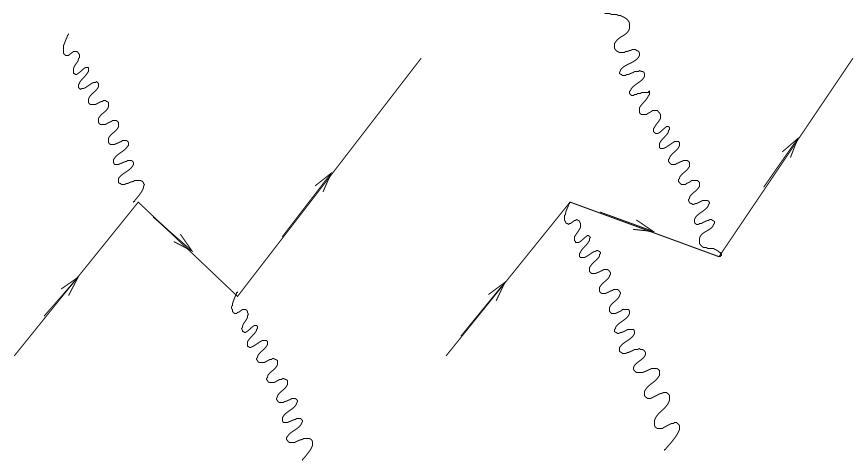
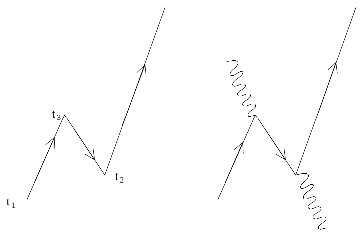
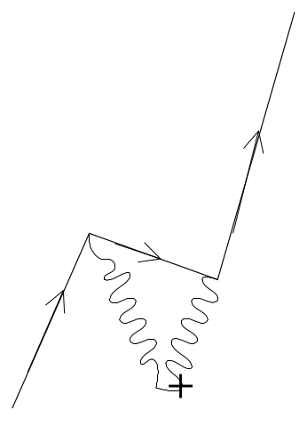

[← 35 Electron Self Energy Corrections](35-electron-self-energy-corrections.md) · [37 Formulas →](37-formulas.md)

---

<hr class="page" style="height:2px;border:0;background:currentColor;opacity:0.25">
<a id="p484" href="book.pdf#page=484" target="_blank" title="This page in the PDF"><sup>[p. 484]</sup></a>

# 36 Dirac Equation

# <a id="s-36-1-dirac-s-motivation"></a>36.1 Dirac’s Motivation

The **Schrödinger equation is simply the non-relativistic energy equation** operating on a wavefunction.

```math
E = \frac{p^{2}}{2 m} + V ( \vec{r} )
```

The natural extension of this is the **relativistic energy equation**.

```math
E^{2} = p^{2} c^{2} + ( mc^{2} )^{2}
```

This is just the **Klein-Gordon equation** that we derived for a scalar field. It did not take physicists long to come up with this equation.

Because the Schrödinger equation is **first order in the time derivative**, the initial conditions needed to determine a solution to the equation are just $`\psi ( t`$ = 0). In an equation that is second order in the time derivative, we also need to specify some information about the time derivatives at $`t`$ = 0 to determine the solution at a later time. It seemed strange to give up the concept that all information is contained in the wave function to go to the relativistically correct equation.

If we have a complex scalar field that satisfies the (Euler-Lagrange = Klein-Gordon) equations

```math
✷ \varphi - m^{2} \varphi = 0
```

```math
✷ \varphi^{*} - m^{2} \varphi^{*} = 0 ,
```

it can be shown that the bilinear quantity

```math
s_{\mu} = \frac{\hbar}{2 mi} \left( \varphi^{*} \frac{\partial \varphi}{\partial x_{\mu}} - \frac{\partial \varphi^{*}}{\partial x_{\mu}} \varphi \right)
```

satisfies the **flux conservation equation**

```math
\frac{\partial s_{\mu}}{\partial x_{\mu}} = \frac{\hbar}{2 mi} \left( \frac{\partial \varphi^{*}}{\partial x_{\mu}} \frac{\partial \varphi}{\partial x_{\mu}} + \varphi^{*} ✷ \varphi - ( ✷ \varphi^{*} ) \varphi - \frac{\partial \varphi^{*}}{\partial x_{\mu}} \frac{\partial \varphi}{\partial x_{\mu}} \right) = \frac{\hbar}{2 mi} m^{2} ( \varphi^{*} \varphi - \varphi^{*} \varphi ) = 0
```

and reduces to the probability flux we used with the Schrödinger equation, in the non-relativistic limit. The fourth component of the vector is just $`c`$ times the probability density, so that’s fine too (using $`e^{imc^{2} t/ \hbar}`$ as the time dependence.).

The perceived **problem with this probability is that it is not always positive**. Because the energy operator appears squared in the equation, both positive energies and negative energies are solutions. Both solutions are needed to form a complete set. With negative energies, the probability density is negative. Dirac thought this was a problem. Later, the vector $`s_{\mu}`$ was reinterpreted as the electric current and charge density, rather than probability. The Klein-Gordon equation was indicating that particles of **both positive and negative charge** are present in the complex scalar field. The “negative energy solutions” are needed to form a complete set, so they cannot be discarded.

Dirac sought to solve the perceived problem by finding an equation that was somehow linear in the time derivative as is the Schrödinger equation. He managed to do this but still found “negative energy solutions” which he eventually interpreted to predict antimatter. We may also be motivated to naturally describe particles with spin one-half.

<div align="right"><a href="book.pdf#page=484" target="_blank" title="This page in the PDF"><sup>[p. 484]</sup></a></div>
<hr class="page" style="height:2px;border:0;background:currentColor;opacity:0.25">
<a id="p485" href="book.pdf#page=485" target="_blank" title="This page in the PDF"><sup>[p. 485]</sup></a>

# <a id="s-36-2-the-schrodinger-pauli-hamiltonian"></a>36.2 The Schrödinger-Pauli Hamiltonian

In the homework on electrons in an electromagnetic field, we showed that **the Schrödinger-Pauli** **Hamiltonian gives the same result as the non-relativistic Hamiltonian we have been** **using and automatically includes the interaction of the electron’s spin with the magnetic** **field**.

```math
H = \frac{1}{2 m} \left( \vec{\sigma} \cdot [ \vec{p} + \frac{e}{c} \vec{A} ( \vec{r} , t ) ] \right)^{2} - e\varphi ( \vec{r} , t )
```

The derivation is repeated here. Recall that $`\{ \sigma_{i} ,\sigma_{j} \}`$ = 2$`\delta_{ij} , [ \sigma_{i} ,\sigma_{j} ]`$ = 2$`\epsilon_{ijk} \sigma_{k}`$, and that the momentum operator differentiates both $`\vec{A}`$ and the wavefunction.

```math
\left( \vec{\sigma} \cdot [ \vec{p} + \frac{e}{c} \vec{A} ( \vec{r} , t ) ] \right)^{2} = \sigma_{i} \sigma_{j} \left( p_{i} p_{j} + \frac{e^{2}}{c^{2}} A_{i} A_{j} + \frac{e}{c} ( p_{i} A_{j} + A_{i} p_{j} ) \right)
```

```math
= \frac{1}{2} ( \sigma_{i} \sigma_{j} + \sigma_{j} \sigma_{i} ) \left( p_{i} p_{j} + \frac{e^{2}}{c^{2}} A_{i} A_{j} \right) + \frac{e}{c} \sigma_{i} \sigma_{j} \left( A_{j} p_{i} + A_{i} p_{j} + \frac{\hbar}{i} \frac{\partial A_{j}}{\partial x_{i}} \right)
```

```math
= \delta_{ij} \left( p_{i} p_{j} + \frac{e^{2}}{c^{2}} A_{i} A_{j} \right) + \frac{e}{c} ( \sigma_{i} \sigma_{j} A_{j} p_{i} + \sigma_{j} \sigma_{i} A_{j} p_{i} ) + \frac{e \hbar}{ic} \sigma_{i} \sigma_{j} \frac{\partial A_{j}}{\partial x_{i}}
```

```math
= p^{2} + \frac{e^{2}}{c^{2}} A^{2} + \frac{e}{c} \{ \sigma_{i} ,\sigma_{j} \} A_{j} p_{i} + \frac{e \hbar}{ic} \frac{1}{2} ( \sigma_{i} \sigma_{j} + \sigma_{i} \sigma_{j} ) \frac{\partial A_{j}}{\partial x_{i}}
```

```math
= p^{2} + \frac{e^{2}}{c^{2}} A^{2} + \frac{e}{c} 2 \delta_{ij} A_{j} p_{i} + \frac{e \hbar}{ic} \frac{1}{2} ( \sigma_{i} \sigma_{j} - \sigma_{j} \sigma_{i} + 2 \delta_{ij} ) \frac{\partial A_{j}}{\partial x_{i}}
```

```math
= p^{2} + \frac{e^{2}}{c^{2}} A^{2} + \frac{2 e}{c} \vec{A} \cdot \vec{p} + \frac{e \hbar}{ic} ( i\epsilon_{ijk} \sigma_{k} + \delta_{ij} ) \frac{\partial A_{j}}{\partial x_{i}}
```

```math
= p^{2} + \frac{e^{2}}{c^{2}} A^{2} + \frac{2 e}{c} \vec{A} \cdot \vec{p} + \frac{e \hbar}{ic} i\epsilon_{ijk} \sigma_{k} \frac{\partial A_{j}}{\partial x_{i}}
```

```math
= p^{2} + \frac{e^{2}}{c^{2}} A^{2} + \frac{2 e}{c} \vec{A} \cdot \vec{p} + \frac{e \hbar}{c} \vec{\sigma} \cdot \vec{B}
```

```math
H = \frac{p^{2}}{2 m} + \frac{e}{mc} \vec{A} \cdot \vec{p} + \frac{e^{2}}{2 mc^{2}} A^{2} - e\varphi + \frac{e \hbar}{2 mc} \vec{\sigma} \cdot \vec{B}
```

```math
H = \frac{1}{2 m} [ \vec{p} + \frac{e}{c} \vec{A} ( \vec{r} , t ) ]^{2} - e\varphi ( \vec{r} , t ) + \frac{e \hbar}{2 mc} \vec{\sigma} \cdot \vec{B} ( \vec{r} , t )
```

We assume the Lorentz condition applies. This is a step in the right direction. The **wavefunction** **now has two components** (a spinor) and the effect of spin is included. Note that this form of the NR Hamiltonian yields the coupling of the electron spin to a magnetic field with the **correct** $`g`$ **factor of 2**. The spin-orbit interaction can be correctly derived from this.

<div align="right"><a href="book.pdf#page=485" target="_blank" title="This page in the PDF"><sup>[p. 485]</sup></a></div>
<hr class="page" style="height:2px;border:0;background:currentColor;opacity:0.25">
<a id="p486" href="book.pdf#page=486" target="_blank" title="This page in the PDF"><sup>[p. 486]</sup></a>

# <a id="s-36-3-the-dirac-equation"></a>36.3 The Dirac Equation

We can **extend this concept to use the relativistic energy equation** (for now with no EM field). The idea is to replace $`\vec{p}`$ with $`\vec{\sigma} \cdot \vec{p}`$.

```math
\left( \frac{E}{c} \right)^{2} - p^{2} = ( mc )^{2}
```

```math
\left( \frac{E}{c} - \vec{\sigma} \cdot \vec{p} \right) \left( \frac{E}{c} + \vec{\sigma} \cdot \vec{p} \right) = ( mc )^{2}
```

```math
\left( \frac{i \hbar}{c} \frac{\partial}{\partial t} + i \hbar \vec{\sigma} \cdot \vec{\nabla} \right) \left( \frac{i \hbar}{c} \frac{\partial}{\partial t} - i \hbar \vec{\sigma} \cdot \vec{\nabla} \right) \varphi = ( mc )^{2} \varphi
```

```math
\left( i \hbar \frac{\partial}{\partial x_{0}} + i \hbar \vec{\sigma} \cdot \vec{\nabla} \right) \left( i \hbar \frac{\partial}{\partial x_{0}} - i \hbar \vec{\sigma} \cdot \vec{\nabla} \right) \varphi = ( mc )^{2} \varphi
```

This is again written in terms of a **2 component spinor** $`\varphi`$.

This equation is clearly headed toward being second order in the time derivative. As with Maxwell’s equation, which is first order when written in terms of the field tensor, we can try to write a first order equation in terms of a quantity derived from $`\varphi`$. Define

```math
\varphi^{( L )} = \varphi
```

```math
\varphi^{( R )} = \frac{1}{mc} \left( i \hbar \frac{\partial}{\partial x_{0}} - i \hbar \vec{\sigma} \cdot \vec{\nabla} \right) \varphi^{( L )}
```

Including the two components of $`\varphi^{( L )}`$ and the two components of $`\varphi^{( R )}`$, we now have four components which satisfy the equations.

```math
\left( i \hbar \frac{\partial}{\partial x_{0}} + i \hbar \vec{\sigma} \cdot \vec{\nabla} \right) \left( i \hbar \frac{\partial}{\partial x_{0}} - i \hbar \vec{\sigma} \cdot \vec{\nabla} \right) \varphi^{( L )} = ( mc )^{2} \varphi^{( L )}
```

```math
\left( i \hbar \frac{\partial}{\partial x_{0}} + i \hbar \vec{\sigma} \cdot \vec{\nabla} \right) mc\varphi^{( R )} = ( mc )^{2} \varphi^{( L )}
```

```math
\left( i \hbar \frac{\partial}{\partial x_{0}} + i \hbar \vec{\sigma} \cdot \vec{\nabla} \right) \varphi^{( R )} = mc\varphi^{( L )}
```

```math
\left( i \hbar \frac{\partial}{\partial x_{0}} - i \hbar \vec{\sigma} \cdot \vec{\nabla} \right) \varphi^{( L )} = mc\varphi^{( R )}
```

These (last) two equations couple the 4 components together unless $`m`$ = 0. Both of the above equations are first order in the time derivative. We could continue with this set of coupled equations but it is more reasonable to **write a single equation in terms of a 4 component wave function**. This will also be a first order equation. First rewrite the two equations together, putting all the terms on one side.

```math
\left( i \hbar \vec{\sigma} \cdot \vec{\nabla} - i \hbar \frac{\partial}{\partial x_{0}} \right) \varphi^{( L )} + mc\varphi^{( R )} = 0
```

```math
\left( - i \hbar \vec{\sigma} \cdot \vec{\nabla} - i \hbar \frac{\partial}{\partial x_{0}} \right) \varphi^{( R )} + mc\varphi^{( L )} = 0
```

<div align="right"><a href="book.pdf#page=486" target="_blank" title="This page in the PDF"><sup>[p. 486]</sup></a></div>
<hr class="page" style="height:2px;border:0;background:currentColor;opacity:0.25">
<a id="p487" href="book.pdf#page=487" target="_blank" title="This page in the PDF"><sup>[p. 487]</sup></a>

Now take the sum and the difference of the two equations.

```math
i \hbar \vec{\sigma} \cdot \vec{\nabla} ( \varphi^{( L )} - \varphi^{( R )} ) - i \hbar \frac{\partial}{\partial x_{0}} ( \varphi^{( R )} + \varphi^{( L )} ) + mc ( \varphi^{( R )} + \varphi^{( L )} ) = 0
```

```math
i \hbar \vec{\sigma} \cdot \vec{\nabla} ( \varphi^{( R )} + \varphi^{( L )} ) - i \hbar \frac{\partial}{\partial x_{0}} ( \varphi^{( L )} - \varphi^{( R )} ) + mc ( \varphi^{( R )} - \varphi^{( L )} ) = 0
```

Now rewriting in terms of $`\psi_{A} = \varphi^{( R )} + \varphi^{( L )}`$ and $`\psi_{B} = \varphi^{( R )} - \varphi^{( L )}`$ and ordering it as a matrix equation, we get.

```math
- i \hbar \vec{\sigma} \cdot \vec{\nabla} ( \varphi^{( R )} - \varphi^{( L )} ) - i \hbar \frac{\partial}{\partial x_{0}} ( \varphi^{( R )} + \varphi^{( L )} ) + mc ( \varphi^{( R )} + \varphi^{( L )} ) = 0
```

```math
i \hbar \vec{\sigma} \cdot \vec{\nabla} ( \varphi^{( R )} + \varphi^{( L )} ) + i \hbar \frac{\partial}{\partial x_{0}} ( \varphi^{( R )} - \varphi^{( L )} ) + mc ( \varphi^{( R )} - \varphi^{( L )} ) = 0
```

```math
- i \hbar \frac{\partial}{\partial x_{0}} ( \varphi^{( R )} + \varphi^{( L )} ) - i \hbar \vec{\sigma} \cdot \vec{\nabla} ( \varphi^{( R )} - \varphi^{( L )} ) + mc ( \varphi^{( R )} + \varphi^{( L )} ) = 0
```

```math
i \hbar \vec{\sigma} \cdot \vec{\nabla} ( \varphi^{( R )} + \varphi^{( L )} ) + i \hbar \frac{\partial}{\partial x_{0}} ( \varphi^{( R )} - \varphi^{( L )} ) + mc ( \varphi^{( R )} - \varphi^{( L )} ) = 0
```

```math
- i \hbar \frac{\partial}{\partial x_{0}} \psi_{A} - i \hbar \vec{\sigma} \cdot \vec{\nabla} \psi_{B} + mc\psi_{A} = 0
```

```math
i \hbar \vec{\sigma} \cdot \vec{\nabla} \psi_{A} + i \hbar \frac{\partial}{\partial x_{0}} \psi_{B} + mc\psi_{B} = 0
```

```math
\begin{pmatrix} - i \hbar_{\partial x} \tfrac{\partial}{0} & - i \hbar \vec{\sigma} \cdot \vec{\nabla} \\ i \hbar \vec{\sigma} \cdot \nabla \vec{\{} & i \hbar \tfrac{\partial}{\partial x_{0}} \end{pmatrix} \begin{pmatrix} \psi_{A} \\ \psi_{B} \end{pmatrix} + mc \begin{pmatrix} \psi_{A} \\ \psi_{B} \end{pmatrix} = 0
```

Remember that $`\psi_{A}`$ and $`\psi_{B}`$ are two component spinors so **this is an equation in 4 components**.

We can rewrite the matrix above as a dot product between 4-vectors. The matrix has a dot product in 3 dimensions and a time component

```math
\begin{pmatrix} - i \hbar_{\partial x} \tfrac{\partial}{0} & - i \hbar \vec{\sigma} \cdot \vec{\nabla} \\ i \hbar \vec{\sigma} \cdot \nabla \vec{\{} & i \hbar \tfrac{\partial}{\partial x_{0}} \end{pmatrix} = \hbar \left[ \begin{pmatrix} 0 & - i \vec{\sigma} \cdot \vec{\nabla} \\ i \vec{\sigma} \cdot \vec{\nabla} & 0 \end{pmatrix} + \begin{pmatrix} \tfrac{\partial}{\partial x_{4}} & 0 \\ 0 & - {}_{\partial x} \tfrac{\partial}{4} \end{pmatrix} \right]
```

```math
= \hbar \left[ \begin{pmatrix} 0 & - i\sigma_{i} \\ i\sigma_{i} & 0 \end{pmatrix} \frac{\partial}{\partial x_{i}} + \begin{pmatrix} 1 & 0 \\ 0 & - 1 \end{pmatrix} \frac{\partial}{\partial x_{4}} \right] = \hbar \left[ \gamma_{\mu} \frac{\partial}{\partial x_{\mu}} \right]
```

The **4 by 4 matrices** $`\gamma_{\mu}`$ are given by.

```math
\gamma_{i} = \begin{pmatrix} 0 & - i\sigma_{i} \\ i\sigma_{i} & 0 \end{pmatrix}
```

```math
\gamma_{4} = \begin{pmatrix} 1 & 0 \\ 0 & - 1 \end{pmatrix}
```

With this definition, the relativistic equation can be simplified a great deal.

```math
\begin{pmatrix} - i \hbar \tfrac{\partial}{\partial x_{0}} & - i \hbar \vec{\sigma} \cdot \vec{\nabla} \\ i \hbar \vec{\sigma} \cdot \nabla \vec{\{} & i \hbar \tfrac{\partial}{0}_{\partial x} \end{pmatrix} \begin{pmatrix} \psi_{A} \\ \psi_{B} \end{pmatrix} + mc \begin{pmatrix} \psi_{A} \\ \psi_{B} \end{pmatrix} = 0
```

```math
\psi = \begin{pmatrix} \psi_{A} \\ \psi_{B} \end{pmatrix} \equiv \begin{pmatrix} \psi_{1} \\ \psi_{2} \\ \psi_{3} \\ \psi_{4} \end{pmatrix}
```

<div align="right"><a href="book.pdf#page=487" target="_blank" title="This page in the PDF"><sup>[p. 487]</sup></a></div>
<hr class="page" style="height:2px;border:0;background:currentColor;opacity:0.25">
<a id="p488" href="book.pdf#page=488" target="_blank" title="This page in the PDF"><sup>[p. 488]</sup></a>

```math
\hbar \gamma_{\mu} \frac{\partial}{\partial x_{\mu}} \psi + mc\psi = 0
```

The **Dirac equation in the absence of EM fields** is

```math
\left( \gamma_{\mu} \frac{\partial}{\partial x_{\mu}} + \frac{mc}{\hbar} \right) \psi = 0 .
```

$`\psi`$ is a **4-component Dirac spinor** and, like the spin states we are used to, represents a coordinate different from the spatial ones.

The **gamma matrices** are 4 by 4 matrices operating in this spinor space. Note that there are 4 matrices, one for each coordinate but that the row or column of the matrix does not correlate with the coordinate.

```math
\gamma_{1} = \begin{pmatrix} 0 & 0 & 0 & - i \\ 0 & 0 & - i & 0 \\ 0 & i & 0 & 0 \\ i & 0 & 0 & 0 \end{pmatrix} \quad \gamma_{2} = \begin{pmatrix} 0 & 0 & 0 & - 1 \\ 0 & 0 & 1 & 0 \\ 0 & 1 & 0 & 0 \\ - 1 & 0 & 0 & 0 \end{pmatrix} \quad \gamma_{3} = \begin{pmatrix} 0 & 0 & - i & 0 \\ 0 & 0 & 0 & i \\ i & 0 & 0 & 0 \\ 0 & - i & 0 & 0 \end{pmatrix} \quad \gamma_{4} = \begin{pmatrix} 1 & 0 & 0 & 0 \\ 0 & 1 & 0 & 0 \\ 0 & 0 & - 1 & 0 \\ 0 & 0 & 0 & - 1 \end{pmatrix}
```

Like the Pauli matrices, the gamma matrices form a vector, (this time a 4vector).

It is easy to see by inspection that the $`\gamma`$ matrices are **Hermitian and traceless**. A little computation will verify that **they anticommute** as the Pauli matrices did.

```math
\{ \gamma_{\mu} ,\gamma_{\nu} \} = 2 \delta_{\mu \nu}
```

Sakurai shows that the anticommutation is all that is needed to determine the physics. That is, for **any set of 4 by 4 matrices that satisfy** $`\{ \gamma_{\mu} ,\gamma_{\nu} \}`$ = 2$`\delta_{\mu \nu}`$**,**

```math
\left( \gamma_{\mu} \frac{\partial}{\partial x_{\mu}} + \frac{mc}{\hbar} \right) \psi = 0
```

**will give the same physical result**, although the representation of $`\psi`$ may be different. This is truly an amazing result.

There are a few other representations of the Dirac matrices that are used. We will try hard to stick with this one, the one originally proposed by Dirac.

It is interesting to note that the **primary physics input was the choice of the Schrödinger-** **Pauli Hamiltonian**

```math
[ \vec{p} + \frac{e}{c} \vec{A} ( \vec{r} , t ) ] \to \vec{\sigma} \cdot [ \vec{p} + \frac{e}{c} \vec{A} ( \vec{r} , t ) ]
```

<div align="right"><a href="book.pdf#page=488" target="_blank" title="This page in the PDF"><sup>[p. 488]</sup></a></div>
<hr class="page" style="height:2px;border:0;background:currentColor;opacity:0.25">
<a id="p489" href="book.pdf#page=489" target="_blank" title="This page in the PDF"><sup>[p. 489]</sup></a>

that gave us the correct interaction with the electron’s spin. We have applied this same momentum operator relativistically, not much of a stretch. We have also written the equation in terms of four components, but there was no new physics in that since everything could be computed from two

```math
\text{ components } , \text{ say } \varphi^{( L )} \text{ since }
```

```math
\varphi^{( R )} = \frac{1}{mc} \left( i \hbar \frac{\partial}{\partial x_{0}} - i \hbar \vec{\sigma} \cdot \vec{\nabla} \right) \varphi^{( L )} .
```

Dirac’s paper did not follow the same line of reasoning. Historically, the Schrödinger-Pauli Hamiltonian was derived from the Dirac equation. It was Dirac who produced the correct equation for electrons and went on to interpret it to gain new insight into physics.

Dirac Biography

# <a id="s-36-4-the-conserved-probability-current"></a>36.4 The Conserved Probability Current

We now return to the nagging problem of the probability density and current which prompted Dirac to find an equation that is first order in the time derivative. We derived the equation showing conservation of probability (See section 7.5.2), for 1D Schrödinger theory by **using the Schrödinger** **equation and its complex conjugate** to get an equation of the form

```math
\frac{\partial P ( x,t )}{\partial t} + \frac{\partial j ( x,t )}{\partial x} = 0 .
```

We also extended it to three dimensions in the same way.

<div align="right"><a href="book.pdf#page=489" target="_blank" title="This page in the PDF"><sup>[p. 489]</sup></a></div>
<hr class="page" style="height:2px;border:0;background:currentColor;opacity:0.25">
<a id="p490" href="book.pdf#page=490" target="_blank" title="This page in the PDF"><sup>[p. 490]</sup></a>

Our problem to find a similar **probability and flux for Dirac theory is similar** but a little more difficult. Start with the Dirac equation.

```math
\left( \gamma_{\mu} \frac{\partial}{\partial x_{\mu}} + \frac{mc}{\hbar} \right) \psi = 0
```

Since the wave function is a 4 component spinor, we will use the **Hermitian conjugate of the** **Dirac equation** instead of the complex conjugate. The $`\gamma`$ matrices are Hermitian.

```math
\gamma_{\mu} \frac{\partial \psi}{\partial x_{\mu}} + \frac{mc}{\hbar} \psi = 0
```

```math
\frac{\partial \psi^{\dagger}}{\partial ( x_{\mu} )^{*}} \gamma_{\mu} + \frac{mc}{\hbar} \psi^{\dagger} = 0
```

The complex conjugate does nothing to the spatial component of $`x_{\mu}`$ but does change the sign of the fourth component. To turn this back into a 4-vector expression, we can change the sign back by multiplying the equation by $`\gamma_{4}`$ (from the right).

```math
\frac{\partial \psi^{\dagger}}{\partial x_{k}} \gamma_{k} + \frac{\partial \psi^{\dagger}}{\partial ( x_{4} )^{*}} \gamma_{4} + \frac{mc}{\hbar} \psi^{\dagger} = 0
```

```math
\frac{\partial \psi^{\dagger}}{\partial x_{k}} \gamma_{k} \gamma_{4} - \frac{\partial \psi^{\dagger}}{\partial x_{4}} \gamma_{4} \gamma_{4} + \frac{mc}{\hbar} \psi^{\dagger} \gamma_{4} = 0
```

```math
- \frac{\partial \psi^{\dagger} \gamma_{4}}{\partial x_{k}} \gamma_{k} - \frac{\partial \psi^{\dagger} \gamma_{4}}{\partial x_{4}} \gamma_{4} + \frac{mc}{\hbar} \psi^{\dagger} \gamma_{4} = 0
```

Defining $`\bar{\psi} = \psi^{\dagger} \gamma_{4}`$, the **adjoint spinor**, we can rewrite the Hermitian conjugate equation.

```math
- \frac{\partial \bar{\psi}}{\partial x_{k}} \gamma_{k} - \frac{\partial \bar{\psi}}{\partial x_{4}} \gamma_{4} + \frac{mc}{\hbar} \bar{\psi} = 0
```

```math
- \frac{\partial \bar{\psi}}{\partial x_{\mu}} \gamma_{\mu} + \frac{mc}{\hbar} \bar{\psi} = 0
```

This is the adjoint equation. We now multiply the Dirac equation by $`\bar{\psi}`$ from the left and multiply the adjoint equation by $`\psi`$ from the right, and subtract.

```math
\bar{\psi} \gamma_{\mu} \frac{\partial \psi}{\partial x_{\mu}} + \frac{mc}{\hbar} \bar{\psi} \psi + \frac{\partial \bar{\psi}}{\partial x_{\mu}} \gamma_{\mu} \psi - \frac{mc}{\hbar} \bar{\psi} \psi = 0
```

```math
\bar{\psi} \gamma_{\mu} \frac{\partial \psi}{\partial x_{\mu}} + \frac{\partial \bar{\psi}}{\partial x_{\mu}} \gamma_{\mu} \psi = 0
```

```math
\frac{\partial}{\partial x_{\mu}} \left( \bar{\psi} \gamma_{\mu} \psi \right) = 0
```

```math
j_{\mu} = \bar{\psi} \gamma_{\mu} \psi
```

```math
\frac{\partial}{\partial x_{\mu}} j_{\mu} = 0
```

<div align="right"><a href="book.pdf#page=490" target="_blank" title="This page in the PDF"><sup>[p. 490]</sup></a></div>
<hr class="page" style="height:2px;border:0;background:currentColor;opacity:0.25">
<a id="p491" href="book.pdf#page=491" target="_blank" title="This page in the PDF"><sup>[p. 491]</sup></a>

We have found a **conserved current**. Some interpretation will be required as we learn more about the solutions to the Dirac equation and ultimately quantize it. We may choose an overall constant to **set the normalization**. The fourth component of the current should be $`ic`$ times the probability density so that the derivative with respect to $`x_{4}`$ turns into $`\frac{\partial P}{\partial t}`$. Therefore let us set the **properly** **normalized conserved 4-vector** to be

```math
j_{\mu} = ic \bar{\psi} \gamma_{\mu} \psi .
```

# <a id="s-36-5-the-non-relativistic-limit-of-the-dirac-equation"></a>36.5 The Non-relativistic Limit of the Dirac Equation

One **important requirement for the Dirac equation is that it reproduces what we know** **from non-relativistic quantum mechanics**. Note that we have derived this equation from something that did give the right answers so we expect the Dirac equation to pass this test. Perhaps we will learn something new though.

We know that our non-relativistic Quantum Mechanics only needed a two component spinor. We can show that, in the non-relativistic limit, two components of the Dirac spinor are large and two are quite small. To do this, we go back to the equations written in terms of $`\psi_{A}`$ and $`\psi_{B}`$, just prior to the introduction of the $`\gamma`$ matrices. We make the substitution to put the couplings to the electromagnetic field into the Hamiltonian.

## <a id="s-36-5-1-the-two-component-dirac-equation"></a>36.5.1 The Two Component Dirac Equation

First, we can write the **two component equation that is equivalent to the Dirac equation**. Assume that the solution has the **usual time dependence** $`e^{- iEt/ \hbar}`$. We start from the equation in $`\psi_{A}`$ and $`\psi_{B}`$.

```math
\begin{pmatrix} - i \hbar \tfrac{\partial}{\partial x_{0}} & - i \hbar \vec{\sigma} \cdot \vec{\nabla} \\ i \hbar \vec{\sigma} \cdot \nabla \vec{\{} & i \hbar \tfrac{\partial}{0}_{\partial x} \end{pmatrix} \begin{pmatrix} \psi_{A} \\ \psi_{B} \end{pmatrix} + mc \begin{pmatrix} \psi_{A} \\ \psi_{B} \end{pmatrix} = 0
```

```math
\begin{pmatrix} - \tfrac{E}{c} & \vec{\sigma} \cdot \vec{p} \\ - \vec{\sigma} \cdot \vec{p} & \tfrac{E}{c} \end{pmatrix} \begin{pmatrix} \psi_{A} \\ \psi_{B} \end{pmatrix} + mc \begin{pmatrix} \psi_{A} \\ \psi_{B} \end{pmatrix} = 0
```

Turn on the EM field by making the usual substitution $`\vec{p} \to \vec{p} + \tfrac{e}{c} \vec{A}`$ and adding the scalar potential term.

```math
\begin{pmatrix} - \tfrac{1}{c} ( E + \quad mc^{2} ) & \vec{\sigma} \cdot \begin{pmatrix} \vec{p} + \tfrac{e}{c} \vec{A} \\ eA_{0} + \end{pmatrix} \\ - \vec{\sigma} \cdot \begin{pmatrix} eA_{0} - \\ \vec{p} + \tfrac{e}{c} \vec{A} \end{pmatrix} & \tfrac{1}{c} ( E + \quad mc^{2} ) \end{pmatrix} \begin{pmatrix} \psi_{A} \\ \psi_{B} \end{pmatrix} = 0
```

```math
\frac{1}{c} ( E + eA_{0} - mc^{2} ) \psi_{A} = \vec{\sigma} \cdot \left( \vec{p} + \frac{e}{c} \vec{A} \right) \psi_{B}
```

```math
\frac{1}{c} ( E + eA_{0} + mc^{2} ) \psi_{B} = \vec{\sigma} \cdot \left( \vec{p} + \frac{e}{c} \vec{A} \right) \psi_{A}
```

These two equations can be turned into one by eliminating $`\psi_{B}`$.

```math
\frac{1}{c} ( E + eA_{0} - mc^{2} ) \psi_{A} = \vec{\sigma} \cdot \left( \vec{p} + \frac{e}{c} \vec{A} \right) \frac{c}{( E + eA_{0} + mc^{2} )} \vec{\sigma} \cdot \left( \vec{p} + \frac{e}{c} \vec{A} \right) \psi_{A}
```

<div align="right"><a href="book.pdf#page=491" target="_blank" title="This page in the PDF"><sup>[p. 491]</sup></a></div>
<hr class="page" style="height:2px;border:0;background:currentColor;opacity:0.25">
<a id="p492" href="book.pdf#page=492" target="_blank" title="This page in the PDF"><sup>[p. 492]</sup></a>

This is the two component equation which is equivalent to the Dirac equation for energy eigenstates. The one difference from our understanding of the Dirac equation is in the **normalization**. We shall see below that the normalization difference is small for non-relativistic electron states but needs to be considered for atomic fine structure.

## <a id="s-36-5-2-the-large-and-small-components-of-the-dirac-wavefunction"></a>36.5.2 The Large and Small Components of the Dirac Wavefunction

Returning to the pair of equations in $`\psi_{A}`$ and $`\psi_{B}`$. Note that for $`E \approx mc^{2}`$, that is non-relativistic electrons, $`\psi_{A}`$ is much bigger than $`\psi_{B}`$.

```math
\frac{1}{c} ( E + eA_{0} + mc^{2} ) \psi_{B} = \vec{\sigma} \cdot \left( \vec{p} + \frac{e}{c} \vec{A} \right) \psi_{A}
```

```math
\psi_{B} \approx \frac{c}{2 mc^{2}} \vec{\sigma} \cdot \left( \vec{p} + \frac{e}{c} \vec{A} \right) \psi_{A} \approx \frac{pc}{2 mc^{2}} \psi_{A}
```

In the Hydrogen atom, $`\psi_{B}`$ **would be of order** $`\alpha 2`$ **times smaller**, so we call $`\psi_{A}`$ the large component and $`\psi_{B}`$ the small component. When we include relativistic corrections for the fine structure of Hydrogen, we must consider the effect $`\psi_{B}`$ has on the normalization. Remember that the conserved current indicates that the normalization condition for the four component Dirac spinor is.

```math
j_{0} = \bar{\psi} \gamma_{4} \psi = \psi^{\dagger} \gamma_{4} \gamma_{4} \psi = \psi^{\dagger} \psi
```

## <a id="s-36-5-3-the-non-relativistic-equation"></a>36.5.3 The Non-Relativistic Equation

Now we will calculate the **prediction of the Dirac equation for the non-relativistic coulomb** **problem**, aiming to directly compare to what we have done with the Schrödinger equation for Hydrogen. As for previous Hydrogen solutions, we will set $`\vec{A}`$ = 0 but have a scalar potential due to the nucleus $`\varphi = A_{0}`$. The energy we have been using in our non-relativistic formulation is $`E^{( NR )} = E - mc^{2}`$. We will **work with the equation for the large component** $`\psi_{A}`$. Note that $`A_{0}`$ is a function of the coordinates and the momentum operator will differentiate it.

```math
\vec{\sigma} \cdot \left( \vec{p} + \frac{e}{c} \vec{A} \right) \frac{c^{2}}{( E + eA_{0} + mc^{2} )} \vec{\sigma} \cdot \left( \vec{p} + \frac{e}{c} \vec{A} \right) \psi_{A} = ( E + eA_{0} - mc^{2} ) \psi_{A}
```

```math
\vec{\sigma} \cdot \vec{p} \frac{c^{2}}{( E + eA_{0} + mc^{2} )} \vec{\sigma} \cdot \vec{p} \psi_{A} = ( E^{( NR )} + eA_{0} ) \psi_{A}
```

Expand the energy term on the left of the equation for the non-relativistic case.

```math
\frac{c^{2}}{E + eA_{0} + mc^{2}} = \frac{1}{2 m} \left( \frac{2 mc^{2}}{mc^{2} + E^{( NR )} + eA_{0} + mc^{2}} \right)
```

```math
= \frac{1}{2 m} \left( \frac{2 mc^{2}}{2 mc^{2} + E^{( NR )} + eA_{0}} \right)
```

```math
= \frac{1}{2 m} \left( \frac{1}{1 + \tfrac{E^{( NR )} + eA_{0}}{2 mc^{2}}} \right)
```

```math
\approx \frac{1}{2 m} \left( 1 - \frac{E^{( NR )} + eA_{0}}{2 mc^{2}} + \left( \frac{E^{( NR )} + eA_{0}}{2 mc^{2}} \right)^{2} + \dots \right)
```

<div align="right"><a href="book.pdf#page=492" target="_blank" title="This page in the PDF"><sup>[p. 492]</sup></a></div>
<hr class="page" style="height:2px;border:0;background:currentColor;opacity:0.25">
<a id="p493" href="book.pdf#page=493" target="_blank" title="This page in the PDF"><sup>[p. 493]</sup></a>

We will be attempting to get the correct Schrödinger equation to order $`\alpha^{4}`$, like the one we used to calculate the fine structure in Hydrogen. Since this energy term we are expanding is multiplied in the equation by $`p^{2}`$, we only need the first two terms in the expansion (order 1 and order $`\alpha^{2} )`$.

```math
\vec{\sigma} \cdot \vec{p} \frac{1}{2 m} \left( 1 - \frac{E^{( NR )} + eA_{0}}{2 mc^{2}} \right) \vec{\sigma} \cdot \vec{p} \psi_{A} = ( E^{( NR )} + eA_{0} ) \psi_{A}
```

The **normalization condition** we derive from the Dirac equation is

```math
j_{0} = \bar{\psi} \gamma_{4} \psi = \psi^{\dagger} \gamma_{4} \gamma_{4} \psi = \psi^{\dagger} \psi = \psi_{A}^{\dagger} \psi_{A} + \psi_{B}^{\dagger} \psi_{B} = 1 .
```

```math
\psi_{B} \approx \frac{pc}{2 mc^{2}} \psi_{A}
```

```math
\psi_{A}^{\dagger} \psi_{A} + \psi_{B}^{\dagger} \psi_{B} \approx \left( 1 + \left( \frac{pc}{2 mc^{2}} \right)^{2} \right) \psi_{A}^{\dagger} \psi_{A} = 1
```

```math
\left( 1 + \frac{p^{2}}{4 m^{2} c^{2}} \right) \psi_{A}^{\dagger} \psi_{A} = 1
```

```math
\psi \equiv \left( 1 + \frac{p^{2}}{8 m^{2} c^{2}} \right) \psi_{A}
```

```math
\psi_{A} \equiv \left( 1 - \frac{p^{2}}{8 m^{2} c^{2}} \right) \psi
```

We’ve defined $`\psi`$, the 2 component wavefunction we will use, in terms of $`\psi_{A}`$ so that it is properly normalized, at least to order $`\alpha^{4}`$. We can **now replace** $`\psi_{A}`$ **in the equation**.

```math
\vec{\sigma} \cdot \vec{p} \frac{1}{2 m} \left( 1 - \frac{E^{( NR )} + eA_{0}}{2 mc^{2}} \right) \vec{\sigma} \cdot \vec{p} \left( 1 - \frac{p^{2}}{8 m^{2} c^{2}} \right) \psi = ( E^{( NR )} + eA_{0} ) \left( 1 - \frac{p^{2}}{8 m^{2} c^{2}} \right) \psi
```

This equation is correct, but not exactly what we want for the Schrödinger equation. In particular, we want to **isolate the non-relativistic energy on the right of the equation** without other operators. We can solve the problem by multiplying both sides of the equation by $`\left( 1 - \tfrac{p^{2}}{8 m^{2} c^{2}} \right)`$.

```math
\begin{aligned} \left( 1 - \frac{p^{2}}{8 m^{2} c^{2}} \right) \vec{\sigma} \cdot \vec{p} \frac{1}{2 m} \left( 1 - \frac{E^{( NR )} + eA_{0}}{2 mc^{2}} \right) \vec{\sigma} \cdot \vec{p} \begin{pmatrix} 1 - \frac{p^{2}}{8 m^{2} c^{2}} & \psi \\ &= & 1 - \frac{p^{2}}{8 m^{2} c^{2}} \end{pmatrix} ( E^{( NR )} + eA_{0} ) \left( 1 - \frac{p^{2}}{8 m^{2} c^{2}} \right) \psi \\ & \quad \left( \frac{\vec{\sigma} \cdot \vec{p} \vec{\sigma} \cdot \vec{p}}{2 m} - \frac{p^{2}}{8 m^{2} c^{2}} \frac{\vec{\sigma} \cdot \vec{p} \vec{\sigma} \cdot \vec{p}}{2 m} - \frac{\vec{\sigma} \cdot \vec{p}}{2 m} \frac{E^{( NR )} + eA_{0}}{2 mc^{2}} \vec{\sigma} \cdot \vec{p} - \frac{\vec{\sigma} \cdot \vec{p} \vec{\sigma} \cdot \vec{p}}{2 m} \frac{p^{2}}{8 m^{2} c^{2}} \right) \psi \end{aligned}
```

```math
\begin{aligned} &= \left( ( E^{( NR )} + eA_{0} ) - \frac{p^{2}}{4 m^{2} c^{2}} E^{( NR )} - \frac{p^{2}}{8 m^{2} c^{2}} eA_{0} - eA_{0} \frac{p^{2}}{8 m^{2} c^{2}} \right) \psi \\ & \quad \left( \frac{p^{2}}{2 m} - \frac{p^{2}}{8 m^{2} c^{2}} \frac{p^{2}}{2 m} - \frac{p^{2}}{2 m} \frac{E^{( NR )}}{2 mc^{2}} - \frac{e \vec{\sigma} \cdot \vec{p} A_{0} \vec{\sigma} \cdot \vec{p}}{4 m^{2} c^{2}} - \frac{p^{2}}{2 m} \frac{p^{2}}{8 m^{2} c^{2}} \right) \psi \end{aligned}
```

```math
= \left( ( E^{( NR )} + eA_{0} ) - \frac{p^{2}}{4 m^{2} c^{2}} E^{( NR )} - \frac{p^{2}}{8 m^{2} c^{2}} eA_{0} - eA_{0} \frac{p^{2}}{8 m^{2} c^{2}} \right) \psi
```

```math
\left( \frac{p^{2}}{2 m} - \frac{p^{4}}{8 m^{3} c^{2}} - eA_{0} - \frac{e \vec{\sigma} \cdot \vec{p} A_{0} \vec{\sigma} \cdot \vec{p}}{4 m^{2} c^{2}} \right) \psi = \left( E^{( NR )} - \frac{p^{2}}{8 m^{2} c^{2}} eA_{0} - eA_{0} \frac{p^{2}}{8 m^{2} c^{2}} \right) \psi
```

<div align="right"><a href="book.pdf#page=493" target="_blank" title="This page in the PDF"><sup>[p. 493]</sup></a></div>
<hr class="page" style="height:2px;border:0;background:currentColor;opacity:0.25">
<a id="p494" href="book.pdf#page=494" target="_blank" title="This page in the PDF"><sup>[p. 494]</sup></a>

We have only kept terms to order $`\alpha^{4}`$. Now we must **simplify two of the terms in the equation** **which contain the momentum operator acting on the field**.

```math
p^{2} A_{0} \psi = - \hbar^{2} \nabla^{2} A_{0} \psi = - \hbar^{2} \vec{\nabla} \cdot ( ( \vec{\nabla} A_{0} ) \psi + A_{0} \vec{\nabla} \psi ) = - \hbar^{2} ( ( \nabla^{2} A_{0} ) \psi + 2 ( \vec{\nabla} A_{0} ) \cdot ( \vec{\nabla} \psi ) + A_{0} \nabla^{2} \psi )
```

```math
= - \hbar^{2} ( \nabla^{2} A_{0} ) \psi + 2 i \hbar \vec{E} \cdot \vec{p} \psi + A_{0} p^{2} \psi
```

```math
\vec{\sigma} \cdot \vec{p} A_{0} \vec{\sigma} \cdot \vec{p} = \frac{\hbar}{i} \vec{\sigma} \cdot ( \vec{\nabla} A_{0} ) \vec{\sigma} \cdot \vec{p} + A_{0} \vec{\sigma} \cdot \vec{p} \vec{\sigma} \cdot \vec{p} = - \frac{\hbar}{i} \vec{\sigma} \cdot \vec{E} \vec{\sigma} \cdot \vec{p} + A_{0} p^{2} = i \hbar ( \sigma_{i} E_{i} \sigma_{j} p_{j} ) + A_{0} p^{2}
```

```math
= \hbar ( \sigma_{i} \sigma_{j} E_{i} p_{j} ) + A_{0} p^{2} = i \hbar i\epsilon_{ijk} \sigma_{k} E_{i} p_{j} + i \hbar \vec{E} \cdot \vec{p} + A_{0} p^{2} = - \hbar \vec{\sigma} \cdot \vec{E} \times \vec{p} + i \hbar \vec{E} \cdot \vec{p} + A_{0} p^{2}
```

Plugging this back into the equation, we can cancel several terms.

```math
\begin{aligned} & \quad \left( \frac{p^{2}}{2 m} - eA_{0} - \frac{p^{4}}{8 m^{3} c^{2}} + = \begin{pmatrix} \frac{e \hbar \vec{\sigma} \cdot \vec{E} \times \vec{p} - ie \hbar \vec{E} \cdot \vec{p} - eA_{0} p^{2}}{4 m^{2} c^{2}} \\ E^{( N R )} - e \end{pmatrix} \frac{- \hbar^{2} ( \nabla^{2} A_{0} ) + 2 i \hbar \vec{E} \cdot \vec{p} + A_{0} p^{2}}{8 m^{2} c^{2}} \psi - eA_{0} \frac{p^{2}}{8 m^{2} c^{2}} \right) \psi \\ \left( \frac{p^{2}}{2 m} - eA_{0} - \frac{p^{4}}{8 m^{2} c^{2}} + \frac{e \hbar \vec{\sigma} \cdot \vec{E} \times \vec{p} - ie \hbar \vec{E} \cdot \vec{p}}{4 m^{2} c^{2}} \right) \psi &= \left( E^{( NR )} - e \frac{- \hbar^{2} ( \nabla^{2} A_{0} ) + 2 i \hbar \vec{E} \cdot \vec{p}}{8 m^{2} c^{2}} \right) \psi \end{aligned}
```

```math
\left( \frac{p^{2}}{2 m} - eA_{0} - \frac{p^{4}}{8 m^{3} c^{2}} + \frac{e \hbar \vec{\sigma} \cdot \vec{E} \times \vec{p}}{4 m^{2} c^{2}} + \frac{e \hbar^{2} \vec{\nabla} \cdot \vec{E}}{8 m^{2} c^{2}} \right) \psi = E^{( NR )} \psi
```

Now we can **explicitly put in the potential** due to the nucleus $`\frac{Ze}{4 \pi r}`$ in our new units. We identify $`\vec{r} \times \vec{p}`$ as the orbital angular momentum. Note that $`\vec{\nabla} \cdot \vec{E} = \rho = Ze\delta^{3} ( \vec{r} )`$. The equation can now be cast in a more familiar form.

```math
- eA_{0} = - e\varphi = - e \frac{Ze}{4 \pi r}
```

```math
\frac{e \hbar \vec{\sigma} \cdot \vec{E} \times \vec{p}}{4 m^{2} c^{2}} = \frac{Ze^{2} \vec{S} \cdot \vec{r} \times \vec{p}}{8 \pi m^{2} c^{2} r^{3}} = \frac{Ze^{2} \vec{L} \cdot \vec{S}}{8 \pi m^{2} c^{2} r^{3}}
```

```math
\begin{aligned} \frac{e \hbar^{2} \vec{\nabla} \cdot \vec{E}}{8 m^{2} c^{2}} &= \frac{e \hbar^{2} Ze}{8 m^{2} c^{2}} \delta^{3} ( \vec{r} ) = \frac{Ze^{2} \hbar^{2}}{8 m^{2} c^{2}} \delta^{3} ( \vec{r} ) \\ \left( \frac{p^{2}}{2 m} - \frac{Ze^{2}}{4 \pi r} - \frac{p^{4}}{8 m^{3} c^{2}} + \frac{Ze^{2} \vec{L} \cdot \vec{S}}{8 \pi m^{2} c^{2} r^{3}} + \frac{Ze^{2} \hbar^{2}}{8 m^{2} c^{2}} \delta^{3} ( \vec{r} ) \right) \psi &= E^{( NR )} \psi \end{aligned}
```

This **“Schrödinger equation”, derived from the Dirac equation**, agrees well with the one we used to understand the fine structure of Hydrogen. The first two terms are the kinetic and potential energy terms for the unperturbed Hydrogen Hamiltonian. Note that our units now put a $`4 \pi`$ in the denominator here. (The 4$`\pi`$ will be absorbed into the new formula for $`\alpha`$.) The third term is the relativistic **correction to the kinetic energy**. The fourth term is the correct **spin-orbit** **interaction**, including the **Thomas Precession** effect that we did not take the time to understand when we did the NR fine structure. The fifth term is the so called **Darwin term** which we said would come from the Dirac equation; and now it has.

<div align="right"><a href="book.pdf#page=494" target="_blank" title="This page in the PDF"><sup>[p. 494]</sup></a></div>
<hr class="page" style="height:2px;border:0;background:currentColor;opacity:0.25">
<a id="p495" href="book.pdf#page=495" target="_blank" title="This page in the PDF"><sup>[p. 495]</sup></a>

This was an important test of the Dirac equation and it passed with flying colors. The **Dirac equa-** **tion naturally incorporates** relativistic corrections, the interaction with electron spin, and gives an additional correction for s states that is found to be correct experimentally. When the Dirac equation is used to make a quantum field theory of electrons and photons, Quantum ElectroDynamics, we can calculate effects to very high order and compare the calculations with experiment, finding good agreement.

# <a id="s-36-6-solution-of-dirac-equation-for-a-free-particle"></a>36.6 Solution of Dirac Equation for a Free Particle

As with the Schrödinger equation, the simplest solutions of the Dirac equation are those for a free particle. They are also quite important to understand. We will find that **each component of the** **Dirac spinor represents a state of a free particle at rest** that we can interpret fairly easily.

We can show that a free particle solution can be written as a **constant spinor times the usual** **free particle exponential**. Start from the Dirac equation and attempt to develop an equation to show that each component has the free particle exponential. We will do this by making a second order differential equation, which turns out to be the Klein-Gordon equation.

```math
\left( \gamma_{\mu} \frac{\partial}{\partial x_{\mu}} + \frac{mc}{\hbar} \right) \psi = 0
```

```math
\gamma_{\nu} \frac{\partial}{\partial x_{\nu}} \left( \gamma_{\mu} \frac{\partial}{\partial x_{\mu}} + \frac{mc}{\hbar} \right) \psi = 0
```

```math
\gamma_{\nu} \frac{\partial}{\partial x_{\nu}} \gamma_{\mu} \frac{\partial}{\partial x_{\mu}} \psi + \gamma_{\nu} \frac{\partial}{\partial x_{\nu}} \frac{mc}{\hbar} \psi = 0
```

```math
\gamma_{\nu} \gamma_{\mu} \frac{\partial}{\partial x_{\nu}} \frac{\partial}{\partial x_{\mu}} \psi + \frac{mc}{\hbar} \gamma_{\nu} \frac{\partial}{\partial x_{\nu}} \psi = 0
```

```math
\gamma_{\nu} \gamma_{\mu} \frac{\partial}{\partial x_{\nu}} \frac{\partial}{\partial x_{\mu}} \psi - \left( \frac{mc}{\hbar} \right)^{2} \psi = 0
```

```math
\gamma_{\mu} \gamma_{\nu} \frac{\partial}{\partial x_{\mu}} \frac{\partial}{\partial x_{\nu}} \psi - \left( \frac{mc}{\hbar} \right)^{2} \psi = 0
```

```math
( \gamma_{\nu} \gamma_{\mu} + \gamma_{\mu} \gamma_{\nu} ) \frac{\partial}{\partial x_{\mu}} \frac{\partial}{\partial x_{\nu}} \psi - 2 \left( \frac{mc}{\hbar} \right)^{2} \psi = 0
```

```math
2 \delta_{\nu \mu} \frac{\partial}{\partial x_{\mu}} \frac{\partial}{\partial x_{\nu}} \psi - 2 \left( \frac{mc}{\hbar} \right)^{2} \psi = 0
```

```math
2 \frac{\partial}{\partial x_{\mu}} \frac{\partial}{\partial x_{\mu}} \psi - 2 \left( \frac{mc}{\hbar} \right)^{2} \psi = 0
```

The **free electron solutions all satisfy the wave equation**.

```math
\left( ✷ - \left( \frac{mc}{\hbar} \right)^{2} \right) \psi = 0
```

Because we have eliminated the $`\gamma`$ matrices from the equation, this is an equation for each component of the Dirac spinor $`\psi`$. **Each component satisfies the wave (Klein-Gordon) equation** and a solution can be written as a constant spinor times the usual exponential representing a wave.

<div align="right"><a href="book.pdf#page=495" target="_blank" title="This page in the PDF"><sup>[p. 495]</sup></a></div>
<hr class="page" style="height:2px;border:0;background:currentColor;opacity:0.25">
<a id="p496" href="book.pdf#page=496" target="_blank" title="This page in the PDF"><sup>[p. 496]</sup></a>

```math
\psi_{\vec{p}} = u_{\vec{p}} e^{i ( \vec{p} \cdot \vec{x} - Et ) / \hbar}
```

Plugging this into the equation, we get a **relation between the momentum and the energy**.

```math
\frac{- p^{2}}{\hbar^{2}} + \frac{E^{2}}{\hbar^{2} c^{2}} - \left( \frac{mc}{\hbar} \right)^{2} = 0
```

```math
- p^{2} c^{2} + E^{2} - m^{2} c^{4} = 0
```

```math
E^{2} = p^{2} c^{2} + m^{2} c^{4}
```

```math
E = \pm \sqrt{p^{2} c^{2} + m^{2} c^{4}}
```

Note that the momentum operator is clearly still $`\tfrac{\hbar}{i} \vec{\nabla}`$ and the energy operator is still $`i \hbar_{\partial t}^{\partial}`$ .

There is no coupling between the different components in this equation, but, we will see that (unlike the equation differentiated again) the **Dirac equation will give us relations between the** **components of the constant spinor**. Again, the solution can be written as a constant spinor, which may depend on momentum $`u_{\vec{p}}`$, times the exponential.

```math
\psi_{\vec{p}} ( x ) = u_{\vec{p}} e^{i ( \vec{p} \cdot \vec{x} - Et ) / \hbar}
```

We should normalize the state if we want to describe one particle per unit volume: $`\psi^{\dagger} \psi = \tfrac{1}{V}`$. We haven’t learned much about what each component represents yet. We also have the plus or minus in the relation $`E = \pm \sqrt{p^{2} c^{2} + m^{2} c^{4}}`$ to deal with. The solutions for a free particle at rest will tell us more about what the different components mean.

## <a id="s-36-6-1-dirac-particle-at-rest"></a>36.6.1 Dirac Particle at Rest

To study this further, lets take the simple case of the free particle at rest. This is just the $`\vec{p}`$ = 0 case of the the solution above so the energy equation gives $`E = \pm mc^{2}`$. The Dirac equation can now be used.

```math
\left( \gamma_{\mu} \frac{\partial}{\partial x_{\mu}} + \frac{mc}{\hbar} \right) \psi = 0
```

```math
\begin{aligned} \left( \gamma_{4} \frac{\partial}{\partial ( ict )} + \frac{mc}{\hbar} \right) \psi_{0} e^{- iEt/ \hbar} &= 0 \\ \gamma_{4} \frac{- E}{\hbar c} \psi_{0} &= - \frac{mc}{\hbar} \psi_{0} \end{aligned}
```

```math
\frac{\pm mc^{2}}{\hbar c} \gamma_{4} \psi_{0} = \frac{mc}{\hbar} \psi_{0}
```

```math
\gamma_{4} \psi_{0} = \pm \psi_{0}
```

This is a very simple equation, putting conditions on the spinor $`\psi_{0}`$.

Lets take the case of positive energy first.

```math
\gamma_{4} \psi_{0} = + \psi_{0}
```

<div align="right"><a href="book.pdf#page=496" target="_blank" title="This page in the PDF"><sup>[p. 496]</sup></a></div>
<hr class="page" style="height:2px;border:0;background:currentColor;opacity:0.25">
<a id="p497" href="book.pdf#page=497" target="_blank" title="This page in the PDF"><sup>[p. 497]</sup></a>

```math
\begin{pmatrix} 1 & 0 & 0 & 0 \\ 0 & 1 & 0 & 0 \\ 0 & 0 & - 1 & 0 \\ 0 & 0 & 0 & - 1 \end{pmatrix} \begin{pmatrix} A_{1} \\ A_{2} \\ B_{1} \\ B_{2} \end{pmatrix} = + \begin{pmatrix} A_{1} \\ A_{2} \\ B_{1} \\ B_{2} \end{pmatrix}
```

```math
\begin{pmatrix} A_{1} \\ A_{2} \\ - B 1 \\ - B_{2} \end{pmatrix} = + \begin{pmatrix} A_{1} \\ A_{2} \\ B_{1} \\ B_{2} \end{pmatrix}
```

```math
B_{1} = B_{2} = 0
```

```math
\psi_{0} = \begin{pmatrix} A_{1} \\ A_{2} \\ 0 \\ 0 \end{pmatrix}
```

We see that the **positive energy solutions**, for a free particle at rest, are **described by the** **upper two component spinor**. what we have called $`\psi_{A}`$. We are free to choose each component of that spinor independently. For now, lets assume that the **two components can be used to** **designate the spin up and spin down** states according to some quantization axis.

For the “negative energy solutions” we have.

```math
\begin{pmatrix} 1 & 0 & 0 & 0 \\ 0 & 1 & 0 & 0 \\ 0 & 0 & - 1 & 0 \\ 0 & 0 & 0 & - 1 \end{pmatrix} \begin{pmatrix} A_{1} \\ A_{2} \\ B_{1} \\ B_{2} \end{pmatrix} = - \begin{pmatrix} A_{1} \\ A_{2} \\ B_{1} \\ B_{2} \end{pmatrix}
```

```math
A_{1} = A_{2} = 0
```

```math
\psi_{0} = \begin{pmatrix} 0 \\ 0 \\ B_{1} \\ B_{2} \end{pmatrix}
```

We **can describe two spin states for the “negative energy solutions”**.

Recall that we have demonstrated that the first two components of $`\psi`$ are large compared to the other two for a non-relativistic electron solution and that the first two components, $`\psi_{A}`$, can be used as the two component spinor in the Schrödinger equation (with a normalization factor). Lets identify the first component as spin up along the z axis and the second as spin down. (We do still have a choice of quantization axis.) **Define a 4 by 4 matrix which gives the z component of the** **spin**.

```math
\Sigma_{z} = \frac{1}{2 i} ( \gamma_{1} \gamma_{2} - \gamma_{2} \gamma_{1} )
```

```math
= \frac{1}{2 i} \left[ \begin{pmatrix} 0 & - i\sigma_{x} \\ i\sigma_{x} & 0 \end{pmatrix} \begin{pmatrix} 0 & - i\sigma_{y} \\ i\sigma_{y} & 0 \end{pmatrix} - \begin{pmatrix} 0 & - i\sigma_{y} \\ i\sigma_{y} & 0 \end{pmatrix} \begin{pmatrix} 0 & - i\sigma_{x} \\ i\sigma_{x} & 0 \end{pmatrix} \right]
```

```math
= \frac{1}{2 i} \left[ \begin{pmatrix} \sigma_{x} \sigma_{y} & 0 \\ 0 & \sigma_{x} \sigma_{y} \end{pmatrix} - \begin{pmatrix} \sigma_{y} \sigma_{x} & 0 \\ 0 & \sigma_{y} \sigma_{x} \end{pmatrix} \right]
```

```math
= \frac{1}{2 i} \begin{pmatrix} [ \sigma_{x} , \sigma_{y} ] & 0 \\ 0 & [ \sigma_{x} , \sigma_{y} ] \end{pmatrix}
```

```math
= \begin{pmatrix} \sigma_{z} & 0 \\ 0 & \sigma_{z} \end{pmatrix}
```

<div align="right"><a href="book.pdf#page=497" target="_blank" title="This page in the PDF"><sup>[p. 497]</sup></a></div>
<hr class="page" style="height:2px;border:0;background:currentColor;opacity:0.25">
<a id="p498" href="book.pdf#page=498" target="_blank" title="This page in the PDF"><sup>[p. 498]</sup></a>

With this matrix defining the spin, the **third component is the one with spin up** along the z direction for the “negative energy solutions”. We could also define 4 by 4 matrices for the x and y components of spin by using cyclic permutations of the above.

So the four normalized solutions for a Dirac particle at rest are.

```math
\psi^{( 1 )} = \psi_{E = + mc^{2} , + \hbar / 2} = \frac{1}{\sqrt{V}} \begin{pmatrix} 1 \\ 0 \\ 0 \\ 0 \end{pmatrix} e^{- imc^{2} t/ \hbar} \quad \psi^{( 2 )} = \psi_{E = + mc^{2} , - \hbar / 2} = \frac{1}{\sqrt{V}} \begin{pmatrix} 0 \\ 1 \\ 0 \\ 0 \end{pmatrix} e^{- imc^{2} t/ \hbar}
```

```math
\psi^{( 3 )} = \psi_{E = - mc^{2} , + \hbar / 2} = \frac{1}{\sqrt{V}} \begin{pmatrix} 0 \\ 0 \\ 1 \\ 0 \end{pmatrix} e^{+ imc^{2} t/ \hbar} \quad \psi^{( 4 )} = \psi_{E = - mc^{2} , - \hbar / 2} = \frac{1}{\sqrt{V}} \begin{pmatrix} 0 \\ 0 \\ 0 \\ 1 \end{pmatrix} e^{+ imc^{2} t/ \hbar}
```

The **first and third have spin up** while the second and fourth have spin down. The first and second are positive energy solutions while the **third and fourth are “negative energy solutions”**, which we still need to understand.

## <a id="s-36-6-2-dirac-plane-wave-solution"></a>36.6.2 Dirac Plane Wave Solution

We now have simple solutions for spin up and spin down for both positive energy and “negative energy” particles at rest. The **solutions for nonzero momentum are not as simple**.

```math
\left( \gamma_{\mu} \frac{\partial}{\partial x_{\mu}} + \frac{mc}{\hbar} \right) \psi = 0
```

```math
\psi_{\vec{p}} ( x ) = u_{\vec{p}} e^{i ( p_{\rho} x_{\rho} ) / \hbar}
```

```math
\left( \gamma_{\mu} \frac{ip_{\mu}}{\hbar} + \frac{mc}{\hbar} \right) \psi = 0
```

```math
\gamma_{i} = \begin{pmatrix} 0 & - i\sigma_{i} \\ i\sigma_{i} & 0 \end{pmatrix}
```

```math
\gamma_{4} = \begin{pmatrix} 1 & 0 \\ 0 & - 1 \end{pmatrix}
```

```math
\begin{aligned} \left[ \begin{pmatrix} 0 & \vec{p} \cdot \vec{\sigma} \\ - \vec{p} \cdot \vec{\sigma} & 0 \end{pmatrix} + \begin{pmatrix} - \tfrac{E}{c} & 0 \\ 0 & \tfrac{E}{c} \end{pmatrix} + mc \right] u_{\vec{p}} e^{i ( p_{\rho} x_{\rho} ) / \hbar} &= 0 \\ \begin{pmatrix} - E + mc^{2} & c \vec{p} \cdot \vec{\sigma} \\ - c \vec{p} \cdot \vec{\sigma} & E + mc^{2} \end{pmatrix} u_{\vec{p}} &= 0 \end{aligned}
```

```math
\sigma_{x} = \begin{pmatrix} 0 & 1 \\ 1 & 0 \end{pmatrix}_{2} \quad \sigma_{y} = \begin{pmatrix} 0 & - i \\ i & 0 \end{pmatrix} \quad \sigma_{z} = \begin{pmatrix} 1 & 0 \\ 0 & - 1 \end{pmatrix}
```

```math
\begin{pmatrix} - E + mc & 0 & p_{z} c & ( p_{x} - ip_{y} ) c \\ 0 & - E + mc^{2} & ( p_{x} + ip_{y} ) c & - p_{z} c \\ - p_{z} c & - ( p_{x} - ip_{y} ) c & E + mc^{2} & 0 \\ - ( p_{x} + ip_{y} ) c & p_{z} c & 0 & E + mc^{2} \end{pmatrix} u_{\vec{p}} = 0
```

<div align="right"><a href="book.pdf#page=498" target="_blank" title="This page in the PDF"><sup>[p. 498]</sup></a></div>
<hr class="page" style="height:2px;border:0;background:currentColor;opacity:0.25">
<a id="p499" href="book.pdf#page=499" target="_blank" title="This page in the PDF"><sup>[p. 499]</sup></a>

We should find four solutions. Lets start with one that gives a **spin up electron** in the first two components and plug it into the Dirac equation to see what the third and fourth components can be for a good solution.

```math
\begin{pmatrix} - E + mc^{2} & 0 & p_{z} c & ( p_{x} - ip_{y} ) c \\ 0 & - E + mc^{2} & ( p_{x} + ip_{y} ) c & - p_{z} c \\ - p_{z} c & - ( p_{x} - ip_{y} ) c & E + mc^{2} & 0 \\ - ( p_{x} + ip_{y} ) c & p_{z} c & 0 & E + mc^{2} \end{pmatrix} \begin{pmatrix} 1 \\ 0 \\ B_{1} \\ B_{2} \end{pmatrix} = 0
```

```math
\begin{pmatrix} - E + mc^{2} + B_{1} p_{z} c + B_{2} ( p_{x} - ip_{y} ) c \\ B_{1} ( p_{x} + ip_{y} ) c - B_{2} p_{z} c \\ - p_{z} c + B_{1} ( E + mc^{2} ) \\ - ( p_{x} + ip_{y} ) c + B_{2} ( E + mc^{2} ) \end{pmatrix} = 0
```

Use the third and fourth components to solve for the coefficients and plug them in for a check of the result.

```math
B_{1} = \frac{p_{z} c}{E + mc^{2}}
```

```math
B_{2} = {}_{2} \frac{( p_{x} + ip_{y} ) c}{E + mc^{2}}_{2}
```

```math
\begin{pmatrix} \frac{{}_{p_{z} ( p_{x} + ip_{y} ) c^{2} - p_{z} (} - E + mc^{2} + \tfrac{p c}{p E + mc^{2}_{x} + ip_{y} )}_{c^{2}}}{{}^{E + mc^{2}} 0} \\ 0 \end{pmatrix} = 0
```

```math
\begin{pmatrix} \frac{- E^{2} + ( mc^{2} )^{2} + p^{2} c^{2}}{{}^{E + mc^{2}} 0} \\ 0 \\ 0 \end{pmatrix} = 0
```

This will be a solution as long as $`E^{2}`$ = $`p^{2} c^{2} + ( mc^{2} )^{2}`$, not a surprising condition. Adding a normalization factor, the solution is.

```math
u_{\vec{p}} = N \begin{pmatrix} 1 \\ \frac{{}_{(} \frac{{}_{p_{z}} 0_{c}}{p E + mc^{2}_{x} + ip_{y} )}_{c}}{E + mc^{2}} \end{pmatrix}
```

```math
u_{\vec{p} = 0} = N \begin{pmatrix} 1 \\ 0 \\ 0 \\ 0 \end{pmatrix}
```

This reduces to the spin up positive energy solution for a particle at rest as the momentum goes to zero. We can therefore identify this as that same solution boosted to have momentum $`\vec{p}`$. The full solution is.

```math
\psi_{\vec{p}}^{( 1 )} = N \begin{pmatrix} 1 \\ \frac{{}_{(} \frac{{}_{p_{z}} 0_{c}}{p E + mc^{2}_{x} + ip_{y} )}_{c}}{E + mc^{2}} \end{pmatrix} e^{i ( \vec{p} \cdot \vec{x} - Et ) / \hbar}
```

<div align="right"><a href="book.pdf#page=499" target="_blank" title="This page in the PDF"><sup>[p. 499]</sup></a></div>
<hr class="page" style="height:2px;border:0;background:currentColor;opacity:0.25">
<a id="p500" href="book.pdf#page=500" target="_blank" title="This page in the PDF"><sup>[p. 500]</sup></a>

We again see that for a non-relativistic electron, the last two components are small compared to the first. This solution is that for a **positive energy electron**. The fact that the **last two** **components are non-zero does not mean it contains “negative energy” solutions**.

If we make the upper two components those of a **spin down electron**, we get the next solution following the same procedure.

```math
\begin{aligned} \begin{pmatrix} - E + mc^{2} & 0 & p_{z} c & ( p_{x} - ip_{y} ) c \\ 0 & - E + mc^{2} & ( p_{x} + ip_{y} ) c & - p_{z} c \\ - p_{z} c & - ( p_{x} - ip_{y} ) c & E + mc^{2} & 0 \\ - ( p_{x} + ip_{y} ) c & p_{z} c & 0 & E + mc^{2} \end{pmatrix} \begin{pmatrix} 0 \\ 1 \\ B_{1} \\ B_{2} \end{pmatrix} &= 0 \\ \begin{pmatrix} B_{1} p_{z} c + B_{2} ( p_{x} - ip_{y} ) c \\ - E + mc^{2} + B_{1} ( p_{x} + ip_{y} ) c - B_{2} p_{z} c \\ - ( p_{x} - ip_{y} ) c + B_{1} ( E + mc^{2} ) \\ p_{z} c + B_{2} ( E + mc^{2} ) \end{pmatrix} &= 0 \end{aligned}
```

```math
\begin{aligned} B_{1} &= \frac{( p_{x} - ip_{y} ) c}{E + mc^{2}} \\ {}_{2} \quad B_{2} &= \frac{- p_{z} c}{E + mc^{2}}_{2} \end{aligned}
```

```math
\begin{pmatrix} \frac{p_{z} ( p_{x} - ip_{y} ) c - p_{z} ( p_{x} - ip_{y} ) c}{- E + mc \frac{E + mc^{2}}{0}^{2} + \tfrac{p^{2} c^{2}}{E + mc^{2}}} \\ 0 \end{pmatrix} = 0
```

```math
\begin{pmatrix} \frac{{}_{- E^{2} + ( mc} 0_{{}^{2} )^{2} + p^{2} c^{2}}}{E + mc^{2}} \\ 0 \\ 0 \end{pmatrix} = 0
```

```math
E^{2} = p^{2} c^{2} + ( mc^{2} )^{2}
```

```math
u_{\vec{p}} = N \begin{pmatrix} 0 \\ \frac{{}_{( p_{x} -} 1_{ip_{y} ) c}}{\frac{- p_{z} c}{E + mc^{2}} E + mc^{2}} \end{pmatrix}
```

```math
u_{\vec{p} = 0} = N \begin{pmatrix} 0 \\ 1 \\ 0 \\ 0 \end{pmatrix}
```

This reduces to the spin down positive energy solution for a particle at rest as the momentum goes to zero. The full solution is.

```math
\psi_{\vec{p}}^{( 2 )} = N \begin{pmatrix} 0 \\ \frac{{}_{( p_{x} -} 1_{ip_{y} ) c}}{\frac{- p_{z} c}{E + mc^{2}} E + mc^{2}} \end{pmatrix} e^{i ( \vec{p} \cdot \vec{x} - Et ) / \hbar}
```

Now we take a look at the **“negative energy” spin up solution** in the same way.

```math
\begin{pmatrix} - E + mc^{2} & 0 & p_{z} c & ( p_{x} - ip_{y} ) c \\ 0 & - E + mc^{2} & ( p_{x} + ip_{y} ) c & - p_{z} c \\ - p_{z} c & - ( p_{x} - ip_{y} ) c & E + mc^{2} & 0 \\ - ( p_{x} + ip_{y} ) c & p_{z} c & 0 & E + mc^{2} \end{pmatrix} \begin{pmatrix} A_{1} \\ A_{2} \\ 1 \\ 0 \end{pmatrix} = 0
```

<div align="right"><a href="book.pdf#page=500" target="_blank" title="This page in the PDF"><sup>[p. 500]</sup></a></div>
<hr class="page" style="height:2px;border:0;background:currentColor;opacity:0.25">
<a id="p501" href="book.pdf#page=501" target="_blank" title="This page in the PDF"><sup>[p. 501]</sup></a>

```math
\begin{aligned} \begin{pmatrix} A_{1} ( - E + mc^{2} ) + p_{z} c \\ A_{2} ( - E + mc^{2} ) + ( p_{x} + ip_{y} ) c \\ - A_{1} p_{z} c - A_{2} ( p_{x} - ip_{y} ) c + ( E + mc^{2} ) \\ - A_{1} ( p_{x} + ip_{y} ) c + A_{2} p_{z} c \end{pmatrix} &= 0 \\ A &= - p_{z} c \\ & \quad {}^{1} \quad - E + mc^{2} \\ A &= - ( p_{x} + ip_{y} ) c \\ & \quad {}^{2} \quad - E + mc^{2} \end{aligned}
```

```math
\begin{pmatrix} 0 \\ 0 \\ \tfrac{p^{2} c^{2}}{- E + mc^{2}} + ( E + mc^{2} ) \\ - {}_{-} \tfrac{- p_{z} c}{E + mc^{2}} ( p_{x} + ip_{y} ) c + \tfrac{- ( p_{x} + ip_{y} ) c}{- E + mc^{2}} p_{z} c \end{pmatrix} = 0
```

```math
\begin{pmatrix} 0 \\ \frac{{}_{- E^{2} + ( mc} 0_{{}^{2} )^{2} + p^{2} c^{2}}}{{}^{- E +} 0^{mc^{2}}} \end{pmatrix} = 0
```

```math
E^{2} = p^{2} c^{2} + ( mc^{2} )^{2}
```

```math
u_{\vec{p}} = N \begin{pmatrix} \frac{- - E + mc^{2} ( p_{x} + ip_{y} ) c}{{}^{- E +} 1^{mc^{2}}}^{- p_{z} c} \\ 0 \end{pmatrix}
```

```math
u_{\vec{p} = 0} = N \begin{pmatrix} 0 \\ 0 \\ 1 \\ 0 \end{pmatrix}
```

This reduces to the spin up “negative energy” solution for a particle at rest as the momentum goes to zero. The full solution is

```math
\psi_{\vec{p}}^{( 3 )} = N \begin{pmatrix} \frac{- \frac{- p_{z} c}{- E + mc^{2}} ( p_{x} + ip_{y} ) c}{{}^{- E +} 1^{mc^{2}}} \\ 0 \end{pmatrix} e^{i ( \vec{p} \cdot \vec{x} - Et ) / \hbar}
```

with $`E`$ being a negative number. We will eventually understand the “negative energy” solutions in terms of anti-electrons otherwise known as positrons.

<div align="center">

Finally, the **“negative energy”, spin down solution** follows the same pattern.

</div>

```math
\begin{pmatrix} - E + mc^{2} & 0 & p_{z} c & ( p_{x} - ip_{y} ) c \\ 0 & - E + mc^{2} & ( p_{x} + ip_{y} ) c & - p_{z} c \\ - p_{z} c & - ( p_{x} - ip_{y} ) c & E + mc^{2} & 0 \\ - ( p_{x} + ip_{y} ) c & p_{z} c & 0 & E + mc^{2} \end{pmatrix} \begin{pmatrix} A_{1} \\ A_{2} \\ 0 \\ 1 \end{pmatrix} = 0
```

```math
\psi_{\vec{p}}^{( 4 )} = N \begin{pmatrix} \frac{- ( p_{x} - ip_{y} ) c}{\frac{- E p + {}_{z} mc c^{2}}{{}^{- E +} 0^{mc^{2}}}} \\ 1 \end{pmatrix} e^{i ( \vec{p} \cdot \vec{x} - Et ) / \hbar}
```

with $`E`$ being a negative number.

<div align="right"><a href="book.pdf#page=501" target="_blank" title="This page in the PDF"><sup>[p. 501]</sup></a></div>
<hr class="page" style="height:2px;border:0;background:currentColor;opacity:0.25">
<a id="p502" href="book.pdf#page=502" target="_blank" title="This page in the PDF"><sup>[p. 502]</sup></a>

We will **normalize the states** so that there is one particle per unit volume.

```math
\psi^{\dagger} \psi = \frac{1}{V}
```

```math
N^{2} \left( 1 + \frac{p^{2} c^{2}}{( | E | + mc^{2} )^{2}} \right) = \frac{1}{V}
```

```math
N^{2} \left( \frac{E^{2} + m^{2} c^{4} + 2 | E | mc^{2} + p^{2} c^{2}}{( | E | + mc^{2} )^{2}} \right) = \frac{1}{V}
```

```math
N^{2} \left( \frac{2 E^{2} + 2 | E | mc^{2}}{( | E | + mc^{2} )^{2}} \right) = \frac{1}{V}
```

```math
N^{2} \left( \frac{2 | E |}{( | E | + mc^{2} )} \right) = \frac{1}{V}
```

```math
N = \sqrt{| E | + mc^{2} 2 | E | V}
```

We have the **four solutions with for a free particle with momentum** $`\vec{p}`$. For solutions 1 and 2, $`E`$ is a positive number. For solutions 3 and 4, $`E`$ is negative.

```math
\psi_{\vec{p}}^{( 1 )} = \sqrt{| E | + mc^{2} 2 | E | V} \begin{pmatrix} 1 \\ \frac{{}_{(} \frac{{}_{p_{z}} 0_{c}}{p E + mc^{2}_{x} + ip_{y} )}_{c}}{E + mc^{2}} \end{pmatrix} e^{i ( \vec{p} \cdot \vec{x} - Et ) / \hbar} \quad \psi_{\vec{p}}^{( 2 )} = \sqrt{| E | + mc^{2} 2 | E | V} \begin{pmatrix} 0 \\ \frac{{}_{( p_{x} - ip_{y} ) c} 1}{E \frac{- p_{z} c}{E + mc^{2}} + mc^{2}} \end{pmatrix} e^{i ( \vec{p} \cdot \vec{x} - Et ) / \hbar}
```

```math
\psi_{\vec{p}}^{( 3 )} = \sqrt{| E | + mc^{2} 2 | E | V} \begin{pmatrix} \frac{- \frac{- p_{z} c}{- E + mc^{2}} ( p_{x} + ip_{y} ) c}{{}^{- E +} 1^{mc^{2}}} \\ 0 \end{pmatrix} e^{i ( \vec{p} \cdot \vec{x} - Et ) / \hbar} \quad \psi_{\vec{p}}^{( 4 )} = \sqrt{| E | + mc^{2} 2 | E | V} \begin{pmatrix} {}^{\tfrac{- ( p_{x} - ip_{y} ) c}{\frac{- E p + {}_{z} mc c^{2}}{- E + mc^{2}}}} 0 \\ 1 \end{pmatrix} e^{i ( \vec{p} \cdot \vec{x} - Et ) / \hbar}
```

The spinors are **orthogonal** for states with the same momentum and the free particle waves are orthogonal for different momenta. Note that the orthogonality condition is the same as for non-relativistic spinors

```math
\psi_{\vec{p}}^{( r ) \dagger} \psi_{\vec{p}}^{( r_{\prime}^{\prime} )} = \delta rr^{\prime} \delta ( \vec{p} - \vec{p}^{\prime} )
```

It is useful to write the plane wave states as a spinor $`u_{\vec{p}}^{( r )}`$ times an exponential. Sakurai picks a normalization of the spinor so that $`u^{\dagger} u`$ transforms like the fourth component of a vector. We will follow the same convention.

```math
\psi_{\vec{p}}^{( r )} \equiv \sqrt{| mc^{2} E | V} u_{\vec{p}}^{( r )} e^{i ( \vec{p} \cdot \vec{x} - Et ) / \hbar}
```

```math
\begin{aligned} u_{\vec{p}}^{( 1 )} &= \sqrt{E 2 mc^{2} + mc^{2}} \begin{pmatrix} 1 \\ \frac{{}_{(} \frac{{}_{p_{z}} 0_{c}}{p E + mc^{2}_{x} + ip_{y} )}_{c}}{E + mc^{2}} \end{pmatrix} \quad u_{\vec{p}}^{( 2 )} = \sqrt{E 2 mc^{2} + mc^{2}} \begin{pmatrix} 0 \\ \frac{{}_{( p_{x} -} 1_{ip_{y} ) c}}{\frac{- p_{z} c}{E + mc^{2}} E + mc^{2}} \end{pmatrix} \\ u_{\vec{p}}^{( 3 )} &= \sqrt{- E 2 mc^{2} + mc^{2}} \begin{pmatrix} \frac{- \frac{- p_{z} c}{- E + mc^{2}} ( p_{x} + ip_{y} ) c}{{}^{- E +} 1^{mc^{2}}} \\ 0 \end{pmatrix} \quad u_{\vec{p}}^{( 4 )} = \sqrt{- E 2 mc^{2} + mc^{2}} \begin{pmatrix} {}^{\tfrac{- ( p_{x} - ip_{y} ) c}{\frac{- E p + {}_{z} mc c^{2}}{- E + mc^{2}}}} 0 \\ 1 \end{pmatrix} \end{aligned}
```

<div align="right"><a href="book.pdf#page=502" target="_blank" title="This page in the PDF"><sup>[p. 502]</sup></a></div>
<hr class="page" style="height:2px;border:0;background:currentColor;opacity:0.25">
<a id="p503" href="book.pdf#page=503" target="_blank" title="This page in the PDF"><sup>[p. 503]</sup></a>

```math
u_{\vec{p}}^{( r ) \dagger} u_{\vec{p}}^{( r^{\prime} )} = \frac{| E |}{mc^{2}} \delta_{rr^{\prime}}
```

```math
\sigma_{z} \quad 0
```

Are the free particle states still eigenstates of Σ$`{}_{z} =`$ as were the states of a particle at

```math
0 \quad \sigma_{z}
```

rest? In general, they are not. To have an eigenvalue of +1, a spinor must have zero second and fourth components and to have an eigenvalue of -1, the first and third components must be zero. So **boosting our Dirac particle to a frame in which it is moving, mixes up the spin states**.

There is one case for which these are still spin eigenstates. If the particle’s momentum is in the z direction, then we have just the spinors we need to be eigenstates of Σ$`z`$. That is, if we boost along the quantization axis, the spin eigenstates are preserved. These are called **helicity eigenstates**. Helicity is the spin component along the direction of the particle. While it is possible to make definite momentum solutions which are eigenstates of helicity, it is not possible to make definite momentum states which are eigenstates of spin along some other direction (except in the trivial case of $`\vec{p}`$ = 0 as we have shown).

To further understand these solutions, we can compute the conserved probability current. First, compute it in general for a Dirac spinor

```math
\psi = \begin{pmatrix} A_{1} \\ A_{2} \\ B_{1} \\ B_{2} \end{pmatrix} .
```

```math
j_{\mu} = ic \bar{\psi} \gamma_{\mu} \psi
```

```math
j_{\mu} = ic\psi^{\dagger} \gamma_{4} \gamma_{\mu} \psi
```

```math
\gamma_{4} = \begin{pmatrix} 1 & 0 & 0 & 0 \\ 0 & 1 & 0 & 0 \\ 0 & 0 & - 1 & 0 \\ 0 & 0 & 0 & - 1 \end{pmatrix}
```

```math
j_{\mu} = ic ( A_{1}^{*} \quad A_{2}^{*} \quad - B_{1}^{*} \quad - B_{2}^{*} ) \gamma_{\mu} \begin{pmatrix} A_{1} \\ A_{2} \\ B_{1} \\ B_{2} \end{pmatrix}
```

```math
\begin{aligned} \gamma_{1} &= \begin{pmatrix} 0 & 0 & 0 & - i \\ 0 & 0 & - i & 0 \\ 0 & i & 0 & 0 \\ i & 0 & 0 & 0 \end{pmatrix} \quad \gamma_{2} = \begin{pmatrix} 0 & 0 & 0 & - 1 \\ 0 & 0 & 1 & 0 \\ 0 & 1 & 0 & 0 \\ - 1 & 0 & 0 & 0 \end{pmatrix} \quad \gamma_{3} = \begin{pmatrix} 0 & 0 & - i & 0 \\ 0 & 0 & 0 & i \\ i & 0 & 0 & 0 \\ 0 & - i & 0 & 0 \end{pmatrix} \\ j_{\mu} &= c \begin{pmatrix} A_{1}^{*} B_{2} + A_{1} B_{2}^{*} + A_{2}^{*} B_{1} + A_{2} B_{1}^{*} \\ - i [ A_{1}^{*} B_{2} - A_{1} B_{2}^{*} - A_{2}^{*} B_{1} + A_{2} B_{1}^{*} ] \\ A_{1}^{*} B_{1} + A_{1} B_{1}^{*} - A_{2}^{*} B_{2} - A_{2} B_{2}^{*} \\ i [ A_{1}^{*} A_{1} + A_{2}^{*} A_{2} + B_{1}^{*} B_{1} + B_{2}^{*} B_{2} ] \end{pmatrix} \end{aligned}
```

Now compute it specifically for a positive energy plane wave, $`\psi_{\vec{p}}^{( 1 )}`$ , and a “negative energy” plane<span class="page" style="float:left;width:100%;margin:0.4em 0 0.6em"><span style="display:block;text-align:right"><a href="book.pdf#page=503" target="_blank" title="This page in the PDF"><sup>[p. 503]</sup></a></span><span style="display:block;height:2px;background:currentColor;opacity:0.25"></span><a id="p504" href="book.pdf#page=504" target="_blank" title="This page in the PDF"><sup>[p. 504]</sup></a></span> wave, $`\psi_{\vec{p}}^{( 3 )}`$ .

```math
\psi_{\vec{p}}^{( 1 )} = N \begin{pmatrix} 1 \\ {}_{(} \frac{{}_{p_{z}} 0_{c}}{p E + mc^{2}_{x} + ip_{y} )}_{{}_{2} c} \end{pmatrix} e^{i ( \vec{p} \cdot \vec{x} - Et ) / \hbar}
```

```math
j_{\mu}^{( 1 )} = N^{2} c ( [ B_{2}^{E + mc} + B_{2}^{*} , - i [ B_{2} - B_{2}^{*} ] , [ B_{1} + B_{1}^{*} ] ,i [ 1 + B_{1}^{*} B_{1} + B_{2}^{*} B_{2} ] )
```

```math
j_{\mu}^{( 1 )} = N^{2} \frac{c}{E + mc^{2}} \left( [ 2 p_{x} c ] , [ 2 p_{y} c ] , [ 2 p_{z} c ] ,i [ E + mc^{2} + \frac{p^{2} c^{2}}{E + mc^{2}} ] \right)
```

```math
j_{\mu}^{( 1 )} = N^{2} \frac{2 c}{E + mc^{2}} ( p_{x} c,p_{y} c,p_{z} c,iE )
```

```math
\psi_{\vec{p}}^{( 3 )} = N \begin{pmatrix} {}^{\tfrac{- \frac{- p_{z} c}{- E + mc^{2}} ( p_{x} + ip_{y} ) c}{- E + mc^{2}}} 1 \\ 0 \end{pmatrix} e^{i ( \vec{p} \cdot \vec{x} - Et ) / \hbar}
```

```math
j_{\mu}^{( 3 )} = N^{2} c ( [ A_{2}^{*} + A_{2} ] , - i [ - A_{2}^{*} + A_{2} ] , [ A_{1}^{*} + A_{1} ] ,i [ A_{1}^{*} A_{1} + A_{2}^{*} A_{2} + 1 ] )
```

```math
j_{\mu}^{( 3 )} = N^{2} \frac{c}{- E + mc^{2}} \left( - 2 p_{x} c, - 2 p_{y} c, - 2 p_{z} c,i [ - E + mc^{2} + \frac{p^{2} c^{2}}{- E + mc^{2}} ] \right)
```

```math
j_{\mu}^{( 3 )} = - N^{2} \frac{2 c}{- E + mc^{2}} ( p_{x} c,p_{y} c,p_{z} c,iE )
```

Since $`E`$ is negative for the “negative energy” solution, the **probability density is positive** but the probability **flux is in the opposite direction of the momentum**.

## <a id="s-36-6-3-alternate-labeling-of-the-plane-wave-solutions"></a>36.6.3 Alternate Labeling of the Plane Wave Solutions

Start from the four plane wave solutions: 1 and 2 with positive energy and 3 and 4 with negative. There are four solutions for each choice of momentum $`\vec{p}`$.

```math
\psi_{\vec{p}}^{( 1 )} = \sqrt{| E | + mc^{2} 2 | E | V} \begin{pmatrix} 1 \\ \frac{{}_{(} \frac{{}_{p_{z}} 0_{c}}{p E + mc^{2}_{x} + ip_{y} )}_{c}}{E + mc^{2}} \end{pmatrix} e^{i ( \vec{p} \cdot \vec{x} - Et ) / \hbar} \quad \psi_{\vec{p}}^{( 2 )} = \sqrt{| E | + mc^{2} 2 | E | V} \begin{pmatrix} 0 \\ \frac{{}_{( p_{x} - ip_{y} ) c} 1}{E \frac{- p_{z} c}{E + mc^{2}} + mc^{2}} \end{pmatrix} e^{i ( \vec{p} \cdot \vec{x} - Et ) / \hbar}
```

```math
\psi_{\vec{p}}^{( 3 )} = \sqrt{| E | + mc^{2} 2 | E | V} \begin{pmatrix} \frac{- \frac{- p_{z} c}{- E + mc^{2}} ( p_{x} + ip_{y} ) c}{{}^{- E +} 1^{mc^{2}}} \\ 0 \end{pmatrix} e^{i ( \vec{p} \cdot \vec{x} - Et ) / \hbar} \quad \psi_{\vec{p}}^{( 4 )} = \sqrt{| E | + mc^{2} 2 | E | V} \begin{pmatrix} \frac{- ( p_{x} - ip_{y} ) c}{\frac{- E p + {}_{z} mc c^{2}}{{}^{- E +} 0^{mc^{2}}}} \\ 1 \end{pmatrix} e^{i ( \vec{p} \cdot \vec{x} - Et ) / \hbar}
```

Concentrate on the exponential which determines the wave property. For solutions 3 and 4, both the phase and group velocity are in the opposite direction to the momentum, indicating we have a problem that was not seen in non-relativistic quantum mechanics.

```math
\vec{v}_{phase} = \frac{\omega}{k} \hat{k} = \frac{E}{p} \hat{p} = \pm \frac{\sqrt{p^{2} c^{2} + m^{2} c^{4}}}{p} \hat{p}
```

<div align="right"><a href="book.pdf#page=504" target="_blank" title="This page in the PDF"><sup>[p. 504]</sup></a></div>
<hr class="page" style="height:2px;border:0;background:currentColor;opacity:0.25">
<a id="p505" href="book.pdf#page=505" target="_blank" title="This page in the PDF"><sup>[p. 505]</sup></a>

```math
\vec{v}_{group} = \frac{d\omega}{dk} \hat{k} = \frac{dE}{dp} \hat{p} = \pm \frac{pc^{2}}{\sqrt{p^{2} c^{2} + m^{2} c^{4}}} \hat{p}
```

Clearly, we want waves that propagate in the right direction. Perhaps the momentum and energy operators we developed in NR quantum mechanics are not the whole story.

For solutions 3 and 4, pick the solution for $`- \vec{p}`$ to classify with solutions 1 and 2 with momentum $`\vec{p}`$ **write everything in terms of the positive square root** $`E = \sqrt{p^{2} c^{2} + m^{2} c^{4}}`$.

```math
\psi_{\vec{p}}^{( 1 )} = \sqrt{E 2 EV + mc^{2}} \begin{pmatrix} 1 \\ \frac{{}_{(} \frac{{}_{p_{z}} 0_{c}}{p E + mc^{2}_{x} + ip_{y} )}_{c}}{E + mc^{2}} \end{pmatrix} e^{i ( \vec{p} \cdot \vec{x} - Et ) / \hbar} \quad \psi_{\vec{p}}^{( 2 )} = \sqrt{E 2 EV + mc^{2}} \begin{pmatrix} 0 \\ \frac{{}_{( p_{x} - ip_{y} ) c} 1}{E \frac{- p_{z} c}{E + mc^{2}} + mc^{2}} \end{pmatrix} e^{i ( \vec{p} \cdot \vec{x} - Et ) / \hbar}
```

```math
\psi_{\vec{p}}^{( 3 )} = \sqrt{E 2 EV + mc^{2}} \begin{pmatrix} \frac{( p \frac{p_{z} c}{E + mc^{2}}_{x} + ip_{y} ) c}{{}^{E + mc^{2}} 1} \\ 0 \end{pmatrix} e^{- i ( \vec{p} \cdot \vec{x} - Et ) / \hbar} \quad \psi_{\vec{p}}^{( 4 )} = \sqrt{| E | + mc^{2} 2 | E | V} \begin{pmatrix} \frac{( p_{x} - ip_{y} ) c}{\frac{E + mc^{2} - p_{z} c}{{}^{E + mc^{2}} 0}} \\ 1 \end{pmatrix} e^{- i ( \vec{p} \cdot \vec{x} - Et ) / \hbar}
```

We have plane waves of the form

```math
e^{\pm i ( p_{\mu} x_{\mu} ) / \hbar}
```

which is not very surprising. In fact we picked the + sign somewhat randomly in the development of NR quantum mechanics. For relativistic quantum mechanics, both solutions are needed. We have no good reason to associate the $`e^{- i ( p_{\mu} x_{\mu} )}`$ solution with negative energy. Lets assume it also has positive energy but happens to have the - sign on the whole exponent.

Consider the Dirac equation with the EM field term included. (While we are dealing with free particle solutions, we can consider that nearly free particles will have a very similar exponential term.)

```math
\frac{\partial}{\partial x_{\mu}} \gamma_{\mu} \psi + \frac{mc}{\hbar} \psi = 0
```

```math
\left( \frac{\partial}{\partial x_{\mu}} + \frac{ie}{\hbar c} A_{\mu} \right) \gamma_{\mu} \psi + \frac{mc}{\hbar} \psi = 0
```

The $`\frac{\partial}{\partial x_{\mu}}`$ operating on the exponential produces $`\pm ip_{\mu} / \hbar`$. If we change the charge on the electron from $`- e`$ to +$`e`$ and change the sign of the exponent, the equation remains the same. Thus, we can turn the negative exponent solution (going backward in time) into the conventional positive exponent solution if we change the charge to +$`e`$. Recall that the momentum has already been inverted (and the spin also will be inverted).

The **negative exponent electron solutions can be recast as conventional exponent positron** **solutions**.

# <a id="s-36-7-negative-energy-solutions-hole-theory"></a>36.7 “Negative Energy” Solutions: Hole Theory

Dirac’s goal had been to find a relativistic equation for electrons which was free of the negative probabilities and the “negative energy” states of the Klein-Gordon equation. By developing and<span class="page" style="float:left;width:100%;margin:0.4em 0 0.6em"><span style="display:block;text-align:right"><a href="book.pdf#page=505" target="_blank" title="This page in the PDF"><sup>[p. 505]</sup></a></span><span style="display:block;height:2px;background:currentColor;opacity:0.25"></span><a id="p506" href="book.pdf#page=506" target="_blank" title="This page in the PDF"><sup>[p. 506]</sup></a></span> equation that was **first order in the time derivative**, he hoped to have an equation that behaved like the Schrödinger equation, an equation for a single particle. The **Dirac equation also has** **“negative energy” solutions**. While the probability is positive, the **flux that we have derived** **is in the opposite direction of the momentum vector** for the “negative energy” solutions.

We cannot discount the “negative energy” solutions since the **positive energy solutions alone** **do not form a complete set**. An electron which is localized in space, will have components of its wave function which are “negative energy”. (The infinite plane wave solutions we have found can be all positive energy.) **The more localized the state, the greater the “negative energy”** **content**.

One problem of the “negative energy” states is that an electron in a positive energy (bound or free) state should be able to **emit a photon and make a transition to a “negative energy” state**. The process could continue giving off an infinite amount of energy. Dirac postulated a solution to this problem. Suppose that **all of the “negative energy” states are all filled** and the Pauli exclusion principle keeps positive energy electrons from making transitions to them.

The positive energies must all be bigger than $`mc^{2}`$ and the negative energies must all be less than $`- mc^{2}`$. There is an energy gap of 2$`mc^{2}`$. It would be possible for a **“negative energy” electron to** **absorb a photon and make a transition to a positive energy state**. The minimum photon energy that could cause this would be 2$`mc^{2}`$. (Actually to conserve momentum and energy, this must be done near a nucleus (for example)). A **hole would be left behind** in the usual vacuum which has a positive charge relative to the vacuum in which all the “negative energy” states are filled. This **hole has all the properties of a positron**. It has positive energy relative to the vacuum. It has **momentum and spin in the opposite direction of the empty “negative energy” state**. The process of moving an electron to a positive energy state is **like pair creation**; it produces both an electron and a hole which we interpret as a positron. The discovery of the positron gave a great deal of support to the hole theory.

The idea of an **infinite sea of “negative energy” electrons** is a strange one. What about all that charge and negative energy? Why is there an asymmetry in the vacuum between negative and positive energy when Dirac’s equation is symmetric? (We could also have said that positrons have positive energy and there is an infinite sea of electrons in negative energy states.) This is probably not the right answer but it has many elements of truth in it. It also gives the right result for some simple calculations. When the Dirac field is quantized, we will no longer need the infinite “negative energy” sea, but electrons and positrons will behave as if it were there.

Another way to look at the “negative energy” solution is as a **positive energy solution moving** **backward in time**. This makes the same change of the sign in the exponential. The particle would move in the opposite direction of its momentum. It would also behave as if it had the opposite charge. We might just relabel $`\vec{p} \to - \vec{p}`$ since these solutions go in the opposite direction anyway and change the sign of $`E`$ so that it is positive. The exponential would be then change to

```math
e^{i ( \vec{p} \cdot \vec{x} - Et ) / \hbar} \to e^{- i ( \vec{p} \cdot \vec{x} - Et ) / \hbar}
```

with e positive and $`\vec{p}`$ in the direction of probability flux.

# <a id="s-36-8-equivalence-of-a-two-component-theory"></a>36.8 Equivalence of a Two Component Theory

The two component theory with $`\psi_{A}`$ (and $`\psi_{B}`$ depending on it) is **equivalent to the Dirac theory**. It has a second order equation and separate negative and positive energy solutions. As we saw in

<div align="right"><a href="book.pdf#page=506" target="_blank" title="This page in the PDF"><sup>[p. 506]</sup></a></div>
<hr class="page" style="height:2px;border:0;background:currentColor;opacity:0.25">
<a id="p507" href="book.pdf#page=507" target="_blank" title="This page in the PDF"><sup>[p. 507]</sup></a>

the non-relativistic limit, the **normalization condition is a bit unnatural** in the two component theory. The normalization correction would be very large for the “negative energy” states if we continued to use $`\psi_{A}`$.

Even though it is a second order differential equation, we only need to specify the wave function and whether it is negative or positive energy to do the time development. The Dirac theory has many advantages in terms of notation and ease of forming Lorentz covariant objects. A decision must be made when we determine how many independent fields there are.

# <a id="s-36-9-relativistic-covariance"></a>36.9 Relativistic Covariance

It is important to show that the Dirac equation, with its constant $`\gamma`$ matrices, can be **covariant**. This will come down to finding the right **transformation of the Dirac spinor** $`\psi`$. Remember that spinors transform under rotations in a way quite different from normal vectors. The four components if the Dirac spinor do not represent x, y, z, and t. We have already solved a similar problem. We derived the **rotation matrices for spin** $`2 1`$ **states**, finding that they are quite different than rotation matrices for vectors. For a rotation about the $`j`$ axis, the result was.

```math
R ( \theta ) = \cos \frac{\theta}{2} + i\sigma_{j} \sin \frac{\theta}{2}
```

We can think of **rotations and boosts as the two basic symmetry transformations** that we can make in 4 dimensions. We wish to find the transformation matrices for the equations.

```math
\psi^{\prime} = S_{rot} ( \theta ) \psi
```

```math
\psi^{\prime} = S_{boost} ( \beta ) \psi
```

We will work with the **Dirac equation** and its transformation. We know how the Lorentz vectors transform so we can derive a requirement on the spinor transformation. (Remember that $`a_{\mu \nu}`$ works in an entirely different space than do $`\gamma_{\mu}`$ and $`S . )`$

```math
\gamma_{\mu} \frac{\partial}{\partial x_{\mu}} \psi ( x ) + \frac{mc}{\hbar} \psi ( x ) = 0
```

```math
\gamma_{\mu} \frac{\partial}{\partial x_{\mu}^{\prime}} \psi^{\prime} ( x^{\prime} ) + \frac{mc}{\hbar} \psi^{\prime} ( x^{\prime} ) = 0
```

```math
\psi^{\prime} ( x^{\prime} ) = S\psi ( x )
```

```math
\frac{\partial}{\partial x_{\mu}^{\prime}} = a_{\mu \nu} \frac{\partial}{\partial x_{\nu}}
```

```math
\gamma_{\mu} a_{\mu \nu} \frac{\partial}{\partial x_{\nu}} S\psi + \frac{mc}{\hbar} S\psi = 0
```

```math
S^{- 1} \left( \gamma_{\mu} a_{\mu \nu} \frac{\partial}{\partial x_{\nu}} S\psi + \frac{mc}{\hbar} S\psi \right) = 0
```

```math
S^{- 1} \gamma_{\mu} Sa_{\mu \nu} \frac{\partial}{\partial x_{\nu}} \psi + \frac{mc}{\hbar} S^{- 1} S\psi = 0
```

```math
\left( S^{- 1} \gamma_{\mu} Sa_{\mu \nu} \right) \frac{\partial}{\partial x_{\nu}} \psi + \frac{mc}{\hbar} \psi = 0
```

<div align="right"><a href="book.pdf#page=507" target="_blank" title="This page in the PDF"><sup>[p. 507]</sup></a></div>
<hr class="page" style="height:2px;border:0;background:currentColor;opacity:0.25">
<a id="p508" href="book.pdf#page=508" target="_blank" title="This page in the PDF"><sup>[p. 508]</sup></a>

The transformed equation will be the same as the Dirac equation if $`S^{- 1} \gamma_{\mu} Sa_{\mu \nu} = \gamma_{\nu}`$. Multiply by the inverse Lorentz transformation.

```math
a_{\mu \nu} ( a )_{\nu \lambda}^{- 1} = \delta_{\mu \lambda}
```

```math
a_{\mu \nu} a_{\lambda \nu} = \delta_{\mu \lambda}
```

```math
S^{- 1} \gamma_{\mu} Sa_{\mu \nu} a_{\lambda \nu} = \gamma_{\nu} a_{\lambda \nu}
```

```math
S^{- 1} \gamma_{\lambda} S = \gamma_{\nu} a_{\lambda \nu}
```

```math
S^{- 1} \gamma_{\mu} S = \gamma_{\nu} a_{\mu \nu}
```

This is the **requirement on** $`S`$ **for covariance of the Dirac equation**.

Rotations and boosts are symmetry transformations of the coordinates in 4 dimensions. Consider the cases of rotations about the z axis and boosts along the x direction, as examples.

```math
a_{\mu \nu}^{( rot )} = \begin{pmatrix} \cos \theta & \sin \theta & 0 & 0 \\ - \sin \theta & \cos \theta & 0 & 0 \\ 0 & 0 & 1 & 0 \\ 0 & 0 & 0 & 1 \end{pmatrix}
```

```math
a_{\mu \nu}^{( boost )} = \begin{pmatrix} \gamma & 0 & 0 & i\beta \gamma \\ 0 & 1 & 0 & 0 \\ 0 & 0 & 1 & 0 \\ - i\beta \gamma & 0 & 0 & \gamma \end{pmatrix} = \begin{pmatrix} \cosh \chi & 0 & 0 & i \sinh \chi \\ 0 & 1 & 0 & 0 \\ 0 & 0 & 1 & 0 \\ - i \sinh \chi & 0 & 0 & \cosh \chi \end{pmatrix}
```

The **boost is just another rotation in Minkowski space** through and angle $`i\chi = i \tanh^{- 1} \beta`$. For example a boost with velocity $`\beta`$ in the x direction is like a rotation in the 1-4 plane by an angle $`i\chi`$. Let us review the **Lorentz transformation for boosts in terms of hyperbolic functions**. We define $`\tanh \chi = \beta`$.

```math
\tanh \chi = e^{\chi} + e^{- \chi} \frac{e^{\chi} - e^{- \chi}}{e^{\chi} + e^{- \chi}} = \beta
```

$`\cosh \chi`$ =

```math
e^{\chi} - 2 e^{- \chi}
```

$`\sinh \chi`$ =

```math
\cos ( i\chi ) = \frac{e^{i ( i\chi )} + e^{- i ( i\chi )}}{2} 2 = \frac{e^{- \chi} + e^{\chi}}{2} = \cosh \chi
```

```math
\sin ( i\chi ) = \frac{e^{i ( i\chi )} - e^{- i ( i\chi )}}{2 i} = \frac{e^{- \chi} - e^{\chi}}{2 i} = i \frac{e^{\chi} - e^{- \chi}}{2} = i \sinh \chi
```

```math
\gamma = \frac{1}{\sqrt{1 - \beta^{2}}} = \frac{1}{\sqrt{1 - \tanh^{2} \chi}} = \frac{1}{\sqrt{( 1 + \tanh \chi ) ( 1 - \tanh \chi} )} = \frac{1}{\sqrt{\frac{2 e^{\chi}}{e^{\chi} + e^{- \chi}} \frac{2 e^{- \chi}}{e^{\chi} + e^{- \chi}}}} = \frac{e^{\chi} + e^{- \chi}}{2} = \cosh \chi
```

$`\beta \gamma`$ = $`\tanh \chi \cosh \chi = \sinh \chi`$

```math
a_{\mu \nu}^{( boost )} = \begin{pmatrix} \cosh \chi & 0 & 0 & i \sinh \chi \\ 0 & 1 & 0 & 0 \\ 0 & 0 & 1 & 0 \\ - i \sinh \chi & 0 & 0 & \cosh \chi \end{pmatrix}
```

<div align="right"><a href="book.pdf#page=508" target="_blank" title="This page in the PDF"><sup>[p. 508]</sup></a></div>
<hr class="page" style="height:2px;border:0;background:currentColor;opacity:0.25">
<a id="p509" href="book.pdf#page=509" target="_blank" title="This page in the PDF"><sup>[p. 509]</sup></a>

```math
\begin{array}{lcccl}
x_{1}^{\prime} & = & x_{1} & \cosh \chi & + ix_{4} \sinh \chi \\ 
x^{\prime} & = & \gamma x & + \beta \gamma i & ( ict ) \\ 
x_{4}^{\prime} & = & x_{4} & \cosh \chi & - ix_{1} \sinh \chi \\ 
\end{array}
```

We verify that a boost along the $`i`$ direction is like a rotation in the $`i 4`$ plane through an angle $`i\chi`$.

We need to **find the transformation matrices** $`S`$ that satisfy the equation $`S^{- 1} \gamma_{\mu} S = \gamma_{\nu} a_{\mu \nu}`$<br>
for the Dirac equation to be covariant. Recalling that the 4 component equivalent of $`\sigma_{z}`$ is Σ$`{}_{z} = \tfrac{[ \gamma_{1} ,\gamma_{2} ]}{2 i} = \tfrac{\gamma_{1} \gamma_{2}}{i}`$, we will show that these matrices are (for a rotation in the xy plane and a boost in<br>
the x direction).

```math
S_{rot} = \cos \frac{\theta}{2} + \gamma_{1} \gamma_{2} \sin \frac{\theta}{2}
```

```math
S_{boost} = \cosh \frac{\chi}{2} + i\gamma_{1} \gamma_{4} \sinh \frac{\chi}{2}
```

Note that this is essentially the transformation that we derived for rotations of spin one-half states extended to 4 components. For the case of the boost the angle is now $`i\chi`$.

Lets **verify that this choice works for a boost**.

```math
\begin{aligned} \left( \cosh \frac{\chi}{2} + i\gamma_{1} \gamma_{4} \sinh \frac{\chi}{2} \right)^{- 1} \gamma_{\mu} \left( \cosh \frac{\chi}{2} + i\gamma_{1} \gamma_{4} \sinh \frac{\chi}{2} \right) &= a_{\mu \nu} \gamma_{\nu} \\ \left( \cosh \frac{- \chi}{2} + i\gamma_{1} \gamma_{4} \sinh \frac{- \chi}{2} \right) \gamma_{\mu} \left( \cosh \frac{\chi}{2} + i\gamma_{1} \gamma_{4} \sinh \frac{\chi}{2} \right) &= a_{\mu \nu} \gamma_{\nu} \end{aligned}
```

```math
\left( \cosh \frac{\chi}{2} - i\gamma_{1} \gamma_{4} \sinh \frac{\chi}{2} \right) \gamma_{\mu} \left( \cosh \frac{\chi}{2} + i\gamma_{1} \gamma_{4} \sinh \frac{\chi}{2} \right) = a_{\mu \nu} \gamma_{\nu}
```

$`\cosh \frac{\chi}{2} \gamma_{\mu} \cosh \frac{\chi}{2} + \cosh \frac{\chi}{2} \gamma_{\mu} i\gamma_{1} \gamma_{4} \sinh \frac{\chi}{2} - i\gamma_{1} \gamma_{4} \sinh \frac{\chi}{2} \gamma_{\mu} \cosh \frac{\chi}{2} - i\gamma_{1} \gamma_{4} \sinh \frac{\chi}{2} \gamma_{\mu} i\gamma_{1} \gamma_{4} \sinh \frac{\chi}{2}`$ = $`a_{\mu \nu} \gamma_{\nu}`$

```math
\gamma_{\mu} \cosh^{2} \frac{\chi}{2} + i\gamma_{\mu} \gamma_{1} \gamma_{4} \cosh \frac{\chi}{2} \sinh \frac{\chi}{2} - i\gamma_{1} \gamma_{4} \gamma_{\mu} \cosh \frac{\chi}{2} \sinh \frac{\chi}{2} + \gamma_{1} \gamma_{4} \gamma_{\mu} \gamma_{1} \gamma_{4} \sinh^{2} \frac{\chi}{2} = a_{\mu \nu} \gamma_{\nu}
```

The equation we must satisfy can be checked for each $`\gamma`$ matrix. First check $`\gamma_{1}`$. The operations with<br>
the $`\gamma`$ matrices all come from the anticommutator, $`\{ \gamma_{\mu} ,\gamma_{\nu} \}`$ = 2$`\delta_{\mu \nu}`$, which tells us that the square<br>
of any gamma matrix is one and that commuting a pair of (unequal) matrices changes the sign.

```math
\gamma_{1} \cosh^{2} \frac{\chi}{2} + i\gamma_{1} \gamma_{1} \gamma_{4} \cosh \frac{\chi}{2} \sinh \frac{\chi}{2} - i\gamma_{1} \gamma_{4} \gamma_{1} \cosh \frac{\chi}{2} \sinh \frac{\chi}{2} + \gamma_{1} \gamma_{4} \gamma_{1} \gamma_{1} \gamma_{4} \sinh^{2} \frac{\chi}{2} = a_{1 \nu} \gamma_{\nu}
```

```math
\gamma_{1} \cosh^{2} \frac{\chi}{2} + i\gamma_{4} \cosh \frac{\chi}{2} \sinh \frac{\chi}{2} + i\gamma_{4} \cosh \frac{\chi}{2} \sinh \frac{\chi}{2} + \gamma_{1} \sinh^{2} \frac{\chi}{2} = a_{1 \nu} \gamma_{\nu}
```

```math
\gamma_{1} \cosh^{2} \frac{\chi}{2} + 2 i\gamma_{4} \cosh \frac{\chi}{2} \sinh \frac{\chi}{2} + \gamma_{1} \sinh^{2} \frac{\chi}{2} = a_{1 \nu} \gamma_{\nu}
```

```math
\cosh^{2} \frac{\chi}{2} + \sinh^{2} \frac{\chi}{2} = \frac{1}{4} ( ( e^{\tfrac{\chi}{2}} + e^{\tfrac{- \chi}{2}} )^{2} + ( e^{\tfrac{\chi}{2}} - e^{\tfrac{- \chi}{2}} )^{2} ) = \frac{1}{4} ( e^{\chi} + 2 + e^{- \chi} + e^{\chi} - 2 + e^{- \chi} )
```

```math
= \frac{1}{2} ( e^{\chi} + e^{- \chi} ) = \cosh \chi
```

```math
\cosh \frac{\chi}{2} \sinh \frac{\chi}{2} = \frac{1}{4} ( ( e^{\tfrac{\chi}{2}} + e^{\tfrac{- \chi}{2}} ) ( e^{\tfrac{\chi}{2}} - e^{\tfrac{- \chi}{2}} ) ) = \frac{1}{4} ( e^{\chi} - e^{- \chi} ) = \frac{1}{2} \sinh \chi
```

<div align="right"><a href="book.pdf#page=509" target="_blank" title="This page in the PDF"><sup>[p. 509]</sup></a></div>
<hr class="page" style="height:2px;border:0;background:currentColor;opacity:0.25">
<a id="p510" href="book.pdf#page=510" target="_blank" title="This page in the PDF"><sup>[p. 510]</sup></a>

```math
\cosh^{2} \frac{\chi}{2} - \sinh^{2} \frac{\chi}{2} = \frac{1}{4} ( ( e^{\tfrac{\chi}{2}} + e^{\tfrac{- \chi}{2}} )^{2} - ( e^{\tfrac{\chi}{2}} - e^{\tfrac{- \chi}{2}} )^{2} )
```

```math
= \frac{1}{4} ( e^{\chi} + 2 + e^{- \chi} - e^{\chi} + 2 - e^{- \chi} ) = 1
```

```math
\gamma_{1} \cosh \chi + i\gamma_{4} \sinh \chi = a_{1 \nu} \gamma_{\nu}
```

```math
a_{\mu \nu} = \begin{pmatrix} \cosh \chi & 0 & 0 & i \sinh \chi \\ 0 & 1 & 0 & 0 \\ 0 & 0 & 1 & 0 \\ - i \sinh \chi & 0 & 0 & \cosh \chi \end{pmatrix}
```

```math
\gamma_{1} \cosh \chi + i\gamma_{4} \sinh \chi = \gamma_{1} \cosh \chi + i\gamma_{4} \sinh \chi
```

That checks for $`\gamma_{1}`$. Now, try $`\gamma_{4}`$.

```math
2 \quad 2
```

$`\gamma_{4}`$ cosh $`\frac{\chi}{2} + i\gamma_{4} \gamma_{1} \gamma_{4} \cosh \frac{\chi}{2} \sinh \frac{\chi}{2} - i\gamma_{1} \gamma_{4} \gamma_{4} \cosh \frac{\chi}{2} \sinh \frac{\chi}{2} + \gamma_{1} \gamma_{4} \gamma_{4} \gamma_{1} \gamma_{4}`$ sinh $`\frac{\chi}{2}`$ = $`a_{4 \nu} \gamma_{\nu}`$

```math
\gamma_{4} \cosh^{2} \frac{\chi}{2} - i\gamma_{1} \cosh \frac{\chi}{2} \sinh \frac{\chi}{2} - i\gamma_{1} \cosh \frac{\chi}{2} \sinh \frac{\chi}{2} + \gamma_{4} \sinh^{2} \frac{\chi}{2} = - i \sinh \chi \gamma_{1} + \cosh \chi \gamma_{4}
```

```math
\gamma_{4} \cosh^{2} \frac{\chi}{2} - 2 i\gamma_{1} \cosh \frac{\chi}{2} \sinh \frac{\chi}{2} + \gamma_{4} \sinh^{2} \frac{\chi}{2} = - i \sinh \chi \gamma_{1} + \cosh \chi \gamma_{4}
```

```math
\gamma_{4} \cosh \chi - i\gamma_{1} \sinh \chi = - i \sinh \chi \gamma_{1} + \cosh \chi \gamma_{4}
```

That one also checks. As a last test, try $`\gamma_{2}`$.

```math
2 \quad 2
```

$`\gamma_{2}`$ cosh $`\frac{\chi}{2} + i\gamma_{2} \gamma_{1} \gamma_{4} \cosh \frac{\chi}{2} \sinh \frac{\chi}{2} - i\gamma_{1} \gamma_{4} \gamma_{2} \cosh \frac{\chi}{2} \sinh \frac{\chi}{2} + \gamma_{1} \gamma_{4} \gamma_{2} \gamma_{1} \gamma_{4}`$ sinh $`\frac{\chi}{2}`$ = $`\gamma_{2}`$

```math
\gamma_{2} \cosh^{2} \frac{\chi}{2} + i\gamma_{2} \gamma_{1} \gamma_{4} \cosh \frac{\chi}{2} \sinh \frac{\chi}{2} - i\gamma_{2} \gamma_{1} \gamma_{4} \cosh \frac{\chi}{2} \sinh \frac{\chi}{2} - \gamma_{2} \sinh^{2} \frac{\chi}{2} = a_{2 \nu} \gamma_{\nu}
```

```math
\gamma_{2} = \gamma_{2}
```

The Dirac equation is therefore shown to be **invariant under boosts along the** $`x_{i}`$ **direction if** **we transform the Dirac spinor according to** $`\psi^{\prime} = S_{boost} \psi`$ with the matrix

```math
S_{boost} = \cosh \frac{\chi}{2} + i\gamma_{i} \gamma_{4} \sinh \frac{\chi}{2}
```

and $`\tanh \chi = \beta`$.

The pure rotation about the z axis should also be verified.

```math
\left( \cos \frac{\theta}{2} + \gamma_{1} \gamma_{2} \sin \frac{\theta}{2} \right)^{- 1} \gamma_{\mu} \left( \cos \frac{\theta}{2} + \gamma_{1} \gamma_{2} \sin \frac{\theta}{2} \right) = a_{\mu \nu} \gamma_{\nu}
```

```math
\left( \cos \frac{\theta}{2} - \gamma_{1} \gamma_{2} \sin \frac{\theta}{2} \right) \gamma_{\mu} \left( \cos \frac{\theta}{2} + \gamma_{1} \gamma_{2} \sin \frac{\theta}{2} \right) = a_{\mu \nu} \gamma_{\nu}
```

$`\gamma_{\mu}`$ cos<sup>2</sup> $`\frac{\theta}{2} + \gamma_{\mu} \gamma_{1} \gamma_{2} \cos \frac{\theta}{2} \sin \frac{\theta}{2} - \gamma_{1} \gamma_{2} \gamma_{\mu} \cos \frac{\theta}{2} \sin \frac{\theta}{2} - \gamma_{1} \gamma_{2} \gamma_{\mu} \gamma_{1} \gamma_{2}`$ sin<sup>2</sup> $`\frac{\theta}{2}`$ = $`a_{\mu \nu} \gamma_{\nu}`$<span class="page" style="float:left;width:100%;margin:0.4em 0 0.6em"><span style="display:block;text-align:right"><a href="book.pdf#page=510" target="_blank" title="This page in the PDF"><sup>[p. 510]</sup></a></span><span style="display:block;height:2px;background:currentColor;opacity:0.25"></span><a id="p511" href="book.pdf#page=511" target="_blank" title="This page in the PDF"><sup>[p. 511]</sup></a></span> For $`\mu`$ = 3 or 4, $`a_{\mu \nu} = \delta_{\mu \nu}`$ and the requirement is fairly obviously satisfied. Checking the requirement for $`\mu`$ = 1, we get.

<div align="center">

$`\gamma_{1}`$ cos<sup>2</sup> $`\frac{\theta}{2} + \gamma_{1} \gamma_{1} \gamma_{2} \cos \frac{\theta}{2} \sin \frac{\theta}{2} - \gamma_{1} \gamma_{2} \gamma_{1} \cos \frac{\theta}{2} \sin \frac{\theta}{2} - \gamma_{1} \gamma_{2} \gamma_{1} \gamma_{1} \gamma_{2}`$ sin<sup>2</sup> $`\frac{\theta}{2}`$ = $`a_{1 \nu} \gamma_{\nu}`$

</div>

```math
a_{\mu \nu} = \begin{pmatrix} \cos \theta & \sin \theta & 0 & 0 \\ - \sin \theta & \cos \theta & 0 & 0 \\ 0 & 0 & 1 & 0 \\ 0 & 0 & 0 & 1 \end{pmatrix}
```

```math
\gamma_{1} \cos^{2} \frac{\theta}{2} + 2 \gamma_{2} \cos \frac{\theta}{2} \sin \frac{\theta}{2} - \gamma_{1} \sin^{2} \frac{\theta}{2} = \cos \theta \gamma_{1} + \sin \theta \gamma_{2}
```

```math
\gamma_{1} \cos \theta + \gamma_{2} \sin \theta = \cos \theta \gamma_{1} + \sin \theta \gamma_{2}
```

This also proves to be the right transformation of $`\psi`$ so that the **Dirac equation is invariant** **under rotations** about the $`k`$ axis if we transform the Dirac spinor according to $`\psi^{\prime} = S_{rot} \psi`$ with the matrix

```math
S_{rot} = \cos \frac{\theta}{2} + \gamma_{i} \gamma_{j} \sin \frac{\theta}{2}
```

and $`ijk`$ is a cyclic permutation.

Despite the fact that we are using a vector of constant matrices, $`\gamma_{\mu}`$, the Dirac equation is covariant if we choose the right transformation of the spinors. This allows us to move from one coordinate system to another.

As an example, we might try our solution for a free electron with spin up along the z axis at rest.

```math
\psi^{( 1 )} = \psi_{E = + mc^{2} , + \hbar / 2} = \frac{1}{\sqrt{V}} \begin{pmatrix} 1 \\ 0 \\ 0 \\ 0 \end{pmatrix} e^{- imc^{2} t/ \hbar} = \frac{1}{\sqrt{V}} \begin{pmatrix} 1 \\ 0 \\ 0 \\ 0 \end{pmatrix} e^{ip_{\rho} x_{\rho} / \hbar}
```

The solution we found for a free particle with momentum $`\vec{p}`$ was.

```math
\psi_{\vec{p}}^{( 1 )} = \sqrt{E 2 EV + mc^{2}} \begin{pmatrix} 1 \\ \frac{{}_{(} \frac{{}_{p_{z}} 0_{c}}{p E + mc^{2}_{x} + ip_{y} )}_{c}}{E + mc^{2}} \end{pmatrix} e^{ip_{\rho} x_{\rho} / \hbar}
```

Imagine we boost the coordinate system along the $`- x`$ direction with $`\tfrac{v}{c} = \beta`$. We can transform the momentum of the electron to the new frame.

```math
p_{\nu}^{\prime} = a_{\mu \nu}^{( boost )} p_{\nu} = \begin{pmatrix} \gamma & 0 & 0 & - i\beta \gamma \\ 0 & 1 & 0 & 0 \\ 0 & 0 & 1 & 0 \\ i\beta \gamma & 0 & 0 & \gamma \end{pmatrix} \begin{pmatrix} 0 \\ 0 \\ 0 \\ imc \end{pmatrix} = \begin{pmatrix} \beta \gamma mc \\ 0 \\ 0 \\ i\gamma mc \end{pmatrix}
```

The momentum along the x direction is $`p_{x} = \beta \gamma mc = mc \sinh \chi`$. We now have two ways to get the free particle state with momentum in the x direction. We can use our free particle state

```math
\psi^{( 1 )} = \sqrt{E 2 EV^{\prime} + mc^{2}} \begin{pmatrix} 1 \\ 0 \\ \frac{{}_{p_{x}} 0_{c}}{E + mc^{2}} \end{pmatrix} e^{i ( \vec{p} \cdot \vec{x} - Et ) / \hbar}
```

<div align="right"><a href="book.pdf#page=511" target="_blank" title="This page in the PDF"><sup>[p. 511]</sup></a></div>
<hr class="page" style="height:2px;border:0;background:currentColor;opacity:0.25">
<a id="p512" href="book.pdf#page=512" target="_blank" title="This page in the PDF"><sup>[p. 512]</sup></a>

```math
= \sqrt{E 2 EV^{\prime} + mc^{2}} \begin{pmatrix} 1 \\ 0 \\ \frac{{}_{\beta \gamma mc^{2}} 0}{\gamma mc^{2} + mc^{2}} \end{pmatrix} e^{i ( \vec{p} \cdot \vec{x} - Et ) / \hbar}
```

```math
= \sqrt{E 2 EV^{\prime} + mc^{2}} \begin{pmatrix} 1 \\ 0 \\ \frac{{}_{\beta \gamma} 0}{\gamma + 1} \end{pmatrix} e^{i ( \vec{p} \cdot \vec{x} - Et ) / \hbar}
```

```math
= \sqrt{E 2 EV^{\prime} + mc^{2}} \begin{pmatrix} 1 \\ 0 \\ \frac{{}_{\sinh} 0_{\chi}}{\cosh \chi + 1} \end{pmatrix} e^{i ( \vec{p} \cdot \vec{x} - Et ) / \hbar}
```

```math
= \sqrt{E 2 EV^{\prime} + mc^{2}} \begin{pmatrix} 1 \\ 0 \\ \frac{{}_{2 \sinh_{\overline{2}}^{\chi}} 0_{\cosh \tfrac{\chi}{2}}}{\cosh^{2} \tfrac{\chi}{2} + \sinh^{2} \tfrac{\chi}{2} + \cosh^{2} \tfrac{\chi}{2} - \sinh^{2} \tfrac{\chi}{2}} \end{pmatrix} e^{i ( \vec{p} \cdot \vec{x} - Et ) / \hbar}
```

```math
= \sqrt{E 2 EV^{\prime} + mc^{2}} \begin{pmatrix} 1 \\ 0 \\ \frac{{}_{2 \sinh_{\overline{2}}^{\chi}} 0_{\cosh \tfrac{\chi}{2}}}{2 \cosh^{2} \tfrac{\chi}{2}} \end{pmatrix} e^{i ( \vec{p} \cdot \vec{x} - Et ) / \hbar}
```

```math
= \sqrt{E 2 EV^{\prime} + mc^{2}} \begin{pmatrix} 1 \\ 0 \\ 0 \\ \tanh \tfrac{\chi}{2} \end{pmatrix} e^{i ( \vec{p} \cdot \vec{x} - Et ) / \hbar}
```

where the normalization factor is now set to be $`\frac{1}{\sqrt{V^{\prime}}}`$, defining this as the primed system.

We can also find the same state by boosting the at rest solution. Recall that we are boosting in the x direction with $`- \beta`$, implying $`\chi \to - \chi`$.

```math
S_{boost} = \cosh \frac{\chi}{2} - i\gamma_{1} \gamma_{4} \sinh \frac{\chi}{2}
```

```math
= \cosh \frac{\chi}{2} - i \begin{pmatrix} 0 & 0 & 0 & - i \\ 0 & 0 & - i & 0 \\ 0 & i & 0 & 0 \\ i & 0 & 0 & 0 \end{pmatrix} \begin{pmatrix} 1 & 0 & 0 & 0 \\ 0 & 1 & 0 & 0 \\ 0 & 0 & - 1 & 0 \\ 0 & 0 & 0 & - 1 \end{pmatrix} \sinh \frac{\chi}{2}
```

```math
= \cosh \frac{\chi}{2} - i \begin{pmatrix} 0 & 0 & 0 & i \\ 0 & 0 & i & 0 \\ 0 & i & 0 & 0 \\ i & 0 & 0 & 0 \end{pmatrix} \sinh \frac{\chi}{2}
```

```math
= \cosh \frac{\chi}{2} + \begin{pmatrix} 0 & 0 & 0 & 1 \\ 0 & 0 & 1 & 0 \\ 0 & 1 & 0 & 0 \\ 1 & 0 & 0 & 0 \end{pmatrix} \sinh \frac{\chi}{2}
```

```math
= \begin{pmatrix} \cosh \tfrac{\chi}{2} & 0 & 0 & \sinh \tfrac{\chi}{2} \\ 0 & \cosh & \sinh & 0 \\ 0 & \sinh \frac{\tfrac{\chi}{\chi 2}}{2} & \cosh \frac{\tfrac{\chi}{\chi 2}}{2} & 0 \\ \sinh \tfrac{\chi}{2} & 0 & 0 & \cosh \tfrac{\chi}{2} \end{pmatrix}
```

<div align="right"><a href="book.pdf#page=512" target="_blank" title="This page in the PDF"><sup>[p. 512]</sup></a></div>
<hr class="page" style="height:2px;border:0;background:currentColor;opacity:0.25">
<a id="p513" href="book.pdf#page=513" target="_blank" title="This page in the PDF"><sup>[p. 513]</sup></a>

```math
\psi_{\vec{p}}^{( 1 )} = \begin{pmatrix} \cosh \tfrac{\chi}{2} & 0 & 0 & \sinh \tfrac{\chi}{2} \\ 0 & \cosh \frac{\chi}{\tfrac{\chi 2}{2}} & \sinh \frac{\chi}{\tfrac{\chi 2}{2}} & 0 \\ 0 & \sinh & \cosh & 0 \\ \sinh \tfrac{\chi}{2} & 0 & 0 & \cosh \tfrac{\chi}{2} \end{pmatrix} \frac{1}{\sqrt{V}} \begin{pmatrix} 1 \\ 0 \\ 0 \\ 0 \end{pmatrix} e^{ip_{\rho} x_{\rho} / \hbar}
```

```math
= \frac{1}{\sqrt{V}} \begin{pmatrix} \cosh \tfrac{\chi}{2} \\ 0 \\ 0 \\ \sinh \tfrac{\chi}{2} \end{pmatrix} e^{ip_{\rho} x_{\rho} / \hbar}
```

```math
= \frac{1}{\sqrt{V}} \cosh \frac{\chi}{2} \begin{pmatrix} 1 \\ 0 \\ 0 \\ \tanh \tfrac{\chi}{2} \end{pmatrix} e^{ip_{\rho} x_{\rho} / \hbar}
```

```math
\frac{1 + \cosh \chi}{2} = \frac{1 + \tfrac{e^{\chi} + e^{- \chi}}{2}}{2} = \frac{e^{\chi} + 2 + e^{- \chi}}{4} = \left( \frac{e \tfrac{\chi}{2} + e^{-} \tfrac{\chi}{2}}{2} \right)^{2} = \cosh^{2} \frac{\chi}{2}
```

```math
\cosh \frac{\chi}{2} = \sqrt{1 + \cosh 2 \chi} = \sqrt{1 + 2 \gamma} = \sqrt{E 2 mc^{2} + mc^{2}}
```

```math
\psi_{\vec{p}}^{( 1 )} = \frac{1}{\sqrt{V}} \sqrt{E 2 mc^{2} + mc^{2}} \begin{pmatrix} 1 \\ 0 \\ 0 \\ \tanh \tfrac{\chi}{2} \end{pmatrix} e^{ip_{\rho} x_{\rho} / \hbar}
```

```math
= \frac{1}{\sqrt{\gamma V^{\prime}}} \sqrt{E 2 mc^{2} + mc^{2}} \begin{pmatrix} 1 \\ 0 \\ 0 \\ \tanh \tfrac{\chi}{2} \end{pmatrix} e^{ip_{\rho} x_{\rho} / \hbar}
```

```math
= \sqrt{E 2 EV^{\prime} + mc^{2}} \begin{pmatrix} 1 \\ 0 \\ 0 \\ \tanh \tfrac{\chi}{2} \end{pmatrix} e^{ip_{\rho} x_{\rho} / \hbar}
```

In the last step the simple Lorentz contraction was used to set $`V^{\prime}`$ = $`\frac{V}{\gamma}`$. This **boosted state** **matches the plane wave solution including the normalization**.

# <a id="s-36-10parity"></a>36.10 Parity

It is useful to understand the **effect of a parity inversion on a Dirac spinor**. Again work with the Dirac equation and its parity inverted form in which $`x_{j} \to - x_{j}`$ and $`x_{4}`$ remains unchanged (the same for the vector potential).

```math
\gamma_{\mu} \frac{\partial}{\partial x_{\mu}} \psi ( x ) + \frac{mc}{\hbar} \psi ( x ) = 0
```

```math
\gamma_{\mu} \frac{\partial}{\partial x_{\mu}^{\prime}} \psi^{\prime} ( x^{\prime} ) + \frac{mc}{\hbar} \psi^{\prime} ( x^{\prime} ) = 0
```

```math
\psi^{\prime} ( x^{\prime} ) = S_{P} \psi ( x )
```

```math
\frac{\partial}{\partial x_{j}^{\prime}} = - \frac{\partial}{\partial x_{j}}
```

<div align="right"><a href="book.pdf#page=513" target="_blank" title="This page in the PDF"><sup>[p. 513]</sup></a></div>
<hr class="page" style="height:2px;border:0;background:currentColor;opacity:0.25">
<a id="p514" href="book.pdf#page=514" target="_blank" title="This page in the PDF"><sup>[p. 514]</sup></a>

```math
\frac{\partial}{\partial x_{4}^{\prime}} = \frac{\partial}{\partial x_{4}}
```

```math
\left( - \gamma_{j} \frac{\partial}{\partial x_{j}} + \gamma_{4} \frac{\partial}{\partial x_{4}} \right) S_{P} \psi + \frac{mc}{\hbar} S_{P} \psi = 0
```

```math
S_{P}^{- 1} \left( - \gamma_{j} \frac{\partial}{\partial x_{j}} + \gamma_{4} \frac{\partial}{\partial x_{4}} \right) S_{P} \psi + \frac{mc}{\hbar} \psi = 0
```

Since $`\gamma_{4}`$ commutes with itself but anticommutes with the $`\gamma_{i}`$, it works fine.

```math
S_{P} = \gamma_{4}
```

(We could multiply it by a phase factor if we want, but there is no point to it.)

Therefore, under a **parity inversion operation**

```math
\psi^{\prime} = S_{P} \psi = \gamma_{4} \psi
```

```math
0 1 1 0 \quad 0 0 \quad 0 0
```

Since $`\gamma_{4} = ( )`$ 0 0 $`- 1`$ 0 $`( )`$ , the third and fourth components of the spinor change sign while

```math
0 0 \quad 0 \quad - 1
```

the first two don’t. Since we could have chosen $`- \gamma_{4}`$, all we know is that **components 3 and 4** **have the opposite parity of components 1 and 2**.

# <a id="s-36-11bilinear-covariants"></a>36.11 Bilinear Covariants

We have seen that the constant $`\gamma`$ matrices can be used to make a **conserved vector current**

```math
j_{\mu} = ic \bar{\psi} \gamma_{\mu} \psi
```

that transforms correctly under Lorentz transformations. With 4 by 4 matrices, we should be able to make up to 16 components. The vector above represents 4 of those.

The **Dirac spinor is transformed** by the matrix $`S`$.

```math
\psi^{\prime} = S\psi
```

This implies that $`\bar{\psi} = \psi^{\dagger} \gamma_{4}`$ transforms according to the equation.

```math
\bar{\psi}^{\prime} = ( S\psi )^{\dagger} \gamma_{4} = \psi^{\dagger} S^{\dagger} \gamma_{4}
```

Looking at the two transformations, we can write the inverse transformation.

```math
S_{rot} = \cos \frac{\theta}{2} + \gamma_{i} \gamma_{j} \sin \frac{\theta}{2}
```

```math
S_{boost} = \cosh \frac{\chi}{2} + i\gamma_{i} \gamma_{4} \sinh \frac{\chi}{2}
```

```math
S_{rot}^{- 1} = \cos \frac{\theta}{2} - \gamma_{i} \gamma_{j} \sin \frac{\theta}{2}
```

<div align="right"><a href="book.pdf#page=514" target="_blank" title="This page in the PDF"><sup>[p. 514]</sup></a></div>
<hr class="page" style="height:2px;border:0;background:currentColor;opacity:0.25">
<a id="p515" href="book.pdf#page=515" target="_blank" title="This page in the PDF"><sup>[p. 515]</sup></a>

```math
S_{boost}^{- 1} = \cosh \frac{\chi}{2} - i\gamma_{i} \gamma_{4} \sinh \frac{\chi}{2}
```

```math
S_{rot}^{\dagger} = \cos \frac{\theta}{2} + \gamma_{j} \gamma_{i} \sin \frac{\theta}{2} = \cos \frac{\theta}{2} - \gamma_{i} \gamma_{j} \sin \frac{\theta}{2}
```

```math
S_{boost}^{\dagger} = \cosh \frac{\chi}{2} - i\gamma_{4} \gamma_{i} \sinh \frac{\chi}{2} = \cosh \frac{\chi}{2} + i\gamma_{i} \gamma_{4} \sinh \frac{\chi}{2}
```

```math
\gamma_{4} S_{rot}^{\dagger} \gamma_{4} = \cos \frac{\theta}{2} - \gamma_{i} \gamma_{j} \sin \frac{\theta}{2} = S_{rot}^{- 1}
```

```math
\gamma_{4} S_{boost}^{\dagger} \gamma_{4} = \cosh \frac{\chi}{2} - i\gamma_{i} \gamma_{4} \sinh \frac{\chi}{2} = S_{boost}^{- 1}
```

```math
\gamma_{4} S^{\dagger} \gamma_{4} = S^{- 1}
```

```math
\bar{\psi}^{\prime} = ( S\psi )^{\dagger} \gamma_{4} = \psi^{\dagger} \gamma_{4} \gamma_{4} S^{\dagger} \gamma_{4} = \psi^{\dagger} \gamma_{4} S^{- 1} = \bar{\psi} S^{- 1}
```

This also holds for $`S_{P}`$.

```math
S_{P} = \gamma_{4}
```

```math
S_{P}^{\dagger} = \gamma_{4}
```

```math
S_{P}^{- 1} = \gamma_{4}
```

```math
\gamma_{4} S_{P}^{\dagger} \gamma_{4} = \gamma_{4} \gamma_{4} \gamma_{4} = \gamma_{4} = S_{P}^{- 1}
```

From this we can quickly get that $`\bar{\psi} \psi`$ is invariant under Lorentz transformations and hence is a **scalar**.

```math
\bar{\psi}^{\prime} \psi^{\prime} = \bar{\psi} S^{- 1} S\psi = \bar{\psi} \psi
```

Repeating the argument for $`\bar{\psi} \gamma_{\mu} \psi`$ we have

```math
\bar{\psi}^{\prime} \gamma_{\mu} \psi^{\prime} = \bar{\psi} S^{- 1} \gamma_{\mu} S\psi = a_{\mu \nu} \bar{\psi} \gamma_{\nu} \psi
```

according to our derivation of the transformations $`S`$. Under the parity transformation

```math
\bar{\psi}^{\prime} \gamma_{\mu} \psi^{\prime} = \bar{\psi} S^{- 1} \gamma_{\mu} S\psi = \bar{\psi} \gamma_{4} \gamma_{\mu} \gamma_{4} \psi
```

the spacial components of the vector change sign and the fourth component doesn’t. It transforms like a **Lorentz vector** under parity.

```math
\text{ Similarly } , \text{ for } \mu \neq \nu ,
```

```math
\bar{\psi} \sigma_{\mu \nu} \psi \equiv \bar{\psi} i\gamma_{\mu} \gamma_{\nu} \psi
```

forms a **rank 2 (antisymmetric) tensor**.

We now have 1+4+6 components for the scalar, vector and rank 2 antisymmetric tensor. To get an axial vector and a pseudoscalar, we **define the product of all gamma matrices**.

```math
\gamma_{5} = \gamma_{1} \gamma_{2} \gamma_{3} \gamma_{4}
```

which obviously **anticommutes** with all the gamma matrices.

```math
\{ \gamma_{\mu} ,\gamma_{5} \} = 0
```

<div align="right"><a href="book.pdf#page=515" target="_blank" title="This page in the PDF"><sup>[p. 515]</sup></a></div>
<hr class="page" style="height:2px;border:0;background:currentColor;opacity:0.25">
<a id="p516" href="book.pdf#page=516" target="_blank" title="This page in the PDF"><sup>[p. 516]</sup></a>

For rotations and boosts, $`\gamma_{5}`$ commutes with $`S`$ since it commutes with the pair of gamma matrices. For a parity inversion, it anticommutes with $`S_{P}`$ = $`\gamma_{4}`$. Therefore its easy to show that $`\bar{\psi} \gamma_{5} \psi`$ transforms like a **pseudoscalar** and $`\bar{\psi} i\gamma_{5} \gamma_{\mu} \psi`$ transforms like an **axial vector**. This now brings our total to 16 components of bilinear (in the spinor) covariants. Note that things like $`\gamma_{5} \sigma_{1 2} = i\gamma_{1} \gamma_{2} \gamma_{3} \gamma_{4} \gamma_{1} \gamma_{2} = - i\gamma_{3} \gamma_{4}`$ is just a constant times another antisymmetric tensor element, so its nothing new.

<div align="center">

**Classification Covariant Form no. of Components**

</div>

```math
\text{ Axial Vector } \frac{\text{ Pseudoscalar } \frac{\text{ Scalar }}{\text{ Vector }}}{\text{ Rank } 2 \text{ antisymmetric tensor }} \quad \bar{\psi} \frac{\frac{\bar{\psi} \psi}{\bar{\psi} \gamma_{\mu} \psi} \bar{\psi} \gamma_{5} \psi}{\bar{\psi} \sigma_{\mu \nu} \psi} \gamma_{5} \gamma_{\mu} \psi \quad 4 \frac{1 \frac{1}{4}}{6}
```

**Total** 16

The $`\gamma`$ matrices can be used along with Dirac spinors to make a Lorentz scalar, pseudoscalar, vector, axial vector and rank 2 tensor. This is the **complete set of covariants**, which of course could be used together to make up Lagrangians for physical quantities. All sixteen quantities defined satisfy $`\Gamma`$<sup>2</sup> = 1.

# <a id="s-36-12constants-of-the-motion-for-a-free-particle"></a>36.12 Constants of the Motion for a Free Particle

We know that operators representing **constants of the motion commute with the Hamilto-** **nian**. The form of the Dirac equation we have been using does not have a clear Hamiltonian. This is true essentially because of the covariant form we have been using. For a Hamiltonian formulation, we need to separate the space and time derivatives. Lets find the **Hamiltonian in the Dirac** **equation**.

```math
\left( \gamma_{\mu} \frac{\partial}{\partial x_{\mu}} + \frac{mc}{\hbar} \right) \psi = 0
```

```math
\left( \gamma_{j} \frac{\partial}{\partial x_{j}} + \gamma_{4} \frac{\partial}{\partial ict} + \frac{mc}{\hbar} \right) \psi = 0
```

```math
\left( \gamma_{j} p_{j} - \gamma_{4} \frac{\hbar}{c} \frac{\partial}{\partial t} - imc \right) \psi = 0
```

```math
( \gamma_{j} p_{j} - imc ) \psi = \gamma_{4} \frac{\hbar}{c} \frac{\partial \psi}{\partial t}
```

```math
( \gamma_{4} \gamma_{j} p_{j} - imc\gamma_{4} ) \psi = \frac{\hbar}{c} \frac{\partial \psi}{\partial t}
```

```math
\left( ic\gamma_{4} \gamma_{j} p_{j} + mc^{2} \gamma_{4} \right) \psi = E\psi
```

```math
H = ic\gamma_{4} \gamma_{j} p_{j} + mc^{2} \gamma_{4}
```

Its easy to see the $`p_{k}`$ commutes with the Hamiltonian for a free particle so that **momentum will** **be conserved**.

<div align="right"><a href="book.pdf#page=516" target="_blank" title="This page in the PDF"><sup>[p. 516]</sup></a></div>
<hr class="page" style="height:2px;border:0;background:currentColor;opacity:0.25">
<a id="p517" href="book.pdf#page=517" target="_blank" title="This page in the PDF"><sup>[p. 517]</sup></a>

The components of orbital angular momentum do not commute with $`H`$.

```math
[ H,L_{z} ] = ic\gamma_{4} [ \gamma_{j} p_{j} ,xp_{y} - yp_{x} ] = \hbar c\gamma_{4} ( \gamma_{1} p_{y} - \gamma_{2} p_{x} )
```

The components of spin also do not commute with $`H`$.

```math
\Sigma_{z} = \frac{[ \gamma_{1} ,\gamma_{2} ]}{2 i} = \frac{\gamma_{1} \gamma_{2}}{i}
```

```math
[ H,S_{z} ] = [ H, \frac{\hbar}{2} \Sigma_{z} ] = c \frac{\hbar}{2} [ \gamma_{4} \gamma_{j} p_{j} ,\gamma_{1} \gamma_{2} ] = c \frac{\hbar}{2} p_{j} [ \gamma_{4} \gamma_{j} \gamma_{1} \gamma_{2} - \gamma_{1} \gamma_{2} \gamma_{4} \gamma_{j} ]
```

```math
= c \frac{\hbar}{2} p_{j} [ \gamma_{4} \gamma_{j} \gamma_{1} \gamma_{2} - \gamma_{4} \gamma_{1} \gamma_{2} \gamma_{j} ] = c \frac{\hbar}{2} p_{j} \gamma_{4} [ \gamma_{j} \gamma_{1} \gamma_{2} - \gamma_{1} \gamma_{2} \gamma_{j} ] = \hbar c\gamma_{4} [ \gamma_{2} p_{x} - \gamma_{1} p_{y} ]
```

However, the **helicity**, or spin along the direction of motion does commute.

```math
[ H, \vec{S} \cdot \vec{p} ] = [ H, \vec{S} ] \cdot \vec{p} = \hbar c\gamma_{4} \vec{p} \times \vec{\gamma} \cdot \vec{p} = 0
```

From the above commutators $`[ H,L_{z} ]`$ and [$`H,S_{z} ]`$, the **components of total angular momentum** **do commute** with $`H`$.

```math
[ H,J_{z} ] = [ H,L_{z} ] + [ H,S_{z} ] = \hbar c\gamma_{4} ( \gamma_{1} p_{y} - \gamma_{2} p_{x} ) + \hbar c\gamma_{4} [ \gamma_{2} p_{x} - \gamma_{1} p_{y} ] = 0
```

The Dirac equation naturally **conserves total angular momentum** but not conserve the orbital or spin parts of it.

We will need another conserved quantity for the solution to the Hydrogen atom; something akin to the $`\pm`$ in $`j = \ell \pm \tfrac{1}{2}`$ we used in the NR solution. We can show that $`[ H,K ]`$ = 0 for

```math
K = \gamma_{4} \vec{\Sigma} \cdot \vec{J} - \frac{\hbar}{2} \gamma_{4} .
```

It is related to the spin component along the total angular momentum direction. Lets compute the commutator recalling that $`H`$ commutes with the total angular momentum.

```math
H = ic\gamma_{4} \vec{\gamma} \cdot \vec{p} + mc^{2} \gamma_{4}
```

```math
[ H,K ] = [ H,\gamma_{4} ] ( \vec{\Sigma} \cdot \vec{J} - \frac{\hbar}{2} ) + \gamma_{4} [ H, \vec{\Sigma} ] \cdot \vec{J}
```

```math
[ H,\gamma_{4} ] = ic [ \gamma_{4} \vec{\gamma} \cdot \vec{p} ,\gamma_{4} ] = 2 i c \vec{\gamma} \cdot \vec{p}
```

```math
[ H, \Sigma_{z} ] = 2 c\gamma_{4} [ \gamma_{2} p_{x} - \gamma_{1} p_{y} ]
```

```math
\left[ H, \vec{\Sigma} \right] = - 2 c\gamma_{4} \vec{\gamma} \times \vec{p}
```

```math
[ H,K ] = 2 ic ( \vec{\gamma} \cdot \vec{p} ) ( \vec{\Sigma} \cdot \vec{J} - \frac{\hbar}{2} ) - 2 c \vec{\gamma} \times \vec{p} \cdot \vec{J}
```

```math
\vec{p} \cdot \vec{L} = 0
```

```math
\vec{J} = \vec{L} + \frac{\hbar}{2} \vec{\Sigma}
```

```math
[ H,K ] = 2 c \left( i ( \vec{\gamma} \cdot \vec{p} ) ( \vec{\Sigma} \cdot \vec{J} ) - \vec{\gamma} \times \vec{p} \cdot \vec{J} - i \hbar ( \vec{\gamma} \cdot \vec{p} ) \right)
```

<div align="right"><a href="book.pdf#page=517" target="_blank" title="This page in the PDF"><sup>[p. 517]</sup></a></div>
<hr class="page" style="height:2px;border:0;background:currentColor;opacity:0.25">
<a id="p518" href="book.pdf#page=518" target="_blank" title="This page in the PDF"><sup>[p. 518]</sup></a>

```math
( \vec{\gamma} \cdot \vec{p} ) ( \vec{\Sigma} \cdot \vec{J} ) = \gamma_{i} p_{i} \Sigma_{j} J_{j} = \frac{- i}{2} p_{i} J_{j} \gamma_{i} \gamma_{m} \gamma_{n} \epsilon_{mnj}
```

```math
\gamma_{i} \gamma_{m} \gamma_{n} \epsilon_{mnj} = 2 ( \delta_{ij} \gamma_{5} \gamma_{4} + \epsilon_{ijk} \gamma_{k} )
```

```math
( \vec{\gamma} \cdot \vec{p} ) ( \vec{\Sigma} \cdot \vec{J} ) = - ip_{i} J_{j} ( \delta_{ij} \gamma_{5} \gamma_{4} + \epsilon_{ijk} \gamma_{k} ) = - i\gamma_{5} \gamma_{4} \vec{p} \cdot \vec{J} - i \vec{\gamma} \times \vec{p} \cdot \vec{J}
```

```math
[ H,K ] = 2 c \left( \gamma_{5} \gamma_{4} \vec{p} \cdot \vec{J} + \vec{\gamma} \times \vec{p} \cdot \vec{J} - \vec{\gamma} \times \vec{p} \cdot \vec{J} - i \frac{\hbar}{2} ( \vec{\gamma} \cdot \vec{p} ) \right)
```

```math
[ H,K ] = 2 c \left( \gamma_{1} \gamma_{2} \gamma_{3} \gamma_{4} \gamma_{4} \vec{p} \cdot \vec{J} - i \frac{\hbar}{2} ( \vec{\gamma} \cdot \vec{p} ) \right)
```

```math
[ H,K ] = 2 c \left( \gamma_{1} \gamma_{2} \gamma_{3} \vec{p} \cdot \vec{J} - i \frac{\hbar}{2} ( \vec{\gamma} \cdot \vec{p} ) \right)
```

```math
[ H,K ] = 2 c \left( \gamma_{1} \gamma_{2} \gamma_{3} \vec{p} \cdot ( \vec{L} + \frac{\hbar}{2} \vec{\Sigma} ) - i \frac{\hbar}{2} ( \vec{\gamma} \cdot \vec{p} ) \right)
```

```math
[ H,K ] = 2 c \frac{\hbar}{2} \left( \gamma_{1} \gamma_{2} \gamma_{3} \vec{p} \cdot \vec{\Sigma} - i ( \vec{\gamma} \cdot \vec{p} ) \right)
```

```math
[ H,K ] = 2 c \frac{\hbar}{2} ( i \vec{p} \cdot \vec{\gamma} - i ( \vec{\gamma} \cdot \vec{p} ) ) = 0
```

It is also useful to show that $`[ K, \vec{J} ]`$ = 0 so that we have a mutually commuting set of operators to define our eigenstates.

```math
[ K, \vec{J} ] = [ \gamma_{4} \vec{\Sigma} \cdot \vec{J} - \frac{\hbar}{2} \gamma_{4} , \vec{J} ] = [ \gamma_{4} , \vec{J} ] \vec{\Sigma} \cdot \vec{J} + \gamma_{4} [ \vec{\Sigma} \cdot \vec{J} , \vec{J} ] - \frac{\hbar}{2} [ \gamma_{4} , \vec{J} ]
```

This will be zero if $`[ \gamma_{4} , \vec{J} ]`$ = 0 and [$`\vec{\Sigma} \cdot \vec{J} , \vec{J} ]`$ = 0.

```math
\left[ \gamma_{4} , \vec{J} \right] = [ \gamma_{4} , \vec{L} + \frac{\hbar}{2} \vec{\Sigma} ] = \frac{\hbar}{2} [ \gamma_{4} , \vec{\Sigma} ] = 0
```

```math
\left[ \vec{\Sigma} \cdot \vec{J} , \vec{J} \right] = [ \vec{\Sigma} \cdot \vec{L} , \vec{J} ] + [ \vec{\Sigma} \cdot \vec{\Sigma} , \vec{J} ] = [ \vec{\Sigma} \cdot \vec{L} , \vec{J} ] + [ 3 , \vec{J} ] = [ \vec{\Sigma} \cdot \vec{L} , \vec{J} ]
```

```math
\left[ \vec{\Sigma} \cdot \vec{L} , \vec{J} \right] = [ L_{i} + \frac{\hbar}{2} \Sigma_{i} , \Sigma_{j} L_{j} ] = [ L_{i} , \Sigma_{j} L_{j} ] + \frac{\hbar}{2} [ \Sigma_{i} , \Sigma_{j} L_{j} ] = \Sigma_{j} [ L_{i} ,L_{j} ] + \frac{\hbar}{2} [ \Sigma_{i} , \Sigma_{j} ] L_{j}
```

```math
= i \hbar \epsilon_{ijk} \Sigma_{j} L_{k} + 2 i \frac{\hbar}{2} \epsilon_{ijk} \Sigma_{k} L_{j} = i \hbar ( \epsilon_{ijk} \Sigma_{j} L_{k} + \epsilon_{ijk} \Sigma_{k} L_{j} ) = i \hbar ( \epsilon_{ijk} \Sigma_{j} L_{k} - \epsilon_{ikj} \Sigma_{k} L_{j} ) = i \hbar ( \epsilon_{ijk} \Sigma_{j} L_{k} - \epsilon_{ijk} \Sigma_{j} L_{k} )
```

So for the Hydrogen atom, $`H , J^{2} , J_{z}`$, and $`K`$ form a complete set of mutually commuting operators for a system with four coordinates $`x , y , z`$ and electron spin.

# <a id="s-36-13the-relativistic-interaction-hamiltonian"></a>36.13 The Relativistic Interaction Hamiltonian

The **interaction Hamiltonian** for the Dirac equation can be deduced in several ways. The simplest for now is to just use the same interaction term that we had for electromagnetism

```math
H_{int} = - \frac{1}{c} j_{\mu} A_{\mu}
```

and identify the probability current multiplied by the charge (-e) as the current that couples to the EM field.

```math
j_{\mu}^{( EM )} = - eic \bar{\psi} \gamma_{\mu} \psi
```

<div align="right"><a href="book.pdf#page=518" target="_blank" title="This page in the PDF"><sup>[p. 518]</sup></a></div>
<hr class="page" style="height:2px;border:0;background:currentColor;opacity:0.25">
<a id="p519" href="book.pdf#page=519" target="_blank" title="This page in the PDF"><sup>[p. 519]</sup></a>

Removing the $`\psi^{\dagger}`$ from the left and $`\psi`$ from the right and dotting into $`A`$, we have the interaction Hamiltonian.

```math
H_{int} = ie\gamma_{4} \gamma_{\mu} A_{\mu}
```

Note the difference between this interaction and the one we used in the non-relativistic case. The relativistic interaction has just one term, is linear in $`A`$, and is naturally proportional to the coupling $`e`$. There is **no longer an** $`A^{2}`$ **term** with a different power of $`e`$. This will make our perturbation series also a series in powers of $`\alpha`$.

We may still assume that $`A`$ is **transverse** and that $`A_{0}`$ = 0 by choice of gauge.

```math
H_{int} = ie\gamma_{4} \gamma_{k} A_{k}
```

# <a id="s-36-14phenomena-of-dirac-states"></a>36.14 Phenomena of Dirac States

## <a id="s-36-14-1-velocity-operator-and-zitterbewegung"></a>36.14.1 Velocity Operator and Zitterbewegung

We will work for a while in the Heisenberg representation in which the operators depend on time and we can see some of the general behavior of electrons. If we work in a state of definite energy, the time dependence of the operators is very simple, just the usual exponentials.

The **operator for velocity** in the x direction can be computed from the commutator with the Hamiltonian.

```math
\dot{x} = \frac{i}{\hbar} [ H,x ] = \frac{i}{\hbar} ic [ \gamma_{4} \gamma_{j} p_{j} ,x ] = ic\gamma_{4} \gamma_{1}
```

```math
v_{j} = ic\gamma_{4} \gamma_{j}
```

The **velocity operator** then is $`v_{j} = ic\gamma_{4} \gamma_{j}`$.

<div align="center">

Its not hard to compute that the **velocity eigenvalues** (any component) are $`\pm c`$.

</div>

```math
ic\gamma_{4} \gamma_{1} = ic \begin{pmatrix} 1 & 0 & 0 & 0 \\ 0 & 1 & 0 & 0 \\ 0 & 0 & - 1 & 0 \\ 0 & 0 & 0 & - 1 \end{pmatrix} \begin{pmatrix} 0 & 0 & 0 & - i \\ 0 & 0 & - i & 0 \\ 0 & i & 0 & 0 \\ i & 0 & 0 & 0 \end{pmatrix} = c \begin{pmatrix} 0 & 0 & 0 & 1 \\ 0 & 0 & 1 & 0 \\ 0 & 1 & 0 & 0 \\ 1 & 0 & 0 & 0 \end{pmatrix}
```

```math
c \begin{pmatrix} 0 & 0 & 0 & 1 \\ 0 & 0 & 1 & 0 \\ 0 & 1 & 0 & 0 \\ 1 & 0 & 0 & 0 \end{pmatrix} \begin{pmatrix} a \\ b \\ c \\ d \end{pmatrix} = \lambda c \begin{pmatrix} a \\ b \\ c \\ d \end{pmatrix}
```

```math
\begin{vmatrix} - \lambda & 0 & 0 & 1 \\ 0 & - \lambda & 1 & 0 \\ 0 & 1 & - \lambda & 0 \\ 1 & 0 & 0 & - \lambda \end{vmatrix} = 0
```

```math
- \lambda [ - \lambda ( \lambda^{2} ) - 1 ( - \lambda ) ] - 1 [ \lambda ( \lambda ) + 1 ( 1 ) ] = 0
```

```math
\lambda^{4} - 2 \lambda^{2} + 1 = 0
```

```math
( \lambda^{2} - 1 )^{2} = 0
```

<div align="right"><a href="book.pdf#page=519" target="_blank" title="This page in the PDF"><sup>[p. 519]</sup></a></div>
<hr class="page" style="height:2px;border:0;background:currentColor;opacity:0.25">
<a id="p520" href="book.pdf#page=520" target="_blank" title="This page in the PDF"><sup>[p. 520]</sup></a>

```math
( \lambda^{2} - 1 ) = 0
```

```math
\lambda = \pm 1
```

```math
v_{x} = \pm c
```

Thus, if we **measure the velocity component in any direction**, we should either get plus or minus $`c`$. This seems quite surprising, but we should note that a component of the velocity operator does not commute with momentum, the Hamiltonian, or even the other components of the velocity operator. If the electron were massless, velocity operators would commute with momentum. (In more speculative theories of particles, electrons are actually thought to be massless, getting an effective mass from interactions with particles present in the vacuum state.)

The states of definite momentum are not eigenstates of velocity for a massive electron. The **velocity** **eigenstates** mix positive and “negative energy” states equally.

```math
\begin{pmatrix} 0 & 0 & 0 & 1 \\ 0 & 0 & 1 & 0 \\ 0 & 1 & 0 & 0 \\ 1 & 0 & 0 & 0 \end{pmatrix} \begin{pmatrix} a \\ b \\ c \\ d \end{pmatrix} = \lambda \begin{pmatrix} a \\ b \\ c \\ d \end{pmatrix}
```

```math
\begin{pmatrix} d \\ c \\ b \\ a \end{pmatrix} = \pm \begin{pmatrix} a \\ b \\ c \\ d \end{pmatrix}
```

```math
u = \begin{pmatrix} 1 \\ 0 \\ 0 \\ 1 \end{pmatrix} \quad u = \begin{pmatrix} 0 \\ 1 \\ 1 \\ 0 \end{pmatrix} \quad u = \begin{pmatrix} 1 \\ 0 \\ 0 \\ - 1 \end{pmatrix} \quad u = \begin{pmatrix} 0 \\ 1 \\ - 1 \\ 0 \end{pmatrix}
```

Thus, while momentum is a constant of the motion for a free electron and behaves as it did in NR Quantum Mechanics, velocity behaves very strangely in the Dirac theory, even for a free electron. Some further study of this effect is in order to see if there are physical consequences and what is different about the Dirac theory in this regard.

We may get the differential equation for the velocity of a free electron by computing the derivative of velocity. We attempt to write the derivative in terms of the constants of the motion $`E`$ and $`\vec{p}`$.

```math
\dot{v}_{j} = \frac{i}{\hbar} [ H,v_{j} ] = \frac{i}{\hbar} ( - 2 Hv_{j} + \{ H,v_{j} \} ) = \frac{i}{\hbar} ( - 2 Hv_{j} + \{ v_{j} p_{j} + mc^{2} \gamma_{4} ,v_{j} \} ) = \frac{i}{\hbar} ( - 2 Hv_{j} + \{ v_{j} p_{j} ,v_{j} \} )
```

```math
= \frac{i}{\hbar} ( - 2 Hv_{j} + \{ v_{j} p_{j} ,v_{j} \} ) = \frac{i}{\hbar} ( - 2 Hv_{j} + 2 v_{j} p_{j} ) = \frac{i}{\hbar} ( - 2 Hv_{j} + 2 v_{j}^{2} p_{j} ) = \frac{i}{\hbar} ( - 2 Hv_{j} + 2 c^{2} p_{j} )
```

This is a differential equation for the Heisenberg operator $`v_{j}`$ which we may solve.

```math
v_{j} ( t ) = c^{2} p_{j} /E + ( v_{j} ( 0 ) - c^{2} p_{j} /E ) e^{- 2 iEt/ \hbar}
```

To check, differentiate the above

```math
\dot{v}_{j} ( t ) = - \frac{2 iE}{\hbar} ( v_{j} ( 0 ) - c^{2} p_{j} /E ) e^{- 2 iEt/ \hbar} = \frac{i}{\hbar} ( - 2 Ev_{j} ( 0 ) + 2 c^{2} p_{j} ) e^{- 2 iEt/ \hbar}
```

<div align="right"><a href="book.pdf#page=520" target="_blank" title="This page in the PDF"><sup>[p. 520]</sup></a></div>
<hr class="page" style="height:2px;border:0;background:currentColor;opacity:0.25">
<a id="p521" href="book.pdf#page=521" target="_blank" title="This page in the PDF"><sup>[p. 521]</sup></a>

and compare it to the original derivative.

```math
\dot{v}_{j} ( t ) = \frac{i}{\hbar} ( - 2 Ev_{j} + 2 c^{2} p_{j} ) = \frac{i}{\hbar} ( - 2 E ( c^{2} p_{j} /E + ( v_{j} ( 0 ) - c^{2} p_{j} /E ) e^{- 2 iEt/ \hbar} ) + 2 c^{2} p_{j} )
```

```math
= \frac{i}{\hbar} ( ( - 2 c^{2} p_{j} + ( - 2 Ev_{j} ( 0 ) + 2 c^{2} p_{j} ) e^{- 2 iEt/ \hbar} ) + 2 c^{2} p_{j} ) = \frac{i}{\hbar} ( - 2 Ev_{j} ( 0 ) + 2 c^{2} p_{j} ) e^{- 2 iEt/ \hbar}
```

This checks so the solution for the velocity as a function of time is correct.

```math
v_{j} ( t ) = c^{2} p_{j} /E + ( v_{j} ( 0 ) - c^{2} p_{j} /E ) e^{- 2 iEt/ \hbar}
```

There is a steady motion in the direction of the momentum with the correct magnitude $`\beta c`$. There are also very rapid oscillations with some amplitude. Since the energy includes $`mc^{2}`$, the period of these oscillations is at most $`\tfrac{2 \pi \hbar}{2 mc^{2}} = \tfrac{\pi \hbar c}{mc^{2} c} = \tfrac{( 3 . 1 4 ) ( 1 9 7 . 3 MeVF )}{0 . 5 MeV ( c )}`$ = 1200$`F/c = \tfrac{1 2 0 0 \times 1 0^{- 1 3}}{3 \times 1 0^{1 0}}`$ = $`4 \times 1 0^{- 2 1}`$ seconds. This very rapid oscillation is known as Zitterbewegung. Obviously, we would see the same kind of oscillation in the position if we integrate the above solution for the velocity. This very rapid motion of the electron means we cannot localize the electron extremely well and gives rise to the Darwin term. This operator analysis is not sufficient to fully understand the effect of Zitterbewegung but it illustrates the behavior.

## <a id="s-36-14-2-expansion-of-a-state-in-plane-waves"></a>36.14.2 Expansion of a State in Plane Waves

To show how the negative energy states play a role in Zitterbewegung, it is convenient to go back to the Schrödinger representation and expand an arbitrary state in terms of plane waves. As with non-relativistic quantum mechanics, the (free particle) **definite momentum states form a complete** **set** and we can expand any state in terms of them.

```math
\psi ( \vec{x} , t ) = \sum_{\vec{p}} \sum_{r = 1}^{{}^{4} \sqrt{| mc^{2} E | V}} c_{\vec{p} ,r} u_{\vec{p}}^{( r )} e^{i ( \vec{p} \cdot \vec{x} - Et ) / \hbar}
```

The $`r`$ = 1$`, 2`$ terms are positive energy plane waves and the $`r`$ = 3$`, 4`$ states are “negative energy”. The differing signs of the energy in the time behavior will give rise to rapid oscillations.

The plane waves can be purely either positive or “negative energy”, however, **localized states have** **uncertainty in the momentum and tend to have both positive and “negative energy”** **components**. As the momentum components become relativistic, the “negative energy” amplitude becomes appreciable.

```math
\frac{c_{3 , 4}}{c_{1 , 2}} \approx \frac{pc}{E + mc^{2}}
```

Even the Hydrogen bound states have small “negative energy” components.

The cross terms between positive and “negative energy” will give rise to very rapid oscillation of the expected values of both velocity and position. The amplitude of the oscillations is small for non-relativistic electrons but grows with momentum (or with localization).

<div align="right"><a href="book.pdf#page=521" target="_blank" title="This page in the PDF"><sup>[p. 521]</sup></a></div>
<hr class="page" style="height:2px;border:0;background:currentColor;opacity:0.25">
<a id="p522" href="book.pdf#page=522" target="_blank" title="This page in the PDF"><sup>[p. 522]</sup></a>

## <a id="s-36-14-3-the-expected-velocity-and-zitterbewegung"></a>36.14.3 The Expected Velocity and Zitterbewegung

The expected value of the velocity in a plane wave state can be simply calculated.

```math
\langle v_{k} \rangle = \int \psi^{\dagger} ( ic\gamma_{4} \gamma_{k} ) \psi d^{3} x
```

```math
( ic\gamma_{4} \gamma_{1} ) u_{\vec{p}}^{( 1 )} = c \begin{pmatrix} 0 & 0 & 0 & 1 \\ 0 & 0 & 1 & 0 \\ 0 & 1 & 0 & 0 \\ 1 & 0 & 0 & 0 \end{pmatrix} \sqrt{E 2 EV + mc^{2}} \begin{pmatrix} 1 \\ \frac{{}_{(} \frac{{}_{p_{z}} 0_{c}}{p E + mc^{2}_{x} + ip_{y} )}_{c}}{E + mc^{2}} \end{pmatrix}
```

```math
( ic\gamma_{4} \gamma_{1} ) u_{\vec{p}}^{( 1 )} = c \sqrt{E 2 EV + mc^{2}} \begin{pmatrix} \frac{( p_{x} + ip_{y} ) c}{\frac{E + p_{z} mc c^{2}}{{}^{E + mc^{2}} 0}} \\ 1 \end{pmatrix}
```

```math
u_{\vec{p}}^{( 1 ) \dagger} ( ic\gamma_{4} \gamma_{1} ) u_{\vec{p}}^{( 1 )} = \frac{E + mc^{2}}{2 EV} c \left( 1 0 \quad \tfrac{p_{z} c}{E + mc^{2}}^{\tfrac{( p_{x} - ip_{y} ) c}{E + mc^{2}}} \right) \begin{pmatrix} \frac{( p_{x} + ip_{y} ) c}{\frac{E + p_{z} mc c^{2}}{{}^{E + mc^{2}} 0}} \\ 1 \end{pmatrix}
```

```math
u_{\vec{p}}^{( 1 ) \dagger} ( ic\gamma_{4} \gamma_{1} ) u_{\vec{p}}^{( 1 )} = \frac{E + mc^{2}}{2 EV} c \frac{2 p_{x} c}{E + mc^{2}} = \frac{p_{x} c}{EV} c
```

```math
\langle v_{k} \rangle = \frac{p_{k} c^{2}}{E}
```

The expected value of a component of the velocity exhibits strange behavior when negative and positive energy states are mixed. Sakurai (equation 3.253) computes this. Note that we use the fact that $`u^{( 3 , 4 )}`$ have “negative energy”.

```math
\langle v_{k} \rangle = \int \psi^{\dagger} ( ic\gamma_{4} \gamma_{k} ) \psi d^{3} x
```

```math
\begin{aligned} \langle v_{k} \rangle &= \sum_{\vec{p} \quad r = 1} \sum^{4} | c_{\vec{p} ,r} |^{2} \frac{p_{k} c^{2}}{| E |} + \sum_{\vec{p}} \sum_{r = 1 r^{\prime} = 3}^{2} \sum^{4} \frac{mc^{3}}{| E |} \left[ c_{\vec{p} ,r^{\prime}}^{*} c_{\vec{p} ,r} u_{\vec{p}}^{( r^{\prime} ) \dagger} i\gamma_{4} \gamma_{k} u_{\vec{p}}^{( r )} e^{- 2 i | E | t/ \hbar} \right. \\ & \quad \left. + c_{\vec{p} ,r^{\prime}} c_{\vec{p} ,r}^{*} u_{\vec{p}}^{( r ) \dagger} i\gamma_{4} \gamma_{k} u_{\vec{p}}^{( r^{\prime} )} e^{2 i | E | t/ \hbar} \right] \end{aligned}
```

The last sum which contains the cross terms between negative and positive energy represents **ex-** **tremely high frequency oscillations in the expected value of the velocity**, known as **Zit-** **terbewegung**. The expected value of the position has similar rapid oscillations.

The Zitterbewegung again keeps electrons from being well localized in a deep potential raising the energy of s states. Its effect is already included in our calculation as it is the source of the Darwin term.

# <a id="s-36-15solution-of-the-dirac-equation-for-hydrogen"></a>36.15 Solution of the Dirac Equation for Hydrogen

The standard Hydrogen atom problem can be solved exactly using relativistic quantum mechanics. The full solution is a bit long but short compared to the complete effort we made in non-relativistic

<div align="right"><a href="book.pdf#page=522" target="_blank" title="This page in the PDF"><sup>[p. 522]</sup></a></div>
<hr class="page" style="height:2px;border:0;background:currentColor;opacity:0.25">
<a id="p523" href="book.pdf#page=523" target="_blank" title="This page in the PDF"><sup>[p. 523]</sup></a>

QM. We have already seen that (even with no applied fields), while the **total angular momentum** **operator commutes with the Dirac Hamiltonian**, neither the orbital angular momentum operator nor the spin operators do commute with $`H`$. The addition of a spherically symmetric potential does not change these facts.

We have shown in the section on conserved quantities that the operator

```math
K = \gamma_{4} \vec{\Sigma} \cdot \vec{J} - \gamma_{4} \frac{\hbar}{2}
```

**also commutes with the Hamiltonian and with** $`\vec{J} . K`$ is a measure of the component of spin along the total angular momentum direction. We will use $`K`$ to help solve problems with spherical symmetry and ultimately the problem of hydrogen. We therefore have **four mutually commuting** **operators** the eigenvalues of which can completely label the eigenstates:

```math
H,J^{2} ,J_{z} ,K \to n_{r} ,j,m_{j} ,\kappa .
```

The **operator** $`K`$ **may be written in several ways**.

```math
K = \gamma_{4} \vec{\Sigma} \cdot \vec{J} - \gamma_{4} \frac{\hbar}{2} = \gamma_{4} \vec{\Sigma} \cdot \vec{L} + \frac{\hbar}{2} \gamma_{4} \vec{\Sigma} \cdot \vec{\Sigma} - \gamma_{4} \frac{\hbar}{2} = \gamma_{4} \vec{\Sigma} \cdot \vec{L} + \gamma_{4} \frac{3 \hbar}{2} - \gamma_{4} \frac{\hbar}{2}
```

```math
= \gamma_{4} \vec{\Sigma} \cdot \vec{L} + \hbar \gamma_{4} = \left( \vec{\sigma} \cdot \vec{L} + \hbar 0 \quad - \vec{\sigma} \cdot 0 \vec{L} - \hbar \right)
```

Assume that the **eigenvalues of** $`K`$ are given by

```math
K\psi = - \kappa \hbar \psi .
```

We now compare the $`K^{2}`$ and $`J^{2}`$ operators.

```math
K^{2} = \gamma_{4} ( \vec{\Sigma} \cdot \vec{L} + \hbar ) \gamma_{4} ( \vec{\Sigma} \cdot \vec{L} + \hbar \gamma_{4} ) = ( \vec{\Sigma} \cdot \vec{L} + \hbar \gamma_{4} )^{2}
```

```math
= \vec{\Sigma} \cdot \vec{L} \vec{\Sigma} \cdot \vec{L} + 2 \hbar \vec{\Sigma} \cdot \vec{L} + \hbar^{2} = \Sigma_{i} L_{i} \Sigma_{j} L_{j} + 2 \hbar \vec{\Sigma} \cdot \vec{L} + \hbar^{2}
```

```math
\Sigma_{1} \Sigma_{1} = - \gamma_{2} \gamma_{3} \gamma_{2} \gamma_{3} = \gamma_{2} \gamma_{2} \gamma_{3} \gamma_{3} = 1
```

```math
\Sigma_{1} \Sigma_{2} = - \gamma_{2} \gamma_{3} \gamma_{3} \gamma_{1} = - \gamma_{2} \gamma_{1} = \gamma_{1} \gamma_{2} = i \Sigma_{3}
```

```math
\Sigma_{i} \Sigma_{j} = \delta_{ij} + i\epsilon_{ijk} \Sigma_{k}
```

```math
K^{2} = L_{i} L_{j} ( \delta_{ij} + i\epsilon_{ijk} \Sigma_{k} ) + 2 \hbar \vec{\Sigma} \cdot \vec{L} + \hbar^{2}
```

```math
= L^{2} + i \vec{\Sigma} \cdot ( \vec{L} \times \vec{L} ) + 2 \hbar \vec{\Sigma} \cdot \vec{L} + \hbar^{2}
```

```math
( \vec{L} \times \vec{L} )_{o} = x_{i} p_{j} x_{m} p_{n} \epsilon_{ijk} \epsilon_{mnl} \epsilon_{klo} = 0 + \frac{\hbar}{i} x_{i} \delta_{jm} p_{n} \epsilon_{ijk} \epsilon_{mnl} \epsilon_{klo} = \frac{\hbar}{i} x_{i} p_{n} \epsilon_{ijk} \epsilon_{jnl} \epsilon_{klo}
```

```math
= - \frac{\hbar}{i} x_{i} p_{n} \epsilon_{jik} \epsilon_{jnl} \epsilon_{klo} = - \frac{\hbar}{i} x_{i} p_{n} ( \delta_{in} \delta_{kl} - \delta_{il} \delta_{kn} ) \epsilon_{klo}
```

```math
= - \frac{\hbar}{i} x_{i} p_{i} \epsilon_{llo} + \frac{\hbar}{i} x_{i} p_{k} \epsilon_{kio} = - \frac{\hbar}{i} x_{i} p_{k} \epsilon_{iko} = i \hbar L_{o}
```

```math
K^{2} = L^{2} - \hbar \vec{\Sigma} \cdot \vec{L} + 2 \hbar \vec{\Sigma} \cdot \vec{L} + \hbar^{2} = {}_{2} L^{2} + \hbar \vec{\Sigma} \cdot \vec{L} + \hbar^{2}
```

```math
J^{2} = L^{2} + \hbar \vec{\Sigma} \cdot \vec{L} + \frac{3}{4} \hbar^{2} = K^{2} - \frac{\hbar}{4}
```

<div align="right"><a href="book.pdf#page=523" target="_blank" title="This page in the PDF"><sup>[p. 523]</sup></a></div>
<hr class="page" style="height:2px;border:0;background:currentColor;opacity:0.25">
<a id="p524" href="book.pdf#page=524" target="_blank" title="This page in the PDF"><sup>[p. 524]</sup></a>

```math
\kappa^{2} \hbar^{2} - \frac{\hbar^{2}}{4} = j ( j + 1 ) \hbar^{2}
```

```math
\kappa^{2} = j^{2} + j + \frac{1}{4}
```

```math
\kappa = \pm ( j + \frac{1}{2} )
```

```math
K\psi = \pm ( j + \frac{1}{2} ) \psi
```

The eigenvalues of $`K`$ are

```math
\kappa = \pm \left( j + \frac{1}{2} \right) \hbar .
```

We may explicitly write out the eigenvalue equation for $`K`$ for $`\kappa = \pm \left( j + \tfrac{1}{2} \right) \hbar`$.

```math
K\psi = - \kappa \hbar \psi = \left( \vec{\sigma} \cdot \vec{L} + \hbar 0 \quad - \vec{\sigma} \cdot \vec{L} 0 - \hbar \right) \begin{pmatrix} \psi_{A} \\ \psi_{B} \end{pmatrix} = \mp \left( j + \frac{1}{2} \right) \hbar \begin{pmatrix} \psi_{A} \\ \psi_{B} \end{pmatrix}
```

The difference between $`J^{2}`$ and $`L^{2}`$ is related to $`\vec{\sigma} \cdot \vec{L}`$.

```math
L^{2} = J^{2} - \hbar \vec{\sigma} \cdot \vec{L} - \frac{3}{4} \hbar
```

We may solve for the effect of $`\vec{\sigma} \cdot \vec{L}`$ on the spinor $`\psi`$, then, solve for the effect of $`L^{2}`$. Note that since $`\psi_{A}`$ and $`\psi_{B}`$ are eigenstates of $`J^{2}`$ and $`\vec{\sigma} \cdot \vec{L}`$, they are eigenstates of $`L^{2}`$ but have different eigenvalues.

```math
\left( \vec{\sigma} \cdot \vec{L} + \hbar 0 \quad - \vec{\sigma} \cdot 0 \vec{L} - \hbar \right) \begin{pmatrix} \psi_{A} \\ \psi_{B} \end{pmatrix} = \hbar \begin{pmatrix} ( \pm ( j + \frac{1}{\tfrac{1 2}{2}} ) \psi_{A} \\ ( \pm ( j + ) \psi_{B} \end{pmatrix}
```

```math
\begin{pmatrix} \vec{\sigma} \cdot \vec{L} & 0 \\ 0 & - \vec{\sigma} \cdot \vec{L} \end{pmatrix} \begin{pmatrix} \psi_{A} \\ \psi_{B} \end{pmatrix} = \hbar \begin{pmatrix} ( \pm ( j + {}^{1} \mp 1 ) \psi_{A} \\ ( \pm ( j + {}^{\tfrac{1 2}{2}} \pm 1 ) \psi_{B} \end{pmatrix}
```

```math
\vec{\sigma} \cdot \vec{L} \begin{pmatrix} \psi_{A} \\ \psi_{B} \end{pmatrix} = \hbar \begin{pmatrix} ( \pm ( j + \frac{1}{\tfrac{1 2}{2}} \mp 1 ) \psi_{A} \\ ( \mp ( j + \quad \pm 1 ) \psi_{B} \end{pmatrix}
```

```math
L^{2} \begin{pmatrix} \psi_{A} \\ \psi_{B} \end{pmatrix} = j ( j + 1 ) \hbar^{2} \begin{pmatrix} \psi_{A} \\ \psi_{B} \end{pmatrix} - \hbar^{2} \begin{pmatrix} ( \pm ( j + \quad \mp 1 ) \psi_{A} \\ ( \mp ( j + \frac{\tfrac{1}{1 2}}{2} \pm 1 ) \psi_{B} \end{pmatrix} - \frac{3}{4} \hbar^{2} \begin{pmatrix} \psi_{A} \\ \psi_{B} \end{pmatrix}
```

```math
= \hbar^{2} \left( \left( j ( j + 1 ) - \frac{3}{4} \right) \begin{pmatrix} \psi_{A} \\ \psi_{B} \end{pmatrix} - \begin{pmatrix} ( \pm ( j + \quad \mp 1 ) \psi_{A} \\ ( \mp ( j + \frac{\tfrac{1}{1 2}}{2} \pm 1 ) \psi_{B} \end{pmatrix} \right)
```

```math
= \hbar^{2} \begin{pmatrix} ( j ( j + 1 ) - \quad \mp ( j + {}^{1} \mp 1 ) ) \psi_{A} \\ ( j ( j + 1 ) - \frac{\tfrac{3}{3 4}}{4} \pm ( j + {}^{\tfrac{1 2}{2}} \pm 1 ) ) \psi_{B} \end{pmatrix}
```

```math
= \hbar^{2} \begin{pmatrix} ( j^{2} + j \mp j \mp \frac{1}{\tfrac{1 2}{2}} + 1 - ) \psi_{A} \\ ( j^{2} + j \pm j \pm \quad + 1 - \frac{\tfrac{3}{3 4}}{4} ) \psi_{B} \end{pmatrix}
```

```math
= \hbar^{2} \begin{pmatrix} ( j^{2} + j \mp j \mp \frac{1}{\tfrac{1 2}{2}} + ) \psi_{A} \\ ( j^{2} + j \pm j \pm \quad + \frac{\tfrac{1}{1 4}}{4} ) \psi_{B} \end{pmatrix}
```

<div align="right"><a href="book.pdf#page=524" target="_blank" title="This page in the PDF"><sup>[p. 524]</sup></a></div>
<hr class="page" style="height:2px;border:0;background:currentColor;opacity:0.25">
<a id="p525" href="book.pdf#page=525" target="_blank" title="This page in the PDF"><sup>[p. 525]</sup></a>

Note that the eigenvalues for the upper and lower components have the same possible values, but are opposite for energy eigenstates. We already know the relation $`\ell = j \pm \tfrac{1}{2}`$ from NR QM. We simply check that it is the same here.

```math
\ell ( \ell + 1 ) = ( j \pm \frac{1}{2} ) ( j + 1 \pm \frac{1}{2} ) = j^{2} + j \pm \frac{1}{2} j \pm \frac{1}{2} j \pm \frac{1}{2} + \frac{1}{4} = j^{2} + j \pm j \pm \frac{1}{2} + \frac{1}{4}
```

It is correct. So $`\psi_{A}`$ and $`\psi_{B}`$ are **eigenstates of** $`L^{2}`$ **but with different eigenvalues**.

```math
L^{2} \begin{pmatrix} \psi_{A} \\ \psi_{B} \end{pmatrix} = \hbar^{2} \begin{pmatrix} \ell_{\mp} ( \ell_{\mp} + 1 ) \psi_{A} \\ \ell_{\pm} ( \ell_{\pm} + 1 ) \psi_{B} \end{pmatrix}
```

```math
\ell_{\pm} = j \pm \frac{1}{\overline{2}}
```

Now we **apply the Dirac equation** and try to use our operators to help solve the problem.

```math
\left( \gamma_{\mu} \frac{\partial}{\partial x_{\mu}} + \gamma_{\mu} \frac{ie}{\hbar c} A_{\mu} + \frac{mc}{\hbar} \right) \psi = 0
```

```math
\left( \gamma_{i} \frac{\partial}{\partial x_{i}} + \gamma_{4} \frac{\partial}{\partial x_{4}} + \gamma_{4} \frac{ie}{\hbar c} iA_{0} + \frac{mc}{\hbar} \right) \psi = 0
```

```math
\left( c\gamma_{i} \frac{\partial}{\partial x_{i}} - i\gamma_{4} \frac{\partial}{\partial t} - \gamma_{4} \frac{e}{\hbar} \frac{e}{r} + \frac{mc^{2}}{\hbar} \right) \psi = 0
```

```math
\left( \hbar c\gamma_{4} \gamma_{i} \frac{\partial}{\partial x_{i}} - i \hbar \frac{\partial}{\partial t} + V ( r ) + mc^{2} \gamma_{4} \right) \psi = 0
```

```math
\hbar c\gamma_{4} \gamma_{i} \frac{\partial}{\partial x_{i}} \psi = \left( i \hbar \frac{\partial}{\partial t} - V ( r ) - mc^{2} \gamma_{4} \right) \psi = 0
```

```math
\hbar c \begin{pmatrix} 1 & 0 \\ 0 & - 1 \end{pmatrix} \begin{pmatrix} 0 & - i\sigma_{i} \\ i\sigma_{i} & 0 \end{pmatrix} \frac{\partial}{\partial x_{i}} \psi = \left( i \hbar \frac{\partial}{\partial t} - V ( r ) - mc^{2} \gamma_{4} \right) \psi = 0
```

```math
c \begin{pmatrix} 0 & - i \hbar \sigma_{i} \\ - i \hbar \sigma_{i} & 0 \end{pmatrix} \frac{\partial}{\partial x_{i}} \psi = \left( i \hbar \frac{\partial}{\partial t} - V ( r ) - mc^{2} \gamma_{4} \right) \psi = 0
```

```math
c \begin{pmatrix} 0 & \sigma_{i} p_{i} \\ \sigma_{i} p_{i} & 0 \end{pmatrix} \begin{pmatrix} \psi_{A} \\ \psi_{B} \end{pmatrix} = \begin{pmatrix} i \hbar \tfrac{\partial}{\partial t} - V ( r ) - mc^{2} & 0 \\ 0 & i \hbar_{\partial t}^{\partial} - V ( r ) + mc^{2} \end{pmatrix} \begin{pmatrix} \psi_{A} \\ \psi_{B} \end{pmatrix}
```

```math
c \begin{pmatrix} 0 & \sigma_{i} p_{i} \\ \sigma_{i} p_{i} & 0 \end{pmatrix} \begin{pmatrix} \psi_{A} \\ \psi_{B} \end{pmatrix} = \begin{pmatrix} E - V ( r ) - mc^{2} & 0 \\ 0 & E - V ( r ) + mc^{2} \end{pmatrix} \begin{pmatrix} \psi_{A} \\ \psi_{B} \end{pmatrix}
```

The Dirac Equation then is.

```math
c \vec{\sigma} \cdot \vec{p} \begin{pmatrix} \psi_{B} \\ \psi_{A} \end{pmatrix} = \begin{pmatrix} E - V ( r ) - mc^{2} & 0 \\ 0 & E - V ( r ) + mc^{2} \end{pmatrix} \begin{pmatrix} \psi_{A} \\ \psi_{B} \end{pmatrix}
```

We can use commutation and anticommutation relations to **write** $`\vec{\sigma} \cdot \vec{p}`$ **in terms of separate** **angular and radial operators**.

```math
\sigma_{i} \hat{x}_{i} \sigma_{j} \hat{x}_{j} \sigma_{n} p_{n} = \sigma_{i} \sigma_{j} \hat{x}_{i} \hat{x}_{j} \sigma_{n} p_{n} = \frac{1}{2} ( \sigma_{i} \sigma_{j} + \sigma_{j} \sigma_{i} ) \hat{x}_{i} \hat{x}_{j} \sigma_{n} p_{n} = \frac{1}{2} 2 \delta_{ij} \hat{x}_{i} \hat{x}_{j} \sigma_{n} p_{n} = \sigma_{n} p_{n}
```

```math
\sigma_{n} p_{n} = \sigma_{i} \hat{x}_{i} \sigma_{j} \hat{x}_{j} \sigma_{n} p_{n} = \frac{1}{r} \frac{\sigma_{i} x_{i}}{r} ( \sigma_{j} \sigma_{n} x_{j} p_{n} ) = \frac{1}{r} \frac{\sigma_{i} x_{i}}{r} \frac{1}{2} ( \sigma_{j} \sigma_{n} x_{j} p_{n} + \sigma_{n} \sigma_{j} x_{n} p_{j} )
```

<div align="right"><a href="book.pdf#page=525" target="_blank" title="This page in the PDF"><sup>[p. 525]</sup></a></div>
<hr class="page" style="height:2px;border:0;background:currentColor;opacity:0.25">
<a id="p526" href="book.pdf#page=526" target="_blank" title="This page in the PDF"><sup>[p. 526]</sup></a>

```math
= \frac{1}{r} \frac{\sigma_{i} x_{i}}{r} \frac{1}{2} ( \sigma_{j} \sigma_{n} x_{j} p_{n} + ( \sigma_{j} \sigma_{n} + 2 i\epsilon_{njk} \sigma_{k} ) x_{n} p_{j} ) = \frac{1}{r} \frac{\sigma_{i} x_{i}}{r} ( \frac{1}{2} ( \sigma_{j} \sigma_{n} x_{j} p_{n} + \sigma_{j} \sigma_{n} x_{n} p_{j} ) + i\epsilon_{njk} \sigma_{k} x_{n} p_{j} )
```

```math
= \frac{1}{r} \frac{\sigma_{i} x_{i}}{r} ( \frac{1}{2} ( \sigma_{j} \sigma_{n} x_{j} p_{n} + \sigma_{n} \sigma_{j} x_{j} p_{n} ) + i\sigma_{k} \epsilon_{njk} x_{n} p_{j} ) = \frac{1}{r} \frac{\sigma_{i} x_{i}}{r} ( \frac{1}{2} ( \sigma_{j} \sigma_{n} + \sigma_{n} \sigma_{j} ) x_{j} p_{n} + i\sigma_{k} L_{k} )
```

```math
= \frac{1}{r} \frac{\sigma_{i} x_{i}}{r} ( \frac{1}{2} 2 \delta_{jn} x_{j} p_{n} + i\sigma_{k} L_{k} ) = \frac{1}{r} \frac{\sigma_{i} x_{i}}{r} ( x_{j} p_{j} + i\sigma_{k} L_{k} )
```

```math
\vec{\sigma} \cdot \vec{p} = \frac{1}{r} \frac{\vec{\sigma} \cdot \vec{x}}{r} \left( - i \hbar r \frac{\partial}{\partial r} + i \vec{\sigma} \cdot \vec{L} \right)
```

```math
\vec{\sigma} \cdot \vec{p} = \frac{1}{r} \frac{\vec{\sigma} \cdot \vec{x}}{r} \left( - i \hbar r \frac{\partial}{\partial r} + i \vec{\sigma} \cdot \vec{L} \right)
```

Note that the operators $`\frac{\vec{\sigma} \cdot \vec{x}}{r}`$ and $`i \vec{\sigma} \cdot \vec{L}`$ act only on the angular momentum parts of the state. There are no radial derivatives so they commute with $`- i \hbar r \tfrac{\partial}{\partial r}`$ . Lets pick a shorthand notation for the angular momentum eigenstates we must use. These have quantum numbers $`j , m_{j}`$, and $`\ell . \psi_{A}`$ will have $`\ell = \ell_{A}`$ and $`\psi_{B}`$ must have the other possible value of $`\ell`$ which we label $`\ell_{B}`$. Following the notation of Sakurai, we will call the state $`| jm_{j} \ell_{A} \rangle \equiv \mathcal{Y}_{j\ell_{A}}^{m_{j}} = \alpha Y_{\ell_{A} ,m_{j} - \tfrac{1}{2}} \chi_{+} + \beta Y_{\ell_{A} ,m_{j} + \tfrac{1}{2}} \chi_{-}`$. (Note that our previous functions made use of $`m = m_{\ell}`$ particularly in the calculation of $`\alpha`$ and $`\beta . )`$

```math
c \frac{1}{r} \frac{\vec{\sigma} \cdot \vec{x}}{r} \left( - i \hbar r \frac{\partial}{\partial r} + i \vec{\sigma} \cdot \vec{L} \right) \begin{pmatrix} \psi_{B} \\ \psi_{A} \end{pmatrix} = \begin{pmatrix} E - V ( r ) - mc^{2} & 0 \\ 0 & E - V ( r ) + mc^{2} \end{pmatrix} \begin{pmatrix} \psi_{A} \\ \psi_{B} \end{pmatrix}
```

```math
c \frac{1}{r} \frac{\vec{\sigma} \cdot \vec{x}}{r} \left( - i \hbar r \frac{\partial}{\partial r} + i \vec{\sigma} \cdot \vec{L} \right) \begin{pmatrix} if ( r ) \mathcal{Y}_{j\ell}^{m} \\ {}_{m} \begin{matrix} j \\ B \\ j \\ A \end{matrix} \\ g ( r ) \mathcal{Y}_{j\ell} \end{pmatrix} = \begin{pmatrix} E - V ( r ) - mc^{2} & 0 \\ 0 & E - V ( r ) + mc^{2} \end{pmatrix} \begin{pmatrix} g ( r ) \mathcal{Y}_{j\ell}^{m} \\ {}_{m} \begin{matrix} j \\ A \\ j \\ B \end{matrix} \\ if ( r ) \mathcal{Y}_{j\ell} \end{pmatrix}
```

The **effect of the two operators related to angular momentum** can be deduced. First, $`\vec{\sigma} \cdot \vec{L}`$ is related to $`K`$. For positive $`\kappa , \psi_{A}`$ has $`\ell = j + \tfrac{1}{2}`$. For negative $`\kappa , \psi_{A}`$ has $`\ell = j - \tfrac{1}{2}`$. For either, $`\psi_{B}`$ has the opposite relation for $`\ell`$, indicating why the full spinor is not an eigenstate of $`L^{2}`$.

```math
\begin{aligned} K &= \left( \vec{\sigma} \cdot \vec{L} + \hbar 0 \quad - \vec{\sigma} \cdot \vec{L} 0 + - \hbar \right) \\ K\psi &= - \kappa \hbar \psi = \left( \vec{\sigma} \cdot \vec{L} + \hbar 0 \quad - \vec{\sigma} \cdot 0 \vec{L} - \hbar \right) \begin{pmatrix} \psi_{A} \\ \psi_{B} \end{pmatrix} = \mp \left( j + \frac{1}{2} \right) \hbar \begin{pmatrix} \psi_{A} \\ \psi_{B} \end{pmatrix} \end{aligned}
```

```math
( \vec{\sigma} \cdot \vec{L} + \hbar ) \psi_{A} = - \kappa \hbar \psi_{A}
```

```math
\vec{\sigma} \cdot \vec{L} \psi_{A} = ( - \kappa - 1 ) \hbar \psi_{A}
```

```math
( - \vec{\sigma} \cdot \vec{L} - \hbar ) \psi_{B} = - \kappa \hbar \psi_{B}
```

```math
\vec{\sigma} \cdot \vec{L} \psi_{B} = ( \kappa - 1 ) \hbar \psi_{B}
```

Second, $`\frac{\vec{\sigma} \cdot \vec{x}}{r}`$ is a pseudoscalar operator. It therefore changes parity and the parity of the state is given by $`( - 1 )^{\ell}`$; so it must change $`\ell`$.

```math
\frac{\vec{\sigma} \cdot \vec{x}}{r} \mathcal{Y}_{j\ell_{A}}^{m_{j}} = C \mathcal{Y}_{j\ell_{B}}^{m_{j}}
```

The square of the operator $`\begin{pmatrix} \cdot \\ \frac{\vec{\sigma} \vec{x}}{r} \end{pmatrix} 2`$ is one, as is clear from the derivation above, so we know the effect of this operator up to a phase factor.

```math
\frac{\vec{\sigma} \cdot \vec{x}}{r} \mathcal{Y}_{j\ell_{A}}^{m_{j}} = e^{i\delta} \mathcal{Y}_{j\ell_{B}}^{m_{j}}
```

<div align="right"><a href="book.pdf#page=526" target="_blank" title="This page in the PDF"><sup>[p. 526]</sup></a></div>
<hr class="page" style="height:2px;border:0;background:currentColor;opacity:0.25">
<a id="p527" href="book.pdf#page=527" target="_blank" title="This page in the PDF"><sup>[p. 527]</sup></a>

The phase factor depends on the conventions we choose for the states $`\mathcal{Y}_{j\ell}^{m_{j}}`$. For our conventions,

```math
\text{ the factor is } - 1 .
```

```math
\frac{\vec{\sigma} \cdot \vec{x}}{r} \mathcal{Y}_{j\ell_{A}}^{m_{j}} = - \mathcal{Y}_{j\ell_{B}}^{m_{j}}
```

We now have everything we need to **get to the radial equations**.

```math
\begin{aligned} c \frac{1}{r} \frac{\vec{\sigma} \cdot \vec{x}}{r} \left( - i \hbar r \frac{\partial}{\partial r} + i \vec{\sigma} \cdot \vec{L} \right) \begin{pmatrix} if ( r ) \mathcal{Y}_{j\ell}^{m} \\ {}_{m} \begin{matrix} j \\ B \\ j \\ A \end{matrix} \\ g ( r ) \mathcal{Y}_{j\ell} \end{pmatrix} &= \begin{pmatrix} E - V ( r ) - mc^{2} & 0 \\ 0 & E - V ( r ) + mc^{2} \end{pmatrix} \begin{pmatrix} g ( r ) \mathcal{Y}_{j\ell}^{m} \\ {}_{m} \begin{matrix} j \\ A \\ j \\ B \end{matrix} \\ if ( r ) \mathcal{Y}_{j\ell} \end{pmatrix} \\ c \frac{1}{r} \frac{\vec{\sigma} \cdot \vec{x}}{r} \begin{pmatrix} if ( r ) \mathcal{Y}_{j\ell}^{m_{j}} \\ \left( \left( - i \hbar r \tfrac{\partial}{\partial r} + i \vec{\sigma} \cdot \vec{L} - i \hbar r \tfrac{\partial}{\partial r} + i \vec{\sigma} \cdot \vec{L} \right) \right)^{B} \\ g ( r ) \mathcal{Y}_{j\ell_{A}}^{m_{j}} \end{pmatrix} &= \begin{pmatrix} E - V ( r ) - mc^{2} & 0 \\ 0 & E - V ( r ) + mc^{2} \end{pmatrix} \begin{pmatrix} g ( r ) \mathcal{Y}_{j\ell}^{m} \\ {}_{m} \begin{matrix} j \\ A \\ j \\ B \end{matrix} \\ if ( r ) \mathcal{Y}_{j\ell} \end{pmatrix} \end{aligned}
```

```math
c \frac{1}{r} \frac{\vec{\sigma} \cdot \vec{x}}{r} \begin{pmatrix} ( r ) \mathcal{Y}_{j\ell_{B}}^{m_{j}} \\ \begin{pmatrix} \begin{pmatrix} \hbar r \tfrac{\partial}{\partial r} - ( \kappa - 1 ) \hbar \\ \hbar r \tfrac{\partial}{\partial r} + i ( - \kappa - \end{pmatrix} f \\ - i \quad 1 ) \hbar \end{pmatrix} g ( r ) \mathcal{Y}_{j\ell_{A}}^{m_{j}} \\ \hbar c \frac{1}{r} \frac{\vec{\sigma} \cdot \vec{x}}{r} \end{pmatrix} = \begin{pmatrix} E - V ( r ) - mc^{2} & 0 \\ 0 & E - V ( r ) + mc^{2} \end{pmatrix} \begin{pmatrix} g ( r ) \mathcal{Y}_{j\ell}^{m} \\ {}_{m} \begin{matrix} j \\ A \\ j \\ B \end{matrix} \\ if ( r ) \mathcal{Y}_{j\ell} \end{pmatrix}
```

```math
\begin{pmatrix} ( r ) \mathcal{Y}_{j\ell_{B}}^{m_{j}} \\ \begin{pmatrix} \begin{pmatrix} r \tfrac{\partial}{\partial r} - ( \kappa - 1 ) \\ ir_{\partial r}^{\partial} - i ( 1 + \end{pmatrix} f \\ - \quad \kappa ) \end{pmatrix} g ( r ) \mathcal{Y}_{j\ell_{A}}^{m_{j}} \end{pmatrix} = \begin{pmatrix} E - V ( r ) - mc^{2} & 0 \\ 0 & E - V ( r ) + mc^{2} \end{pmatrix} \begin{pmatrix} g ( r ) \mathcal{Y}_{j\ell}^{m} \\ {}_{m} \begin{matrix} j \\ A \\ j \\ B \end{matrix} \\ if ( r ) \mathcal{Y}_{j\ell} \end{pmatrix}
```

```math
\hbar c \frac{1}{r} \begin{pmatrix} \left( \begin{pmatrix} - r_{\partial r} + ( \kappa - 1 ) \\ ir \tfrac{\partial}{\partial r} + i ( 1 + \kappa ) \end{pmatrix}^{\partial} \right) f ( r ) \mathcal{Y}_{j\ell}^{m} \\ {}_{m} \begin{matrix} j \\ A \\ j \\ B \end{matrix} \\ g ( r ) \mathcal{Y}_{j\ell} \end{pmatrix} = \begin{pmatrix} E - V ( r ) - mc^{2} & 0 \\ 0 & E - V ( r ) + mc^{2} \end{pmatrix} \begin{pmatrix} g ( r ) \mathcal{Y}_{j\ell}^{m} \\ {}_{m} \begin{matrix} j \\ A \\ j \\ B \end{matrix} \\ if ( r ) \mathcal{Y}_{j\ell} \end{pmatrix}
```

```math
\hbar c \frac{1}{r} \begin{pmatrix} \left( \begin{pmatrix} - r \tfrac{\partial}{\partial r} + ( \kappa - 1 ) \\ r \tfrac{\partial}{\partial r} + ( 1 + \kappa ) \end{pmatrix} \right) f ( r ) \\ g ( r ) \end{pmatrix} = \begin{pmatrix} E - V ( r ) - mc^{2} & 0 \\ 0 & E - V ( r ) + mc^{2} \end{pmatrix} \begin{pmatrix} g ( r ) \\ f ( r ) \end{pmatrix}
```

```math
\hbar c \left( \begin{pmatrix} \tfrac{\partial f}{\partial r} + \tfrac{( \kappa - 1 )}{r} f \\ \begin{pmatrix} - \\ \tfrac{\partial g}{\partial r} + \tfrac{( 1 + \kappa )}{r} g \end{pmatrix} \end{pmatrix} \right) = \begin{pmatrix} ( E - V - mc^{2} ) g \\ ( E - V + mc^{2} ) f \end{pmatrix}
```

This is now a set of two coupled radial equations. We can simplify them a bit by making the substitutions $`F = rf`$ and $`G = rg`$. The extra term from the derivative cancels the 1’s that are with $`\kappa`$s.

```math
\begin{aligned} \hbar c \left( \left( \begin{pmatrix} - {}_{r} \quad + \tfrac{F}{r^{2}} + \frac{\kappa F}{\tfrac{G r}{2}^{2} +} & 2 \\ \tfrac{1}{r} \frac{{}_{\partial G} \tfrac{\partial F}{\partial r}}{\partial r} - \tfrac{G}{r^{2}} + {}_{r} & \frac{- {}_{\kappa G} \tfrac{F}{r}}{r^{2}} \end{pmatrix}^{1} \right) \right) &= \begin{pmatrix} ( E - V - mc^{2} )_{r}^{G} \\ ( E - V + mc^{2} )_{r}^{F} \end{pmatrix} \\ \hbar c \left( \left( \begin{pmatrix} - \tfrac{\partial F}{\partial G \partial r} + \tfrac{\kappa F}{\kappa G r} \\ {}_{\partial r} + {}_{r} \end{pmatrix} \right) \right) &= \begin{pmatrix} ( E - V - mc^{2} ) G \\ ( E - V + mc^{2} ) F \end{pmatrix} \end{aligned}
```

```math
\left( \left( \begin{pmatrix} \tfrac{\partial F}{\partial r} - \tfrac{\kappa F}{r} \\ \tfrac{\partial G}{\partial r} + \tfrac{\kappa G}{r} \end{pmatrix} \right) \right) = \begin{pmatrix} \tfrac{mc^{2} - E + V}{{}_{2} \hbar c} G \\ \tfrac{mc + E - V}{\hbar c} F \end{pmatrix}
```

These equations are true for any spherically symmetric potential. Now it is time to **specialize to** **the hydrogen atom** for which $`\tfrac{V}{\hbar c} = - \tfrac{Z\alpha}{r}`$ . We define $`k_{1}`$ = $`\frac{mc^{2} + E}{\hbar c}`$ and $`k_{2}`$ = $`\frac{mc^{2} \quad E}{\hbar c} -`$ and the

```math
\surd
```

dimensionless $`\rho = k_{1} k_{2} r`$. The equations then become.

```math
\left( \left( \begin{pmatrix} \tfrac{\partial F}{\partial r} - \tfrac{\kappa F}{r} \\ \tfrac{\partial G}{\partial r} + \tfrac{\kappa G}{r} \end{pmatrix} \right) \right) = \begin{pmatrix} \left( \begin{pmatrix} k_{2} - \tfrac{Z\alpha}{r} \\ k_{1} + \tfrac{Z\alpha}{r} \end{pmatrix} \right) G \\ F \end{pmatrix}
```

<div align="right"><a href="book.pdf#page=527" target="_blank" title="This page in the PDF"><sup>[p. 527]</sup></a></div>
<hr class="page" style="height:2px;border:0;background:currentColor;opacity:0.25">
<a id="p528" href="book.pdf#page=528" target="_blank" title="This page in the PDF"><sup>[p. 528]</sup></a>

```math
\left( \left( \begin{pmatrix} \tfrac{\partial F}{\partial \rho} - \tfrac{\kappa F}{\rho} \\ \tfrac{\partial G}{\partial \rho} + \tfrac{\kappa G}{\rho} \end{pmatrix} \right) \right) = \begin{pmatrix} \left( \begin{pmatrix} \sqrt{k \frac{k_{2}}{k_{1}}} - \tfrac{Z\alpha}{\rho} \\ \sqrt{k_{2}^{1}} + \tfrac{Z\alpha}{\rho} \end{pmatrix} \right) G \\ F \end{pmatrix}
```

```math
\begin{pmatrix} \left( \tfrac{\partial}{\partial \rho} \tfrac{\partial}{\partial \rho} + - \tfrac{\kappa}{\overline{\rho}}_{\overline{\rho}}^{\kappa} \right) F - \left( \begin{pmatrix} \sqrt{k \frac{k_{2}}{k_{1}}} - \tfrac{Z\alpha}{\rho} \\ \sqrt{k_{2}^{1}} + \tfrac{Z\alpha}{\rho} \end{pmatrix} \right) G \\ G - \quad F \end{pmatrix} = 0
```

With the guidance of the non-relativistic solutions, we will **postulate a solution of the form**

```math
F = e^{- \rho} \rho^{s} \sum_{m = 0}^{\infty} a_{m} \rho^{m} = e^{- \rho} \sum_{m = 0}^{\infty} a_{m} \rho^{s + m}
```

```math
G = e^{- \rho} \rho^{s} \sum_{m = 0}^{\infty} b_{m} \rho^{m} = e^{- \rho} \sum_{m = 0}^{\infty} b_{m} \rho^{s + m} .
```

The exponential will make everything go to zero for large $`\rho`$ if the power series terminates. We need to verify that this is a solution near $`\rho`$ = 0 if we pick the right $`a_{0} , b_{0}`$, and $`s`$. We now substitute these postulated solutions into the equations to **obtain recursion relations**.

```math
\left( \frac{\partial}{\partial \rho} - \frac{\kappa}{\overline{\rho}} \right) F - \left( \sqrt{\frac{k_{2}}{k_{1}}} - \frac{Z\alpha}{\rho} \right) G = 0
```

```math
\left( \frac{\partial}{\partial \rho} + \frac{\kappa}{\overline{\rho}} \right) G - \left( \sqrt{\frac{k_{1}}{k_{2}}} + \frac{Z\alpha}{\rho} \right) F = 0
```

```math
\sum_{m = 0}^{\infty} \begin{pmatrix} s + m & s + m - 1 & s + m - 1 & \sqrt{\frac{k_{2}}{k_{1}}}_{s + m} & s + m - 1 \\ - a_{m} \rho & + a_{m} ( s + m ) \rho & - a_{m} \kappa \rho & - b_{m} \quad \rho & + b_{m} Z\alpha \rho \end{pmatrix} = 0
```

```math
\sum_{m = 0}^{\infty} \left( - b_{m} \rho^{s + m} + b_{m} ( s + m ) \rho^{s + m - 1} + b_{m} \kappa \rho^{s + m - 1} - a_{m} \sqrt{\frac{k_{1}}{k_{2}}} \rho^{s + m} - a_{m} Z\alpha \rho^{s + m - 1} \right) = 0
```

```math
\left( - a_{m} + a_{m + 1} ( s + m + 1 ) - a_{m + 1} \kappa - b_{m} \sqrt{\frac{k_{2}}{k_{1}}} + b_{m + 1} Z\alpha \right) = 0
```

```math
\left( - b_{m} + b_{m + 1} ( s + m + 1 ) + b_{m + 1} \kappa - a_{m} \sqrt{\frac{k_{1}}{k_{2}}} - a_{m + 1} Z\alpha \right) = 0
```

```math
- a_{m} + ( s + m + 1 - \kappa ) a_{m + 1} - \sqrt{\frac{k_{2}}{k_{1}}} b_{m} + Z\alpha b_{m + 1} = 0
```

```math
- b_{m} + ( s + m + 1 + \kappa ) b_{m + 1} - \sqrt{\frac{k_{1}}{k_{2}}} a_{m} - Z\alpha a_{m + 1} = 0
```

```math
- a_{m} + ( s + m + 1 - \kappa ) a_{m + 1} - \sqrt{\frac{k_{2}}{k_{1}}} b_{m} + Z\alpha b_{m + 1} = 0
```

```math
- \sqrt{\frac{k_{1}}{k_{2}} a_{m} - Z\alpha a_{m + 1} - b_{m} + ( s + m + 1 + \kappa ) b_{m + 1}} = 0
```

For the lowest order term $`\rho^{s}`$, we need to have a solution without lower powers. This means that we<span class="page" style="float:left;width:100%;margin:0.4em 0 0.6em"><span style="display:block;text-align:right"><a href="book.pdf#page=528" target="_blank" title="This page in the PDF"><sup>[p. 528]</sup></a></span><span style="display:block;height:2px;background:currentColor;opacity:0.25"></span><a id="p529" href="book.pdf#page=529" target="_blank" title="This page in the PDF"><sup>[p. 529]</sup></a></span> **look at the** $`m = - 1`$ **recursion relations** with $`a_{m} = b_{m}`$ = 0 and solve the equations.

```math
( s - \kappa ) a_{0} + Z\alpha b_{0} = 0
```

```math
- Z\alpha a_{0} + ( s + \kappa ) b_{0} = 0
```

```math
\begin{pmatrix} ( s - \kappa ) & Z\alpha \\ - Z\alpha & ( s + \kappa ) \end{pmatrix} \begin{pmatrix} a_{0} \\ b_{0} \end{pmatrix} = 0
```

```math
s^{2} - \kappa^{2} + Z^{2} \alpha^{2} = 0
```

```math
s^{2} = \kappa^{2} - Z^{2} \alpha^{2}
```

```math
s = \pm \sqrt{\kappa^{2} - Z^{2} \alpha^{2}}
```

Note that while $`\kappa`$ is a non-zero integer, $`Z^{2} \alpha^{2}`$ is a small non-integer number. We need to take the positive root in order to keep the state normalized.

```math
s = + \sqrt{\kappa^{2} - Z^{2} \alpha^{2}}
```

As usual, the **series must terminate at some** $`m = n_{r}`$ for the state to normalizable. This can be seen approximately by assuming either the $`a`$’s or the $`b`$’s are small and noting that the series is that of a positive exponential.

Assume the series for $`F`$ and $`G`$ **terminate at the same** $`n_{r}`$. We can then take the equations in the coefficients and set $`a_{n_{r} + 1} = b_{n_{r} + 1}`$ = 0 to get relationships between $`a_{n_{r}}`$ and $`b_{n_{r}}`$.

```math
a_{n_{r}} = - \sqrt{\frac{k_{2}}{k_{1}}} b_{n_{r}}
```

```math
b_{n_{r}} = - \sqrt{\frac{k_{1}}{k_{2}}} a_{n_{r}}
```

These are the same equation, which is consistent with our assumption.

The final step is to use this result in the **recursion relations for** $`m = n_{r} - 1`$ to find a **condition** **on** $`E`$ which must be satisfied for the series to terminate. Note that this choice of $`m`$ connects $`a_{n_{r}}`$ and $`b_{n_{r}}`$ to the rest of the series giving nontrivial conditions on $`E`$. We already have the information from the next step in the recursion which gives $`a_{n_{r} + 1} = b_{n_{r} + 1}`$ = 0.

```math
- a_{m} + ( s + m + 1 - \kappa ) a_{m + 1} - \sqrt{\frac{k_{2}}{k_{1}}} b_{m} + Z\alpha b_{m + 1} = 0
```

```math
- \sqrt{\frac{k_{1}}{k_{2}}} a_{m} - Z\alpha a_{m + 1} - b_{m} + ( s + m + 1 + \kappa ) b_{m + 1} = 0
```

```math
- a_{n_{r} - 1} + ( s + n_{r} - \kappa ) a_{n_{r}} - \sqrt{\frac{k_{2}}{k_{1}}} b_{n_{r} - 1} + Z\alpha b_{n_{r}} = 0
```

```math
- \sqrt{\frac{k_{1}}{k_{2}}} a_{n_{r} - 1} - Z\alpha a_{n_{r}} - b_{n_{r} - 1} + ( s + n_{r} + \kappa ) b_{n_{r}} = 0
```

```math
- \sqrt{\frac{k_{1}}{k_{2}}} a_{n_{r} - 1} + ( s + n_{r} - \kappa ) \sqrt{\frac{k_{1}}{k_{2}}} a_{n_{r}} - b_{n_{r} - 1} + Z\alpha \sqrt{\frac{k_{1}}{k_{2}}} b_{n_{r}} = 0
```

```math
- \sqrt{\frac{k_{1}}{k_{2}}} a_{n_{r} - 1} - Z\alpha a_{n_{r}} - b_{n_{r} - 1} + ( s + n_{r} + \kappa ) b_{n_{r}} = 0
```

<div align="right"><a href="book.pdf#page=529" target="_blank" title="This page in the PDF"><sup>[p. 529]</sup></a></div>
<hr class="page" style="height:2px;border:0;background:currentColor;opacity:0.25">
<a id="p530" href="book.pdf#page=530" target="_blank" title="This page in the PDF"><sup>[p. 530]</sup></a>

At this point we take the difference between the two equations to get one condition.

```math
\left( ( s + n_{r} - \kappa ) \sqrt{\frac{k_{1}}{k_{2}}} + Z\alpha \right) a_{n_{r}} + \left( Z\alpha \sqrt{\frac{k_{1}}{k_{2}}} - ( s + n_{r} + \kappa ) \right) b_{n_{r}} = 0
```

```math
\left( - ( s + n_{r} - \kappa ) \sqrt{\frac{k_{1}}{k_{2}}} - Z\alpha \right) \sqrt{\frac{k_{2}}{k_{1}}} b_{n_{r}} + \left( Z\alpha \sqrt{\frac{k_{1}}{k_{2}}} - ( s + n_{r} + \kappa ) \right) b_{n_{r}} = 0
```

```math
- ( s + n_{r} - \kappa ) - Z\alpha \sqrt{\frac{k_{2}}{k_{1}}} + Z\alpha \sqrt{\frac{k_{1}}{k_{2}}} - ( s + n_{r} + \kappa ) = 0
```

```math
- ( s + n_{r} - \kappa ) \sqrt{k_{1} k_{2}} - Z\alpha k_{2} + Z\alpha k_{1} - ( s + n_{r} + \kappa ) \sqrt{k_{1} k_{2}} = 0
```

```math
- 2 ( s + n_{r} ) \sqrt{k_{1} k_{2}} + Z\alpha ( k_{1} - k_{2} ) = 0
```

```math
2 ( s + n_{r} ) \sqrt{k_{1} k_{2}} = Z\alpha ( k_{1} - k_{2} )
```

```math
2 ( s + n_{r} ) \sqrt{m^{2} c^{4} - E^{2}} = 2 Z\alpha E
```

```math
( s + n_{r} ) \sqrt{m^{2} c^{4} - E^{2}} = Z\alpha E
```

```math
( s + n_{r} )^{2} ( m^{2} c^{4} - E^{2} ) = Z^{2} \alpha^{2} E^{2}
```

```math
( s + n_{r} )^{2} ( m^{2} c^{4} ) = ( Z^{2} \alpha^{2} + ( s + n_{r} )^{2} ) E^{2}
```

```math
\frac{( s + n_{r} )^{2}}{( ( s + n_{r} )^{2} + Z^{2} \alpha^{2} )} ( m^{2} c^{4} ) = E^{2}
```

```math
E^{2} = \frac{m^{2} c^{4}}{( 1 + \tfrac{Z^{2} \alpha^{2}}{( s + n_{r} )^{2}} )}
```

```math
E = \frac{mc^{2}}{\sqrt{1 + \tfrac{Z^{2} \alpha^{2}}{( n_{r} + s )^{2}}}}
```

```math
E = \frac{mc^{2}}{\sqrt{1 + \tfrac{Z^{2} \alpha^{2}}{( n_{r} + \sqrt{\kappa^{2} - Z^{2} \alpha^{2}} )^{2}}}}
```

```math
E = \frac{mc^{2}}{\sqrt{1 + \frac{Z^{2} \alpha^{2}}{\left( {}_{n_{r} +} \sqrt{( j + {}_{\tfrac{1}{2}} )^{2} - \tfrac{2}{Z} \frac{2}{\alpha}} \right)^{2}}}}
```

Using the quantum numbers from four mutually commuting operators, we have solved the radial equation in a similar way as for the non-relativistic case yielding the exact **energy relation** for relativistic Quantum Mechanics.

```math
E = \frac{mc^{2}}{\sqrt{1 + \frac{Z^{2} \alpha^{2}}{\left( {}_{n_{r} +} \sqrt{( j + {}^{\tfrac{1}{2}} )^{2} - {}^{Z^{2} \alpha^{2}}} \right)^{2}}}}
```

We can identify the standard principle quantum number in this case as $`n = n_{r} + j + \tfrac{1}{2}`$. This result gives the same answer as our non-relativistic calculation to order $`\alpha^{4}`$ but is also **correct to** **higher order**. It is an **exact solution to the quantum mechanics problem** posed but does not include the effects of **field theory**, such as the Lamb shift and the anomalous magnetic moment of the electron.

<div align="right"><a href="book.pdf#page=530" target="_blank" title="This page in the PDF"><sup>[p. 530]</sup></a></div>
<hr class="page" style="height:2px;border:0;background:currentColor;opacity:0.25">
<a id="p531" href="book.pdf#page=531" target="_blank" title="This page in the PDF"><sup>[p. 531]</sup></a>

Relativistic corrections become quite important for high $`Z`$ atoms in which the typical velocity of electrons in the most inner shells is of order $`Z\alpha c`$.

# <a id="s-36-16thomson-scattering"></a>36.16 Thomson Scattering

The cross section for **Thomson scattering illustrates the need for “negative energy” states**<br>
**in our calculations**. Recall that we got the correct cross section from the non-relativistic calcula-<br>
tion and that Thomson also got the correct result from classical E&M.

In the Dirac theory, we have only one term in the **interaction Hamiltonian**,

```math
H_{int} = ie\gamma_{4} \gamma_{k} A_{k}
```

Because it is linear in $`A`$ it can create a photon or annihilate a photon. Photon scattering is therefore second order (and proportional to $`e^{2} )`$. The **quantized photon field** is

```math
A_{\mu} ( x ) = \frac{1}{\sqrt{V}} \sum_{k\alpha} \sqrt{\frac{\hbar c^{2}}{2 \omega}} \epsilon_{\mu}^{( \alpha )} \left( a_{k,\alpha} ( 0 ) e^{ik_{\rho} x_{\rho}} + a_{k,\alpha}^{\dagger} ( 0 ) e^{- ik_{\rho} x_{\rho}} \right) .
```

The initial and final states are **definite momentum states**, as are the intermediate electron states.<br>
We shall **first do the calculation assuming no electrons from the “negative energy” sea** **participate**, other than to exclude transitions to those “negative energy” states. The initial and<br>
final states are therefore the positive energy plane wave states $`\psi_{\vec{p}}^{( r )}`$ for $`r`$ = 1$`,`$ 2. The intermediate<br>
states must also be positive energy states since the “negative energy” states are all filled.

The computation of the scattering cross section follows the same steps made in the development<br>
of the Krammers-Heisenberg formula for photon scattering. There is no $`A^{2}`$ term so we are just computing the **two second order terms**.

```math
c_{\vec{p}^{\prime} ,r^{\prime} ; \vec{k}^{\prime} , \hat{\epsilon}^{\prime}}^{( 2 )} ( t ) = \frac{- e^{2}}{\hbar^{2}} \sum_{I} \frac{1}{V} \frac{\hbar c^{2}}{2 \sqrt{\omega^{\prime} \omega}} \int_{0}^{t} dt_{2} \langle \vec{p}^{\prime} r^{\prime} ; \vec{k}^{\prime} \hat{\epsilon}^{( \alpha^{\prime} )} | i\gamma_{4} \gamma_{n} ( \epsilon_{n}^{( \alpha )} a_{k,\alpha} e^{i ( \vec{k} \cdot \vec{x} - \omega t_{2} )} + \epsilon_{n}^{( \alpha^{\prime} )} a_{k^{\prime} ,\alpha^{\prime}}^{\dagger} e^{i ( - \vec{k} \cdot \vec{x} + \omega^{\prime} t_{2} )} ) | I \rangle e^{i ( E^{\prime} - E^{\prime \prime} )}
```

```math
\times \int_{0}^{t_{2}} dt_{1} e^{i ( E^{\prime \prime} - E ) t_{1} / \hbar} \langle I | i\gamma_{4} \gamma_{n} ( \epsilon_{n}^{( \alpha )} a_{k,\alpha} e^{i ( \vec{k} \cdot \vec{x} - \omega t_{1} )} + \epsilon_{n}^{( \alpha^{\prime} )} a_{k^{\prime} ,\alpha^{\prime}}^{\dagger} e^{i ( - \vec{k} \cdot \vec{x} + \omega^{\prime} t_{1} )} ) | \vec{p} r ; \vec{k} \hat{\epsilon}^{( \alpha )} \rangle
```

```math
\begin{aligned} c_{\vec{p}^{\prime} ,r^{\prime} ; \vec{k}^{\prime} \hat{\epsilon}^{\prime}}^{( 2 )} ( t ) &= \frac{e^{2} \hbar c^{2}}{2 V \sqrt{\omega^{\prime} \omega}} \sum_{\vec{p}^{\prime \prime} r^{\prime \prime} = 1 , 2} \left[ \frac{\langle \vec{p}^{\prime} r^{\prime} | i\gamma_{4} \gamma_{n} \epsilon_{n}^{\prime} e^{- i \vec{k}^{\prime} \cdot \vec{x}} | \vec{p}^{\prime \prime} r^{\prime \prime} \rangle \langle \vec{p}^{\prime \prime} r^{\prime \prime} | i\gamma_{4} \gamma_{n} \epsilon_{n} e^{i \vec{k} \cdot \vec{x}} | \vec{p} r \rangle}{E^{\prime \prime} - E - \hbar \omega} \right. \\ & \quad \left. + \quad \frac{\langle \vec{p}^{\prime} r^{\prime} | i\gamma_{4} \gamma_{n} \epsilon_{n} e^{i \vec{k} \cdot \vec{x}} | \vec{p}^{\prime \prime} r^{\prime \prime} \rangle \langle \vec{p}^{\prime \prime} r^{\prime \prime} | i\gamma_{4} \gamma_{n} \epsilon_{n}^{\prime} e^{- i \vec{k}^{\prime} \cdot \vec{x}} | \vec{p} r \rangle}{E^{\prime \prime} - E + \hbar \omega^{\prime}} \right] \frac{i}{\hbar} \int_{0}^{t} dt_{2} e^{i ( E^{\prime} - E + \hbar \omega^{\prime} - \hbar \omega ) t_{2} / \hbar} \end{aligned}
```

As in the earlier calculation, the photon states have been eliminated from the equation since they<br>
give a factor of 1 with the initial state photon being annihilated and the final state photon being created in each term.

Now lets take a **look at one of the matrix elements**. Assume the **initial state electron is at**<br>
**rest and that the photon momentum is small**.

```math
\langle \vec{p}^{\prime \prime} r^{\prime \prime} | i\gamma_{4} \gamma_{n} \epsilon_{n} e^{i \vec{k} \cdot \vec{x}} | \vec{p} r \rangle
```

<div align="right"><a href="book.pdf#page=531" target="_blank" title="This page in the PDF"><sup>[p. 531]</sup></a></div>
<hr class="page" style="height:2px;border:0;background:currentColor;opacity:0.25">
<a id="p532" href="book.pdf#page=532" target="_blank" title="This page in the PDF"><sup>[p. 532]</sup></a>

For $`\vec{p}`$ = 0 and $`\vec{k}`$ = 0, a delta function requires that $`\vec{p}^{\prime \prime}`$ = 0. It turns out that $`u_{0}^{( r^{\prime \prime} ) \dagger} \gamma_{4} \gamma_{n} u_{0}^{( r )}`$ = 0, so that the cross section is zero in this limit.

```math
\gamma_{i} = \begin{pmatrix} 0 & - i\sigma_{i} \\ i\sigma_{i} & 0 \end{pmatrix}
```

```math
\gamma_{4} = \begin{pmatrix} 1 & 0 \\ 0 & - 1 \end{pmatrix}
```

```math
\gamma_{4} \gamma_{i} = \begin{pmatrix} 0 & - i\sigma_{i} \\ - i\sigma_{i} & 0 \end{pmatrix}
```

This matrix only connects $`r`$ = 1$`,`$ 2 spinors to $`r`$ = 3$`,`$ 4 spinors because of its off diagonal nature. So, the calculation yields zero for a cross section in contradiction to the other two calculations. In fact, since the photon momentum is not quite zero, there is a small contribution, but far too small.

The above calculation misses some **important terms due to the “negative energy” sea**. There are additional terms if we consider the possibility that the photon can elevate a “negative energy” electron to have positive energy.



_Figure 97 (p. 532)_

In one term, the initial state photon is absorbed by a “negative energy” electron, then the initial state electron fills the hole in the “negative energy” sea emitting the final state photon. In the other term, even further from the mass shell, a “negative energy” electron emits the final state photon and moves to a positive energy state, then the initial state electron absorbs the initial photon and fills the hole left behind in the sea. These terms are larger because the $`\gamma_{4} \gamma_{i}`$ matrix connects positive energy and “negative energy” states.

```math
\begin{aligned} c_{\vec{p}^{\prime} ,r^{\prime} ; \vec{k}^{\prime} \hat{\epsilon}^{\prime}}^{( 2 )} ( t ) &= \frac{ie^{2} c^{2}}{2 V \sqrt{\omega^{\prime} \omega}} \sum_{\vec{p}^{\prime \prime} r^{\prime \prime} = 3 , 4} \left[ \frac{\langle \vec{p}^{\prime \prime} r^{\prime \prime} | i\gamma_{4} \gamma_{n} \epsilon_{n}^{\prime} e^{- i \vec{k}^{\prime} \cdot \vec{x}} | \vec{p} r \rangle \langle \vec{p}^{\prime} r^{\prime} | i\gamma_{4} \gamma_{n} \epsilon_{n} e^{i \vec{k} \cdot \vec{x}} | \vec{p}^{\prime \prime} r^{\prime \prime} \rangle}{E^{\prime} - E^{\prime \prime} - \hbar \omega} \right. \\ & \quad \left. + \quad \frac{\langle \vec{p}^{\prime \prime} r^{\prime \prime} | i\gamma_{4} \gamma_{n} \epsilon_{n} e^{i \vec{k} \cdot \vec{x}} | \vec{p} r \rangle \langle \vec{p}^{\prime} r^{\prime} | i\gamma_{4} \gamma_{n} \epsilon_{n}^{\prime} e^{- i k^{\vec{\prime}} \cdot \vec{x}} | \vec{p}^{\prime \prime} r^{\prime \prime} \rangle}{E^{\prime \prime} - E^{\prime} + \hbar \omega^{\prime}} \right] \int^{t} dt_{2} e^{i ( E^{\prime} - E + \hbar \omega^{\prime} - \hbar \omega ) t_{2} / \hbar} \end{aligned}
```

<div align="right"><a href="book.pdf#page=532" target="_blank" title="This page in the PDF"><sup>[p. 532]</sup></a></div>
<hr class="page" style="height:2px;border:0;background:currentColor;opacity:0.25">
<a id="p533" href="book.pdf#page=533" target="_blank" title="This page in the PDF"><sup>[p. 533]</sup></a>

The matrix element is to be taken with the initial **electron at rest**$`, \hbar k<<mc`$, the final electron (approximately) at rest, and hence the intermediate electron at rest, due to a delta function of momentum conservation that comes out of the spatial integral.

Let the positive energy spinors be written as

```math
u_{0}^{( r )} = \begin{pmatrix} \chi^{( r )} \\ 0 \end{pmatrix}
```

and the “negative energy” spinors as

```math
u_{0}^{( r^{\prime \prime} )} = \begin{pmatrix} 0_{\prime \prime} \\ \chi^{( r )} \end{pmatrix}
```

The matrix $`\gamma_{4} \gamma_{i}`$ connect the positive and “negative energy” spinors so that the amplitude can be written in terms of two component spinors and Pauli matrices.

```math
\gamma_{4} \gamma_{i} = \begin{pmatrix} 0 & - i\sigma_{i} \\ - i\sigma i & 0 \end{pmatrix}
```

```math
u_{0}^{( r^{\prime \prime} ) \dagger} i\gamma_{4} \gamma_{i} u_{0}^{( r )} = \left( 0 ,\chi^{( r^{\prime \prime} ) \dagger} \right) \begin{pmatrix} 0 & \sigma_{i} \\ \sigma_{i} & 0 \end{pmatrix} \begin{pmatrix} \chi^{( r )} \\ 0 \end{pmatrix} = \chi^{( r^{\prime \prime} ) \dagger} \sigma_{i} \chi^{( r )}
```

```math
c_{\vec{p}^{\prime} ,r^{\prime} ; \vec{k}^{\prime} \epsilon^{\hat{\prime}}}^{( 2 )} ( t ) = \frac{ie^{2}}{4 mV \sqrt{\omega^{\prime} \omega}} \sum_{r^{\prime \prime} = 3 , 4} [ \langle 0 r^{\prime \prime} | i\gamma_{4} \gamma_{n} \epsilon_{n}^{\prime} | 0 r \rangle \langle 0 r^{\prime} | i\gamma_{4} \gamma_{n} \epsilon_{n} | 0 r^{\prime \prime} \rangle + \langle 0 r^{\prime \prime} | i\gamma_{4} \gamma_{n} \epsilon_{n} | 0 r \rangle \langle 0 r^{\prime} | i\gamma_{4} \gamma_{n} \epsilon_{n}^{\prime} | 0 r^{\prime \prime} \rangle ]
```

```math
\int_{0}^{t} dt_{2} e^{i ( E^{\prime} - E + \hbar \omega^{\prime} - \hbar \omega ) t_{2} / \hbar}
```

```math
c_{\vec{p}^{\prime} ,r^{\prime} ; \vec{k}^{\prime} \hat{\epsilon}^{\prime}}^{( 2 )} ( t ) = \int_{t} \frac{ie^{2}}{4 mV \sqrt{\omega^{\prime} \omega}} \sum_{i ( E^{\prime} - E + \hbar \omega^{\prime} - \hbar \omega ) t r^{\prime \prime} = 3 , 4 / \hbar} \left[ ( \chi^{( r^{\prime \prime} ) \dagger} \vec{\sigma} \cdot \hat{\epsilon}^{\prime} \chi^{( r )} ) ( \chi^{( r^{\prime} ) \dagger} \vec{\sigma} \cdot \hat{\epsilon} \chi^{( r^{\prime \prime} )} ) + ( \chi^{( r^{\prime \prime} ) \dagger} \vec{\sigma} \cdot \hat{\epsilon} \chi^{( r )} ) ( \chi^{( r^{\prime} ) \dagger} \vec{\sigma} \cdot \hat{\epsilon}^{\prime} \chi^{( r^{\prime \prime} )} ) \right]
```

```math
c_{\vec{p}^{\prime} ,r^{\prime} ; \vec{k}^{\prime} \hat{\epsilon}^{\prime}}^{( 2 )} ( t ) = {}^{0} \frac{ie^{2}}{4 mV \sqrt{\omega^{\prime} \omega}} dt_{2} e \sum_{r^{\prime \prime} = 3 , 4} \left[ ( \chi^{( r^{\prime} ) \dagger} \vec{\sigma} \cdot \hat{\epsilon} \chi^{( r^{\prime \prime} )} ) ( \chi^{( r^{\prime \prime} ) \dagger} \vec{\sigma} \cdot \hat{\epsilon}^{\prime} \chi^{( r )} ) + ( \chi^{( r^{\prime} ) \dagger} \vec{\sigma} \cdot \hat{\epsilon}^{\prime} \chi^{( r^{\prime \prime} )} ) ( \chi^{( r^{\prime \prime} ) \dagger} \vec{\sigma} \cdot \hat{\epsilon} \chi^{( r )} ) \right]^{2}
```

```math
\int_{0}^{t} dt_{2} e^{i ( E^{\prime} - E + \hbar \omega^{\prime} - \hbar \omega ) t_{2} / \hbar}
```

```math
c_{\vec{p}^{\prime} ,r^{\prime} ; \vec{k}^{\prime} \hat{\epsilon}^{\prime}}^{( 2 )} ( t ) = \frac{ie^{2}}{4 mV \sqrt{\omega^{\prime} \omega}} \chi^{( r^{\prime} ) \dagger} \left[ ( \vec{\sigma} \cdot \hat{\epsilon} ) ( \vec{\sigma} \cdot \hat{\epsilon}^{\prime} ) + ( \vec{\sigma} \cdot \hat{\epsilon}^{\prime} ) ( \vec{\sigma} \cdot \hat{\epsilon} ) \right] \chi^{( r )} \int_{0}^{t} dt_{2} e^{i ( E^{\prime} - E + \hbar \omega^{\prime} - \hbar \omega ) t_{2} / \hbar}
```

```math
c_{\vec{p}^{\prime} ,r^{\prime} ; \vec{k}^{\prime} \hat{\epsilon}^{\prime}}^{( 2 )} ( t ) = \frac{ie^{2}}{4 mV \sqrt{\omega^{\prime} \omega}} \chi^{( r^{\prime} ) \dagger} [ \sigma_{i} \sigma_{j} + \sigma_{j} \sigma_{i} ] \hat{\epsilon}_{i} \hat{\epsilon}_{j}^{\prime} \chi^{( r )} \int_{0}^{t} dt_{2} e^{i ( E^{\prime} - E + \hbar \omega^{\prime} - \hbar \omega ) t_{2} / \hbar}
```

```math
c_{\vec{p}^{\prime} ,r^{\prime} ; \vec{k}^{\prime} \hat{\epsilon}^{\prime}}^{( 2 )} ( t ) = \frac{ie^{2}}{2 mV \sqrt{\omega^{\prime} \omega}} \chi^{( r^{\prime} ) \dagger} \hat{\epsilon} \cdot \hat{\epsilon}^{\prime} \chi^{( r )} \int_{0}^{t} dt_{2} e^{i ( E^{\prime} - E + \hbar \omega^{\prime} - \hbar \omega ) t_{2} / \hbar}
```

```math
c_{\vec{p}^{\prime} ,r^{\prime} ; \vec{k}^{\prime} \hat{\epsilon}^{\prime}}^{( 2 )} ( t ) = \frac{ie^{2}}{2 mV \sqrt{\omega^{\prime} \omega}} \hat{\epsilon} \cdot \hat{\epsilon}^{\prime} \delta_{rr^{\prime}} \int_{0}^{t} dt_{2} e^{i ( E^{\prime} - E + \hbar \omega^{\prime} - \hbar \omega ) t_{2} / \hbar}
```

<div align="right"><a href="book.pdf#page=533" target="_blank" title="This page in the PDF"><sup>[p. 533]</sup></a></div>
<hr class="page" style="height:2px;border:0;background:currentColor;opacity:0.25">
<a id="p534" href="book.pdf#page=534" target="_blank" title="This page in the PDF"><sup>[p. 534]</sup></a>

```math
| c_{\vec{p}^{\prime} ,r^{\prime} ; \vec{k}^{\prime} \hat{\epsilon}^{\prime}}^{( 2 )} ( t ) |^{2} = \left( \frac{e^{2}}{2 mV} \right)^{2} \frac{1}{\omega^{\prime} \omega} | \hat{\epsilon} \cdot \hat{\epsilon}^{\prime} |^{2} \delta_{rr^{\prime}} 2 \pi t\delta ( E^{\prime} / \hbar - E/ \hbar + \omega^{\prime} - \omega )
```

```math
\Gamma = \left( \frac{e^{2}}{2 mV} \right)^{2} \frac{2 \pi}{\omega^{\prime} \omega} \int \frac{Vk^{\prime 2} dk^{\prime} d \Omega}{( 2 \pi )^{3}} | \hat{\epsilon} \cdot \hat{\epsilon}^{\prime} |^{2} \delta_{rr^{\prime}} \delta ( \omega^{\prime} - \omega )
```

```math
\Gamma = \left( \frac{e^{2}}{2 mcV} \right)^{2} 2 \pi \frac{1}{c} \int \frac{Vd \Omega}{( 2 \pi )^{3}} | \hat{\epsilon} \cdot \hat{\epsilon}^{\prime} |^{2} \delta_{rr^{\prime}}
```

```math
\frac{d\sigma}{d \Omega} = \left( \frac{e^{2}}{2 mcV} \right)^{2} 2 \pi \frac{V}{c} \frac{1}{c} \frac{V}{( 2 \pi )^{3}} | \hat{\epsilon} \cdot \hat{\epsilon}^{\prime} |^{2} \delta_{rr^{\prime}}
```

```math
\frac{d\sigma}{d \Omega} = \left( \frac{e^{2}}{4 \pi mc^{2}} \right)^{2} | \hat{\epsilon} \cdot \hat{\epsilon}^{\prime} |^{2} \delta_{rr^{\prime}}
```

This agrees with the other calculations and with experiment. The **“negative energy” sea is** **required** to get the right answer in Dirac theory. There are **alternatives** to the “negative energy” sea. Effectively we are allowing for the creation of electron positron pairs through the use of the filled negative energy states. The same result could be obtained with the possibility of pair creation, again with the hypothesis that a positron is a “negative energy” electron going backward in time.

# <a id="s-36-17hole-theory-and-charge-conjugation"></a>36.17 Hole Theory and Charge Conjugation

Dirac postulated that the “negative energy” sea was entirely filled with electrons and that an antielectron would be formed if one of the “negative energy” electrons were elevated to a positive energy state. This would yield a positive energy electron plus a hole in the “negative energy” sea. The hole also has positive energy compared to the vacuum since it is lacking the negative energy present in the vacuum state. Therefore, both the electron and the positron would have positive energy. This describes the process of **pair creation**.

Similarly, any positive energy electron could make a transition to the now empty “negative energy” state. Energy would be given off, for example by the emission of two photons, and the system would return to the vacuum state. This is the process of **pair annihilation**.

The tables below **compare an electron and a positron** with the same momentum and spin. For simplicity, the tables assume the momentum is along the z direction so that we can have spin up and spin down eigenstates. The electron and positron have opposite charge so the standard Electromagnetic currents are in opposite directions. The last row of the table shows the “negative energy” electron state that must be unoccupied to produce the positron state shown in the row above it. A **hole in the vacuum naturally produces a positron of opposite charge, momentum,** **and spin**. Because the probability flux for the “negative energy” electron states is in the opposite direction of the momentum, (and the charge and momentum are opposite the positron) the EM current of the positron and of the “negative energy” state are in opposite directions, due the product of three signs. This means the **velocities are in the same direction**.

<div align="right"><a href="book.pdf#page=534" target="_blank" title="This page in the PDF"><sup>[p. 534]</sup></a></div>
<hr class="page" style="height:2px;border:0;background:currentColor;opacity:0.25">
<a id="p535" href="book.pdf#page=535" target="_blank" title="This page in the PDF"><sup>[p. 535]</sup></a>

charge mom. Energy $`S_{z} \quad \vec{j}^{( EM )} \quad \vec{v}`$ spinor

spin up, positive energy electron $`- e \quad p \hat{z} \quad + \sqrt{p^{2} c^{2} + m^{2} c^{4}} \quad + {}^{\hbar} \quad - \hat{z} \quad + \hat{z} \quad u^{( 1 )} ( \vec{p} )`$ spin up, positive energy positron $`+ e \quad p \hat{z} \quad + \sqrt{p^{2} c^{2} + m^{2} c^{4}} \quad + {}^{\hbar} \tfrac{2}{2} \quad + \hat{z} \quad + \hat{z} \quad v^{( 1 )} ( \vec{p} )`$ (spin down “negative energy” hole)<br>
spin down, “negative energy” electron $`- e \quad - p \hat{z} \quad - \sqrt{p^{2} c^{2} + m^{2} c^{4}} \quad - \tfrac{\hbar}{2} \quad - \hat{z} \quad + \hat{z} \quad - u^{( 4 )} ( - \vec{p} )`$

We have **defined the positron spinor** $`v^{( 1 )}`$ to be the one with positive momentum and spin up. Note that the minus sign on $`u^{( 4 )}`$ is conventional and will come from our future definition of the charge conjugation operator.

Similarly we can make a table starting from a spin down electron.

charge mom. Energy $`S_{z} \quad \vec{j}^{( EM )} \quad \vec{v}`$ spinor

spin down, positive energy electron $`- e \quad p \hat{z} \quad + \sqrt{p^{2} c^{2} + m^{2} c^{4}} \quad - {}^{\hbar} \quad - \hat{z} \quad + \hat{z} \quad u^{( 2 )} ( \vec{p} )`$ spin down, positive energy positron $`+ e \quad p \hat{z} \quad + \sqrt{p^{2} c^{2} + m^{2} c^{4}} \quad - \tfrac{\hbar 2}{2} \quad + \hat{z} \quad + \hat{z} \quad v^{( 2 )} ( \vec{p} )`$ (spin up “negative energy” hole)<br>
spin up, “negative energy” electron $`- e \quad - p \hat{z} \quad - \sqrt{p^{2} c^{2} + m^{2} c^{4}} \quad + \tfrac{\hbar}{2} \quad - \hat{z} \quad + \hat{z} \quad u^{( 3 )} ( - \vec{p} )`$

We have now also **defined the spinor,** $`v^{( 2 )}`$**, for the spin down positron**.

# <a id="s-36-18charge-conjugate-waves"></a>36.18 Charge Conjugate Waves

Assume that, in addition to rotation, boost and parity symmetry, the Dirac equation also has a symmetry under **charge conjugation**. We wish to write the Dirac equation in a way that makes the symmetry between electron and positron clear. Start from the Dirac equation and include the coupling to the EM field with the substitution that $`\vec{p} \to \left( \vec{p} + \tfrac{e}{c} \vec{A} \right)`$.

```math
\frac{\partial}{\partial x_{\mu}} \gamma_{\mu} \psi + \frac{mc}{\hbar} \psi = 0
```

```math
\left( \frac{\partial}{\partial x_{\mu}} + \frac{ie}{\hbar c} A_{\mu} \right) \gamma_{\mu} \psi + \frac{mc}{\hbar} \psi = 0
```

The strategy is to try to write the charge conjugate of this equation then show that it is equivalent to the Dirac equation with the right choice of charge conjugation operator for $`\psi`$. First of all, the sign of $`eA_{\mu}`$ is expected to change in the charge conjugate equation. (Assume the equation, including the constant $`e`$ is the same but the sign of the EM field $`A_{\mu}`$ changes.) Second assume, for now, that the **Dirac spinor is transformed to its charge conjugate** by the operation

```math
\psi^{C} = S_{C} \psi^{*}
```

where we are motivated by complex scalar field experience. $`S_{C}`$ is a 4 by 4 matrix. The **charge** **conjugate equation** then is

```math
\left( \frac{\partial}{\partial x_{\mu}} - \frac{ie}{\hbar c} A_{\mu} \right) \gamma_{\mu} S_{C} \psi^{*} + \frac{mc}{\hbar} S_{C} \psi^{*} = 0 .
```

<div align="right"><a href="book.pdf#page=535" target="_blank" title="This page in the PDF"><sup>[p. 535]</sup></a></div>
<hr class="page" style="height:2px;border:0;background:currentColor;opacity:0.25">
<a id="p536" href="book.pdf#page=536" target="_blank" title="This page in the PDF"><sup>[p. 536]</sup></a>

Take the **complex conjugate** carefully remembering that $`x_{4}`$ and $`A_{4}`$ will change signs.

```math
\left( \frac{\partial}{\partial x_{i}} + \frac{ie}{\hbar c} A_{i} \right) \gamma_{i}^{*} S_{C}^{*} \psi + \left( - \frac{\partial}{\partial x_{4}} - \frac{ie}{\hbar c} A_{4} \right) \gamma_{4}^{*} S_{C}^{*} \psi + \frac{mc}{\hbar} S_{C}^{*} \psi = 0
```

**Multiply from the left** by $`S_{C}^{*- 1}`$.

```math
\left( \frac{\partial}{\partial x_{i}} + \frac{ie}{\hbar c} A_{i} \right) S_{C}^{*- 1} \gamma_{i}^{*} S_{C}^{*} \psi + \left( - \frac{\partial}{\partial x_{4}} - \frac{ie}{\hbar c} A_{4} \right) S_{C}^{*- 1} \gamma_{4}^{*} S_{C}^{*} \psi + \frac{mc}{\hbar} \psi = 0
```

Compare this to the **original Dirac equation**,

```math
\left( \frac{\partial}{\partial x_{\mu}} + \frac{ie}{\hbar c} A_{\mu} \right) \gamma_{\mu} \psi + \frac{mc}{\hbar} \psi = 0
```

```math
\left( \frac{\partial}{\partial x_{i}} + \frac{ie}{\hbar c} A_{i} \right) \gamma_{i} \psi + \left( \frac{\partial}{\partial x_{4}} + \frac{ie}{\hbar c} A_{4} \right) \gamma_{4} \psi + \frac{mc}{\hbar} \psi = 0
```

The two equations will be the **same if the matrix** $`S_{C}`$ **satisfies** the conditions.

```math
S_{C}^{*- 1} \gamma_{i}^{*} S_{C}^{*} = \gamma_{i}
```

```math
S_{C}^{*- 1} \gamma_{4}^{*} S_{C}^{*} = - \gamma_{4} .
```

Recalling the $`\gamma`$ matrices in our representation,

```math
\gamma_{1} = \begin{pmatrix} 0 & 0 & 0 & - i \\ 0 & 0 & - i & 0 \\ 0 & i & 0 & 0 \\ i & 0 & 0 & 0 \end{pmatrix} \quad \gamma_{2} = \begin{pmatrix} 0 & 0 & 0 & - 1 \\ 0 & 0 & 1 & 0 \\ 0 & 1 & 0 & 0 \\ - 1 & 0 & 0 & 0 \end{pmatrix} \quad \gamma_{3} = \begin{pmatrix} 0 & 0 & - i & 0 \\ 0 & 0 & 0 & i \\ i & 0 & 0 & 0 \\ 0 & - i & 0 & 0 \end{pmatrix} \quad \gamma_{4} = \begin{pmatrix} 1 & 0 & 0 & 0 \\ 0 & 1 & 0 & 0 \\ 0 & 0 & - 1 & 0 \\ 0 & 0 & 0 & - 1 \end{pmatrix}
```

note that $`\gamma_{1}`$ and $`\gamma_{3}`$ are completely imaginary and will change sign upon complex conjugation, while $`\gamma_{2}`$ and $`\gamma_{4}`$ are completely real and will not. The solution in our representation (only) is

```math
S_{C}^{*} = S_{C}^{*- 1} = S_{C} = S_{C}^{- 1} = \gamma_{2} .
```

It anti-commutes with $`\gamma_{1}`$ and $`\gamma_{3}`$ producing a minus sign to cancel the one from complex conjugation. It commutes with $`\gamma_{2}`$ giving the right + sign. It anti-commutes with $`\gamma_{4}`$ giving the right - sign.

The **charge conjugate of the Dirac spinor** is given by.

```math
\psi^{\prime} = \gamma_{2} \psi^{*}
```

Of course a second charge conjugation operation takes the state back to the original $`\psi`$.

Applying this to the plane wave solutions gives.

```math
\psi_{\vec{p}}^{( 1 )} = \sqrt{| mc^{2} E | V} u_{\vec{p}}^{( 1 )} e^{i ( \vec{p} \cdot \vec{x} - Et ) / \hbar} \quad \to - \sqrt{| mc^{2} E | V} u_{- \vec{p}}^{( 4 )} e^{i ( - \vec{p} \cdot \vec{x} + Et ) / \hbar} \equiv \sqrt{| mc^{2} E | V} v_{\vec{p}}^{( 1 )} e^{i ( - \vec{p} \cdot \vec{x} + Et ) / \hbar}
```

```math
\psi_{\vec{p}}^{( 2 )} = \sqrt{| mc^{2} E | V} u_{\vec{p}}^{( 2 )} e^{i ( \vec{p} \cdot \vec{x} - Et ) / \hbar} \quad \to \quad \sqrt{| mc^{2} E | V} u_{- \vec{p}}^{( 3 )} e^{i ( - \vec{p} \cdot \vec{x} + Et ) / \hbar} \equiv \sqrt{| mc^{2} E | V} v_{\vec{p}}^{( 2 )} e^{i ( - \vec{p} \cdot \vec{x} + Et ) / \hbar}
```

<div align="right"><a href="book.pdf#page=536" target="_blank" title="This page in the PDF"><sup>[p. 536]</sup></a></div>
<hr class="page" style="height:2px;border:0;background:currentColor;opacity:0.25">
<a id="p537" href="book.pdf#page=537" target="_blank" title="This page in the PDF"><sup>[p. 537]</sup></a>

```math
\psi_{\vec{p}}^{( 3 )} = \sqrt{| mc^{2} E | V} u_{\vec{p}}^{( 3 )} e^{i ( \vec{p} \cdot \vec{x} + | E | t ) / \hbar} \quad \to \quad \sqrt{| mc^{2} E | V} u_{- \vec{p}}^{( 2 )} e^{i ( - \vec{p} \cdot \vec{x} -| E | t ) / \hbar}
```

```math
\psi_{\vec{p}}^{( 4 )} = \sqrt{| mc^{2} E | V} u_{\vec{p}}^{( 4 )} e^{i ( \vec{p} \cdot \vec{x} + | E | t ) / \hbar} \quad \to - \sqrt{| mc^{2} E | V} u_{- \vec{p}}^{( 1 )} e^{i ( - \vec{p} \cdot \vec{x} -| E | t ) / \hbar}
```

**The charge conjugate of an electron state is the “negative energy” electron state, the** **absence of which would produce a positron of the same energy, momentum, spin, and** **velocity as the electron.** That is, the conjugate is the hole needed to make a positron with the same properties as the electron except that it has opposite charge.

Let us take one more look at a plane wave solution to the Dirac equation, for example $`\psi_{\vec{p}}^{( 1 )}`$ and its charge conjugate, from the point of view that **a positron is an electron moving backward in** **time**. Discard the idea of the “negative energy” sea. Assume that we have found a new solution to the field equations that moves backward in time rather than forward.

```math
\psi_{\vec{p}}^{( 1 )} = \sqrt{| mc^{2} E | V} u_{\vec{p}}^{( 1 )} e^{i ( \vec{p} \cdot \vec{x} - Et ) / \hbar} \quad \to - \sqrt{| mc^{2} E | V} u_{- \vec{p}}^{( 4 )} e^{i ( - \vec{p} \cdot \vec{x} + Et ) / \hbar} \equiv \sqrt{| mc^{2} E | V} v_{\vec{p}}^{( 1 )} e^{i ( - \vec{p} \cdot \vec{x} + Et ) / \hbar}
```

The charge conjugate of the electron solution is an electron with the same charge $`- e`$, opposite momentum $`- \vec{p}`$, and spin opposite to the original state. It satisfies the equation with the signs of the EM fields reversed and, because the sign of the $`Et`$ term in the exponential is reversed, it behaves as a positive energy solution moving backward in time, with the right momentum and spin.

Our opinion of the “negative energy” solutions has been biased by living in a world of matter. We know about **matter waves oscillating as** $`e^{i ( \vec{p} \cdot \vec{x} - Et ) / \hbar}`$. There is a **symmetric set of solutions for** **the same particles moving “backward in time” oscillating as** $`e^{i ( - \vec{p} \cdot \vec{x} + Et ) / \hbar}`$. These solutions **behave like antiparticles moving forward in time**. Consider the following diagram (which contributes to Thomson scattering) **from two points of view**. From one point of view, an electron starts out at $`t_{1}`$, lets say in the state $`\psi_{\vec{p}}^{( 1 )}`$ . At time $`t_{3}`$, the electron interacts with the field and makes a transition to the state $`\psi_{\vec{p}^{\prime \prime}}^{( 4 )}`$ which travels backward in time to $`t_{2}`$ where it again interacts and makes a transition to $`\psi_{\vec{p}}^{( 1 )_{\prime}}`$ . From the other point of view, the electron starts out at $`t_{1}`$, then, at time $`t^{2}`$, the field causes the creation of an electron positron pair both of which propagate forward in time. At time $`t_{3}`$, the positron and initial electron annihilate interacting with the field. The electron produced at $`t_{2}`$ propagates on into the future.

<div align="right"><a href="book.pdf#page=537" target="_blank" title="This page in the PDF"><sup>[p. 537]</sup></a></div>
<hr class="page" style="height:2px;border:0;background:currentColor;opacity:0.25">
<a id="p538" href="book.pdf#page=538" target="_blank" title="This page in the PDF"><sup>[p. 538]</sup></a>



_Figure 98 (p. 538)_

**No reference to the “negative energy” sea is needed**. **No change in the “negative** **energy” solutions is needed** although it will be helpful to relabel them with the properties of the positron rather than the properties of the electron moving backward in time.

The charge conjugation operation is similar to parity. A parity operation changes the system to a symmetric one that also satisfies the equations of motion but is different from the original system. **Both parity and charge conjugation are good symmetries of the Dirac equation and** **of the electromagnetic interaction.** The charge conjugate solution is that of an electron going backward in time that can also be treated as a positron going forward in time.

# <a id="s-36-19quantization-of-the-dirac-field"></a>36.19 Quantization of the Dirac Field

The classical **free field Lagrangian density** for the Dirac electron field is.

```math
\mathcal{L} = - c \hbar \bar{\psi} \gamma_{\mu} \frac{\partial}{\partial x_{\mu}} \psi - mc^{2} \bar{\psi} \psi
```

The **independent fields** are considered to be the 4 components of $`\psi`$ and the four components of $`\bar{\psi}`$. This Lagrange density is a **Lorentz scalar** that depends only on the fields. The **Euler-Lagrange** **equation** using the $`\bar{\psi}`$ independent fields is simple since there is no derivative of $`\bar{\psi}`$ in the Lagrangian.

```math
\frac{\partial}{\partial x_{\mu}} \left( \frac{\partial \mathcal{L}}{\partial ( \partial \bar{\psi} /\partial x_{\mu} )} \right) - \frac{\partial \mathcal{L}}{\partial \bar{\psi}} = 0
```

```math
\frac{\partial \mathcal{L}}{\partial ( \partial \bar{\psi} /\partial x_{\mu} )} = 0
```

```math
\frac{\partial \mathcal{L}}{\partial \bar{\psi}} = 0
```

```math
- c \hbar \gamma_{\mu} \frac{\partial}{\partial x_{\mu}} \psi - mc^{2} \psi = 0
```

<div align="right"><a href="book.pdf#page=538" target="_blank" title="This page in the PDF"><sup>[p. 538]</sup></a></div>
<hr class="page" style="height:2px;border:0;background:currentColor;opacity:0.25">
<a id="p539" href="book.pdf#page=539" target="_blank" title="This page in the PDF"><sup>[p. 539]</sup></a>

```math
\left( \gamma_{\mu} \frac{\partial}{\partial x_{\mu}} + \frac{mc}{\hbar} \right) \psi = 0
```

This **gives us the Dirac equation** indicating that this Lagrangian is the right one. The Euler- Lagrange equation derived using the fields $`\psi`$ is the **Dirac adjoint equation**,

```math
\frac{\partial}{\partial x_{\mu}} \left( \frac{\partial \mathcal{L}}{\partial ( \partial \psi /\partial x_{\mu} )} \right) - \frac{\partial \mathcal{L}}{\partial \psi} = 0
```

```math
\frac{\partial}{\partial x_{\mu}} \left( - c \hbar \bar{\psi} \gamma_{\mu} \right) + mc^{2} \bar{\psi} = 0
```

```math
- \frac{\partial}{\partial x_{\mu}} \bar{\psi} \gamma_{\mu} + \frac{mc}{\hbar} \bar{\psi} = 0
```

again indicating that this is the **correct Lagrangian if the Dirac equation is assumed to be** **correct**.

To compute the **Hamiltonian density**, we start by finding the momenta conjugate to the fields $`\psi`$.

```math
\Pi = \frac{\partial \mathcal{L}}{\partial \left( \tfrac{\partial \psi}{\partial t} \right)} = - c \hbar \bar{\psi} \gamma_{4} \frac{1}{ic} = i \hbar \psi^{\dagger} \gamma_{4} \gamma_{4} = i \hbar \psi^{\dagger}
```

There is no time derivative of $`\bar{\psi}`$ so those momenta are zero. The Hamiltonian can then be computed.

```math
\mathcal{H} = \frac{\partial \psi}{\partial t} \Pi - \mathcal{L}
```

```math
= i \hbar \psi^{\dagger} \frac{\partial \psi}{\partial t} + c \hbar \bar{\psi} \gamma_{\mu} \frac{\partial}{\partial x_{\mu}} \psi + mc^{2} \bar{\psi} \psi
```

```math
= - c \hbar \psi^{\dagger} \frac{\partial \psi}{\partial x_{4}} + c \hbar \psi^{\dagger} \gamma_{4} \gamma_{4} \frac{\partial \psi}{\partial x_{4}} + c \hbar \bar{\psi} \gamma_{k} \frac{\partial}{\partial x_{k}} \psi + mc^{2} \bar{\psi} \psi
```

```math
= \hbar c\psi^{\dagger} \gamma_{4} \gamma_{k} \frac{\partial}{\partial x_{k}} \psi + mc^{2} \psi^{\dagger} \gamma_{4} \psi
```

```math
= \psi^{\dagger} \left( \hbar c\gamma_{4} \gamma_{k} \frac{\partial}{\partial x_{k}} \psi + mc^{2} \gamma_{4} \right) \psi
```

```math
H = \int \psi^{\dagger} \left( \hbar c\gamma_{4} \gamma_{k} \frac{\partial}{\partial x_{k}} + mc^{2} \gamma_{4} \right) \psi d^{3} x
```

We may expand the field $`\psi`$ in the **complete set of plane waves** either using the four spinors $`u_{\vec{p}}^{( r )}`$ for $`r`$ = 1$`, 2 , 3 , 4`$ or using the electron and positron spinors $`u_{\vec{p}}^{( r )}`$ and $`v_{\vec{p}}^{( r )}`$ for $`r`$ = 1$`, 2`$. For economy of notation, we choose the former with a plan to change to the later once the quantization is completed.

```math
\psi ( \vec{x} , t ) = \sum_{\vec{p} \quad r = 1} \sum^{{}^{4} \sqrt{| mc^{2} E | V}} c_{\vec{p} ,r} u_{\vec{p}}^{( r )} e^{i ( \vec{p} \cdot \vec{x} - Et ) / \hbar}
```

The conjugate can also be written out.

```math
\psi^{\dagger} ( \vec{x} , t ) = \sum_{\vec{p}} \sum_{r = 1}^{4} \sqrt{| mc^{2} E | V} c_{\vec{p} ,r}^{*} u_{\vec{p}}^{( r ) \dagger} e^{- i ( \vec{p} \cdot \vec{x} - Et ) / \hbar}
```

<div align="right"><a href="book.pdf#page=539" target="_blank" title="This page in the PDF"><sup>[p. 539]</sup></a></div>
<hr class="page" style="height:2px;border:0;background:currentColor;opacity:0.25">
<a id="p540" href="book.pdf#page=540" target="_blank" title="This page in the PDF"><sup>[p. 540]</sup></a>

Writing the **Hamiltonian in terms of these fields**, the formula can be simplified as follows

```math
H = \int \psi^{\dagger} \left( \hbar c\gamma_{4} \gamma_{k} \frac{\partial}{\partial x_{k}} + mc^{2} \gamma_{4} \right) \psi d^{3} x
```

```math
H = \int \sum_{\vec{p} \quad r = 1} \sum^{4} \sum_{\vec{p}^{\prime} \quad r^{\prime} = 1} \sum^{4} \sqrt{| E mc^{2 \prime} | V} c_{\vec{p}^{\prime} ,r^{\prime}}^{*} u_{\vec{p}}^{( r_{\prime}^{\prime} ) \dagger} e^{- i ( \vec{p} \cdot \vec{x} - Et ) / \hbar} \left( \hbar c\gamma_{4} \gamma_{k} \frac{\partial}{\partial x_{k}} + mc^{2} \gamma_{4} \right) \sqrt{| mc^{2} E | V} c_{\vec{p} ,r} u_{\vec{p}}^{( r )} e^{i ( \vec{p} \cdot \vec{x} - Et ) / \hbar} d^{3} x
```

```math
H = \int \sum_{\vec{p} \quad r = 1} \sum^{4} \sum_{\vec{p}^{\prime} \quad r^{\prime} = 1} \sum^{4} \sqrt{| E mc^{2 \prime} | V} c_{\vec{p}^{\prime} ,r^{\prime}}^{*} u_{\vec{p}}^{( r_{\prime}^{\prime} ) \dagger} e^{- i ( \vec{p} \cdot \vec{x} - Et ) / \hbar} \left( \hbar c\gamma_{4} \gamma_{k} \frac{ip_{k}}{\hbar} + mc^{2} \gamma_{4} \right) \sqrt{| mc^{2} E | V} c_{\vec{p} ,r} u_{\vec{p}}^{( r )} e^{i ( \vec{p} \cdot \vec{x} - Et ) / \hbar} d^{3} x
```

```math
H = \int \sum_{\vec{p} \quad r = 1} \sum^{4} \sum_{\vec{p}^{\prime} \quad r^{\prime} = 1} \sum^{4} \sqrt{| E mc^{2 \prime} | V} c_{\vec{p}^{\prime} ,r^{\prime}}^{*} u_{\vec{p}}^{( r_{\prime}^{\prime} ) \dagger} e^{- i ( \vec{p} \cdot \vec{x} - Et ) / \hbar} \left( ic\gamma_{4} \gamma_{k} p_{k} + mc^{2} \gamma_{4} \right) \sqrt{| mc^{2} E | V} c_{\vec{p} ,r} u_{\vec{p}}^{( r )} e^{i ( \vec{p} \cdot \vec{x} - Et ) / \hbar} d^{3} x
```

```math
\left( ic\gamma_{4} \gamma_{j} p_{j} + mc^{2} \gamma_{4} \right) \sqrt{\psi} = E\psi \quad \surd
```

```math
H = \int \sum_{\vec{p} \quad r = 1} \sum^{4} \sum_{\vec{p}^{\prime} \quad r^{\prime} = 1} \sum^{4} \frac{mc^{2}}{| E^{\prime} | V} c_{\vec{p}^{\prime} ,r^{\prime}}^{*} u_{\vec{p}}^{( r_{\prime}^{\prime} ) \dagger} e^{- i ( \vec{p} \cdot \vec{x} - Et ) / \hbar} ( E ) \quad \frac{mc^{2}}{| E | V} c_{\vec{p} ,r} u_{\vec{p}}^{( r )} e^{i ( \vec{p} \cdot \vec{x} - Et ) / \hbar} d^{3} x
```

```math
H = \sum_{\vec{p} \quad r = 1} \sum^{4} \sum_{\vec{p}^{\prime} r^{\prime} = 1} \sum^{4} \sqrt{\frac{mc^{2}}{| E^{\prime} |}} c_{\vec{p}^{\prime} ,r^{\prime}}^{*} u_{\vec{p}}^{( r_{\prime}^{\prime} ) \dagger} ( E ) \sqrt{\frac{mc^{2}}{| E |}} c_{\vec{p} ,r} u_{\vec{p}}^{( r )} \delta_{\vec{p} \vec{p}^{\prime}}
```

```math
H = \sum_{\vec{p} \quad r = 1 r^{\prime} = 1} \sum^{4} \sum^{4} \frac{mc^{2}}{| E |} c_{\vec{p} ,r^{\prime}}^{*} c_{\vec{p} ,r} u_{\vec{p}}^{( r^{\prime} ) \dagger} ( E ) u_{\vec{p}}^{( r )}
```

```math
u_{\vec{p}}^{( r ) \dagger} u_{\vec{p}}^{( r^{\prime} )} = \frac{| E |}{mc^{2}} \delta_{rr^{\prime}}
```

```math
H = \sum_{\vec{p} \quad r = 1 r^{\prime} = 1} \sum^{4} \sum^{4} \frac{mc^{2} E}{| E |} c_{\vec{p} ,r^{\prime}}^{*} c_{\vec{p} ,r} \frac{| E |}{mc^{2}} \delta_{rr^{\prime}}
```

```math
H = \sum_{\vec{p} \quad r = 1} \sum^{4} Ec_{\vec{p} ,r}^{*} c_{\vec{p} ,r}
```

where previous results from the Hamiltonian form of the Dirac equation and the normalization of the Dirac spinors have been used to simplify the formula greatly.

**Compare this Hamiltonian** to the one used to quantize the Electromagnetic field

```math
H = \sum_{k,\alpha} \left( \frac{\omega}{c} \right)^{2} \left[ c_{k,\alpha} c_{k,\alpha}^{*} + c_{k,\alpha}^{*} c_{k,\alpha} \right]
```

for which the Fourier coefficients were replaced by operators as follows.

```math
c_{k,\alpha} = \sqrt{\frac{\hbar c^{2}}{2 \omega}} a_{k,\alpha}
```

```math
c_{k,\alpha}^{*} = \sqrt{\frac{\hbar c^{2}}{2 \omega}} a_{k,\alpha}^{\dagger}
```

<div align="right"><a href="book.pdf#page=540" target="_blank" title="This page in the PDF"><sup>[p. 540]</sup></a></div>
<hr class="page" style="height:2px;border:0;background:currentColor;opacity:0.25">
<a id="p541" href="book.pdf#page=541" target="_blank" title="This page in the PDF"><sup>[p. 541]</sup></a>

The Hamiltonian written in terms of the creation and annihilation operators is.

```math
H = \frac{1}{2} \sum_{k,\alpha} \hbar \omega \left[ a_{k,\alpha} a_{k,\alpha}^{\dagger} + a_{k,\alpha}^{\dagger} a_{k,\alpha} \right]
```

By analogy, we can skip the steps of making coordinates and momenta for the individual oscillators, and just **replace the Fourier coefficients for the Dirac plane waves by operators**.

```math
H = \sum_{\vec{p} \quad r = 1} \sum^{4} Eb_{\vec{p}}^{( r )^{\dagger}} b_{\vec{p}}^{( r )}
```

```math
\psi ( \vec{x} , t ) = \sum_{\vec{p} \quad r = 1} \sum^{{}^{4} \sqrt{| mc^{2} E | V}} b_{\vec{p}}^{( r )} u_{\vec{p}}^{( r )} e^{i ( \vec{p} \cdot \vec{x} - Et ) / \hbar}
```

```math
\psi^{\dagger} ( \vec{x} , t ) = \sum_{\vec{p} \quad r = 1} \sum^{{}^{4} \sqrt{| mc^{2} E | V}} b_{\vec{p}}^{( r )^{\dagger}} u_{\vec{p}}^{( r ) \dagger} e^{- i ( \vec{p} \cdot \vec{x} - Et ) / \hbar}
```

(Since the Fermi-Dirac operators will anti-commute, the analogy is imperfect.)

The **creation an annihilation operators** $`b_{\vec{p}}^{( r )^{\dagger}}`$ and $`b_{\vec{p}}^{( r )}`$ satisfy **anticommutation relations**.

```math
\{ b_{\vec{p}}^{( r )} ,b_{\vec{p}}^{( r_{\prime}^{\prime} )^{\dagger}} \} = \delta_{rr^{\prime}} \delta_{\vec{p} \vec{p}^{\prime}}
```

```math
\{ b_{\vec{p}}^{( r )} ,b_{\vec{p}}^{( r )} \} = 0
```

```math
\{ b_{\vec{p}}^{( r ) \dagger} ,b_{\vec{p}}^{( r )^{\dagger}} \} = 0
```

```math
N_{\vec{p}}^{( r )} = b_{\vec{p}}^{( r )^{\dagger}} b_{\vec{p}}^{( r )}
```

$`N_{\vec{p}}^{( r )}`$ is the occupation number operator. The anti-commutation relations constrain the **occupation** **number to be 1 or 0**.

A **state of the electrons in a system** can be described by the occupation numbers (0 or 1 for each plane wave). The state can be generated by operation on the vacuum state with the appropriate set of creation operators.

# <a id="s-36-20the-quantized-dirac-field-with-positron-spinors"></a>36.20 The Quantized Dirac Field with Positron Spinors

The basis states in our quantized Dirac field can be changed eliminate the “negative energy” states and replace them with **positron states**. Recall that we can replace $`- u_{- \vec{p}}^{( 4 )}`$ with the positron spinor $`v_{\vec{p}}^{( 1 )}`$ and $`u_{- \vec{p}}^{( 3 )}`$ with $`v_{\vec{p}}^{( 2 )}`$ such that the new spinors are charge conjugates of the electron spinors.

```math
S_{C} u_{\vec{p}}^{( s ) *} = v_{\vec{p}}^{( s )} \quad s = 1 , 2
```

The positron spinor is actually just the same as the negative energy spinor when the momentum is reversed.

<div align="right"><a href="book.pdf#page=541" target="_blank" title="This page in the PDF"><sup>[p. 541]</sup></a></div>
<hr class="page" style="height:2px;border:0;background:currentColor;opacity:0.25">
<a id="p542" href="book.pdf#page=542" target="_blank" title="This page in the PDF"><sup>[p. 542]</sup></a>

```math
\dagger
```

We name the **creation and annihilation operators for the positron states** to be $`d_{\vec{p}}^{( s )}`$ and $`d_{\vec{p}}^{( s )}`$ and identify them to be.

```math
d_{\vec{p}}^{( 1 )} = - b_{\vec{p}}^{( 4 )^{\dagger}}
```

```math
d_{\vec{p}}^{( 2 )} = b_{\vec{p}}^{( 3 )^{\dagger}}
```

These **anti-commute** with everything else with the exception that

```math
\{ d_{\vec{p}}^{( s )} ,d_{\vec{p}}^{( s_{\prime}^{\prime} )^{\dagger}} \} = \delta_{ss^{\prime}} \delta_{\vec{p} \vec{p}^{\prime}}
```

The Dirac field and Hamiltonian can now be **rewritten**.

```math
\psi ( \vec{x} , t ) = \sum_{\vec{p} \quad s = 1} \sum^{{}^{2} \sqrt{\frac{mc^{2}}{EV}}} \left( b_{\vec{p}}^{( s )} u_{\vec{p}}^{( s )} e^{i ( \vec{p} \cdot \vec{x} - Et ) / \hbar} + d_{\vec{p}}^{( s ) \dagger} v_{\vec{p}}^{( s )} e^{- i ( \vec{p} \cdot \vec{x} - Et ) / \hbar} \right)
```

```math
\psi^{\dagger} ( \vec{x} , t ) = \sum_{\vec{p} \quad s = 1} \sum^{{}^{2} \sqrt{\frac{mc^{2}}{EV}}} \left( b_{\vec{p}}^{( s ) \dagger} u_{\vec{p}}^{( s ) \dagger} e^{- i ( \vec{p} \cdot \vec{x} - Et ) / \hbar} + d_{\vec{p}}^{( s )} v_{\vec{p}}^{( s ) \dagger} e^{i ( \vec{p} \cdot \vec{x} - Et ) / \hbar} \right)
```

```math
H = \sum_{\vec{p} \quad s = 1} \sum^{2} E \left( b_{\vec{p}}^{( s )^{\dagger}} b_{\vec{p}}^{( s )} - d_{\vec{p}}^{( s )} d_{\vec{p}}^{( s )^{\dagger}} \right)
```

```math
= \sum_{\vec{p} \quad s = 1} \sum^{2} E \left( b_{\vec{p}}^{( s )^{\dagger}} b_{\vec{p}}^{( s )} + d_{\vec{p}}^{( s )^{\dagger}} d_{\vec{p}}^{( s )} - 1 \right)
```

All the **energies of these states are positive**.

There is an (infinite) constant energy, similar but of opposite sign to the one for the quantized EM field, which we must add to make the vacuum state have zero energy. Note that, had we used commuting operators (Bose-Einstein) instead of anti-commuting, there would have been no lowest energy ground state so this Energy subtraction would not have been possible. **Fermi-Dirac** **statistics are required for particles satisfying the Dirac equation**.

Since the **operators creating fermion states anti-commute**, fermion states must be antisymmetric under interchange. Assume $`b_{r}^{\dagger}`$ and $`b_{r}`$ are the creation and annihilation operators for fermions and that they anti-commute.

```math
\{ b_{r}^{\dagger} ,b_{r}^{\dagger^{\prime}} \} = 0
```

The **states are then antisymmetric under interchange** of pairs of fermions.

```math
b_{r}^{\dagger} b_{r}^{\dagger^{\prime}} | 0 \rangle = - b_{r}^{\dagger^{\prime}} b_{r}^{\dagger} | 0 \rangle
```

Its not hard to show that the **occupation number for fermion states is either zero or one**.

Note that the **spinors satisfy the following equations**.

```math
( i\gamma_{\mu} p_{\mu} + mc ) u_{\vec{p}}^{( s )} = 0
```

```math
( - i\gamma_{\mu} p_{\mu} + mc ) v_{\vec{p}}^{( s )} = 0
```

Since we changed the sign of the momentum in our definition of $`v_{\vec{p}}^{( s )}`$, the momentum term in the Dirac equation had to change sign.

<div align="right"><a href="book.pdf#page=542" target="_blank" title="This page in the PDF"><sup>[p. 542]</sup></a></div>
<hr class="page" style="height:2px;border:0;background:currentColor;opacity:0.25">
<a id="p543" href="book.pdf#page=543" target="_blank" title="This page in the PDF"><sup>[p. 543]</sup></a>

# <a id="s-36-21vacuum-polarization"></a>36.21 Vacuum Polarization

Vacuum polarization is an important effect in effectively reducing the charge on a particle. The reduction is dependent on distance and hence on the energy scale.

The term **Vacuum Polarization** is descriptive of the effect. A charged particle will polarize the vacuum in a way analogous to the way a dielectric is polarized. A **virtual electron positron pair** in the vacuum will be affected by the charge. If the original charged source is a nucleus for example, the virtual electron will be attracted and the virtual positron repelled, causing a net polarization of the vacuum which **screens the nuclear charge**. At very short distances from the nucleus, the bare charge is seen, while at long distances the screening is important. This causes the basic coupling $`\alpha`$ to vary a bit with distance and therefore with energy. This polarization of the vacuum is similar to the polarization of a dielectric material. In this case, what is being polarized are the virtual electrons and positrons in the vacuum. Of course other particles than the electron can be polarized in the vacuum so the **energy variation of the coupling “constant”** is an interesting subject for research.

The effect of vacuum polarization on Hydrogen would be to lower the energy of $`s`$ states relative to others since they are close to the nucleus and therefore see an unscreened charge. This effect is actually rather small even compared to the Lamb shift and of opposite sign. Vacuum Polarization has larger effects at higher energies at which shorter distances are probed. In fact we can say that the electromagnetic coupling varies slowly with the energy scale, increasing (logarithmically) at higher energies. This is referred to as the running of the coupling constant.

We can get some qualitative understanding of the origin of **Zitterbewegung** from the idea of virtual pair production in the field of the nucleus. The diagram below shows a photon from the Coulomb field of the nucleus producing an electron positron pair. The original real electron from the atom then anihillates with the positron, coupling to another field photon. The electron from the pair is left over and becomes the new atomic electron, however, it need not be in the same place as the original electron.



_Figure 99 (p. 543)_

<div align="right"><a href="book.pdf#page=543" target="_blank" title="This page in the PDF"><sup>[p. 543]</sup></a></div>
<hr class="page" style="height:2px;border:0;background:currentColor;opacity:0.25">
<a id="p544" href="book.pdf#page=544" target="_blank" title="This page in the PDF"><sup>[p. 544]</sup></a>

We can estimate the distance an electron might jump as it undergoes this process. First the time for which the virtual pair exists can be estimated from the uncertainty principle. Energy conservation is violated by 2$`mc^{2}`$ at least so ∆$`t = \tfrac{\hbar}{2 mc^{2}}`$ (which is approximately the reciprocal of the Zitterbewegung frequency). The distance the electron appears to jump then is of the order of $`c`$∆$`t = \tfrac{\hbar c}{2 mc^{2}}`$ = 0$`. 0 0 2`$ Angstroms. This is the aproximate size of the fast back and forth motion of Zitterbewegung.

# <a id="s-36-22the-qed-lagrangian-and-gauge-invariance"></a>36.22 The QED LaGrangian and Gauge Invariance

The LaGrangian for electrons, photons, and the interaction between the two is the LaGrangian of Quantum ElectroDynamics.

```math
\mathcal{L} = - \hbar c \bar{\psi} \left( \gamma_{\mu} \frac{\partial}{\partial x_{\mu}} + \frac{mc}{\hbar} \right) \psi - \frac{1}{4} F_{\mu \nu} F_{\mu \nu} - ie \bar{\psi} \gamma_{\mu} A_{\mu} \psi
```

QED is our first complete example of an interacting Quantum Field Theory. It taught us a great deal about the laws of physics.

The primary difference between Quantum Mechanics and Quantum Field Theory is that particles can be created and destroyed. The probability to find an electron or a photon integrated over space does not have to be one. It can change with time. We have written the fields of the photon and the electron in terms of creation and annihilation operators.

```math
A_{\mu} = \frac{1}{\sqrt{V}} \sum_{k\alpha}^{\sqrt{\frac{\hbar c^{2}}{2 \omega}}} \epsilon_{\mu}^{( \alpha )} \left( a_{k,\alpha} ( t ) e^{i \vec{k} \cdot \vec{x}} + a_{k,\alpha}^{\dagger} ( t ) e^{- i \vec{k} \cdot \vec{x}} \right)
```

```math
\psi ( \vec{x} , t ) = \sum_{\vec{p} \quad s = 1} \sum^{{}^{2} \sqrt{\frac{mc^{2}}{EV}}} \left( b_{\vec{p}}^{( s )} u_{\vec{p}}^{( s )} e^{i ( \vec{p} \cdot \vec{x} - Et ) / \hbar} + d_{\vec{p}}^{( s ) \dagger} v_{\vec{p}}^{( s )} e^{- i ( \vec{p} \cdot \vec{x} - Et ) / \hbar} \right)
```

```math
\psi^{\dagger} ( \vec{x} , t ) = \sum_{\vec{p} \quad s = 1} \sum^{{}^{2} \sqrt{\frac{mc^{2}}{EV}}} \left( b_{\vec{p}}^{( s ) \dagger} u_{\vec{p}}^{( s ) \dagger} e^{- i ( \vec{p} \cdot \vec{x} - Et ) / \hbar} + d_{\vec{p}}^{( s )} v_{\vec{p}}^{( s ) \dagger} e^{i ( \vec{p} \cdot \vec{x} - Et ) / \hbar} \right)
```

Note that in the interaction term $`- ie \bar{\psi} \gamma_{\mu} A_{\mu} \psi`$ photons can be created or destroyed singly but that electrons must be created and destroyed along with a positron.

Phase (or Gauge) symmetry can be studied very simply from this LaGrangian. We have shown that the phase transformation

```math
A_{\mu} \to A_{\mu} \psi \to e^{i\lambda ( x )} \psi - \frac{\hbar c}{e} \frac{\partial \lambda ( x )}{\partial x_{\mu}}
```

leaves the Schrödinger equation invariant. This can be most directly studied using the LaGrangian. We can deduce from the above transformation that

```math
\bar{\psi} \to e^{- i\lambda ( x )} \bar{\psi}
```

```math
F_{\mu \nu} = \frac{\partial A_{\nu}}{\partial x_{\mu}} - \frac{\partial A_{\mu}}{\partial x_{\nu}} \to F_{\mu \nu} - \frac{\hbar c}{e} \left( \frac{\partial}{\partial x_{\mu}} \frac{\partial \lambda ( x )}{\partial x_{\nu}} - \frac{\partial}{\partial x_{\nu}} \frac{\partial \lambda ( x )}{\partial x_{\mu}} \right) = F_{\mu \nu}
```

<div align="right"><a href="book.pdf#page=544" target="_blank" title="This page in the PDF"><sup>[p. 544]</sup></a></div>
<hr class="page" style="height:2px;border:0;background:currentColor;opacity:0.25">
<a id="p545" href="book.pdf#page=545" target="_blank" title="This page in the PDF"><sup>[p. 545]</sup></a>

The transformed LaGrangian then can be computed easily.

```math
\mathcal{L} = - \hbar c \bar{\psi} \left( \gamma_{\mu} \frac{\partial}{\partial x_{\mu}} + \frac{mc}{\hbar} \right) \psi - \frac{1}{4} F_{\mu \nu} F_{\mu \nu} - ie \bar{\psi} \gamma_{\mu} A_{\mu} \psi
```

The exponentials from $`\bar{\psi}`$ and $`\psi`$ cancel except for the term in which $`\psi`$ is differentiated.

```math
\mathcal{L} \to \mathcal{L} - i \hbar c \bar{\psi} \gamma_{\mu} \frac{\partial \lambda}{\partial x_{\mu}} \psi - ie \bar{\psi} \gamma_{\mu} \frac{- \hbar c}{e} \frac{\partial \lambda}{\partial x_{\mu}} \psi = \mathcal{L}
```

This all may seem fairly simple but imagine that we add a mass term for the EM field, $`- m^{2} A_{\mu} A_{\mu}`$. The LaGrangian is no longer gauge invariant. Gauge invariance implies zero mass photons and even maintains the massless photon after radiative corrections. Gauge invariance also implies the existence of a conserved current. Remember that electric current in 4D also includes the charge density. Gauge invariance implies conservation of charge, another important result.

This simple transformation $`\psi \to e^{i\lambda ( x )} \psi`$ is called a local U(1) symmetry where the U stands for unitary.

The Weak interactions are based on an SU(2) symmetry. This is just a local phase symmetry times an arbitrary local rotation in SU(2) space. The SU(2) group is familiar to us since angular momentum is based on SU(2). In the weak interactions, there are two particles that are the symmetric (much like a spin up and a spin down electron but NOT a spin up and spin down electron). We can rotate our states into different linear combinations of the symmetric particles and the LaGrangian remains invariant. Given this local SU(2) symmetry of the fermion wave functions, we can easily deduce what boson fields are required to make the LaGrangian gauge invariant. It turns out we need a triplet of bosons. (The weak interactions then get messy because of the Higgs mechanism but the underlying gauge theory is still correct.)

The Strong interactions are based on the SU(3) group. Instead of having 3 sigma matrices to do rotations in the lowest dimension representation of the group, SU(3) has eight lambda matrices. The SU(3) symmetry for the quark wavefunctions requires an octet of massless vector boson called gluons to make the LaGrangian gauge invariant.

So the Standard Model is as simple as 1 2 3 in Quantum Field Theories.

# <a id="s-36-23interaction-with-a-scalar-field"></a>36.23 Interaction with a Scalar Field

**Yukawa couplings** to a scalar field would be of the form $`G \bar{\psi} \psi`$ while couplings to a pseudoscalar field would be of the form $`iG \bar{\psi} \gamma_{5} \psi`$.

---

[← 35 Electron Self Energy Corrections](35-electron-self-energy-corrections.md) · [37 Formulas →](37-formulas.md)
