# (UCSD Physics 130)

<a id="00a-title-pages"></a>

<hr class="page" style="height:2px;border:0;background:currentColor;opacity:0.25">
<a id="p1" href="book.pdf#page=1" target="_blank" title="This page in the PDF"><sup>[p. 1]</sup></a>

# Title Pages

# <a id="s-quantum-physics"></a>Quantum Physics

# <a id="s-ucsd-physics-130"></a>(UCSD Physics 130)

April 2, 2003

---

<a id="00b-contents"></a>

<hr class="page" style="height:2px;border:0;background:currentColor;opacity:0.25">
<a id="p2" href="book.pdf#page=2" target="_blank" title="This page in the PDF"><sup>[p. 2]</sup></a>

# Contents

- [1 Course Summary](#01-course-summary) — [pp. 17–62](#p17)
  - [1.1 Problems with Classical Physics](#s-1-1-problems-with-classical-physics) — [p. 17](#p17)
  - [1.2 Thought Experiments on Diffraction](#s-1-2-thought-experiments-on-diffraction) — [p. 17](#p17)
  - [1.3 Probability Amplitudes](#s-1-3-probability-amplitudes) — [p. 17](#p17)
  - [1.4 Wave Packets and Uncertainty](#s-1-4-wave-packets-and-uncertainty) — [p. 18](#p18)
  - [1.5 Operators](#s-1-5-operators) — [p. 19](#p19)
  - [1.6 Expectation Values](#s-1-6-expectation-values) — [p. 19](#p19)
  - [1.7 Commutators](#s-1-7-commutators) — [p. 20](#p20)
  - [1.8 The Schrödinger Equation](#s-1-8-the-schrodinger-equation) — [p. 20](#p20)
  - [1.9 Eigenfunctions, Eigenvalues and Vector Spaces](#s-1-9-eigenfunctions-eigenvalues-and-vector-spaces) — [p. 20](#p20)
  - [1.10 A Particle in a Box](#s-1-10-a-particle-in-a-box) — [p. 22](#p22)
  - [1.11 Piecewise Constant Potentials in One Dimension](#s-1-11-piecewise-constant-potentials-in-one-dimension) — [p. 22](#p22)
  - [1.12 The Harmonic Oscillator in One Dimension](#s-1-12-the-harmonic-oscillator-in-one-dimension) — [p. 24](#p24)
  - [1.13 Delta Function Potentials in One Dimension](#s-1-13-delta-function-potentials-in-one-dimension) — [p. 24](#p24)
  - [1.14 Harmonic Oscillator Solution with Operators](#s-1-14-harmonic-oscillator-solution-with-operators) — [p. 25](#p25)
  - [1.15 More Fun with Operators](#s-1-15-more-fun-with-operators) — [p. 26](#p26)
  - [1.16 Two Particles in 3 Dimensions](#s-1-16-two-particles-in-3-dimensions) — [p. 27](#p27)
  - [1.17 Identical Particles](#s-1-17-identical-particles) — [p. 28](#p28)
  - [1.18 Some 3D Problems Separable in Cartesian Coordinates](#s-1-18-some-3d-problems-separable-in-cartesian-coordinates) — [p. 28](#p28)
  - [1.19 Angular Momentum](#s-1-19-angular-momentum) — [p. 29](#p29)
  - [1.20 Solutions to the Radial Equation for Constant Potentials](#s-1-20-solutions-to-the-radial-equation-for-constant-potentials) — [p. 30](#p30)
  - [1.21 Hydrogen](#s-1-21-hydrogen) — [p. 30](#p30)
  - [1.22 Solution of the 3D HO Problem in Spherical Coordinates](#s-1-22-solution-of-the-3d-ho-problem-in-spherical-coordinates) — [p. 31](#p31)
  - [1.23 Matrix Representation of Operators and States](#s-1-23-matrix-representation-of-operators-and-states) — [p. 31](#p31)
  - [1.24 A Study of $`\ell`$ = 1 Operators and Eigenfunctions](#s-1-24-a-study-of-ell-1-operators-and-eigenfunctions) — [p. 32](#p32)
  - [1.25 Spin 1/2 and other 2 State Systems](#s-1-25-spin-1-2-and-other-2-state-systems) — [p. 33](#p33)
  - [1.26 Quantum Mechanics in an Electromagnetic Field](#s-1-26-quantum-mechanics-in-an-electromagnetic-field) — [p. 33](#p33)
  - [1.27 Local Phase Symmetry in Quantum Mechanics and the Gauge Symmetry](#s-1-27-local-phase-symmetry-in-quantum-mechanics-and-the-gauge-symmetry) — [p. 34](#p34)
  - [1.28 Addition of Angular Momentum](#s-1-28-addition-of-angular-momentum) — [p. 36](#p36)
  - [1.29 Time Independent Perturbation Theory](#s-1-29-time-independent-perturbation-theory) — [p. 37](#p37)
  - [1.30 The Fine Structure of Hydrogen](#s-1-30-the-fine-structure-of-hydrogen) — [p. 38](#p38)
  - [1.31 Hyperfine Structure](#s-1-31-hyperfine-structure) — [p. 39](#p39)
  - [1.32 The Helium Atom](#s-1-32-the-helium-atom) — [p. 40](#p40)
  - [1.33 Atomic Physics](#s-1-33-atomic-physics) — [p. 41](#p41)
  - [1.34 Molecules](#s-1-34-molecules) — [p. 42](#p42)
  - [1.35 Time Dependent Perturbation Theory](#s-1-35-time-dependent-perturbation-theory) — [p. 43](#p43)
  - [1.36 Radiation in Atoms](#s-1-36-radiation-in-atoms) — [p. 43](#p43)
  - [1.37 Classical Field Theory](#s-1-37-classical-field-theory) — [p. 46](#p46)
  - [1.38 The Classical Electromagnetic Field](#s-1-38-the-classical-electromagnetic-field) — [p. 47](#p47)
  - [1.39 Quantization of the EM Field](#s-1-39-quantization-of-the-em-field) — [p. 48](#p48)
<span class="page" style="float:left;width:100%;margin:0.4em 0 0.6em"><span style="display:block;text-align:right"><a href="book.pdf#page=2" target="_blank" title="This page in the PDF"><sup>[p. 2]</sup></a></span><span style="display:block;height:2px;background:currentColor;opacity:0.25"></span><a id="p3" href="book.pdf#page=3" target="_blank" title="This page in the PDF"><sup>[p. 3]</sup></a></span><span style="display:block;clear:both"></span>
      - [1.40 Scattering of Photons](#s-1-40-scattering-of-photons) — [p. 50](#p50)
      - [1.41 Electron Self Energy](#s-1-41-electron-self-energy) — [p. 51](#p51)
      - [1.42 The Dirac Equation](#s-1-42-the-dirac-equation) — [p. 53](#p53)
      - [1.43 The Dirac Equation](#s-1-43-the-dirac-equation) — [p. 60](#p60)
    - [2 The Problems with Classical Physics](#02-the-problems-with-classical-physics) — [pp. 63–82](#p63)
      - [2.1 Black Body Radiation \*](#s-2-1-black-body-radiation) — [p. 64](#p64)
      - [2.2 The Photoelectric Effect](#s-2-2-the-photoelectric-effect) — [p. 69](#p69)
      - [2.3 The Rutherford Atom \*](#s-2-3-the-rutherford-atom) — [p. 71](#p71)
      - [2.4 Atomic Spectra \*](#s-2-4-atomic-spectra) — [p. 73](#p73)
        - [2.4.1 The Bohr Atom \*](#s-2-4-1-the-bohr-atom) — [p. 75](#p75)
      - [2.5 Derivations and Computations](#s-2-5-derivations-and-computations) — [p. 77](#p77)
        - [2.5.1 Black Body Radiation Formulas \*](#s-2-5-1-black-body-radiation-formulas) — [p. 77](#p77)
        - [2.5.2 The Fine Structure Constant and the Coulomb Potential](#s-2-5-2-the-fine-structure-constant-and-the-coulomb-potential) — [p. 77](#p77)
      - [2.6 Examples](#s-2-6-examples) — [p. 78](#p78)
        - [2.6.1 The Solar Temperature \*](#s-2-6-1-the-solar-temperature) — [p. 78](#p78)
        - [2.6.2 Black Body Radiation from the Early Universe \*](#s-2-6-2-black-body-radiation-from-the-early-universe) — [p. 79](#p79)
        - [2.6.3 Compton Scattering \*](#s-2-6-3-compton-scattering) — [p. 79](#p79)
        - [2.6.4 Rutherford’s Nuclear Size \*](#s-2-6-4-rutherford-s-nuclear-size) — [p. 81](#p81)
      - [2.7 Sample Test Problems](#s-2-7-sample-test-problems) — [p. 82](#p82)
    - [3 Diffraction](#03-diffraction) — [pp. 83–96](#p83)
      - [3.1 Diffraction from Two Slits](#s-3-1-diffraction-from-two-slits) — [p. 83](#p83)
      - [3.2 Single Slit Diffraction](#s-3-2-single-slit-diffraction) — [p. 86](#p86)
      - [3.3 Diffraction from Crystals](#s-3-3-diffraction-from-crystals) — [p. 86](#p86)
      - [3.4 The DeBroglie Wavelength](#s-3-4-the-debroglie-wavelength) — [p. 89](#p89)
        - [3.4.1 Computing DeBroglie Wavelengths](#s-3-4-1-computing-debroglie-wavelengths) — [p. 90](#p90)
      - [3.5 Wave Particle Duality (Thought Experiments)](#s-3-5-wave-particle-duality-thought-experiments) — [p. 91](#p91)
      - [3.6 Examples](#s-3-6-examples) — [p. 95](#p95)
        - [3.6.1 Intensity Distribution for Two Slit Diffraction \*](#s-3-6-1-intensity-distribution-for-two-slit-diffraction) — [p. 95](#p95)
        - [3.6.2 Intensity Distribution for Single Slit Diffraction \*](#s-3-6-2-intensity-distribution-for-single-slit-diffraction) — [p. 95](#p95)
      - [3.7 Sample Test Problems](#s-3-7-sample-test-problems) — [p. 96](#p96)
    - [4 The Solution: Probability Amplitudes](#04-the-solution-probability-amplitudes) — [pp. 97–99](#p97)
      - [4.1 Derivations and Computations](#s-4-1-derivations-and-computations) — [p. 98](#p98)
        - [4.1.1 Review of Complex Numbers](#s-4-1-1-review-of-complex-numbers) — [p. 98](#p98)
        - [4.1.2 Review of Traveling Waves](#s-4-1-2-review-of-traveling-waves) — [p. 98](#p98)
      - [4.2 Sample Test Problems](#s-4-2-sample-test-problems) — [p. 99](#p99)
    - [5 Wave Packets](#05-wave-packets) — [pp. 100–116](#p100)
      - [5.1 Building a Localized Single-Particle Wave Packet](#s-5-1-building-a-localized-single-particle-wave-packet) — [p. 100](#p100)
      - [5.2 Two Examples of Localized Wave Packets](#s-5-2-two-examples-of-localized-wave-packets) — [p. 101](#p101)
      - [5.3 The Heisenberg Uncertainty Principle](#s-5-3-the-heisenberg-uncertainty-principle) — [p. 102](#p102)
<span class="page" style="float:left;width:100%;margin:0.4em 0 0.6em"><span style="display:block;text-align:right"><a href="book.pdf#page=3" target="_blank" title="This page in the PDF"><sup>[p. 3]</sup></a></span><span style="display:block;height:2px;background:currentColor;opacity:0.25"></span><a id="p4" href="book.pdf#page=4" target="_blank" title="This page in the PDF"><sup>[p. 4]</sup></a></span><span style="display:block;clear:both"></span>
  - [5.4 Position Space and Momentum Space](#s-5-4-position-space-and-momentum-space) — [p. 103](#p103)
  - [5.5 Time Development of a Gaussian Wave Packet \*](#s-5-5-time-development-of-a-gaussian-wave-packet) — [p. 104](#p104)
  - [5.6 Derivations and Computations](#s-5-6-derivations-and-computations) — [p. 105](#p105)
    - [5.6.1 Fourier Series \*](#s-5-6-1-fourier-series) — [p. 105](#p105)
    - [5.6.2 Fourier Transform \*](#s-5-6-2-fourier-transform) — [p. 106](#p106)
    - [5.6.3 Integral of Gaussian](#s-5-6-3-integral-of-gaussian) — [p. 107](#p107)
    - [5.6.4 Fourier Transform of Gaussian \*](#s-5-6-4-fourier-transform-of-gaussian) — [p. 108](#p108)
    - [5.6.5 Time Dependence of a Gaussian Wave Packet \*](#s-5-6-5-time-dependence-of-a-gaussian-wave-packet) — [p. 109](#p109)
    - [5.6.6 Numbers](#s-5-6-6-numbers) — [p. 110](#p110)
    - [5.6.7 The Dirac Delta Function](#s-5-6-7-the-dirac-delta-function) — [p. 111](#p111)
  - [5.7 Examples](#s-5-7-examples) — [p. 112](#p112)
    - [5.7.1 The Square Wave Packet](#s-5-7-1-the-square-wave-packet) — [p. 112](#p112)
    - [5.7.2 The Gaussian Wave Packet \*](#s-5-7-2-the-gaussian-wave-packet) — [p. 112](#p112)
    - [5.7.3 The Dirac Delta Function Wave Packet \*](#s-5-7-3-the-dirac-delta-function-wave-packet) — [p. 113](#p113)
    - [5.7.4 Can I “See” inside an Atom](#s-5-7-4-can-i-see-inside-an-atom) — [p. 113](#p113)
    - [5.7.5 Can I “See” inside a Nucleus](#s-5-7-5-can-i-see-inside-a-nucleus) — [p. 113](#p113)
    - [5.7.6 Estimate the Hydrogen Ground State Energy](#s-5-7-6-estimate-the-hydrogen-ground-state-energy) — [p. 114](#p114)
  - [5.8 Sample Test Problems](#s-5-8-sample-test-problems) — [p. 115](#p115)
- [6 Operators](#06-operators) — [pp. 117–125](#p117)
  - [6.1 Operators in Position Space](#s-6-1-operators-in-position-space) — [p. 117](#p117)
    - [6.1.1 The Momentum Operator](#s-6-1-1-the-momentum-operator) — [p. 117](#p117)
    - [6.1.2 The Energy Operator](#s-6-1-2-the-energy-operator) — [p. 118](#p118)
    - [6.1.3 The Position Operator](#s-6-1-3-the-position-operator) — [p. 118](#p118)
    - [6.1.4 The Hamiltonian Operator](#s-6-1-4-the-hamiltonian-operator) — [p. 118](#p118)
  - [6.2 Operators in Momentum Space](#s-6-2-operators-in-momentum-space) — [p. 118](#p118)
  - [6.3 Expectation Values](#s-6-3-expectation-values) — [p. 119](#p119)
  - [6.4 Dirac Bra-ket Notation](#s-6-4-dirac-bra-ket-notation) — [p. 120](#p120)
  - [6.5 Commutators](#s-6-5-commutators) — [p. 120](#p120)
  - [6.6 Derivations and Computations](#s-6-6-derivations-and-computations) — [p. 121](#p121)
    - [6.6.1 Verify Momentum Operator](#s-6-6-1-verify-momentum-operator) — [p. 121](#p121)
    - [6.6.2 Verify Energy Operator](#s-6-6-2-verify-energy-operator) — [p. 122](#p122)
  - [6.7 Examples](#s-6-7-examples) — [p. 122](#p122)
    - [6.7.1 Expectation Value of Momentum in a Given State](#s-6-7-1-expectation-value-of-momentum-in-a-given-state) — [p. 122](#p122)
    - [6.7.2 Commutator of $`E`$ and $`t`$](#s-6-7-2-commutator-of-e-and-t) — [p. 122](#p122)
    - [6.7.3 Commutator of $`E`$ and $`x`$](#s-6-7-3-commutator-of-e-and-x) — [p. 123](#p123)
    - [6.7.4 Commutator of $`p`$ and $`x^{n}`$](#s-6-7-4-commutator-of-p-and-x-n) — [p. 123](#p123)
    - [6.7.5 Commutator of $`L_{x}`$ and $`L_{y}`$](#s-6-7-5-commutator-of-l-x-and-l-y) — [p. 124](#p124)
  - [6.8 Sample Test Problems](#s-6-8-sample-test-problems) — [p. 124](#p124)
<span class="page" style="float:left;width:100%;margin:0.4em 0 0.6em"><span style="display:block;text-align:right"><a href="book.pdf#page=4" target="_blank" title="This page in the PDF"><sup>[p. 4]</sup></a></span><span style="display:block;height:2px;background:currentColor;opacity:0.25"></span><a id="p5" href="book.pdf#page=5" target="_blank" title="This page in the PDF"><sup>[p. 5]</sup></a></span><span style="display:block;clear:both"></span>
    - [7 The Schrödinger Equation](#07-the-schrodinger-equation) — [pp. 126–131](#p126)
      - [7.1 Deriving the Equation from Operators](#s-7-1-deriving-the-equation-from-operators) — [p. 126](#p126)
      - [7.2 The Flux of Probability \*](#s-7-2-the-flux-of-probability) — [p. 127](#p127)
      - [7.3 The Schrödinger Wave Equation](#s-7-3-the-schrodinger-wave-equation) — [p. 128](#p128)
      - [7.4 The Time Independent Schrödinger Equation](#s-7-4-the-time-independent-schrodinger-equation) — [p. 128](#p128)
      - [7.5 Derivations and Computations](#s-7-5-derivations-and-computations) — [p. 129](#p129)
        - [7.5.1 Linear Operators](#s-7-5-1-linear-operators) — [p. 129](#p129)
        - [7.5.2 Probability Conservation Equation \*](#s-7-5-2-probability-conservation-equation) — [p. 130](#p130)
      - [7.6 Examples](#s-7-6-examples) — [p. 130](#p130)
        - [7.6.1 Solution to the Schrödinger Equation in a Constant Potential](#s-7-6-1-solution-to-the-schrodinger-equation-in-a-constant-potential) — [p. 130](#p130)
      - [7.7 Sample Test Problems](#s-7-7-sample-test-problems) — [p. 131](#p131)
    - [8 Eigenfunctions, Eigenvalues and Vector Spaces](#08-eigenfunctions-eigenvalues-and-vector-spaces) — [pp. 132–144](#p132)
      - [8.1 Eigenvalue Equations](#s-8-1-eigenvalue-equations) — [p. 132](#p132)
      - [8.2 Hermitian Conjugate of an Operator](#s-8-2-hermitian-conjugate-of-an-operator) — [p. 133](#p133)
      - [8.3 Hermitian Operators](#s-8-3-hermitian-operators) — [p. 134](#p134)
      - [8.4 Eigenfunctions and Vector Space](#s-8-4-eigenfunctions-and-vector-space) — [p. 135](#p135)
      - [8.5 The Particle in a 1D Box](#s-8-5-the-particle-in-a-1d-box) — [p. 136](#p136)
        - [8.5.1 The Same Problem with Parity Symmetry](#s-8-5-1-the-same-problem-with-parity-symmetry) — [p. 138](#p138)
      - [8.6 Momentum Eigenfunctions](#s-8-6-momentum-eigenfunctions) — [p. 139](#p139)
      - [8.7 Derivations and Computations](#s-8-7-derivations-and-computations) — [p. 140](#p140)
        - [8.7.1 Eigenfunctions of Hermitian Operators are Orthogonal](#s-8-7-1-eigenfunctions-of-hermitian-operators-are-orthogonal) — [p. 140](#p140)
        - [8.7.2 Continuity of Wavefunctions and Derivatives](#s-8-7-2-continuity-of-wavefunctions-and-derivatives) — [p. 141](#p141)
      - [8.8 Examples](#s-8-8-examples) — [p. 142](#p142)
        - [8.8.1 Hermitian Conjugate of a Constant Operator](#s-8-8-1-hermitian-conjugate-of-a-constant-operator) — [p. 142](#p142)
        - [8.8.2 Hermitian Conjugate of $`\partial x \partial`$](#s-8-8-2-hermitian-conjugate-of-partial-x-partial) — [p. 142](#p142)
      - [8.9 Sample Test Problems](#s-8-9-sample-test-problems) — [p. 142](#p142)
    - [9 One Dimensional Potentials](#09-one-dimensional-potentials) — [pp. 145–171](#p145)
      - [9.1 Piecewise Constant Potentials in 1D](#s-9-1-piecewise-constant-potentials-in-1d) — [p. 145](#p145)
        - [9.1.1 The General Solution for a Constant Potential](#s-9-1-1-the-general-solution-for-a-constant-potential) — [p. 145](#p145)
        - [9.1.2 The Potential Step](#s-9-1-2-the-potential-step) — [p. 145](#p145)
        - [9.1.3 The Potential Well with $`E> 0`$ \*](#s-9-1-3-the-potential-well-with-e-0) — [p. 147](#p147)
        - [9.1.4 Bound States in a Potential Well \*](#s-9-1-4-bound-states-in-a-potential-well) — [p. 149](#p149)
        - [9.1.5 The Potential Barrier](#s-9-1-5-the-potential-barrier) — [p. 151](#p151)
      - [9.2 The 1D Harmonic Oscillator](#s-9-2-the-1d-harmonic-oscillator) — [p. 153](#p153)
      - [9.3 The Delta Function Potential \*](#s-9-3-the-delta-function-potential) — [p. 155](#p155)
      - [9.4 The Delta Function Model of a Molecule \*](#s-9-4-the-delta-function-model-of-a-molecule) — [p. 156](#p156)
      - [9.5 The Delta Function Model of a Crystal \*](#s-9-5-the-delta-function-model-of-a-crystal) — [p. 157](#p157)
      - [9.6 The Quantum Rotor](#s-9-6-the-quantum-rotor) — [p. 159](#p159)
      - [9.7 Derivations and Computations](#s-9-7-derivations-and-computations) — [p. 160](#p160)
        - [9.7.1 Probability Flux for the Potential Step \*](#s-9-7-1-probability-flux-for-the-potential-step) — [p. 160](#p160)
<span class="page" style="float:left;width:100%;margin:0.4em 0 0.6em"><span style="display:block;text-align:right"><a href="book.pdf#page=5" target="_blank" title="This page in the PDF"><sup>[p. 5]</sup></a></span><span style="display:block;height:2px;background:currentColor;opacity:0.25"></span><a id="p6" href="book.pdf#page=6" target="_blank" title="This page in the PDF"><sup>[p. 6]</sup></a></span><span style="display:block;clear:both"></span>
    - [9.7.2 Scattering from a 1D Potential Well \*](#s-9-7-2-scattering-from-a-1d-potential-well) — [p. 160](#p160)
    - [9.7.3 Bound States of a 1D Potential Well \*](#s-9-7-3-bound-states-of-a-1d-potential-well) — [p. 162](#p162)
    - [9.7.4 Solving the HO Differential Equation \*](#s-9-7-4-solving-the-ho-differential-equation) — [p. 164](#p164)
    - [9.7.5 1D Model of a Molecule Derivation \*](#s-9-7-5-1d-model-of-a-molecule-derivation) — [p. 167](#p167)
    - [9.7.6 1D Model of a Crystal Derivation \*](#s-9-7-6-1d-model-of-a-crystal-derivation) — [p. 167](#p167)
  - [9.8 Examples](#s-9-8-examples) — [p. 169](#p169)
  - [9.9 Sample Test Problems](#s-9-9-sample-test-problems) — [p. 170](#p170)
- [10 Harmonic Oscillator Solution using Operators](#10-harmonic-oscillator-solution-using-operators) — [pp. 172–181](#p172)
  - [10.1 Introducing $`A`$ and $`A^{\dagger}`$](#s-10-1-introducing-a-and-a-dagger) — [p. 173](#p173)
  - [10.2 Commutators of $`A , A^{\dagger}`$ and $`H`$](#s-10-2-commutators-of-a-a-dagger-and-h) — [p. 174](#p174)
  - [10.3 Use Commutators to Derive HO Energies](#s-10-3-use-commutators-to-derive-ho-energies) — [p. 174](#p174)
    - [10.3.1 Raising and Lowering Constants](#s-10-3-1-raising-and-lowering-constants) — [p. 175](#p175)
  - [10.4 Expectation Values of $`p`$ and $`x`$](#s-10-4-expectation-values-of-p-and-x) — [p. 176](#p176)
  - [10.5 The Wavefunction for the HO Ground State](#s-10-5-the-wavefunction-for-the-ho-ground-state) — [p. 176](#p176)
  - [10.6 Examples](#s-10-6-examples) — [p. 177](#p177)
    - [10.6.1 The expectation value of $`x`$ in eigenstate](#s-10-6-1-the-expectation-value-of-x-in-eigenstate) — [p. 177](#p177)
    - [10.6.2 The expectation value of $`p`$ in eigenstate](#s-10-6-2-the-expectation-value-of-p-in-eigenstate) — [p. 177](#p177)
    - [10.6.3 The expectation value of $`x`$ in the state $`\frac{\sqrt{1}}{2} ( u_{0} + u_{1} )`$](#s-10-6-3-the-expectation-value-of-x-in-the-state-frac-sqrt-1-2-u-0-u-1) — [p. 178](#p178)
    - [10.6.4 The expectation value of $`\frac{1}{2} m\omega^{2} x^{2}`$ in eigenstate](#s-10-6-4-the-expectation-value-of-frac-1-2-m-omega-2-x-2-in-eigenstate) — [p. 178](#p178)
    - [10.6.5 The expectation value of $`2 p^{2} m`$ in eigenstate](#s-10-6-5-the-expectation-value-of-2-p-2-m-in-eigenstate) — [p. 179](#p179)
    - [10.6.6 Time Development Example](#s-10-6-6-time-development-example) — [p. 179](#p179)
  - [10.7 Sample Test Problems](#s-10-7-sample-test-problems) — [p. 179](#p179)
- [11 More Fun with Operators](#11-more-fun-with-operators) — [pp. 182–190](#p182)
  - [11.1 Operators in a Vector Space](#s-11-1-operators-in-a-vector-space) — [p. 182](#p182)
    - [11.1.1 Review of Operators](#s-11-1-1-review-of-operators) — [p. 182](#p182)
    - [11.1.2 Projection Operators $`| j \rangle \langle j |`$ and Completeness](#s-11-1-2-projection-operators-j-rangle-langle-j-and-completeness) — [p. 183](#p183)
    - [11.1.3 Unitary Operators](#s-11-1-3-unitary-operators) — [p. 184](#p184)
  - [11.2 A Complete Set of Mutually Commuting Operators](#s-11-2-a-complete-set-of-mutually-commuting-operators) — [p. 184](#p184)
  - [11.3 Uncertainty Principle for Non-Commuting Operators](#s-11-3-uncertainty-principle-for-non-commuting-operators) — [p. 185](#p185)
  - [11.4 Time Derivative of Expectation Values \*](#s-11-4-time-derivative-of-expectation-values) — [p. 186](#p186)
  - [11.5 The Time Development Operator \*](#s-11-5-the-time-development-operator) — [p. 187](#p187)
  - [11.6 The Heisenberg Picture \*](#s-11-6-the-heisenberg-picture) — [p. 188](#p188)
  - [11.7 Examples](#s-11-7-examples) — [p. 189](#p189)
    - [11.7.1 Time Development Example](#s-11-7-1-time-development-example) — [p. 189](#p189)
  - [11.8 Sample Test Problems](#s-11-8-sample-test-problems) — [p. 189](#p189)
- [12 Extending QM to Two Particles and Three Dimensions](#12-extending-qm-to-two-particles-and-three-dimensions) — [pp. 191–195](#p191)
  - [12.1 Quantum Mechanics for Two Particles](#s-12-1-quantum-mechanics-for-two-particles) — [p. 191](#p191)
  - [12.2 Quantum Mechanics in Three Dimensions](#s-12-2-quantum-mechanics-in-three-dimensions) — [p. 192](#p192)
  - [12.3 Two Particles in Three Dimensions](#s-12-3-two-particles-in-three-dimensions) — [p. 192](#p192)
  - [12.4 Identical Particles](#s-12-4-identical-particles) — [p. 194](#p194)
  - [12.5 Sample Test Problems](#s-12-5-sample-test-problems) — [p. 194](#p194)
<span class="page" style="float:left;width:100%;margin:0.4em 0 0.6em"><span style="display:block;text-align:right"><a href="book.pdf#page=6" target="_blank" title="This page in the PDF"><sup>[p. 6]</sup></a></span><span style="display:block;height:2px;background:currentColor;opacity:0.25"></span><a id="p7" href="book.pdf#page=7" target="_blank" title="This page in the PDF"><sup>[p. 7]</sup></a></span><span style="display:block;clear:both"></span>
    - [13 3D Problems Separable in Cartesian Coordinates](#13-3d-problems-separable-in-cartesian-coordinates) — [pp. 196–201](#p196)
      - [13.1 Particle in a 3D Box](#s-13-1-particle-in-a-3d-box) — [p. 196](#p196)
        - [13.1.1 Filling the Box with Fermions](#s-13-1-1-filling-the-box-with-fermions) — [p. 197](#p197)
        - [13.1.2 Degeneracy Pressure in Stars](#s-13-1-2-degeneracy-pressure-in-stars) — [p. 198](#p198)
      - [13.2 The 3D Harmonic Oscillator](#s-13-2-the-3d-harmonic-oscillator) — [p. 200](#p200)
      - [13.3 Sample Test Problems](#s-13-3-sample-test-problems) — [p. 201](#p201)
    - [14 Angular Momentum](#14-angular-momentum) — [pp. 202–218](#p202)
      - [14.1 Rotational Symmetry](#s-14-1-rotational-symmetry) — [p. 202](#p202)
      - [14.2 Angular Momentum Algebra: Raising and Lowering Operators](#s-14-2-angular-momentum-algebra-raising-and-lowering-operators) — [p. 203](#p203)
      - [14.3 The Angular Momentum Eigenfunctions](#s-14-3-the-angular-momentum-eigenfunctions) — [p. 205](#p205)
        - [14.3.1 Parity of the Spherical Harmonics](#s-14-3-1-parity-of-the-spherical-harmonics) — [p. 208](#p208)
      - [14.4 Derivations and Computations](#s-14-4-derivations-and-computations) — [p. 208](#p208)
        - [14.4.1 Rotational Symmetry Implies Angular Momentum Conservation](#s-14-4-1-rotational-symmetry-implies-angular-momentum-conservation) — [p. 208](#p208)
        - [14.4.2 The Commutators of the Angular Momentum Operators](#s-14-4-2-the-commutators-of-the-angular-momentum-operators) — [p. 209](#p209)
        - [14.4.3 Rewriting $`2 p^{2} \mu`$ Using $`L^{2}`$](#s-14-4-3-rewriting-2-p-2-mu-using-l-2) — [p. 210](#p210)
        - [14.4.4 Spherical Coordinates and the Angular Momentum Operators](#s-14-4-4-spherical-coordinates-and-the-angular-momentum-operators) — [p. 211](#p211)
        - [14.4.5 The Operators $`L_{\pm}`$](#s-14-4-5-the-operators-l-pm) — [p. 213](#p213)
      - [14.5 Examples](#s-14-5-examples) — [p. 215](#p215)
        - [14.5.1 The Expectation Value of $`L_{z}`$](#s-14-5-1-the-expectation-value-of-l-z) — [p. 215](#p215)
        - [14.5.2 The Expectation Value of $`L_{x}`$](#s-14-5-2-the-expectation-value-of-l-x) — [p. 216](#p216)
      - [14.6 Sample Test Problems](#s-14-6-sample-test-problems) — [p. 216](#p216)
    - [15 The Radial Equation and Constant Potentials \*](#15-the-radial-equation-and-constant-potentials) — [pp. 219–227](#p219)
      - [15.1 The Radial Equation \*](#s-15-1-the-radial-equation) — [p. 218](#p218)
      - [15.2 Behavior at the Origin \*](#s-15-2-behavior-at-the-origin) — [p. 218](#p218)
      - [15.3 Spherical Bessel Functions \*](#s-15-3-spherical-bessel-functions) — [p. 219](#p219)
      - [15.4 Particle in a Sphere \*](#s-15-4-particle-in-a-sphere) — [p. 221](#p221)
      - [15.5 Bound States in a Spherical Potential Well \*](#s-15-5-bound-states-in-a-spherical-potential-well) — [p. 221](#p221)
      - [15.6 Partial Wave Analysis of Scattering \*](#s-15-6-partial-wave-analysis-of-scattering) — [p. 223](#p223)
      - [15.7 Scattering from a Spherical Well \*](#s-15-7-scattering-from-a-spherical-well) — [p. 224](#p224)
      - [15.8 The Radial Equation for $`u ( r ) = rR ( r )`$ \*](#s-15-8-the-radial-equation-for-u-r-rr-r) — [p. 226](#p226)
      - [15.9 Sample Test Problems](#s-15-9-sample-test-problems) — [p. 227](#p227)
    - [16 Hydrogen](#16-hydrogen) — [pp. 228–242](#p228)
      - [16.1 The Radial Wavefunction Solutions](#s-16-1-the-radial-wavefunction-solutions) — [p. 229](#p229)
      - [16.2 The Hydrogen Spectrum](#s-16-2-the-hydrogen-spectrum) — [p. 233](#p233)
      - [16.3 Derivations and Calculations](#s-16-3-derivations-and-calculations) — [p. 234](#p234)
        - [16.3.1 Solution of Hydrogen Radial Equation \*](#s-16-3-1-solution-of-hydrogen-radial-equation) — [p. 234](#p234)
        - [16.3.2 Computing the Radial Wavefunctions \*](#s-16-3-2-computing-the-radial-wavefunctions) — [p. 236](#p236)
      - [16.4 Examples](#s-16-4-examples) — [p. 238](#p238)
        - [16.4.1 Expectation Values in Hydrogen States](#s-16-4-1-expectation-values-in-hydrogen-states) — [p. 238](#p238)
<span class="page" style="float:left;width:100%;margin:0.4em 0 0.6em"><span style="display:block;text-align:right"><a href="book.pdf#page=7" target="_blank" title="This page in the PDF"><sup>[p. 7]</sup></a></span><span style="display:block;height:2px;background:currentColor;opacity:0.25"></span><a id="p8" href="book.pdf#page=8" target="_blank" title="This page in the PDF"><sup>[p. 8]</sup></a></span><span style="display:block;clear:both"></span>
    - [16.4.2 The Expectation of $`r 1`$ in the Ground State](#s-16-4-2-the-expectation-of-r-1-in-the-ground-state) — [p. 239](#p239)
    - [16.4.3 The Expectation Value of $`r`$ in the Ground State](#s-16-4-3-the-expectation-value-of-r-in-the-ground-state) — [p. 239](#p239)
    - [16.4.4 The Expectation Value of $`v_{r}`$ in the Ground State](#s-16-4-4-the-expectation-value-of-v-r-in-the-ground-state) — [p. 239](#p239)
  - [16.5 Sample Test Problems](#s-16-5-sample-test-problems) — [p. 240](#p240)
- [17 3D Symmetric HO in Spherical Coordinates \*](#17-3d-symmetric-ho-in-spherical-coordinates) — [pp. 243–246](#p243)
- [18 Operators Matrices and Spin](#18-operators-matrices-and-spin) — [pp. 247–282](#p247)
  - [18.1 The Matrix Representation of Operators and Wavefunctions](#s-18-1-the-matrix-representation-of-operators-and-wavefunctions) — [p. 247](#p247)
  - [18.2 The Angular Momentum Matrices\*](#s-18-2-the-angular-momentum-matrices) — [p. 248](#p248)
  - [18.3 Eigenvalue Problems with Matrices](#s-18-3-eigenvalue-problems-with-matrices) — [p. 249](#p249)
  - [18.4 An $`\ell`$ = 1 System in a Magnetic Field\*](#s-18-4-an-ell-1-system-in-a-magnetic-field) — [p. 251](#p251)
  - [18.5 Splitting the Eigenstates with Stern-Gerlach](#s-18-5-splitting-the-eigenstates-with-stern-gerlach) — [p. 251](#p251)
  - [18.6 Rotation operators for $`\ell`$ = 1 \*](#s-18-6-rotation-operators-for-ell-1) — [p. 254](#p254)
  - [18.7 A Rotated Stern-Gerlach Apparatus\*](#s-18-7-a-rotated-stern-gerlach-apparatus) — [p. 255](#p255)
  - [18.8 Spin $`2 1`$](#s-18-8-spin-2-1) — [p. 256](#p256)
  - [18.9 Other Two State Systems\*](#s-18-9-other-two-state-systems) — [p. 259](#p259)
    - [18.9.1 The Ammonia Molecule (Maser)](#s-18-9-1-the-ammonia-molecule-maser) — [p. 259](#p259)
    - [18.9.2 The Neutral Kaon System\*](#s-18-9-2-the-neutral-kaon-system) — [p. 260](#p260)
  - [18.10Examples](#s-18-10examples) — [p. 260](#p260)
    - [18.10.1 Harmonic Oscillator Hamiltonian Matrix](#s-18-10-1-harmonic-oscillator-hamiltonian-matrix) — [p. 260](#p260)
    - [18.10.2 Harmonic Oscillator Raising Operator](#s-18-10-2-harmonic-oscillator-raising-operator) — [p. 260](#p260)
    - [18.10.3 Harmonic Oscillator Lowering Operator](#s-18-10-3-harmonic-oscillator-lowering-operator) — [p. 261](#p261)
    - [18.10.4 Eigenvectors of $`L_{x}`$](#s-18-10-4-eigenvectors-of-l-x) — [p. 261](#p261)
    - [18.10.5 A 90 degree rotation about the z axis](#s-18-10-5-a-90-degree-rotation-about-the-z-axis) — [p. 262](#p262)
    - [18.10.6 Energy Eigenstates of an $`\ell`$ = 1 System in a B-field](#s-18-10-6-energy-eigenstates-of-an-ell-1-system-in-a-b-field) — [p. 263](#p263)
    - [18.10.7 A series of Stern-Gerlachs](#s-18-10-7-a-series-of-stern-gerlachs) — [p. 264](#p264)
    - [18.10.8 Time Development of an $`\ell`$ = 1 System in a B-field: Version I](#s-18-10-8-time-development-of-an-ell-1-system-in-a-b-field-version-i) — [p. 266](#p266)
    - [18.10.9 Expectation of $`S_{x}`$ in General Spin $`2 1`$ State](#s-18-10-9-expectation-of-s-x-in-general-spin-2-1-state) — [p. 267](#p267)
    - [18.10.10Eigenvectors of $`S_{x}`$ for Spin $`2 1`$](#s-18-10-10eigenvectors-of-s-x-for-spin-2-1) — [p. 267](#p267)
    - [18.10.11Eigenvectors of $`S_{y}`$ for Spin $`2 1`$](#s-18-10-11eigenvectors-of-s-y-for-spin-2-1) — [p. 269](#p269)
    - [18.10.12Eigenvectors of $`S_{u}`$](#s-18-10-12eigenvectors-of-s-u) — [p. 270](#p270)
    - [18.10.13Time Development of a Spin $`2 1`$ State in a B field](#s-18-10-13time-development-of-a-spin-2-1-state-in-a-b-field) — [p. 271](#p271)
    - [18.10.14Nuclear Magnetic Resonance (NMR and MRI)](#s-18-10-14nuclear-magnetic-resonance-nmr-and-mri) — [p. 271](#p271)
  - [18.11Derivations and Computations](#s-18-11derivations-and-computations) — [p. 273](#p273)
    - [18.11.1 The $`\ell`$ = 1 Angular Momentum Operators\*](#s-18-11-1-the-ell-1-angular-momentum-operators) — [p. 273](#p273)
    - [18.11.2 Compute $`[ L_{x} ,L_{y} ]`$ Using Matrices \*](#s-18-11-2-compute-l-x-l-y-using-matrices) — [p. 274](#p274)
    - [18.11.3 Derive the Expression for Rotation Operator $`R_{z}`$ \*](#s-18-11-3-derive-the-expression-for-rotation-operator-r-z) — [p. 274](#p274)
    - [18.11.4 Compute the $`\ell`$ = 1 Rotation Operator $`R_{z} ( \theta_{z} )`$ \*](#s-18-11-4-compute-the-ell-1-rotation-operator-r-z-theta-z) — [p. 275](#p275)
    - [18.11.5 Compute the $`\ell`$ = 1 Rotation Operator $`R_{y} ( \theta_{y} )`$ \*](#s-18-11-5-compute-the-ell-1-rotation-operator-r-y-theta-y) — [p. 275](#p275)
    - [18.11.6 Derive Spin $`2 1`$ Operators](#s-18-11-6-derive-spin-2-1-operators) — [p. 276](#p276)
    - [18.11.7 Derive Spin $`2 1`$ Rotation Matrices \*](#s-18-11-7-derive-spin-2-1-rotation-matrices) — [p. 277](#p277)
<span class="page" style="float:left;width:100%;margin:0.4em 0 0.6em"><span style="display:block;text-align:right"><a href="book.pdf#page=8" target="_blank" title="This page in the PDF"><sup>[p. 8]</sup></a></span><span style="display:block;height:2px;background:currentColor;opacity:0.25"></span><a id="p9" href="book.pdf#page=9" target="_blank" title="This page in the PDF"><sup>[p. 9]</sup></a></span><span style="display:block;clear:both"></span>
        - [18.11.8 NMR Transition Rate in a Oscillating B Field](#s-18-11-8-nmr-transition-rate-in-a-oscillating-b-field) — [p. 278](#p278)
      - [18.12Homework Problems](#s-18-12homework-problems) — [p. 279](#p279)
      - [18.13Sample Test Problems](#s-18-13sample-test-problems) — [p. 280](#p280)
    - [19 Homework Problems 130A](#19-homework-problems-130a) — [pp. 283–291](#p283)
      - [19.1 HOMEWORK 1](#s-19-1-homework-1) — [p. 283](#p283)
      - [19.2 Homework 2](#s-19-2-homework-2) — [p. 284](#p284)
      - [19.3 Homework 3](#s-19-3-homework-3) — [p. 285](#p285)
      - [19.4 Homework 4](#s-19-4-homework-4) — [p. 286](#p286)
      - [19.5 Homework 5](#s-19-5-homework-5) — [p. 287](#p287)
      - [19.6 Homework 6](#s-19-6-homework-6) — [p. 288](#p288)
      - [19.7 Homework 7](#s-19-7-homework-7) — [p. 289](#p289)
      - [19.8 Homework 8](#s-19-8-homework-8) — [p. 290](#p290)
      - [19.9 Homework 9](#s-19-9-homework-9) — [p. 291](#p291)
    - [20 Electrons in an Electromagnetic Field](#20-electrons-in-an-electromagnetic-field) — [pp. 292–310](#p292)
      - [20.1 Review of the Classical Equations of Electricity and Magnetism in CGS Units](#s-20-1-review-of-the-classical-equations-of-electricity-and-magnetism-in-cgs-units) — [p. 292](#p292)
      - [20.2 The Quantum Hamiltonian Including a B-field](#s-20-2-the-quantum-hamiltonian-including-a-b-field) — [p. 293](#p293)
      - [20.3 Gauge Symmetry in Quantum Mechanics](#s-20-3-gauge-symmetry-in-quantum-mechanics) — [p. 295](#p295)
      - [20.4 Examples](#s-20-4-examples) — [p. 298](#p298)
        - [20.4.1 The Naive Zeeman Splitting](#s-20-4-1-the-naive-zeeman-splitting) — [p. 298](#p298)
        - [20.4.2 A Plasma in a Magnetic Field](#s-20-4-2-a-plasma-in-a-magnetic-field) — [p. 298](#p298)
      - [20.5 Derivations and Computations](#s-20-5-derivations-and-computations) — [p. 299](#p299)
        - [20.5.1 Deriving Maxwell’s Equations for the Potentials](#s-20-5-1-deriving-maxwell-s-equations-for-the-potentials) — [p. 299](#p299)
        - [20.5.2 The Lorentz Force from the Classical Hamiltonian](#s-20-5-2-the-lorentz-force-from-the-classical-hamiltonian) — [p. 301](#p301)
        - [20.5.3 The Hamiltonian in terms of B](#s-20-5-3-the-hamiltonian-in-terms-of-b) — [p. 303](#p303)
        - [20.5.4 The Size of the B field Terms in Atoms](#s-20-5-4-the-size-of-the-b-field-terms-in-atoms) — [p. 304](#p304)
        - [20.5.5 Energy States of Electrons in a Plasma I](#s-20-5-5-energy-states-of-electrons-in-a-plasma-i) — [p. 304](#p304)
        - [20.5.6 Energy States of Electrons in a Plasma II](#s-20-5-6-energy-states-of-electrons-in-a-plasma-ii) — [p. 306](#p306)
        - [20.5.7 A Hamiltonian Invariant Under Wavefunction Phase (or Gauge) Transformations307 20.5.8 Magnetic Flux Quantization from Gauge Symmetry](#s-20-5-7-a-hamiltonian-invariant-under-wavefunction-phase-or-gauge-transformations307-20-5-8-magnetic-flux-quantization-from-gauge-symmetry) — [p. 308](#p308)
      - [20.6 Homework Problems](#s-20-6-homework-problems) — [p. 309](#p309)
      - [20.7 Sample Test Problems](#s-20-7-sample-test-problems) — [p. 310](#p310)
    - [21 Addition of Angular Momentum](#21-addition-of-angular-momentum) — [pp. 311–325](#p311)
      - [21.1 Adding the Spins of Two Electrons](#s-21-1-adding-the-spins-of-two-electrons) — [p. 311](#p311)
      - [21.2 Total Angular Momentum and The Spin Orbit Interaction](#s-21-2-total-angular-momentum-and-the-spin-orbit-interaction) — [p. 312](#p312)
      - [21.3 Adding Spin $`2 1`$ to Integer Orbital Angular Momentum](#s-21-3-adding-spin-2-1-to-integer-orbital-angular-momentum) — [p. 313](#p313)
      - [21.4 Spectroscopic Notation](#s-21-4-spectroscopic-notation) — [p. 313](#p313)
      - [21.5 General Addition of Angular Momentum: The Clebsch-Gordan Series](#s-21-5-general-addition-of-angular-momentum-the-clebsch-gordan-series) — [p. 314](#p314)
      - [21.6 Interchange Symmetry for States with Identical Particles](#s-21-6-interchange-symmetry-for-states-with-identical-particles) — [p. 315](#p315)
      - [21.7 Examples](#s-21-7-examples) — [p. 316](#p316)
<span class="page" style="float:left;width:100%;margin:0.4em 0 0.6em"><span style="display:block;text-align:right"><a href="book.pdf#page=9" target="_blank" title="This page in the PDF"><sup>[p. 9]</sup></a></span><span style="display:block;height:2px;background:currentColor;opacity:0.25"></span><a id="p10" href="book.pdf#page=10" target="_blank" title="This page in the PDF"><sup>[p. 10]</sup></a></span><span style="display:block;clear:both"></span>
    - [21.7.1 Counting states for $`\ell`$ = 3 Plus spin $`2 1`$](#s-21-7-1-counting-states-for-ell-3-plus-spin-2-1) — [p. 316](#p316)
    - [21.7.2 Counting states for Arbitrary $`\ell`$ Plus spin $`2 1`$](#s-21-7-2-counting-states-for-arbitrary-ell-plus-spin-2-1) — [p. 316](#p316)
    - [21.7.3 Adding $`\ell`$ = 4 to $`\ell`$ = 2](#s-21-7-3-adding-ell-4-to-ell-2) — [p. 316](#p316)
    - [21.7.4 Two electrons in an atomic P state](#s-21-7-4-two-electrons-in-an-atomic-p-state) — [p. 317](#p317)
    - [21.7.5 The parity of the pion from $`\pi d \to nn`$](#s-21-7-5-the-parity-of-the-pion-from-pi-d-to-nn) — [p. 318](#p318)
  - [21.8 Derivations and Computations](#s-21-8-derivations-and-computations) — [p. 318](#p318)
    - [21.8.1 Commutators of Total Spin Operators](#s-21-8-1-commutators-of-total-spin-operators) — [p. 318](#p318)
    - [21.8.2 Using the Lowering Operator to Find Total Spin States](#s-21-8-2-using-the-lowering-operator-to-find-total-spin-states) — [p. 319](#p319)
    - [21.8.3 Applying the $`S^{2}`$ Operator to $`\chi_{1 m}`$ and $`\chi_{0 0}`$](#s-21-8-3-applying-the-s-2-operator-to-chi-1-m-and-chi-0-0) — [p. 320](#p320)
    - [21.8.4 Adding any $`\ell`$ plus spin $`2 1`$](#s-21-8-4-adding-any-ell-plus-spin-2-1) — [p. 321](#p321)
    - [21.8.5 Counting the States for $`| \ell_{1} - \ell_{2} |\leq j \leq \ell_{1} + \ell_{2}`$](#s-21-8-5-counting-the-states-for-ell-1-ell-2-leq-j-leq-ell-1-ell-2) — [p. 323](#p323)
  - [21.9 Homework Problems](#s-21-9-homework-problems) — [p. 323](#p323)
  - [21.10Sample Test Problems](#s-21-10sample-test-problems) — [p. 324](#p324)
- [22 Time Independent Perturbation Theory](#22-time-independent-perturbation-theory) — [pp. 326–335](#p326)
  - [22.1 The Perturbation Series](#s-22-1-the-perturbation-series) — [p. 326](#p326)
  - [22.2 Degenerate State Perturbation Theory](#s-22-2-degenerate-state-perturbation-theory) — [p. 327](#p327)
  - [22.3 Examples](#s-22-3-examples) — [p. 328](#p328)
    - [22.3.1 H.O. with anharmonic perturbation $`( ax^{4} )`$](#s-22-3-1-h-o-with-anharmonic-perturbation-ax-4) — [p. 328](#p328)
    - [22.3.2 Hydrogen Atom Ground State in a E-field, the Stark Effect](#s-22-3-2-hydrogen-atom-ground-state-in-a-e-field-the-stark-effect) — [p. 329](#p329)
    - [22.3.3 The Stark Effect for n=2 Hydrogen](#s-22-3-3-the-stark-effect-for-n-2-hydrogen) — [p. 330](#p330)
  - [22.4 Derivations and Computations](#s-22-4-derivations-and-computations) — [p. 332](#p332)
    - [22.4.1 Derivation of 1st and 2nd Order Perturbation Equations](#s-22-4-1-derivation-of-1st-and-2nd-order-perturbation-equations) — [p. 332](#p332)
    - [22.4.2 Derivation of 1st Order Degenerate Perturbation Equations](#s-22-4-2-derivation-of-1st-order-degenerate-perturbation-equations) — [p. 333](#p333)
  - [22.5 Homework Problems](#s-22-5-homework-problems) — [p. 334](#p334)
  - [22.6 Sample Test Problems](#s-22-6-sample-test-problems) — [p. 335](#p335)
- [23 Fine Structure in Hydrogen](#23-fine-structure-in-hydrogen) — [pp. 336–346](#p336)
  - [23.1 Hydrogen Fine Structure](#s-23-1-hydrogen-fine-structure) — [p. 336](#p336)
  - [23.2 Hydrogen Atom in a Weak Magnetic Field](#s-23-2-hydrogen-atom-in-a-weak-magnetic-field) — [p. 339](#p339)
  - [23.3 Examples](#s-23-3-examples) — [p. 341](#p341)
  - [23.4 Derivations and Computations](#s-23-4-derivations-and-computations) — [p. 341](#p341)
    - [23.4.1 The Relativistic Correction](#s-23-4-1-the-relativistic-correction) — [p. 341](#p341)
    - [23.4.2 The Spin-Orbit Correction](#s-23-4-2-the-spin-orbit-correction) — [p. 341](#p341)
    - [23.4.3 Perturbation Calculation for Relativistic Energy Shift](#s-23-4-3-perturbation-calculation-for-relativistic-energy-shift) — [p. 342](#p342)
    - [23.4.4 Perturbation Calculation for H2 Energy Shift](#s-23-4-4-perturbation-calculation-for-h2-energy-shift) — [p. 343](#p343)
    - [23.4.5 The Darwin Term](#s-23-4-5-the-darwin-term) — [p. 343](#p343)
    - [23.4.6 The Anomalous Zeeman Effect](#s-23-4-6-the-anomalous-zeeman-effect) — [p. 344](#p344)
  - [23.5 Homework Problems](#s-23-5-homework-problems) — [p. 345](#p345)
  - [23.6 Sample Test Problems](#s-23-6-sample-test-problems) — [p. 345](#p345)
<span class="page" style="float:left;width:100%;margin:0.4em 0 0.6em"><span style="display:block;text-align:right"><a href="book.pdf#page=10" target="_blank" title="This page in the PDF"><sup>[p. 10]</sup></a></span><span style="display:block;height:2px;background:currentColor;opacity:0.25"></span><a id="p11" href="book.pdf#page=11" target="_blank" title="This page in the PDF"><sup>[p. 11]</sup></a></span><span style="display:block;clear:both"></span>
    - [24 Hyperfine Structure](#24-hyperfine-structure) — [pp. 347–357](#p347)
      - [24.1 Hyperfine Splitting](#s-24-1-hyperfine-splitting) — [p. 347](#p347)
      - [24.2 Hyperfine Splitting in a B Field](#s-24-2-hyperfine-splitting-in-a-b-field) — [p. 348](#p348)
      - [24.3 Examples](#s-24-3-examples) — [p. 350](#p350)
        - [24.3.1 Splitting of the Hydrogen Ground State](#s-24-3-1-splitting-of-the-hydrogen-ground-state) — [p. 350](#p350)
        - [24.3.2 Hyperfine Splitting in a Weak B Field](#s-24-3-2-hyperfine-splitting-in-a-weak-b-field) — [p. 351](#p351)
        - [24.3.3 Hydrogen in a Strong B Field](#s-24-3-3-hydrogen-in-a-strong-b-field) — [p. 352](#p352)
        - [24.3.4 Intermediate Field](#s-24-3-4-intermediate-field) — [p. 352](#p352)
        - [24.3.5 Positronium](#s-24-3-5-positronium) — [p. 353](#p353)
        - [24.3.6 Hyperfine and Zeeman for H, muonium, positronium](#s-24-3-6-hyperfine-and-zeeman-for-h-muonium-positronium) — [p. 354](#p354)
      - [24.4 Derivations and Computations](#s-24-4-derivations-and-computations) — [p. 355](#p355)
        - [24.4.1 Hyperfine Correction in Hydrogen](#s-24-4-1-hyperfine-correction-in-hydrogen) — [p. 355](#p355)
      - [24.5 Homework Problems](#s-24-5-homework-problems) — [p. 357](#p357)
      - [24.6 Sample Test Problems](#s-24-6-sample-test-problems) — [p. 357](#p357)
    - [25 The Helium Atom](#25-the-helium-atom) — [pp. 358–370](#p358)
      - [25.1 General Features of Helium States](#s-25-1-general-features-of-helium-states) — [p. 358](#p358)
      - [25.2 The Helium Ground State](#s-25-2-the-helium-ground-state) — [p. 360](#p360)
      - [25.3 The First Excited State(s)](#s-25-3-the-first-excited-state-s) — [p. 360](#p360)
      - [25.4 The Variational Principle (Rayleigh-Ritz Approximation)](#s-25-4-the-variational-principle-rayleigh-ritz-approximation) — [p. 363](#p363)
      - [25.5 Variational Helium Ground State Energy](#s-25-5-variational-helium-ground-state-energy) — [p. 364](#p364)
      - [25.6 Examples](#s-25-6-examples) — [p. 366](#p366)
        - [25.6.1 1D Harmonic Oscillator](#s-25-6-1-1d-harmonic-oscillator) — [p. 366](#p366)
        - [25.6.2 1-D H.O. with exponential wavefunction](#s-25-6-2-1-d-h-o-with-exponential-wavefunction) — [p. 366](#p366)
      - [25.7 Derivations and Computations](#s-25-7-derivations-and-computations) — [p. 367](#p367)
        - [25.7.1 Calculation of the ground state energy shift](#s-25-7-1-calculation-of-the-ground-state-energy-shift) — [p. 367](#p367)
      - [25.8 Homework Problems](#s-25-8-homework-problems) — [p. 369](#p369)
      - [25.9 Sample Test Problems](#s-25-9-sample-test-problems) — [p. 369](#p369)
    - [26 Atomic Physics](#26-atomic-physics) — [pp. 371–382](#p371)
      - [26.1 Atomic Shell Model](#s-26-1-atomic-shell-model) — [p. 371](#p371)
      - [26.2 The Hartree Equations](#s-26-2-the-hartree-equations) — [p. 372](#p372)
      - [26.3 Hund’s Rules](#s-26-3-hund-s-rules) — [p. 372](#p372)
      - [26.4 The Periodic Table](#s-26-4-the-periodic-table) — [p. 373](#p373)
      - [26.5 The Nuclear Shell Model](#s-26-5-the-nuclear-shell-model) — [p. 376](#p376)
      - [26.6 Examples](#s-26-6-examples) — [p. 378](#p378)
        - [26.6.1 Boron Ground State](#s-26-6-1-boron-ground-state) — [p. 378](#p378)
        - [26.6.2 Carbon Ground State](#s-26-6-2-carbon-ground-state) — [p. 379](#p379)
        - [26.6.3 Nitrogen Ground State](#s-26-6-3-nitrogen-ground-state) — [p. 380](#p380)
        - [26.6.4 Oxygen Ground State](#s-26-6-4-oxygen-ground-state) — [p. 382](#p382)
      - [26.7 Homework Problems](#s-26-7-homework-problems) — [p. 382](#p382)
      - [26.8 Sample Test Problems](#s-26-8-sample-test-problems) — [p. 382](#p382)

<div align="right"><a href="book.pdf#page=11" target="_blank" title="This page in the PDF"><sup>[p. 11]</sup></a></div>
<hr class="page" style="height:2px;border:0;background:currentColor;opacity:0.25">
<a id="p12" href="book.pdf#page=12" target="_blank" title="This page in the PDF"><sup>[p. 12]</sup></a>

- [27 Molecular Physics](#27-molecular-physics) — [pp. 383–390](#p383)
  - [27.1 The H$`2 +`$ Ion](#s-27-1-the-h2-ion) — [p. 383](#p383)
  - [27.2 The H$`2`$ Molecule](#s-27-2-the-h2-molecule) — [p. 385](#p385)
  - [27.3 Importance of Unpaired Valence Electrons](#s-27-3-importance-of-unpaired-valence-electrons) — [p. 386](#p386)
  - [27.4 Molecular Orbitals](#s-27-4-molecular-orbitals) — [p. 386](#p386)
  - [27.5 Vibrational States](#s-27-5-vibrational-states) — [p. 388](#p388)
  - [27.6 Rotational States](#s-27-6-rotational-states) — [p. 389](#p389)
  - [27.7 Examples](#s-27-7-examples) — [p. 390](#p390)
  - [27.8 Derivations and Computations](#s-27-8-derivations-and-computations) — [p. 390](#p390)
  - [27.9 Homework Problems](#s-27-9-homework-problems) — [p. 390](#p390)
  - [27.10Sample Test Problems](#s-27-10sample-test-problems) — [p. 390](#p390)
- [28 Time Dependent Perturbation Theory](#28-time-dependent-perturbation-theory) — [pp. 391–397](#p391)
  - [28.1 General Time Dependent Perturbations](#s-28-1-general-time-dependent-perturbations) — [p. 391](#p391)
  - [28.2 Sinusoidal Perturbations](#s-28-2-sinusoidal-perturbations) — [p. 392](#p392)
  - [28.3 Examples](#s-28-3-examples) — [p. 395](#p395)
    - [28.3.1 Harmonic Oscillator in a Transient E Field](#s-28-3-1-harmonic-oscillator-in-a-transient-e-field) — [p. 395](#p395)
  - [28.4 Derivations and Computations](#s-28-4-derivations-and-computations) — [p. 396](#p396)
    - [28.4.1 The Delta Function of Energy Conservation](#s-28-4-1-the-delta-function-of-energy-conservation) — [p. 396](#p396)
  - [28.5 Homework Problems](#s-28-5-homework-problems) — [p. 397](#p397)
  - [28.6 Sample Test Problems](#s-28-6-sample-test-problems) — [p. 397](#p397)
- [29 Radiation in Atoms](#29-radiation-in-atoms) — [pp. 398–418](#p398)
  - [29.1 The Photon Field in the Quantum Hamiltonian](#s-29-1-the-photon-field-in-the-quantum-hamiltonian) — [p. 398](#p398)
  - [29.2 Decay Rates for the Emission of Photons](#s-29-2-decay-rates-for-the-emission-of-photons) — [p. 400](#p400)
  - [29.3 Phase Space: The Density of Final States](#s-29-3-phase-space-the-density-of-final-states) — [p. 400](#p400)
  - [29.4 Total Decay Rate Using Phase Space](#s-29-4-total-decay-rate-using-phase-space) — [p. 401](#p401)
  - [29.5 Electric Dipole Approximation and Selection Rules](#s-29-5-electric-dipole-approximation-and-selection-rules) — [p. 402](#p402)
  - [29.6 Explicit 2p to 1s Decay Rate](#s-29-6-explicit-2p-to-1s-decay-rate) — [p. 405](#p405)
  - [29.7 General Unpolarized Initial State](#s-29-7-general-unpolarized-initial-state) — [p. 406](#p406)
  - [29.8 Angular Distributions](#s-29-8-angular-distributions) — [p. 408](#p408)
  - [29.9 Vector Operators and the Wigner Eckart Theorem](#s-29-9-vector-operators-and-the-wigner-eckart-theorem) — [p. 409](#p409)
  - [29.10Exponential Decay](#s-29-10exponential-decay) — [p. 410](#p410)
  - [29.11Lifetime and Line Width](#s-29-11lifetime-and-line-width) — [p. 411](#p411)
    - [29.11.1 Other Phenomena Influencing Line Width](#s-29-11-1-other-phenomena-influencing-line-width) — [p. 412](#p412)
  - [29.12Phenomena of Radiation Theory](#s-29-12phenomena-of-radiation-theory) — [p. 413](#p413)
    - [29.12.1 The Mössbauer Effect](#s-29-12-1-the-mossbauer-effect) — [p. 413](#p413)
    - [29.12.2 LASERs](#s-29-12-2-lasers) — [p. 414](#p414)
  - [29.13Examples](#s-29-13examples) — [p. 416](#p416)
    - [29.13.1 The 2P to 1S Decay Rate in Hydrogen](#s-29-13-1-the-2p-to-1s-decay-rate-in-hydrogen) — [p. 416](#p416)
  - [29.14Derivations and Computations](#s-29-14derivations-and-computations) — [p. 416](#p416)
    - [29.14.1 Energy in Field for a Given Vector Potential](#s-29-14-1-energy-in-field-for-a-given-vector-potential) — [p. 416](#p416)
<span class="page" style="float:left;width:100%;margin:0.4em 0 0.6em"><span style="display:block;text-align:right"><a href="book.pdf#page=12" target="_blank" title="This page in the PDF"><sup>[p. 12]</sup></a></span><span style="display:block;height:2px;background:currentColor;opacity:0.25"></span><a id="p13" href="book.pdf#page=13" target="_blank" title="This page in the PDF"><sup>[p. 13]</sup></a></span><span style="display:block;clear:both"></span>
        - [29.14.2 General Phase Space Formula](#s-29-14-2-general-phase-space-formula) — [p. 416](#p416)
        - [29.14.3 Estimate of Atomic Decay Rate](#s-29-14-3-estimate-of-atomic-decay-rate) — [p. 417](#p417)
      - [29.15Homework Problems](#s-29-15homework-problems) — [p. 417](#p417)
      - [29.16Sample Test Problems](#s-29-16sample-test-problems) — [p. 418](#p418)
    - [30 Scattering](#30-scattering) — [pp. 419–425](#p419)
      - [30.1 Scattering from a Screened Coulomb Potential](#s-30-1-scattering-from-a-screened-coulomb-potential) — [p. 423](#p423)
      - [30.2 Scattering from a Hard Sphere](#s-30-2-scattering-from-a-hard-sphere) — [p. 424](#p424)
      - [30.3 Homework Problems](#s-30-3-homework-problems) — [p. 425](#p425)
      - [30.4 Sample Test Problems](#s-30-4-sample-test-problems) — [p. 425](#p425)
    - [31 Classical Scalar Fields](#31-classical-scalar-fields) — [pp. 426–435](#p426)
      - [31.1 Simple Mechanical Systems and Fields](#s-31-1-simple-mechanical-systems-and-fields) — [p. 426](#p426)
      - [31.2 Classical Scalar Field in Four Dimensions](#s-31-2-classical-scalar-field-in-four-dimensions) — [p. 428](#p428)
    - [32 Classical Maxwell Fields](#32-classical-maxwell-fields) — [pp. 436–442](#p436)
      - [32.1 Rationalized Heaviside-Lorentz Units](#s-32-1-rationalized-heaviside-lorentz-units) — [p. 436](#p436)
      - [32.2 The Electromagnetic Field Tensor](#s-32-2-the-electromagnetic-field-tensor) — [p. 437](#p437)
      - [32.3 The Lagrangian for Electromagnetic Fields](#s-32-3-the-lagrangian-for-electromagnetic-fields) — [p. 439](#p439)
      - [32.4 Gauge Invariance can Simplify Equations](#s-32-4-gauge-invariance-can-simplify-equations) — [p. 441](#p441)
    - [33 Quantum Theory of Radiation](#33-quantum-theory-of-radiation) — [pp. 443–462](#p443)
      - [33.1 Transverse and Longitudinal Fields](#s-33-1-transverse-and-longitudinal-fields) — [p. 443](#p443)
      - [33.2 Fourier Decomposition of Radiation Oscillators](#s-33-2-fourier-decomposition-of-radiation-oscillators) — [p. 444](#p444)
      - [33.3 The Hamiltonian for the Radiation Field](#s-33-3-the-hamiltonian-for-the-radiation-field) — [p. 446](#p446)
      - [33.4 Canonical Coordinates and Momenta](#s-33-4-canonical-coordinates-and-momenta) — [p. 447](#p447)
      - [33.5 Quantization of the Oscillators](#s-33-5-quantization-of-the-oscillators) — [p. 449](#p449)
      - [33.6 Photon States](#s-33-6-photon-states) — [p. 452](#p452)
      - [33.7 Fermion Operators](#s-33-7-fermion-operators) — [p. 452](#p452)
      - [33.8 Quantized Radiation Field](#s-33-8-quantized-radiation-field) — [p. 453](#p453)
      - [33.9 The Time Development of Field Operators](#s-33-9-the-time-development-of-field-operators) — [p. 455](#p455)
      - [33.10Uncertainty Relations and RMS Field Fluctuations](#s-33-10uncertainty-relations-and-rms-field-fluctuations) — [p. 455](#p455)
      - [33.11Emission and Absorption of Photons by Atoms](#s-33-11emission-and-absorption-of-photons-by-atoms) — [p. 457](#p457)
      - [33.12Review of Radiation of Photons](#s-33-12review-of-radiation-of-photons) — [p. 458](#p458)
        - [33.12.1 Beyond the Electric Dipole Approximation](#s-33-12-1-beyond-the-electric-dipole-approximation) — [p. 459](#p459)
      - [33.13Black Body Radiation Spectrum](#s-33-13black-body-radiation-spectrum) — [p. 461](#p461)
    - [34 Scattering of Photons](#34-scattering-of-photons) — [pp. 463–472](#p463)
      - [34.1 Resonant Scattering](#s-34-1-resonant-scattering) — [p. 468](#p468)
      - [34.2 Elastic Scattering](#s-34-2-elastic-scattering) — [p. 468](#p468)
      - [34.3 Rayleigh Scattering](#s-34-3-rayleigh-scattering) — [p. 470](#p470)
      - [34.4 Thomson Scattering](#s-34-4-thomson-scattering) — [p. 470](#p470)
      - [34.5 Raman Effect](#s-34-5-raman-effect) — [p. 472](#p472)

<div align="right"><a href="book.pdf#page=13" target="_blank" title="This page in the PDF"><sup>[p. 13]</sup></a></div>
<hr class="page" style="height:2px;border:0;background:currentColor;opacity:0.25">
<a id="p14" href="book.pdf#page=14" target="_blank" title="This page in the PDF"><sup>[p. 14]</sup></a>

- [35 Electron Self Energy Corrections](#35-electron-self-energy-corrections) — [pp. 473–483](#p473)
  - [35.1 The Lamb Shift](#s-35-1-the-lamb-shift) — [p. 479](#p479)
- [36 Dirac Equation](#36-dirac-equation) — [pp. 484–545](#p484)
  - [36.1 Dirac’s Motivation](#s-36-1-dirac-s-motivation) — [p. 484](#p484)
  - [36.2 The Schrödinger-Pauli Hamiltonian](#s-36-2-the-schrodinger-pauli-hamiltonian) — [p. 485](#p485)
  - [36.3 The Dirac Equation](#s-36-3-the-dirac-equation) — [p. 486](#p486)
  - [36.4 The Conserved Probability Current](#s-36-4-the-conserved-probability-current) — [p. 489](#p489)
  - [36.5 The Non-relativistic Limit of the Dirac Equation](#s-36-5-the-non-relativistic-limit-of-the-dirac-equation) — [p. 491](#p491)
    - [36.5.1 The Two Component Dirac Equation](#s-36-5-1-the-two-component-dirac-equation) — [p. 491](#p491)
    - [36.5.2 The Large and Small Components of the Dirac Wavefunction](#s-36-5-2-the-large-and-small-components-of-the-dirac-wavefunction) — [p. 492](#p492)
    - [36.5.3 The Non-Relativistic Equation](#s-36-5-3-the-non-relativistic-equation) — [p. 492](#p492)
  - [36.6 Solution of Dirac Equation for a Free Particle](#s-36-6-solution-of-dirac-equation-for-a-free-particle) — [p. 495](#p495)
    - [36.6.1 Dirac Particle at Rest](#s-36-6-1-dirac-particle-at-rest) — [p. 496](#p496)
    - [36.6.2 Dirac Plane Wave Solution](#s-36-6-2-dirac-plane-wave-solution) — [p. 498](#p498)
    - [36.6.3 Alternate Labeling of the Plane Wave Solutions](#s-36-6-3-alternate-labeling-of-the-plane-wave-solutions) — [p. 504](#p504)
  - [36.7 “Negative Energy” Solutions: Hole Theory](#s-36-7-negative-energy-solutions-hole-theory) — [p. 505](#p505)
  - [36.8 Equivalence of a Two Component Theory](#s-36-8-equivalence-of-a-two-component-theory) — [p. 506](#p506)
  - [36.9 Relativistic Covariance](#s-36-9-relativistic-covariance) — [p. 507](#p507)
  - [36.10Parity](#s-36-10parity) — [p. 513](#p513)
  - [36.11Bilinear Covariants](#s-36-11bilinear-covariants) — [p. 514](#p514)
  - [36.12Constants of the Motion for a Free Particle](#s-36-12constants-of-the-motion-for-a-free-particle) — [p. 516](#p516)
  - [36.13The Relativistic Interaction Hamiltonian](#s-36-13the-relativistic-interaction-hamiltonian) — [p. 518](#p518)
  - [36.14Phenomena of Dirac States](#s-36-14phenomena-of-dirac-states) — [p. 519](#p519)
    - [36.14.1 Velocity Operator and Zitterbewegung](#s-36-14-1-velocity-operator-and-zitterbewegung) — [p. 519](#p519)
    - [36.14.2 Expansion of a State in Plane Waves](#s-36-14-2-expansion-of-a-state-in-plane-waves) — [p. 521](#p521)
    - [36.14.3 The Expected Velocity and Zitterbewegung](#s-36-14-3-the-expected-velocity-and-zitterbewegung) — [p. 522](#p522)
  - [36.15Solution of the Dirac Equation for Hydrogen](#s-36-15solution-of-the-dirac-equation-for-hydrogen) — [p. 522](#p522)
  - [36.16Thomson Scattering](#s-36-16thomson-scattering) — [p. 531](#p531)
  - [36.17Hole Theory and Charge Conjugation](#s-36-17hole-theory-and-charge-conjugation) — [p. 534](#p534)
  - [36.18Charge Conjugate Waves](#s-36-18charge-conjugate-waves) — [p. 535](#p535)
  - [36.19Quantization of the Dirac Field](#s-36-19quantization-of-the-dirac-field) — [p. 538](#p538)
  - [36.20The Quantized Dirac Field with Positron Spinors](#s-36-20the-quantized-dirac-field-with-positron-spinors) — [p. 541](#p541)
  - [36.21Vacuum Polarization](#s-36-21vacuum-polarization) — [p. 543](#p543)
  - [36.22The QED LaGrangian and Gauge Invariance](#s-36-22the-qed-lagrangian-and-gauge-invariance) — [p. 544](#p544)
  - [36.23Interaction with a Scalar Field](#s-36-23interaction-with-a-scalar-field) — [p. 545](#p545)
- [37 Formulas](#37-formulas) — [pp. 546–548](#p546)

---

<a id="00c-additional-front-matter"></a>

<hr class="page" style="height:2px;border:0;background:currentColor;opacity:0.25">
<a id="p15" href="book.pdf#page=15" target="_blank" title="This page in the PDF"><sup>[p. 15]</sup></a>

# Additional Front Matter

# <a id="s-preface"></a>Preface

These notes represent an experiment in the use of information technology in teaching an advanced undergraduate physics course, Quantum Physics at UCSD. The experiment has several goals.

$`•`$ To make all the class material including a complete set of lecture notes available to students

on the World-Wide Web.

$`•`$ To make use of some simple multimedia technology to enhance the class notes as a learning

tool compared to a conventional textbook.

$`•`$ To present a complex subject to students in several different ways so that each student can

use the learning techniques best suited to that individual.

$`•`$ To get some experience with the use of multimedia technologies in teaching advanced courses.

$`•`$ To produce course material that might be appropriate for distance learning or self-paced courses

in the future.

The current set of notes covers a 3 quarter course at UCSD, from the beginning of Quantum Mechanics to the quantization of the electromagnetic field and the Dirac equation. The notes for the last quarter should be considered to be a first draft.

At this time, the experiment is in progress. One quarter is not sufficient to optimize the course material. While a complete set of html based notes has been produced, only limited additional audio and visual material is now available.

It is my personal teaching experience that upper division physics students learn in different ways. Many physics students get very little more than an introduction to the material out of the lecture and prefer to learn from the textbook and homework. Some students claim they cannot learn from the textbook and rely on lectures to get their basic understanding. Some prefer a rather verbose exposition of the material in the text, while others prefer a concise discussion largely based on equations. Modern media have conditioned the students of today in a way that is often detrimental to learning complex subjects from either a lecture or a textbook.

I chose to use html and the worldwide web as the primary delivery tool for enhanced class notes. All of the standard software tools and information formats are usable from html. Every computer can access this format using Internet browsers.

An important aspect of the design of the notes is to maintain a concise basic treatment of the physics, with derivations and examples available behind hyperlinks. It is my goal, not fully met at this time, to have very detailed derivations, with less steps skipped than in standard textbooks. Eventually, this format will allow more examples than are practical in a textbook.

Another important aspect is audio discussion of important equations and drawings. The browser is able to concentrate on an equation while hearing about the details instead of having to go back an forth between text and equation. The use of this needs to be expanded and would benefit from better software tools.

Because of the heavy use of complex equations in this course, the html is generated from LaTeX input. This has not proved to be a limitation so far since native html can be included. LaTeX<span class="page" style="float:left;width:100%;margin:0.4em 0 0.6em"><span style="display:block;text-align:right"><a href="book.pdf#page=15" target="_blank" title="This page in the PDF"><sup>[p. 15]</sup></a></span><span style="display:block;height:2px;background:currentColor;opacity:0.25"></span><a id="p16" href="book.pdf#page=16" target="_blank" title="This page in the PDF"><sup>[p. 16]</sup></a></span> has the ability to produce high quality equations and input is fast compared to other options. The LaTeX2html translator functions well enough for the conversion.

Projecting the notes can be very useful in lecture for introductions, for review, and for quick looks at derivations. The primary teaching though probably still works best at the blackboard. One thing that our classrooms really don’t facilitate is switching from one mode to the other.

In a future class, with the notes fully prepared, I will plan to decrease the formal lecture time and add lab or discussion session time, with students working moving at their own pace using computers. Projects could be worked on in groups or individually. Instructors would be available to answer questions and give suggestions.

Similar sessions would be possible at a distance. The formal lecture could be taped and available in bite size pieces inside the lecture notes. Advanced classes with small numbers of students could be taught based on notes, with less instructor support than is usual. Classes could be offered more often than is currently feasible.

Jim Branson

---

<a id="01-course-summary"></a>

<hr class="page" style="height:2px;border:0;background:currentColor;opacity:0.25">
<a id="p17" href="book.pdf#page=17" target="_blank" title="This page in the PDF"><sup>[p. 17]</sup></a>

# 1 Course Summary

# <a id="s-1-1-problems-with-classical-physics"></a>1.1 Problems with Classical Physics

Around the beginning of the 20th century, **classical physics,** based on Newtonian Mechanics and Maxwell’s equations of Electricity and Magnetism described nature as we knew it. Statistical Mechanics was also a well developed discipline describing systems with a large number of degrees of freedom. Around that time, Einstein introduced Special Relativity which was compatible with Maxwell’s equations but changed our understanding of space-time and modified Mechanics.

Many things remained unexplained. While the electron as a constituent of atoms had been found, atomic structure was rich and quite mysterious. There were problems with classical physics, (See section 2) including Black Body Radiation, the Photoelectric effect, basic Atomic Theory, Compton Scattering, and eventually with the diffraction of all kinds of particles. Plank hypothesized that EM energy was always emitted in quanta

```math
E = h\nu = \hbar \omega
```

to solve the Black Body problem. Much later, deBroglie derived the wavelength (See section 3.4) for particles.

```math
\lambda = \frac{h}{p}
```

Ultimately, the problems led to the development of Quantum Mechanics in which all particles are understood to have both wave and a particle behavior.

# <a id="s-1-2-thought-experiments-on-diffraction"></a>1.2 Thought Experiments on Diffraction

Diffraction (See section 3) of photons, electrons, and neutrons has been observed (see the pictures) and used to study crystal structure.

To understand the experimental input in a simplified way, we consider some thought experiments on the diffraction (See section 3.5) of photons, electrons, and bullets through two slits. For example, photons, which make up all electromagnetic waves, show a diffraction pattern exactly as predicted by the theory of EM waves, but we always detect an integer number of photons with the **Plank’s** **relation**, $`E = h\nu`$, between wave frequency and particle energy satisfied.

Electrons, neutrons, and everything else behave in exactly the same way, exhibiting wave-like diffraction yet detection of an integer number of particles and satisfying $`\lambda = \tfrac{h}{p}`$. This deBroglie wavelength formula relates the wave property $`\lambda`$ to the particle property $`p`$.

# <a id="s-1-3-probability-amplitudes"></a>1.3 Probability Amplitudes

In Quantum Mechanics, we understand this **wave-particle duality** using (complex) probability amplitudes (See section 4) which satisfy a wave equation.

```math
\psi ( \vec{x} , t ) = e^{i ( \vec{k} \cdot \vec{x} - \omega t )} = e^{i ( \vec{p} \cdot \vec{x} - Et ) / \hbar}
```

<div align="right"><a href="book.pdf#page=17" target="_blank" title="This page in the PDF"><sup>[p. 17]</sup></a></div>
<hr class="page" style="height:2px;border:0;background:currentColor;opacity:0.25">
<a id="p18" href="book.pdf#page=18" target="_blank" title="This page in the PDF"><sup>[p. 18]</sup></a>

The probability to find a particle at a position $`\vec{x}`$ at some time $`t`$ is the absolute square of the probability amplitude $`\psi ( \vec{x} , t )`$.

```math
P ( \vec{x} , t ) = | \psi ( \vec{x} , t ) |^{2}
```

To compute the probability to find an electron at our thought experiment detector, we add the probability amplitude to get to the detector through slit 1 to the amplitude to get to the detector through slit 2 and take the absolute square.

```math
P_{\text{ detector }} = | \psi_{1} + \psi_{2} |^{2}
```

Quantum Mechanics completely changes our view of the world. **Instead of a deterministic world,** **we now have only probabilities**. We cannot even measure both the position and momentum of a particle (accurately) at the same time. Quantum Mechanics will require us to use the mathematics of operators, Fourier Transforms, vector spaces, and much more.

# <a id="s-1-4-wave-packets-and-uncertainty"></a>1.4 Wave Packets and Uncertainty

The probability amplitude for a free particle with momentum $`\vec{p}`$ and energy $`E = \sqrt{( pc )^{2} + ( mc^{2} )^{2}}`$ is the complex wave function

```math
\psi_{\text{ free particle }} ( \vec{x} , t ) = e^{i ( \vec{p} \cdot \vec{x} - Et ) / \hbar} .
```

Note that $`| \psi |^{2}`$ = 1 everywhere so this does not represent a localized particle. In fact we recognize the wave property that, to have exactly one frequency, a wave must be spread out over space.

We can build up localized wave packets that represent single particles(See section 5.1) by adding up these free particle wave functions (with some coefficients).

```math
\psi ( x,t ) = \frac{1}{\sqrt{2 \pi \hbar}} \int_{-\infty}^{+ \infty} \varphi ( p ) e^{i ( px - Et ) / \hbar} dp
```

(We have moved to one dimension for simplicity.) Similarly we can compute the coefficient for each momentum $`\infty`$

```math
\varphi ( p ) = \frac{1}{\sqrt{2 \pi \hbar}} \int_{-\infty} \psi ( x ) e^{- ipx/ \hbar} dx.
```

These coefficients, $`\varphi ( p )`$, are actually the state function of the particle in momentum space. We can describe the state of a particle either in position space with $`\psi ( x )`$ or in momentum space with $`\varphi ( p )`$. We can use $`\varphi ( p )`$ to compute the probability distribution function for momentum.

```math
P ( p ) = | \varphi ( p ) |^{2}
```

We will show that wave packets like these behave correctly in the classical limit, vindicating the choice we made for $`\psi_{f reeparticle} ( \vec{x} , t )`$.

The Heisenberg Uncertainty Principle (See section 5.3) is a property of waves that we can deduce from our study of localized wave packets.

```math
\Delta p \Delta x \geq \frac{\hbar}{2}
```

<div align="right"><a href="book.pdf#page=18" target="_blank" title="This page in the PDF"><sup>[p. 18]</sup></a></div>
<hr class="page" style="height:2px;border:0;background:currentColor;opacity:0.25">
<a id="p19" href="book.pdf#page=19" target="_blank" title="This page in the PDF"><sup>[p. 19]</sup></a>

It shows that due to the wave nature of particles, we cannot localize a particle into a small volume without increasing its energy. For example, we can estimate the ground state energy (and the size of) a Hydrogen atom very well from the uncertainty principle.

The next step in building up Quantum Mechanics is to determine how a wave function develops with time – particularly useful if a potential is applied. The differential equation which wave functions must satisfy is called the Schrödinger Equation.

# <a id="s-1-5-operators"></a>1.5 Operators

The Schrödinger equation comes directly out of our understanding of wave packets. To get from wave packets to a differential equation, we use the new concept of (linear) operators (See section 6). We determine the momentum and energy operators by requiring that, when an operator for some variable $`v`$ acts on our simple wavefunction, we get $`v`$ times the same wave function.

```math
p_{x}^{( op )} = \frac{\hbar}{i} \frac{\partial}{\partial x}
```

```math
p_{x}^{( op )} e^{i ( \vec{p} \cdot \vec{x} - Et ) / \hbar} = \frac{\hbar}{i} \frac{\partial}{\partial x} e^{i ( \vec{p} \cdot \vec{x} - Et ) / \hbar} = p_{x} e^{i ( \vec{p} \cdot \vec{x} - Et ) / \hbar}
```

```math
E^{( op )} = i \hbar \frac{\partial}{\partial t}
```

```math
E^{( op )} e^{i ( \vec{p} \cdot \vec{x} - Et ) / \hbar} = i \hbar \frac{\partial}{\partial t} e^{i ( \vec{p} \cdot \vec{x} - Et ) / \hbar} = Ee^{i ( \vec{p} \cdot \vec{x} - Et ) / \hbar}
```

# <a id="s-1-6-expectation-values"></a>1.6 Expectation Values

We can use operators to help us compute the expectation value (See section 6.3) of a physical variable. If a particle is in the state $`\psi ( x )`$, the normal way to compute the expectation value of $`f ( x )`$ is $`\infty \quad \infty`$

```math
\langle f ( x ) \rangle = \int_{-\infty} P ( x ) f ( x ) dx = \int_{-\infty} \psi^{*} ( x ) \psi ( x ) f ( x ) dx.
```

If the variable we wish to compute the expectation value of (like $`p )`$ is not a simple function of $`x`$, let

```math
\text{ its operator act on } \psi ( x )_{\infty}
```

```math
\langle p \rangle = \int_{-\infty} \psi^{*} ( x ) p^{( op )} \psi ( x ) dx.
```

We have a shorthand notation for the expectation value of a variable $`v`$ in the state $`\psi`$ which is quite useful. $`\infty`$

```math
\langle \psi | v | \psi \rangle \equiv \int_{-\infty} \psi^{*} ( x ) v^{( op )} \psi ( x ) dx.
```

We extend the notation from just expectation values to

```math
\langle \psi | v | \varphi \rangle \equiv \int_{-\infty}^{\infty} \psi^{*} ( x ) v^{( op )} \varphi ( x ) dx
```

<div align="right"><a href="book.pdf#page=19" target="_blank" title="This page in the PDF"><sup>[p. 19]</sup></a></div>
<hr class="page" style="height:2px;border:0;background:currentColor;opacity:0.25">
<a id="p20" href="book.pdf#page=20" target="_blank" title="This page in the PDF"><sup>[p. 20]</sup></a>

and $`\infty`$

```math
\langle \psi | \varphi \rangle \equiv \int_{-\infty} \psi^{*} ( x ) \varphi ( x ) dx
```

We use this shorthand **Dirac Bra-Ket notation** a great deal.

# <a id="s-1-7-commutators"></a>1.7 Commutators

Operators (or variables in quantum mechanics) do not necessarily commute. We can compute the commutator (See section 6.5) of two variables, for example

```math
[ p,x ] \equiv px - xp = \frac{\hbar}{i} .
```

Later we will learn to derive the uncertainty relation for two variables from their commutator. We will also use commutators to solve several important problems.

# <a id="s-1-8-the-schrodinger-equation"></a>1.8 The Schrödinger Equation

Wave functions must satisfy the Schrödinger Equation (See section 7) which is actually a wave equation.

```math
\frac{- \hbar^{2}}{2 m} \nabla^{2} \psi ( \vec{x} , t ) + V ( \vec{x} ) \psi ( \vec{x} , t ) = i \hbar \frac{\partial \psi ( \vec{x} , t )}{\partial t}
```

We will use it to solve many problems in this course. In terms of operators, this can be written as

```math
H\psi ( \vec{x} , t ) = E\psi ( \vec{x} , t )
```

where (dropping the $`( op )`$ label) $`H = \tfrac{p^{2}}{2 m} + V ( \vec{x} )`$ is the Hamiltonian operator. So the Schrödinger Equation is, in some sense, simply the statement (in operators) that the kinetic energy plus the potential energy equals the total energy.

# <a id="s-1-9-eigenfunctions-eigenvalues-and-vector-spaces"></a>1.9 Eigenfunctions, Eigenvalues and Vector Spaces

For any given physical problem, the Schrödinger equation solutions which separate (See section 7.4) (between time and space), $`\psi ( x,t ) = u ( x ) T ( t ) ,`$ are an extremely important set. If we assume the equation separates, we get the two equations (in one dimension for simplicity)

```math
i \hbar \frac{\partial T ( t )}{\partial t} = ET ( t )
```

```math
Hu ( x ) = Eu ( x )
```

The second equation is called the time independent Schrödinger equation. For bound states, there are only solutions to that equation for some quantized set of energies

```math
Hu_{i} ( x ) = E_{i} u_{i} ( x ) .
```

For states which are not bound, a continuous range of energies is allowed.

<div align="right"><a href="book.pdf#page=20" target="_blank" title="This page in the PDF"><sup>[p. 20]</sup></a></div>
<hr class="page" style="height:2px;border:0;background:currentColor;opacity:0.25">
<a id="p21" href="book.pdf#page=21" target="_blank" title="This page in the PDF"><sup>[p. 21]</sup></a>

The time independent Schrödinger equation is an example of an eigenvalue equation (See section

```math
8 . 1 ) . \quad H\psi_{i} ( \vec{x} ) = E_{i} \psi_{i} ( \vec{x} )
```

If we operate on $`\psi_{i}`$ with $`H`$, we get back the same function $`\psi_{i}`$ times some constant. In this case $`\psi_{i}`$ would be called and Eigenfunction, and $`E_{i}`$ would be called an Eigenvalue. There are usually an infinite number of solutions, indicated by the index $`i`$ here.

Operators for physical variables must have real eigenvalues. They are called Hermitian operators (See section 8.3). We can show that the eigenfunctions of Hermitian operators are orthogonal (and can be normalized).

```math
\langle \psi_{i} | \psi_{j} \rangle = \delta_{ij}
```

(In the case of eigenfunctions with the same eigenvalue, called degenerate eigenfunctions, we can must choose linear combinations which are orthogonal to each other.) We will assume that the eigenfunctions also form a complete set so that any wavefunction can be expanded in them,

```math
\varphi ( \vec{x} ) = \sum_{i} \alpha_{i} \psi_{i} ( \vec{x} )
```

where the $`\alpha_{i}`$ are coefficients which can be easily computed (due to orthonormality) by

```math
\alpha_{i} = \langle \psi_{i} | \varphi \rangle .
```

So now we have another way to represent a state (in addition to position space and momentum space). We can represent a state by giving the coefficients in sum above. (Note that $`\psi_{p} ( x ) = e^{i ( px - Et ) / \hbar}`$ is just an eigenfunction of the momentum operator and $`\varphi_{x} ( p ) = e^{- i ( px - Et ) / \hbar}`$ is just an eigenfunction of the position operator (in p-space) so they also represent and expansion of the state in terms of eigenfunctions.)

Since the $`\psi_{i}`$ form an orthonormal, complete set, they can be thought of as the unit vectors of a vector space (See section 8.4). The arbitrary wavefunction $`\varphi`$ would then be a vector in that space and could be represented by its coefficients.

```math
\varphi = \begin{pmatrix} \alpha_{1} \\ \alpha_{2} \\ \alpha_{3} \\ \dots \end{pmatrix}
```

The bra-ket $`\langle \varphi | \psi i \rangle`$ can be thought of as a dot product between the arbitrary vector $`\varphi`$ and one of the unit vectors. We can use the expansion in terms of energy eigenstates to compute many things. In particular, since the time development of the energy eigenstates is very simple,

```math
\psi ( \vec{x} , t ) = \psi ( \vec{x} ) e^{- iE_{i} t/ \hbar}
```

<div align="center">

we can use these eigenstates to follow the time development of an arbitrary state $`\varphi`$

</div>

```math
\varphi ( t ) = \begin{pmatrix} \alpha_{1} e^{- t/ \hbar} \\ \alpha_{2} e^{-} \begin{matrix} iE_{1} \\ iE_{2} \\ iE_{3} \end{matrix}^{t/ \hbar} \\ \alpha_{3} e^{- t/ \hbar} \\ \dots \end{pmatrix}
```

simply by computing the coefficients $`\alpha_{i}`$ at $`t`$ = 0.

<div align="center">

We can define the Hermitian conjugate (See section 8.2) $`O^{\dagger}`$ of the operator $`O`$ by

</div>

```math
\langle \psi | O | \psi \rangle = \langle \psi | O\psi \rangle = \langle O^{\dagger} \psi | \psi \rangle .
```

Hermitian operators $`H`$ have the property that $`H^{\dagger} = H`$.

<div align="right"><a href="book.pdf#page=21" target="_blank" title="This page in the PDF"><sup>[p. 21]</sup></a></div>
<hr class="page" style="height:2px;border:0;background:currentColor;opacity:0.25">
<a id="p22" href="book.pdf#page=22" target="_blank" title="This page in the PDF"><sup>[p. 22]</sup></a>

# <a id="s-1-10-a-particle-in-a-box"></a>1.10 A Particle in a Box

As a concrete illustration of these ideas, we study the particle in a box (See section 8.5) (in one dimension). This is just a particle (of mass $`m )`$ which is free to move inside the walls of a box $`0 <x<a`$, but which cannot penetrate the walls. We represent that by a potential which is zero inside the box and infinite outside. We solve the **Schrödinger equation** inside the box and realize that the probability for the particle to be outside the box, and hence the wavefunction there, must be zero. Since there is no potential inside, the Schrödinger equation is

```math
Hu_{n} ( x ) = - \frac{\hbar^{2}}{2 m} \frac{d^{2} u_{n} ( x )}{dx^{2}} = E_{n} u_{n} ( x )
```

where we have anticipated that there will be many solutions indexed by $`n`$. We know four (only 2 linearly independent) functions which have a second derivative which is a constant times the same function: $`u ( x ) = e^{ikx} , u ( x ) = e^{- ikx} , u ( x )`$ = sin($`kx )`$, and $`u ( x )`$ = cos($`kx )`$. The wave function must be continuous though, so we require the boundary conditions

```math
u ( 0 ) = u ( a ) = 0 .
```

The sine function is always zero at $`x`$ = 0 and none of the others are. To make the sine function zero at $`x = a`$ we need $`ka = n\pi`$ or $`k = \tfrac{n\pi}{a}`$ . So the **energy eigenfunctions** are given by

```math
u_{n} ( x ) = C \sin \left( \frac{n\pi x}{a} \right)
```

where we allow the overall constant $`C`$ because it satisfies the differential equation. Plugging $`\sin \left( \tfrac{n\pi x}{a} \right)`$ back into the Schrödinger equation, we find that

```math
E_{n} = \frac{n^{2} \pi^{2} \hbar^{2}}{2 ma^{2}} .
```

Only **quantized energies** are allowed when we solve this bound state problem. We have one remaining task. The eigenstates should be normalized to represent one particle.

```math
\langle u_{n} | u_{n} \rangle = \int_{0}^{a} C^{*} \sin \left( \frac{n\pi x}{a} \right) C \sin \left( \frac{n\pi x}{a} \right) dx = | C |^{2} \frac{a}{2}
```

So the wave function will be normalized if we choose $`C = \sqrt{\frac{2}{a}}`$.

```math
u_{n} ( x ) = \sqrt{\frac{2}{a}} \sin \left( \frac{n\pi x}{a} \right)
```

We can always multiply by any complex number of magnitude 1, but, it doesn’t change the physics. This example shows many of the features we will see for other bound state problems. The one difference is that, because of an infinite change in the potential at the walls of the box, we did not need to keep the first derivative of the wavefunction continuous. In all other problems, we will have to pay more attention to this.

# <a id="s-1-11-piecewise-constant-potentials-in-one-dimension"></a>1.11 Piecewise Constant Potentials in One Dimension

We now study the physics of several **simple potentials in one dimension**. First a series of piecewise constant potentials (See section 9.1.1). for which the Schrödinger equation is

```math
\frac{- \hbar^{2}}{2 m} \frac{d^{2} u ( x )}{dx^{2}} + Vu ( x ) = Eu ( x )
```

<div align="right"><a href="book.pdf#page=22" target="_blank" title="This page in the PDF"><sup>[p. 22]</sup></a></div>
<hr class="page" style="height:2px;border:0;background:currentColor;opacity:0.25">
<a id="p23" href="book.pdf#page=23" target="_blank" title="This page in the PDF"><sup>[p. 23]</sup></a>

or

```math
\frac{d^{2} u ( x )}{dx^{2}} + \frac{2 m}{\hbar^{2}} ( E - V ) u ( x ) = 0
```

and the **general solution**, for $`E>V`$, can be written as either

```math
u ( x ) = Ae^{ikx} + Be^{- ikx}
```

or

```math
u ( x ) = A \sin ( kx ) + B \cos ( kx )
```

, with $`k = \sqrt{2 m ( \hbar^{2} E - V )}`$. We will also need solutions for the classically forbidden regions where the total energy is less than the potential energy, $`E<V`$.

```math
u ( x ) = Ae^{\kappa x} + Be^{- \kappa x}
```

with $`\kappa = \sqrt{2 m ( \hbar V_{2} - E )}`$. (Both $`k`$ and $`\kappa`$ are positive real numbers.) The 1D scattering problems are often analogous to problems where light is reflected or transmitted when it at the surface of glass.

First, we calculate the probability the a particle of energy $`E`$ is reflected by a potential step (See

```math
2
```

section 9.1.2) of height $`V_{0} : P_{R}`$ = $`\sqrt{\frac{E - \quad E - V_{0}}{\sqrt{E} + \sqrt{E - V_{0}}} ( \surd )}`$ . We also use this example to understand the probability current $`j = \tfrac{\hbar}{2 im} [ u^{*} \tfrac{du}{dx} - \tfrac{du^{*}}{dx} ( ) u ]`$.

Second we investigate the square potential well (See section 9.1.3) square potential well $`( V ( x ) = - V_{0}`$ for $`- a<x<a`$ and $`V ( x )`$ = 0 elsewhere), for the case where the particle is not bound $`E> 0`$. Assuming a beam of particles incident from the left, we need to match solutions in the three regions at the boundaries at $`x = \pm a`$. After some difficult arithmetic, the probabilities to be transmitted or reflected are computed. It is found that the probability to be transmitted goes to 1 for some particular energies.

```math
E = - V_{0} + \frac{n^{2} \pi^{2} \hbar^{2}}{8 ma^{2}}
```

This type of behavior is exhibited by electrons scattering from atoms. At some energies the scattering probability goes to zero.

Third we study the square potential barrier (See section 9.1.5) $`( V ( x )`$ = +$`V_{0}`$ for $`- a<x<a`$ and $`V ( x )`$ = 0 elsewhere), for the case in which $`E<V_{0}`$. Classically the probability to be transmitted would be zero since the particle is energetically excluded from being inside the barrier. The Quantum calculation gives the probability to be transmitted through the barrier to be

```math
| T |^{2} = \frac{( 2 k\kappa )^{2}}{( k^{2} + \kappa^{2} )^{2} \sinh^{2} ( 2 \kappa a ) + ( 2 k\kappa )^{2}} \to ( \frac{4 k\kappa}{k^{2} + \kappa^{2}} )^{2} e^{- 4 \kappa a}
```

where $`k = \sqrt{\tfrac{2 mE}{\hbar^{2}}}`$ and $`\kappa = \sqrt{2 m ( V \hbar_{0 2} - E )}`$. Study of this expression shows that the probability to be transmitted decreases as the barrier get higher or wider. Nevertheless, barrier penetration is an important quantum phenomenon.

We also study the square well for the bound state (See section 9.1.4) case in which $`E< 0`$. Here we need to solve a transcendental equation to determine the bound state energies. The number of bound states increases with the depth and the width of the well but there is always at least one bound state.

<div align="right"><a href="book.pdf#page=23" target="_blank" title="This page in the PDF"><sup>[p. 23]</sup></a></div>
<hr class="page" style="height:2px;border:0;background:currentColor;opacity:0.25">
<a id="p24" href="book.pdf#page=24" target="_blank" title="This page in the PDF"><sup>[p. 24]</sup></a>

# <a id="s-1-12-the-harmonic-oscillator-in-one-dimension"></a>1.12 The Harmonic Oscillator in One Dimension

Next we solve for the energy eigenstates of the harmonic oscillator (See section 9.2) potential $`V ( x ) = \tfrac{1}{2} kx^{2} = \tfrac{1}{2} m\omega^{2} x^{2}`$, where we have eliminated the spring constant $`k`$ by using the classical oscillator frequency $`\omega = \sqrt{\frac{k}{m}}`$ . The energy eigenvalues are

```math
E_{n} = \left( n + \frac{1}{2} \right) \hbar \omega .
```

The energy eigenstates turn out to be a polynomial (in $`x )`$ of degree $`n`$ times $`e^{- m\omega x^{2} / \hbar}`$. So the ground state, properly normalized, is just

```math
u_{0} ( x ) = \left( \frac{m\omega}{\pi \hbar} \right)^{\tfrac{1}{4}} e^{- m\omega x^{2} / \hbar} .
```

We will later return the harmonic oscillator to solve the problem by operator methods.

# <a id="s-1-13-delta-function-potentials-in-one-dimension"></a>1.13 Delta Function Potentials in One Dimension

The delta function potential (See section 9.3) is a very useful one to make simple models of molecules and solids. First we solve the problem with one attractive delta function $`V ( x ) = - aV_{0} \delta ( x )`$. Since the bound state has negative energy, the solutions that are normalizable are $`Ce^{\kappa x}`$ for $`x< 0`$ and $`Ce^{- \kappa x}`$ for $`x> 0`$. Making $`u ( x )`$ continuous and its first derivative have a discontinuity computed from the Schrödinger equation at $`x`$ = 0, gives us exactly one bound state with

```math
E = - \frac{ma^{2} V_{0}^{2}}{2 \hbar^{2}} .
```

Next we use two delta functions to model a molecule (See section 9.4), $`V ( x ) = - aV_{0} \delta ( x + d ) - aV_{0} \delta ( x - d )`$. Solving this problem by matching wave functions at the boundaries at $`\pm d`$, we find again transcendental equations for two bound state energies. The ground state energy is more negative than that for one delta function, indicating that the molecule would be bound. A look at the wavefunction shows that the 2 delta function state can lower the kinetic energy compared to the state for one delta function, by reducing the curvature of the wavefunction. The excited state has more curvature than the atomic state so we would not expect molecular binding in that state.

Our final 1D potential, is a model of a solid (See section 9.5).

```math
V ( x ) = - aV_{0} \sum_{n = -\infty}^{\infty} \delta ( x - na )
```

This has a infinite, periodic array of delta functions, so this might be applicable to a crystal. The solution to this is a bit tricky but it comes down to

```math
\cos ( \varphi ) = \cos ( ka ) + \frac{2 maV_{0}}{\hbar^{2} k} \sin ( ka ) .
```

Since the right hand side of the equation can be bigger than 1.0 (or less than -1), there are regions of $`E = \tfrac{\hbar^{2} k^{2}}{2 m}`$ which do not have solutions. There are also bands of energies with solutions. These energy bands are seen in crystals (like Si).

<div align="right"><a href="book.pdf#page=24" target="_blank" title="This page in the PDF"><sup>[p. 24]</sup></a></div>
<hr class="page" style="height:2px;border:0;background:currentColor;opacity:0.25">
<a id="p25" href="book.pdf#page=25" target="_blank" title="This page in the PDF"><sup>[p. 25]</sup></a>

# <a id="s-1-14-harmonic-oscillator-solution-with-operators"></a>1.14 Harmonic Oscillator Solution with Operators

We can solve the harmonic oscillator problem using operator methods (See section 10). We write the Hamiltonian in terms of the operator

```math
A \equiv \left( \sqrt{\frac{m\omega}{2 \hbar}} x + i \frac{p}{\sqrt{2 m \hbar \omega}} \right)
```

.

```math
H = \frac{p^{2}}{2 m} + \frac{1}{2} m\omega^{2} x^{2} = \hbar \omega ( A^{\dagger} A + \frac{1}{2} )
```

We compute the **commutators**

```math
[ A,A^{\dagger} ] = \frac{i}{2 \hbar} ( - [ x,p ] + [ p,x ] ) = 1
```

```math
[ H,A ] = \hbar \omega [ A^{\dagger} A,A ] = \hbar \omega [ A^{\dagger} ,A ] A = - \hbar \omega A
```

```math
[ H,A^{\dagger} ] = \hbar \omega [ A^{\dagger} A,A^{\dagger} ] = \hbar \omega A^{\dagger} [ A,A^{\dagger} ] = \hbar \omega A^{\dagger}
```

If we apply the the commutator $`[ H,A ]`$ to the eigenfunction $`u_{n}`$, we get $`[ H,A ] u_{n} = - \hbar \omega Au_{n}`$ which rearranges to the eigenvalue equation

```math
H ( Au_{n} ) = ( E_{n} - \hbar \omega ) ( Au_{n} ) .
```

This says that $`( Au_{n} )`$ is an eigenfunction of $`H`$ with eigenvalue $`( E_{n} - \hbar \omega )`$ so it **lowers the energy** by $`\hbar \omega`$. Since the energy must be positive for this Hamiltonian, the lowering must stop somewhere, at the ground state, where we will have

```math
Au_{0} = 0 .
```

This allows us to compute the **ground state energy** like this

```math
Hu_{0} = \hbar \omega ( A^{\dagger} A + \frac{1}{2} ) u_{0} = \frac{1}{2} \hbar \omega u_{0}
```

showing that the ground state energy is $`\tfrac{1}{2} \hbar \omega`$. Similarly, $`A^{\dagger}`$ **raises the energy** by $`\hbar \omega`$. We can travel up and down the energy ladder using $`A^{\dagger}`$ and $`A`$, always in steps of $`\hbar \omega`$. The energy eigenvalues are therefore

```math
E_{n} = \left( n + \frac{1}{2} \right) \hbar \omega .
```

A little more computation shows that

```math
Au_{n} = \sqrt{n} u_{n - 1}
```

and that

```math
A^{\dagger} u_{n} = \sqrt{n + 1} u_{n + 1} .
```

These formulas are useful for all kinds of **computations** within the important harmonic oscillator system. Both $`p`$ and $`x`$ can be written in terms of $`A`$ and $`A^{\dagger}`$.

```math
x = \sqrt{\frac{\hbar}{2 m\omega}} ( A + A^{\dagger} )
```

```math
p = - i \sqrt{\frac{m \hbar \omega}{2}} ( A - A^{\dagger} )
```

<div align="right"><a href="book.pdf#page=25" target="_blank" title="This page in the PDF"><sup>[p. 25]</sup></a></div>
<hr class="page" style="height:2px;border:0;background:currentColor;opacity:0.25">
<a id="p26" href="book.pdf#page=26" target="_blank" title="This page in the PDF"><sup>[p. 26]</sup></a>

# <a id="s-1-15-more-fun-with-operators"></a>1.15 More Fun with Operators

We find the time development operator (See section 11.5) by solving the equation $`i \hbar_{\partial t}^{\partial \psi} = H\psi`$.

```math
\psi ( t ) = e^{- iHt/ \hbar} \psi ( t = 0 )
```

This implies that $`e^{- iHt/ \hbar}`$ is the time development operator. In some cases we can calculate the actual operator from the power series for the exponential.

```math
e^{- iHt/ \hbar} = \sum_{n = 0}^{\infty} \frac{( - iHt/ \hbar )^{n}}{n !}
```

We have been working in what is called the Schrödinger picture in which the wavefunctions (or states) develop with time. There is the alternate Heisenberg picture (See section 11.6) in which the operators develop with time while the states do not change. For example, if we wish to compute the expectation value of the operator $`B`$ as a function of time in the usual Schrödinger picture, we get

```math
\langle \psi ( t ) | B | \psi ( t ) \rangle = \langle e^{- iHt/ \hbar} \psi ( 0 ) | B | e^{- iHt/ \hbar} \psi ( 0 ) \rangle = \langle \psi ( 0 ) | e^{iHt/ \hbar} Be^{- iHt/ \hbar} | \psi ( 0 ) \rangle .
```

In the Heisenberg picture the operator $`B ( t ) = e^{iHt/ \hbar} Be^{- iHt/ \hbar}`$.

We use operator methods to compute the uncertainty relationship between non-commuting variables (See section 11.3)

```math
( \Delta A ) ( \Delta B ) \geq \frac{i}{2} \langle [ A,B ] \rangle
```

which gives the result we deduced from wave packets for $`p`$ and $`x`$.

Again we use operator methods to calculate the time derivative of an expectation value (See section 11.4).

```math
\frac{d}{dt} \langle \psi | A | \psi \rangle = \frac{i}{\hbar} \langle \psi | [ H,A ] | \psi \rangle + \left\langle \psi \left| \frac{\partial A}{\partial t} \right| \psi \right\rangle_{\psi}
```

(Most operators we use don’t have explicit time dependence so the second term is usually zero.) This again shows the importance of the Hamiltonian operator for time development. We can use this to show that in Quantum mechanics the expectation values for $`p`$ and $`x`$ behave as we would expect from Newtonian mechanics **(Ehrenfest Theorem)**.

```math
\frac{d \langle x \rangle}{dt} = \frac{i}{\hbar} \langle [ H,x ] \rangle = \frac{i}{\hbar} \langle [ \frac{p^{2}}{2 m} ,x ] \rangle = \left\langle \frac{p}{m} \right\rangle
```

```math
\frac{d \langle p \rangle}{dt} = \frac{i}{\hbar} \langle [ H,p ] \rangle = \frac{i}{\hbar} \left\langle [ V ( x ) , \frac{\hbar}{i} \frac{d}{dx} ] \right\rangle = - \left\langle \frac{dV ( x )}{dx} \right\rangle
```

Any operator $`A`$ that commutes with the Hamiltonian has a **time independent** expectation value. The energy eigenfunctions can also be (simultaneous) eigenfunctions of the commuting operator $`A`$. It is usually a symmetry of the $`H`$ that leads to a commuting operator and hence an additional constant of the motion.

<div align="right"><a href="book.pdf#page=26" target="_blank" title="This page in the PDF"><sup>[p. 26]</sup></a></div>
<hr class="page" style="height:2px;border:0;background:currentColor;opacity:0.25">
<a id="p27" href="book.pdf#page=27" target="_blank" title="This page in the PDF"><sup>[p. 27]</sup></a>

# <a id="s-1-16-two-particles-in-3-dimensions"></a>1.16 Two Particles in 3 Dimensions

So far we have been working with states of just one particle in one dimension. The extension to two different particles and to three dimensions (See section 12) is straightforward. The coordinates and momenta of different particles and of the additional dimensions **commute with each other** as we might expect from classical physics. The only things that don’t commute are a coordinate with its momentum, for example,

```math
[ p_{( 2 ) z} ,z_{( 2 )} ] = \frac{\hbar}{i}
```

while

```math
[ p_{( 1 ) x} ,x_{( 2 )} ] = [ p_{( 2 ) z} ,y_{( 2 )} ] = 0 .
```

We may write states for two particles which are uncorrelated, like $`u_{0} ( \vec{x}_{( 1 )} ) u_{3} ( \vec{x}_{( 2 )} )`$, or we may write states in which the particles are correlated. The Hamiltonian for two particles in 3 dimensions simply becomes

<a id="eq-2"></a>

```math
\begin{aligned} H &= \frac{- \hbar^{2}}{2 m_{( 1 )}} \left( \frac{\partial^{2}}{\partial x_{( 1 )}^{2}} + \frac{\partial^{2}}{\partial y_{( 1 )}^{2}} + \frac{\partial^{2}}{\partial z_{( 1 )}^{2}} \right) + \frac{- \hbar^{2}}{2 m_{( 2 )}} \left( \frac{\partial^{2}}{\partial x_{( 2 )}^{2}} + \frac{\partial^{2}}{\partial y_{( 2 )}^{2}} + \frac{\partial^{2}}{\partial z_{( 2 )}^{2}} \right) + V ( \vec{x} \quad , \vec{x} \quad ) \\ H &= \frac{- \hbar^{2}}{2 m_{( 1 )}} \nabla_{( 1 )}^{2} + \frac{- \hbar^{2}}{2 m_{( 2 )}} \nabla_{( 1 )}^{2} + V ( \vec{x}_{( 1 )} , \vec{x}_{( 2 )} ) \end{aligned} \qquad \text{(2)}
```

If two particles interact with each other, with no external potential,

```math
H = \frac{- \hbar^{2}}{2 m_{( 1 )}} \nabla_{( 1 )}^{2} + \frac{- \hbar^{2}}{2 m_{( 2 )}} \nabla_{( 1 )}^{2} + V ( \vec{x}_{( 1 )} - \vec{x}_{( 2 )} )
```

the Hamiltonian has a **translational symmetry**, and remains invariant under the translation $`\vec{x} \to`$ $`\vec{x} + \vec{a}`$. We can show that this translational symmetry implies **conservation of total momentum**. Similarly, we will show that rotational symmetry implies conservation of angular momentum, and that time symmetry implies conservation of energy.

For two particles interacting through a potential that depends only on difference on the coordinates,

```math
H = \frac{\vec{p}_{1}^{2}}{2 m} + \frac{\vec{p}_{2}^{2}}{2 m} + V ( \vec{r}_{1} - \vec{r}_{2} )
```

we can make the usual transformation to the center of mass (See section 12.3) made in classical mechanics

```math
\vec{r} \equiv \vec{r}_{1} - \vec{r}_{2}
```

```math
\vec{R} \equiv \frac{m_{1} \vec{r}_{1} + m_{2} \vec{r}_{2}}{m_{1} + m_{2}}
```

and reduce the problem to the CM moving like a free particle

```math
\begin{aligned} M &= m_{1} + m_{2} \\ H &= \frac{- \hbar^{2}}{2 M} \vec{\nabla}_{R}^{2} \end{aligned}
```

plus one potential problem in 3 dimensions with the usual reduced mass.

```math
\frac{1}{\mu} = \frac{1}{m_{1}} + \frac{1}{m_{2}}
```

```math
H = - \frac{\hbar^{2}}{2 \mu} \vec{\nabla}_{r}^{2} + V ( \vec{r} )
```

So we are now left with a 3D problem to solve (3 variables instead of 6).

<div align="right"><a href="book.pdf#page=27" target="_blank" title="This page in the PDF"><sup>[p. 27]</sup></a></div>
<hr class="page" style="height:2px;border:0;background:currentColor;opacity:0.25">
<a id="p28" href="book.pdf#page=28" target="_blank" title="This page in the PDF"><sup>[p. 28]</sup></a>

# <a id="s-1-17-identical-particles"></a>1.17 Identical Particles

Identical particles present us with another symmetry in nature. Electrons, for example, are indistinguishable from each other so we must have a symmetry of the Hamiltonian under interchange (See section 12.4) of any pair of electrons. Lets call the operator that interchanges electron-1 and electron-2 $`P_{1 2}`$.

```math
[ H,P_{1 2} ] = 0
```

So we can make our energy eigenstates also eigenstates of $`P_{1 2}`$. Its easy to see (by operating on an eigenstate twice with $`P_{1 2} )`$, that the possible eigenvalues are $`\pm 1`$. It is a law of physics that spin $`\frac{1}{2}`$ particles called **fermions** (like electrons) always are **antisymmetric under interchange**, while particles with **integer spin called bosons** (like photons) always are **symmetric under** **interchange**. Antisymmetry under interchange leads to the Pauli exclusion principle that no two electrons (for example) can be in the same state.

# <a id="s-1-18-some-3d-problems-separable-in-cartesian-coordinates"></a>1.18 Some 3D Problems Separable in Cartesian Coordinates

We begin our study of Quantum Mechanics in 3 dimensions with a few simple cases of problems that can be separated in Cartesian coordinates (See section 13). This is possible when the Hamiltonian can be written

```math
H = H_{x} + H_{y} + H_{z} .
```

One nice example of separation of variable in Cartesian coordinates is the **3D harmonic oscillator**

```math
V ( r ) = \frac{1}{2} m\omega^{2} r^{2}
```

which has energies which depend on three quantum numbers.

```math
E_{n_{x} n_{y} n_{z}} = \left( n_{x} + n_{y} + n_{z} + \frac{3}{2} \right) \hbar \omega
```

It really behaves like 3 independent one dimensional harmonic oscillators.

Another problem that separates is the **particle in a 3D box**. Again, energies depend on three quantum numbers

```math
E_{n_{x} n_{y} n_{z}} = \frac{\pi^{2} \hbar^{2}}{2 mL^{2}} \left( n_{x}^{2} + n_{y}^{2} + n_{z}^{2} \right)
```

for a cubic box of side $`L`$. We investigate the effect of the Pauli exclusion principle by filling our 3D box with identical fermions which must all be in different states. We can use this to model White Dwarfs or Neutron Stars.

In classical physics, it takes three coordinates to give the location of a particle in 3D. In quantum mechanics, we are finding that it takes **three quantum numbers** to label and energy eigenstate (not including spin).

<div align="right"><a href="book.pdf#page=28" target="_blank" title="This page in the PDF"><sup>[p. 28]</sup></a></div>
<hr class="page" style="height:2px;border:0;background:currentColor;opacity:0.25">
<a id="p29" href="book.pdf#page=29" target="_blank" title="This page in the PDF"><sup>[p. 29]</sup></a>

# <a id="s-1-19-angular-momentum"></a>1.19 Angular Momentum

For the common problem of central potentials (See section 14.1) $`V ( r )`$, we use the obvious **rotational** **symmetry** to find that the **angular momentum**, $`\vec{L} = \vec{x} \times \vec{p}`$, operators commute with $`H`$,

```math
[ H,L_{z} ] = [ H,L_{x} ] = [ H,L_{y} ] = 0
```

but they do not commute with each other.

```math
[ L_{x} ,L_{y} ] \neq 0
```

We want to find **two mutually commuting operators** which commute with $`H`$, so we turn to $`L^{2} = L_{x}^{2} + L_{y}^{2} + L_{z}^{2}`$ which does commute with each component of $`L`$.

```math
[ L^{2} ,L_{z} ] = 0
```

We chose our two operators to be $`L^{2}`$ and $`L_{z}`$.

Some computation reveals that we can write

```math
p^{2} = \frac{1}{r^{2}} \left( L^{2} + ( \vec{r} \cdot \vec{p} )^{2} - i \hbar \vec{r} \cdot \vec{p} \right) .
```

With this the kinetic energy part of our equation will only have derivatives in $`r`$ assuming that we have eigenstates of $`L^{2}`$.

```math
\frac{- \hbar^{2}}{2 \mu} \left[ \frac{1}{r^{2}} \left( r \frac{\partial}{\partial r} \right)^{2} + \frac{1}{r} \frac{\partial}{\partial r} - \frac{L^{2}}{\hbar^{2} r^{2}} \right] u_{E} ( \vec{r} ) + V ( r ) u_{E} ( \vec{r} ) = Eu_{E} ( \vec{r} )
```

The **Schrödinger equation thus separates** into an angular part (the $`L^{2}`$ term) and a radial part (the rest). With this separation we expect (anticipating the angular solution a bit)

```math
u_{E} ( \vec{r} ) = R_{E\ell} ( r ) Y_{\ell m} ( \theta ,\varphi )
```

will be a solution. The $`Y_{\ell m} ( \theta ,\varphi )`$ will be eigenfunctions of $`L^{2}`$

```math
L^{2} Y_{\ell m} ( \theta ,\varphi ) = \ell ( \ell + 1 ) \hbar^{2} Y_{\ell m} ( \theta ,\varphi )
```

so the radial equation becomes

```math
\frac{- \hbar^{2}}{2 \mu} \left[ \frac{1}{r^{2}} \left( r \frac{\partial}{\partial r} \right)^{2} + \frac{1}{r} \frac{\partial}{\partial r} - \frac{\ell ( \ell + 1 )}{r^{2}} \right] R_{E\ell} ( r ) + V ( r ) R_{E\ell} ( r ) = ER_{E\ell} ( r )
```

We must come back to this equation for each $`V ( r )`$ which we want to solve.

We **solve the angular part of the problem in general** using angular momentum operators. We find that **angular momentum is quantized**.

```math
L_{z} Y_{\ell m} ( \theta ,\varphi ) = m \hbar Y_{\ell m} ( \theta ,\varphi )
```

```math
L^{2} Y_{\ell m} ( \theta ,\varphi ) = \ell ( \ell + 1 ) \hbar^{2} Y_{\ell m} ( \theta ,\varphi )
```

with $`\ell`$ and $`m`$ integers satisfying the condition $`- \ell \leq m \leq \ell`$. The operators that **raise and lower** **the** $`z`$ **component** of angular momentum are

```math
L_{\pm} = L_{x} \pm iL_{y}
```

```math
L_{\pm} Y_{\ell m} = \hbar \sqrt{\ell ( \ell + 1 ) - m ( m \pm 1 )} Y_{\ell ( m \pm 1 )}
```

We derive the functional form of the **Spherical Harmonics** $`Y_{\ell m} ( \theta ,\varphi )`$ using the differential form of the angular momentum operators.

<div align="right"><a href="book.pdf#page=29" target="_blank" title="This page in the PDF"><sup>[p. 29]</sup></a></div>
<hr class="page" style="height:2px;border:0;background:currentColor;opacity:0.25">
<a id="p30" href="book.pdf#page=30" target="_blank" title="This page in the PDF"><sup>[p. 30]</sup></a>

# <a id="s-1-20-solutions-to-the-radial-equation-for-constant-potentials"></a>1.20 Solutions to the Radial Equation for Constant Potentials

Solutions to the radial equation (See section 15.1) in a constant potential are important since they are the solutions for large $`r`$ in potentials of limitted range. They are therefore used in scattering problems as the incoming and outgoing states. The solutions are the spherical Bessel and spherical Neumann functions (See section 15.3).

```math
j_{\ell} ( \rho ) = ( - \rho )^{\ell} \left( \frac{1}{\rho} \frac{d}{d\rho} \right)^{\ell} \frac{\sin \rho}{\rho} \to \frac{\sin ( \rho - \tfrac{\ell \pi}{2} )}{\rho}
```

```math
n_{\ell} ( \rho ) = - ( - \rho )^{\ell} \left( \frac{1}{\rho} \frac{d}{d\rho} \right)^{\ell} \frac{\cos \rho}{\rho} \to \frac{- \cos ( \rho - \tfrac{\ell \pi}{2} )}{\rho}
```

where $`\rho = kr`$. The linear combination of these which falls off properly at large $`r`$ is called the **Hankel** **function** of the first type.

```math
h_{\ell}^{( 1 )} ( \rho ) = j_{\ell} ( \rho ) + in_{\ell} ( \rho ) = ( - \rho )^{\ell} \left( \frac{1}{\rho} \frac{d}{d\rho} \right)^{\ell} \frac{\sin \rho - i \cos \rho}{\rho} \to - \frac{i}{\rho} e^{i ( \rho - \tfrac{\ell \pi}{2} )}
```

We use these solutions to do a **partial wave analysis of scattering**, solve for **bound states of a** **spherical potential** well, solve for bound states of an **infinite spherical well** (a spherical “box”), and solve for scattering from a spherical potential well.

# <a id="s-1-21-hydrogen"></a>1.21 Hydrogen

The Hydrogen (Coulomb potential) radial equation (See section 16) is solved by finding the behavior at large $`r`$, then finding the behavior at small $`r`$, then using a power series solution to get

```math
R ( \rho ) = \rho^{\ell} \sum_{k = 0}^{\infty} a_{k} \rho^{k} e^{- \rho / 2}
```

with $`\rho = \sqrt{\frac{- 8 \mu E}{\hbar^{2}}} r`$. To keep the wavefunction normalizable the power series must terminate, giving us our **energy eigenvalue** condition.

```math
E_{n} = - \frac{Z^{2} \alpha^{2} mc^{2}}{2 n^{2}}
```

Here $`n`$ is called the **principle quantum number** and it is given by

```math
n = n_{r} + \ell + 1
```

where $`n_{r}`$ is the number of nodes in the radial wavefunction. It is an odd feature of Hydrogen that a radial excitation and an angular excitation have the same energy.

So a Hydrogen **energy eigenstate** $`\psi_{n\ell m} ( \vec{x} ) = R_{n\ell} ( r ) Y_{\ell m} ( \theta ,\varphi )`$ is described by three integer quantum numbers with the requirements that $`n \geq 1`$, $`\ell <n`$ and also an integer, and $`- l \leq m \leq \ell`$. The ground state of Hydrogen is $`\psi_{1 0 0}`$ and has energy of -13.6 eV. We compute several of the lowest energy eigenstates.

The diagram below shows the lowest energy bound states of Hydrogen and their typical decays.

<div align="right"><a href="book.pdf#page=30" target="_blank" title="This page in the PDF"><sup>[p. 30]</sup></a></div>
<hr class="page" style="height:2px;border:0;background:currentColor;opacity:0.25">
<a id="p31" href="book.pdf#page=31" target="_blank" title="This page in the PDF"><sup>[p. 31]</sup></a>

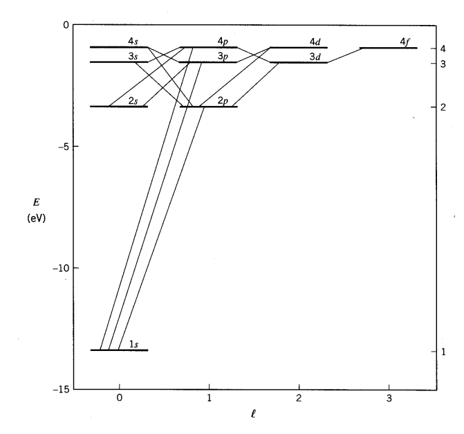

_Figure 1 (p. 31)_

# <a id="s-1-22-solution-of-the-3d-ho-problem-in-spherical-coordinates"></a>1.22 Solution of the 3D HO Problem in Spherical Coordinates

As and example of another problem with spherical symmetry, we solve the 3D symmetric harmonic oscillator (See section 17) problem. We have already solved this problem in Cartesian coordinates. Now we use spherical coordinates and angular momentum eigenfunctions.

The eigen-energies are

```math
E = \left( 2 n_{r} + \ell + \frac{3}{2} \right) \hbar \omega
```

where $`n_{r}`$ is the number of nodes in the radial wave function and $`\ell`$ is the total angular momentum quantum number. This gives exactly the same set of eigen-energies as we got in the Cartesian solution but the eigenstates are now states of definite total angular momentum and z component of angular momentum.

# <a id="s-1-23-matrix-representation-of-operators-and-states"></a>1.23 Matrix Representation of Operators and States

We may define the **components of a state vector** $`\psi`$ as the projections of the state on a complete, orthonormal set of states, like the eigenfunctions of a Hermitian operator.

```math
\psi i \equiv \langle u i | \psi \rangle
```

```math
| \psi \rangle = \sum \psi_{i} | u_{i} \rangle
```

<div align="right"><a href="book.pdf#page=31" target="_blank" title="This page in the PDF"><sup>[p. 31]</sup></a></div>
<hr class="page" style="height:2px;border:0;background:currentColor;opacity:0.25">
<a id="p32" href="book.pdf#page=32" target="_blank" title="This page in the PDF"><sup>[p. 32]</sup></a>

Similarly, we may define the **matrix element** of an operator in terms of a pair of those orthonormal basis states

```math
O_{ij} \equiv \langle u_{i} | O | u_{j} \rangle .
```

With these definitions, Quantum Mechanics problems can be solved using the matrix representation operators and states. (See section 18.1). An operator acting on a state is a matrix times a vector.

```math
\begin{pmatrix} ( O\psi )_{1} \\ ( O\psi )_{2} \\ \dots \\ ( O\psi )_{i} \\ \dots \end{pmatrix} = \begin{pmatrix} O_{1 1} & O_{1 2} & \dots & O_{1 j} & \dots \\ O_{2 1} & O_{2 2} & \dots & O_{2 j} & \dots \\ \dots & \dots & \dots & \dots & \dots \\ O_{i 1} & O_{i 2} & \dots & O_{ij} & \dots \\ \dots & \dots & \dots & \dots & \dots \end{pmatrix} \begin{pmatrix} \psi_{1} \\ \psi_{2} \\ \dots \\ \psi_{j} \\ \dots \end{pmatrix}
```

The product of operators is the product of matrices. Operators which don’t commute are represented by matrices that don’t commute.

# <a id="s-1-24-a-study-of-ell-1-operators-and-eigenfunctions"></a>1.24 A Study of $`\ell`$ = 1 Operators and Eigenfunctions

The set of states with the same total angular momentum and the angular momentum operators which act on them are often represented by vectors and matrices. For example the different $`m`$ states for $`\ell`$ = 1 will be represented by a 3 component vector and the angular momentum operators (See section 18.2) represented by 3X3 matrices. There are both practical and theoretical reasons why this set of states is separated from the states with different total angular momentum quantum numbers. The states are often (nearly) degenerate and therefore should be treated as a group for practical reasons. Also, a rotation of the coordinate axes will not change the total angular momentum quantum number so the rotation operator works within this group of states.

We write our **3 component vectors** as follows.

```math
\psi = \begin{pmatrix} \psi_{+} \\ \psi_{0} \\ \psi_{-} \end{pmatrix}
```

The matrices representing the angular momentum operators for $`\ell`$ = 1 are as follows.

```math
L_{x} = \frac{\hbar}{\sqrt{2}} \begin{pmatrix} 0 & 1 & 0 \\ 1 & 0 & 1 \\ 0 & 1 & 0 \end{pmatrix} \quad L_{y} = \frac{\hbar}{\sqrt{2 i}} \begin{pmatrix} 0 & 1 & 0 \\ - 1 & 0 & 1 \\ 0 & - 1 & 0 \end{pmatrix} \quad L_{z} = \hbar \begin{pmatrix} 1 & 0 & 0 \\ 0 & 0 & 0 \\ 0 & 0 & - 1 \end{pmatrix}
```

The same matrices also represent spin 1, $`s`$ = 1, but of course would act on a different vector space.

The rotation operators (See section 18.6) (symmetry operators) are given by

```math
R_{z} ( \theta_{z} ) = e^{i\theta_{z} L_{z} / \hbar} \quad R_{x} ( \theta_{x} ) = e^{i\theta_{x} L_{x} / \hbar} \quad R_{y} ( \theta_{y} ) = e^{i\theta_{y} L_{y} / \hbar}
```

for the differential form or the matrix form of the operators. For $`\ell`$ = 1 these are 3X3 (unitary) matrices. We use them when we need to redefine the direction of our coordinate axes. Rotations of the angular momentum states are not the same as rotations of vectors in 3 space. The components of the vectors represent different quantities and hence transform quite differently. The “vectors” we are using for angular momentum actually should be called spinors when we refer to their properties under rotations and Lorentz boosts.

<div align="right"><a href="book.pdf#page=32" target="_blank" title="This page in the PDF"><sup>[p. 32]</sup></a></div>
<hr class="page" style="height:2px;border:0;background:currentColor;opacity:0.25">
<a id="p33" href="book.pdf#page=33" target="_blank" title="This page in the PDF"><sup>[p. 33]</sup></a>

# <a id="s-1-25-spin-1-2-and-other-2-state-systems"></a>1.25 Spin 1/2 and other 2 State Systems

The angular momentum algebra defined by the commutation relations between the operators requires that the total angular momentum quantum number must either be an integer or a half integer. The half integer possibility was not useful for orbital angular momentum because there was no corresponding (single valued) spherical harmonic function to represent the amplitude for a particle to be at some position.

The half integer possibility is used to represent the internal angular momentum of some particles. The simplest and most important case is spin one-half (See section 18.8). There are just two

```math
1
```

possible states with different z components of spin: spin up $`\left( 0 \right)`$, with z component of angular

momentum +$`\frac{\hbar}{2}`$, and spin down $`\left( 0 \right)`$, with $`- \tfrac{\hbar}{2}`$. The corresponding spin operators are

```math
S_{x} = \frac{\hbar}{2} \begin{pmatrix} 0 & 1 \\ 1 & 0 \end{pmatrix} \quad 1 \quad S_{y} = \frac{\hbar}{2} \begin{pmatrix} 0 & - i \\ i & 0 \end{pmatrix} \quad S_{z} = \frac{\hbar}{2} \begin{pmatrix} 1 & 0 \\ 0 & - 1 \end{pmatrix}
```

These satisfy the usual commutation relations from which we derived the properties of angular momentum operators.

<div align="center">

It is common to define the Pauli Matrices, $`\sigma_{i}`$, which have the following properties.

</div>

```math
S_{i} \equiv \frac{\hbar}{2} \sigma_{i} .
```

```math
\vec{S} = \frac{\hbar}{2} \vec{\sigma}
```

```math
\sigma_{x} = \begin{pmatrix} 0 & 1 \\ 1 & 0 \end{pmatrix} \quad \sigma_{y} = \begin{pmatrix} 0 & - i \\ i & 0 \end{pmatrix} \quad \sigma_{z} = \begin{pmatrix} 1 & 0 \\ 0 & - 1 \end{pmatrix}
```

```math
[ \sigma_{i} ,\sigma_{j} ] = 2 i\epsilon_{ijk} \sigma_{k}
```

```math
\sigma_{i}^{2} = 1
```

```math
\sigma_{x} \sigma_{y} + \sigma_{y} \sigma_{x} = \sigma_{x} \sigma_{z} + \sigma_{z} \sigma_{x} = \sigma_{z} \sigma_{y} + \sigma_{y} \sigma_{z} = 0
```

```math
\{ \sigma_{i} ,\sigma_{j} \} = 2 \delta_{ij}
```

The last two lines state that the Pauli matrices anti-commute. The $`\sigma`$ matrices are the **Hermitian,** **Traceless matrices** of dimension 2. Any 2 by 2 matrix can be written as a linear combination of the $`\sigma`$ matrices and the identity.

# <a id="s-1-26-quantum-mechanics-in-an-electromagnetic-field"></a>1.26 Quantum Mechanics in an Electromagnetic Field

The **classical Hamiltonian** for a particle in an Electromagnetic field is

```math
H = \frac{1}{2 m} \left( \vec{p} + \frac{e}{c} \vec{A} \right)^{2} - e\varphi
```

where $`e`$ is defined to be a positive number. This Hamiltonian gives the correct Lorentz force law. Note that the momentum operator will now include momentum in the field, not just the particle’s momentum. As this Hamiltonian is written, $`\vec{p}`$ is the variable conjugate to $`\vec{r}`$ and is related to the velocity by $`\vec{p} = m \vec{v} - \tfrac{e}{c} \vec{A}`$.

<div align="right"><a href="book.pdf#page=33" target="_blank" title="This page in the PDF"><sup>[p. 33]</sup></a></div>
<hr class="page" style="height:2px;border:0;background:currentColor;opacity:0.25">
<a id="p34" href="book.pdf#page=34" target="_blank" title="This page in the PDF"><sup>[p. 34]</sup></a>

In Quantum Mechanics, the momentum operator is replaced (See section 20) in the same way to include the effects of magnetic fields and eventually radiation.

```math
\vec{p} \to \vec{p} + \frac{e}{c} \vec{A}
```

Starting from the above Hamiltonian, we derive the **Hamiltonian for a particle in a constant** **magnetic field**.

```math
\frac{- \hbar^{2}}{2 m} \nabla^{2} \psi + \frac{e}{2 mc} \vec{B} \cdot \vec{L} \psi + \frac{e^{2}}{8 mc^{2}} \left( r^{2} B^{2} - ( \vec{r} \cdot \vec{B} )^{2} \right) \psi = ( E + e\varphi ) \psi
```

This has the familiar effect of a magnetic moment parallel to the angular momentum vector, plus some additional terms which are very small for atoms in fields realizable in the laboratory.

So, for atoms, the dominant additional term is

```math
H_{B} = \frac{e}{2 mc} \vec{B} \cdot \vec{L} = - \vec{\mu} \cdot \vec{B} ,
```

where $`\vec{\mu} = - \tfrac{e}{2 mc} \vec{L}`$. This is, effectively, the **magnetic moment** due to the electron’s orbital angular momentum.

The other terms can be important if a state is spread over a region much larger than an atom. We work the example of a **plasma in a constant magnetic field**. A charged particle in the plasma has the following energy spectrum

```math
E_{n} = \frac{eB \hbar}{m_{e} c} \left( n + \frac{1}{2} \right) + \frac{\hbar^{2} k^{2}}{2 m_{e}} .
```

which depends on 2 quantum numbers. $`\hbar k`$ is the conserved momentum along the field direction which can take on any value. $`n`$ is an integer dealing with the state in x and y. This problem can be simplified using a few different symmetry operators. We work it two different ways: in one it reduces to the radial equation for the Hydrogen atom; in the other it reduces to the Harmonic Oscillator equation, showing that these two problems we can solve are somehow equivalent.

# <a id="s-1-27-local-phase-symmetry-in-quantum-mechanics-and-the-gauge-symmetry"></a>1.27 Local Phase Symmetry in Quantum Mechanics and the Gauge Sym- metry

There is a symmetry in physics which we might call the **Local Phase Symmetry** in quantum mechanics. In this symmetry we change the phase of the (electron) wavefunction by a different amount everywhere in spacetime. To compensate for this change, we need to also make a gauge transformation (See section 20.3) of the electromagnetic potentials. They all must go together like this.

```math
\frac{\psi ( \vec{r} , t )}{\varphi} \vec{A} \quad \to \frac{\to}{\to} \quad \vec{A} \frac{e^{- i \tfrac{e}{\hbar c} f ( \vec{r} ,t )} \psi ( \vec{r} , t )}{\varphi + \frac{1}{c} \frac{\partial f ( \vec{r} , t )}{\partial t}} - \vec{\nabla} f ( \vec{r} , t )
```

The local phase symmetry requires that Electromagnetism exist and have a gauge symmetry so that we can keep the Schrödinger Equation invariant under this phase transformation.

<div align="right"><a href="book.pdf#page=34" target="_blank" title="This page in the PDF"><sup>[p. 34]</sup></a></div>
<hr class="page" style="height:2px;border:0;background:currentColor;opacity:0.25">
<a id="p35" href="book.pdf#page=35" target="_blank" title="This page in the PDF"><sup>[p. 35]</sup></a>

We exploit the gauge symmetry in EM to show that, in **field free regions**, the function $`f`$ can be simply equal to a line integral of the vector potential (if we pick the right gauge).

```math
f ( \vec{r} ) = \int_{\vec{r}_{0}}^{\vec{r}} d \vec{r} \cdot \vec{A} .
```

We use this to show that the magnetic flux enclosed by a superconductor is quantized.

We also show that magnetic fields can be used to change interference effects in quantum mechanics. The **Aharanov Böhm Effect** brings us back to the two slit diffraction experiment but adds magnetic fields.

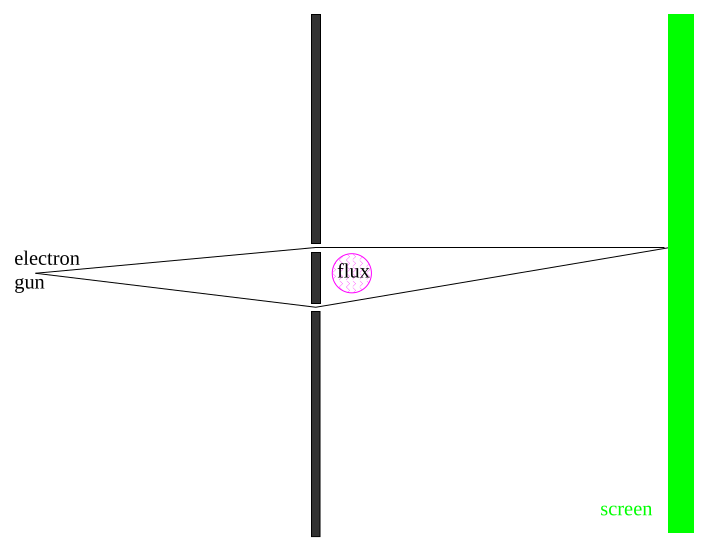

_Figure 2 (p. 35)_

The electron beams travel through two slits in field free regions but we have the ability to vary a magnetic field enclosed by the path of the electrons. At the screen, the amplitudes from the two slits interfere $`\psi = \psi_{1} + \psi_{2}`$. Let’s start with $`B`$ = 0 and $`A`$ = 0 everywhere. When we change the $`B`$ field, the wavefunctions must change.

```math
\psi \psi_{1 2} \psi \quad \to \to = \left( \psi_{1} e^{- i \tfrac{e \Phi}{\hbar c}} + \psi_{2} \right) \int^{\psi \psi_{1} e \frac{- i \tfrac{e}{\hbar c}_{1} d \vec{r} \cdot \vec{A}}{- i \tfrac{e}{\hbar c}_{2} d \vec{r} \cdot \vec{A}}_{2} e} \int e \int^{- i \tfrac{e}{\hbar c}_{2} d \vec{r} \cdot \vec{A}}
```

The relative phase from the two slits depends on the flux between the slits. By varying the $`B`$ field, we will **shift the diffraction pattern** even though $`B`$ = 0 along the whole path of the electrons.

<div align="right"><a href="book.pdf#page=35" target="_blank" title="This page in the PDF"><sup>[p. 35]</sup></a></div>
<hr class="page" style="height:2px;border:0;background:currentColor;opacity:0.25">
<a id="p36" href="book.pdf#page=36" target="_blank" title="This page in the PDF"><sup>[p. 36]</sup></a>

# <a id="s-1-28-addition-of-angular-momentum"></a>1.28 Addition of Angular Momentum

It is often required to add angular momentum from two (or more) sources (See section 21) together to get states of definite total angular momentum. For example, in the absence of external fields, the energy eigenstates of Hydrogen (including all the fine structure effects) are also **eigenstates** **of total angular momentum**. This almost has to be true if there is spherical symmetry to the problem.

As an example, lets assume we are adding the orbital angular momentum from two electrons, $`\vec{L}_{1}`$ and $`\vec{L}_{2}`$ to get a total angular momentum $`\vec{J}`$. We will show that the total angular momentum quantum number takes on every value in the range

```math
| \ell_{1} - \ell_{2} |\leq j \leq \ell_{1} + \ell_{2} .
```

We can understand this qualitatively in the **vector model** pictured below. We are adding two quantum vectors.

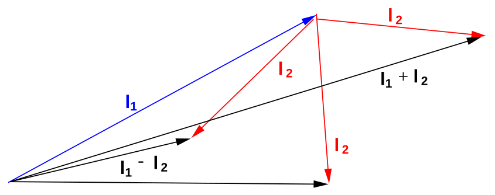

_Figure 3 (p. 36)_

The length of the resulting vector is somewhere between the difference of their magnitudes and the sum of their magnitudes, since we don’t know which direction the vectors are pointing.

The states of definite total angular momentum with quantum numbers $`j`$ and $`m`$, can be written in terms of **products of the individual states** (like electron 1 is in this state AND electron 2 is in that state). The general expansion is called the **Clebsch-Gordan series:**

```math
\psi_{jm} = \sum_{m_{1} m_{2}} \langle \ell_{1} m_{1} \ell_{2} m_{2} | jm\ell_{1} \ell_{2} \rangle Y_{\ell_{1} m_{1}} Y_{\ell_{2} m_{2}}
```

or in terms of the ket vectors

```math
| jm\ell_{1} \ell_{2} \rangle = \sum_{m_{1} m_{2}} \langle \ell_{1} m_{1} \ell_{2} m_{2} | jm\ell_{1} \ell_{2} \rangle | \ell_{1} m_{1} \ell_{2} m_{2} \rangle
```

The Clebsch-Gordan coefficients are tabulated although we will compute many of them ourselves.

When combining states of identical particles, the **highest total angular momentum state,** $`s = s_{1} + s_{2}`$, will always be **symmetric under interchange.** The symmetry under interchange will alternate as $`j`$ is reduced.

<div align="right"><a href="book.pdf#page=36" target="_blank" title="This page in the PDF"><sup>[p. 36]</sup></a></div>
<hr class="page" style="height:2px;border:0;background:currentColor;opacity:0.25">
<a id="p37" href="book.pdf#page=37" target="_blank" title="This page in the PDF"><sup>[p. 37]</sup></a>

The total number of states is always preserved. For example if I add two $`\ell`$ = 2 states together, I get total angular momentum states with $`j`$ = 0$`, 1 , 2 ,`$ 3 and 4. There are 25 product states since each $`\ell`$ = 2 state has 5 different possible $`m`$s. Check that against the sum of the number of states we have just listed.

```math
5 \otimes 5 = 9_{S} \oplus 7_{A} \oplus 5_{S} \oplus 3_{A} \oplus 1_{S}
```

where the numbers are the number of states in the multiplet.

We will use addition of angular momentum to:

$`•`$ Add the orbital angular momentum to the spin angular momentum for an electron in an atom

```math
\vec{J} = \vec{L} + \vec{S} ;
```

```math
\begin{array}{ll}
• & \text{ Add the orbital angular momenta together for two electrons in an atom } \vec{L} = \vec{L}_{1} + \vec{L}_{2} ; \\ 
• & \text{ Add the spins of two particles together } \vec{S} = \vec{S}_{1} + \vec{S}_{2} ; \\ 
• & \text{ Add the nuclear spin to the total atomic angular momentum } \vec{F} = \vec{J} + \vec{I} ; \\ 
• & \text{ Add the total angular momenta of two electrons together } \vec{J} = \vec{J}_{1} + \vec{J}_{2} ; \\ 
\end{array}
```

$`•`$ Add the total orbital angular momentum to the total spin angular momentum for a collection

of electrons in an atom $`\vec{J} = \vec{L} + \vec{S}`$;

$`•`$ Write the product of spherical harmonics in terms of a sum of spherical harmonics.

# <a id="s-1-29-time-independent-perturbation-theory"></a>1.29 Time Independent Perturbation Theory

Assume we have already solved and an energy eigenvalue problem and now need to include an additional term in the Hamiltonian. We can use time independent perturbation theory (See section 22) to calculate corrections to the energy eigenvalues and eigenstates. If the Schrödinger equation for the **full problem** is

```math
( H_{0} + H_{1} ) \psi_{n} = E_{n} \psi_{n}
```

and we have already solved the eigenvalue problem for $`H_{0}`$, we may use a **perturbation series,** to expand both our energy eigenvalues and eigenstates in powers of the small perturbation.

```math
E_{n} = E_{n}^{( 0 )} + E_{n}^{( 1 )} + E_{n}^{( 2 )} + \dots
```

```math
\psi_{n} = N \left( \varphi_{n} + {}_{k} \sum_{\not = n} c_{nk} \varphi_{k} \right)
```

```math
c_{nk} = c_{nk}^{( 1 )} + c_{nk}^{( 2 )} + \dots
```

where the superscript (0), (1), (2) are the zeroth, first, and second order terms in the series. $`N`$ is there to keep the wave function normalized but will not play an important role in our results.

By solving the Schrödinger equation at each order of the perturbation series, we **compute the** **corrections to the energies and eigenfunctions.** (see section 22.4.1) We just give the first few terms above.

```math
E_{n}^{( 1 )} = \langle \varphi_{n} | H_{1} | \varphi_{n} \rangle
```

```math
c_{nk}^{( 1 )} = \tfrac{\langle \varphi_{k} | H_{1} | \varphi_{n} \rangle}{E_{n}^{( 0 )} - E_{k}^{( 0 )}}
```

```math
E_{n}^{( 2 )} = {}_{k} \sum_{\not = n} \tfrac{| \langle \varphi_{k} | H_{1} | \varphi_{n} \rangle |^{2}}{E_{n}^{( 0 )} - E_{k}^{( 0 )}}
```

<div align="right"><a href="book.pdf#page=37" target="_blank" title="This page in the PDF"><sup>[p. 37]</sup></a></div>
<hr class="page" style="height:2px;border:0;background:currentColor;opacity:0.25">
<a id="p38" href="book.pdf#page=38" target="_blank" title="This page in the PDF"><sup>[p. 38]</sup></a>

A problem arises in the case of **degenerate states** or nearly degenerate states. The energy denominator in the last equation above is small and the series does not converge. To handle this case, we need to rediagonalize the full Hamiltonian in the subspace of nearly degenerate states.

```math
\sum_{i \in \mathcal{N}} \langle \varphi_{n}^{( j )} | H | \varphi_{n}^{( i )} \rangle \alpha_{i} = E_{n} \alpha_{j} .
```

This is just the standard eigenvalue problem for the full Hamiltonian in the **subspace of (nearly)** **degenerate states.**

We will use time independent perturbation theory is used to compute fine structure and hyperfine corrections to Hydrogen energies, as well as for many other calculations. Degenerate state perturbation theory will be used for the Stark Effect and for hyperfine splitting in Hydrogen.

# <a id="s-1-30-the-fine-structure-of-hydrogen"></a>1.30 The Fine Structure of Hydrogen

We have solved the problem of a non-relativistic, spinless electron in a coulomb potential exactly. Real Hydrogen atoms have several small corrections to this simple solution. If we say that electron spin is a relativistic effect, they can all be called relativistic corrections which are off order $`\alpha^{2}`$ compared to the Hydrogen energies we have calculated.

1. The relativistic correction to the electron’s kinetic energy.

2. The Spin-Orbit correction.

3. The “Darwin Term” correction to s states from Dirac equation.

Calculating these fine structure effects (See section 23) separately and summing them we find that we get a nice cancellation yielding a simple formula.

```math
E_{nlm} = E_{n}^{( 0 )} + \frac{E_{n}^{( 0 )}}{2 mc^{2}}^{2} \left[ 3 - \frac{4 n}{j + \tfrac{1}{2}} \right]
```

The correction depends only on the total angular quantum number and does not depend on $`\ell`$ so the states of different total angular momentum split in energy but there is still a good deal of degeneracy. It makes sense, for a **problem with spherical symmetry, that the states of definite total** **angular momentum are the energy eigenstates** and that the result depend on $`j`$.

We also compute the **Zeeman effect** in which an external magnetic field is applied to Hydrogen. The external field is very important since it breaks the spherical symmetry and splits degenerate states allowing us to understand Hydrogen through spectroscopy.

The correction due to a **weak magnetic field** is found to be

```math
\Delta E = \left\langle \psi_{n\ell jm_{j}} \left| \frac{eB}{2 mc} ( L_{z} + 2 S_{z} ) \right| \psi_{n\ell jm_{j}} \right\rangle = \frac{e \hbar B}{2 mc} m_{j} \left( 1 \pm \frac{1}{2 \ell + 1} \right)
```

The factor $`\left( 1 \pm \tfrac{1}{2 \ell + 1} \right)`$ is known as the **Lande** $`g`$ **Factor** because the state splits as if it had this gyromagnetic ratio. We know that it is in fact a combination of the orbital and spin g factors in

<div align="right"><a href="book.pdf#page=38" target="_blank" title="This page in the PDF"><sup>[p. 38]</sup></a></div>
<hr class="page" style="height:2px;border:0;background:currentColor;opacity:0.25">
<a id="p39" href="book.pdf#page=39" target="_blank" title="This page in the PDF"><sup>[p. 39]</sup></a>

a state of definite $`j`$. We have assumed that the effect of the field is small compared to the fine structure corrections. We can write the full energy in a weak magnetic field.

```math
E_{njm_{j} \ell s} = - \frac{1}{2} \alpha^{2} mc^{2} \left( \frac{1}{n^{2}} + \frac{\alpha^{2}}{n^{3}} \left[ \frac{1}{j + \tfrac{1}{2}} - \frac{3}{4 n} \right] \right) + g_{L} \mu_{B} Bm_{j}
```

Thus, in a weak field, the **the degeneracy is completely broken for the states** $`\psi_{njm_{j} \ell s}`$. All the states can be detected spectroscopically.

In the strong field limit we could use states of definite $`m_{\ell}`$ and $`m_{s}`$ and calculate the effects of the fine structure, $`H_{1} + H_{2}`$, as a perturbation. In an intermediate strength field, on the order of 500 Gauss, the combination of the Hydrogen fine structure Hamiltonian and the term to the B field must be diagonalized on the set of states with the same principal quantum number $`n`$.

# <a id="s-1-31-hyperfine-structure"></a>1.31 Hyperfine Structure

The **interaction between the spin of the nucleus and the angular momentum of the** **electron** causes a further (hyperfine) splitting (See section 24) of atomic states. It is called hyperfine because it is also order $`\alpha^{2}`$ like the fine structure corrections, but it is smaller by a factor of about $`\frac{m_{e}}{m_{p}}`$ because of the mass dependence of the spin magnetic moment for particles.

The magnetic moment of the nucleus is

```math
\vec{\mu}_{N} = \frac{Zeg_{N}}{2 M_{N} c} \vec{I}
```

where $`\vec{I}`$ is the **nuclear spin** vector. Because the nucleus, the proton, and the neutron have internal structure, the nuclear gyromagnetic ratio is not just 2. For the proton, it is $`g_{p} \approx 5 . 5 6 .`$

We computed the hyperfine contribution to the Hamiltonian for $`\ell`$ = 0 states.

```math
H_{hf} = \left\langle \frac{e}{mc} \vec{S} \cdot \vec{B} \right\rangle = \frac{4}{3} ( Z\alpha )^{4} \left( \frac{m}{M_{N}} \right) ( mc^{2} ) g_{N} \frac{1}{n^{3}} \frac{\vec{S} \cdot \vec{I}}{\hbar^{2}}
```

Now, just as in the case of the $`\vec{L} \cdot \vec{S}`$, spin-orbit interaction, we will define the total angular momentum

```math
\vec{F} = \vec{S} + \vec{I} .
```

It is in the states of definite $`f`$ and $`m_{f}`$ that the hyperfine perturbation will be diagonal. In essence, we are doing degenerate state perturbation theory. We could diagonalize the 4 by 4 matrix for the perturbation to solve the problem or we can use what we know to pick the right states to start with. Again like the spin orbit interaction, the **total angular momentum states** will be the right states **because we can write the perturbation in terms of quantum numbers of those states.**

```math
\vec{S} \cdot \vec{I} = \frac{1}{2} \left( F^{2} - S^{2} - I^{2} \right) = \frac{1}{2} \hbar^{2} \left( f ( f + 1 ) - \frac{3}{4} - \frac{3}{4} \right)
```

```math
\Delta E = \frac{2}{3} ( Z\alpha )^{4} \left( \frac{m}{M_{N}} \right) ( mc^{2} ) g_{N} \frac{1}{n^{3}} \left( f ( f + 1 ) - \frac{3}{2} \right) .
```

<div align="right"><a href="book.pdf#page=39" target="_blank" title="This page in the PDF"><sup>[p. 39]</sup></a></div>
<hr class="page" style="height:2px;border:0;background:currentColor;opacity:0.25">
<a id="p40" href="book.pdf#page=40" target="_blank" title="This page in the PDF"><sup>[p. 40]</sup></a>

For the hydrogen ground state we are just adding two spin $`\frac{1}{2}`$ particles so the possible values are $`f`$ = 0$`,`$ 1. The transition between the two states gives rise to EM waves with $`\lambda`$ = 21 cm.

We will work out the **effect of an external B field on the Hydrogen hyperfine states** both in the strong field and in the weak field approximation. We also work the problem without a field strength approximation. The **always applicable intermediate field strength result** is that the four states have energies which depend on the strength of the B field. Two of the energy eigenstates mix in a way that also depends on B. The four energies are

```math
E = E_{n 0 0} + \frac{\mathcal{A} \hbar^{2}}{4} \pm \mu_{B} B
```

```math
E = E_{n 0 0} - \frac{\mathcal{A} \hbar^{2}}{4} \pm \sqrt{\left( \frac{\mathcal{A} \hbar^{2}}{2} \right)^{2} + ( \mu_{B} B )^{2} .}
```

# <a id="s-1-32-the-helium-atom"></a>1.32 The Helium Atom

The Hamiltonian for Helium (See section 25) has the same terms as Hydrogen but has a large perturbation due to the repulsion between the two electrons.

```math
H = \frac{p_{1}^{2}}{2 m} + \frac{p_{2}^{2}}{2 m} - \frac{Ze^{2}}{r_{1}} - \frac{Ze^{2}}{r_{2}} + \frac{e^{2}}{| \vec{r}_{1} - \vec{r}_{2} |}
```

Note that the **perturbation due to the repulsion between the two electrons** is about the same size as the the rest of the Hamiltonian so first order perturbation theory is unlikely to be accurate.

The **Helium ground state has two electrons in the 1s level**. Since the spatial state is symmetric, the spin part of the state must be antisymmetric so $`s`$ = 0 (as it always is for closed shells). For our zeroth order energy eigenstates, we will use **product states of Hydrogen wavefunctions**

```math
u ( \vec{r}_{1} , \vec{r}_{2} ) = \varphi_{n_{1} \ell_{1} m_{1}} ( \vec{r}_{1} ) \varphi_{n_{2} \ell_{2} m_{2}} ( \vec{r}_{2} )
```

and ignore the perturbation. The energy for two electrons in the (1s) state for $`Z`$ = 2 is then $`4 \alpha^{2} mc^{2}`$ = 108$`. 8`$ eV.

We can estimate the ground state energy in **first order perturbation theory**, using the electron repulsion term as a (very large) perturbation. This is not very accurate.

We can improve the estimate of the ground state energy using the **variational principle**. The main problem with our estimate from perturbation theory is that we are not accounting for **changes in** **the wave function of the electrons due to screening**. We can do this in some reasonable approximation by reducing the charge of the nucleus in the wavefunction (not in the Hamiltonian). With the parameter $`Z^{*}`$, we get a better estimate of the energy.

<div align="center">

Calculation Energy $`Z_{wfn}`$

</div>

```math
1 \frac{0^{th} \text{ Order }}{1 \text{ Actual }^{st} \text{ Order Variational }}^{st} \text{ Order perturbation theory } \quad \frac{- 1 0 8 . 8}{- 7 8 . 9 7 5 - 7 7 . 3 8} - 7 4 . 8 \quad \frac{2}{\tfrac{2 7}{1 6}} 2
```

<div align="right"><a href="book.pdf#page=40" target="_blank" title="This page in the PDF"><sup>[p. 40]</sup></a></div>
<hr class="page" style="height:2px;border:0;background:currentColor;opacity:0.25">
<a id="p41" href="book.pdf#page=41" target="_blank" title="This page in the PDF"><sup>[p. 41]</sup></a>

Note that the variational calculation still uses first order perturbation theory. It just adds a variable parameter to the wavefunction which we use to minimize the energy. This only works for the ground state and for other special states.

There is only one allowed (1$`s )^{2}`$ state and it is the ground state. For **excited states**, the spatial states are (usually) different so they can be either symmetric or antisymmetric (under interchange of the two electrons). It turns out that the antisymmetric state has the electrons further apart so the repulsion is smaller and the energy is lower. If the spatial state is antisymmetric, then the spin state is symmetric, s=1. So the triplet states are generally significantly lower in energy than the corresponding spin singlet states. This **appears to be a strong spin dependent interaction** **but is actually just the effect of the repulsion between the electrons** having a big effect depending on the symmetry of the spatial state and hence on the symmetry of the spin state.

The **first exited state** has the hydrogenic state content of (1s)(2s) and has s=1. We calculated the energy of this state.

We’ll learn later that electromagnetic **transitions which change spin are strongly suppressed** causing the spin triplet (orthohelium) and the spin singlet states (parahelium) to have nearly separate decay chains.

# <a id="s-1-33-atomic-physics"></a>1.33 Atomic Physics

The Hamiltonian for an atom with Z electrons and protons (See section 26) has many terms representing the repulsion between each pair of electrons.

```math
\left[ \sum_{i = 1}^{Z} \left( \frac{p_{i}^{2}}{2 m} - \frac{Ze^{2}}{r_{i}} \right) + \sum_{i>j} \frac{e^{2}}{| \vec{r}_{i} - \vec{r}_{j} |} \right] \psi = E\psi .
```

We have seen that the coulomb repulsion between electrons is a very large correction in Helium and that the three body problem in quantum mechanics is only solved by approximation.

The physics of **closed shells** and angular momentum enable us to make sense of even the most complex atoms. When we have enough electrons to fill a shell, say the 1s or 2p, The resulting electron distribution is spherically symmetric because

```math
\sum_{m = - \ell}^{\ell} | Y_{\ell m} ( \theta ,\varphi ) |^{2} = \frac{2 \ell + 1}{4 \pi} .
```

With all the states filled and the relative phases determined by the antisymmetry required by Pauli, the quantum numbers of the closed shell are determined. **There is only one possible state** **representing a closed shell** and the quantum numbers are

```math
s = 0
```

```math
\ell = 0
```

```math
j = 0
```

The closed shell screens the nuclear charge. Because of the **screening**, the potential no longer has a pure $`\frac{1}{r}`$ behavior. Electrons which are far away from the nucleus see less of the nuclear charge and<span class="page" style="float:left;width:100%;margin:0.4em 0 0.6em"><span style="display:block;text-align:right"><a href="book.pdf#page=41" target="_blank" title="This page in the PDF"><sup>[p. 41]</sup></a></span><span style="display:block;height:2px;background:currentColor;opacity:0.25"></span><a id="p42" href="book.pdf#page=42" target="_blank" title="This page in the PDF"><sup>[p. 42]</sup></a></span> shift up in energy. We see that the atomic shells fill up in the order 1s, 2s, 2p, 3s, 3p, 4s, 3d, 4p, 5s, 4d, 5p, 6s, 4f, 5d, 6p. The effect of screening increasing the energy of higher $`\ell`$ states is clear. Its no wonder that the periodic table is not completely periodic.

A set of guidelines, known as Hund’s rules, help us determine the quantum numbers for the ground states of atoms. The hydrogenic shells fill up giving well defined $`j`$ = 0 states for the closed shells. As we add **valence electrons** we follow Hund’s rules to determine the ground state. We get a great simplification by treating nearly closed shells as a closed shell plus positively charged, spin $`\frac{1}{2}`$ **holes**. For example, if an atom is two electrons short of a closed shell, we treat it as a closed shell plus two positive holes.)

1. Couple the valence electrons (or holes) to give **maximum total spin**.

2. Now choose the state of maximum $`\ell`$ (subject to the Pauli principle. The Pauli principle rather

than the rule, often determines everything here.)

3. If the shell is more than half full, pick the highest total angular momentum state $`j = \ell + s`$

otherwise pick the lowest $`j = | \ell - s |`$.

# <a id="s-1-34-molecules"></a>1.34 Molecules

We can study simple molecules (See section 27) to understand the physical phenomena of molecules in general. The **simplest molecule we can work with is the** H$`2 +`$ **ion**. It has two nuclei (A and B) sharing one electron (1).

```math
H_{0} = \frac{p_{e}^{2}}{2 m} - \frac{e^{2}}{r_{1 A}} - \frac{e^{2}}{r_{1 B}} + \frac{e^{2}}{R_{AB}}
```

$`R_{AB}`$ is the distance between the two nuclei. We calculate the ground state energy using the Hydrogen states as a basis.

The lowest energy wavefunction can be thought of as a (anti)symmetric linear combination of an electron in the ground state near nucleus A and the ground state near nucleus B

```math
\psi_{\pm} \left( \vec{r} , \vec{R} \right) = C_{\pm} ( R ) [ \psi_{A} \pm \psi_{B} ]
```

where $`\psi_{A} = \sqrt{\frac{1}{\pi a_{0}^{3}}} e^{- r_{1 A} /a_{0}}`$ is g.s. around nucleus A. $`\psi_{A}`$ and $`\psi_{B}`$ are not orthogonal; there is overlap. The **symmetric (bonding) state has a large probability for the electron to be** **found between nuclei**. The antisymmetric (antibonding) state has a small probability there, and hence, a much larger energy. Remember, this symmetry is that of the wavefunction of one electron around the two nuclei.

**The** H$`2`$ **molecule is also simple** and its energy can be computed with the help of the previous calculation. The space symmetric state will be the ground state.

```math
\langle \psi | H | \psi \rangle = 2 E_{H_{2}^{+}} ( R_{AB} ) - \frac{e^{2}}{R_{AB}} + \left\langle \psi \left| \frac{e^{2}}{r_{1 2}} \right| \psi \right\rangle
```

The molecule can **vibrate** in the potential created when the shared electron binds the atoms together, giving rise to a harmonic oscillator energy spectrum.

<div align="right"><a href="book.pdf#page=42" target="_blank" title="This page in the PDF"><sup>[p. 42]</sup></a></div>
<hr class="page" style="height:2px;border:0;background:currentColor;opacity:0.25">
<a id="p43" href="book.pdf#page=43" target="_blank" title="This page in the PDF"><sup>[p. 43]</sup></a>

Molecules can **rotate** like classical rigid bodies subject to the constraint that angular momentum is quantized in units of $`\hbar`$.

```math
E_{rot} = \frac{1}{2} \frac{L^{2}}{I} = \frac{\ell ( \ell + 1 ) \hbar^{2}}{2 I} \approx \frac{\hbar^{2}}{2 Ma_{0}^{2}} = \frac{m}{M} \frac{\alpha^{2} mc^{2}}{2} \approx \frac{m}{M} E \approx \frac{1}{1 0 0 0} eV
```

# <a id="s-1-35-time-dependent-perturbation-theory"></a>1.35 Time Dependent Perturbation Theory

We have used time independent perturbation theory to find the energy shifts of states and to find the change in energy eigenstates in the presence of a small perturbation. We now consider the case of a **perturbation** $`\mathcal{V}`$ **that is time dependent**. Such a perturbation **can cause transitions** **between energy eigenstates**. We will calculate the rate of those transitions (See section 28).

We derive an equation for the **rate of change of the amplitude to be in the** $`n^{th}`$ **energy** **eigenstate**.

```math
i \hbar \frac{\partial c_{n} ( t )}{\partial t} = \sum_{k} \mathcal{V}_{nk} ( t ) c_{k} ( t ) e^{i ( E_{n} - E_{k} ) t/ \hbar}
```

Assuming that at $`t`$ = 0 the quantum system starts out in some **initial state** $`\varphi_{i}`$, we derive the **amplitude to be in a final state** $`\varphi_{n}`$.

```math
c_{n} ( t ) = \frac{1}{i \hbar} \int_{0}^{t} e^{i\omega_{ni} t^{\prime}} \mathcal{V}_{ni} ( t^{\prime} ) dt^{\prime}
```

An important case of a time dependent potential is a pure **sinusoidal oscillating (harmonic)** **perturbation**. We can **make up any time dependence from a linear combination** of sine and cosine waves. With some calculation, we derive the transition rate in a harmonic potential of

```math
\text{ frequency } \omega ._{2}
```

```math
\Gamma_{i \to n} \equiv \frac{dP_{n}}{dt} = \frac{2 \pi V_{ni}}{\hbar} \delta ( E_{n} - E_{i} + \hbar \omega )
```

This contains a delta function of energy conservation. The delta function may seem strange. The transition rate would be zero if energy is not conserved and infinite if energy is exactly conserved. We can make sense of this if there is a distribution function of $`P ( \omega )`$ of the perturbing potential or if there is a continuum of final states that we need to integrate over. In either case, the delta function helps us do the integral simply.

# <a id="s-1-36-radiation-in-atoms"></a>1.36 Radiation in Atoms

The interaction of atoms with electromagnetic waves (See section 29) can be computed using time dependent perturbation theory. The atomic problem is solved in the absence of EM waves, then the vector potential terms in the Hamiltonian can be treated as a perturbation.

```math
H = \frac{1}{2 m} \left( \vec{p} + \frac{e}{c} \vec{A} \right)^{2} + V ( r ) .
```

<div align="right"><a href="book.pdf#page=43" target="_blank" title="This page in the PDF"><sup>[p. 43]</sup></a></div>
<hr class="page" style="height:2px;border:0;background:currentColor;opacity:0.25">
<a id="p44" href="book.pdf#page=44" target="_blank" title="This page in the PDF"><sup>[p. 44]</sup></a>

In a gauge in which $`\vec{\nabla} \cdot \vec{A}`$ = 0, the perturbation is

```math
\mathcal{V} = \frac{e}{mc} \vec{A} \cdot \vec{p} + \frac{e^{2}}{2 mc^{2}} A^{2} .
```

For most atomic decays, the $`A^{2}`$ term can be neglected since it is much smaller than the $`\vec{A} \cdot \vec{p}`$ term. Both the decay of excited atomic states with the emission of radiation and the excitation of atoms with the absorption of radiation can be calculated.

An arbitrary EM field can be Fourier analyzed to give a sum of components of definite frequency. Consider the vector potential for one such component, $`\vec{A} ( \vec{r} , t ) \equiv 2 \vec{A}_{0}`$ cos$`( \vec{k} \cdot \vec{r} - \omega t )`$. The energy in the field is $`Energy = \tfrac{\omega^{2}}{2 \pi c^{2}} V | A_{0} |^{2}`$. If the field is quantized (as we will later show) with photons of energy $`E = \hbar \omega`$, we may write field strength **in terms of the number of photons** $`N`$.

```math
\vec{A} ( \vec{r} , t ) = \left[ \frac{2 \pi \hbar c^{2} N}{\omega V} \right]^{\tfrac{1}{2}} \hat{\epsilon} 2 \cos ( \vec{k} \cdot \vec{r} - \omega t )
```

```math
\vec{A} ( \vec{r} , t ) = \left[ \frac{2 \pi \hbar c^{2} N}{\omega V} \right]^{\tfrac{1}{2}} \hat{\epsilon} \left( e^{i ( \vec{k} \cdot \vec{r} - \omega t )} + e^{- i ( \vec{k} \cdot \vec{r} - \omega t )} \right)
```

The direction of the field is given by the unit polarization vector $`\hat{\epsilon}`$. The cosine term has been split into positive and negative exponentials. In time dependent perturbation theory, the positive exponential corresponds to the absorption of a photon and excitation of the atom and the negative exponential corresponds to the emission of a photon and decay of the atom to a lower energy state.

Think of the EM field as a harmonic oscillator at each frequency, the negative exponential corresponds to a raising operator for the field and the positive exponential to a lowering operator. In analogy to the quantum 1D harmonic oscillator we replace $`\sqrt{N}`$ by $`\sqrt{N}`$ + 1 in the raising operator case.

```math
\vec{A} ( \vec{r} , t ) = \left[ \frac{2 \pi \hbar c^{2}}{\omega V} \right]^{\tfrac{1}{2}} \hat{\epsilon} \left( \sqrt{N} e^{i ( \vec{k} \cdot \vec{r} - \omega t )} + \sqrt{N + 1} e^{- i ( \vec{k} \cdot \vec{r} - \omega t )} \right)
```

With this change, which will later be justified with the quantization of the field, there is a **pertur-** **bation even with no applied field** $`( N`$ = 0)

```math
\mathcal{V}_{N = 0} = V_{N = 0} e^{i\omega t} = \frac{e}{mc} \vec{A} \cdot \vec{p} = \frac{e}{mc} \left[ \frac{2 \pi \hbar c^{2}}{\omega V} \right]^{\tfrac{1}{2}} e^{- i ( \vec{k} \cdot \vec{r} - \omega t )} \hat{\epsilon} \cdot \vec{p}
```

which can cause decays of atomic states.

Plugging this $`N`$ = 0 field into the first order time dependent perturbation equations, the decay rate for an atomic state can be computed.

```math
\Gamma_{i \to n} = \frac{( 2 \pi )^{2} e^{2}}{m^{2} \omega V} | \langle \varphi_{n} | e^{- i \vec{k} \cdot \vec{r}} \hat{\epsilon} \cdot \vec{p} | \varphi_{i} \rangle |^{2} \delta ( E_{n} - E_{i} + \hbar \omega )
```

The absolute square of the time integral from perturbation theory yields the delta function of energy conservation.

To get the total decay rate, we must sum over the allowed final states. We can assume that the atom remains at rest as a very good approximation, but, the final photon states must be carefully

<div align="right"><a href="book.pdf#page=44" target="_blank" title="This page in the PDF"><sup>[p. 44]</sup></a></div>
<hr class="page" style="height:2px;border:0;background:currentColor;opacity:0.25">
<a id="p45" href="book.pdf#page=45" target="_blank" title="This page in the PDF"><sup>[p. 45]</sup></a>

considered. Applying periodic boundary conditions in a cubic volume $`V`$, the integral over final states can be done as indicated below.

```math
k_{x} L = 2 \pi n_{x} \quad dn_{x} = \tfrac{L}{2 \pi} dk_{x}
```

```math
k_{y} L = 2 \pi n_{y} \quad dn_{y} = \tfrac{L}{2 \pi} dk_{y}
```

```math
k_{z} L = 2 \pi n_{z} \quad dn_{z} = \tfrac{L}{2 \pi} dk_{z}
```

```math
d^{3} n = \tfrac{L^{3}}{( 2 \pi )^{3}} d^{3} k = \tfrac{V}{( 2 \pi )^{3}} d^{3} k
```

```math
\Gamma_{tot} = \int \Gamma_{i \to n} d^{3} n
```

With this **phase space integral** done aided by the delta function, the general formula for the decay rate is

```math
\Gamma_{tot} = \frac{e^{2} ( E_{i} - E_{n} )}{2 \pi \hbar^{2} m^{2} c^{3}} \sum_{\lambda} \int d \Omega_{\gamma} | \langle \varphi_{n} | e^{- i \vec{k} \cdot \vec{r}} \hat{\epsilon}^{( \lambda )} \cdot \vec{p}_{e} | \varphi_{i} \rangle |^{2} .
```

This decay rate still contains the integral over photon directions and a sum over final state polarization.

Computation of the atomic matrix element is usually done in the Electric Dipole approximation (See section 29.5)

```math
e^{- i \vec{k} \cdot \vec{r}} \approx 1
```

which is valid if the wavelength of the photon is much larger than the size of the atom. With the help of some commutation relations, the decay rate formula becomes

```math
\Gamma_{tot} = \frac{\alpha \omega_{in}^{3}}{2 \pi c^{2}} \sum_{\lambda} \int d \Omega_{\gamma} | \hat{\epsilon} \cdot \langle \varphi_{n} | \vec{r} | \varphi_{i} \rangle |^{2} .
```

The atomic matrix element of the vector operator $`\vec{r}`$ is zero unless certain constraints on the angular momentum of initial and final states are satisfied. The selection rules for electric dipole (E1) transitions are:

```math
\Delta \ell = \pm 1 \quad \Delta m = 0 , \pm 1 \quad \Delta s = 0 .
```

This is the outcome of the Wigner-Eckart theorem which states that the matrix element of a vector operator $`V^{q}`$, where the integer $`q`$ runs from -1 to +1, is given by

```math
\langle \alpha^{\prime} j^{\prime} m^{\prime} | V^{q} | \alpha jm \rangle = \langle j^{\prime} m^{\prime} | j 1 mq \rangle \langle \alpha^{\prime} j^{\prime} || V || \alpha j \rangle
```

Here $`\alpha`$ represents all the (other) quantum numbers of the state, not the angular momentum quantum numbers. In the case of a simple spatial operator like $`\vec{r}`$, only the orbital angular momentum is involved.

```math
\Gamma_{2 p \to 1 s} = \frac{2 \alpha \omega_{in}^{3}}{3 c^{2}} ( 2 ) ( 4 \pi ) \left| 4 \sqrt{6} \left( \frac{2}{3} \right)^{5} a_{0} \right|^{2} \frac{1}{1 2 \pi} = \frac{4 \alpha \omega_{in}^{3}}{9 c^{2}} \left| 4 \sqrt{6} \left( \frac{2}{3} \right)^{5} a_{0} \right|^{2}
```

We derive a simple result for the total decay rate of a state, summed over final photon polarization and integrated over photon direction.

```math
\Gamma_{tot} = \frac{4 \alpha \omega_{in}^{3}}{3 c^{2}} | \vec{r}_{ni} |^{2}
```

<div align="right"><a href="book.pdf#page=45" target="_blank" title="This page in the PDF"><sup>[p. 45]</sup></a></div>
<hr class="page" style="height:2px;border:0;background:currentColor;opacity:0.25">
<a id="p46" href="book.pdf#page=46" target="_blank" title="This page in the PDF"><sup>[p. 46]</sup></a>

This can be used to easily compute decay rates for Hydrogen, for example the 2p decay rate.

```math
\Gamma_{2 p \to 1 s} = \frac{4 \alpha \omega_{in}^{3}}{9 c^{2}} \left| 4 \sqrt{6} \left( \frac{2}{3} \right)^{5} a_{0} \right|^{2}
```

The total decay rate is related to the energy width of an excited state, as might be expected from the uncertainty principle. The Full Width at Half Maximum (FWHM) of the energy distribution of a state is $`\hbar \Gamma_{tot}`$. The distribution in frequency follows a Breit-Wigner distribution.

```math
I_{i} ( \omega ) = | \varphi_{i} ( \omega ) |^{2} = \frac{1}{( \omega - \omega_{0} )^{2} + \tfrac{\Gamma^{2}}{4}}
```

In addition to the inherent energy width of a state, other effects can influence measured widths, including collision broadening, Doppler broadening, and atomic recoil.

The quantum theory of EM radiation can be used to understand many phenomena, including photon angular distributions, photon polarization, LASERs, the Mössbauer effect, the photoelectric effect, the scattering of light, and x-ray absorption.

# <a id="s-1-37-classical-field-theory"></a>1.37 Classical Field Theory

A review of classical field theory (See section 31) is useful to ground our development of relativistic quantum field theories for photons and electrons. We will work with 4-vectors like the coordinate vector below

```math
( x_{1} ,x_{2} ,x_{3} ,x_{4} ) = ( x,y,z,ict )
```

using the $`i`$ to get a $`-`$ in the time term in a dot product (instead of using a metric tensor).

A Lorentz scalar Lagrangian density will be derived for each field theory we construct. From the Lagrangian we can derive a field equation called the Euler-Lagrange equation.

```math
\frac{\partial}{\partial x_{\mu}} \left( \frac{\partial \mathcal{L}}{\partial ( \partial \varphi /\partial x_{\mu} )} \right) - \frac{\partial \mathcal{L}}{\partial \varphi} = 0
```

The Lagrangian for a massive scalar field $`\varphi`$ can be deduced from the requirement that it be a scalar

```math
\mathcal{L} = - \frac{1}{2} \left( \frac{\partial \varphi}{\partial x_{\nu}} \frac{\partial \varphi}{\partial x_{\nu}} + \mu^{2} \varphi^{2} \right) + \varphi \rho
```

where the last term is the interaction with a source. The Euler-Lagrange equation gives

```math
\frac{\partial}{\partial x_{\mu}} \frac{\partial}{\partial x_{\mu}} \varphi - \mu^{2} \varphi = \rho
```

which is the known as the **Klein-Gordon equation** with a source and is a reasonable relativistic equation for a scalar field.

Using Fourier transforms, the field from a point source can be computed.

```math
\varphi ( \vec{x} ) = \frac{- Ge^{- \mu r}}{4 \pi r}
```

<div align="right"><a href="book.pdf#page=46" target="_blank" title="This page in the PDF"><sup>[p. 46]</sup></a></div>
<hr class="page" style="height:2px;border:0;background:currentColor;opacity:0.25">
<a id="p47" href="book.pdf#page=47" target="_blank" title="This page in the PDF"><sup>[p. 47]</sup></a>

This is a field that falls off much faster than $`\frac{1}{r}`$. **A massive scalar field falls off exponentially** and the larger the mass, the faster the fall off. This fits the form of the force between nucleons fairly well although the actual nuclear force needs a much more detailed study.

# <a id="s-1-38-the-classical-electromagnetic-field"></a>1.38 The Classical Electromagnetic Field

For the study of the Maxwell field, (See section 20) it is most convenient to make a small modification to the system of units that are used. In **Rationalized Heaviside-Lorentz Units** the fields are all reduced by a factor of $`\sqrt{4 \pi}`$ and the charges are increased by the same factor. With this change Maxwell’s equations, as well as the Lagrangians we use, are simplified. It would have simplified many things if Maxwell had started off with this set of units.

As is well known from classical electricity and magnetism, the electric and magnetic field components are actually elements of a rank 2 Lorentz tensor.

```math
F_{\mu \nu} = \begin{pmatrix} 0 & B_{z} & - B_{y} & - iE_{x} \\ - B_{z} & 0 & B_{x} & - iE_{y} \\ B_{y} & - B_{x} & 0 & - iE_{z} \\ iE_{x} & iE_{y} & iE_{z} & 0 \end{pmatrix}
```

This field tensor can simply be written in terms of the **vector potential**, (which is a Lorentz vector).

```math
A_{\mu} = ( \vec{A} ,i\varphi )
```

```math
F_{\mu \nu} = \frac{\partial A_{\nu}}{\partial x_{\mu}} - \frac{\partial A_{\mu}}{\partial x_{\nu}}
```

<div align="center">

Note that $`F_{\mu \nu}`$ is automatically antisymmetric under the interchange of the indices.

</div>

With the fields so derived from the vector potential, two of Maxwell’s equations are automatically satisfied. The remaining two equations can be written as one 4-vector equation.

```math
\frac{\partial F_{\mu \nu}}{\partial x_{\nu}} = \frac{j_{\mu}}{c}
```

We now wish to pick a scalar Lagrangian. Since E&M is a well understood theory, the Lagrangian that is known to give the right equations is also known.

```math
\mathcal{L} = - \frac{1}{4} F_{\mu \nu} F_{\mu \nu} + \frac{1}{c} j_{\mu} A_{\mu}
```

Note that (apart from the speed of light not being set to 1) the Lagrangian does not contain needless constants in this set of units. The last term is a source term which provides the interaction between the EM field and charged particles. In working with this Lagrangian, we will treat each component of $`A`$ as an independent field. In this case, the Euler-Lagrange equation is Maxwell’s equation as written above.

The free field Hamiltonian density can be computed according to the standard prescription yielding

```math
\frac{\partial \mathcal{L}}{\partial ( \partial A_{\mu} /\partial x_{4} )} = F_{\mu 4}
```

<div align="right"><a href="book.pdf#page=47" target="_blank" title="This page in the PDF"><sup>[p. 47]</sup></a></div>
<hr class="page" style="height:2px;border:0;background:currentColor;opacity:0.25">
<a id="p48" href="book.pdf#page=48" target="_blank" title="This page in the PDF"><sup>[p. 48]</sup></a>

```math
\mathcal{H} = ( F_{\mu 4} ) \frac{\partial A_{\mu}}{\partial x_{4}} - \mathcal{L}
```

```math
= \frac{1}{2} ( E^{2} + B^{2} )
```

if there are no source terms in the region.

Gauge symmetry may be used to put a condition on the vector potential.

```math
\frac{\partial A_{\nu}}{\partial x_{\nu}} = 0 .
```

This is called the **Lorentz condition**. Even with this satisfied, there is **still substantial gauge** **freedom** possible. Gauge transformations can be made as shown below.

```math
A_{\mu} \to A_{\mu} + \frac{\partial \Lambda}{\partial x_{\mu}}
```

✷Λ = 0

# <a id="s-1-39-quantization-of-the-em-field"></a>1.39 Quantization of the EM Field

The Hamiltonian for the Maxwell field may be used to quantize the field (See section 33) in much the same way that one dimensional wave mechanics was quantized. The radiation field can be shown to be the transverse part of the field $`\vec{A}_{\perp}`$ while static charges give rise to $`A_{\|}`$ and $`A_{0}`$.

We **decompose the radiation field into its Fourier components**

```math
\vec{A} ( \vec{x} , t ) = \frac{1}{\sqrt{V}} \sum_{k \quad \alpha = 1} \sum^{2} \hat{\epsilon}^{( \alpha )} \left( c_{k,\alpha} ( t ) e^{i \vec{k} \cdot \vec{x}} + c_{k,\alpha}^{*} ( t ) e^{- i \vec{k} \cdot \vec{x}} \right)
```

where $`\hat{\epsilon}^{( \alpha )}`$ are real unit vectors, and $`c_{k,\alpha}`$ is the coefficient of the wave with wave vector $`\vec{k}`$ and polarization vector $`\hat{\epsilon}^{( \alpha )}`$. Once the wave vector is chosen, the two polarization vectors must be picked so that $`\hat{\epsilon}^{( 1 )} , \hat{\epsilon}^{( 2 )}`$, and $`\vec{k}`$ **form a right handed orthogonal system**.

Plugging the Fourier decomposition into the formula for the Hamiltonian density and using the transverse nature of the radiation field, we can compute the Hamiltonian (density integrated over volume).

```math
H = \sum_{k,\alpha} \left( \frac{\omega}{c} \right)^{2} \left[ c_{k,\alpha} ( t ) c_{k,\alpha}^{*} ( t ) + c_{k,\alpha}^{*} ( t ) c_{k,\alpha} ( t ) \right]
```

This Hamiltonian will be used to quantize the EM field. In calculating the Hamiltonian, care has been taken not to commute the Fourier coefficients and their conjugates.

The canonical coordinate and momenta may be found

```math
Q_{k,\alpha} = \frac{1}{c} ( c_{k,\alpha} + c_{k,\alpha}^{*} )
```

<div align="right"><a href="book.pdf#page=48" target="_blank" title="This page in the PDF"><sup>[p. 48]</sup></a></div>
<hr class="page" style="height:2px;border:0;background:currentColor;opacity:0.25">
<a id="p49" href="book.pdf#page=49" target="_blank" title="This page in the PDF"><sup>[p. 49]</sup></a>

```math
P_{k,\alpha} = - \frac{i\omega}{c} ( c_{k,\alpha} - c_{k,\alpha}^{*} )
```

for the harmonic oscillator at each frequency. We assume that a coordinate and its conjugate momentum have the same commutator as in wave mechanics and that coordinates from different oscillators commute.

```math
[ Q_{k,\alpha} ,P_{k^{\prime} ,\alpha^{\prime}} ] = i \hbar \delta_{kk^{\prime}} \delta_{\alpha \alpha^{\prime}}
```

```math
[ Q_{k,\alpha} ,Q_{k^{\prime} ,\alpha^{\prime}} ] = 0
```

```math
[ P_{k,\alpha} ,P_{k^{\prime} ,\alpha^{\prime}} ] = 0
```

As was done for the 1D harmonic oscillator, we write the Hamiltonian in terms of raising and lowering operators that have the same commutation relations as in the 1D harmonic oscillator.

```math
a_{k,\alpha} = \frac{1}{\sqrt{2 \hbar \omega}} ( \omega Q_{k,\alpha} + iP_{k,\alpha} )
```

```math
a_{k,\alpha}^{\dagger} = \frac{1}{\sqrt{2 \hbar \omega}} ( \omega Q_{k,\alpha} - iP_{k,\alpha} )
```

```math
H = \left( a_{k,\alpha}^{\dagger} a_{k,\alpha} + \frac{1}{2} \right) \hbar \omega
```

```math
\left[ a_{k,\alpha} ,a_{k^{\prime} ,\alpha^{\prime}}^{\dagger} \right] = \delta_{kk^{\prime}} \delta_{\alpha \alpha^{\prime}}
```

This means everything we know about the raising and lowering operators applies here. Energies are in steps of $`\hbar \omega`$ and there must be a ground state. The states can be labeled by a quantum number $`n_{k,\alpha}`$.

```math
H = \left( a_{k,\alpha}^{\dagger} a_{k,\alpha} + \frac{1}{2} \right) \hbar \omega = \left( N_{k,\alpha} + \frac{1}{2} \right) \hbar \omega
```

```math
N_{k,\alpha} = a_{k,\alpha}^{\dagger} a_{k,\alpha}
```

The Fourier coefficients can now be written in terms of the raising and lowering operators for the field.

```math
c_{k,\alpha} = \sqrt{\frac{\hbar c^{2}}{2 \omega}} a_{k,\alpha}
```

```math
c_{k,\alpha}^{*} = \sqrt{\frac{\hbar c^{2}}{2 \omega}} a_{k,\alpha}^{\dagger}
```

```math
A_{\mu} = \frac{1}{\sqrt{V}} \sum_{k\alpha}^{\sqrt{\frac{\hbar c^{2}}{2 \omega}}} \epsilon_{\mu}^{( \alpha )} \left( a_{k,\alpha} ( t ) e^{i \vec{k} \cdot \vec{x}} + a_{k,\alpha}^{\dagger} ( t ) e^{- i \vec{k} \cdot \vec{x}} \right)
```

```math
H = \frac{1}{2} \sum_{k,\alpha} \hbar \omega \left[ a_{k,\alpha} a_{k,\alpha}^{\dagger} + a_{k,\alpha}^{\dagger} a_{k,\alpha} \right]
```

```math
= \sum_{k,\alpha} \hbar \omega \left( N_{k,\alpha} + \frac{1}{2} \right)
```

<div align="right"><a href="book.pdf#page=49" target="_blank" title="This page in the PDF"><sup>[p. 49]</sup></a></div>
<hr class="page" style="height:2px;border:0;background:currentColor;opacity:0.25">
<a id="p50" href="book.pdf#page=50" target="_blank" title="This page in the PDF"><sup>[p. 50]</sup></a>

States of the field are given by the occupation number of each possible photon state.

```math
| n_{k_{1} ,\alpha_{1}} ,n_{k_{2} ,\alpha_{2}} ,\dots ,n_{k_{i} ,\alpha_{i}} ,\dots \rangle = \prod_{i} \frac{( a_{k_{i} ,\alpha_{i}}^{\dagger} )^{n_{ki,\alpha i}}}{\sqrt{n_{k_{i} ,\alpha_{i}} !}} | 0 \rangle
```

Any state can be constructed by operating with creation operators on the vacuum state. Any state with multiple photons will automatically be symmetric under the interchange of pairs of photons because the operators commute.

```math
a_{k,\alpha}^{\dagger} a_{k^{\prime} ,\alpha^{\prime}}^{\dagger} | 0 \rangle = a_{k^{\prime} ,\alpha^{\prime}}^{\dagger} a_{k,\alpha}^{\dagger} | 0 \rangle
```

This is essentially the same result as our earlier guess to put an $`n`$ + 1 in the emission operator (See Section 29.1).

We can now write the quantized radiation field in terms of the operators at $`t`$ = 0.

```math
A_{\mu} = \frac{1}{\sqrt{V}} \sum_{k\alpha}^{\sqrt{\frac{\hbar c^{2}}{2 \omega}}} \epsilon_{\mu}^{( \alpha )} \left( a_{k,\alpha} ( 0 ) e^{ik_{\rho} x_{\rho}} + a_{k,\alpha}^{\dagger} ( 0 ) e^{- ik_{\rho} x_{\rho}} \right)
```

Beyond the Electric Dipole approximation, the next term in the expansion of $`e^{i \vec{k} \cdot \vec{x}}`$ is $`i \vec{k} \cdot \vec{x}`$. This term gets split according to its rotation and Lorentz transformation properties into the Electric Quadrupole term and the Magnetic Dipole term. The interaction of the **electron spin** with the magnetic field is of the same order and should be included together with the E2 and M1 terms.

```math
\frac{e \hbar}{2 mc} ( \vec{k} \times \hat{\epsilon}^{( \lambda )} ) \cdot \vec{\sigma}
```

The Electric Quadrupole (E2) term **does not change parity** and gives us the selection rule.

```math
| \ell_{n} - \ell_{i} |\leq 2 \leq \ell_{n} + \ell_{i}
```

The Magnetic Dipole term (M1) does not change parity but may change the spin. Since it is an (axial) vector operator, it changes angular momentum by 0, +1, or -1 unit.

The quantized field is very helpful in the derivation of Plank’s black body radiation formula that started the quantum revolution. By balancing the reaction rates proportional to $`N`$ and $`N`$ + 1 for absorption and emission in equilibrium the energy density in the radiation field inside a cavity is easily derived.

```math
U ( \nu ) = U ( \omega ) \frac{d\omega}{d\nu} = \frac{8 \pi}{c^{3}} \frac{h\nu^{3}}{e^{\hbar \omega /kT} - 1}
```

# <a id="s-1-40-scattering-of-photons"></a>1.40 Scattering of Photons

(See section 34) The quantized photon field can be used to compute the cross section for photon scattering. The electric dipole approximation is used to simplify the atomic matrix element at low energy where the wavelength is long compared to atomic size.

<div align="right"><a href="book.pdf#page=50" target="_blank" title="This page in the PDF"><sup>[p. 50]</sup></a></div>
<hr class="page" style="height:2px;border:0;background:currentColor;opacity:0.25">
<a id="p51" href="book.pdf#page=51" target="_blank" title="This page in the PDF"><sup>[p. 51]</sup></a>

To scatter a photon the field must act twice, once to annihilate the initial state photon and once to create the final state photon. Since the quantized field contains both creation and annihilation operators,

```math
A_{\mu} ( x ) = \frac{1}{\sqrt{V}} \sum_{k\alpha}^{\sqrt{\frac{\hbar c^{2}}{2 \omega}}} \epsilon_{\mu}^{( \alpha )} \left( a_{k,\alpha} ( 0 ) e^{ik_{\rho} x_{\rho}} + a_{k,\alpha}^{\dagger} ( 0 ) e^{- ik_{\rho} x_{\rho}} \right)
```

either the $`A^{2}`$ term in first order, or the $`\vec{A} \cdot \vec{p}`$ term in second order can contribute to scattering. Both of these amplitudes are of order $`e^{2}`$.

The matrix element of the $`A^{2}`$ term to go from a photon of wave vector $`\vec{k}`$ and an atomic state $`i`$ to a scattered photon of wave vector $`\vec{k}^{\prime}`$ and an atomic state $`n`$ is particularly simple since it contains no atomic coordinates or momenta.

```math
\frac{e^{2}}{2 mc^{2}} \langle n ; \vec{k}^{\prime} \hat{\epsilon}^{( \alpha^{\prime} )} | \vec{A} \cdot \vec{A} | i ; \vec{k} \hat{\epsilon}^{( \alpha )} \rangle = \frac{e^{2}}{2 mc^{2}} \frac{1}{V} \frac{\hbar c^{2}}{\sqrt{\omega^{\prime} \omega}} \epsilon_{\mu}^{( \alpha )} \epsilon_{\mu}^{( \alpha^{\prime} )} e^{- i ( \omega - \omega^{\prime} ) t} \delta_{ni}
```

The second order terms can change atomic states because of the $`\vec{p}`$ operator.

The cross section for photon scattering is then given by the

```math
\frac{d\sigma}{d \Omega} = \left( \frac{e^{2}}{4 \pi mc^{2}} \right)^{2} \left( \frac{\omega^{\prime}}{\omega} \right) \left| \delta_{ni} \hat{\epsilon} \cdot \hat{\epsilon}^{\prime} - \frac{1}{m \hbar} \sum_{j} \left[ \frac{\langle n | \hat{\epsilon}^{\prime} \cdot \vec{p} | j \rangle \langle j | \hat{\epsilon} \cdot \vec{p} | i \rangle}{\omega_{ji} - \omega} + \frac{\langle n | \hat{\epsilon} \cdot \vec{p} | j \rangle \langle j | \hat{\epsilon}^{\prime} \cdot \vec{p} | i \rangle}{\omega_{ji} + \omega^{\prime}} \right] \right|^{2}
```

**Kramers-Heisenberg Formula**. The three terms come from the three Feynman diagrams that contribute to the scattering to order $`e^{2}`$.

This result can be specialized for the case of elastic scattering, with the help of some commutators.

```math
\frac{d\sigma_{elas}}{d \Omega} = \left( \frac{e^{2}}{4 \pi mc^{2}} \right)^{2} \left( \frac{m\omega}{\hbar} \right)^{2} \left| \sum_{j} \omega_{ji} \left[ \frac{\langle i | \hat{\epsilon}^{\prime} \cdot \vec{x} | j \rangle \langle j | \hat{\epsilon} \cdot \vec{x} | i \rangle}{\omega_{ji} - \omega} - \frac{\langle i | \hat{\epsilon} \cdot \vec{x} | j \rangle \langle j | \hat{\epsilon}^{\prime} \cdot \vec{x} | i \rangle}{\omega_{ji} + \omega} \right] \right|^{2}
```

Lord Rayleigh calculated **low energy elastic scattering of light** from atoms using classical electromagnetism. If the energy of the scattered photon is less than the energy needed to excite the atom, then the cross section is proportional to $`\omega^{4}`$, so that blue light scatters more than red light does in the colorless gasses in our atmosphere.

If the energy of the scattered photon is much bigger than the binding energy of the atom, $`\omega >> 1`$ eV. then the cross section approaches that for **scattering from a free electron, Thomson** **Scattering**.

```math
\frac{d\sigma}{d \Omega} = \left( \frac{e^{2}}{4 \pi mc^{2}} \right)^{2} | \hat{\epsilon} \cdot \hat{\epsilon}^{\prime} |^{2}
```

The scattering is roughly energy independent and the only angular dependence is on polarization. Scattered light can be polarized even if incident light is not.

# <a id="s-1-41-electron-self-energy"></a>1.41 Electron Self Energy

Even in classical electromagnetism, if one can calculates the energy needed to assemble an electron, the result is infinite, yet electrons exist. The quantum self energy correction (See section 35) is also<span class="page" style="float:left;width:100%;margin:0.4em 0 0.6em"><span style="display:block;text-align:right"><a href="book.pdf#page=51" target="_blank" title="This page in the PDF"><sup>[p. 51]</sup></a></span><span style="display:block;height:2px;background:currentColor;opacity:0.25"></span><a id="p52" href="book.pdf#page=52" target="_blank" title="This page in the PDF"><sup>[p. 52]</sup></a></span> infinite although it can be rendered finite if we accept the fact that out theories are not valid up to infinite energies.

The quantum self energy correction has important, measurable effects. It causes observable energy shifts in Hydrogen and it helps us solve the problem of infinities due to energy denominators from intermediate states.

The coupled differential equations from first order perturbation theory for the state under study $`\varphi_{n}`$ and intermediate states $`\psi_{j}`$ may be solved for the self energy correction.

```math
\Delta E_{n} = \sum_{\vec{k} ,\alpha} \sum_{j} | H_{nj} |^{2} \frac{1 - e^{i ( \omega_{nj} - \omega ) t}}{\hbar ( \omega_{nj} - \omega )}
```

The result is, in general, complex. The imaginary part of the self energy correction is directly related to the width of the state.

```math
- \frac{2}{\hbar} ℑ ( \Delta E_{n} ) = \Gamma_{n}
```

The **time dependence of the wavefunction for the state** $`\psi_{n}`$ **is modified by the self energy** **correction**.

```math
\psi_{n} ( \vec{x} , t ) = \psi_{n} ( \vec{x} ) e^{- i ( E_{n} + ℜ ( \Delta E_{n} ) ) t/ \hbar} e^{{}^{-} \tfrac{\Gamma nt}{2}}
```

This gives us the **exponential decay behavior** that we expect, **keeping resonant scattering** **cross sections from going to infinity**.

The real part of the correction should be studied to understand relative energy shifts of states. It is the **difference between the bound electron’s self energy and that for a free electron** in which we are interested. The self energy correction for a free particle can be computed.

```math
\Delta E_{free} = - \frac{2 \alpha E_{cut - off}}{3 \pi m^{2} c^{2}} p^{2}
```

We automatically account for this correction by a change in the observed mass of the electron. For the non-relativistic definition of the energy of a free electron, an increase in the mass decreases the energy.

```math
m_{obs} = ( 1 + \frac{4 \alpha E_{cut - off}}{3 \pi mc^{2}} ) m_{bare}
```

If we **cut off the integral at** $`m_{e} c^{2}`$**, the correction to the mass is only about 0.3%**,

Since the observed mass of the electron already accounts for most of the self energy correction for a bound state, we must correct for this effect to avoid double counting of the correction. The self energy correction for a bound state then is.

```math
\Delta E_{n}^{( obs )} = \Delta E_{n} + \frac{2 \alpha E_{cut - off}}{3 \pi m^{2} c^{2}} \langle n | p^{2} | n \rangle
```

In 1947, Willis E. Lamb and R. C. Retherford used microwave techniques to determine the **splitting** **between the** $`2 S 1_{2}`$ **and** $`2 P 1_{2}`$ **states in Hydrogen**. The result can be well accounted for by the

<div align="right"><a href="book.pdf#page=52" target="_blank" title="This page in the PDF"><sup>[p. 52]</sup></a></div>
<hr class="page" style="height:2px;border:0;background:currentColor;opacity:0.25">
<a id="p53" href="book.pdf#page=53" target="_blank" title="This page in the PDF"><sup>[p. 53]</sup></a>

self energy correction, at least when relativistic quantum mechanics is used. Our non-relativistic calculation gives a qualitative explanation of the effect.

```math
\Delta E_{n}^{( obs )} = \frac{4 \alpha^{5}}{3 \pi n^{3}} \left( \log \left( \frac{mc^{2}}{2 \hbar \bar{\omega}_{nj}} \right) + \frac{1 1}{2 4} - \frac{1}{5} \right) mc^{2}
```

# <a id="s-1-42-the-dirac-equation"></a>1.42 The Dirac Equation

Our goal is to find the analog of the Schrödinger equation for relativistic spin one-half particles (See section 36), however, we should note that even in the Schrödinger equation, the interaction of the field with spin was rather ad hoc. There was no explanation of the gyromagnetic ratio of 2. One can incorporate spin into the non-relativistic equation by using the **Schrödinger-Pauli Hamiltonian** which contains the dot product of the Pauli matrices with the momentum operator.

```math
H = \frac{1}{2 m} \left( \vec{\sigma} \cdot [ \vec{p} + \frac{e}{c} \vec{A} ( \vec{r} , t ) ] \right)^{2} - e\varphi ( \vec{r} , t )
```

A little computation shows that this gives the correct interaction with spin.

```math
H = \frac{1}{2 m} [ \vec{p} + \frac{e}{c} \vec{A} ( \vec{r} , t ) ]^{2} - e\varphi ( \vec{r} , t ) + \frac{e \hbar}{2 mc} \vec{\sigma} \cdot \vec{B} ( \vec{r} , t )
```

This Hamiltonian acts on a two component spinor.

We can **extend this concept to use the relativistic energy equation**. The idea is to replace $`\vec{p}`$ with $`\vec{\sigma} \cdot \vec{p}`$ in the relativistic energy equation.

```math
\left( \frac{E}{c} \right)^{2} - p^{2} = ( mc )^{2}
```

```math
\left( \frac{E}{c} - \vec{\sigma} \cdot \vec{p} \right) \left( \frac{E}{c} + \vec{\sigma} \cdot \vec{p} \right) = ( mc )^{2}
```

```math
\left( i \hbar \frac{\partial}{\partial x_{0}} + i \hbar \vec{\sigma} \cdot \vec{\nabla} \right) \left( i \hbar \frac{\partial}{\partial x_{0}} - i \hbar \vec{\sigma} \cdot \vec{\nabla} \right) \varphi = ( mc )^{2} \varphi
```

Instead of an equation which is second order in the time derivative, we can make a first order equation, like the Schrödinger equation, by extending this equation to four components.

```math
\varphi^{( L )} = \varphi
```

```math
\varphi^{( R )} = \frac{1}{mc} \left( i \hbar \frac{\partial}{\partial x_{0}} - i \hbar \vec{\sigma} \cdot \vec{\nabla} \right) \varphi^{( L )}
```

Now rewriting in terms of $`\psi_{A} = \varphi^{( R )} + \varphi^{( L )}`$ and $`\psi_{B} = \varphi^{( R )} - \varphi^{( L )}`$ and ordering it as a matrix equation, we get an equation that can be written as a dot product between 4-vectors.

```math
\begin{pmatrix} - i \hbar_{\partial x} \tfrac{\partial}{0} & - i \hbar \vec{\sigma} \cdot \vec{\nabla} \\ i \hbar \vec{\sigma} \cdot \nabla \vec{\{} & i \hbar \tfrac{\partial}{\partial x_{0}} \end{pmatrix} = \hbar \left[ \begin{pmatrix} 0 & - i \vec{\sigma} \cdot \vec{\nabla} \\ i \vec{\sigma} \cdot \vec{\nabla} & 0 \end{pmatrix} + \begin{pmatrix} \tfrac{\partial}{\partial x_{4}} & 0 \\ 0 & - {}_{\partial x} \tfrac{\partial}{4} \end{pmatrix} \right]
```

```math
= \hbar \left[ \begin{pmatrix} 0 & - i\sigma_{i} \\ i\sigma_{i} & 0 \end{pmatrix} \frac{\partial}{\partial x_{i}} + \begin{pmatrix} 1 & 0 \\ 0 & - 1 \end{pmatrix} \frac{\partial}{\partial x_{4}} \right] = \hbar \left[ \gamma_{\mu} \frac{\partial}{\partial x_{\mu}} \right]
```

<div align="right"><a href="book.pdf#page=53" target="_blank" title="This page in the PDF"><sup>[p. 53]</sup></a></div>
<hr class="page" style="height:2px;border:0;background:currentColor;opacity:0.25">
<a id="p54" href="book.pdf#page=54" target="_blank" title="This page in the PDF"><sup>[p. 54]</sup></a>

Define the **4 by 4 matrices** $`\gamma_{\mu}`$ are by.

```math
\gamma_{i} = \begin{pmatrix} 0 & - i\sigma_{i} \\ i\sigma_{i} & 0 \end{pmatrix}
```

```math
\gamma_{4} = \begin{pmatrix} 1 & 0 \\ 0 & - 1 \end{pmatrix}
```

With this definition, the relativistic equation can be simplified a great deal

```math
\left( \gamma_{\mu} \frac{\partial}{\partial x_{\mu}} + \frac{mc}{\hbar} \right) \psi = 0
```

where the gamma matrices are given by

```math
\gamma_{1} = \begin{pmatrix} 0 & 0 & 0 & - i \\ 0 & 0 & - i & 0 \\ 0 & i & 0 & 0 \end{pmatrix} \quad \gamma_{2} = \begin{pmatrix} 0 & 0 & 0 & - 1 \\ 0 & 0 & 1 & 0 \\ 0 & 1 & 0 & 0 \end{pmatrix}
```

$`i`$ 0 0 0 $`- 1`$ 0 0 0 and they satisfy anti-commutation relations.

```math
\gamma_{3} = \begin{pmatrix} 0 & 0 & - i & 0 \\ 0 & 0 & 0 & i \\ i & 0 & 0 & 0 \\ 0 & - i & 0 & 0 \end{pmatrix} \quad \gamma_{4} = \begin{pmatrix} 1 & 0 & 0 & 0 \\ 0 & 1 & 0 & 0 \\ 0 & 0 & - 1 & 0 \\ 0 & 0 & 0 & - 1 \end{pmatrix}
```

```math
\{ \gamma_{\mu} ,\gamma_{\nu} \} = 2 \delta_{\mu \nu}
```

In fact any set of matrices that satisfy the anti-commutation relations would yield equivalent physics results, however, we will work in the above explicit representation of the gamma matrices.

Defining $`\bar{\psi} = \psi^{\dagger} \gamma_{4}`$,

```math
j_{\mu} = ic \bar{\psi} \gamma_{\mu} \psi
```

satisfies the equation of a conserved 4-vector current

```math
\frac{\partial}{\partial x_{\mu}} j_{\mu} = 0
```

and also transforms like a 4-vector. The fourth component of the vector shows that the probability density is $`\psi^{\dagger} \psi`$. This indicates that the normalization of the state includes all four components of the Dirac spinors.

For non-relativistic electrons, the first two components of the Dirac spinor are large while the last two are small.

```math
\psi = \begin{pmatrix} \psi_{A} \\ \psi_{B} \end{pmatrix}
```

```math
\psi_{B} \approx \frac{c}{2 mc^{2}} \vec{\sigma} \cdot \left( \vec{p} + \frac{e}{c} \vec{A} \right) \psi_{A} \approx \frac{pc}{2 mc^{2}} \psi_{A}
```

We use this fact to write an approximate two-component equation derived from the Dirac equation in the non-relativistic limit.

```math
\left( \frac{p^{2}}{2 m} - \frac{Ze^{2}}{4 \pi r} - \frac{p^{4}}{8 m^{3} c^{2}} + \frac{Ze^{2} \vec{L} \cdot \vec{S}}{8 \pi m^{2} c^{2} r^{3}} + \frac{Ze^{2} \hbar^{2}}{8 m^{2} c^{2}} \delta^{3} ( \vec{r} ) \right) \psi = E^{( NR )} \psi
```

<div align="right"><a href="book.pdf#page=54" target="_blank" title="This page in the PDF"><sup>[p. 54]</sup></a></div>
<hr class="page" style="height:2px;border:0;background:currentColor;opacity:0.25">
<a id="p55" href="book.pdf#page=55" target="_blank" title="This page in the PDF"><sup>[p. 55]</sup></a>

This **“Schrödinger equation”, derived from the Dirac equation**, agrees well with the one we used to understand the fine structure of Hydrogen. The first two terms are the kinetic and potential energy terms for the unperturbed Hydrogen Hamiltonian. The third term is the relativistic **correction to the kinetic energy**. The fourth term is the correct **spin-orbit interaction**, including the **Thomas Precession** effect that we did not take the time to understand when we did the NR fine structure. The fifth term is the so called **Darwin term** which we said would come from the Dirac equation; and now it has.

For a free particle, each component of the Dirac spinor satisfies the Klein-Gordon equation.

```math
\psi_{\vec{p}} = u_{\vec{p}} e^{i ( \vec{p} \cdot \vec{x} - Et ) / \hbar}
```

This is consistent with the relativistic energy relation.

The four normalized solutions for a Dirac particle at rest are.

```math
\psi^{( 1 )} = \psi_{E = + mc^{2} , + \hbar / 2} = \frac{1}{\sqrt{V}} \begin{pmatrix} 1 \\ 0 \\ 0 \\ 0 \end{pmatrix} e^{- imc^{2} t/ \hbar}
```

```math
\psi^{( 2 )} = \psi_{E = + mc^{2} , - \hbar / 2} = \frac{1}{\sqrt{V}} \begin{pmatrix} 0 \\ 1 \\ 0 \\ 0 \end{pmatrix} e^{- imc^{2} t/ \hbar}
```

```math
\psi^{( 3 )} = \psi_{E = - mc^{2} , + \hbar / 2} = \frac{1}{\sqrt{V}} \begin{pmatrix} 0 \\ 0 \\ 1 \\ 0 \end{pmatrix} e^{+ imc^{2} t/ \hbar}
```

```math
\psi^{( 4 )} = \psi_{E = - mc^{2} , - \hbar / 2} = \frac{1}{\sqrt{V}} \begin{pmatrix} 0 \\ 0 \\ 0 \\ 1 \end{pmatrix} e^{+ imc^{2} t/ \hbar}
```

The **first and third have spin up** while the second and fourth have spin down. The first and second are positive energy solutions while the **third and fourth are “negative energy solutions”**, which we still need to understand.

The next step is to find the solutions with definite momentum. The four plane wave solutions to the Dirac equation are

```math
\psi_{\vec{p}}^{( r )} \equiv \sqrt{| mc^{2} E | V} u_{\vec{p}}^{( r )} e^{i ( \vec{p} \cdot \vec{x} - Et ) / \hbar}
```

where the four spinors are given by.

```math
\begin{aligned} u_{\vec{p}}^{( 1 )} &= \sqrt{E 2 mc^{2} + mc^{2}} \begin{pmatrix} 1 \\ \frac{{}_{(} \frac{{}_{p_{z}} 0_{c}}{p E + mc^{2}_{x} + ip_{y} )}_{c}}{2} \end{pmatrix} \quad u_{\vec{p}}^{( 2 )} = \sqrt{E 2 mc^{2} + mc^{2}} \begin{pmatrix} 0 \\ \frac{{}_{( p_{x} -} 1_{ip_{y} ) c}}{\frac{- p_{z} c}{E + mc^{2}} E + mc^{2}} \end{pmatrix} \\ u_{\vec{p}}^{( 3 )} &= \sqrt{- E 2 mc^{2} + mc^{2}} \begin{pmatrix} {}^{\tfrac{\frac{E + mc}{- ( p_{x} + ip_{y} ) c} \frac{- p_{z} c}{- E + mc^{2}}}{- E + mc^{2}}} 1 \\ 0 \end{pmatrix} \quad u_{\vec{p}}^{( 4 )} = \sqrt{- E 2 mc^{2} + mc^{2}} \begin{pmatrix} \frac{- ( p_{x} - ip_{y} ) c}{\frac{- E p + {}_{z} mc c^{2}}{{}^{- E +} 0^{mc^{2}}}} \\ 1 \end{pmatrix} \end{aligned}
```

<div align="right"><a href="book.pdf#page=55" target="_blank" title="This page in the PDF"><sup>[p. 55]</sup></a></div>
<hr class="page" style="height:2px;border:0;background:currentColor;opacity:0.25">
<a id="p56" href="book.pdf#page=56" target="_blank" title="This page in the PDF"><sup>[p. 56]</sup></a>

$`E`$ is positive for solutions 1 and 2 and negative for solutions 3 and 4. The spinors are orthogonal

```math
u_{\vec{p}}^{( r ) \dagger} u_{\vec{p}}^{( r^{\prime} )} = \frac{| E |}{mc^{2}} \delta_{rr^{\prime}}
```

and the normalization constants have been set so that the states are properly normalized and the spinors follow the convention given above, with the normalization proportional to energy.

The solutions are not in general eigenstates of any component of spin but are eigenstates of **helicity**, the component of spin along the direction of the momentum.

Note that with $`E`$ negative, the exponential $`e^{i ( \vec{p} \cdot \vec{x} - Et ) / \hbar}`$ has the phase velocity, the group velocity and the probability flux all in the opposite direction of the momentum as we have defined it. This clearly doesn’t make sense. Solutions 3 and 4 need to be understood in a way for which the non-relativistic operators have not prepared us. Let us simply relabel solutions 3 and 4 such that

```math
\vec{p} \to - \vec{p}
```

```math
E \to - E
```

so that all the energies are positive and the momenta point in the direction of the velocities. This means we change the signs in solutions 3 and 4 as follows.

```math
\psi_{\vec{p}}^{( 1 )} = \sqrt{E 2 EV + mc^{2}} \begin{pmatrix} 1 \\ \frac{{}_{(} \frac{{}_{p_{z}} 0_{c}}{p E + mc^{2}_{x} + ip_{y} )}_{c}}{E + mc^{2}} \end{pmatrix} e^{i ( \vec{p} \cdot \vec{x} - Et ) / \hbar}
```

```math
\psi_{\vec{p}}^{( 2 )} = \sqrt{E 2 EV + mc^{2}} \begin{pmatrix} 0 \\ \frac{{}_{( p_{x} -} 1_{ip_{y} ) c}}{E \frac{- p_{z} c}{E + mc^{2}} + mc^{2}} \end{pmatrix} e^{i ( \vec{p} \cdot \vec{x} - Et ) / \hbar}
```

```math
\psi_{\vec{p}}^{( 3 )} = \sqrt{E 2 EV + mc^{2}} \begin{pmatrix} {}^{\tfrac{( p \frac{p_{z} c}{E + mc^{2}}_{x} + ip_{y} ) c}{E + mc^{2}}} 1 \\ 0 \end{pmatrix} e^{- i ( \vec{p} \cdot \vec{x} - Et ) / \hbar}
```

```math
\psi_{\vec{p}}^{( 4 )} = \sqrt{| E | + mc^{2} 2 | E | V} \begin{pmatrix} \frac{( p_{x} - ip_{y} ) c}{\frac{E + mc^{2} - p_{z} c}{{}^{E + mc^{2}} 0}} \\ 1 \end{pmatrix} e^{- i ( \vec{p} \cdot \vec{x} - Et ) / \hbar}
```

We have plane waves of the form

```math
e^{\pm ip_{\mu} x_{\mu} / \hbar}
```

with the plus sign for solutions 1 and 2 and the minus sign for solutions 3 and 4. These $`\pm`$ sign in the exponential is not very surprising from the point of view of possible solutions to a differential equation. The problem now is that for solutions 3 and 4 the momentum and energy operators must have a minus sign added to them and the phase of the wave function at a fixed position behaves in the opposite way as a function of time than what we expect and from solutions 1 and 2. It is as if solutions 3 and 4 are moving backward in time.

If we change the charge on the electron from $`- e`$ to +$`e`$ and change the sign of the exponent, the Dirac equation remains the invariant. Thus, we can turn the negative exponent solution (going

<div align="right"><a href="book.pdf#page=56" target="_blank" title="This page in the PDF"><sup>[p. 56]</sup></a></div>
<hr class="page" style="height:2px;border:0;background:currentColor;opacity:0.25">
<a id="p57" href="book.pdf#page=57" target="_blank" title="This page in the PDF"><sup>[p. 57]</sup></a>

backward in time) into the conventional positive exponent solution if we change the charge to +$`e`$. We can interpret solutions 3 and 4 as positrons. We will make this switch more carefully when we study the charge conjugation operator.

The Dirac equation should be invariant under Lorentz boosts and under rotations, both of which are just changes in the definition of an inertial coordinate system. Under Lorentz boosts, $`\frac{\partial}{\partial x_{\mu}}`$ transforms like a 4-vector but the $`\gamma_{\mu}`$ matrices are constant. The Dirac equation is shown to be **invariant under** **boosts** along the $`x_{i}`$ direction if we transform the Dirac spinor according to

```math
\psi^{\prime} = S_{boost} \psi
```

```math
S_{boost} = \cosh \frac{\chi}{2} + i\gamma_{i} \gamma_{4} \sinh \frac{\chi}{2}
```

with $`\tanh \chi = \beta`$.

The **Dirac equation is invariant under rotations** about the $`k`$ axis if we transform the Dirac spinor according to

```math
\psi^{\prime} = S_{rot} \psi
```

```math
S_{rot} = \cos \frac{\theta}{2} + \gamma_{i} \gamma_{j} \sin \frac{\theta}{2}
```

with $`ijk`$ is a cyclic permutation.

Another symmetry related to the choice of coordinate system is parity. Under a **parity inversion** **operation** the Dirac equation remains invariant if

```math
\psi^{\prime} = S_{P} \psi = \gamma_{4} \psi
```

```math
0 1 1 0 \quad 0 0 \quad 0 0
```

Since $`\gamma_{4} =`$ , the third and fourth components of the spinor change sign while

```math
0 0 0 0 \quad - 1 0 \quad - 0 1
```

the first two don’t. Since we could have chosen $`- \gamma_{4}`$, all we know is that **components 3 and 4** **have the opposite parity of components 1 and 2**.

From 4 by 4 matrices, we may derive 16 independent components of covariant objects. We **define** **the product of all gamma matrices**.

```math
\gamma_{5} = \gamma_{1} \gamma_{2} \gamma_{3} \gamma_{4}
```

which obviously **anticommutes** with all the gamma matrices.

```math
\{ \gamma_{\mu} ,\gamma_{5} \} = 0
```

For rotations and boosts, $`\gamma_{5}`$ commutes with $`S`$ since it commutes with the pair of gamma matrices. For a parity inversion, it anticommutes with $`S_{P} = \gamma_{4}`$.

The simplest set of covariants we can make from Dirac spinors and $`\gamma`$ matrices are tabulated below.<span class="page" style="float:left;width:100%;margin:0.4em 0 0.6em"><span style="display:block;text-align:right"><a href="book.pdf#page=57" target="_blank" title="This page in the PDF"><sup>[p. 57]</sup></a></span><span style="display:block;height:2px;background:currentColor;opacity:0.25"></span><a id="p58" href="book.pdf#page=58" target="_blank" title="This page in the PDF"><sup>[p. 58]</sup></a></span> **Classification Covariant Form no. of Components**

```math
\text{ Axial Vector } \frac{\text{ Pseudoscalar } \frac{\text{ Scalar }}{\text{ Vector }}}{\text{ Rank } 2 \text{ antisymmetric tensor }} \quad \bar{\psi} \frac{\frac{\bar{\psi} \psi}{\bar{\psi} \gamma_{\mu} \psi} \bar{\psi} \gamma_{5} \psi}{\bar{\psi} \sigma_{\mu \nu} \psi} \gamma_{5} \gamma_{\mu} \psi \quad 4 \frac{1 \frac{1}{4}}{6}
```

**Total** 16

Products of more $`\gamma`$ matrices turn out to repeat the same quantities because the square of any $`\gamma`$ matrix is 1.

For many purposes, it is useful to write the Dirac equation in the traditional form $`H\psi = E\psi`$. To do this, we must separate the space and time derivatives, making the equation less covariant looking.

```math
\left( \gamma_{\mu} \frac{\partial}{\partial x_{\mu}} + \frac{mc}{\hbar} \right) \psi = 0
```

```math
\left( ic\gamma_{4} \gamma_{j} p_{j} + mc^{2} \gamma_{4} \right) \psi = - \hbar \frac{\partial}{\partial t} \psi
```

Thus we can identify the operator below as the Hamiltonian.

```math
H = ic\gamma_{4} \gamma_{j} p_{j} + mc^{2} \gamma_{4}
```

The Hamiltonian helps us identify constants of the motion. If an operator commutes with $`H`$, it represents a conserved quantity.

Its easy to see the $`p_{k}`$ commutes with the Hamiltonian for a free particle so that **momentum will** **be conserved**. The components of orbital angular momentum do not commute with $`H`$.

```math
[ H,L_{z} ] = ic\gamma_{4} [ \gamma_{j} p_{j} ,xp_{y} - yp_{x} ] = \hbar c\gamma_{4} ( \gamma_{1} p_{y} - \gamma_{2} p_{x} )
```

The components of spin also do not commute with $`H`$.

```math
[ H,S_{z} ] = \hbar c\gamma_{4} [ \gamma_{2} p_{x} - \gamma_{1} p_{y} ]
```

But, from the above, the **components of total angular momentum do commute** with $`H`$.

```math
[ H,J_{z} ] = [ H,L_{z} ] + [ H,S_{z} ] = \hbar c\gamma_{4} ( \gamma_{1} p_{y} - \gamma_{2} p_{x} ) + \hbar c\gamma_{4} [ \gamma_{2} p_{x} - \gamma_{1} p_{y} ] = 0
```

The Dirac equation naturally **conserves total angular momentum** but not the orbital or spin parts of it.

We can also see that the **helicity**, or spin along the direction of motion does commute.

```math
[ H, \vec{S} \cdot \vec{p} ] = [ H, \vec{S} ] \cdot \vec{p} = 0
```

For any calculation, we need to know the interaction term with the Electromagnetic field. Based on the interaction of field with a current

```math
H_{int} = - 1 j_{\mu} A_{\mu}
```

<div align="right"><a href="book.pdf#page=58" target="_blank" title="This page in the PDF"><sup>[p. 58]</sup></a></div>
<hr class="page" style="height:2px;border:0;background:currentColor;opacity:0.25">
<a id="p59" href="book.pdf#page=59" target="_blank" title="This page in the PDF"><sup>[p. 59]</sup></a>

and the current we have found for the Dirac equation, the interaction Hamiltonian is.

```math
H_{int} = ie\gamma_{4} \gamma_{k} A_{k}
```

This is simpler than the non-relativistic case, with no $`A^{2}`$ term and only one power of $`e`$.

The Dirac equation has some unexpected phenomena which we can derive. Velocity eigenvalues for electrons are always $`\pm c`$ along any direction. Thus the only values of velocity that we could measure are $`\pm c`$.

Localized states, expanded in plane waves, contain all four components of the plane wave solutions. Mixing components 1 and 2 with components 3 and 4 gives rise to **Zitterbewegung**, the very rapid oscillation of an electrons velocity and position.

```math
\begin{aligned} \langle v k \rangle &= \sum_{\vec{p}} \sum_{r = 1}^{4} | c_{\vec{p} ,r} |^{2} \frac{p_{k} c^{2}}{E} \\ & \quad + \sum_{\vec{p}} \sum_{r = 1 r^{\prime} = 3}^{2} \sum^{4} \frac{mc^{3}}{| E |} \left[ c_{\vec{p} ,r^{\prime}}^{*} c_{\vec{p} ,r} u_{\vec{p}}^{( r^{\prime} ) \dagger} i\gamma_{4} \gamma_{k} u_{\vec{p}}^{( r )} e^{- 2 i | E | t/ \hbar} c_{\vec{p} ,r^{\prime}} c_{\vec{p} ,r}^{*} u_{\vec{p}}^{( r ) \dagger} i\gamma_{4} \gamma_{k} u_{\vec{p}}^{( r^{\prime} )} e^{2 i | E | t/ \hbar} \right] \end{aligned}
```

The last sum which contains the cross terms between negative and positive energy represents **ex-** **tremely high frequency oscillations in the expected value of the velocity**, known as Zitterbewegung. The expected value of the position has similar rapid oscillations.

It is possible to solve the Dirac equation exactly for Hydrogen in a way very similar to the non-relativistic solution. One difference is that it is clear from the beginning that the total angular momentum is a constant of the motion and is used as a basic quantum number. There is another conserved quantum number related to the component of spin along the direction of $`\vec{J}`$. With these quantum numbers, the radial equation can be solved in a similar way as for the non-relativistic case yielding the **energy relation**.

```math
E = \frac{mc^{2}}{\sqrt{1 + \frac{Z^{2} \alpha^{2}}{\left( {}_{n_{r} +} \sqrt{( j + {}_{\tfrac{1}{2}} )^{2} - \tfrac{2 2}{Z \alpha}} \right)^{2}}}}
```

We can identify the standard principle quantum number in this case as $`n = n_{r} + j + \tfrac{1}{2}`$. This result gives the same answer as our non-relativistic calculation to order $`\alpha^{4}`$ but is also **correct to** **higher order**. It is an **exact solution to the quantum mechanics problem** posed but does not include the effects of **field theory**, such as the Lamb shift and the anomalous magnetic moment of the electron.

A calculation of Thomson scattering shows that even simple low energy photon scattering relies on the “negative energy” or positron states to get a non-zero answer. If the calculation is done with the two diagrams in which a photon is absorbed then emitted by an electron (and vice-versa) the result is zero at low energy because the interaction Hamiltonian connects the first and second plane wave states with the third and fourth at zero momentum. This is in contradiction to the classical and non-relativistic calculations as well as measurement. There are additional diagrams if we consider the possibility that the photon can create and electron positron pair which annihilates with the initial electron emitting a photon (or with the initial and final photons swapped). These two terms give the right answer. The calculation of Thomson scattering makes it clear that we cannot ignore the new “negative energy” or positron states.

<div align="right"><a href="book.pdf#page=59" target="_blank" title="This page in the PDF"><sup>[p. 59]</sup></a></div>
<hr class="page" style="height:2px;border:0;background:currentColor;opacity:0.25">
<a id="p60" href="book.pdf#page=60" target="_blank" title="This page in the PDF"><sup>[p. 60]</sup></a>

The Dirac equation is invariant under charge conjugation, defined as changing electron states into the opposite charged positron states with the same momentum and spin (and changing the sign of external fields). To do this the Dirac spinor is transformed according to.

```math
\psi^{\prime} = \gamma_{2} \psi^{*}
```

Of course a second charge conjugation operation takes the state back to the original $`\psi`$. Applying this to the plane wave solutions gives

```math
\psi_{\vec{p}}^{( 1 )} = \sqrt{| mc^{2} E | V} u_{\vec{p}}^{( 1 )} e^{i ( \vec{p} \cdot \vec{x} - Et ) / \hbar} \quad \to - \sqrt{| mc^{2} E | V} u_{- \vec{p}}^{( 4 )} e^{i ( - \vec{p} \cdot \vec{x} + Et ) / \hbar} \equiv \sqrt{| mc^{2} E | V} v_{\vec{p}}^{( 1 )} e^{i ( - \vec{p} \cdot \vec{x} + Et ) / \hbar}
```

```math
\psi_{\vec{p}}^{( 2 )} = \sqrt{| mc^{2} E | V} u_{\vec{p}}^{( 2 )} e^{i ( \vec{p} \cdot \vec{x} - Et ) / \hbar} \quad \to \quad \sqrt{| mc^{2} E | V} u_{- \vec{p}}^{( 3 )} e^{i ( - \vec{p} \cdot \vec{x} + Et ) / \hbar} \equiv \sqrt{| mc^{2} E | V} v_{\vec{p}}^{( 2 )} e^{i ( - \vec{p} \cdot \vec{x} + Et ) / \hbar}
```

```math
\psi_{\vec{p}}^{( 3 )} = \sqrt{| mc^{2} E | V} u_{\vec{p}}^{( 3 )} e^{i ( \vec{p} \cdot \vec{x} + | E | t ) / \hbar} \quad \to \quad \sqrt{| mc^{2} E | V} u_{- \vec{p}}^{( 2 )} e^{i ( - \vec{p} \cdot \vec{x} -| E | t ) / \hbar}
```

```math
\psi_{\vec{p}}^{( 4 )} = \sqrt{| mc^{2} E | V} u_{\vec{p}}^{( 4 )} e^{i ( \vec{p} \cdot \vec{x} + | E | t ) / \hbar} \quad \to - \sqrt{| mc^{2} E | V} u_{- \vec{p}}^{( 1 )} e^{i ( - \vec{p} \cdot \vec{x} -| E | t ) / \hbar}
```

which defines new positron spinors $`v_{\vec{p}}^{( 1 )}`$ and $`v_{\vec{p}}^{( 2 )}`$ that are charge conjugates of $`u_{\vec{p}}^{( 1 )}`$ and $`u_{\vec{p}}^{( 2 )}`$ .

# <a id="s-1-43-the-dirac-equation"></a>1.43 The Dirac Equation

To proceed toward a field theory for electrons and quantization of the Dirac field we wish to find a scalar Lagrangian that yields the Dirac equation. From the study of Lorentz covariants we know that $`\bar{\psi} \psi`$ is a scalar and that we can form a scalar from the dot product of two 4-vectors as in the Lagrangian below. The Lagrangian cannot depend explicitly on the coordinates.

```math
\mathcal{L} = - c \hbar \bar{\psi} \gamma_{\mu} \frac{\partial}{\partial x_{\mu}} \psi - mc^{2} \bar{\psi} \psi
```

(We could also add a tensor term but it is not needed to get the Dirac equation.) The **independent** **fields** are considered to be the 4 components of $`\psi`$ and the four components of $`\bar{\psi}`$. The **Euler-** **Lagrange equation** using the $`\bar{\psi}`$ independent fields is simple since there is no derivative of $`\bar{\psi}`$ in the Lagrangian.

```math
\frac{\partial}{\partial x_{\mu}} \left( \frac{\partial \mathcal{L}}{\partial ( \partial \bar{\psi} /\partial x_{\mu} )} \right) - \frac{\partial \mathcal{L}}{\partial \bar{\psi}} = 0
```

```math
\frac{\partial \mathcal{L}}{\partial \bar{\psi}} = 0
```

```math
- c \hbar \gamma_{\mu} \frac{\partial}{\partial x_{\mu}} \psi - mc^{2} \psi = 0
```

```math
\left( \gamma_{\mu} \frac{\partial}{\partial x_{\mu}} + \frac{mc}{\hbar} \right) \psi = 0
```

This **gives us the Dirac equation** indicating that this Lagrangian is the right one. The Euler- Lagrange equation derived using the fields $`\psi`$ is the **Dirac adjoint equation**,

<div align="right"><a href="book.pdf#page=60" target="_blank" title="This page in the PDF"><sup>[p. 60]</sup></a></div>
<hr class="page" style="height:2px;border:0;background:currentColor;opacity:0.25">
<a id="p61" href="book.pdf#page=61" target="_blank" title="This page in the PDF"><sup>[p. 61]</sup></a>

The Hamiltonian density may be derived from the Lagrangian in the standard way and the total Hamiltonian computed by integrating over space. Note that the Hamiltonian density is the same as the Hamiltonian derived from the Dirac equation directly.

```math
H = \int \psi^{\dagger} \left( \hbar c\gamma_{4} \gamma_{k} \frac{\partial}{\partial x_{k}} + mc^{2} \gamma_{4} \right) \psi d^{3} x
```

We may expand $`\psi`$ in plane waves to understand the Hamiltonian as a sum of oscillators.

```math
\psi ( \vec{x} , t ) = \sum_{\vec{p} \quad r = 1} \sum^{{}^{4} \sqrt{| mc^{2} E | V}} c_{\vec{p} ,r} u_{\vec{p}}^{( r )} e^{i ( \vec{p} \cdot \vec{x} - Et ) / \hbar}
```

```math
\psi^{\dagger} ( \vec{x} , t ) = \sum_{\vec{p}} \sum_{r = 1}^{4} \sqrt{| mc^{2} E | V} c_{\vec{p} ,r}^{*} u_{\vec{p}}^{( r ) \dagger} e^{- i ( \vec{p} \cdot \vec{x} - Et ) / \hbar}
```

Writing the **Hamiltonian in terms of these fields**, the formula can be simplified yielding

```math
H = \sum_{\vec{p}} \sum_{r = 1}^{4} Ec_{\vec{p} ,r}^{*} c_{\vec{p} ,r} .
```

By analogy with electromagnetism, we can replace the Fourier coefficients for the Dirac plane waves by operators.

```math
H = \sum_{\vec{p} \quad r = 1} \sum^{4} Eb_{\vec{p}}^{( r )^{\dagger}} b_{\vec{p}}^{( r )}
```

```math
\psi ( \vec{x} , t ) = \sum_{\vec{p} \quad r = 1} \sum^{4} \sqrt{| mc^{2} E | V} b_{\vec{p}}^{( r )} u_{\vec{p}}^{( r )} e^{i ( \vec{p} \cdot \vec{x} - Et ) / \hbar}
```

```math
\psi^{\dagger} ( \vec{x} , t ) = \sum_{\vec{p} \quad r = 1} \sum^{{}^{4} \sqrt{| mc^{2} E | V}}_{\dagger} b_{\vec{p}}^{( r )^{\dagger}} u_{\vec{p}}^{( r ) \dagger} e^{- i ( \vec{p} \cdot \vec{x} - Et ) / \hbar}
```

The **creation an annihilation operators** $`b_{\vec{p}}^{( r )}`$ and $`b_{\vec{p}}^{( r )}`$ satisfy **anticommutation relations**.

```math
\{ b_{\vec{p}}^{( r )} ,b_{\vec{p}}^{( r_{\prime}^{\prime} )^{\dagger}} \} = \delta_{rr^{\prime}} \delta_{\vec{p} \vec{p}^{\prime}}
```

```math
\{ b_{\vec{p}}^{( r )} ,b_{\vec{p}}^{( r )} \} = 0
```

```math
\{ b_{\vec{p}}^{( r ) \dagger} ,b_{\vec{p}}^{( r )^{\dagger}} \} = 0
```

```math
N_{\vec{p}}^{( r )} = b_{\vec{p}}^{( r )^{\dagger}} b_{\vec{p}}^{( r )}
```

$`N_{\vec{p}}^{( r )}`$ is the occupation number operator. The anti-commutation relations constrain the **occupation** **number to be 1 or 0**.

The Dirac field and Hamiltonian can now be **rewritten** in terms of electron and positron fields for which the energy is always positive by replacing the operator to annihilate a “negative energy state”<span class="page" style="float:left;width:100%;margin:0.4em 0 0.6em"><span style="display:block;text-align:right"><a href="book.pdf#page=61" target="_blank" title="This page in the PDF"><sup>[p. 61]</sup></a></span><span style="display:block;height:2px;background:currentColor;opacity:0.25"></span><a id="p62" href="book.pdf#page=62" target="_blank" title="This page in the PDF"><sup>[p. 62]</sup></a></span> with an operator to create a positron state with the right momentum and spin.

```math
d_{\vec{p}}^{( 1 )} = - b_{\vec{p}}^{( 4 )^{\dagger}}
```

```math
d_{\vec{p}}^{( 2 )} = b_{\vec{p}}^{( 3 )^{\dagger}}
```

These **anti-commute** with everything else with the exception that

```math
\{ d_{\vec{p}}^{( s )} ,d_{\vec{p}}^{( s_{\prime}^{\prime} )^{\dagger}} \} = \delta_{ss^{\prime}} \delta_{\vec{p} \vec{p}^{\prime}}
```

Now rewrite the fields and Hamiltonian.

```math
\psi ( \vec{x} , t ) = \sum_{\vec{p} \quad s = 1} \sum^{{}^{2} \sqrt{\frac{mc^{2}}{EV}}} \left( b_{\vec{p}}^{( s )} u_{\vec{p}}^{( s )} e^{i ( \vec{p} \cdot \vec{x} - Et ) / \hbar} + d_{\vec{p}}^{( s ) \dagger} v_{\vec{p}}^{( s )} e^{- i ( \vec{p} \cdot \vec{x} - Et ) / \hbar} \right)
```

```math
\psi^{\dagger} ( \vec{x} , t ) = \sum_{\vec{p} \quad s = 1} \sum^{{}^{2} \sqrt{\frac{mc^{2}}{EV}}} \left( b_{\vec{p}}^{( s ) \dagger} u_{\vec{p}}^{( s ) \dagger} e^{- i ( \vec{p} \cdot \vec{x} - Et ) / \hbar} + d_{\vec{p}}^{( s )} v_{\vec{p}}^{( s ) \dagger} e^{i ( \vec{p} \cdot \vec{x} - Et ) / \hbar} \right)
```

```math
H = \sum_{\vec{p} \quad s = 1} \sum^{2} E \left( b_{\vec{p}}^{( s )^{\dagger}} b_{\vec{p}}^{( s )} - d_{\vec{p}}^{( s )} d_{\vec{p}}^{( s )^{\dagger}} \right)
```

```math
= \sum_{\vec{p} \quad s = 1} \sum^{2} E \left( b_{\vec{p}}^{( s )^{\dagger}} b_{\vec{p}}^{( s )} + d_{\vec{p}}^{( s )^{\dagger}} d_{\vec{p}}^{( s )} - 1 \right)
```

All the **energies of these states are positive**.

There is an (infinite) constant energy, similar but of opposite sign to the one for the quantized EM field, which we must add to make the vacuum state have zero energy. Note that, had we used commuting operators (Bose-Einstein) instead of anti-commuting, there would have been no lowest energy ground state so this Energy subtraction would not have been possible. **Fermi-Dirac** **statistics are required for particles satisfying the Dirac equation**.

Since the **operators creating fermion states anti-commute**, fermion states must be antisymmetric under interchange. Assume $`b_{r}^{\dagger}`$ and $`b_{r}`$ are the creation and annihilation operators for fermions and that they anti-commute.

```math
\{ b_{r}^{\dagger} ,b_{r}^{\dagger^{\prime}} \} = 0
```

The **states are then antisymmetric under interchange** of pairs of fermions.

```math
b_{r}^{\dagger} b_{r}^{\dagger^{\prime}} | 0 \rangle = - b_{r}^{\dagger^{\prime}} b_{r}^{\dagger} | 0 \rangle
```

Its not hard to show that the **occupation number for fermion states is either zero or one**.

Note that the **spinors satisfy the following slightly different equations**.

```math
( i\gamma_{\mu} p_{\mu} + mc ) u_{\vec{p}}^{( s )} = 0
```

```math
( - i\gamma_{\mu} p_{\mu} + mc ) v_{\vec{p}}^{( s )} = 0
```

---

<a id="02-the-problems-with-classical-physics"></a>

<hr class="page" style="height:2px;border:0;background:currentColor;opacity:0.25">
<a id="p63" href="book.pdf#page=63" target="_blank" title="This page in the PDF"><sup>[p. 63]</sup></a>

# 2 The Problems with Classical Physics

By the late nineteenth century the laws of physics were based on Mechanics and the law of Gravitation from Newton, Maxwell’s equations describing Electricity and Magnetism, and on Statistical Mechanics describing the state of large collection of matter. These laws of physics described nature very well under most conditions, however, some measurements of the late 19th and early 20th century could not be understood. The problems with classical physics led to the development of Quantum Mechanics and Special Relativity.

Some of the problems leading to the development of Quantum Mechanics are listed here.

$`•`$ Black Body Radiation (See section 2.1): Classical physics predicted that hot objects would instantly radiate away all their heat into electromagnetic waves. The calculation, which was based on Maxwell’s equations and Statistical Mechanics, showed that the radiation rate went to infinity as the EM wavelength went to zero, “The Ultraviolet Catastrophe”. Plank solved the problem by postulating that EM energy was emitted in quanta with $`E = h\nu`$.

$`•`$ The Photoelectric Effect (See section 2.2): When light was used to knock electrons out of solids, the results were completely different than expected from Maxwell’s equations. The measurements were easy to explain (for Einstein) if light is made up of particles with the energies Plank postulated.

$`•`$ Atoms: After Rutherford (See section 2.3) found that the positive charge in atoms was concentrated in a very tiny nucleus, classical physics predicted that the atomic electrons orbiting the nucleus would radiate their energy away and spiral into the nucleus. This clearly did not happen. The energy radiated by atoms (See section 2.4) also came out in quantized amounts in contradiction to the predictions of classical physics. The Bohr Atom (See section 2.4.1) postulated an angular momentum quantization rule, $`L = n \hbar`$ for $`n`$ = 1$`, 2 , 3 \dots`$, that gave the right result for hydrogen, but turned out to be wrong since the ground state of hydrogen has zero angular momentum. It took a full understanding of Quantum Mechanics to explain the atomic energy spectra.

$`•`$ Compton Scattering (See section 2.6.3): When light was scattered off electrons, it behaved just like a particle but changes wave length in the scattering; more evidence for the particle nature of light and Plank’s postulate.

$`•`$ Waves and Particles: In diffraction experiments,light was shown to behave like a wave while in experiments like the Photoelectric effect, light behaved like a particle. More difficult diffraction experiments showed that electrons (as well as the other particles) also behaved like a wave, yet we can only detect an integer number of electrons (or photons).

Quantum Mechanics incorporates a **wave-particle duality** and explains all of the above phenomena. In doing so, Quantum Mechanics changes our understanding of nature in fundamental ways. While the classical laws of physics are deterministic, QM is probabilistic. We can only predict the probability that a particle will be found in some region of space.

Electromagnetic waves like light are made up of particles we call photons. Einstein, based on Plank’s formula, hypothesized that the particles of light had energy proportional to their frequency.

```math
E = h\nu
```

<div align="right"><a href="book.pdf#page=63" target="_blank" title="This page in the PDF"><sup>[p. 63]</sup></a></div>
<hr class="page" style="height:2px;border:0;background:currentColor;opacity:0.25">
<a id="p64" href="book.pdf#page=64" target="_blank" title="This page in the PDF"><sup>[p. 64]</sup></a>

The new idea of Quantum Mechanics is that every particle’s probability (as a function of position and time) is equal to the square of a probability amplitude function and that these probability amplitudes obey a wave equation. This is much like the case in electromagnetism where the energy density goes like the square of the field and hence the photon probability density goes like the square of the field, yet the field is made up of waves. So probability amplitudes are like the fields we know from electromagnetism in many ways.

**DeBroglie** assumed $`E = h\nu`$ for photons and other particles and **used Lorentz invariance** (from special relativity) to derive the wavelength for particles (See section 3.4) like electrons.

```math
\lambda = \frac{h}{p}
```

The rest of wave mechanics was built around these ideas, giving a complete picture that could explain the above measurements and could be tested to very high accuracy, particularly in the hydrogen atom. We will spend several chapters exploring these ideas.

\* See Example 2.6.3: Assume the photon is a particle with the standard deBroglie wavelength. Use kinematics to derive the wavelength of the scattered photon as a function of angle for Compton Scattering.\*

## <a id="s-gasiorowicz-chapter-1"></a>Gasiorowicz Chapter 1

## <a id="s-rohlf-chapters-3-6"></a>Rohlf Chapters 3,6

**Griffiths does not really cover this.**

## <a id="02-the-problems-with-classical-physics--s-cohen-tannoudji-et-al-chapter"></a>Cohen-Tannoudji et al. Chapter

# <a id="s-2-1-black-body-radiation"></a>2.1 Black Body Radiation \*

A **black body** is one that absorbs all the EM radiation (light...) that strikes it. To stay in thermal equilibrium, it must emit radiation at the same rate as it absorbs it so a black body also radiates well. (Stoves are black.)

Radiation from a hot object is familiar to us. Objects around room temperature radiate mainly in the infrared as seen the the graph below.

<div align="right"><a href="book.pdf#page=64" target="_blank" title="This page in the PDF"><sup>[p. 64]</sup></a></div>
<hr class="page" style="height:2px;border:0;background:currentColor;opacity:0.25">
<a id="p65" href="book.pdf#page=65" target="_blank" title="This page in the PDF"><sup>[p. 65]</sup></a>

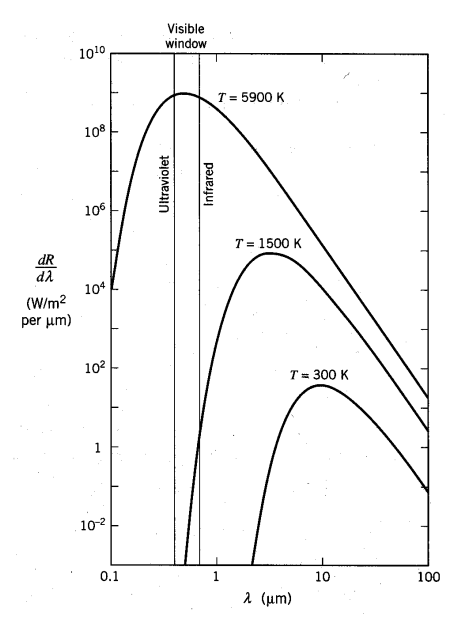

_Figure 4 (p. 65)_

If we heat an object up to about 1500 degrees we will begin to see a dull red glow and we say the object is red hot. If we heat something up to about 5000 degrees, near the temperature of the sun’s surface, it radiates well throughout the visible spectrum and we say it is white hot.

By considering plates in thermal equilibrium it can be shown that the emissive power over the absorption coefficient must be the same as a function of wavelength, even for plates of different materials.

```math
\frac{E_{1} ( \lambda ,T )}{A_{1} ( \lambda )} = \frac{E_{2} ( \lambda ,T )}{A_{2} ( \lambda )}
```

It there were differences, there could be a net energy flow from one plate to the other, violating the equilibrium condition.

<div align="right"><a href="book.pdf#page=65" target="_blank" title="This page in the PDF"><sup>[p. 65]</sup></a></div>
<hr class="page" style="height:2px;border:0;background:currentColor;opacity:0.25">
<a id="p66" href="book.pdf#page=66" target="_blank" title="This page in the PDF"><sup>[p. 66]</sup></a>

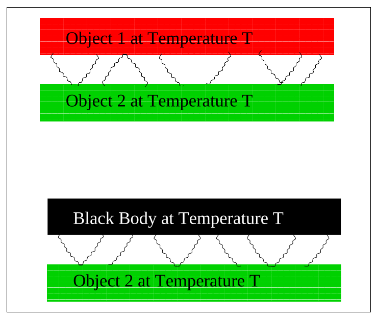

_Figure 5 (p. 66)_

A black body is one that absorbs all radiation incident upon it.

```math
A_{BB} = 1
```

Thus, the black body Emissive power, $`E ( \nu ,T )`$, is universal and can be derived from first principles.

A good example of a black body is a cavity with a small hole in it. Any light incident upon the hole goes into the cavity and is essentially never reflected out since it would have to undergo a very large number of reflections off walls of the cavity. If we make the walls absorptive (perhaps by painting them black), the cavity makes a perfect black body.

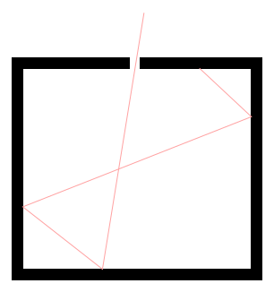

_Figure 6 (p. 66)_

There is a simple relation between the energy density in a cavity, $`u ( \nu ,T )`$, and the black body emissive power of a black body which simply comes from an analysis of how much radiation, traveling at the

<div align="right"><a href="book.pdf#page=66" target="_blank" title="This page in the PDF"><sup>[p. 66]</sup></a></div>
<hr class="page" style="height:2px;border:0;background:currentColor;opacity:0.25">
<a id="p67" href="book.pdf#page=67" target="_blank" title="This page in the PDF"><sup>[p. 67]</sup></a>

speed of light, will flow out of a hole in the cavity in one second.

```math
E ( \nu ,T ) = \frac{c}{4} u ( \nu ,T )
```

The only part that takes a little thinking is the 4 in the equation above.

Rayleigh and Jeans **calculated** (see section 2.5.1) t he energy density (in EM waves) inside a cavity and hence the emission spectrum of a black body. Their calculation was based on simple EM theory and equipartition. It not only did not agree with data; it said that all energy would be instantly radiated away in high frequency EM radiation. This was called the **ultraviolet catastrophe**.

```math
u ( \nu ,T ) = \frac{8 \pi \nu^{2}}{c^{3}} kT
```

Plank found a formula that fit the data well at both long and short wavelength.

```math
u ( \nu ,T ) = \frac{8 \pi \nu^{2}}{c^{3}} \frac{h\nu}{e^{h\nu /kT} - 1}
```

His formula fit the data so well that he tried to find a way to derive it. In a few months he was able to do this, by postulating that energy was emitted in quanta with $`E = h\nu`$. Even though there are a very large number of cavity modes at high frequency, the probability to emit such high energy quanta vanishes exponentially according to the Boltzmann distribution. Plank thus suppressed high frequency radiation in the calculation and brought it into agreement with experiment. Note that Plank’s Black Body formula is the same in the limit that $`h\nu <<kT`$ but goes to zero at large $`\nu`$ while the Rayleigh formula goes to infinity.

<div align="right"><a href="book.pdf#page=67" target="_blank" title="This page in the PDF"><sup>[p. 67]</sup></a></div>
<hr class="page" style="height:2px;border:0;background:currentColor;opacity:0.25">
<a id="p68" href="book.pdf#page=68" target="_blank" title="This page in the PDF"><sup>[p. 68]</sup></a>

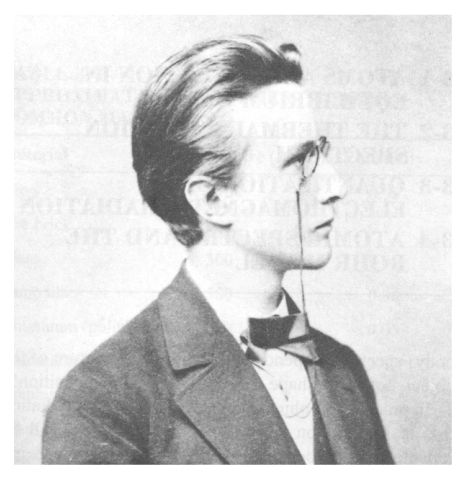

_Figure 7 (p. 68)_

It is interesting to note that classical EM waves would suck all the thermal energy out of matter, making the universe a very cold place for us. The figure below compares the two calculations to some data at $`T`$ = 1600 degrees. (It is also surprising that the start of the Quantum revolution came from Black Body radiation.)

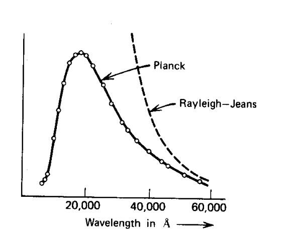

_Figure 8 (p. 68)_

So the emissive power per unit area is

```math
E ( \nu ,T ) = \frac{2 \pi \nu^{2}}{c^{2}} \frac{h\nu}{e^{h\nu /kT} - 1}
```

<div align="right"><a href="book.pdf#page=68" target="_blank" title="This page in the PDF"><sup>[p. 68]</sup></a></div>
<hr class="page" style="height:2px;border:0;background:currentColor;opacity:0.25">
<a id="p69" href="book.pdf#page=69" target="_blank" title="This page in the PDF"><sup>[p. 69]</sup></a>

<div align="center">

We can integrate this over frequency to get the total power radiated per unit area.

</div>

```math
R ( T ) = \frac{\pi^{2} c}{6 0 ( \hbar c )^{3}} k^{4} T^{4} = ( 5 . 6 7 \times 1 0^{- 8} W / m^{2} /^{◦} K^{4} ) T^{4}
```

\* See Example 2.6.1: What is the temperature at the solar surface? Use both the the intensity of radiation on earth and that the spectrum peaks about 500 nm to get answers.\*

\* See Example 2.6.2: The cosmic microwave background is black body radiation with a temperature of 2.7 degrees. For what frequency (and what wavelength) does the intensity peak?\*

# <a id="s-2-2-the-photoelectric-effect"></a>2.2 The Photoelectric Effect

The Photoelectric Effect shows that Plank’s hypothesis, used to fit the Black Body data, is actually correct for EM radiation. Einstein went further and proposed, in 1905, that light was made up of particles with energy related to the frequency of the light, $`E = h\nu`$. (He got his Nobel prize for the Photoelectric effect, not for Special or General Relativity.)

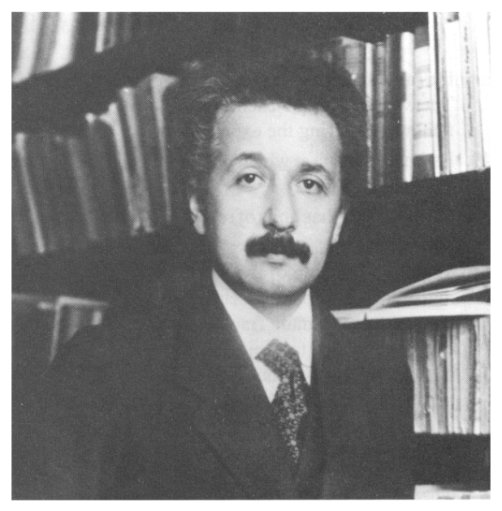

_Figure 9 (p. 69)_

<div align="right"><a href="book.pdf#page=69" target="_blank" title="This page in the PDF"><sup>[p. 69]</sup></a></div>
<hr class="page" style="height:2px;border:0;background:currentColor;opacity:0.25">
<a id="p70" href="book.pdf#page=70" target="_blank" title="This page in the PDF"><sup>[p. 70]</sup></a>

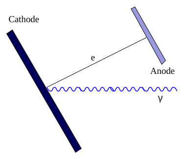

_Figure 10 (p. 70)_

When **light strikes a polished (metal) surface** electrons are ejected.

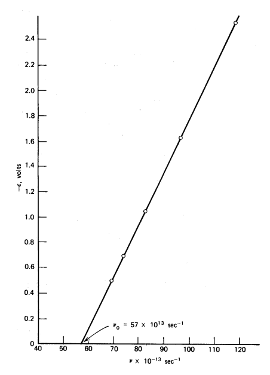

_Figure 11 (p. 70)_

Measurements were made of the **maximum electron energy versus light frequency** and light intensity. Classical physics predicted that the electron energy should increase with intensity, as the electric field increases. This is not observed. The electron energy is independent of intensity and depends linearly on the light frequency, as seen the the figure above. The kinetic energy of the electrons is given by Plank’s constant times the light frequency minus a **work function** $`W`$ which depends on the material.

```math
1 mv^{2} = h\nu - W
```

<div align="right"><a href="book.pdf#page=70" target="_blank" title="This page in the PDF"><sup>[p. 70]</sup></a></div>
<hr class="page" style="height:2px;border:0;background:currentColor;opacity:0.25">
<a id="p71" href="book.pdf#page=71" target="_blank" title="This page in the PDF"><sup>[p. 71]</sup></a>

This equation just expresses conservation of energy with $`h\nu`$ being the photon energy and $`W`$ the binding energy of electrons in the solid. Data from the Photoelectric effect strongly supported the hypothesis that light is composed of particles (photons).

# <a id="s-2-3-the-rutherford-atom"></a>2.3 The Rutherford Atom \*

The classical theory of atoms held that electrons were bound to a large positive charge about the size of the atom. Rutherford scattered charged $`( \alpha )`$ particles from atoms to see what the positive charge distribution was. With a approximately uniform charge distribution, his 5.5 MeV $`\alpha`$ particles should never have backscattered because they had enough energy to overcome the coulomb force from a charge distribution, essentially plowing right through the middle.

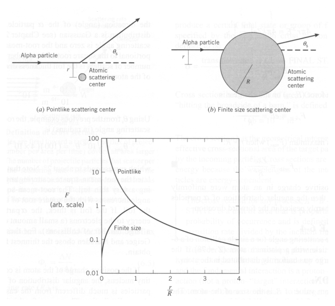

_Figure 12 (p. 71)_

He found that the $`\alpha`$ particles often scattered at angles larger than 90 degrees. His data can be explained if the **positive nucleus** of an atom is very small. For a very small nucleus, the Coulomb force continues to increase as the $`\alpha`$ approaches the nucleus, and backscattering is possible.

<div align="right"><a href="book.pdf#page=71" target="_blank" title="This page in the PDF"><sup>[p. 71]</sup></a></div>
<hr class="page" style="height:2px;border:0;background:currentColor;opacity:0.25">
<a id="p72" href="book.pdf#page=72" target="_blank" title="This page in the PDF"><sup>[p. 72]</sup></a>

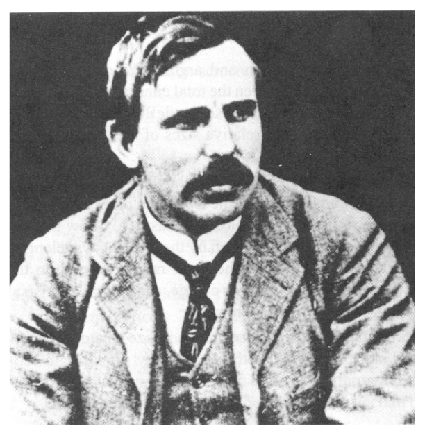

_Figure 13 (p. 72)_

\* See Example 2.6.4: Use Electrostatics to estimate how small a gold nucleus must be to backscatter a 5.5 MeV alpha particle.\*

This brought up a new problem. The atomic size was known from several types of experiments. If **electrons orbit around the atomic nucleus**, according to Maxwell’s equations, they should **radiate energy** as they accelerate. This radiation is not observed and the ground states of atoms are stable.

In Quantum Mechanics, the **localization of the electron around a nucleus is limited because** **of the wave nature of the electron**. For hydrogen, where there is no multi-body problem to make the calculation needlessly difficult, the energy levels can be calculated very accurately. Hydrogen was used to test Quantum Mechanics as it developed. We will also use hydrogen a great deal in this course.

Scattering of the high energy $`\alpha`$ particles allowed Rutherford to **“see” inside the atom** and determine that the atomic nucleus is very small. (He probably destroyed all the atoms he “saw”.) The figure below shows Rutherford’s angular distribution in his scattering experiment along with several subsequent uses of the same technique, with higher and higher energy particles. We see Rutherford’s discovery of the **tiny nucleus**, the discovery of **nuclear structure**, the discovery of a point-like **proton inside the nucleus**, the discovery of **proton structure**, the discovery of **quarks inside** **the proton**, and finally the lack of discovery, so far, of any **quark structure**.

<div align="right"><a href="book.pdf#page=72" target="_blank" title="This page in the PDF"><sup>[p. 72]</sup></a></div>
<hr class="page" style="height:2px;border:0;background:currentColor;opacity:0.25">
<a id="p73" href="book.pdf#page=73" target="_blank" title="This page in the PDF"><sup>[p. 73]</sup></a>

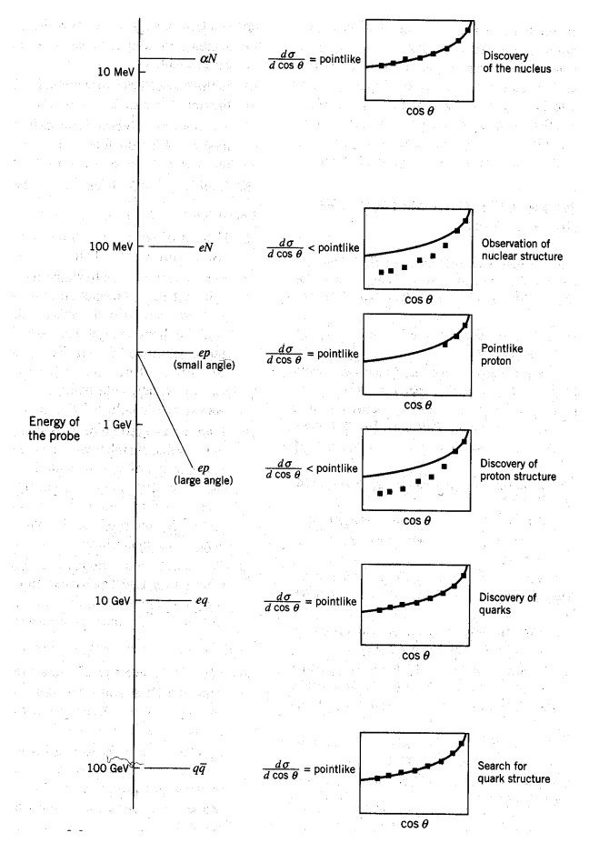

_Figure 14 (p. 73)_

To “see” these things at smaller and smaller distances, we needed to use beams of particles with smaller and smaller wavelength, and hence, higher energy.

# <a id="s-2-4-atomic-spectra"></a>2.4 Atomic Spectra \*

Hydrogen was ultimately the true test of the quantum theory. Very high accuracy measurements were made using diffraction gratings. These were well understood in non-relativistic QM and understood even better in the fully relativistic Quantum Field Theory, Quantum Electrodynamics.

The figure below show the **energy levels in Hydrogen**, the **transitions** between energy levels, and the wavelength of light produced in the transition. The **Lyman series** covers transitions to<span class="page" style="float:left;width:100%;margin:0.4em 0 0.6em"><span style="display:block;text-align:right"><a href="book.pdf#page=73" target="_blank" title="This page in the PDF"><sup>[p. 73]</sup></a></span><span style="display:block;height:2px;background:currentColor;opacity:0.25"></span><a id="p74" href="book.pdf#page=74" target="_blank" title="This page in the PDF"><sup>[p. 74]</sup></a></span> the ground state and is beyond the visible part of the spectrum. The **Balmer series** is due to transitions to the first excited state and is in the visible.

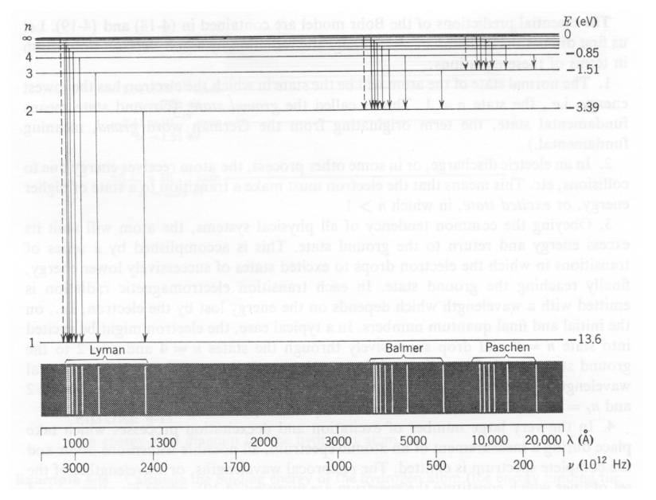

_Figure 15 (p. 74)_

By the time of Plank’s $`E = h\nu`$, **a great deal of data existed on the discrete energies** at which atoms radiated. Each atom had its own unique radiation fingerprint. Absorption at discrete energies had also been observed.

The **Rydberg formula** for the energies of photons emitted by Hydrogen was developed well before the QM explanation came along.

```math
E = 1 3 . 6 \text{ eV } \left( \frac{1}{n_{1}^{2}} - \frac{1}{n_{2}^{2}} \right)
```

Some of the states in heavier atoms followed the same type of formula. Better experiments showed that the spectral lines were often split into a multiplet of lines. We will understand these splitting much later in the course.

Heavier atoms provide a even richer spectrum but are much more difficult to calculate. Very good approximation techniques have been developed. With computers and good technique, the energy levels of more complex atoms can be calculated. The spectrum of mercury shown below has many more lines than seen in Hydrogen.

<div align="right"><a href="book.pdf#page=74" target="_blank" title="This page in the PDF"><sup>[p. 74]</sup></a></div>
<hr class="page" style="height:2px;border:0;background:currentColor;opacity:0.25">
<a id="p75" href="book.pdf#page=75" target="_blank" title="This page in the PDF"><sup>[p. 75]</sup></a>

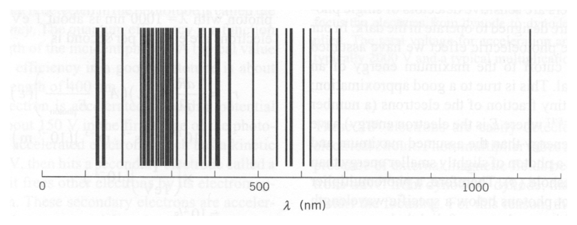

_Figure 16 (p. 75)_

The figure below shows the visible part of the spectrum for several atomic or molecular sources. For Hydrogen, we mainly see the Balmer series, with a line from Paschen-Bach. The spectra of different atoms are quite distinct. Molecules have many other types of excitations and can produce many frequencies of light.

## <a id="s-2-4-1-the-bohr-atom"></a>2.4.1 The Bohr Atom \*

Bohr postulated that electrons orbited the nucleus like planets orbiting the sun. He managed to fit the data for Hydrogen by postulating that **electrons orbited the nucleus in circular orbits,**<span class="page" style="float:left;width:100%;margin:0.4em 0 0.6em"><span style="display:block;text-align:right"><a href="book.pdf#page=75" target="_blank" title="This page in the PDF"><sup>[p. 75]</sup></a></span><span style="display:block;height:2px;background:currentColor;opacity:0.25"></span><a id="p76" href="book.pdf#page=76" target="_blank" title="This page in the PDF"><sup>[p. 76]</sup></a></span> **and that angular momentum is quantized** such that $`L = n \hbar`$, for $`n`$ = 1$`, 2 , 3 \dots`$. This is natural since $`\hbar`$ has units of angular momentum. Bohr correctly postdicted the Hydrogen energies and the size of the atom.

Balance of forces for circular orbits.

```math
\frac{mv^{2}}{r} = \frac{1}{4 \pi \epsilon_{0}} \frac{e^{2}}{r^{2}}
```

Angular momentum quantization assumption.

```math
L = mvr = n \hbar
```

Solve for velocity.

```math
v = \frac{n \hbar}{mr}
```

Plug into force equation to get formula for $`r`$.

```math
\frac{mn^{2} \hbar^{2} r^{2}}{m^{2} r^{2} r} = \frac{e^{2}}{4 \pi \epsilon_{0}}
```

```math
\frac{n^{2} \hbar^{2}}{mr} = \frac{e^{2}}{4 \pi \epsilon_{0}}
```

```math
\frac{1}{r} = \frac{me^{2}}{4 \pi \epsilon_{0} \hbar^{2}} \frac{1}{n^{2}}
```

Now we just want to plug $`v`$ and $`r`$ into the energy formula. We write the Hydrogen potential in terms of the fine structure constant (See section 2.5.2): $`\alpha_{SI} = \tfrac{1}{4 \pi \epsilon_{0}} \tfrac{e^{2}}{\hbar c} \approx \tfrac{1}{1 3 7}`$ .

```math
V ( r ) = \frac{- \alpha \hbar c}{r}
```

```math
\frac{1}{r} = \frac{\alpha mc}{\hbar} \frac{1}{n^{2}}
```

We now compute the energy levels.

```math
E = \frac{1}{2} mv^{2} + V ( r )
```

```math
E = \frac{1}{2} m \left( \frac{n \hbar}{mr} \right)^{2} - \frac{\alpha \hbar c}{r}
```

```math
E = \frac{1}{2} m \left( \frac{\alpha n \hbar c}{n^{2} \hbar} \right)^{2} - \frac{\alpha^{2} \hbar mc^{2}}{n^{2} \hbar}
```

```math
E = \frac{1}{2} m \left( \frac{\alpha c}{n} \right)^{2} - \frac{\alpha^{2} mc^{2}}{n^{2}}
```

```math
E = \frac{1}{2} \left( \frac{\alpha^{2} mc^{2}}{n^{2}} \right) - \frac{\alpha^{2} mc^{2}}{n^{2}} = - \frac{\alpha^{2} mc^{2}}{2 n^{2}}
```

The constant $`\frac{\alpha^{2} mc^{2}}{2}`$ = $`\frac{5 1 1 0 0 0}{2 ( 1 3 7 )^{2}}`$ = 13$`. 6`$ eV. Bohr’s formula gives the **right Hydrogen energy** **spectrum**.

<div align="right"><a href="book.pdf#page=76" target="_blank" title="This page in the PDF"><sup>[p. 76]</sup></a></div>
<hr class="page" style="height:2px;border:0;background:currentColor;opacity:0.25">
<a id="p77" href="book.pdf#page=77" target="_blank" title="This page in the PDF"><sup>[p. 77]</sup></a>

We can also compute the ground state radius of the Bohr orbit.

```math
\frac{1}{r} = \frac{\alpha mc^{2}}{\hbar c}
```

```math
r = \frac{( 1 3 7 ) ( 1 9 7 3 )}{5 1 1 0 0 0} = 0 . 5 3 ˚ A
```

This is also about the right radius. The name for this number, the **Bohr radius**, persists to this day despite the fact that Bohr’s assumption is wrong.

Although angular momentum is quantized in units of $`\hbar`$, **the ground state of Hydrogen has zero** **angular momentum**. This would put Bohr’s electron in the nucleus.

**Bohr fit the data, with some element of truth, but his model is WRONG**.

# <a id="s-2-5-derivations-and-computations"></a>2.5 Derivations and Computations

## <a id="s-2-5-1-black-body-radiation-formulas"></a>2.5.1 Black Body Radiation Formulas \*

(Not yet available.)

## <a id="s-2-5-2-the-fine-structure-constant-and-the-coulomb-potential"></a>2.5.2 The Fine Structure Constant and the Coulomb Potential

We will now grapple for the first time with the problem of which set of units to use. Advanced texts typically use **CGS units** in which the potential energy is

```math
V ( r ) = \frac{- e^{2}}{r}
```

while the **Standard International units**

```math
V ( r ) = \frac{1}{4 \pi \epsilon_{0}} \frac{- e^{2}}{r}
```

We can circumvent the problem by defining the dimensionless **fine structure constant** $`\alpha`$.

```math
\alpha_{SI} = \frac{1}{4 \pi \epsilon_{0}} \frac{e^{2}}{\hbar c} \approx \frac{1}{1 3 7}
```

```math
\alpha_{CGS} = \frac{e^{2}}{\hbar c} \approx \frac{1}{1 3 7}
```

So in either set of units the Hydrogen potential is

```math
V ( r ) = \frac{- \alpha \hbar c}{r}
```

<div align="right"><a href="book.pdf#page=77" target="_blank" title="This page in the PDF"><sup>[p. 77]</sup></a></div>
<hr class="page" style="height:2px;border:0;background:currentColor;opacity:0.25">
<a id="p78" href="book.pdf#page=78" target="_blank" title="This page in the PDF"><sup>[p. 78]</sup></a>

# <a id="s-2-6-examples"></a>2.6 Examples

**2.6.1 The Solar Temperature \***

## <a id="s-2-6-1-the-solar-temperature"></a>Estimate the solar temperature using

$`•`$ the solar radiation intensity on the earth of 1.4 kilowatts per square meter. $`( r_{sun}`$ = $`7 \times 1 0`$<sup>8</sup>

```math
m , d_{sun} = 1 . 5 \times 1 0^{1 1} m )
```

$`•`$ and the solar spectrum which peaks at about 500 nm.

First we compute the power radiated per unit area on the solar surface.

```math
R = ( 1 4 0 0 W / m^{2} ) ( 4 \pi d_{sun}^{2} ) / ( 4 \pi r_{sun}^{2} ) = 6 . 4 \times 1 0^{7} W / m^{2}
```

We compare this to the expectation as a function of temperature.

```math
R ( T ) = ( 5 . 6 7 \times 1 0^{- 8} W / m^{2} /^{◦} K^{4} ) T^{4}
```

and get

```math
T^{4} = \frac{6 . 4 \times 1 0^{7}}{5 . 6 7 \times 1 0^{- 8}}
```

```math
T = 5 8 0 0^{◦} K
```

Lets assume that $`E ( \lambda ,T )`$ peaks at 500 nm as one of the graphs shows. We need to transform $`E ( \nu ,T )`$. Remember $`f ( \nu ) d\nu = g ( \lambda ) d\lambda`$ for distribution functions.

```math
E ( \nu ,T ) = \frac{2 \pi \nu^{2}}{c^{2}} \frac{h\nu}{e^{h\nu /kT} - 1}
```

```math
E ( \lambda ,T ) = \left| \frac{d\nu}{d\lambda} \right| \frac{2 \pi \nu^{2}}{c^{2}} \frac{h\nu}{e^{h\nu /kT} - 1}
```

```math
= \frac{\nu^{2}}{c} \frac{2 \pi \nu^{2}}{c^{2}} \frac{h\nu}{e^{h\nu /kT} - 1} = \frac{2 \pi \nu^{4}}{c^{3}} \frac{h\nu}{e^{h\nu /kT} - 1}
```

This peaks when

```math
\frac{\nu^{5}}{e^{h\nu /kT} - 1}
```

is maximum.

```math
\frac{5 \nu^{4}}{e^{h\nu /kT} - 1} - \frac{\nu^{5} ( h/kT ) e^{h\nu /kT}}{( e^{h\nu /kT} - 1 )^{2}} = 0
```

```math
\frac{5}{e^{h\nu /kT} - 1} = \frac{\nu ( h/kT ) e^{h\nu /kT}}{( e^{h\nu /kT} - 1 )^{2}}
```

```math
\frac{5 ( e^{h\nu /kT} - 1 )}{e^{h\nu /kT}} = h\nu /kT
```

```math
5 ( 1 - e^{- h\nu /kT} ) = h\nu /kT
```

<div align="right"><a href="book.pdf#page=78" target="_blank" title="This page in the PDF"><sup>[p. 78]</sup></a></div>
<hr class="page" style="height:2px;border:0;background:currentColor;opacity:0.25">
<a id="p79" href="book.pdf#page=79" target="_blank" title="This page in the PDF"><sup>[p. 79]</sup></a>

Lets set $`y = h\nu /kT`$ and solve the equation

```math
y = 5 ( 1 - e^{- y} )
```

I solved this iteratively starting at y=5 and got $`y`$ = 4$`. 97`$ implying

```math
h\nu = 4 . 9 7 kT
```

If we take $`\lambda`$ = 500 nm, them $`\nu`$ = $`6 \times 1 0`$<sup>14</sup>.

```math
T = \frac{h\nu}{5 k} = \frac{( 6 . 6 \times 1 0^{- 3 4} ) ( 6 \times 1 0^{1 4} )}{( 5 ) ( 1 . 4 \times 1 0^{- 2 3} )} = 6 \times 1 0^{3} = 5 7 0 0
```

That’s agrees well.

## <a id="s-2-6-2-black-body-radiation-from-the-early-universe"></a>2.6.2 Black Body Radiation from the Early Universe \*

Find the frequency $`\nu`$ at which the the Emissive $`E ( \nu ,T )`$ is a maximum for the 2.7 degree cosmic background radiation. Find the wavelength $`\lambda`$ for which $`E ( \lambda ,T )`$ is a maximum.

The cosmic background radiation was produced when the universe was much hotter than it is now. Most of the atoms in the universe were ionized and photons interacted often with the ions or free electrons. As the universe cooled so that neutral atoms formed, the photons decoupled from matter and just propagated through space. We see these photons today as the background radiation. Because the universe is expanding, the radiation has been red shifted down to a much lower temperature. We observe about 2.7 degrees. The background radiation is very uniform but we are beginning to observe non-uniformities at the $`1 0^{- 5}`$ level.

From the previous problem, we can say that the peak $`\lambda`$ occurs when

```math
h\nu = 5 kT
```

```math
\nu = 5 kT/h
```

```math
\lambda = ch/ ( 5 kT ) = \frac{( 3 \times 1 0^{8} ) ( 6 . 6 \times 1 0^{- 3 4} )}{( 5 ) ( 1 . 4 \times 1 0^{- 2 3} ) ( 2 . 7 )} = 1 mm
```

Similarly the peak in $`\nu`$ occurs when

```math
\nu = 2 . 8 kT/h = \frac{( 1 . 4 \times 1 0^{- 2 3} ) ( 2 . 7 )}{( 6 . 6 \times 1 0^{- 3 4} )} = 6 \times 1 0^{1 0} Hz
```

## <a id="s-2-6-3-compton-scattering"></a>2.6.3 Compton Scattering \*

**Compton scattered high energy photons from (essentially) free electrons** in 1923. He measured the wavelength of the scattered photons as a function of the scattering angle. The figure below shows both the initial state (a) and the final state, with the photon scattered by an angle $`\theta`$ and the electron recoiling at an angle $`\varphi`$. The photons were from nuclear decay and so they were of high enough energy that it didn’t matter that the electrons were actually bound in atoms. We wish to derive the formula for the **wavelength of the scattered photon as a function of angle**.

<div align="right"><a href="book.pdf#page=79" target="_blank" title="This page in the PDF"><sup>[p. 79]</sup></a></div>
<hr class="page" style="height:2px;border:0;background:currentColor;opacity:0.25">
<a id="p80" href="book.pdf#page=80" target="_blank" title="This page in the PDF"><sup>[p. 80]</sup></a>

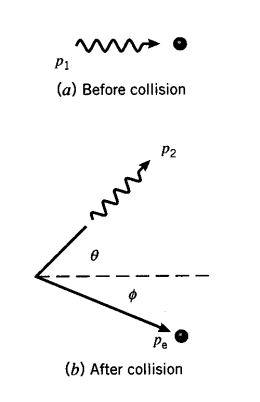

_Figure 17 (p. 80)_

We solve the problem using only conservation of energy and momentum. Lets work in **units in** **which** $`c`$ = 1 for now. We’ll put the $`c`$ back in at the end. Assume the photon is initially moving in the $`z`$ direction with energy E and that it scatters in the $`yz`$ plane so that $`p_{x}`$ = 0. **Conservation of** **momentum** gives

```math
E = E^{\prime} \cos \theta + p_{e} \cos \varphi
```

**and**

```math
E^{\prime} \sin \theta = p_{e} \sin \varphi .
```

**Conservation of energy** gives

```math
E + m = E^{\prime} + \sqrt{p_{e}^{2} + m^{2}}
```

Our goal is to solve for $`E^{\prime}`$ in terms of $`\cos \theta`$ so lets make sure we eliminate the $`\varphi`$. Continuing from the energy equation

```math
E - E^{\prime} + m = \sqrt{p_{e}^{2} + m^{2}}
```

squaring and calculating $`p_{e}^{2}`$ from the components

```math
E^{2} + E^{\prime 2} + m^{2} - 2 EE^{\prime} + 2 mE - 2 mE^{\prime} = ( E - E^{\prime} \cos \theta )^{2} + ( E^{\prime} \sin \theta )^{2} + m^{2}
```

and writing out the squares on the right side

```math
E^{2} + E^{\prime 2} + m^{2} - 2 EE^{\prime} + 2 mE - 2 mE^{\prime} = E^{2} + E^{\prime 2} - 2 EE^{\prime} \cos \theta + m^{2}
```

and removing things that appear on both sides

```math
- 2 EE^{\prime} + 2 mE - 2 mE^{\prime} = - 2 EE^{\prime} \cos \theta
```

and grouping

```math
m ( E - E^{\prime} ) = EE^{\prime} ( 1 - \cos \theta )
```

```math
\frac{( E - E^{\prime} )}{EE^{\prime}} = \frac{( 1 - \cos \theta )}{m}
```

```math
\frac{1}{E^{\prime}} - \frac{1}{E} = \frac{( 1 - \cos \theta )}{m}
```

<div align="right"><a href="book.pdf#page=80" target="_blank" title="This page in the PDF"><sup>[p. 80]</sup></a></div>
<hr class="page" style="height:2px;border:0;background:currentColor;opacity:0.25">
<a id="p81" href="book.pdf#page=81" target="_blank" title="This page in the PDF"><sup>[p. 81]</sup></a>

Since $`\lambda = h/p = h/E`$ in our fine units,

```math
\lambda^{\prime} - \lambda = \frac{h}{m} ( 1 - \cos \theta ) .
```

We now apply the speed of light to make the units come out to be a length.

```math
\lambda^{\prime} - \lambda = \frac{hc}{mc^{2}} ( 1 - \cos \theta )
```

These calculations can be fairly frustrating if you don’t decide which variables you want to keep and which you need to eliminate from your equations. In this case we eliminated $`\varphi`$ by using the energy equation and computing $`p_{e}^{2}`$.

## <a id="s-2-6-4-rutherford-s-nuclear-size"></a>2.6.4 Rutherford’s Nuclear Size \*

If the positive charge in gold atoms were uniformly distributed over a sphere or radius 5 Angstroms, what is the maximum $`\alpha`$ particle kinetic energy for which the $`\alpha`$ can be scattered right back in the direction from which it came?

To solve this, we need to compute the potential at the center of the charge distribution relative to the potential at infinity (which we will say is zero). This tells us directly the kinetic energy in eV needed to plow right through the charge distribution.

The potential at the surface of the nucleus is $`\frac{1}{4 \pi \epsilon_{0}} \frac{Ze}{R}`$ where Z is the number of protons in the atom and R is the nuclear radius. That’s the easy part. Now we need to integrate our way into the center.

```math
V = \frac{1}{4 \pi \epsilon_{0}} \frac{Ze}{R} - \int_{R}^{0} \frac{1}{4 \pi \epsilon_{0}} \frac{r^{3}}{R^{3}} \frac{Ze}{r^{2}} dr
```

The $`\frac{r^{3}}{R^{3}}`$ gives the fraction of the nuclear charge inside a radius $`r`$.

```math
V = \frac{1}{4 \pi \epsilon_{0}} \frac{Ze}{R} - \frac{1}{4 \pi \epsilon_{0} R^{3}} \int_{R}^{0} Zerdr
```

```math
V = \frac{1}{4 \pi \epsilon_{0}} \left( \frac{Ze}{R} + \frac{Ze}{2 R} \right) = \frac{3 Ze}{8 \pi \epsilon_{0} R}
```

So

```math
V = \frac{( 3 ) ( 7 9 ) ( 1 . 6 \times 1 0^{- 1 9} C )}{8 \pi ( 8 . 8 5 \times 1 0^{- 1 2} C^{2} / \text{ Nm }^{2} ) R} = \frac{1 . 7 \times 1 0^{- 7}}{R} \text{ Nm } / C
```

The is then the kinetic energy in eV needed for a particle of charge +$`e`$ to plow right through the center of a spherical charge distribution. The $`\alpha`$ particle actually has charge +2$`e`$ so we need to multiply by 2. For a nuclear radius of 5 ˚Aor $`5 \times 1 0^{- 1 0}`$ meters, we need about 680 eV to plow through the nucleus. For the actual nuclear radius of about 5 Fermis or $`5 \times 1 0^{- 1 5}`$ meters, we need 68 MeV to plow through.

<div align="right"><a href="book.pdf#page=81" target="_blank" title="This page in the PDF"><sup>[p. 81]</sup></a></div>
<hr class="page" style="height:2px;border:0;background:currentColor;opacity:0.25">
<a id="p82" href="book.pdf#page=82" target="_blank" title="This page in the PDF"><sup>[p. 82]</sup></a>

**Lets compare the above SI units numbers to my suggested method of using the fine** **structure constant...** Putting in the alpha charge of 2$`e`$.

```math
U = \frac{6 Ze^{2}}{8 \pi \epsilon_{0} R} = \frac{3 Z\alpha \hbar c}{R} = \frac{( 3 ) ( 7 9 ) ( 1 9 7 3 )}{( 1 3 7 ) ( 5 )} \text{ eV } = 6 8 3 \text{ eV }
```

This is easier.

# <a id="s-2-7-sample-test-problems"></a>2.7 Sample Test Problems

1. What is the maximum wavelength of electromagnetic radiation which can eject electrons from a metal having a work function of 3 eV? (3 points)<br>
**Answer**<br>
The minimum photon energy needed to knock out an electron is 3 eV. We just need to convert that to wavelength.

```math
E = h\nu = 3 eV
```

```math
\nu = \frac{c}{\lambda}
```

```math
\frac{2 \pi \hbar c}{\lambda} = 3 eV
```

```math
\lambda = \frac{2 \pi \hbar c}{3 eV} = \frac{2 \pi ( 1 9 7 3 eV ˚ A )}{3 eV} \approx 4 0 0 0 ˚ A
```

2. **\*** Based on classical electromagnetism and statistical mechanics, Rayleigh computed the energy density inside a cavity. He found that, at a temperature T, the energy density as a function of frequency was

```math
u ( \nu ,T ) = \frac{8 \pi \nu^{2}}{c^{3}} k_{B} T.
```

Why is this related to black body radiation? Why was this in obvious disagreement with observation?

3. What is the maximum wavelength of electromagnetic radiation which can eject electrons from

a metal having a work function of 2 eV?

4. **\*** State simply what problem with black-body radiation caused Plank to propose the relation

$`E = h\nu`$ for light.

5. The work function of a metal is 2 eV. Assume a beam of light of wavelength $`\lambda`$ is incident upon a polished surface of the metal. Plot the maximum electron energy (in eV) of electrons ejected from the metal versus $`\lambda`$ in Angstroms. Be sure to label both axes with some numerical values.

6.

---

<a id="03-diffraction"></a>

<hr class="page" style="height:2px;border:0;background:currentColor;opacity:0.25">
<a id="p83" href="book.pdf#page=83" target="_blank" title="This page in the PDF"><sup>[p. 83]</sup></a>

# 3 Diffraction

**Feynman Lectures, Volume III, Chapter I.**

**Gasciorawicz does not really this.**

**Rohlf Chapters 5**

**Griffiths doesn’t cover this.**

# <a id="s-3-1-diffraction-from-two-slits"></a>3.1 Diffraction from Two Slits

**Water waves** will exhibit a diffractive interference pattern in a 2 slit experiment as diagrammed below. The diagram shows the crests of the water waves at some time. Downstream from the slits, we will see constructive interference where the waves from the slits are in phase and destructive interference where they are 180 degrees out of phase, for example where a crest from one slit meets a trough from the other. The plot labeled $`I_{1 2}`$ shows the interference pattern at the location of the absorber. **Diffraction is a simple wave phenomenon**.

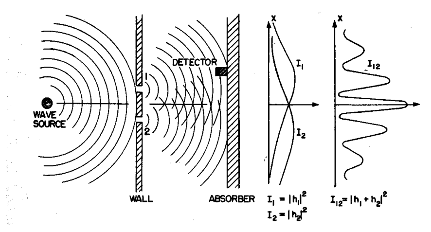

_Figure 18 (p. 83)_

The **diffraction of light** was a well known phenomenon by the end of the 19th century and was well explained in classical ElectroMagnetic theory since light was held to be a EM wave. The diffraction pattern from two narrow slits is particularly easy to understand in terms of waves. The setup is shown in the diagram below.

<div align="right"><a href="book.pdf#page=83" target="_blank" title="This page in the PDF"><sup>[p. 83]</sup></a></div>
<hr class="page" style="height:2px;border:0;background:currentColor;opacity:0.25">
<a id="p84" href="book.pdf#page=84" target="_blank" title="This page in the PDF"><sup>[p. 84]</sup></a>

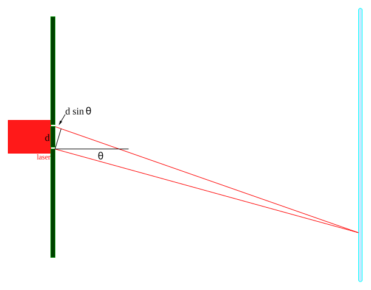

_Figure 19 (p. 84)_

EM waves of wavelength $`\lambda`$ are emitted from a single light-source, like a laser. They travel to two narrow slits, (for simplicity) equidistant from the source, and a distance $`d`$ apart. Light travels from the slits to a detection screen. A diffraction pattern can be seen on the detection screen, like the one shown in the picture below.

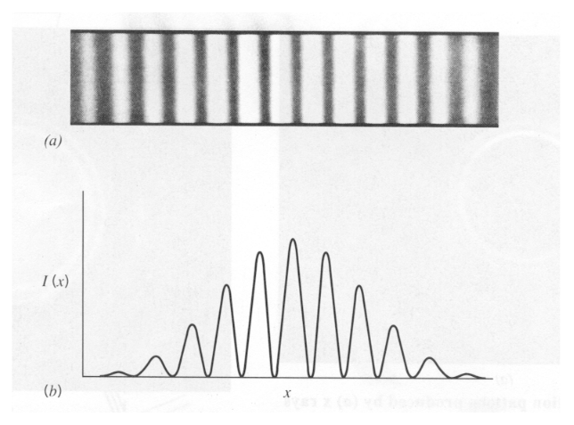

_Figure 20 (p. 84)_

The center of the diffraction pattern occurs at the location on the screen equidistant from each slit where the **waves from the two slits are in phase** (because they have traveled exactly the same distance) and the fields add, so the waves **interfere constructively** and there is an intensity maximum. Some distance off this center of the diffraction pattern, there will be destructive interference between waves from the two slits and the intensity will be zero. This will occur when

<div align="right"><a href="book.pdf#page=84" target="_blank" title="This page in the PDF"><sup>[p. 84]</sup></a></div>
<hr class="page" style="height:2px;border:0;background:currentColor;opacity:0.25">
<a id="p85" href="book.pdf#page=85" target="_blank" title="This page in the PDF"><sup>[p. 85]</sup></a>

the distance traveled by two waves differs by $`\lambda / 2`$, so the **waves are 180 degrees out of phase** **and the fields from the two slits cancel**.

We can compute this location by looking at the above diagram. We assume that the distance to the screen is much greater than $`d`$. For light detected at an angle $`\theta`$, the extra distance traveled from slit 1 is just $`d \sin \theta`$. So the angle of the **first minimum** (or null) can be found from the equation $`d \sin \theta = \tfrac{\lambda}{2}`$.

More generally we will get a **maximum if the paths from the slits differ by an integer** **number of wavelengths** $`d \sin \theta = n\lambda`$ and we will get a **null when the paths differ by a half** **integer number wavelengths**. $`d \sin \theta_{null} = \tfrac{( n + 1 ) \lambda}{2}`$.

Although it is very difficult because electrons are charged, **2 slit electron diffraction** has also been observed.

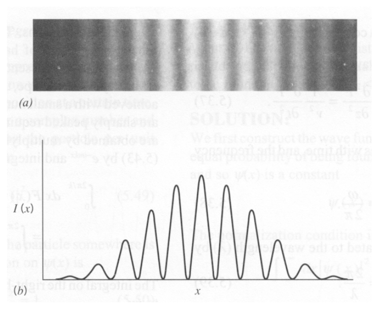

_Figure 21 (p. 85)_

So, all kinds of particles seem to diffract indicating there is some kind of wave involved. We will now continue with some thought experiments on diffraction to illustrate the physics that Quantum Mechanics needed to match.

\* See Example 3.6.1: Derive the location of the nodes in the diffraction pattern from two narrow slits a distance $`d`$ apart. Now try to compute the intensity distribution.\*

<div align="right"><a href="book.pdf#page=85" target="_blank" title="This page in the PDF"><sup>[p. 85]</sup></a></div>
<hr class="page" style="height:2px;border:0;background:currentColor;opacity:0.25">
<a id="p86" href="book.pdf#page=86" target="_blank" title="This page in the PDF"><sup>[p. 86]</sup></a>

# <a id="s-3-2-single-slit-diffraction"></a>3.2 Single Slit Diffraction

There are many other examples of diffraction. The picture below shows diffraction from a single slit where waves from different parts of the slit interfere with each other. To get the field at some point on the detection screen, one should integrate over the slit.

\* See Example 3.6.2: Derive the location of the nodes in the diffraction pattern from one slit of width $`a`$. Now try to compute the intensity distribution for single slit diffraction.\*

# <a id="s-3-3-diffraction-from-crystals"></a>3.3 Diffraction from Crystals

**Electron waves were first demonstrated by measuring diffraction from crystals**. Davison and Germer observed diffraction of electrons from a Nickel crystal in 1928. They varied the electron energy to measure the electron wavelength, agreeing well with the deBroglie expectation.

First we see diffraction from a **single crystal**.

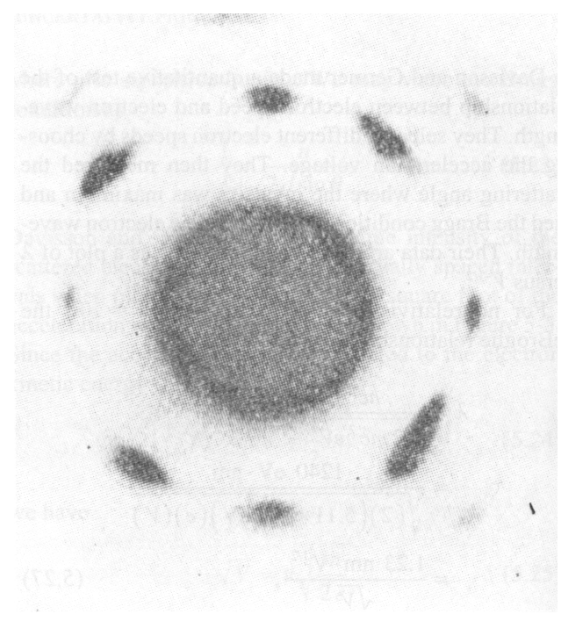

_Figure 22 (p. 86)_

Diffraction off **polycrystalline material** gives concentric rings instead of spots.

<div align="right"><a href="book.pdf#page=86" target="_blank" title="This page in the PDF"><sup>[p. 86]</sup></a></div>
<hr class="page" style="height:2px;border:0;background:currentColor;opacity:0.25">
<a id="p87" href="book.pdf#page=87" target="_blank" title="This page in the PDF"><sup>[p. 87]</sup></a>

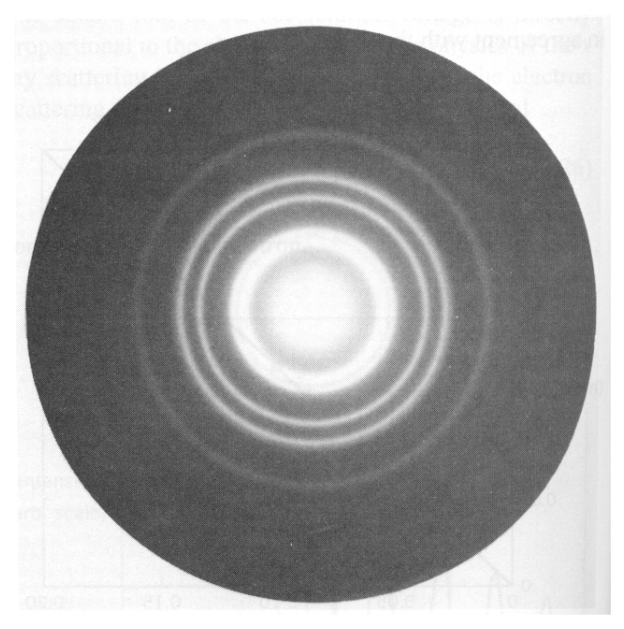

_Figure 23 (p. 87)_

Diffraction from crystals is a powerful tool. First we see **x-ray diffraction from a single Sodium** **Crystal** which has periodic locations of the atoms.

<div align="right"><a href="book.pdf#page=87" target="_blank" title="This page in the PDF"><sup>[p. 87]</sup></a></div>
<hr class="page" style="height:2px;border:0;background:currentColor;opacity:0.25">
<a id="p88" href="book.pdf#page=88" target="_blank" title="This page in the PDF"><sup>[p. 88]</sup></a>

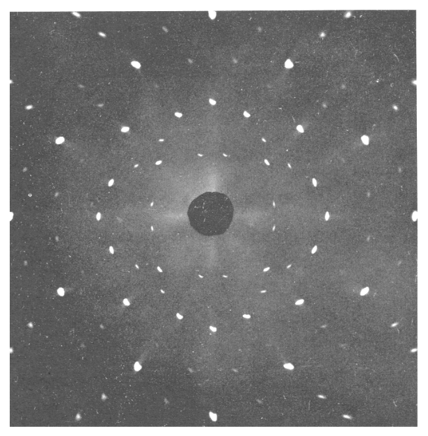

_Figure 24 (p. 88)_

Another example of diffraction is shown below. Here **neutrons diffract from a single Sodium** **crystal**.

<div align="right"><a href="book.pdf#page=88" target="_blank" title="This page in the PDF"><sup>[p. 88]</sup></a></div>
<hr class="page" style="height:2px;border:0;background:currentColor;opacity:0.25">
<a id="p89" href="book.pdf#page=89" target="_blank" title="This page in the PDF"><sup>[p. 89]</sup></a>

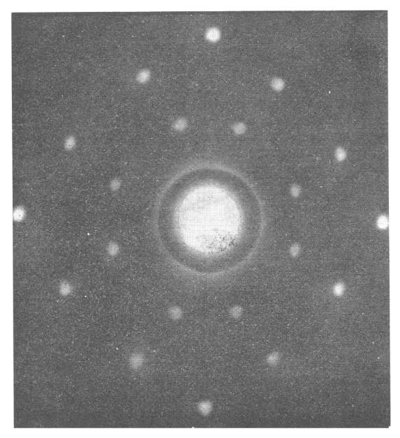

_Figure 25 (p. 89)_

# <a id="s-3-4-the-debroglie-wavelength"></a>3.4 The DeBroglie Wavelength

The Lorentz transformation had been postulated for ElectroMagnetic waves before Einstein developed Special Relativity. The EM waves were entirely consistent with Relativity. For example, the phase of an EM wave at some point is the same as at the Lorentz transformed point.

**DeBroglie applied this Lorentz invariance requirement on the phase of matter waves** to determine what the wavelength must be. Its easy for us to derive the wavelength using 4-vectors. Position and time form one 4-vector.

```math
x^{\mu} = ( c t , \vec{x} )
```

Energy and momentum form another.

```math
p^{\mu} = ( E, \vec{p} c )
```

Recall that Lorentz vectors must be transformed but **Lorentz scalars are automatically invari-** **ant** under transformations. For example the scalar formed by dotting the 4-momentum into itself is

```math
p^{\mu} p_{\mu} = - E^{2} + p^{2} c^{2} = - m^{2} c^{4} .
```

The mass of a particle is clearly Lorentz invariant.

To compute the wavelength for our matter waves, lets use the scalar

```math
p^{\mu} x_{\mu} /c = - Et + \vec{p} \cdot \vec{x}
```

<div align="right"><a href="book.pdf#page=89" target="_blank" title="This page in the PDF"><sup>[p. 89]</sup></a></div>
<hr class="page" style="height:2px;border:0;background:currentColor;opacity:0.25">
<a id="p90" href="book.pdf#page=90" target="_blank" title="This page in the PDF"><sup>[p. 90]</sup></a>

Its already easy to see that the phase in a wave like

```math
e^{i ( \vec{p} \cdot \vec{x} - Et ) / \hbar}
```

is Lorentz invariant.

To read off the wavelength, lets pick off the part of the expression that corresponds to $`e^{2 \pi i ( x/\lambda - \nu t )}`$. We see that<sup>2</sup>$`\tfrac{\pi}{\lambda} = \tfrac{p}{\hbar}`$ and therefore the DeBroglie wavelength is.

```math
\lambda = \frac{2 \pi \hbar}{p} = \frac{h}{p}
```

DeBroglie derived this result in 1923.

We can also read off the frequency $`\nu`$.

```math
\nu = \frac{E}{2 \pi \hbar} = E/h
```

This was in some sense the input to our calculation.

The deBroglie wavelength will be our **primary physics input** for the development of Quantum Mechanics. Its not that this work was the most significant, but, this wavelength summarizes most of what happened before 1923.

## <a id="s-3-4-1-computing-debroglie-wavelengths"></a>3.4.1 Computing DeBroglie Wavelengths

We usually quote the energy of a particle in terms of its **kinetic energy** in electron Volts, eV (or Million electron Volts, MeV). The reason for this is that particles are usually accelerated to some energy by an electric field. If I let an electron (or proton...) be accelerated through a 100 Volt potential difference, it will have a kinetic energy of 100eV.

The whole problem of computing a deBroglie wavelength is to convert from kinetic energy to momentum. If you always want to be correct without any need for thinking, use the **relativistically** **correct formula** for the kinetic energy

```math
T = \sqrt{( mc^{2} )^{2} + p^{2} c^{2}} - mc^{2}
```

and solve it for $`pc`$,

```math
pc = \sqrt{( T + mc^{2} )^{2} - ( mc^{2} )^{2}}
```

then use this handy formula to get the answer.

```math
\lambda = \frac{h}{p} = \frac{2 \pi \hbar c}{pc}
```

I remember that $`\hbar c`$ = 1973 eV˚A allowing me to keep the whole calculation in eV. I also know the masses of the particles.

```math
m_{e} c^{2} = 0 . 5 1 \text{ MeV }
```

```math
m_{p} c^{2} = 9 3 8 . 3 \text{ MeV }
```

<div align="right"><a href="book.pdf#page=90" target="_blank" title="This page in the PDF"><sup>[p. 90]</sup></a></div>
<hr class="page" style="height:2px;border:0;background:currentColor;opacity:0.25">
<a id="p91" href="book.pdf#page=91" target="_blank" title="This page in the PDF"><sup>[p. 91]</sup></a>

(If $`T<<<mc^{2}`$, make sure the **precision** of your calculator sufficient or use the non-relativistic method below.)

If you know that the particle is **super-relativistic**, so that $`T>>mc^{2}`$, then just use $`pc = T`$ and life is easy.

If you know that the particle is highly **non-relativistic**, $`T<<mc^{2}`$, then you can use $`T = \tfrac{p^{2}}{2 m}`$ =

```math
\tfrac{( pc )^{2}}{2 mc^{2}} \text{ giving } pc = \sqrt{2 mc^{2} T} .
```

So, for example, compute the wavelength of a 100 eV electron. This is non-relativistic since 100 eV ¡¡ 510000 eV. So $`pc = \sqrt{1 0}`$<sup>6</sup> $`\times 100`$ eV or 10000 eV.

```math
\lambda = \frac{2 \pi 1 9 7 3}{pc} = \frac{1 2 0 0 0}{1 0 0 0 0} = 1 . 2 ˚ A
```

# <a id="s-3-5-wave-particle-duality-thought-experiments"></a>3.5 Wave Particle Duality (Thought Experiments)

Richard Feynman (Nobel Prize for Quantum ElectroDynamics...) presents several thought experiments in his Lectures on Physics, third volume.


_Figure 26 (p. 91)_

For our first thought experiment, we will consider **two silt diffraction of light**. Assume that instead of using the screen, I use a **sensitive photo-detector**. I measure the intensity of light as a function of position near the screen and find the same set of maxima and minima that I did using my eyes.

<div align="right"><a href="book.pdf#page=91" target="_blank" title="This page in the PDF"><sup>[p. 91]</sup></a></div>
<hr class="page" style="height:2px;border:0;background:currentColor;opacity:0.25">
<a id="p92" href="book.pdf#page=92" target="_blank" title="This page in the PDF"><sup>[p. 92]</sup></a>

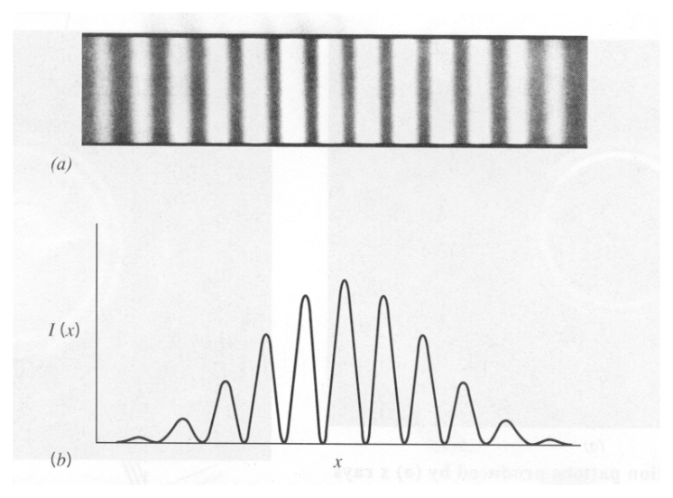

_Figure 27 (p. 92)_

Now lets turn down the intensity of the light source. For very low intensity I find that my detector collects **one photon at a time**. It never collects half a photon. (With the right detector, I could again verify that for each photon, the Photoelectric effect is seen and that $`E = h\nu`$.) So the waves that are diffracting are somehow made up of photons. With a **low enough intensity**, I can assure that **only one photon** is present in the apparatus at any time. I can operate my detector and collect data over a long time, summing up the number of photons detected as a function of position. What will I get for the distribution? I get exactly the same distribution as before with maxima and minima. No matter how low the intensity, (1 particle/ minute!) **we still see diffraction**. We never detect a fraction of an electron or a photon, **only integer numbers**.

How does a single photon interfere with itself? It must somehow travel through both slits.

Lets turn to **electron diffraction** for a minute. In our thought experiment we again have two slits.

<div align="right"><a href="book.pdf#page=92" target="_blank" title="This page in the PDF"><sup>[p. 92]</sup></a></div>
<hr class="page" style="height:2px;border:0;background:currentColor;opacity:0.25">
<a id="p93" href="book.pdf#page=93" target="_blank" title="This page in the PDF"><sup>[p. 93]</sup></a>

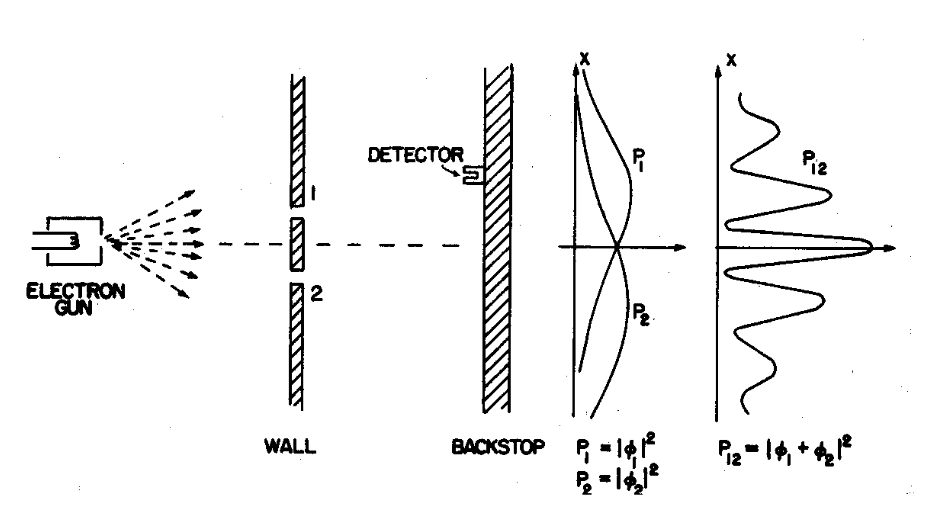

_Figure 28 (p. 93)_

We use our detector to measure the diffraction pattern similar to the one for photons labeled $`P_{1 2}`$ below. If we **cover up slit 2** we get the distribution labeled $`P_{1}`$ and if we /emphtextcover up slit 1 we get the intensity distribution labeled $`P_{2}`$. We could have done the same with our photons above.

Now we will try to see which slit each electron passes through. We put a **bright light source near** **the slits** and detect light bouncing off the electron so we can see which slit it passes through.

<div align="right"><a href="book.pdf#page=93" target="_blank" title="This page in the PDF"><sup>[p. 93]</sup></a></div>
<hr class="page" style="height:2px;border:0;background:currentColor;opacity:0.25">
<a id="p94" href="book.pdf#page=94" target="_blank" title="This page in the PDF"><sup>[p. 94]</sup></a>

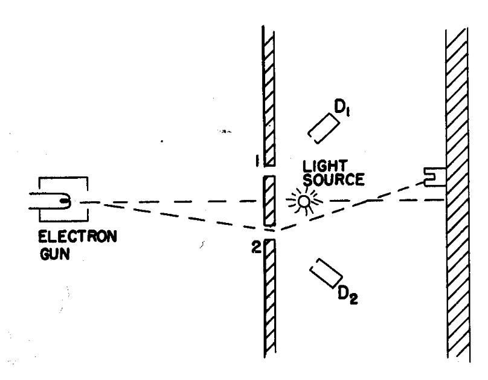

_Figure 29 (p. 94)_

What distribution do we see now? Actually we will see $`P_{1} + P_{2}`$ if we can tell which slit the electron went through. Our **observation of the electron as it passes through the slit has changed** **the resulting intensity distribution**. If we turn the light off, we go back to measuring $`P_{1 2}`$.

Can you explain why the light causes the diffraction pattern to disappear?

Is it the mere observation? Does the light change the phase of the electron?

There are many examples of an observer changing the result of a Quantum experiment. Indeed, it is held that when a state is observed, its wave function collapses into the state “seen”. In this case, all we had to do is turn on the light. We didn’t have to look.

Finally, we will do a two slit **diffraction experiment with bullets**. We must make slits big enough for the bullets to pass through.

<div align="right"><a href="book.pdf#page=94" target="_blank" title="This page in the PDF"><sup>[p. 94]</sup></a></div>
<hr class="page" style="height:2px;border:0;background:currentColor;opacity:0.25">
<a id="p95" href="book.pdf#page=95" target="_blank" title="This page in the PDF"><sup>[p. 95]</sup></a>

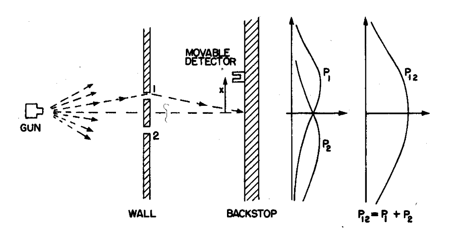

_Figure 30 (p. 95)_

No matter what distance between the slits we choose, we **never observe diffraction** for the bullets. They always give the $`P_{1} + P_{2}`$ pattern (probably different for the bullets). Can you explain this? The bullet’s wavelength is much much smaller than the actual size of the bullet.

Why didn’t we see diffraction for the bullets. Bullets are **macroscopic objects** with huge momenta compared to individual particles. High momentum implies a small deBroglie wavelength. So to see diffraction, we must make the distance between the slits much smaller than we did for the photons (perhaps 10<sup>20</sup> times smaller). But bullets are also big. They only fit through big slits which must them be further apart than the slits used for photons. For bullets, **the wavelength is tiny** **compared to any slit a bullet would fit through**. Therefore no bullet diffraction is possible.

**Feynman Lectures on Physics, Vol. III Chapter 1**

# <a id="s-3-6-examples"></a>3.6 Examples

## <a id="s-3-6-1-intensity-distribution-for-two-slit-diffraction"></a>3.6.1 Intensity Distribution for Two Slit Diffraction \*

Derive the location of the nodes in the diffraction pattern from two narrow slits a distance $`d`$ apart. Now try to compute the intensity distribution.

**This is an in lab exercise**.

## <a id="s-3-6-2-intensity-distribution-for-single-slit-diffraction"></a>3.6.2 Intensity Distribution for Single Slit Diffraction \*

Derive the location of the nodes in the diffraction pattern from one slit of width $`a`$. Now try to compute the intensity distribution for single slit diffraction.

**This is an in lab exercise**.

<div align="right"><a href="book.pdf#page=95" target="_blank" title="This page in the PDF"><sup>[p. 95]</sup></a></div>
<hr class="page" style="height:2px;border:0;background:currentColor;opacity:0.25">
<a id="p96" href="book.pdf#page=96" target="_blank" title="This page in the PDF"><sup>[p. 96]</sup></a>

# <a id="s-3-7-sample-test-problems"></a>3.7 Sample Test Problems

1. What is the deBroglie wavelength of an electron with 13.6 eV of kinetic energy? What is the deBroglie wavelength of an electron with 10 MeV of kinetic energy?

**Answer**<br>
13.6 eV is much less than $`mc^{2}`$ = 0$`. 5 1 1 MeV`$ so this is non-relativistic.

```math
\frac{p^{2}}{2 m} = 1 3 . 6
```

```math
\frac{p^{2} c^{2}}{2 mc^{2}} = 1 3 . 6
```

```math
pc = \sqrt{2 mc^{2} ( 1 3 . 6 )}
```

```math
\lambda = \frac{h}{p} = \frac{2 \pi \hbar}{p} = \frac{2 \pi \hbar c}{pc} = \frac{2 \pi \hbar c}{\sqrt{2 mc^{2} ( 1 3 . 6 )}}
```

```math
= \frac{2 \pi ( 1 9 7 3 eV ˚ A )}{\sqrt{2 ( 0 . 5 1 1 \times 1 0^{6} eV ) ( 1 3 . 6 eV )}} \approx 3 . 3 3 ˚ A
```

10 MeV is much bigger than $`mc^{2}`$ for an electron so it is super-relativistic and we can use

```math
E = pc .
```

```math
\lambda = \frac{2 \pi \hbar c}{pc} = \frac{2 \pi ( 1 9 7 . 3 ) MeVF )}{1 0 MeV} \approx 1 2 0 F
```

2. What is the DeBroglie wavelength for each of the following particles? The energies given are the kinetic energies.

a) a 10 eV electron b) a 1 MeV electron c) a 10 MeV proton

3. A 2 slit electron diffraction experiment is set up as (not) shown below. The observed electron intensity distribution is plotted in the figure. Now an intense light source is introduced near the two slits. With this light, it can be ”seen” which slit each electron goes through. Qualitatively plot the new electron intensity distribution from each slit and from the 2 slits combined. What is the condition on the wavelength of the light for this effect to occur?

4. What is the DeBroglie wavelength for each of the following particles? The energies given are the kinetic energies.

a) a 1 eV electron b) a 10<sup>4</sup> MeV proton

5. What K.E. must a Hydrogen atom have so that its DeBroglie wavelength is smaller than the

size of the atom? (Factors of 2 are not important.)

6. Calculate the DeBroglie wavelength for (a) a proton with 10 MeV kinetic energy, (b) An electron with 10 MeV kinetic energy, and (c) a 1 gram lead ball moving with a velocity of 10 cm/sec (one erg is one gram cm<sup>2</sup>/sec<sup>2</sup>). Be sure to take account of relativity where needed.

7.

---

<a id="04-the-solution-probability-amplitudes"></a>

<hr class="page" style="height:2px;border:0;background:currentColor;opacity:0.25">
<a id="p97" href="book.pdf#page=97" target="_blank" title="This page in the PDF"><sup>[p. 97]</sup></a>

# 4 The Solution: Probability Amplitudes

For **EM waves**, the intensity, and hence the probability to find a photon, is proportional to the square of the fields. The fields obey the wave equation. The fields from two slits can add constructively or destructively giving interference patterns. The $`E`$ and $`B`$ fields are 90 degrees out of phase and both contribute to the intensity.

We will **use the same ideas for electrons**, although the details of the field will vary a bit because electrons and photons are somewhat different kinds of particles. For both particles the wavelength is given by

```math
\lambda = \frac{h}{p}
```

and the frequency by

```math
E = h\nu = \hbar \omega .
```

We will use a **complex probability amplitude** $`\psi ( x,t )`$ for the electron. The real and imaginary parts are out of phase like the EM fields. The traveling wave with momentum $`p`$ and energy $`E`$ then is

```math
\psi ( x,t ) \propto e^{i ( kx - \omega t )} = e^{i ( px - Et ) / \hbar}
```

The **probability to find an electron is equal to the absolute square** of the complex probability amplitude.

```math
P ( x,t ) = | \psi ( x,t ) |^{2}
```

(We will overcome the problem that this probability is 1 everywhere for our simple wavefunction.)

**We have just put in most of the physics of Quantum Mechanics. Much of what we do** **for the rest of the course will be deduced from the paragraph above. Our input came** **from deBroglie and Plank, with support from experiments.**

Lets summarize the physics input again.

$`•`$ Free particles are represented by complex wave functions with a relationship between their particle properties – energy and momentum, and their wave properties – frequency and wavelength given by Plank and deBroglie.

$`•`$ The absolute square of the wavefunction gives the probability distribution function. Quantum

Mechanics only tells us the probability.

$`•`$ We can make superpositions of our free particle wave functions to make states that do not have definite momentum. We will find that any state can be made from the superposition of free particle states with different momentum.

We now have a wave-particle duality for all the particles, however, **physics now only tells us** **the probability** for some quantum events to occur. We have lost the complete predictive power of classical physics.

**Gasiorowicz Chapter 1**

**Rohlf Chapter 5**

<div align="right"><a href="book.pdf#page=97" target="_blank" title="This page in the PDF"><sup>[p. 97]</sup></a></div>
<hr class="page" style="height:2px;border:0;background:currentColor;opacity:0.25">
<a id="p98" href="book.pdf#page=98" target="_blank" title="This page in the PDF"><sup>[p. 98]</sup></a>

## <a id="s-griffiths-1-2-1-3"></a>Griffiths 1.2, 1.3

## <a id="04-the-solution-probability-amplitudes--s-cohen-tannoudji-et-al-chapter"></a>Cohen-Tannoudji et al. Chapter

# <a id="s-4-1-derivations-and-computations"></a>4.1 Derivations and Computations

## <a id="s-4-1-1-review-of-complex-numbers"></a>4.1.1 Review of Complex Numbers

This is a simple review, but, you must make sure you use complex numbers correctly. One of the most common mistakes in test problems is to forget to take the complex conjugate when computing a probability.

A complex number $`c = a + ib`$ consists of a real part $`a`$ and an imaginary part $`ib`$. (We choose $`a`$ and $`b`$ to be real numbers.) $`i`$ is the square root of -1.

The complex conjugate of $`c`$ is $`c^{*} = a - ib`$. (Just change the sign of all the $`i . )`$

The absolute square of a complex number is calculated by multiplying it by its complex conjugate.

```math
| c |^{2} = c^{*} c = ( a - ib ) ( a + ib ) = a^{2} + iab - iab + b^{2} = a^{2} + b^{2}
```

This give the magnitude squared of the complex number. The absolute square is always real.

We will use complex exponentials all the time.

```math
e^{i\theta} = \cos \theta + i \sin \theta
```

```math
e^{- i\theta} = \cos \theta - i \sin \theta
```

You can verify that the absolute square of these exponentials is always 1. They are often called a phase factor.

We can write $`\sin \theta = \tfrac{e^{i\theta} \quad e^{- i\theta}}{2 i}^{-}`$ and $`\cos \theta = \tfrac{e^{i\theta} + e^{- i\theta}}{2}`$.

As with other exponentials, we can multiply them by adding the exponents.

```math
e^{ikx} e^{- i\omega t} = e^{i ( kx - \omega t )}
```

## <a id="s-4-1-2-review-of-traveling-waves"></a>4.1.2 Review of Traveling Waves

A normal traveling wave may be given by

```math
\cos ( kx - \omega t ) .
```

The phase of the wave goes through 2$`\pi`$ in one wavelength in $`x`$. So the wavelength $`\lambda`$ satisfies

```math
k\lambda = 2 \pi .
```

<div align="right"><a href="book.pdf#page=98" target="_blank" title="This page in the PDF"><sup>[p. 98]</sup></a></div>
<hr class="page" style="height:2px;border:0;background:currentColor;opacity:0.25">
<a id="p99" href="book.pdf#page=99" target="_blank" title="This page in the PDF"><sup>[p. 99]</sup></a>

Similarly the phase goes through 2$`\pi`$ in one period $`\tau`$ in time.

```math
\omega \tau = 2 \pi
```

$`\omega`$ is the angular frequency. It changes by 2$`\pi`$ every cycle. The frequency $`\nu`$ increases by 1 every cycle so

```math
\omega = 2 \pi \nu .
```

There is no reason to memorize these equations. They should be obvious.

Lets see how fast one of the peaks of the wave moves. This is called the phase velocity. At time $`t`$ = 0, there is a peak at $`x`$ = 0. This is the peak for which the argument of cosine is 0. At time $`t`$ = 1, the argument is zero when $`kx = \omega t`$ or at $`x = \tfrac{\omega}{k}`$. If we compute the phase velocity by taking $`\frac{\Delta x}{\Delta t}`$, we get

```math
v_{\text{ phase }} = \frac{\omega}{k} .
```

That is, one of the peaks of this wave travels with a velocity of $`\frac{\omega}{k}`$.

```math
v = \frac{\omega}{k} = \frac{2 \pi \nu}{\frac{2 \pi}{\lambda}} = \nu \lambda
```

In non-relativistic QM, we have $`\hbar k = p , E = \hbar \omega`$, and $`E = \tfrac{p^{2}}{2 m}`$ , so

```math
\omega ( k ) = \frac{E}{\hbar} = \frac{\hbar^{2} k^{2}}{2 m \hbar} = \frac{\hbar k^{2}}{2 m}
```

<div align="center">

You may remember that a pulse will move at the group velocity which is given by

</div>

```math
v_{g} = \left( \frac{d\omega}{dk} \right) = \frac{2 \hbar k}{2 m} = \frac{\hbar k}{m} = \frac{p}{m} .
```

(The phase velocity for the non-relativistic case is $`v_{p} = \tfrac{p}{2 m} . )`$

# <a id="s-4-2-sample-test-problems"></a>4.2 Sample Test Problems

1. Write down the two (unnormalized) free particle wave functions for a particle of kinetic energy E. Include the proper time dependence and expressions for other constants in terms of E.

```math
2 .
```

---

<a id="05-wave-packets"></a>

<hr class="page" style="height:2px;border:0;background:currentColor;opacity:0.25">
<a id="p100" href="book.pdf#page=100" target="_blank" title="This page in the PDF"><sup>[p. 100]</sup></a>

# 5 Wave Packets

## <a id="s-gasiorowicz-chapter-2"></a>Gasiorowicz Chapter 2

## <a id="s-rohlf-chapters-5"></a>Rohlf Chapters 5

## <a id="s-griffiths-chapter-2"></a>Griffiths Chapter 2

## <a id="05-wave-packets--s-cohen-tannoudji-et-al-chapter"></a>Cohen-Tannoudji et al. Chapter

# <a id="s-5-1-building-a-localized-single-particle-wave-packet"></a>5.1 Building a Localized Single-Particle Wave Packet

We now have a wave function for a **free particle with a definite momentum** $`p`$

```math
\psi ( x,t ) = e^{i ( px - Et ) / \hbar} = e^{i ( kx - \omega t )}
```

where the wave number $`k`$ is defined by $`p = \hbar k`$ and the angular frequency $`\omega`$ satisfies $`E = \hbar \omega`$. It is not localized since $`P ( x,t ) = | \psi ( x,t ) |^{2}`$ = 1 everywhere.

We would like a state which is localized and **normalized to one particle**.

```math
\int_{-\infty}^{\infty} \psi^{*} ( x,t ) \psi ( x,t ) dx = 1
```

To make a **wave packet which is localized in space**, we must add components of different wave number. Recall that we can use a Fourier Series (See section 5.6.1) to compose any function $`f ( x )`$ when we limit the range to $`- L<x<L`$. We do not want to limit our states in $`x`$, so we will take the limit that $`L \to \infty`$. In that limit, every wave number is allowed so the sum turns into an integral. The result is the very closely related Fourier Transform (See section 5.6.2)

```math
f ( x ) = \frac{1}{\sqrt{2 \pi}} \int_{-\infty}^{\infty} A ( k ) e^{ikx} dk
```

with coefficients which are computable,

```math
A ( k ) = \frac{1}{\sqrt{2 \pi}} \int_{-\infty}^{\infty} f ( x ) e^{- ikx} dx.
```

The normalizations of $`f ( x )`$ and $`A ( k )`$ are the same (with this **symmetric form**) and both can represent probability amplitudes.

```math
\int_{-\infty}^{\infty} f^{*} ( x ) f ( x ) dx = \int_{-\infty}^{\infty} A^{*} ( k ) A ( k ) dk
```

We understand $`f ( x )`$ as a **wave packet** made up of definite momentum terms $`e^{ikx}`$. The coefficient of each term is $`A ( k )`$. The probability for a particle to be found in a region $`dx`$ around some value of

<div align="right"><a href="book.pdf#page=100" target="_blank" title="This page in the PDF"><sup>[p. 100]</sup></a></div>
<hr class="page" style="height:2px;border:0;background:currentColor;opacity:0.25">
<a id="p101" href="book.pdf#page=101" target="_blank" title="This page in the PDF"><sup>[p. 101]</sup></a>

$`x`$ is $`| f ( x ) |^{2} dx`$. The probability for a particle to have wave number in region $`dk`$ around some value of $`k`$ is $`| A ( k ) |^{2} dk`$. (Remember that $`p = \hbar k`$ so the momentum distribution is very closely related. We work with $`k`$ for a while for economy of notation.)

# <a id="s-5-2-two-examples-of-localized-wave-packets"></a>5.2 Two Examples of Localized Wave Packets

Lets now try **two examples of a wave packet localized in** $`k`$ and properly normalized at $`t`$ = 0.

<div align="center">

1. A “square” packet: $`A ( k ) = \sqrt{\tfrac{1}{a}}`$ for $`k_{0} - \tfrac{a}{2} <k<k_{0} + \tfrac{a}{2}`$ and 0 elsewhere.

</div>

```math
2 . A \text{ Gaussian packet } : A ( k ) = \left( \tfrac{2 \alpha}{\pi} \right)^{1 / 4} e^{- \alpha ( k - k_{0} )^{2}} .
```

These are both localized in momentum about $`p = \hbar k_{0}`$.

Check the normalization of (1).

```math
\int_{-\infty}^{\infty} | A ( k ) |^{2} dk = \frac{1}{a} \int_{k_{0} - \tfrac{a}{2}}^{k_{0} + \tfrac{a}{2}} dk = \frac{1}{a} a = 1
```

Check the normalization of (2) using the result for a definite integral of a Gaussian (See section$`\infty`$

```math
5 . 6 . 3 ) \int_{-\infty} dxe^{- ax^{2}} = \sqrt{\frac{\pi}{a}} .
```

```math
\int_{-\infty}^{\infty} | A ( k ) |^{2} dk = \sqrt{\frac{2 \alpha}{\pi}} \int_{-\infty}^{\infty} e^{- 2 \alpha ( k - k_{0} )^{2}} dk = \sqrt{\frac{2 \alpha}{\pi}} \sqrt{\frac{\pi}{2 \alpha}} = 1
```

So now we take the Fourier Transform of (1) right here.

```math
f ( x ) = \frac{1}{\sqrt{2 \pi}} \int_{-\infty}^{\infty} A ( k ) e^{ikx} dk = \frac{1}{\sqrt{2 \pi}} \frac{1}{\sqrt{a}} \int_{k_{0} - {}^{a}}^{k_{0} + \tfrac{a}{2}} e^{ikx} dk
```

```math
f ( x ) = \frac{1}{\sqrt{2 \pi a}} \frac{1}{ix} \left[ e^{ikx} \right]_{k_{0} - \tfrac{\tfrac{a}{2}_{a}}{2}}^{k_{0} +} = \frac{1}{\sqrt{2 \pi a}} \frac{1}{ix} e^{ik_{0} x^{2}} \left[ e^{iax/ 2} - e^{- iax/ 2} \right]
```

```math
f ( x ) = \frac{1}{\sqrt{2 \pi a}} \frac{1}{ix} e^{ik_{0} x} \left[ 2 i \sin \left( \frac{ax}{2} \right) \right] = \sqrt{\frac{a}{2 \pi}} e^{ik_{0} x} \frac{2 \sin \left( \tfrac{ax}{2} \right)}{ax}
```

Note that $`\tfrac{2 \sin}{ax} ( \tfrac{ax}{2}`$ ) is equal to 1 at $`x`$ = 0 and that it decreases from there. If you square this, it should remind you of a single slit diffraction pattern! In fact, the single slit gives us a square localization in position space and the F.T. is this $`\frac{\sin ( x )}{x}`$ function.

The Fourier Transform of a Gaussian (See section 5.6.4) wave packet $`A ( k ) = \left( \tfrac{2 \alpha}{\pi} \right)^{1 / 4} e^{- \alpha ( k - k_{0} )^{2}}`$ is

```math
f ( x ) = \left( \frac{1}{2 \pi \alpha} \right)^{1 / 4} e^{ik_{0} x} e^{- \tfrac{x 2}{4 \alpha}}
```

<div align="right"><a href="book.pdf#page=101" target="_blank" title="This page in the PDF"><sup>[p. 101]</sup></a></div>
<hr class="page" style="height:2px;border:0;background:currentColor;opacity:0.25">
<a id="p102" href="book.pdf#page=102" target="_blank" title="This page in the PDF"><sup>[p. 102]</sup></a>

also a Gaussian. We will show later that a Gaussian is the best one can do to localize a particle in position and momentum at the same time.

In both of these cases of $`f ( x )`$ (transformed from a normalized $`A ( k )`$ localized in momentum space) we see

$`•`$ A coefficient which **correctly normalizes** the state to 1,

$`• e^{ik_{0} x}`$ – a **wave corresponding to momentum** $`\hbar k_{0}`$,

$`•`$ and a packet function which is **localized** in $`x`$.

We have achieved our goal of finding **states that represent one free particle**. We see that we can have states which are localized both in position space and momentum space. We achieved this by making wave packets which are superpositions of states with definite momentum. The wave packets, while localized, have some width in $`x`$ and in $`p`$.

# <a id="s-5-3-the-heisenberg-uncertainty-principle"></a>5.3 The Heisenberg Uncertainty Principle

The wave packets we tried above satisfy an **uncertainty principle which is a property of waves**. That is ∆$`k`$∆$`x \geq \tfrac{1}{2}`$.

For the “square” packet the full width in $`k`$ is ∆$`k = a`$. The width in $`x`$ is a little hard to define, but, lets use the first node in the probability found at $`\tfrac{ax}{2} = \pi`$ or $`x =`$<sup>2</sup>$`a \pi`$. So the width is twice this or ∆$`x =`$<sup>4</sup>$`a \pi`$. This gives us

```math
\Delta k \Delta x = 4 \pi
```

which certainly satisfies the limit above. Note that if we change the width of $`A ( k )`$, the width of $`f ( x )`$ changes to keep the uncertainty product constant.

For the Gaussian wave packet, we can rigorously read the **RMS width of the probability distri-** **bution** as was done at the end of the section on the Fourier Transform of a Gaussian (See section 5.6.4).

```math
\sigma_{x} = \sqrt{\alpha}
```

```math
\sigma_{k} = \frac{1}{\sqrt{4 \alpha}}
```

We can again see that as we vary the width in k-space, the width in x-space varies to keep the product constant.

```math
\sigma_{x} \sigma_{k} = \frac{1}{2}
```

The **Gaussian wave packet gives the minimum uncertainty**. We will prove this later.

If we translate into momentum $`p = \hbar k`$, then

```math
\Delta p = \hbar \Delta k.
```

So the **Heisenberg Uncertainty Principle** states.

<div align="right"><a href="book.pdf#page=102" target="_blank" title="This page in the PDF"><sup>[p. 102]</sup></a></div>
<hr class="page" style="height:2px;border:0;background:currentColor;opacity:0.25">
<a id="p103" href="book.pdf#page=103" target="_blank" title="This page in the PDF"><sup>[p. 103]</sup></a>

```math
\Delta p \Delta x \geq \frac{\hbar}{2}
```

It says we cannot know the position of a particle and its momentum at the same time and tells us the limit of how well we can know them.

If we try to localize a particle to a very small region of space, its momentum becomes uncertain. If we try to make a particle with a definite momentum, its probability distribution spreads out over space.

# <a id="s-5-4-position-space-and-momentum-space"></a>5.4 Position Space and Momentum Space

We can represent a state with either $`\psi ( x )`$ or with $`\varphi ( p )`$. We can (Fourier) transform from one to the other.

We have the symmetric Fourier Transform.

```math
f ( x ) = \frac{1}{\sqrt{2 \pi}} \int_{-\infty}^{\infty} A ( k ) e^{ikx} dk
```

```math
A ( k ) = \frac{1}{\sqrt{2 \pi}} \int_{-\infty}^{\infty} f ( x ) e^{- ikx} dx
```

When we change variable from $`k`$ to $`p`$, we get the **Fourier Transforms in terms of** $`x`$ **and** $`p`$.

```math
\psi ( x ) = \frac{1}{\sqrt{2 \pi \hbar}} \int_{-\infty}^{\infty} \varphi ( p ) e^{ipx/ \hbar} dp
```

```math
\varphi ( p ) = \frac{1}{\sqrt{2 \pi \hbar}} \int_{-\infty}^{\infty} \psi ( x ) e^{- ipx/ \hbar} dx
```

These formulas are worth a little study. If we define $`u_{p} ( x )`$ to be the **state with definite momen-** **tum** $`p`$, (in position space) our formula for it is

```math
u_{p} ( x ) = \frac{1}{\sqrt{2 \pi \hbar}} e^{ipx/ \hbar} .
```

Similarly, the state (in momentum space) with **definite position** $`x`$ is

```math
v_{x} ( p ) = \frac{1}{\sqrt{2 \pi \hbar}} e^{- ipx/ \hbar}
```

These states cannot be normalized to 1 but they do have a normalization convention which is satisfied due to the constant shown.

<div align="right"><a href="book.pdf#page=103" target="_blank" title="This page in the PDF"><sup>[p. 103]</sup></a></div>
<hr class="page" style="height:2px;border:0;background:currentColor;opacity:0.25">
<a id="p104" href="book.pdf#page=104" target="_blank" title="This page in the PDF"><sup>[p. 104]</sup></a>

Our Fourier Transform can now be read to say that we **add up states of definite momentum** **to get** $`\psi ( x )`$

```math
\psi ( x ) = \int_{-\infty}^{\infty} \varphi ( p ) u_{p} ( x ) dp
```

and we add up states of definite position to get $`\varphi ( p )`$.

```math
\varphi ( p ) = \int_{-\infty}^{\infty} \psi ( x ) v_{x} ( p ) dx
```

There is a more abstract way to write these states. Using the notation of Dirac, the state with definite momentum $`p_{0} , u_{p 0} ( x ) = \sqrt{\tfrac{1}{2 \pi \hbar} e^{ip_{0} x/ \hbar}}`$ might be written as

```math
| p_{0} \rangle
```

and the state with definite position $`x_{1} , v_{x 1} ( p ) = \sqrt{\tfrac{1}{2 \pi \hbar} e^{- ipx_{1} / \hbar}}`$ might be written

```math
| x_{1} \rangle .
```

The arbitrary state represented by either $`\psi ( x )`$ or $`\varphi ( p )`$, might be written simple as

```math
| \psi \rangle .
```

The actual wave function $`\psi ( x )`$ would be written as

```math
\psi ( x ) = \langle x | \psi \rangle .
```

This gives us the amplitude to be at $`x`$ for any value of $`x`$.

We will find that there are other ways to represent Quantum states. This was a preview. We will spend more time on Dirac Bra-ket notation (See section 6.4) later.

# <a id="s-5-5-time-development-of-a-gaussian-wave-packet"></a>5.5 Time Development of a Gaussian Wave Packet \*

So far, we have performed our Fourier Transforms at $`t`$ = 0 and looked at the result only at $`t`$ = 0. We will now put time back into the wave function and look at the wave packet at later times. We will see that the behavior of photons and non-relativistic electrons is quite different.

Assume we **start with our Gaussian** (minimum uncertainty) wavepacket $`A ( k ) = e^{- \alpha ( k - k_{0} )^{2}}`$ at $`t`$ = 0. We can do the Fourier Transform to position space, including the time dependence.

```math
\psi ( x,t ) = \int_{-\infty}^{\infty} A ( k ) e^{i ( kx - \omega ( k ) t )} dk
```

We write explicitly that $`\omega`$ depends on $`k`$. For our free particle, this just means that the energy depends on the momentum. For a photon, $`E = pc`$, so $`\hbar \omega = \hbar kc`$, and hence $`\omega = kc`$. For an non-relativistic electron, $`E = \tfrac{p^{2}}{2 m}`$ , so $`\hbar \omega = \tfrac{\hbar^{2} k^{2}}{2 m}`$, and hence $`\omega = \tfrac{\hbar k^{2}}{2 m}`$.

<div align="right"><a href="book.pdf#page=104" target="_blank" title="This page in the PDF"><sup>[p. 104]</sup></a></div>
<hr class="page" style="height:2px;border:0;background:currentColor;opacity:0.25">
<a id="p105" href="book.pdf#page=105" target="_blank" title="This page in the PDF"><sup>[p. 105]</sup></a>

To cover the general case, lets expand $`\omega ( k )`$ around the center of the wave packet in k-space.

```math
\omega ( k ) = \omega ( k_{0} ) + \frac{d\omega}{dk} \left| {}_{k_{0}} ( k - k_{0} ) + \frac{1}{2} \frac{d^{2} \omega}{dk^{2}} \right|_{k_{0}} ( k - k_{0} )^{2}
```

We anticipate the outcome a bit and name the coefficients.

```math
\omega ( k ) = \omega_{0} + v_{g} ( k - k_{0} ) + \beta ( k - k_{0} )^{2}
```

For the photon, $`v_{g} = c`$ and $`\beta`$ = 0. For the NR electron, $`v_{g} = \tfrac{\hbar k_{0}}{m}`$ and $`\beta = \tfrac{\hbar}{2 m}`$.

Performing the Fourier Transform (See section 5.6.5), we get

```math
\psi ( x,t ) = \sqrt{\alpha + \pi i\beta t} e^{i ( k_{0} x - \omega_{0} t )} e^{\tfrac{- ( x - vgt ) 2}{4 ( \alpha + i\beta t )}}
```

```math
| \psi ( x,t ) |^{2} = \frac{\pi}{\sqrt{\alpha^{2} + \beta^{2} t^{2}}} e^{\tfrac{- \alpha ( x - vgt ) 2}{2 ( \alpha 2 + \beta 2 t 2 )}} .
```

We see that the photon will move with the velocity of light and that the wave packet will not disperse, because $`\beta`$ = 0.

For the NR electron, the wave packet moves with the correct **group velocity**, $`v_{g} = \tfrac{p}{m}`$, but the wave packet **spreads with time**. The RMS width is $`\sigma = \sqrt{\alpha^{2} + \left( \tfrac{\hbar t}{2 m} \right)^{2}}`$.

A wave packet naturally spreads because it contains waves of different momenta and hence different velocities. Wave packets that are very localized in space spread rapidly.

# <a id="s-5-6-derivations-and-computations"></a>5.6 Derivations and Computations

## <a id="s-5-6-1-fourier-series"></a>5.6.1 Fourier Series \*

Fourier series allow us to **expand any periodic function** on the range $`( - L,L )`$, in terms of sines and cosines also periodic on that interval.

```math
f ( x ) = \sum_{n = 0}^{\infty} A_{n} \cos \left( \frac{n\pi x}{L} \right) + \sum_{n = 1}^{\infty} B_{n} \sin \left( \frac{n\pi x}{L} \right)
```

Since the sines and cosines can be made from the complex exponentials, we can equally well use them for our basis for expansion. This has the nice simplification of having only one term in the sum, using negative $`n`$ to get the other term.

```math
f ( x ) = \sum_{n = -\infty}^{\infty} a_{n} e^{\tfrac{in\pi x}{L}}
```

The exponentials are orthogonal and normalized over the interval (as were the sines and cosines)

```math
\frac{1}{2 L} \int_{- L}^{L} e^{\tfrac{in\pi x}{L}} e^{\tfrac{- im\pi x}{L}} dx = \delta_{nm}
```

<div align="right"><a href="book.pdf#page=105" target="_blank" title="This page in the PDF"><sup>[p. 105]</sup></a></div>
<hr class="page" style="height:2px;border:0;background:currentColor;opacity:0.25">
<a id="p106" href="book.pdf#page=106" target="_blank" title="This page in the PDF"><sup>[p. 106]</sup></a>

so that we can easily compute the coefficients.

```math
a_{n} = \frac{1}{2 L} \int_{- L}^{L} f ( x ) e^{\tfrac{- in\pi x}{L}} dx
```

In summary, the Fourier series equations we will use are

```math
f ( x ) = \sum_{n = -\infty}^{\infty} a_{n} e^{\tfrac{in\pi x}{L}}
```

and

```math
a_{n} = \frac{1}{2 L} \int_{- L}^{L} f ( x ) e^{\tfrac{- in\pi x}{L}} dx.
```

We will expand the interval to infinity.

## <a id="s-5-6-2-fourier-transform"></a>5.6.2 Fourier Transform \*

To allow wave **functions to extend to infinity**, we will expand the interval used

```math
L \to \infty .
```

As we do this we will use the wave number

```math
k = \frac{n\pi}{L} .
```

As $`L \to \infty . , k`$ can take on any value, implying we will have a continuous distribution of $`k`$. Our sum over $`n`$ becomes an integral over $`k`$.

```math
dk = \frac{\pi}{L} dn.
```

If we define $`A ( k ) = \sqrt{\frac{2}{\pi}} La_{n}`$, we can make the transform come out with the constants we want.

```math
f ( x ) = {}_{n =} \sum^{\infty}_{-\infty} a_{n} e^{\tfrac{in\pi x}{L}} \quad \text{ Standard Fourier Series }
```

```math
a_{n} = \tfrac{1}{2 L} \int_{- L}^{L} f ( x ) e \tfrac{- in\pi x}{L} dx \quad \text{ Standard Fourier Series }
```

```math
A_{n} = \sqrt{\frac{2}{\pi}} L \tfrac{1}{2 L} \int_{- L}^{L} f ( x ) e^{-} \tfrac{in\pi x}{L} dx \quad \text{ redefine coefficient }
```

```math
A_{n} = \sqrt{\tfrac{1}{2 \pi} \int_{- L}^{L} f ( x ) e^{-} \tfrac{in\pi x}{L} dx}
```

```math
f ( x ) = \sqrt{\frac{\pi}{2}} \tfrac{1}{L}_{\infty n =} \sum_{-\infty}^{\infty} A_{n} e \tfrac{in\pi x}{L} \quad f \text{ stays the same }
```

<div align="center">

$`f ( x ) = \tfrac{\sqrt{\pi}}{\sqrt{2} L} \int A ( k ) e_{\overline{\pi}}^{ikxL} dk`$ but is rewritten in new A and dk

</div>

```math
f ( x ) = \tfrac{1}{2 \pi} \sqrt{\int_{-\infty}^{-\infty \infty} A ( k ) e^{ikx} dk \quad \text{ result }}
```

```math
A ( k ) = \tfrac{1}{2 \pi} \sqrt{\int_{-\infty}^{\infty} f ( x ) e^{- ikx} dx \quad \text{ result }}
```

<div align="right"><a href="book.pdf#page=106" target="_blank" title="This page in the PDF"><sup>[p. 106]</sup></a></div>
<hr class="page" style="height:2px;border:0;background:currentColor;opacity:0.25">
<a id="p107" href="book.pdf#page=107" target="_blank" title="This page in the PDF"><sup>[p. 107]</sup></a>

This is just the extension of the Fourier series to all $`x`$.

If $`f ( x )`$ is normalized, then $`A ( k )`$ will also be normalized with this (symmetric) form of the Fourier Transform. Thus, if $`f ( x )`$ is a probability amplitude in position-space, $`A ( k )`$ can be a probability amplitude (in k-space).

## <a id="s-5-6-3-integral-of-gaussian"></a>5.6.3 Integral of Gaussian

This is just a slick derivation of the definite integral of a Gaussian from minus infinity to infinity. With other limits, the integral cannot be done analytically but is tabulated. Functions are available in computer libraries to return this important integral.

The answer is $`\infty`$

```math
\int_{-\infty} dxe^{- ax^{2}} = \sqrt{\frac{\pi}{a} .}
```

Define $`\infty`$

```math
I = \int_{-\infty} dxe^{- ax^{2}} .
```

Integrate over both $`x`$ and $`y`$ so that

```math
I^{2} = \int_{-\infty}^{\infty} dxe^{- ax^{2}} \int_{-\infty}^{\infty} dye^{- ay^{2}} = \int_{-\infty -\infty}^{\infty} \int^{\infty} dxdye^{- a ( x^{2} + y^{2} )} .
```

Transform to polar coordinates.

```math
I^{2} = 2 \pi \int_{0}^{\infty} rdre^{- ar^{2}} = \pi \int_{0}^{\infty} d ( r^{2} ) e^{- ar^{2}} = \pi \left[ - \frac{1}{a} e^{- ar^{2}} \right] \frac{\infty}{0} = \frac{\pi}{a}
```

Now just take the square root to get the answer above.

```math
\int_{-\infty}^{\infty} dxe^{- ax^{2}} = \sqrt{\frac{\pi}{a} .}
```

Other forms can be obtained by differentiating with respect to $`a`$.

```math
\frac{\partial}{\partial a} \int_{-\infty}^{\infty} dxe^{- ax^{2}} = \frac{\partial}{\partial a} \sqrt{\frac{\pi}{a}}
```

```math
\int_{-\infty}^{\infty} dxx^{2} e^{- ax^{2}} = \frac{1}{2 a} \sqrt{\frac{\pi}{a}}
```

<div align="right"><a href="book.pdf#page=107" target="_blank" title="This page in the PDF"><sup>[p. 107]</sup></a></div>
<hr class="page" style="height:2px;border:0;background:currentColor;opacity:0.25">
<a id="p108" href="book.pdf#page=108" target="_blank" title="This page in the PDF"><sup>[p. 108]</sup></a>

## <a id="s-5-6-4-fourier-transform-of-gaussian"></a>5.6.4 Fourier Transform of Gaussian \*

We wish to **Fourier transform the Gaussian wave packet** in (momentum) k-space $`A ( k ) = \left( \tfrac{2 \alpha}{\pi} \right)^{1 / 4} e^{- \alpha ( k - k_{0} )^{2}}`$ to get $`f ( x )`$ in position space. The Fourier Transform formula is

```math
f ( x ) = \frac{1}{\sqrt{2 \pi}} \left( \frac{2 \alpha}{\pi} \right)^{1 / 4} \int_{-\infty}^{\infty} e^{- \alpha ( k - k_{0} )^{2}} e^{ikx} dk.
```

Now we will transform the integral a few times to get to the standard definite integral of a Gaussian for which we know the answer. First,

```math
k^{\prime} = k - k_{0}
```

which does nothing really since $`dk^{\prime} = dk`$.

```math
f ( x ) = \left( \frac{\alpha}{2 \pi^{3}} \right)^{1 / 4} e^{ik_{0} x} \int_{-\infty}^{\infty} e^{- \alpha ( k - k_{0} )^{2}} e^{i ( k - k_{0} ) x} dk
```

```math
f ( x ) = \left( \frac{\alpha}{2 \pi^{3}} \right)^{1 / 4} e^{ik_{0} x} \int_{-\infty}^{\infty} e^{- \alpha k^{\prime 2}} e^{ik^{\prime} x} dk^{\prime}
```

Now we want to **complete the square** in the exponent inside the integral. We plan a term like $`e^{- \alpha k^{\prime \prime 2}}`$ so we define

```math
k^{\prime \prime} = k^{\prime} - \frac{ix}{2 \alpha} .
```

Again $`dk^{\prime \prime} = dk^{\prime} = dk`$. Lets write out the planned exponent to see what we are missing.

```math
- \alpha \left( k^{\prime} - \frac{ix}{2 \alpha} \right)^{2} = - \alpha k^{\prime 2} + ik^{\prime} x + \frac{x^{2}}{4 \alpha}
```

We need to multiply by $`e^{- \tfrac{x 2}{4 \alpha}}`$ to cancel the extra term in the completed square.

```math
f ( x ) = \left( \frac{\alpha}{2 \pi^{3}} \right)^{1 / 4} e^{ik_{0} x} \int_{-\infty}^{\infty} e^{- \alpha ( k^{\prime} - \tfrac{ix}{2 \alpha} )^{2}} e^{- \tfrac{x 2}{4 \alpha}} dk^{\prime}
```

That term can be pulled outside the integral since it doesn’t depend on $`k`$.

```math
f ( x ) = \left( \frac{\alpha}{2 \pi^{3}} \right)^{1 / 4} e^{ik_{0} x} e^{- \tfrac{x 2}{4 \alpha}} \int_{-\infty}^{\infty} e^{- \alpha k^{\prime \prime 2}} dk^{\prime \prime}
```

So now we have the standard Gaussian integral which just gives us $`\sqrt{\frac{\pi}{\alpha}}`$.

```math
f ( x ) = \left( \frac{\alpha}{2 \pi^{3}} \right)^{1 / 4} \sqrt{\frac{\pi}{\alpha}} e^{ik_{0} x} e^{- \tfrac{x 2}{4 \alpha}}
```

```math
f ( x ) = \left( \frac{1}{2 \pi \alpha} \right)^{1 / 4} e^{ik_{0} x} e^{- \tfrac{x 2}{4 \alpha}}
```

<div align="right"><a href="book.pdf#page=108" target="_blank" title="This page in the PDF"><sup>[p. 108]</sup></a></div>
<hr class="page" style="height:2px;border:0;background:currentColor;opacity:0.25">
<a id="p109" href="book.pdf#page=109" target="_blank" title="This page in the PDF"><sup>[p. 109]</sup></a>

Lets **check the normalization**.

```math
\int_{-\infty}^{\infty} | f ( x ) |^{2} dx = \sqrt{\frac{1}{2 \pi \alpha}} \int_{-\infty}^{\infty} e^{- \tfrac{x 2}{2 \alpha}} dx = \sqrt{\frac{1}{2 \pi \alpha}} \sqrt{2 \alpha \pi} = 1
```

Given a normalized $`A ( k )`$, we get a normalized $`f ( x )`$.

The RMS deviation, or standard deviation of a Gaussian can be read from the distribution.

```math
P ( x ) = \frac{1}{\sqrt{2 \pi \sigma^{2}}} e^{- \tfrac{( x - X ) 2}{2 \sigma 2}}
```

Squaring $`f ( x )`$, we get

```math
P ( x ) = \sqrt{\frac{1}{2 \pi \alpha}} e^{- \tfrac{x 2}{2 \alpha}} .
```

Reading from either the coefficient or the exponential we see that

```math
\sigma_{x} = \sqrt{\alpha}
```

For the width in k-space,

```math
P ( k ) = \sqrt{\frac{2 \alpha}{\pi}} e^{- 2 \alpha ( k - k_{0} )^{2}} .
```

Reading from the coefficient of the exponential, we get

```math
\sigma_{k} = \frac{1}{\sqrt{4 \alpha}} .
```

We can see that as we vary the width in k-space, the width in x-space varies to keep the product constant.

```math
\sigma_{x} \sigma_{k} = \frac{1}{2}
```

Translating this into momentum, we get the limit of the **Heisenberg Uncertainty Principle**.

```math
\sigma_{x} \sigma_{p} = \frac{\hbar}{2}
```

In fact the Uncertainty Principle states that

```math
\sigma_{x} \sigma_{p} \geq \frac{\hbar}{2}
```

so the Gaussian wave packets seem to saturate the bound!

## <a id="s-5-6-5-time-dependence-of-a-gaussian-wave-packet"></a>5.6.5 Time Dependence of a Gaussian Wave Packet \*

Assume we start with our Gaussian (minimum uncertainty) wavepacket $`A ( k ) = e^{- \alpha ( k - k_{0} )^{2}}`$ at $`t`$ = 0. We are not interested in careful normalization here so we will drop constants.

```math
\psi ( x,t ) = \int_{-\infty}^{\infty} A ( k ) e^{i ( kx - \omega ( k ) t )} dk
```

<div align="right"><a href="book.pdf#page=109" target="_blank" title="This page in the PDF"><sup>[p. 109]</sup></a></div>
<hr class="page" style="height:2px;border:0;background:currentColor;opacity:0.25">
<a id="p110" href="book.pdf#page=110" target="_blank" title="This page in the PDF"><sup>[p. 110]</sup></a>

We write explicitly that $`w`$ depends on $`k`$. For our free particle, this just means that the energy depends on the momentum. To cover the general case, lets expand $`\omega ( k )`$ around the center of the wave packet in k-space.

```math
\omega ( k ) = \omega ( k_{0} ) + \frac{d\omega}{dk} |_{k_{0}} ( k - k_{0} ) + \frac{1}{2} \frac{d^{2} \omega}{dk^{2}} |_{k_{0}} ( k - k_{0} )^{2}
```

We anticipate the outcome a bit and name the coefficients.

```math
\omega ( k ) = \omega_{0} + v_{g} ( k - k_{0} ) + \beta ( k - k_{0} )^{2}
```

We still need to do the integral as before. Make the substitution $`k^{\prime} = k - k_{0}`$ giving $`A ( k^{\prime} ) = e^{- \alpha k^{\prime 2}}`$. Factor out the constant exponential that has no $`k^{\prime}`$ dependence.

```math
\psi ( x,t ) = e^{i ( k_{0} x - w_{0} t )} \int_{-\infty}^{\infty} A ( k^{\prime} ) e^{i ( k^{\prime} x - v_{g} t )} e^{- ik^{\prime 2} \beta t} dk^{\prime}
```

```math
\psi ( x,t ) = e^{i ( k_{0} x - w_{0} t )} \int_{-\infty}^{\infty} e^{- \alpha k^{\prime 2}} e^{i ( k^{\prime} x - v_{g} t )} e^{- ik^{\prime 2} \beta t} dk^{\prime}
```

```math
\psi ( x,t ) = e^{i ( k_{0} x - w_{0} t )} \int_{-\infty}^{\infty} e^{- [ \alpha - i\beta t ] k^{\prime 2}} e^{i ( k^{\prime} x - v_{g} t )} dk^{\prime}
```

We now **compare this integral to the one we did earlier** (so we can avoid the work of completing the square again). Dropping the constants, we had

```math
f ( x ) = e^{ik_{0} x} \int_{-\infty}^{\infty} e^{- \alpha k^{\prime 2}} e^{ik^{\prime} x} dk^{\prime} = e^{ik_{0} x} e^{- \tfrac{x 2}{4 \alpha}}
```

Our new integral is the same with the **substitutions** $`k_{0} x \to k_{0} x - \omega_{0} t , k^{\prime} x \to k^{\prime} ( x - v_{g} t )`$, and $`\alpha \to ( \alpha + i\beta t )`$. We can then write down the answer

```math
\psi ( x,t ) = \sqrt{\alpha + \pi i\beta t} e^{i ( k_{0} x - \omega_{0} t )} e^{\tfrac{- ( x - vgt ) 2}{4 ( \alpha + i\beta t )}}
```

```math
| \psi ( x,t ) |^{2} = \sqrt{\alpha + \pi i\beta t} \sqrt{\alpha - \pi i\beta t} e^{\tfrac{- ( x - vgt ) 2}{4 ( \alpha + i\beta t )}} e^{\tfrac{- ( x - vgt ) 2}{4 ( \alpha - i\beta t )}}
```

```math
| \psi ( x,t ) |^{2} = \frac{\pi}{\sqrt{\alpha^{2} + \beta^{2} t^{2}}} e^{\tfrac{- \alpha ( x - vgt ) 2}{2 ( \alpha 2 + \beta 2 t 2 )}}
```

## <a id="s-5-6-6-numbers"></a>5.6.6 Numbers

The convenient unit of energy (mass and momentum too) is the electron volt.

```math
1 eV = 1 . 6 0 2 \times 1 0^{- 1 2} \text{ erg } = 1 . 6 0 2 \times 1 0^{- 1 9} \text{ Joule }
```

<div align="right"><a href="book.pdf#page=110" target="_blank" title="This page in the PDF"><sup>[p. 110]</sup></a></div>
<hr class="page" style="height:2px;border:0;background:currentColor;opacity:0.25">
<a id="p111" href="book.pdf#page=111" target="_blank" title="This page in the PDF"><sup>[p. 111]</sup></a>

<div align="center">

Use the fine structure constant to avoid CGS units which are used in the textbook.

</div>

```math
\alpha = \frac{e^{2}}{\hbar c} = 1 / 1 3 7
```

This combination saves a lot of work.

```math
\hbar c = 1 9 7 3 \text{ eV } ˚ A = 1 9 7 . 3 \text{ MeVF }
```

```math
1 ˚ A = 1 . 0 \times 1 0^{- 1 0} m
```

```math
1 \text{ Fermi } = 1 . 0 \times 1 0^{- 1 5} m
```

The Bohr radius gives the size of the Hydrogen atom.

```math
a_{0} = \frac{\hbar}{\alpha m_{e} c} = 0 . 5 2 9 \times 1 0^{- 1 0} m
```

```math
m_{p} = 9 3 8 . 3 \text{ MeV } / c^{2}
```

```math
m_{n} = 9 3 9 . 6 \text{ MeV } / c^{2}
```

```math
m_{e} = 0 . 5 1 1 \text{ MeV } / c^{2}
```

## <a id="s-5-6-7-the-dirac-delta-function"></a>5.6.7 The Dirac Delta Function

The **Dirac delta function is zero everywhere except at the point where its argument is** **zero**. At that point, it is just the right kind of infinity so that

```math
\int_{-\infty}^{\infty} dxf ( x ) \delta ( x ) = f ( 0 ) .
```

This is the definition of the delta function. It picks of the value of the function $`f ( x )`$ at the point where the argument of the delta function vanishes. A simple extension of the definition gives.

```math
\int_{-\infty}^{\infty} dxf ( x ) \delta ( x - a ) = f ( a )
```

The transformation of an integral allows us to compute

```math
\int_{-\infty}^{\infty} dxf ( x ) \delta ( g ( x ) ) = \left[ \frac{1}{| \tfrac{dg}{dx} |} f ( x ) \right]_{g ( x ) = 0}
```

the effect of the argument being a function.

If we make a wave packet in p-space using the delta function, and we transform to position space,

```math
\psi ( x ) = \frac{1}{\sqrt{2 \pi \hbar}} \int_{-\infty}^{\infty} \delta ( p - p_{0} ) e^{ipx/ \hbar} dp = \frac{1}{\sqrt{2 \pi \hbar}} e^{ip_{0} x/ \hbar}
```

we just get the state of definite $`p`$.

This is a state of definite momentum written in momentum space. $`\delta ( p - p_{0} )`$<br>
Its Fourier transform is $`\psi_{p} ( x,t ) = \tfrac{1}{\sqrt{2 \pi \hbar}} e^{i ( px - Et ) / \hbar}`$<br>
This is a state of definite position written in position space. $`\delta ( x - x_{0} )`$

<div align="right"><a href="book.pdf#page=111" target="_blank" title="This page in the PDF"><sup>[p. 111]</sup></a></div>
<hr class="page" style="height:2px;border:0;background:currentColor;opacity:0.25">
<a id="p112" href="book.pdf#page=112" target="_blank" title="This page in the PDF"><sup>[p. 112]</sup></a>

# <a id="s-5-7-examples"></a>5.7 Examples

## <a id="s-5-7-1-the-square-wave-packet"></a>5.7.1 The Square Wave Packet

Given the following one dimensional probability amplitude in the position variable x, compute the probability distribution in momentum space. Show that the uncertainty principle is roughly satisfied.

```math
\psi ( x ) = \frac{1}{\sqrt{2 a}}
```

for $`- a<x<a`$, otherwise $`\psi ( x )`$ = 0.

Its normalized.

```math
\int_{-\infty}^{\infty} \psi^{*} \psi dx = \int_{- a}^{a} \frac{1}{2 a} dx = 1
```

Take the Fourier Transform.

```math
\varphi ( k ) = \frac{1}{\sqrt{2 \pi}} \int_{- a}^{a} \frac{1}{\sqrt{2 a}} e^{- ikx} dx
```

```math
\varphi ( k ) = \frac{1}{\sqrt{4 \pi a}} \left[ \frac{- 1}{ik} e^{- ikx} \right] \frac{a}{- a}
```

```math
\varphi ( k ) = \frac{1}{ik \sqrt{4 \pi a}} \left[ e^{- ika} - e^{ika} \right]
```

```math
\varphi ( k ) = \frac{1}{ik \sqrt{4 \pi a}} [ - 2 i \sin ka ] = - \sqrt{\frac{1}{\pi a}} \frac{\sin ( ka )}{k}
```

Now estimate the width of the two probability distributions.

```math
\Delta x_{2} = 2 a
```

```math
| \varphi ( k ) |^{2} = \frac{1}{\pi a} \frac{\sin ( ka )}{k^{2}}
```

```math
\Delta k = \frac{2 \pi}{a}
```

```math
\Delta x \Delta k = 4 \pi
```

## <a id="s-5-7-2-the-gaussian-wave-packet"></a>5.7.2 The Gaussian Wave Packet \*

Given the following one dimensional probability amplitude in the position variable x, compute the probability distribution in momentum space. Show that the uncertainty principle is roughly satisfied. $`\psi ( x )`$ = ($`\tfrac{\alpha}{\pi} ) \tfrac{1}{4} e^{- \alpha x^{2} / 2}`$

<div align="right"><a href="book.pdf#page=112" target="_blank" title="This page in the PDF"><sup>[p. 112]</sup></a></div>
<hr class="page" style="height:2px;border:0;background:currentColor;opacity:0.25">
<a id="p113" href="book.pdf#page=113" target="_blank" title="This page in the PDF"><sup>[p. 113]</sup></a>

## <a id="s-5-7-3-the-dirac-delta-function-wave-packet"></a>5.7.3 The Dirac Delta Function Wave Packet \*

Given the following one dimensional probability amplitude in the position variable x, compute the probability distribution in momentum space. Show that the uncertainty principle is roughly satisfied. $`\psi ( x ) = \delta ( x - x_{0} )`$

## <a id="s-5-7-4-can-i-see-inside-an-atom"></a>5.7.4 Can I “See” inside an Atom

To see inside an atom, we must use light with a wavelength smaller than the size of the atom. With normal light, once a surface is polished down to the .25 micron level, it looks shiny. You can no longer see defects. So to see inside the atom, we would need light with $`\lambda = \tfrac{h}{p}`$ = 0$`. 1`$ A.$`( )`$˚

```math
p = \frac{2 \pi \hbar}{0 . 1}
```

```math
pc = \frac{2 \pi \hbar c}{0 . 1} = \frac{2 \pi 1 9 7 3}{0 . 1} = 1 2 0 0 0 0 \text{ eV }
```

This is more than enough kinetic energy to blow the atom apart. You can’t “see” inside.

A similar calculation can be made with the uncertainty principle.

```math
\Delta p \Delta x \geq \frac{\hbar}{2}
```

```math
\Delta ( pc ) \Delta x \geq \frac{\hbar c}{2}
```

```math
\Delta E_{\gamma} \geq \frac{\hbar c}{2 \Delta x}
```

```math
E_{\gamma} \geq \frac{\hbar c}{2 ( 0 . 1 ˚ A )} = 1 0 0 0 0 eV
```

The binding energy is 13 eV, so this will still blow it apart.

So we can’t “watch” the inside of an atom.

We can probe atoms with high energy photons (for example). These will blow the atoms apart, but we can use many atoms of the same kind. We learn about the internal structure of the atoms by scattering particles off them, blowing them apart.

## <a id="s-5-7-5-can-i-see-inside-a-nucleus"></a>5.7.5 Can I “See” inside a Nucleus

In a similar fashion to the previous section, $`E_{\gamma} \geq \tfrac{\hbar c}{2 ( 0 . 1 F )}`$ = 1000 MeV$`.`$

The binding energy per nucleon is a few MeV, so, we will also blow nuclei apart to look carefully inside them. We again can just use lots of nuclei to allow us to learn about internal nuclear structure.<span class="page" style="float:left;width:100%;margin:0.4em 0 0.6em"><span style="display:block;text-align:right"><a href="book.pdf#page=113" target="_blank" title="This page in the PDF"><sup>[p. 113]</sup></a></span><span style="display:block;height:2px;background:currentColor;opacity:0.25"></span><a id="p114" href="book.pdf#page=114" target="_blank" title="This page in the PDF"><sup>[p. 114]</sup></a></span> **5.7.6 Estimate the Hydrogen Ground State Energy**

The reason the Hydrogen atom (and other atoms) is so large is the essentially uncertainty principle. If the electron were confined to a smaller volume, ∆$`p`$ would increase, causing $`p`$ to increase on average. The energy would increase not decrease.

We can use the uncertainty principle to estimate the minimum energy for Hydrogen. This is not a perfect calculation but it is more correct than the Bohr model. The idea is that the radius must be larger than the spread in position, and the momentum must be larger than the spread in momentum.

```math
r \geq \Delta x
```

```math
p \geq \Delta p = \frac{\hbar}{2 r}
```

This is our formula for the potential energy in terms of the dimensionless fine structure constant $`\alpha`$.

```math
V ( r ) = - \frac{e^{2}}{r} = - \frac{\alpha \hbar c}{r}
```

## <a id="s-5-7-6-estimate-the-hydrogen-ground-state-energy"></a>Lets estimate the energy

```math
E = \frac{p^{2}}{2 m} - \frac{\alpha \hbar c}{r}
```

and put in the effect of the uncertainty principle.

```math
pr = \hbar
```

```math
E = \frac{p^{2}}{2 m} - \frac{\alpha \hbar cp}{\hbar}
```

```math
E = \frac{p^{2}}{2 m} - \alpha cp
```

Differentiate with respect to $`p`$ and set equal to zero to get the minimum.

```math
\frac{dE}{dp} = \frac{p}{m} - \alpha c = 0
```

```math
p = \alpha mc
```

```math
E = \frac{\alpha^{2} mc^{2}}{2} - \alpha^{2} mc^{2} = - \frac{\alpha^{2} mc^{2}}{2} = - 1 3 . 6 \text{ eV }
```

Note that the potential energy is just (-2) times the kinetic energy (as we expect from the Virial Theorem). The ground state energy formula is correct.

We can also estimate the radius.

```math
r = \frac{\hbar}{p} = \frac{\hbar}{\alpha mc} = \frac{\hbar c}{\alpha mc^{2}} = \frac{1 9 7 3 eV ˚ A ( 1 3 7 )}{5 1 1 0 0 0 eV} = 0 . 5 3 ˚ A
```

The ground state of Hydrogen has zero (orbital) angular momentum. It is not moving in a circular orbit as Bohr hypothesized. The electron just has a probability distribution that is spread out over about 1 ˚A. If it were not spread out, the energy would go up.

<div align="right"><a href="book.pdf#page=114" target="_blank" title="This page in the PDF"><sup>[p. 114]</sup></a></div>
<hr class="page" style="height:2px;border:0;background:currentColor;opacity:0.25">
<a id="p115" href="book.pdf#page=115" target="_blank" title="This page in the PDF"><sup>[p. 115]</sup></a>

# <a id="s-5-8-sample-test-problems"></a>5.8 Sample Test Problems

1. A nucleus has a radius of 4 Fermis. Use the uncertainty principle to estimate the kinetic energy for a neutron localized inside the nucleus. Do the same for an electron.

**Answer**

```math
\Delta p \Delta x \approx \hbar
```

```math
pr \approx \hbar
```

Try non-relativistic formula first and verify approximation when we have the energy.

```math
E = \frac{p^{2}}{2 m} = \frac{\hbar^{2}}{2 mr^{2}} = \frac{( \hbar c )^{2}}{2 mc^{2} r^{2}} = \frac{( 1 9 7 . 3 MeVF )^{2}}{2 ( 9 4 0 MeV ) ( 4 F )^{2}} \approx 1 . 3 MeV
```

This is much less than 940 MeV so the non-relativistic approximation is very good.<br>
The electron energy will be higher and its rest mass is only 0.51 MeV so it WILL be relativistic.

```math
\text{ This makes it easier } .
```

```math
pr \approx \hbar
```

```math
E = pc = \frac{\hbar c}{r} = \frac{1 9 7 . 3 MeVF}{4 F} \approx 5 0 MeV
```

2. **\*** Assume that the potential for a neutron near a heavy nucleus is given by $`V ( r )`$ = 0 for $`r> 5`$ Fermis and $`V ( r ) = - V_{0}`$ for $`r< 5`$ Fermis. Use the uncertainty principle to estimate the minimum value of $`V_{0}`$ needed for the neutron to be bound to the nucleus.

3. Use the uncertainty principle to estimate the ground state energy of Hydrogen.<br>
**Answer**

```math
\Delta p \Delta x \approx \hbar
```

```math
pr \approx \hbar
```

```math
E = \frac{p^{2}}{2 m} - \frac{e^{2}}{r} = \frac{p^{2}}{2 m} - \frac{e^{2}}{\hbar} p
```

(We could have replaced $`p`$ equally well.) Minimize.

```math
\frac{dE}{dp} = \frac{p}{m} - \frac{e^{2}}{\hbar} = 0
```

```math
p = \frac{me^{2}}{\hbar}
```

```math
E = \frac{p^{2}}{2 m} - \frac{e^{2}}{\hbar} p = \frac{m^{2} e^{4}}{2 m \hbar^{2}} - \frac{me^{4}}{\hbar^{2}} = \frac{me^{4}}{2 \hbar^{2}} - \frac{me^{4}}{\hbar^{2}} = - \frac{me^{4}}{2 \hbar^{2}}
```

```math
\alpha = \frac{e^{2}}{\hbar c}
```

```math
e^{2} = \alpha \hbar c
```

```math
E = - \frac{1}{2} \alpha^{2} mc^{2}
```

4. **\*** Given the following one dimensional probability amplitudes in the position variable x, compute the probability distribution in momentum space. Show that the uncertainty principle is roughly satisfied.

<div align="right"><a href="book.pdf#page=115" target="_blank" title="This page in the PDF"><sup>[p. 115]</sup></a></div>
<hr class="page" style="height:2px;border:0;background:currentColor;opacity:0.25">
<a id="p116" href="book.pdf#page=116" target="_blank" title="This page in the PDF"><sup>[p. 116]</sup></a>

a $`\psi ( x ) = \tfrac{1}{\sqrt{2 a}}`$ for $`- a<x<a`$, otherwise $`\psi ( x )`$ = 0.

```math
b \psi ( x ) = ( {}_{\pi}^{\alpha} ) 4^{1} e^{- \alpha x^{2} / 2}
```

```math
c \psi ( x ) = \delta ( x - x_{0} )
```

5. Use the Heisenberg uncertainty principle to estimate the ground state energy for a particle of

mass $`m`$ in the potential $`V ( x ) = \tfrac{1}{2} kx^{2}`$.

6. **\*** Find the one dimensional wave function in position space $`\psi ( x )`$ that corresponds to $`\varphi ( p ) =`$

```math
\delta ( p - p_{0} ) .
```

7. **\*** Find the one dimensional wave function in position space $`\psi ( x )`$ that corresponds to $`\varphi ( p ) =`$

$`\frac{1}{\sqrt{2 b}}`$ for $`- b<p<b`$, and $`\varphi ( p )`$ = 0 otherwise.

8. **\*** Assume that a particle is localized such that $`\psi ( x ) = \tfrac{1}{\sqrt{a}}`$ for $`0 <x<a`$ and that $`\psi ( x )`$ = 0

elsewhere. What is the probability for the particle to have a momentum between $`p`$ and $`p + dp`$?

9. A beam of photons of momentum $`p`$ is incident upon a slit of width $`a`$. The resulting diffraction pattern is viewed on screen which is a distance $`d`$ from the slit. Use the **uncertainty principle** to estimate the width of the central maximum of the diffraction pattern in terms of the variables given.

10. **\*** The wave-function of a particle in position space is given by $`\psi ( x ) = \delta ( x - a )`$. Find the

wave-function in **momentum space**. Is the state correctly normalized? Explain why.

11. **\*** A particle is in the state $`\psi ( x ) = Ae^{- \alpha x^{2} / 2}`$. What is the probability for the particle to have

a momentum between $`p`$ and $`p + dp`$?

12. A hydrogen atom has the potential $`V ( r ) = \tfrac{e^{2}}{r}^{-}`$. Use the uncertainty principle to estimate the

ground state energy.

13. **\*** Assume that $`\varphi ( p ) = \tfrac{1}{\sqrt{2 a}}`$ for $`| p | <a`$ and $`\varphi ( p )`$ = 0 elsewhere. What is $`\psi ( x )`$? What is the

probability to find the particle between $`x`$ and $`x + dx`$?

14. The hydrogen atom is made up of a proton and an electron bound together by the Coulomb potential, $`V ( r ) = \tfrac{- e^{2}}{r}`$. It is also possible to make a hydrogen-like atom from a proton and a muon. The force binding the muon to the proton is identical to that for the electron but the muon’s mass is 106 MeV/c<sup>2</sup>. Use the uncertainty principle to estimate the energy and the radius of the ground state of muonic hydrogen.

15. **\*** Given the following one dimensional probability amplitudes in the momentum representation, compute the probability amplitude in the position representation, $`\psi ( x )`$. Show that the uncertainty principle is satisfied.

(a) $`\bar{\psi} ( p ) = \sqrt{\tfrac{1}{2 a}}`$ for $`- a<p<a , \bar{\psi} ( p )`$ = 0 elsewhere.

```math
( b ) \bar{\psi} ( p ) = \delta ( p - p_{0} )
```

```math
( c ) \bar{\psi} ( p ) = ( {}_{\pi}^{\alpha} ) 4^{1} e^{- \alpha p^{2} / 2}
```

16. **\*** Assume that $`\varphi ( p ) = \delta ( p - p_{0} )`$. What is $`\psi ( x )`$? What is $`<p^{2} >`$? What is $`<x^{2} >`$?

17.

---

<a id="06-operators"></a>

<hr class="page" style="height:2px;border:0;background:currentColor;opacity:0.25">
<a id="p117" href="book.pdf#page=117" target="_blank" title="This page in the PDF"><sup>[p. 117]</sup></a>

# 6 Operators

Operators will be used to help us derive a differential equation that our wave-functions must satisfy. They will also be used in almost any Quantum Physics calculation.

An example of a linear operator (See section 7.5.1) is a simple differential operator like $`\frac{\partial}{\partial x}`$ , which we understand to differentiate everything to the right of it with respect to $`x`$.

# <a id="s-6-1-operators-in-position-space"></a>6.1 Operators in Position Space

To find operators for physical variables in position space, we will look at wave functions with definite momentum. Our state of definite momentum $`p_{0}`$ (and definite energy $`E_{0} )`$ is

```math
u_{p 0} ( x,t ) = \frac{1}{\sqrt{2 \pi \hbar}} e^{i ( p_{0} x - E_{0} t ) / \hbar} .
```

We can build any other state from superpositions of these states using the Fourier Transform.

```math
\psi ( x,t ) = \int_{-\infty}^{\infty} \varphi ( p ) u_{p} ( x,t ) dp
```

## <a id="s-6-1-1-the-momentum-operator"></a>6.1.1 The Momentum Operator

We determine the momentum operator by requiring that, when we operate with $`p_{x}^{( op )}`$ on $`u_{p 0} ( x,t )`$, we get $`p_{0}`$ times the same wave function.

```math
p^{( op )} u_{p 0} ( x,t ) = p_{0} u_{p 0} ( x,t )
```

This means that for these definite momentum states, multiplying by $`p_{x}^{( op )}`$ is the same as multiplying by the variable $`p`$. We find that this is true for the following **momentum operator**.

```math
p^{( op )} = \frac{\hbar}{i} \frac{\partial}{\partial x}
```

We can verify (See section 6.6.1) that this works by explicit calculation.

If we take our momentum operator and **act on a arbitrary state**,

```math
p^{( op )} \psi ( x,t ) = p^{( op )} \int_{-\infty}^{\infty} \varphi ( p ) u_{p} ( x,t ) dp = \int_{-\infty}^{\infty} \varphi ( p ) pu_{p} ( x,t ) dp
```

it gives us the right $`p`$ for each term in the integral. This will allow us to compute expectation values for any variable we can represent by an operator.

<div align="right"><a href="book.pdf#page=117" target="_blank" title="This page in the PDF"><sup>[p. 117]</sup></a></div>
<hr class="page" style="height:2px;border:0;background:currentColor;opacity:0.25">
<a id="p118" href="book.pdf#page=118" target="_blank" title="This page in the PDF"><sup>[p. 118]</sup></a>

## <a id="s-6-1-2-the-energy-operator"></a>6.1.2 The Energy Operator

We can deduce and verify (See section 6.6.2) the **energy operator** in the same way.

```math
E^{( op )} = i \hbar \frac{\partial}{\partial t}
```

## <a id="s-6-1-3-the-position-operator"></a>6.1.3 The Position Operator

What about the **position operator**, $`x^{( op )}`$? The answer is simply

```math
x^{( op )} = x
```

when we are working in **position space** with $`u_{p 0} ( x,t ) = \tfrac{1}{2 \pi \hbar} \sqrt{e^{i ( p_{0} x - E_{0} t ) / \hbar}}`$ (as we have been above).

## <a id="s-6-1-4-the-hamiltonian-operator"></a>6.1.4 The Hamiltonian Operator

We can develop other operators using the basic ones. We will use the **Hamiltonian operator** which, for our purposes, is the sum of the kinetic and potential energies. This is the non-relativistic case.

```math
H = \frac{p^{2}}{2 m} + V ( x )
```

```math
H^{( op )} = - \frac{\hbar^{2}}{2 m} \frac{\partial^{2}}{\partial x^{2}} + V ( x )
```

Since the potential energy just depends on $`x`$, its easy to use. Angular momentum operators will later be simply computed from position and momentum operators.

# <a id="s-6-2-operators-in-momentum-space"></a>6.2 Operators in Momentum Space

If we want to work in **momentum space**, we need to look at the states of definite position to find our operators. The state (in momentum space) with definite position $`x_{0}`$ is

```math
v_{x 0} ( p ) = \frac{1}{\sqrt{2 \pi \hbar}} e^{- ipx_{0} / \hbar}
```

The operators are

```math
x^{( op )} = i \hbar \frac{\partial}{\partial p}
```

<div align="right"><a href="book.pdf#page=118" target="_blank" title="This page in the PDF"><sup>[p. 118]</sup></a></div>
<hr class="page" style="height:2px;border:0;background:currentColor;opacity:0.25">
<a id="p119" href="book.pdf#page=119" target="_blank" title="This page in the PDF"><sup>[p. 119]</sup></a>

and

```math
p^{( op )} = p.
```

The $`( op )`$ notation used above is usually dropped. If we see the variable $`p`$, use of the operator is implied (except in state written in terms of $`p`$ like $`\varphi ( p ) ) .`$

**Gasiorowicz Chapter 3**

**Griffiths doesn’t cover this.**

**Cohen-Tannoudji et al. Chapter**

# <a id="s-6-3-expectation-values"></a>6.3 Expectation Values

Operators allow us to compute the expectation value of some physics quantity given the wavefunction. If a particle is in the state $`\psi ( x,t )`$, the normal way to **compute the expectation value** of

```math
f ( x ) \text{ is }_{\infty \infty}
```

```math
\langle f ( x ) \rangle_{\psi} = \int_{-\infty} P ( x ) f ( x ) dx = \int_{-\infty} \psi^{*} ( x ) \psi ( x ) f ( x ) dx.
```

We can move the $`f ( x )`$ between just before $`\psi`$ anticipating the use of linear operators.

```math
\langle f ( x ) \rangle_{\psi} = \int_{-\infty}^{\infty} \psi^{*} ( x ) f ( x ) \psi ( x ) dx
```

If the variable we wish to compute the expectation value of (like $`p )`$ is not a simple function of $`x`$, let its operator act on $`\psi ( x )`$. The **expectation value of** $`p`$ **in the state** $`\psi`$ is

```math
\langle p \rangle_{\psi} = \langle \psi | p | \psi \rangle = \int_{-\infty}^{\infty} \psi^{*} ( x ) p^{( op )} \psi ( x ) dx
```

The Dirac Bra-ket notation (See section 6.4) shown above is a convenient way to represent the expectation value of a variable given some state.

\* See Example 6.7.1: A particle is in the state $`\psi ( x ) = \begin{pmatrix} 1 \\ 2 \pi \alpha \end{pmatrix}^{1 / 4} e^{ik_{0} x} e^{- \tfrac{x 2}{4 \alpha}}`$. What is the expectation value of $`p`$?\*

For any physical quantity $`v`$, the expectation value of $`v`$ in an arbitrary state $`\psi`$ is

```math
\langle \psi | v | \psi \rangle = \int_{-\infty}^{\infty} \psi^{*} ( x ) v^{( op )} \psi ( x ) dx
```

<div align="right"><a href="book.pdf#page=119" target="_blank" title="This page in the PDF"><sup>[p. 119]</sup></a></div>
<hr class="page" style="height:2px;border:0;background:currentColor;opacity:0.25">
<a id="p120" href="book.pdf#page=120" target="_blank" title="This page in the PDF"><sup>[p. 120]</sup></a>

**The expectation values of physical quantities should be real**.

## <a id="06-operators--s-gasiorowicz-chapter-3"></a>Gasiorowicz Chapter 3

## <a id="06-operators--s-griffiths-chapter-1"></a>Griffiths Chapter 1

## <a id="06-operators--s-cohen-tannoudji-et-al-chapter"></a>Cohen-Tannoudji et al. Chapter

# <a id="s-6-4-dirac-bra-ket-notation"></a>6.4 Dirac Bra-ket Notation

A state with definite momentum $`p . | p \rangle`$<br>
A state with definite position $`x . | x \rangle`$<br>
The **“dot product”** between two abstract states $`\psi_{1}`$ and $`\psi_{2}`$.

```math
\langle \psi_{1} | \psi_{2} \rangle = \int_{-\infty}^{\infty} \psi_{1}^{*} \psi_{2} dx
```

This dot product projects the state $`\psi_{2}`$ onto $`\psi_{1}`$ and represents the amplitude to go from $`\psi_{2}`$ to $`\psi_{1}`$.

To find the probability amplitude for our particle to by at any position $`x`$, we dot the state of definite $`x`$ into our state $`\psi . \psi ( x ) = \langle x | \psi \rangle`$

To find the probability amplitude for our particle to have a momentum $`p`$, we dot the state of definite $`x`$ into our state $`\psi . \varphi ( p ) = \langle p | \psi \rangle`$

# <a id="s-6-5-commutators"></a>6.5 Commutators

Operators (or variables in quantum mechanics) do not necessarily commute. We can see our first example of that now that we have a few operators. We **define the commutator** to be

```math
[ p,x ] \equiv px - xp
```

(using $`p`$ and $`x`$ as examples.)

We will now **compute the commutator** between $`p`$ and $`x`$. Because $`p`$ is represented by a differential operator, we must do this carefully. Lets think of the commutator as a (differential) operator too, as generally it will be. To make sure that we keep all the $`\frac{\partial}{\partial x}`$ that we need, we will compute $`[ p,x ] \psi ( x )`$ then remove the $`\psi ( x )`$ at the end to see only the commutator.

```math
[ p,x ] \psi ( x ) = px\psi ( x ) - xp\psi ( x ) = \frac{\hbar}{i} \frac{\partial}{\partial x} x\psi ( x ) - x \frac{\hbar}{i} \frac{\partial}{\partial x} \psi ( x )
```

<div align="right"><a href="book.pdf#page=120" target="_blank" title="This page in the PDF"><sup>[p. 120]</sup></a></div>
<hr class="page" style="height:2px;border:0;background:currentColor;opacity:0.25">
<a id="p121" href="book.pdf#page=121" target="_blank" title="This page in the PDF"><sup>[p. 121]</sup></a>

```math
[ p,x ] \psi ( x ) = \frac{\hbar}{i} \left( \psi ( x ) + x \frac{\partial \psi ( x )}{\partial x} - x \frac{\partial \psi ( x )}{\partial x} \right) = \frac{\hbar}{i} \psi ( x )
```

<div align="center">

So, removing the $`\psi ( x )`$ we used for computational purposes, we get the commutator.

</div>

```math
[ p,x ] = \frac{\hbar}{i}
```

Later we will learn to derive the uncertainty relation for two variables from their commutator. Physical variable with zero commutator have no uncertainty principle and we can know both of them at the same time.

We will also use commutators to solve several important problems.

We can compute the **same commutator in momentum space**.

```math
[ p,x ] \varphi = [ p,i \hbar \frac{d}{dp} ] \varphi = i \hbar \left( p \frac{d}{dp} \varphi - \frac{d}{dp} p\varphi \right) = i \hbar ( - \varphi ) = \frac{\hbar}{i} \varphi
```

```math
[ p,x ] = \frac{\hbar}{i}
```

The commutator is the same in any representation.

```math
\begin{array}{ll}
\text{* See Example 6.7.2:} & \text{ Compute the commutator } [ E,t ] . * \\ 
\text{* See Example 6.7.3:} & \text{ Compute the commutator } [ E,x ] . * \\ 
\text{* See Example 6.7.4:} & \text{ Compute the commutator } [ p,x^{n} ] . * \\ 
\text{* See Example 6.7.5:} & \text{ Compute the commutator of the angular momentum operators } [ L_{x} ,L_{y} ] . * \\ 
\end{array}
```

**Gasiorowicz Chapter 3**

**Griffiths Chapter 3**

**Cohen-Tannoudji et al. Chapter**

# <a id="s-6-6-derivations-and-computations"></a>6.6 Derivations and Computations

## <a id="s-6-6-1-verify-momentum-operator"></a>6.6.1 Verify Momentum Operator

```math
p^{( op )} \frac{1}{\sqrt{2 \pi \hbar}} e^{i ( p_{0} x - E_{0} t ) / \hbar} = \frac{\hbar}{i} \frac{\partial}{\partial x} \frac{1}{\sqrt{2 \pi \hbar}} e^{i ( p_{0} x - E_{0} t ) / \hbar}
```

```math
\frac{1}{\sqrt{2 \pi \hbar}} \frac{\hbar}{i} \frac{ip_{0}}{\hbar} e^{i ( p_{0} x - E_{0} t ) / \hbar} = p_{0} \frac{1}{\sqrt{2 \pi \hbar}} e^{i ( p_{0} x - E_{0} t ) / \hbar}
```

<div align="right"><a href="book.pdf#page=121" target="_blank" title="This page in the PDF"><sup>[p. 121]</sup></a></div>
<hr class="page" style="height:2px;border:0;background:currentColor;opacity:0.25">
<a id="p122" href="book.pdf#page=122" target="_blank" title="This page in the PDF"><sup>[p. 122]</sup></a>

## <a id="s-6-6-2-verify-energy-operator"></a>6.6.2 Verify Energy Operator

```math
E^{( op )} \frac{1}{\sqrt{2 \pi \hbar}} e^{i ( p_{0} x - E_{0} t ) / \hbar} = \frac{1}{\sqrt{2 \pi \hbar}} i \hbar \frac{- iE_{0}}{\hbar} e^{i ( p_{0} x - E_{0} t ) / \hbar}
```

```math
= E_{0} \frac{1}{\sqrt{2 \pi \hbar}} e^{i ( p_{0} x - E_{0} t ) / \hbar}
```

# <a id="s-6-7-examples"></a>6.7 Examples

## <a id="s-6-7-1-expectation-value-of-momentum-in-a-given-state"></a>6.7.1 Expectation Value of Momentum in a Given State

A particle is in the state $`\psi ( x ) = \left( \tfrac{1}{2 \pi \alpha} \right)^{1 / 4} e^{ik_{0} x} e^{- \tfrac{x 2}{4 \alpha}}`$. What is the expectation value of $`p`$?

We will use the momentum operator to get this result.

```math
\langle p \rangle_{\psi} = \langle \psi | p | \psi \rangle = \int_{-\infty}^{\infty} \psi^{*} ( x ) p^{( op )} \psi ( x ) dx
```

```math
= \int_{-\infty}^{\infty} \left( \frac{1}{2 \pi \alpha} \right)^{1 / 4} e^{- ik_{0} x} e^{- \tfrac{x 2}{4 \alpha}} \frac{\hbar}{i} \frac{\partial}{\partial x} \left( \frac{1}{2 \pi \alpha} \right)^{1 / 4} e^{ik_{0} x} e^{- \tfrac{x 2}{4 \alpha}} dx
```

```math
= \left( \frac{1}{2 \pi \alpha} \right)^{1 / 2} \frac{\hbar}{i} \int_{-\infty}^{\infty} e^{- ik_{0} x} e^{- \tfrac{x 2}{4 \alpha}} \frac{\partial}{\partial x} e^{ik_{0} x} e^{- \tfrac{x 2}{4 \alpha}} dx
```

```math
= \left( \frac{1}{2 \pi \alpha} \right)^{1 / 2} \frac{\hbar}{i} \int_{-\infty}^{\infty} e^{- ik_{0} x} e^{- \tfrac{x 2}{4 \alpha}} \left( ik_{0} e^{ik_{0} x} e^{- \tfrac{x 2}{4 \alpha}} - \frac{2 x}{4 \alpha} e^{ik_{0} x} e^{- \tfrac{x 2}{4 \alpha}} \right) dx
```

```math
= \left( \frac{1}{2 \pi \alpha} \right)^{1 / 2} \frac{\hbar}{i} \int_{-\infty}^{\infty} \left( ik_{0} e^{- \tfrac{x 2}{2 \alpha}} - \frac{2 x}{4 \alpha} e^{- \tfrac{x 2}{2 \alpha}} \right) dx
```

The second term gives zero because the integral is odd about $`x`$ = 0.

```math
\langle \psi | p | \psi \rangle = \left( \frac{1}{2 \pi \alpha} \right)^{1 / 2} \frac{\hbar}{i} \int_{-\infty}^{\infty} \left( ik_{0} e^{- \tfrac{x 2}{2 \alpha}} \right) dx
```

```math
\langle \psi | p | \psi \rangle = \left( \frac{1}{2 \pi \alpha} \right)^{1 / 2} \hbar k_{0} \sqrt{2 \pi \alpha} = \hbar k_{0}
```

Excellent.

## <a id="s-6-7-2-commutator-of-e-and-t"></a>6.7.2 Commutator of $`E`$ and $`t`$

Again use the crutch of keeping a wave function on the right to avoid mistakes.

```math
[ E,t ] \psi ( x,t ) = \left( i \hbar \frac{\partial}{\partial t} t - ti \hbar \frac{\partial}{\partial t} \right) \psi ( x,t )
```

<div align="right"><a href="book.pdf#page=122" target="_blank" title="This page in the PDF"><sup>[p. 122]</sup></a></div>
<hr class="page" style="height:2px;border:0;background:currentColor;opacity:0.25">
<a id="p123" href="book.pdf#page=123" target="_blank" title="This page in the PDF"><sup>[p. 123]</sup></a>

```math
= i \hbar \psi ( x,t ) + \left( i \hbar t \frac{\partial}{\partial t} - i \hbar t \frac{\partial}{\partial t} \right) \psi ( x,t )
```

```math
= i \hbar \psi ( x,t )
```

Removing the wave function, we have the commutator.

```math
[ E,t ] = i \hbar
```

## <a id="s-6-7-3-commutator-of-e-and-x"></a>6.7.3 Commutator of $`E`$ and $`x`$

Again use the crutch of keeping a wave function on the right to avoid mistakes.

```math
[ E,x ] \psi ( x,t ) = \left( i \hbar \frac{\partial}{\partial t} x - xi \hbar \frac{\partial}{\partial t} \right) \psi ( x,t )
```

```math
= \left( i \hbar x \frac{\partial}{\partial t} - i \hbar x \frac{\partial}{\partial t} \right) \psi ( x,t ) = 0
```

Since $`\frac{\partial x}{\partial t}`$ = 0.

## <a id="s-6-7-4-commutator-of-p-and-x-n"></a>6.7.4 Commutator of $`p`$ and $`x^{n}`$

We can use the commutator $`[ p,x ]`$ to help us. Remember that $`px = xp + [ p,x ]`$.

```math
[ p,x^{n} ] = px^{n} - x^{n} p
```

```math
= ( px ) x^{n - 1} - x^{n} p
```

```math
= xpx^{n - 1} + [ p,x ] x^{n - 1} - x^{n} p
```

```math
= x ( px ) x^{n - 2} + [ p,x ] x^{n - 1} - x^{n} p
```

```math
= x^{2} px^{n - 2} + x [ p,x ] x^{n - 2} + [ p,x ] x^{n - 1} - x^{n} p
```

```math
= x^{2} px^{n - 2} + 2 [ p,x ] x^{n - 1} - x^{n} p
```

```math
= x^{3} px^{n - 3} + 3 [ p,x ] x^{n - 1} - x^{n} p
```

```math
= x^{n} p + n [ p,x ] x^{n - 1} - x^{n} p
```

```math
= n [ p,x ] x^{n - 1} = n \frac{\hbar}{i} x^{n - 1}
```

It is usually not wise to use the differential operators and a wave function crutch to compute commutators like this one. **Use the known basic commutators when you can.** Nevertheless, we can compute it that way.

```math
[ p,x^{n} ] \psi = \frac{\hbar}{i} \frac{\partial}{\partial x} x^{n} \psi - x^{n} \frac{\hbar}{i} \frac{\partial}{\partial x} \psi = \frac{\hbar}{i} nx^{n - 1} \psi
```

```math
[ p,x^{n} ] = \frac{\hbar}{i} nx^{n - 1}
```

It works pretty well for this particular case, but not if I have $`p`$ to some power...

<div align="right"><a href="book.pdf#page=123" target="_blank" title="This page in the PDF"><sup>[p. 123]</sup></a></div>
<hr class="page" style="height:2px;border:0;background:currentColor;opacity:0.25">
<a id="p124" href="book.pdf#page=124" target="_blank" title="This page in the PDF"><sup>[p. 124]</sup></a>

## <a id="s-6-7-5-commutator-of-l-x-and-l-y"></a>6.7.5 Commutator of $`L_{x}`$ and $`L_{y}`$

Angular momentum is defined by

```math
\vec{L} = \vec{r} \times \vec{p} .
```

So the components of angular momentum are

```math
L_{z} = xp_{y} - yp_{x}
```

```math
L_{x} = yp_{z} - zp_{y}
```

```math
L_{y} = zp_{x} - xp_{z} .
```

We wish to compute $`[ L_{x} ,L_{y} ]`$ which has all the coordinates and momenta in it.

The only operators that do not commute are the coordinates and their conjugate momenta.

```math
[ x,y ] = 0
```

```math
[ p_{x} ,p_{y} ] = 0
```

```math
[ p_{i} ,r_{j} ] = \frac{\hbar}{i} \delta_{ij}
```

So now we just need to compute.

```math
[ L_{x} ,L_{y} ] = [ yp_{z} - zp_{y} ,zp_{x} - xp_{z} ]
```

```math
= [ yp_{z} ,zp_{x} ] - [ yp_{z} ,xp_{z} ] - [ zp_{y} ,zp_{x} ] + [ zp_{y} ,xp_{z} ]
```

```math
= y [ p_{z} ,z ] p_{x} - 0 - 0 + x [ z,p_{z} ] p_{y}
```

```math
= \frac{\hbar}{i} ( yp_{x} - xp_{y} ) = i \hbar L_{z}
```

It is not necessary (or wise) to use the differential operators and a wave function crutch to compute commutators like this one. **Use the known basic commutators when you can.**

# <a id="s-6-8-sample-test-problems"></a>6.8 Sample Test Problems

1. The absolute square of a wave function for a free particle is given as:

```math
| \psi ( x,t ) |^{2} = \sqrt{2 \pi ( a^{2} a + b^{2} t^{2} )} e^{- a ( x - v_{g} t )^{2} / 2 ( a^{2} + b^{2} t^{2} )}
```

Find the expected value of $`x`$ as a function of time. Find the expected value of $`x^{2}`$ as a function of time. Compute the RMS x-width of this wave packet as a function of time.

2. Find the commutator $`[ p,e^{ik_{0} x} ]`$ where $`k_{0}`$ is a constant and the second operator can be expanded

```math
\text{ as } e^{ik_{0} x} = {}_{n} \sum_{= 0}^{\infty} \tfrac{( ik_{0} x )^{n}}{n !} .
```

3. Which of the following are linear operators?

<div align="right"><a href="book.pdf#page=124" target="_blank" title="This page in the PDF"><sup>[p. 124]</sup></a></div>
<hr class="page" style="height:2px;border:0;background:currentColor;opacity:0.25">
<a id="p125" href="book.pdf#page=125" target="_blank" title="This page in the PDF"><sup>[p. 125]</sup></a>

```math
• O_{1} \psi ( x ) = 1 /\psi ( x )
```

```math
• O_{2} \psi ( x ) = \tfrac{\partial \psi ( x )}{\partial x}
```

```math
• O_{3} \psi ( x ) = x^{2} \psi ( x )
```

```math
• O_{4} \psi ( x ) = - \psi ( x + a )
```

4. For a free particle, the total energy operator H is given by $`H = p^{2} / 2 m`$. Compute the commutators [H,x] and [H,p]. If a particle is in a state of definite energy, what do these commutators tell you about how well we know the particle’s position and momentum?

5. Find the commutator $`[ x,p^{3} ]`$.

6. Compute the commutator $`[ H,x^{2} ]`$ where $`H`$ is the Hamiltonian for a free particle.

```math
7 .
```

---

<a id="07-the-schrodinger-equation"></a>

<hr class="page" style="height:2px;border:0;background:currentColor;opacity:0.25">
<a id="p126" href="book.pdf#page=126" target="_blank" title="This page in the PDF"><sup>[p. 126]</sup></a>

# 7 The Schrödinger Equation

Schrödinger developed a **differential equation for the time development of a wave function**. Since the Energy operator has a time derivative, the kinetic energy operator has space derivatives, and we expect the solutions to be traveling waves, it is natural to try an energy equation. The Schrödinger equation is the **operator statement that the kinetic energy plus the potential** **energy is equal to the total energy**.

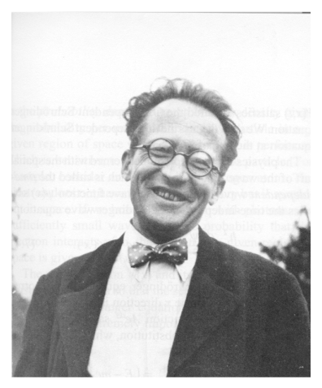

_Figure 31 (p. 126)_

# <a id="s-7-1-deriving-the-equation-from-operators"></a>7.1 Deriving the Equation from Operators

For a **free particle**, we have

```math
\frac{p^{2}}{2 m} = E
```

```math
- \frac{\hbar^{2}}{2 m} \frac{\partial^{2}}{\partial x^{2}} \psi = i \hbar \frac{\partial}{\partial t} \psi
```

Lets **try this equation on our states of definite momentum**.

```math
- \frac{\hbar^{2}}{2 m} \frac{\partial^{2}}{\partial x^{2}} \frac{1}{\sqrt{2 \pi \hbar}} e^{i ( p_{0} x - E_{0} t ) / \hbar} = i \hbar \frac{\partial}{\partial t} \frac{1}{\sqrt{2 \pi \hbar}} e^{i ( p_{0} x - E_{0} t ) / \hbar}
```

The constant in front of the wave function can be removed from both sides. Its there for normalization, not part of the solution. We will go ahead and do the differentiation.

```math
- \frac{\hbar^{2}}{2 m} \frac{- p_{0}^{2}}{\hbar^{2}} e^{i ( p_{0} x - E_{0} t ) / \hbar} = i \hbar \frac{- iE_{0}}{\hbar} e^{i ( p_{0} x - E_{0} t ) / \hbar}
```

```math
\frac{p_{0}^{2}}{2 m} e^{i ( p_{0} x - E_{0} t ) / \hbar} = E_{0} e^{i ( p_{0} x - E_{0} t ) / \hbar}
```

<div align="right"><a href="book.pdf#page=126" target="_blank" title="This page in the PDF"><sup>[p. 126]</sup></a></div>
<hr class="page" style="height:2px;border:0;background:currentColor;opacity:0.25">
<a id="p127" href="book.pdf#page=127" target="_blank" title="This page in the PDF"><sup>[p. 127]</sup></a>

Our wave function will be a solution of the free particle Schrödinger equation provided $`E_{0} = \tfrac{p_{0}^{2}}{2 m}`$ . This is exactly what we wanted. So we have constructed an equation that has the expected wave-functions as solutions. It is a wave equation based on the total energy.

Adding in potential energy, we have **the Schrödinger Equation**

```math
\frac{- \hbar^{2}}{2 m} \frac{\partial^{2} \psi ( x,t )}{\partial x^{2}} + V ( x ) \psi ( x,t ) = i \hbar \frac{\partial \psi ( x,t )}{\partial t}
```

or

```math
H\psi ( x,t ) = E\psi ( x,t )
```

where

```math
H = \frac{p^{2}}{2 m} + V ( x )
```

is the Hamiltonian operator.

In **three dimensions**, this becomes.

```math
H\psi ( \vec{x} , t ) = \frac{- \hbar^{2}}{2 m} \nabla^{2} \psi ( \vec{x} , t ) + V ( \vec{x} ) \psi ( \vec{x} , t ) = i \hbar \frac{\partial \psi ( \vec{x} , t )}{\partial t}
```

We will use it to solve many problems in this course.

So the Schrödinger Equation is, in some sense, simply the statement (in operators) that the kinetic energy plus the potential energy equals the total energy.

# <a id="s-7-2-the-flux-of-probability"></a>7.2 The Flux of Probability \*

In analogy to the Poynting vector for EM radiation, we may want to know the **probability current** in some physical situation. For example, in our free particle solution, the probability density is uniform over all space, but there is a net flow along the direction of the momentum.

We can derive an equation showing conservation of probability (See section 7.5.2), by differentiating $`P ( x,t ) = \psi^{*} \psi`$ and using the Schrödinger Equation.

```math
\frac{\partial P ( x,t )}{\partial t} + \frac{\partial j ( x,t )}{\partial x} = 0
```

This is the usual conservation equation if $`j ( x,t )`$ is identified as the probability current.

```math
j ( x,t ) = \frac{\hbar}{2 mi} \left[ \psi^{*} \frac{\partial \psi}{\partial x} - \frac{\partial \psi^{*}}{\partial x} \psi \right]
```

This current can be computed from the wave function.

<div align="right"><a href="book.pdf#page=127" target="_blank" title="This page in the PDF"><sup>[p. 127]</sup></a></div>
<hr class="page" style="height:2px;border:0;background:currentColor;opacity:0.25">
<a id="p128" href="book.pdf#page=128" target="_blank" title="This page in the PDF"><sup>[p. 128]</sup></a>

If we **integrate if over some interval** in $`x`$

```math
\int_{a}^{b} \frac{\partial P ( x,t )}{\partial t} dx = - \int_{a}^{b} \frac{\partial j ( x,t )}{\partial x}
```

```math
\frac{\partial}{\partial t} \int_{a}^{b} P ( x,t ) dx = j ( x = a,t ) - j ( x = b,t )
```

the equation says that the rate of change of probability in an interval is equal to the probability flux into the integral minus the flux out.

Extending this analysis to **3 dimensions**,

```math
\frac{\partial P ( x,t )}{\partial t} + \vec{\nabla} \cdot \vec{j} ( \vec{r} , t ) = 0
```

with

```math
\vec{j} ( \vec{r} , t ) = \frac{\hbar}{2 mi} \left[ \psi^{*} ( \vec{r} , t ) \vec{\nabla} \psi ( \vec{r} , t ) - \psi ( \vec{r} , t ) \vec{\nabla} \psi^{*} ( \vec{r} , t ) \right]
```

# <a id="s-7-3-the-schrodinger-wave-equation"></a>7.3 The Schrödinger Wave Equation

The normal equation we get, for waves on a string or on water, relates the second space derivative to the second time derivative. The Schrödinger equation uses **only the first time derivative**, however, the addition of the $`i`$ relates the real part of the wave function to the imaginary part, in effect shifting the phase by 90 degrees as the 2nd derivative would do.

```math
\frac{- \hbar^{2}}{2 m} \frac{\partial^{2} \psi ( x,t )}{\partial x^{2}} + V ( x ) \psi ( x,t ) = i \hbar \frac{\partial \psi ( x,t )}{\partial t}
```

The Schrödinger equation is **built for complex wave functions**.

When Dirac tried to make a relativistic version of the equation, where the energy relation is a bit more complicated, he discovered new physics.

## <a id="07-the-schrodinger-equation--s-gasiorowicz-chapter-3"></a>Gasiorowicz Chapter 3

## <a id="07-the-schrodinger-equation--s-griffiths-chapter-1"></a>Griffiths Chapter 1

## <a id="07-the-schrodinger-equation--s-cohen-tannoudji-et-al-chapter"></a>Cohen-Tannoudji et al. Chapter

# <a id="s-7-4-the-time-independent-schrodinger-equation"></a>7.4 The Time Independent Schrödinger Equation

Second order differential equations, like the Schrödinger Equation, can be solved by **separation of** **variables**. These separated solutions can then be used to solve the problem in general.

<div align="right"><a href="book.pdf#page=128" target="_blank" title="This page in the PDF"><sup>[p. 128]</sup></a></div>
<hr class="page" style="height:2px;border:0;background:currentColor;opacity:0.25">
<a id="p129" href="book.pdf#page=129" target="_blank" title="This page in the PDF"><sup>[p. 129]</sup></a>

Assume that we can **factorize** the solution between time and space.

```math
\psi ( x,t ) = u ( x ) T ( t )
```

Plug this into the Schrödinger Equation.

```math
\left( \frac{- \hbar^{2}}{2 m} \frac{\partial^{2} u ( x )}{\partial x^{2}} + V ( x ) u ( x ) \right) T ( t ) = i \hbar u ( x ) \frac{\partial T ( t )}{\partial t}
```

Put everything that depends on $`x`$ on the left and everything that depends on $`t`$ on the right.

```math
\frac{\left( \tfrac{\hbar^{2}}{2 m}^{-} \tfrac{\partial^{2} u ( x )}{\partial x^{2}} + V ( x ) u ( x ) \right)}{u ( x )} = \frac{i \hbar^{\partial T} \tfrac{( t )}{\partial t}}{T ( t )} = const. = E
```

Since we have a function of only $`x`$ set equal to a function of only $`t`$, they **both must equal a** **constant**. In the equation above, we call the constant $`E`$, (with some knowledge of the outcome). We now have an equation in $`t`$ set equal to a constant

```math
i \hbar \frac{\partial T ( t )}{\partial t} = ET ( t )
```

which has a simple **general solution**,

```math
T ( t ) = Ce^{- iEt/ \hbar}
```

and an equation in $`x`$ set equal to a constant

```math
\frac{- \hbar^{2}}{2 m} \frac{\partial^{2} u ( x )}{\partial x^{2}} + V ( x ) u ( x ) = Eu ( x )
```

which depends on the problem to be solved (through $`V ( x ) ) .`$

<div align="center">

The $`x`$ equation is often called the **Time Independent Schrödinger Equation**.

</div>

```math
\frac{- \hbar^{2}}{2 m} \frac{\partial^{2} u ( x )}{\partial x^{2}} + V ( x ) u ( x ) = Eu ( x )
```

Here, $`E`$ is a constant. The **full time dependent solution** is.

```math
\psi ( x,t ) = u ( x ) e^{- iEt/ \hbar}
```

<div align="center">

\* See Example 7.6.1: Solve the Schrödinger equation for a constant potential $`V_{0} . *`$

</div>

# <a id="s-7-5-derivations-and-computations"></a>7.5 Derivations and Computations

## <a id="s-7-5-1-linear-operators"></a>7.5.1 Linear Operators

**Linear operators** $`L`$ satisfy the equation

<div align="right"><a href="book.pdf#page=129" target="_blank" title="This page in the PDF"><sup>[p. 129]</sup></a></div>
<hr class="page" style="height:2px;border:0;background:currentColor;opacity:0.25">
<a id="p130" href="book.pdf#page=130" target="_blank" title="This page in the PDF"><sup>[p. 130]</sup></a>

```math
L ( a\psi + b\varphi ) = aL\psi + bL\varphi
```

where $`a`$ and $`b`$ are arbitrary constants and $`\psi`$ and $`\varphi`$ are arbitrary wave-functions. A multiplicative constant is a simple linear operator. Differential operators clearly are linear also.

An example of a non-linear operator (which we will not use) is $`N`$ which has the property

```math
N\psi = \psi^{2} .
```

## <a id="s-7-5-2-probability-conservation-equation"></a>7.5.2 Probability Conservation Equation \*

Start from the probability and differentiate with respect to time.

```math
\frac{\partial P ( x,t )}{\partial t} = \frac{\partial}{\partial t} ( \psi^{*} ( x,t ) \psi ( x,t ) ) = \left[ \frac{\partial \psi^{*}}{\partial t} \psi - \psi^{*} \frac{\partial \psi}{\partial t} \right]
```

Use the Schrödinger Equation

```math
\frac{- \hbar^{2}}{2 m} \frac{\partial^{2} \psi}{\partial x^{2}} + V ( x ) \psi = i \hbar \frac{\partial \psi}{\partial t}
```

and its complex conjugate

```math
\frac{- \hbar^{2}}{2 m} \frac{\partial^{2} \psi^{*}}{\partial x^{2}} + V ( x ) \psi^{*} = - i \hbar \frac{\partial \psi^{*}}{\partial t} .
```

(We assume $`V ( x )`$ is real. Imaginary potentials do cause probability not to be conserved.)

Now we need to plug those equations in.

```math
\frac{\partial P ( x,t )}{\partial t} = \frac{1}{i \hbar} \left[ \frac{\hbar^{2}}{2 m} \frac{\partial^{2} \psi^{*}}{\partial x^{2}} \psi - V ( x ) \psi^{*} \psi + \frac{- \hbar^{2}}{2 m} \psi^{*} \frac{\partial^{2} \psi}{\partial x^{2}} + V ( x ) \psi^{*} \psi \right]
```

```math
= \frac{1}{i \hbar} \frac{\hbar^{2}}{2 m} \left[ \frac{\partial^{2} \psi^{*}}{\partial x^{2}} \psi - \psi^{*} \frac{\partial^{2} \psi}{\partial x^{2}} \right] = \frac{\hbar}{2 mi} \frac{\partial}{\partial x} \left[ \frac{\partial \psi^{*}}{\partial x} \psi - \psi^{*} \frac{\partial \psi}{\partial x} \right]
```

This is the usual conservation equation if $`j ( x,t )`$ is identified as the probability current.

```math
\frac{\partial P ( x,t )}{\partial t} + \frac{\partial j ( x,t )}{\partial x} = 0
```

```math
j ( x,t ) = \frac{\hbar}{2 mi} \left[ \psi^{*} \frac{\partial \psi}{\partial x} - \frac{\partial \psi^{*}}{\partial x} \psi \right]
```

# <a id="s-7-6-examples"></a>7.6 Examples

## <a id="s-7-6-1-solution-to-the-schrodinger-equation-in-a-constant-potential"></a>7.6.1 Solution to the Schrödinger Equation in a Constant Potential

Assume we want to solve the Schrödinger Equation in a region in which the potential is constant and equal to $`V_{0}`$. We will find two solutions for each energy $`E`$.

<div align="right"><a href="book.pdf#page=130" target="_blank" title="This page in the PDF"><sup>[p. 130]</sup></a></div>
<hr class="page" style="height:2px;border:0;background:currentColor;opacity:0.25">
<a id="p131" href="book.pdf#page=131" target="_blank" title="This page in the PDF"><sup>[p. 131]</sup></a>

We have the equation.

```math
\frac{- \hbar^{2}}{2 m} \frac{\partial^{2} \psi ( x )}{\partial x^{2}} + V_{0} \psi ( x ) = E\psi ( x )
```

```math
\frac{\partial^{2} \psi ( x )}{\partial x^{2}} = - \frac{2 m}{\hbar^{2}} ( E - V_{0} ) \psi ( x )
```

Remember that $`x`$ is an independent variable in the above equation while $`p`$ and $`E`$ are constants to be determined in the solution.

For $`E>V_{0}`$, there are solutions

```math
e^{ikx}
```

and

```math
e^{- ikx}
```

if we define $`k`$ by the equation $`\hbar k`$ = +$`\sqrt{2 m ( E - V_{0} )}`$. These are waves traveling in opposite directions with the same energy (and magnitude of momentum).

We could also use the linear combinations of the above two solutions

```math
\sin ( kx )
```

and

```math
\cos ( kx ) .
```

There are only two linearly independent solutions. We need to choose either the exponentials or the trig functions, not both. The sin and cos solutions represent states of definite energy but contain particles moving to the left and to the right. They are not definite momentum states. They will be useful to us for some solutions.

The solutions are also technically correct for $`E<V_{0}`$ but $`k`$ becomes imaginary. Lets write the solutions in terms of $`\hbar \kappa = i \hbar k = \sqrt{2 m ( V_{0} - E )}`$ The solutions are

```math
e^{\kappa x}
```

and

```math
e^{- \kappa x} .
```

These are not waves at all, but real exponentials. Note that these are solutions for regions where the particle is not allowed classically, due to energy conservation; the total energy is less than the potential energy. We will use these solutions in Quantum Mechanics.

# <a id="s-7-7-sample-test-problems"></a>7.7 Sample Test Problems

```math
1 .
```

```math
2 .
```

---

<a id="08-eigenfunctions-eigenvalues-and-vector-spaces"></a>

<hr class="page" style="height:2px;border:0;background:currentColor;opacity:0.25">
<a id="p132" href="book.pdf#page=132" target="_blank" title="This page in the PDF"><sup>[p. 132]</sup></a>

# 8 Eigenfunctions, Eigenvalues and Vector Spaces

# <a id="s-8-1-eigenvalue-equations"></a>8.1 Eigenvalue Equations

The time independent Schrödinger Equation is an example of an Eigenvalue equation.

```math
Hu ( x ) = Eu ( x )
```

The Hamiltonian operates on $`u ( x )`$ **the eigenfunction**, giving a constant $`E`$ **the eigenvalue**, times the same function. (Eigen just means the same in German.)

Usually, for bound states, there are **many eigenfunction solutions** (denoted here by the index $`i )`$.

```math
H\psi_{i} = E_{i} \psi_{i}
```

For states representing one particle (particularly bound states) we must **require that the solutions** **be normalizable**. Solutions that are not normalizable must be discarded. A normalizable wave function must go to zero at infinity.

```math
\psi ( \infty ) \to 0
```

In fact, all the derivatives of $`\psi`$ must go to zero at infinity in order for the wave function to stay at zero.

We will prove later that the eigenfunctions are orthogonal (See section 8.7.1) to each other.

```math
\langle \psi_{i} | \psi_{j} \rangle = \delta_{ij}
```

```math
\int_{-\infty}^{\infty} \psi^{*} ( x ) \psi ( x ) dx = 1
```

We will assume that the **eigenfunctions form a complete set** so that any function can be written as a linear combination of them.

```math
\psi = \alpha_{1} \psi_{1} + \alpha_{2} \psi_{2} + \alpha_{3} \psi_{3} + \dots
```

```math
\psi = \sum_{i = 1}^{\infty} \alpha_{i} \psi_{i}
```

(This can be proven for many of the eigenfunctions we will use.)<span class="page" style="float:left;width:100%;margin:0.4em 0 0.6em"><span style="display:block;text-align:right"><a href="book.pdf#page=132" target="_blank" title="This page in the PDF"><sup>[p. 132]</sup></a></span><span style="display:block;height:2px;background:currentColor;opacity:0.25"></span><a id="p133" href="book.pdf#page=133" target="_blank" title="This page in the PDF"><sup>[p. 133]</sup></a></span> Since the eigenfunctions are orthogonal, we can easily **compute the coefficients** in the expansion of an arbitrary wave function $`\psi`$.

```math
\alpha_{i} = \langle \psi_{i} | \psi \rangle = \langle \psi_{i} | \sum_{j} \alpha_{j} \psi_{j} \rangle = \sum_{j} \langle \psi_{i} | \psi_{j} \rangle \alpha_{j} = \sum_{j} \delta_{ij} \alpha_{j} = \alpha_{i}
```

We will later think of the eigenfunctions as unit vectors in a vector space (See section 8.4). The arbitrary wave function $`\psi`$ is then a vector in that space.

```math
\psi = \begin{pmatrix} \alpha_{1} \\ \alpha_{2} \\ \alpha_{3} \\ \dots \end{pmatrix}
```

It is instructive to compute the **expectation value of the Hamiltonian** using the expansion of $`\psi`$ and the orthonormality of the eigenfunctions.

```math
\langle \psi | H | \psi \rangle = \sum_{ij} \langle \alpha_{i} \psi_{i} | H | \alpha_{j} \psi_{j} \rangle = \sum_{ij} \langle \alpha_{i} \psi_{i} | \alpha_{j} H\psi_{j} \rangle
```

```math
= \sum_{ij} \alpha_{i}^{*} \alpha_{j} E_{j} \langle \psi_{i} | \psi_{j} \rangle = \sum_{ij} \alpha_{i}^{*} \alpha_{j} E_{j} \delta_{ij}
```

```math
= \sum_{i} \alpha_{i}^{*} \alpha_{i} E_{i} = \sum_{i} | \alpha_{i} |^{2} E_{i}
```

We can see that the **coefficients of the eigenstates represent probability amplitudes to be** **in those states**, since the absolute squares of the coefficients $`\alpha_{i}^{*} \alpha_{i}`$ obviously give the probability.

# <a id="s-8-2-hermitian-conjugate-of-an-operator"></a>8.2 Hermitian Conjugate of an Operator

First let us define the **Hermitian Conjugate** of an operator $`H`$ to be $`H^{\dagger}`$. The meaning of this conjugate is given in the following equation.

```math
\langle \psi | H | \psi \rangle = \int_{-\infty}^{\infty} \psi^{*} ( x ) H\psi ( x ) dx = \langle \psi | H\psi \rangle \equiv \langle H^{\dagger} \psi | \psi \rangle
```

That is, $`H^{\dagger}`$ must operate on the conjugate of $`\psi`$ and give the same result for the integral as when $`H`$ operates on $`\psi`$.

The definition of the **Hermitian Conjugate of an operator** can be simply written in Bra-Ket notation.

```math
\langle A^{\dagger} \varphi | \psi \rangle = \langle \varphi | A\psi \rangle
```

Starting from this definition, we can prove some simple things. Taking the complex conjugate

```math
\langle \psi | A^{\dagger} \varphi \rangle = \langle A\psi | \varphi \rangle
```

<div align="right"><a href="book.pdf#page=133" target="_blank" title="This page in the PDF"><sup>[p. 133]</sup></a></div>
<hr class="page" style="height:2px;border:0;background:currentColor;opacity:0.25">
<a id="p134" href="book.pdf#page=134" target="_blank" title="This page in the PDF"><sup>[p. 134]</sup></a>

Now taking the Hermitian conjugate of $`A^{\dagger}`$.

```math
\langle \left( A^{\dagger} \right)^{\dagger} \psi | \varphi \rangle = \langle A\psi | \varphi \rangle
```

```math
\left( A^{\dagger} \right)^{\dagger} = A
```

If we take the Hermitian conjugate twice, we get back to the same operator.

Its easy to show that

```math
( \lambda A )^{\dagger} = \lambda^{*} A^{\dagger}
```

and

```math
( A + B )^{\dagger} = A^{\dagger} + B^{\dagger}
```

just from the properties of the dot product.

We can also show that

```math
( AB )^{\dagger} = B^{\dagger} A^{\dagger} .
```

```math
\langle \varphi | AB\psi \rangle = \langle A^{\dagger} \varphi | B\psi \rangle = \langle B^{\dagger} A^{\dagger} \varphi | \psi \rangle
```

\* See Example 8.8.1: Find the Hermitian conjugate of the operator $`a + ib . *`$

\* See Example 8.8.2: Find the Hermitian conjugate of the operator $`\partial x \partial`$ .\*

# <a id="s-8-3-hermitian-operators"></a>8.3 Hermitian Operators

A **physical variable must have real expectation values** (and eigenvalues). This implies that the operators representing physical variables have some special properties.

By computing the complex conjugate of the expectation value of a physical variable, we can easily **show that physical operators are their own Hermitian conjugate**.

```math
\langle \psi | H | \psi \rangle^{*} = \left[ \int_{-\infty}^{\infty} \psi^{*} ( x ) H\psi ( x ) dx \right]^{*} = \int_{-\infty}^{\infty} \psi ( x ) ( H\psi ( x ) )^{*} dx = \langle H\psi | \psi \rangle
```

```math
\langle H\psi | \psi \rangle = \langle \psi | H\psi \rangle = \langle H^{\dagger} \psi | \psi \rangle
```

```math
H^{\dagger} = H
```

Operators that are their own Hermitian Conjugate are called **Hermitian Operators**.

```math
H^{\dagger} = H
```

<div align="right"><a href="book.pdf#page=134" target="_blank" title="This page in the PDF"><sup>[p. 134]</sup></a></div>
<hr class="page" style="height:2px;border:0;background:currentColor;opacity:0.25">
<a id="p135" href="book.pdf#page=135" target="_blank" title="This page in the PDF"><sup>[p. 135]</sup></a>

# <a id="s-8-4-eigenfunctions-and-vector-space"></a>8.4 Eigenfunctions and Vector Space

Wavefunctions are analogous to vectors in 3D space. The unit vectors of our vector space are eigenstates.

In **normal 3D space**, we represent a vector by its components.

```math
\vec{r} = x \hat{x} + y \hat{y} + z \hat{z} = \sum_{i = 1}^{3} r_{i} \hat{u}_{i}
```

The unit vectors $`\hat{u}_{i}`$ are orthonormal,

```math
\hat{u}_{i} \cdot \hat{u}_{j} = \delta_{ij}
```

where $`\delta_{ij}`$ is the usual Kroneker delta, equal to 1 if $`i = j`$ and otherwise equal to zero.

**Eigenfunctions – the unit vectors of our space** – are orthonormal.

```math
\langle \psi_{i} | \psi_{j} \rangle = \delta_{ij}
```

We represent our **wavefunctions – the vectors in our space** – as linear combinations of the eigenstates (unit vectors). $`\infty`$

```math
\psi = \sum_{i = 1} \alpha_{i} \psi_{i}
```

```math
\varphi = \sum_{j = 1}^{\infty} \beta_{j} \psi_{j}
```

In normal 3D space, we can compute the **dot product between two vectors** using the components.

```math
\vec{r}_{1} \cdot \vec{r}_{2} = x_{1} x_{2} + y_{1} y_{2} + z_{1} z_{2}
```

In our vector space, we **define the dot product** to be

```math
\langle \psi | \varphi \rangle = \langle \sum_{i = 1}^{\infty} \alpha_{i} \psi_{i} | \sum_{j = 1}^{\infty} \beta_{j} \psi_{j} \rangle = \sum_{i = 1 j = 1}^{\infty} \sum^{\infty} \alpha_{i}^{*} \beta_{j} \langle \psi_{i} | \psi_{j} \rangle
```

```math
= \sum_{i = 1 j = 1}^{\infty} \sum^{\infty} \alpha_{i}^{*} \beta_{j} \delta_{ij} = \sum_{i = 1}^{\infty} \alpha_{i}^{*} \beta_{i}
```

We also can compute the dot product from the components of the vectors. Our vector space is a little bit different because of the complex conjugate involved in the definition of our dot product.

From a more mathematical point of view, the square integrable functions form a (vector) Hilbert Space. The scalar product is defined as above.

```math
\langle \varphi | \psi \rangle = \int_{-\infty}^{\infty} d^{3} r\varphi^{*} \psi
```

The properties of the scalar product are easy to derive from the integral.

```math
\langle \varphi | \psi \rangle = \langle \psi | \varphi \rangle^{*}
```

<div align="right"><a href="book.pdf#page=135" target="_blank" title="This page in the PDF"><sup>[p. 135]</sup></a></div>
<hr class="page" style="height:2px;border:0;background:currentColor;opacity:0.25">
<a id="p136" href="book.pdf#page=136" target="_blank" title="This page in the PDF"><sup>[p. 136]</sup></a>

```math
\langle \varphi | \lambda_{1} \psi_{1} + \lambda_{2} \psi_{2} \rangle = \lambda_{1} \langle \varphi | \psi_{1} \rangle + \lambda_{2} \langle \varphi | \psi_{2} \rangle
```

```math
\langle \lambda_{1} \varphi_{1} + \lambda_{2} \varphi_{2} | \psi \rangle = \lambda_{1}^{*} \langle \varphi_{1} | \psi \rangle + \lambda_{2}^{*} \langle \varphi_{2} | \psi \rangle
```

$`\langle \psi | \psi \rangle`$ is real and greater than 0. It equals zero iff $`\psi`$ = 0. We may also derive the Schwartz inequality.

```math
\langle \psi_{1} | \psi_{2} \rangle \leq \sqrt{\langle \psi_{1} | \psi_{1} \rangle \langle \psi_{2} | \psi_{2} \rangle}
```

Linear operators take vectors in the space into other vectors.

```math
\psi^{\prime} = A\psi
```

# <a id="s-8-5-the-particle-in-a-1d-box"></a>8.5 The Particle in a 1D Box

As a simple example, we will solve the 1D **Particle in a Box** problem. That is a particle confined to a region $`0 <x<a`$. We can do this with the (unphysical) potential which is zero with in those limits and +$`\infty`$ outside the limits.

```math
V ( x ) = \begin{cases} 0 & 0 <x<a \\ \infty & \text{ elsewhere } \end{cases}
```

Because of the infinite potential, this problem has very **unusual boundary conditions**. (Normally we will require continuity of the wave function and its first derivative.) The wave function must be zero at $`x`$ = 0 and $`x = a`$ since it must be continuous and it is zero in the region of infinite potential. The first derivative does not need to be continuous at the boundary (unlike other problems), because of the infinite discontinuity in the potential.

The time independent **Schrödinger equation** (also called the energy eigenvalue equation) is

```math
Hu_{j} = E_{j} u_{j}
```

with the Hamiltonian (inside the box)

```math
H = - \frac{\hbar^{2}}{2 m} \frac{d^{2}}{dx^{2}}
```

Our solutions will have

```math
u_{j} = 0
```

outside the box.

The **solution inside the box** could be written as

```math
u_{j} = e^{ikx}
```

where $`k`$ can be positive or negative. We do **need to choose linear combinations that satisfy** **the boundary condition** that $`u_{j} ( x`$ = 0) = $`u_{j} ( x = a )`$ = 0.

We can do this easily by **choosing**

```math
u_{j} = C \sin ( kx )
```

<div align="right"><a href="book.pdf#page=136" target="_blank" title="This page in the PDF"><sup>[p. 136]</sup></a></div>
<hr class="page" style="height:2px;border:0;background:currentColor;opacity:0.25">
<a id="p137" href="book.pdf#page=137" target="_blank" title="This page in the PDF"><sup>[p. 137]</sup></a>

which automatically satisfies the BC at 0. To satisfy the BC at $`x = a`$ we need the argument of sine

```math
\text{ to be } n\pi \text{ there } . \quad u_{n} = C \sin \left( \frac{n\pi x}{a} \right)
```

Plugging this back into the Schrödinger equation, we get

```math
\frac{- \hbar^{2}}{2 m} ( - \frac{n^{2} \pi^{2}}{a^{2}} ) C \sin ( kx ) = EC \sin ( kx ) .
```

There will only be a solution which satisfies the BC for a **quantized set of energies**.

```math
E_{n} = \frac{n^{2} \pi^{2} \hbar^{2}}{2 ma^{2}}
```

We have solutions to the Schrödinger equation that satisfy the boundary conditions. Now we need to set the constant $`C`$ to **normalize** them to 1.

```math
\langle u_{n} | u_{n} \rangle = | C |^{2} \int_{0}^{a} \sin^{2} \left( \frac{n\pi x}{a} \right) dx = | C |^{2} \frac{a}{2}
```

Remember that the average value of sin<sup>2</sup> is one half (over half periods). So we set $`C`$ giving us the eigenfunctions

```math
u_{n} = \sqrt{\frac{2}{a}} \sin \left( \frac{n\pi x}{a} \right)
```

The first four eigenfunctions are graphed below. The ground state has the least curvature and the fewest zeros of the wavefunction.

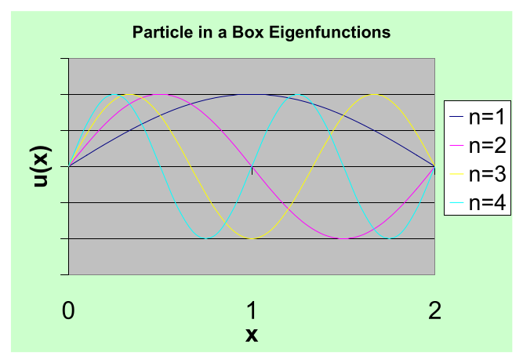

_Figure 32 (p. 137)_

<div align="right"><a href="book.pdf#page=137" target="_blank" title="This page in the PDF"><sup>[p. 137]</sup></a></div>
<hr class="page" style="height:2px;border:0;background:currentColor;opacity:0.25">
<a id="p138" href="book.pdf#page=138" target="_blank" title="This page in the PDF"><sup>[p. 138]</sup></a>

Note that these states would have a definite parity if $`x`$ = 0 were at the center of the box.

The **expansion** of an arbitrary wave function in these eigenfunctions is essentially our **original** **Fourier Series**. This is a good example of the energy eigenfunctions being orthogonal and covering the space.

## <a id="s-8-5-1-the-same-problem-with-parity-symmetry"></a>8.5.1 The Same Problem with Parity Symmetry

If we simply **redefine the position of the box** so that $`- \tfrac{a}{2} <x< \tfrac{a}{2}`$, then our problem has **symmetry under the Parity operation**.

```math
x \to - x
```

The Hamiltonian remains unchanged if we make the above transformation. The Hamiltonian commutes with the Parity operator.

```math
[ H,P ] = 0
```

This means that $`( Pu_{i} )`$ is an eigenfunction of $`H`$ with the same energy eigenvalue.

```math
H ( Pu_{i} ) = P ( Hu_{i} ) = PE_{i} u_{i} = E_{i} ( Pu_{i} )
```

Thus, it must be a constant times the same energy eigenfunction.

```math
Pu_{i} = cu_{i}
```

The equations says the **energy eigenfunctions are also eigenfunctions of the parity operator**.

If we operate twice with parity, we get back to the original function,

```math
P^{2} u_{i} = u_{i}
```

so the **parity eigenvalues must be** $`\pm 1`$.

```math
Pu_{i} = \pm 1 u_{i}
```

The boundary conditions are

```math
\psi ( \pm \frac{a}{2} ) = 0 .
```

This gives **two types of solutions**.

```math
u_{n}^{+} ( x ) = \sqrt{\frac{2}{a}} \cos \left( \frac{( 2 n - 1 ) \pi x}{a} \right)
```

```math
u_{n}^{-} ( x ) = \sqrt{\frac{2}{a}} \sin \left( \frac{2 n\pi x}{a} \right)
```

```math
E_{n}^{+} = ( 2 n - 1 )^{2} \frac{\pi^{2} \hbar^{2}}{2 ma^{2}}
```

```math
E_{n}^{-} = ( 2 n )^{2} \frac{\pi^{2} \hbar^{2}}{2 ma^{2}}
```

<div align="right"><a href="book.pdf#page=138" target="_blank" title="This page in the PDF"><sup>[p. 138]</sup></a></div>
<hr class="page" style="height:2px;border:0;background:currentColor;opacity:0.25">
<a id="p139" href="book.pdf#page=139" target="_blank" title="This page in the PDF"><sup>[p. 139]</sup></a>

Together, these are **exactly equivalent to the set of solutions we had with the box defined** **to be from 0 to** $`a`$. The $`u_{n}^{+} ( x )`$ have eigenvalue +1 under the parity operator. The $`u_{n}^{-} ( x )`$ have eigenvalue -1 under the parity operator.

This is an **example of a symmetry** of the problem, causing an operator to commute with the Hamiltonian. We can then have simultaneous eigenfunctions of that operator and $`H`$. In this case all the energy eigenfunctions are also eigenstates of parity. Parity is conserved.

An arbitrary wave function can be written as a sum of the energy eigenfunctions recovering the **Fourier series in its standard form**.

```math
\psi ( x ) = \sum_{n = 1}^{\infty} [ A_{n}^{+} u_{n}^{+} ( x ) + A_{n}^{-} u_{n}^{-} ( x ) ]
```

# <a id="s-8-6-momentum-eigenfunctions"></a>8.6 Momentum Eigenfunctions

We can also look at the **eigenfunctions of the momentum operator**.

```math
p_{op} u_{p} ( x ) = pu_{p} ( x )
```

```math
\frac{\hbar}{i} \frac{d}{dx} u_{p} ( x ) = pu_{p} ( x )
```

The **eigenstates** are

```math
u_{p} ( x ) = Ce^{ipx/ \hbar}
```

with $`p`$ allowed to be positive or negative.

These solutions do not go to zero at infinity so they are not normalizable to one particle.

```math
\langle p | p \rangle = \langle u_{p} | u_{p} \rangle = \infty
```

This is a common problem for this type of state.

We will use a **different type of normalization for the momentum eigenstates** (and the position eigenstates).

```math
\langle p^{\prime} | p \rangle = | C |^{2} \int_{-\infty}^{\infty} e^{i ( p - p^{\prime} ) x/ \hbar} dx = 2 \pi \hbar | C |^{2} \delta ( p - p^{\prime} )
```

Instead of the Kronecker delta, we use the Dirac delta function. The momentum eigenstates have a continuous range of eigenvalues so that they cannot be indexed like the energy eigenstates of a bound system. This means the Kronecker delta could not work anyway.

These are the **momentum eigenstates**

```math
u_{p} ( x ) = \frac{1}{\sqrt{2 \pi \hbar}} e^{ipx/ \hbar}
```

<div align="right"><a href="book.pdf#page=139" target="_blank" title="This page in the PDF"><sup>[p. 139]</sup></a></div>
<hr class="page" style="height:2px;border:0;background:currentColor;opacity:0.25">
<a id="p140" href="book.pdf#page=140" target="_blank" title="This page in the PDF"><sup>[p. 140]</sup></a>

satisfying the **normalization condition**

```math
\langle p^{\prime} | p \rangle = \delta ( p - p^{\prime} )
```

For a **free particle Hamiltonian**, both momentum and parity commute with $`H`$. So we can make simultaneous eigenfunctions.

```math
[ H,p ] = 0
```

```math
[ H,P ] = 0
```

We **cannot make eigenfunctions of all three operators** since

```math
[ P,p ] \neq 0 .
```

So we have the **choice** of the $`e^{ikx}`$ states which are eigenfunctions of $`H`$ and of $`p`$, but contain positive and negative parity components. or we have the sin$`( kx )`$ and cos($`kx )`$ states which contain two momenta but are eigenstates of $`H`$ and Parity. These are just different linear combinations of the same solutions.

# <a id="s-8-7-derivations-and-computations"></a>8.7 Derivations and Computations

## <a id="s-8-7-1-eigenfunctions-of-hermitian-operators-are-orthogonal"></a>8.7.1 Eigenfunctions of Hermitian Operators are Orthogonal

We wish to prove that eigenfunctions of Hermitian operators are orthogonal. In fact we will first do this **except in the case of equal eigenvalues**.

Assume we have a **Hermitian operator** $`A`$ **and two of its eigenfunctions** such that

```math
A\psi_{1} = a_{1} \psi_{1}
```

```math
A\psi_{2} = a_{2} \psi_{2} .
```

Now we compute $`\langle \psi_{2} | A | \psi_{1} \rangle`$ two ways.

```math
\langle \psi 2 | A\psi 1 \rangle = a 1 \langle \psi 2 | \psi 1 \rangle
```

```math
\langle \psi_{2} | A\psi_{1} \rangle = \langle A\psi_{2} | \psi_{1} \rangle = a_{2} \langle \psi_{2} | \psi_{1} \rangle
```

Remember the **eigenvalues are real** so there’s no conjugation needed.

Now we **subtract the two equations**. The left hand sides are the same so they give zero.

```math
0 = ( a_{2} - a_{1} ) \langle \psi_{2} | \psi_{1} \rangle
```

If $`a_{1} \neq a_{2}`$ then

```math
\langle \psi_{2} | \psi_{1} \rangle = 0 .
```

<div align="right"><a href="book.pdf#page=140" target="_blank" title="This page in the PDF"><sup>[p. 140]</sup></a></div>
<hr class="page" style="height:2px;border:0;background:currentColor;opacity:0.25">
<a id="p141" href="book.pdf#page=141" target="_blank" title="This page in the PDF"><sup>[p. 141]</sup></a>

The **eigenfunctions are orthogonal**.

What if two of the eigenfunctions have the **same eigenvalue**? Then, our proof doesn’t work. Assume $`\langle \psi_{2} | \psi_{1} \rangle`$ is real, since we can always adjust a phase to make it so. Since any linear combination of $`\psi_{1}`$ and $`\psi_{2}`$ has the same eigenvalue, we can use any linear combination. Our aim will be to **choose** **two linear combinations which are orthogonal**. Lets try

```math
\psi_{+} = \frac{1}{\sqrt{2}} ( \psi_{1} + \psi_{2} )
```

```math
\psi_{-} = \frac{1}{\sqrt{2}} ( \psi_{1} - \psi_{2} )
```

so

```math
\langle \psi_{+} | \psi_{-} \rangle = \frac{1}{2} ( 1 - 1 + ( \langle \psi_{1} | \psi_{2} \rangle - \langle \psi_{2} | \psi_{1} \rangle ) )
```

```math
= \frac{1}{2} ( \langle \psi_{1} | \psi_{2} \rangle - \langle \psi_{2} | \psi_{1} \rangle ) = 0 .
```

This is zero under the assumption that the dot product is real.

We have thus found an **orthogonal set of eigenfunctions even in the case that some of the** **eigenvalues are equal** (degenerate). From now on we will just assume that we are working with an orthogonal set of eigenfunctions.

## <a id="s-8-7-2-continuity-of-wavefunctions-and-derivatives"></a>8.7.2 Continuity of Wavefunctions and Derivatives

We can use the Schrödinger Equation to show that the **first derivative of the wave function** **should be continuous**, unless the potential is infinite at the boundary.

```math
\frac{- \hbar^{2}}{2 m} \frac{d^{2} \psi}{dx^{2}} = ( E - V ( x ) ) \psi
```

```math
\frac{d^{2} \psi}{dx^{2}} = \frac{2 m}{\hbar^{2}} ( V ( x ) - E ) \psi
```

Integrate both sides from just below a boundary (assumed to be at $`x`$ = 0) to just above.

```math
\int_{- \epsilon}^{+ \epsilon} \frac{d^{2} \psi}{dx^{2}} dx = \frac{2 m}{\hbar^{2}} \int_{- \epsilon}^{+ \epsilon} ( V ( x ) - E ) \psi dx \to 0
```

Let $`\epsilon`$ go to zero and the right hand side must go to zero for finite potentials.

```math
\frac{d\psi}{dx} \left| {}_{+ \epsilon} - \frac{d\psi}{dx} \right|_{- \epsilon} \to 0
```

Infinite potentials are unphysical but often handy. The delta function potential is very handy, so we will derive a special continuity equation for it. Assume $`V ( x ) = V_{0} \delta ( x )`$. Integrating the Schrödinger Equation, we get

```math
\int_{- \epsilon}^{+ \epsilon} \frac{d^{2} \psi}{dx^{2}} dx = \frac{2 m}{\hbar^{2}} \int_{- \epsilon}^{+ \epsilon} ( V_{0} \delta ( x ) - E ) \psi dx
```

<div align="right"><a href="book.pdf#page=141" target="_blank" title="This page in the PDF"><sup>[p. 141]</sup></a></div>
<hr class="page" style="height:2px;border:0;background:currentColor;opacity:0.25">
<a id="p142" href="book.pdf#page=142" target="_blank" title="This page in the PDF"><sup>[p. 142]</sup></a>

As before, finite terms in the right hand integral go to zero as $`\epsilon \to 0`$, but now the delta function gives a fixed contribution to the integral.

```math
\frac{d\psi}{dx} \left| {}_{+ \epsilon} - \frac{d\psi}{dx} \right|_{- \epsilon} = \frac{2 m}{\hbar^{2}} V_{0} \psi ( 0 )
```

There is a **discontinuity in the derivative of the wave function** proportional to the wave function at that point (and to the strength of the delta function potential).

# <a id="s-8-8-examples"></a>8.8 Examples

## <a id="s-8-8-1-hermitian-conjugate-of-a-constant-operator"></a>8.8.1 Hermitian Conjugate of a Constant Operator

If we have the operator $`O = a + ib`$ where $`a`$ and $`b`$ are real, what is its Hermitian conjugate? By the definition of the Hermitian conjugate

```math
\langle \varphi | O\psi \rangle = \langle O^{\dagger} \varphi | \psi \rangle .
```

It is easy to see from the integral that

```math
\langle ( a - ib ) \varphi | \psi \rangle = \langle \varphi | ( a + ib ) \psi \rangle = ( a + ib ) \langle \varphi | \psi \rangle
```

So the Hermitian conjugate of a constant operator is its complex conjugate.

## <a id="s-8-8-2-hermitian-conjugate-of-partial-x-partial"></a>8.8.2 Hermitian Conjugate of $`\frac{\partial}{\partial x}`$

We wish to compute the Hermitian conjugate of the operator $`\frac{\partial}{\partial x}`$ . We will use the integral to derive the result. $`\infty`$

```math
\langle \varphi \left| \frac{\partial}{\partial x} \psi \right\rangle \rangle = \int_{-\infty} \varphi^{*} ( x ) \frac{\partial \psi ( x )}{\partial x} dx
```

We can integrate this by parts, differentiating the $`\varphi`$ and integrating to get $`\psi`$.

```math
\left\langle \varphi \left| \frac{\partial}{\partial x} \psi \right\rangle = [ \varphi^{*} ( x ) \psi ( x ) ]_{-\infty}^{\infty} - \int_{-\infty}^{\infty} \frac{\partial \varphi^{*} ( x )}{\partial x} \psi ( x ) dx = \left\langle \frac{- \partial}{\partial x} \varphi \right| \psi \right\rangle
```

So the Hermitian conjugate of $`\frac{\partial}{\partial x}`$ is $`- \tfrac{\partial}{\partial x}`$ .

Note that the Hermitian conjugate of the momentum operator is $`\frac{\hbar}{- i} \frac{\partial}{\partial x} -`$ which is the same as the original operator. So the momentum operator is Hermitian.

# <a id="s-8-9-sample-test-problems"></a>8.9 Sample Test Problems

1. A particle is confined to a box of length $`L`$ in one dimension. It is initially in the ground state. Suddenly, one wall of the box is moved outward making a new box of length 3$`L`$. What is the probability that the particle is in the ground state of the new box? You may find it useful to

<div align="right"><a href="book.pdf#page=142" target="_blank" title="This page in the PDF"><sup>[p. 142]</sup></a></div>
<hr class="page" style="height:2px;border:0;background:currentColor;opacity:0.25">
<a id="p143" href="book.pdf#page=143" target="_blank" title="This page in the PDF"><sup>[p. 143]</sup></a>

```math
\text{ know that } \int \sin ( Ax ) \sin ( Bx ) dx = \tfrac{\sin ( ( A - B ) x )}{2 ( A - B )} - \tfrac{\sin ( ( A + B ) x )}{2 ( A + B )}
```

**Answer**

```math
P = | \langle_{L} u_{0}^{( L )} | u_{0}^{( 3 L )} \rangle |_{L}^{2}
```

```math
\langle u_{0}^{( L )} | u_{0}^{( 3 L )} \rangle = \int_{0} \sqrt{\frac{2}{L}} \sin \frac{\pi x}{L} \sqrt{\frac{2}{3 L}} \sin \frac{\pi x}{3 L} = \frac{2}{\sqrt{3 L}} \int_{0} \sin \frac{\pi x}{L} \sin \frac{\pi x}{3 L} dx
```

```math
= \frac{2}{\sqrt{3 L}} \left[ \frac{\sin \tfrac{2 \pi x}{3 L}}{2 \tfrac{2 \pi}{3 L}} - \frac{\sin \tfrac{4 \pi x}{3 L}}{2 \tfrac{4 \pi}{3 L}} \right] \frac{L}{0} = \frac{2}{\sqrt{3 L}} \frac{3 L}{4 \pi} \left( \sin \frac{2 \pi}{3} - \frac{1}{2} \sin \frac{4 \pi}{3} \right)
```

```math
= \frac{\sqrt{3}}{2 \pi} \left( \frac{\sqrt{3}}{2} - \frac{1}{2} \frac{- \sqrt{3}}{2} \right) = \frac{9}{8 \pi}
```

```math
P = \frac{8 1}{6 4 \pi^{2}}
```

2. A particle of mass $`m`$ is in a 1 dimensional box of length L. The particle is in the ground state. The size of the box is suddenly (symmetrically) expanded to length 3L. Find the probability for the particle to be in the ground state of the new potential. (Your answer may include an integral which you need not evaluate.) Find the probability to be in the first excited state of the new potential.

3. Two degenerate eigenfunctions of the Hamiltonian are properly normalized and have the following properties.

```math
H\psi_{1} = E_{0} \psi_{1}
```

```math
H\psi_{2} = E_{0} \psi_{2}
```

```math
P\psi_{1} = - \psi_{2}
```

```math
P\psi_{2} = - \psi_{1}
```

What are the properly normalized states that are eigenfunctions of H and P? What are their energies?

4. Find the first (lowest) three Energy eigenstates for a particle localized in a box such that $`0 <x<a`$. That is, the potential is zero inside the box and infinite outside. State the boundary conditions and show that your solutions satisfy them. Normalize the solutions to represent one particle in the box.

5. A particle is in the first excited state of a box of length $`L`$. What is that state? Now one wall of the box is suddenly moved outward so that the new box has length $`D`$. What is the probability for the particle to be in the ground state of the new box? What is the probability for the particle to be in the first excited state of the new box?

6. **\*** Assume that $`\varphi ( p ) = \delta ( p - p_{0} )`$. What is $`\psi ( x )`$? What is $`<p^{2} >`$? What is $`<x^{2} >`$?

7. For a free particle, the Hamiltonian operator H is given by $`H = p_{op}^{2} / 2 m`$. Find the functions, $`\psi ( x )`$, which are eigenfunction of both the Hamiltonian and of $`p`$. Write the eigenfunction that has energy eigenvalue $`E_{0}`$ and momentum eigenvalue $`p_{0}`$. Now write the corresponding eigenfunctions in momentum space.

<div align="right"><a href="book.pdf#page=143" target="_blank" title="This page in the PDF"><sup>[p. 143]</sup></a></div>
<hr class="page" style="height:2px;border:0;background:currentColor;opacity:0.25">
<a id="p144" href="book.pdf#page=144" target="_blank" title="This page in the PDF"><sup>[p. 144]</sup></a>

8. **\*** A particle of mass $`m`$ is in a 1 dimensional box of length L. The particle is in the ground state. A measurement is made of the particle’s momentum. Find the probability that the value measured is between $`p_{0}`$ and $`p_{0} + dp`$.

9. A particle of mass $`m`$ is in a constant potential $`V ( x ) = - V_{0}`$ for all x. What two operators commute with the Hamiltonian and can therefore be made constants of the motion? Since these two operators do not commute with each other, there must be two ways to write the energy eigenfunctions, one corresponding to each commuting operator. Write down these two forms of the eigenfunctions of the Hamiltonian that are also eigenfunctions of these two operators.

10. A particle is confined to a ”box” in one dimension. That is the potential is zero for $`x`$ between 0 and $`L`$, and the potential is infinite for $`x`$ less than zero or $`x`$ greater than $`L`$.

a) Give an expression for the eigenfunctions of the Hamiltonian operator. These are the time independent solutions of this problem. (Hint: Real functions will be simplest to use here.)

b) Assume that a particle is in the ground state of this box. Now one wall of the box is suddenly moved from $`x = L`$ to $`x = W`$ where $`W>L`$. What is the probability that the particle is found in the ground state of the new potential? (You may leave your answer in the form containing a clearly specified integral.)

11. A particle of mass $`m`$ is in a 1 dimensional box of length $`L`$. The particle is in the ground state. The size of the box is suddenly expanded to length 3$`L`$. Find the probability for the particle to be in the ground state of the new potential. (Your answer may include an integral which you need not evaluate.) Find the probability to be in the first excited state of the new potential.

12.

---

<a id="09-one-dimensional-potentials"></a>

<hr class="page" style="height:2px;border:0;background:currentColor;opacity:0.25">
<a id="p145" href="book.pdf#page=145" target="_blank" title="This page in the PDF"><sup>[p. 145]</sup></a>

# 9 One Dimensional Potentials

# <a id="s-9-1-piecewise-constant-potentials-in-1d"></a>9.1 Piecewise Constant Potentials in 1D

Several standard problems can be understood conceptually using two or three regions with constant potentials. We will find solutions in each region of the potential. These potentials have **simple** **solutions to the Schrödinger equation**. We must then match the solutions at the boundaries between the regions. Because of the multiple regions, these problems will require **more work with** **boundary conditions** than is usual.

## <a id="s-9-1-1-the-general-solution-for-a-constant-potential"></a>9.1.1 The General Solution for a Constant Potential

We have found the general solution of the Schrödinger Equation in a region in which the potential is constant (See section 7.6.1). Assume the potential is equal to $`V_{0}`$ and the total energy is equal to $`E`$. Assume further that we are solving the time independent equation.

```math
\frac{- \hbar^{2}}{2 m} \frac{d^{2} u ( x )}{dx^{2}} + V_{0} u ( x ) = Eu ( x )
```

```math
\frac{d^{2} u ( x )}{dx^{2}} = - \frac{2 m ( E - V_{0} )}{\hbar^{2}} u ( x )
```

For $`E>V_{0}`$, the general solution is

```math
u ( x ) = Ae^{+ ikx} + Be^{- ikx}
```

with $`k = \sqrt{2 m ( E \hbar_{2} - V_{0} )}`$ positive and real. We could also use the linear combination of the above two solutions.

```math
u ( x ) = A \sin ( kx ) + B \cos ( kx )
```

We should use one set of solutions or the other in a region, not both. There are only two linearly independent solutions.

The solutions are also technically correct for $`E<V_{0}`$ but $`k`$ becomes imaginary. For simplicity, lets write the solutions in terms of $`\kappa = \sqrt{2 m ( V \hbar_{0 2} - E )}`$, which again is real and positive. The general solution is

```math
u ( x ) = Ae^{+ \kappa x} + Be^{- \kappa x} .
```

These are not waves at all, but real exponentials. Note that these are solutions for regions where the particle is not allowed classically, due to energy conservation; the total energy is less than the potential energy. Nevertheless, we will need these solutions in Quantum Mechanics.

## <a id="s-9-1-2-the-potential-step"></a>9.1.2 The Potential Step

We wish to study the physics of a potential step for the case $`E>V_{0}`$.

```math
V ( x ) = \begin{cases} 0 & x< 0 \\ + V_{0} & x> 0 \end{cases}
```

<div align="right"><a href="book.pdf#page=145" target="_blank" title="This page in the PDF"><sup>[p. 145]</sup></a></div>
<hr class="page" style="height:2px;border:0;background:currentColor;opacity:0.25">
<a id="p146" href="book.pdf#page=146" target="_blank" title="This page in the PDF"><sup>[p. 146]</sup></a>

For this problem, both regions have $`E>V`$, so we will use the complex exponential solutions in both regions. This is essentially a 1D scattering problem. Assume there is a **beam of particles with** **definite momentum** coming in from the left and assume there is no flux of particles coming from the right.

For $`x< 0`$, the solution is

```math
u ( x ) = e^{ikx} + \sqrt{Re^{- ikx}}
```

```math
k = \frac{2 mE}{\hbar^{2}} .
```

Note we have assumed the coefficient of the incident beam is 1. (Multiplying by some number does not change the physics.) For $`x> 0`$ the solution is

```math
\sqrt{u^{\prime} ( x} ) = Te^{ik^{\prime} x}
```

```math
k^{\prime} = \frac{2 m ( E - V_{0} )}{\hbar^{2}}
```

(Note that a beam coming from the right, would have given a $`e^{- ik^{\prime} x}`$ term for $`x> 0`$.)

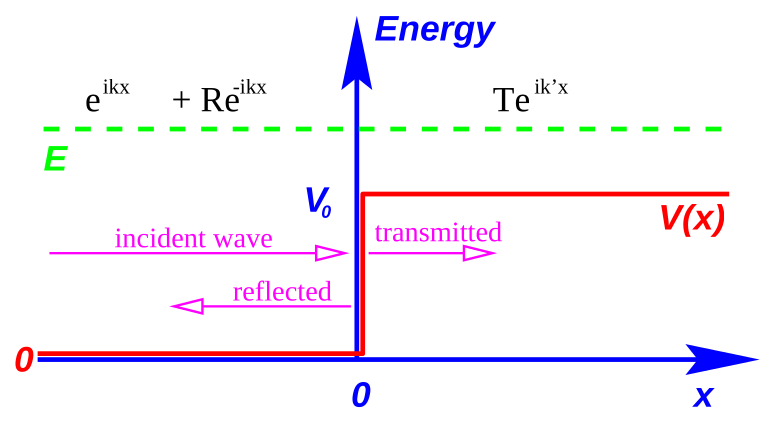

_Figure 33 (p. 146)_

There are **two unknown coefficients** $`R`$ and $`T`$ which will be determined by matching boundary conditions. We will not require normalization to one particle, since we have a beam with definite momentum, which cannot be so normalized. (A more physical problem to solve would use an incoming wave packet with a spread in momentum.)

**Continuity of the wave function** at $`x`$ = 0 implies

```math
1 + R = T.
```

The exponentials are all equal to 1 there so the equation is simple.

<div align="right"><a href="book.pdf#page=146" target="_blank" title="This page in the PDF"><sup>[p. 146]</sup></a></div>
<hr class="page" style="height:2px;border:0;background:currentColor;opacity:0.25">
<a id="p147" href="book.pdf#page=147" target="_blank" title="This page in the PDF"><sup>[p. 147]</sup></a>

**Continuity of the derivative of the wavefunction** at $`x`$ = 0 gives

```math
[ ike^{ikx} - ikRe^{- ikx} ]_{x = 0} = [ ik^{\prime} Te^{ik^{\prime} x} ]_{x = 0}
```

Evaluate and plug in $`T`$ from the equation above. We can solve the problem.

```math
k ( 1 - R ) = k^{\prime} ( 1 + R )
```

```math
( k + k^{\prime} ) R = ( k - k^{\prime} )
```

The coefficients are

```math
R = \frac{k - k^{\prime}}{k + k^{\prime}}
```

```math
T = 1 + R = \frac{2 k}{k + k^{\prime}} .
```

We now have the **full solution**, given our assumption of particles incident from the left.

```math
u ( x ) = \begin{cases} e^{ikx} + \tfrac{k \quad k^{\prime}}{k + k ik^{\prime}}^{-} e^{- ikx} & x< 0 \\ \tfrac{2 k}{k + k^{\prime}} e^{{}^{\prime} x} & x> 0 \end{cases}
```

**Classically**, all of the particles would be transmitted, continuing on to infinity.

**In Quantum Mechanics, some probability is reflected**.

```math
P_{\text{ reflection }} = | R |^{2} = \left( \frac{k - k^{\prime}}{k + k^{\prime}} \right)^{2}
```

(Note that we can simply use the coefficient of $`e^{- ikx}`$ because the incoming term has a coefficient of 1 and because the reflected particles are moving with the same velocity as the incoming beam.)

If we wish to compute the **transmission probability**, the easy way to do it is to say that its

```math
P_{\text{ transmission }} = 1 - P_{\text{ reflection }} = \frac{4 kk^{\prime}}{( k + k^{\prime} )^{2}} .
```

We’ll get the same answers for the reflection and transmission coefficients using the probability flux (See section 9.7.1) to solve the problem.

The transmission probability goes to 1 one $`k = k^{\prime}`$ (since there is no step). The transmission probability goes to 0 for $`k^{\prime}`$ = 0 (since the kinetic energy is zero).

## <a id="s-9-1-3-the-potential-well-with-e-0"></a>9.1.3 The Potential Well with $`E> 0`$ \*

With positive energy, this is again a scattering type problem, now with three regions of the potential,

```math
\text{ all with } E>V .
```

```math
V ( x ) = \begin{cases} 0 & x< - a \\ - V_{0} & - a<x<a \\ 0 & x>a \end{cases}
```

<div align="right"><a href="book.pdf#page=147" target="_blank" title="This page in the PDF"><sup>[p. 147]</sup></a></div>
<hr class="page" style="height:2px;border:0;background:currentColor;opacity:0.25">
<a id="p148" href="book.pdf#page=148" target="_blank" title="This page in the PDF"><sup>[p. 148]</sup></a>

Numbering the three regions from left to right,

```math
u_{1} ( x ) = e^{ikx} + Re^{- ikx}
```

```math
u_{2} ( x ) = Ae^{ik^{\prime} x} + Be^{- ik^{\prime} x}
```

```math
u_{3} ( x ) = Te^{ikx}
```

Again we have assumed a **beam of definite momentum incident from the left and no wave** **incident from the right**.

Ae + Be ik’x -ik’x

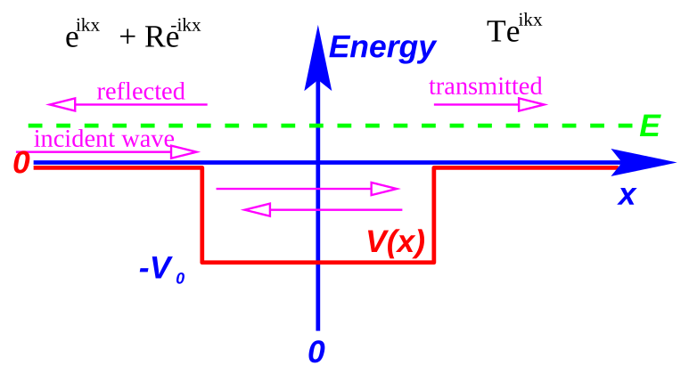

_Figure 34 (p. 148)_

There are **four unknown coefficients**. We now match the wave function and its first derivative at the two boundaries yielding **4 equations**.

Some hard work yields reflection and transmission amplitudes (See section 9.7.2)

```math
R = ie^{- 2 ika} \frac{( k^{\prime 2} - k^{2} ) \sin ( 2 k^{\prime} a )}{2 kk^{\prime} \cos ( 2 k^{\prime} a ) - i ( k^{\prime 2} + k^{2} ) \sin ( 2 k^{\prime} a )}
```

```math
T = e^{- 2 ika} \frac{2 kk^{\prime}}{2 kk^{\prime} \cos ( 2 k^{\prime} a ) - i ( k^{\prime 2} + k^{2} ) \sin ( 2 k^{\prime} a )} .
```

The squares of these give **the reflection and transmission probability**, since the potential is the same in the two regions.

Again, **classically, everything would be transmitted** because the energy is larger than the potential. Quantum mechanically, there is a probability to be transmitted and a probability to be reflected. The **reflection probability will go to zero for certain energies**: $`R \to 0`$ if

```math
2 k^{\prime} a = n\pi
```

<div align="right"><a href="book.pdf#page=148" target="_blank" title="This page in the PDF"><sup>[p. 148]</sup></a></div>
<hr class="page" style="height:2px;border:0;background:currentColor;opacity:0.25">
<a id="p149" href="book.pdf#page=149" target="_blank" title="This page in the PDF"><sup>[p. 149]</sup></a>

```math
k^{\prime} = \sqrt{2 m ( E \hbar^{2} - V_{0} )}
```

```math
E = - V_{0} + \frac{n^{2} \pi^{2} \hbar^{2}}{8 ma^{2}}
```

There are analogs of this in 3D. The scattering cross section often goes to zero for certain particular energies. For example, electrons scattering off atoms may have nearly zero cross section at some particular energy. Again this is a wave property.

## <a id="s-9-1-4-bound-states-in-a-potential-well"></a>9.1.4 Bound States in a Potential Well \*

We will work with the same potential well as in the previous section but assume that $`- V_{0} <E< 0`$, making this a **bound state problem**. Note that this potential has a Parity symmetry. In the left and right regions the general solution is

```math
u ( x ) = Ae^{\kappa x} + Be^{- \kappa x}
```

with

```math
\kappa = \sqrt{- 2 \hbar^{2} mE} .
```

The $`e^{- \kappa x}`$ term will not be acceptable at $`-\infty`$ and the $`e^{\kappa x}`$ term will not be acceptable at +$`\infty`$ since they diverge and we could never normalize to one bound particle.

```math
u_{1} ( x ) = C_{1} e^{\kappa x}
```

```math
u_{3} ( x ) = C_{3} e^{- \kappa x}
```

<div align="center">

In the center we’ll use the sine and cosine solutions anticipating parity eigenstates.

</div>

```math
u_{2} ( x ) = A \cos ( kx \sqrt{) + B \sin ( kx )}
```

```math
k = \frac{2 m ( E + V_{0} )}{\hbar^{2}}
```

Again we will have 4 equations in 4 unknown coefficients.

<div align="right"><a href="book.pdf#page=149" target="_blank" title="This page in the PDF"><sup>[p. 149]</sup></a></div>
<hr class="page" style="height:2px;border:0;background:currentColor;opacity:0.25">
<a id="p150" href="book.pdf#page=150" target="_blank" title="This page in the PDF"><sup>[p. 150]</sup></a>

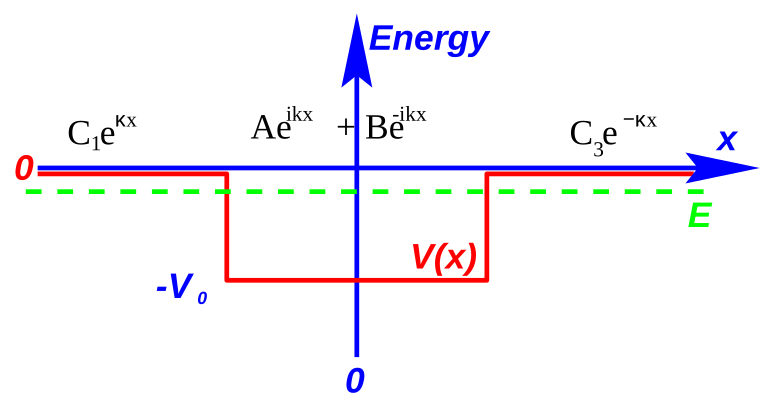

_Figure 35 (p. 150)_

The calculation (See section 9.7.3) shows that either $`A`$ or $`B`$ must be zero for a solution. This means that the **solutions separate into even parity and odd parity states**. We could have guessed this from the potential.

The **even states** have the (quantization) constraint on the energy that

```math
\begin{aligned} \kappa &= \tan ( ka ) k \\ \sqrt{- 2 \hbar^{2} mE} &= \tan \begin{pmatrix} \sqrt{2 m ( E \hbar^{2} + V_{0} )} \\ a \end{pmatrix} \sqrt{2 m ( E \hbar^{2} + V_{0} )} \\ \sqrt{E - E + V_{0}} &= \tan \begin{pmatrix} \sqrt{2 m ( E \hbar^{2} + V_{0} )} \\ a \end{pmatrix} \end{aligned}
```

and the **odd states** have the constraint

```math
\begin{aligned} \kappa &= - \cot ( ka ) k \\ \sqrt{E - E + V_{0}} &= - \cot \begin{pmatrix} \sqrt{2 m ( E \hbar^{2} + V_{0} )} \\ a \end{pmatrix} \end{aligned}
```

These are transcendental equations, so we will solve them graphically. The plot below compares the square root on the left hand side of the transcendental equations to the tangent on the right for the event states and to “-cotangent” on the right for odd states. Where the curves intersect (not including the asymptote), is an allowed energy. There is always one even solution for the 1D potential well. In the graph shown, there are 2 even and one odd solution. The wider and deeper the well, the more solutions.

<div align="right"><a href="book.pdf#page=150" target="_blank" title="This page in the PDF"><sup>[p. 150]</sup></a></div>
<hr class="page" style="height:2px;border:0;background:currentColor;opacity:0.25">
<a id="p151" href="book.pdf#page=151" target="_blank" title="This page in the PDF"><sup>[p. 151]</sup></a>

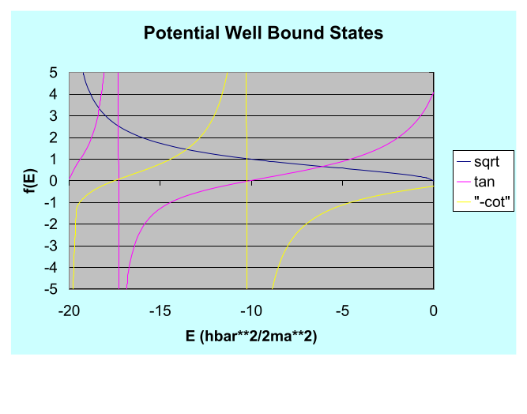

_Figure 36 (p. 151)_

Try this 1D Potential Applet. It allows you to vary the potential and see the eigenstates.

## <a id="s-9-1-5-the-potential-barrier"></a>9.1.5 The Potential Barrier

With an analysis of the Potential Barrier problem, we can understand the phenomenon of **quantum** **tunneling**.

```math
V ( x ) = \begin{cases} 0 & x< - a \\ + V_{0} & - a<x<a \\ 0 & x>a \end{cases}
```

Numbering the three regions from left to right,

```math
u_{1} ( x ) = e^{ikx} + Re^{- ikx}
```

```math
u_{2} ( x ) = Ae^{\kappa x} + Be^{- \kappa x}
```

```math
u_{3} ( x ) = Te^{ikx}
```

Again we assume a beam of definite momentum incident from the left and no wave incident from the right. For the solutions outside the barrier,

```math
k = \sqrt{\frac{2 mE}{\hbar^{2}} .}
```

<div align="right"><a href="book.pdf#page=151" target="_blank" title="This page in the PDF"><sup>[p. 151]</sup></a></div>
<hr class="page" style="height:2px;border:0;background:currentColor;opacity:0.25">
<a id="p152" href="book.pdf#page=152" target="_blank" title="This page in the PDF"><sup>[p. 152]</sup></a>

Inside the barrier,

```math
\kappa = \sqrt{\frac{2 m ( V_{0} - E )}{\hbar^{2}} .}
```

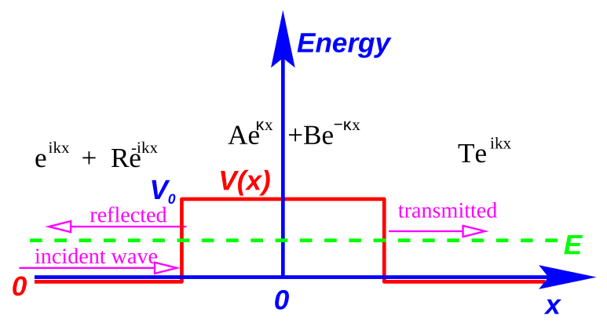

_Figure 37 (p. 152)_

This is actually the same as the (unbound) potential well problem with the substitution

```math
k^{\prime} \to i\kappa
```

in the center region.

The **amplitude to be transmitted** is

```math
T = e^{- 2 ika} \frac{2 k\kappa}{2 k\kappa \cosh ( 2 \kappa a ) - i ( k^{2} - \kappa^{2} ) \sinh ( 2 \kappa a )} .
```

We can compute the probability to be transmitted.

```math
| T |^{2} = \frac{( 2 k\kappa )^{2}}{( k^{2} + \kappa^{2} )^{2} \sinh^{2} ( 2 \kappa a ) + ( 2 k\kappa )^{2}} \to \left( \frac{4 k\kappa}{k^{2} + \kappa^{2}} \right)^{2} e^{- 4 \kappa a}
```

An **approximate probability** is sometimes useful.

```math
| T |^{2} \approx e^{- 2 \kappa ( 2 a )} = e \int^{{}^{- 2} \frac{a}{- a} \sqrt{\tfrac{2 m}{\hbar 2} [ V ( x ) - E ]}} dx
```

**Classically the transmission probability would be zero**. In Quantum Mechanics, the particle is **allowed to violate energy conservation for a short time** and so has a chance to tunnel through the barrier.

Tunneling can be applied to cold emission of electrons from a metal, alpha decay of nuclei, semiconductors, and many other problems.

<div align="right"><a href="book.pdf#page=152" target="_blank" title="This page in the PDF"><sup>[p. 152]</sup></a></div>
<hr class="page" style="height:2px;border:0;background:currentColor;opacity:0.25">
<a id="p153" href="book.pdf#page=153" target="_blank" title="This page in the PDF"><sup>[p. 153]</sup></a>

# <a id="s-9-2-the-1d-harmonic-oscillator"></a>9.2 The 1D Harmonic Oscillator

The **harmonic oscillator is an extremely important physics problem**. Many potentials look like a harmonic oscillator near their minimum. This is the first non-constant potential for which we will solve the Schrödinger Equation.

The harmonic oscillator Hamiltonian is given by

```math
H = \frac{p^{2}}{2 m} + \frac{1}{2} kx^{2}
```

which makes the **Schrödinger Equation for energy eigenstates**

```math
\frac{- \hbar^{2}}{2 m} \frac{d^{2} u}{dx^{2}} + \frac{1}{2} kx^{2} u = Eu.
```

Note that this potential also has a Parity symmetry. The potential is unphysical because it does not go to zero at infinity, however, it is often a very good approximation, and this potential can be solved exactly.

It is standard to remove the spring constant $`k`$ from the Hamiltonian, replacing it with the **classical** **oscillator frequency**.

```math
\omega = \sqrt{\frac{k}{m}}
```

The **Harmonic Oscillator Hamiltonian** becomes.

```math
H = \frac{p^{2}}{2 m} + \frac{1}{2} m\omega^{2} x^{2}
```

The **differential equation to be solved is**

```math
\frac{- \hbar^{2}}{2 m} \frac{d^{2} u}{dx^{2}} + \frac{1}{2} m\omega^{2} x^{2} u = Eu.
```

To solve the Harmonic Oscillator equation (See section 9.7.4), we will first change to dimensionless variables, then find the form of the solution for $`x \to \pm \infty`$, then multiply that solution by a polynomial, derive a recursion relation between the coefficients of the polynomial, show that the polynomial series must terminate if the solutions are to be normalizable, derive the energy eigenvalues, then finally derive the functions that are solutions.

The **energy eigenvalues** are

```math
E_{n} = \left( n + \frac{1}{2} \right) \hbar \omega
```

for $`n`$ = 0$`, 1 , 2 ,\dots`$. There are a countably infinite number of solutions with **equal energy spacing**. We have been forced to have quantized energies by the requirement that the wave functions be normalizable.

The **ground state wave function** is.

<div align="right"><a href="book.pdf#page=153" target="_blank" title="This page in the PDF"><sup>[p. 153]</sup></a></div>
<hr class="page" style="height:2px;border:0;background:currentColor;opacity:0.25">
<a id="p154" href="book.pdf#page=154" target="_blank" title="This page in the PDF"><sup>[p. 154]</sup></a>

```math
u_{0} ( x ) = \left( \frac{m\omega}{\pi \hbar} \right)^{\tfrac{1}{4}} e^{- m\omega x^{2} / 2 \hbar}
```

This is a Gaussian (minimum uncertainty) distribution. Since the HO potential has a parity symmetry, the **solutions either have even or odd parity**. The ground state is even parity.

The **first excited state** is an odd parity state, with a first order polynomial multiplying the same Gaussian.

```math
u_{1} ( x ) = \left( \frac{m\omega}{\pi \hbar} \right) \tfrac{1}{4} \sqrt{\frac{2 m\omega}{\hbar}} xe^{- m\omega x^{2} / 2 \hbar}
```

The **second excited state** is even parity, with a second order polynomial multiplying the same Gaussian.

```math
u_{2} ( x ) = C \left( 1 - 2 \frac{m\omega x^{2}}{\hbar} \right) e^{- m\omega x^{2} / 2 \hbar}
```

Note that $`n`$ is equal to the number of zeros of the wavefunction. This is a common trend. With more zeros, a wavefunction has more curvature and hence more kinetic energy.

The general solution can be written as

```math
u_{n} ( x ) = \sum_{k = 0}^{\infty} a_{k} y^{k} e^{- y^{2} / 2}
```

with the coefficients determined by the recursion relation

```math
a_{k + 2} = \frac{2 ( k - n )}{( k + 1 ) ( k + 2 )} a_{k}
```

and the dimensionless variable $`y`$ given by.

```math
y = \sqrt{\frac{m\omega}{\hbar}} x
```

The series terminates with the last nonzero term having $`k = n`$.

<div align="right"><a href="book.pdf#page=154" target="_blank" title="This page in the PDF"><sup>[p. 154]</sup></a></div>
<hr class="page" style="height:2px;border:0;background:currentColor;opacity:0.25">
<a id="p155" href="book.pdf#page=155" target="_blank" title="This page in the PDF"><sup>[p. 155]</sup></a>

# <a id="s-9-3-the-delta-function-potential"></a>9.3 The Delta Function Potential \*

Take a simple, **attractive delta function potential** and look for the bound states.

```math
V ( x ) = - aV_{0} \delta ( x )
```

These will have energy less than zero so the solutions are

```math
\psi ( x ) = \begin{cases} Ae^{\kappa x} & x< 0 \\ Ae^{- \kappa x} & x> 0 \end{cases}
```

where

```math
\kappa = \sqrt{- 2 \hbar^{2} mE} .
```

There are only two regions, above and below the delta function. We don’t need to worry about the one point at $`x`$ = 0 – the two solutions will match there. We have already made the wave function continuous at $`x`$ = 0 by using the same coefficient, $`A`$, for the solution in both regions.

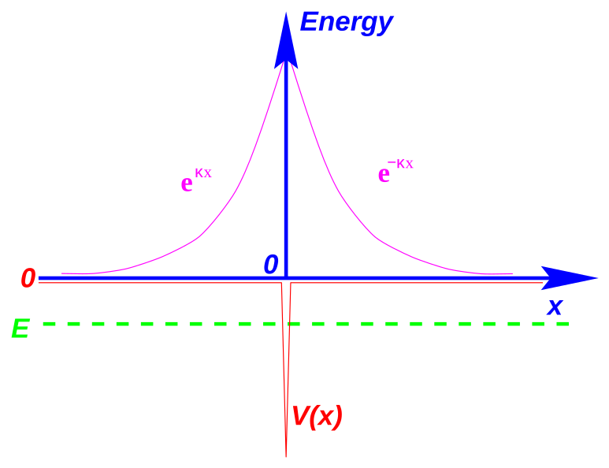

_Figure 38 (p. 155)_

We now need to meet the boundary condition on the first derivative at $`x`$ = 0. Recall that the delta function causes a known discontinuity in the first derivative (See section 8.7.2).

```math
\frac{d\psi}{dx} \left| {}_{+ \epsilon} - \frac{d\psi}{dx} \right|_{- \epsilon} = - \frac{2 maV_{0}}{\hbar^{2}} \psi ( 0 )
```

```math
- \kappa - \kappa = - \frac{2 maV_{0}}{\hbar^{2}}
```

```math
\kappa = \frac{maV_{0}}{\hbar^{2}}
```

<div align="right"><a href="book.pdf#page=155" target="_blank" title="This page in the PDF"><sup>[p. 155]</sup></a></div>
<hr class="page" style="height:2px;border:0;background:currentColor;opacity:0.25">
<a id="p156" href="book.pdf#page=156" target="_blank" title="This page in the PDF"><sup>[p. 156]</sup></a>

Putting in the formula for $`\kappa`$ in terms of the energy.

```math
\frac{- 2 mE}{\hbar^{2}} = \frac{m^{2} a^{2} V_{0}^{2}}{\hbar^{4}}
```

```math
E = - \frac{ma^{2} V_{0}^{2}}{2 \hbar^{2}}
```

There is only one energy for which we can satisfy the boundary conditions. There is only **one** **bound state** in an attractive delta function potential.

# <a id="s-9-4-the-delta-function-model-of-a-molecule"></a>9.4 The Delta Function Model of a Molecule \*

The use of two delta functions allows us to see, to some extent, how **atoms bind into molecules**. Our potential is

```math
V ( x ) = - aV_{0} ( \delta ( x + d ) + \delta ( x - d ) )
```

with attractive delta functions at $`x = \pm d`$. This is a parity symmetric potential, so we can assume that our solutions will be parity eigenstates.

**For even parity, our solution in the three regions** is

```math
\begin{aligned} \psi ( x ) &= \begin{cases} e^{\kappa x} & x< - d \\ A ( e^{\kappa x} + e^{- \kappa x} ) & - d<x<d \\ e^{- \kappa x} & x>d \end{cases} \\ \kappa &= \sqrt{- 2 \hbar^{2} mE} . \end{aligned}
```

Since the solution is designed to be symmetric about $`x`$ = 0, the boundary conditions at $`- d`$ are the same as at $`d`$. The boundary conditions determine the constant $`A`$ and constrain $`\kappa`$.

A little calculation gives (See section 9.7.5)

```math
\frac{2 maV_{0}}{\kappa \hbar^{2}} = 1 + \tanh ( \kappa d )
```

This is a transcendental equation, but we can limit the energy.

```math
\frac{2 maV_{0}}{\kappa \hbar^{2}} < 2
```

```math
\kappa > \frac{maV_{0}}{\hbar^{2}}
```

Since $`\kappa = \tfrac{maV_{0}}{\hbar^{2}}`$ for the single delta function, this $`\kappa = \sqrt{- 2 \hbar mE_{2}}`$ is larger than the one for the single delta function. This means that $`E`$ is more negative and there is **more binding energy**.

```math
E_{molecule} <E_{atom}
```

Basically, the electron doesn’t have to be a localized with two atoms as it does with just one. This allows the kinetic energy to be lower.

The figure below shows the two solutions plotted on the same graph as the potential.

<div align="right"><a href="book.pdf#page=156" target="_blank" title="This page in the PDF"><sup>[p. 156]</sup></a></div>
<hr class="page" style="height:2px;border:0;background:currentColor;opacity:0.25">
<a id="p157" href="book.pdf#page=157" target="_blank" title="This page in the PDF"><sup>[p. 157]</sup></a>

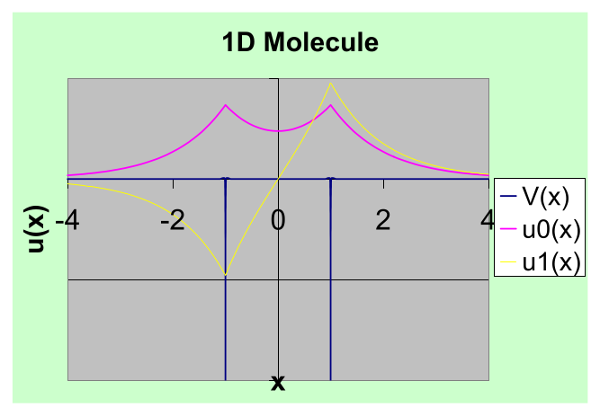

_Figure 39 (p. 157)_

Two Hydrogen atoms bind together to form a molecule with a separation of 0.74 Angstroms, just larger than the Bohr radius of 0.53 Angstroms. The binding energy (for the two electrons) is about 4.5 eV. If we approximate the Coulomb potential by with a delta function, setting $`aV_{0}`$ = (0$`. 5 3 ) ( 2 ) ( 1 3 . 6 )`$ eV Angstroms, our very naive calculation would give 1.48 eV for one electron, which is at least the right order of magnitude.

The **odd parity solution** has an energy that satisfies the equation

```math
\frac{2 maV_{0}}{\kappa \hbar^{2}} = 1 + \coth ( \kappa d ) .
```

```math
\frac{2 maV_{0}}{\kappa \hbar^{2}} > 2
```

```math
\kappa < \frac{maV_{0}}{\hbar^{2}}
```

This energy is larger than for one delta function. This state would be called **anti-bonding**.

# <a id="s-9-5-the-delta-function-model-of-a-crystal"></a>9.5 The Delta Function Model of a Crystal \*

The Kronig-Penny model of a solid crystal contains an **infinite array of repulsive delta func-** **tions**. $`\infty`$

```math
V ( x ) = aV_{0} \sum_{n = -\infty} \delta ( x - na )
```

<div align="right"><a href="book.pdf#page=157" target="_blank" title="This page in the PDF"><sup>[p. 157]</sup></a></div>
<hr class="page" style="height:2px;border:0;background:currentColor;opacity:0.25">
<a id="p158" href="book.pdf#page=158" target="_blank" title="This page in the PDF"><sup>[p. 158]</sup></a>

Our states will have positive energy.

This potential has a new symmetry, that a **translation by the lattice spacing** $`a`$ leaves the problem unchanged. The probability distributions must therefore have this symmetry

```math
| \psi ( x + a ) |^{2} = | \psi ( x ) |^{2} ,
```

which means that the wave function differs by a phase at most.

```math
\psi ( x + a ) = e^{i\varphi} \psi ( x )
```

The general solution in the region $`( n - 1 ) a<x<na`$ is

```math
\psi_{n} ( x ) = A_{n} \sin ( k [ x - na ] ) + B_{n} \cos ( k [ x - na ] )
```

```math
k = \sqrt{2 mE \hbar^{2}}
```

By matching the boundary conditions and requiring that the probability be periodic, we derive a constraint on $`k`$ (See section 9.7.6) similar to the quantized energies for bound states.

```math
\cos ( \varphi ) = \cos ( ka ) + \frac{maV_{0}}{\hbar^{2} k} \sin ( ka )
```

Since cos$`( \varphi )`$ can only take on values between -1 and 1, there are **allowed bands of** $`k`$ **and gaps** **between those bands**.

The graph below shows cos$`( ka ) + \tfrac{maV_{0}}{\hbar^{2} k}`$ sin$`( ka )`$ as a function of $`k`$. If this is not between -1 and 1, there is no solution, that value of $`k`$ and the corresponding energy are not allowed.

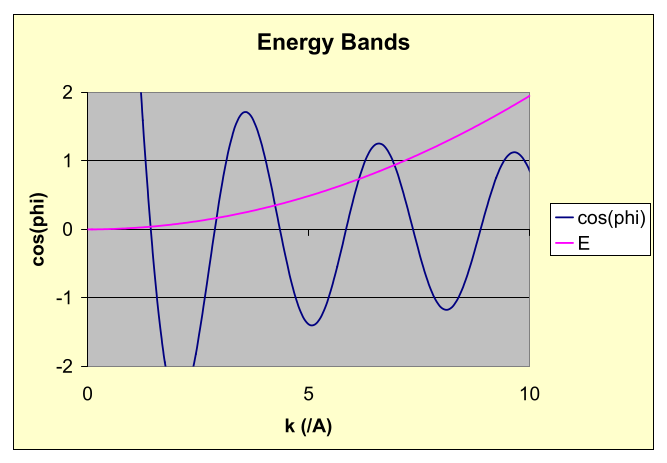

_Figure 40 (p. 158)_

<div align="right"><a href="book.pdf#page=158" target="_blank" title="This page in the PDF"><sup>[p. 158]</sup></a></div>
<hr class="page" style="height:2px;border:0;background:currentColor;opacity:0.25">
<a id="p159" href="book.pdf#page=159" target="_blank" title="This page in the PDF"><sup>[p. 159]</sup></a>

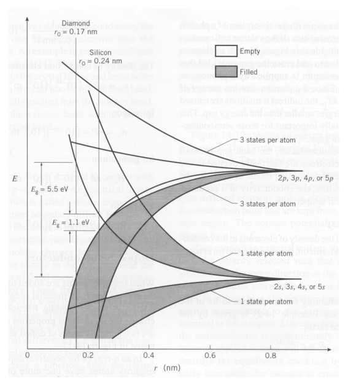

_Figure 41 (p. 159)_

This energy band phenomenon is found in solids. Solids with partially filled bands are conductors. Solids with filled bands are insulators. Semiconductors have a small number of charge carriers (or holes) in a band.

# <a id="s-9-6-the-quantum-rotor"></a>9.6 The Quantum Rotor

It is useful to simply investigate **angular momentum with just one free rotation angle**. This might be the quantum plane propeller. We will do a good job of this in 3 dimensions later.

Lets assume we have a **mass** $`m`$ **constrained to move in a circle of radius** $`r`$. Assume the motion in the circle is free, so there is no potential. The kinetic energy is $`\tfrac{1}{2} mv^{2} = \tfrac{p^{2}}{2 m}`$ for $`p = mr \tfrac{d\varphi}{dt}`$.

If we measure distance around the circle, then $`x = r\varphi`$ and the one problem we have is that once I go completely around the circle, I am back to $`x`$ = 0. Lets just go ahead and write our wavefunction.

```math
e^{i ( px - Et ) / \hbar} = e^{i ( pr\varphi - Et ) / \hbar}
```

Remembering angular momentum, lets call the combination $`pr = L`$. Our wave is $`e^{i ( L\varphi - Et ) / \hbar}`$.

This must be **single valued** so we need to require that

```math
e^{i ( 2 \pi L - Et ) / \hbar} = e^{i ( 0 - Et ) / \hbar}
```

```math
e^{i ( 2 \pi L ) / \hbar} = 1
```

```math
L = n \hbar
```

<div align="right"><a href="book.pdf#page=159" target="_blank" title="This page in the PDF"><sup>[p. 159]</sup></a></div>
<hr class="page" style="height:2px;border:0;background:currentColor;opacity:0.25">
<a id="p160" href="book.pdf#page=160" target="_blank" title="This page in the PDF"><sup>[p. 160]</sup></a>

```math
n = 0 , 1 , 2 , 3 \dots
```

The **angular momentum must be quantized in units of** $`\hbar`$.

This will prove to be true for 3 dimensions too, however, the 3 components of angular momentum do not commute with each other, leading to all kinds of fun.

# <a id="s-9-7-derivations-and-computations"></a>9.7 Derivations and Computations

## <a id="s-9-7-1-probability-flux-for-the-potential-step"></a>9.7.1 Probability Flux for the Potential Step \*

The probability flux is given by

```math
j ( x,t ) = \frac{\hbar}{2 mi} \left[ \psi^{*} \frac{\partial \psi}{\partial x} - \frac{\partial \psi^{*}}{\partial x} \psi \right] .
```

We can save some effort by noticing that this contains an expression minus its complex conjugate. (This assures that term in brackets is imaginary and the flux is then real.)

```math
j = \frac{\hbar}{2 im} \left[ u^{*} \frac{du}{dx} - \frac{du^{*}}{dx} u \right] = \frac{\hbar}{2 im} \left[ u^{*} \frac{du}{dx} - CC \right]
```

For $`x< 0`$

```math
j = \frac{\hbar}{2 im} [ ( e^{- ikx} + R^{*} e^{ikx} ) ( ike^{ikx} - ikRe^{- ikx} ) - CC ]
```

```math
j = \frac{i \hbar k}{2 im} [ 1 - Re^{- 2 ikx} + R^{*} e^{2 ikx} - R^{*} R ] + CC
```

```math
j = [ 1 -| R |^{2} ] \frac{\hbar k}{m} .
```

The probability to be reflected is the reflected flux divided by the incident flux. In this case its easy to see that its $`| R |^{2}`$ as we said. For $`x> 0`$

```math
j = | T |^{2} \frac{\hbar k^{\prime}}{m} .
```

The probability to be transmitted is the transmitted flux divided by the incident flux.

```math
| T |^{2} \frac{\hbar k^{\prime}}{m} \frac{m}{\hbar k} = \frac{4 k^{2}}{( k + k^{\prime} )^{2}} \frac{k^{\prime}}{k} = \frac{4 kk^{\prime}}{( k + k^{\prime} )^{2}}
```

again as we had calculated earlier.

## <a id="s-9-7-2-scattering-from-a-1d-potential-well"></a>9.7.2 Scattering from a 1D Potential Well \*

```math
V ( x ) = \begin{cases} 0 & x< - a \\ - V_{0} & - a<x<a \\ 0 & x>a \end{cases}
```

<div align="right"><a href="book.pdf#page=160" target="_blank" title="This page in the PDF"><sup>[p. 160]</sup></a></div>
<hr class="page" style="height:2px;border:0;background:currentColor;opacity:0.25">
<a id="p161" href="book.pdf#page=161" target="_blank" title="This page in the PDF"><sup>[p. 161]</sup></a>

Numbering the three regions from left to right,

```math
u_{1} ( x ) = e^{ikx} + Re^{- ikx}
```

```math
u_{2} ( x ) = Ae^{ik^{\prime} x} + Be^{- ik^{\prime} x}
```

```math
u_{3} ( x ) = Te^{ikx}
```

Again we have assumed no wave incident from the right (but we could add that solution if we wanted).

We now match the wave function and its first derivative at the two boundaries yielding 4 equations. That’s good since we have 4 constants to determine. At $`x = a`$ we have 2 equations which we can use to eliminate $`A`$ and $`B`$.

```math
Te^{ika} = Ae^{ik^{\prime} a} + Be^{- ik^{\prime} a}
```

```math
ikTe^{ika} = ik^{\prime} Ae^{ik^{\prime} a} - ik^{\prime} Be^{- ik^{\prime} a}
```

```math
\frac{k}{k^{\prime}} Te^{ika} = Ae^{ik^{\prime} a} - Be^{- ik^{\prime} a}
```

```math
Ae^{ik^{\prime} a} = \frac{1}{2} Te^{ika} \left( 1 + \frac{k}{k^{\prime}} \right)
```

```math
Be^{- ik^{\prime} a} = \frac{1}{2} Te^{ika} \left( 1 - \frac{k}{k^{\prime}} \right)
```

At $`x = - a`$ we have 2 equations which can now be written in terms of $`R`$ and $`T`$ by using the above.

```math
e^{- ika} + Re^{ika} = Ae^{- ik^{\prime} a} + Be^{ik^{\prime} a}
```

```math
ike^{- ika} - ikRe^{ika} = ik^{\prime} Ae^{- ik^{\prime} a} - ik^{\prime} Be^{ik^{\prime} a}
```

```math
e^{- ika} + Re^{ika} = \frac{1}{2} Te^{ika} \left[ \left( 1 + \frac{k}{k^{\prime}} \right) e^{- 2 ik^{\prime} a} + \left( 1 - \frac{k}{k^{\prime}} \right) e^{2 ik^{\prime} a} \right]
```

```math
ke^{- ika} - kRe^{ika} = \frac{1}{2} Te^{ika} k^{\prime} \left[ \left( 1 + \frac{k}{k^{\prime}} \right) e^{- 2 ik^{\prime} a} - \left( 1 - \frac{k}{k^{\prime}} \right) e^{2 ik^{\prime} a} \right]
```

```math
e^{- ika} - Re^{ika} = \frac{1}{2} Te^{ika} \left[ \left( \frac{k^{\prime}}{k} + 1 \right) e^{- 2 ik^{\prime} a} - \left( \frac{k^{\prime}}{k} - 1 \right) e^{2 ik^{\prime} a} \right]
```

We can add equations to eliminate $`R`$.

```math
e^{- ika} + Re^{ika} = \frac{1}{2} Te^{ika} \left[ \left( 1 + \frac{k}{k^{\prime}} \right) e^{- 2 ik^{\prime} a} + \left( 1 - \frac{k}{k^{\prime}} \right) e^{2 ik^{\prime} a} \right]
```

```math
e^{- ika} - Re^{ika} = \frac{1}{2} Te^{ika} \left[ \left( \frac{k^{\prime}}{k} + 1 \right) e^{- 2 ik^{\prime} a} - \left( \frac{k^{\prime}}{k} - 1 \right) e^{2 ik^{\prime} a} \right]
```

```math
2 e^{- ika} = \frac{1}{2} Te^{ika} \left[ \left( 2 + \frac{k^{\prime}}{k} + \frac{k}{k^{\prime}} \right) e^{- 2 ik^{\prime} a} + \left( 2 - \frac{k^{\prime}}{k} - \frac{k}{k^{\prime}} \right) e^{2 ik^{\prime} a} \right]
```

```math
4 e^{- 2 ika} = T \left[ 4 \cos ( 2 k^{\prime} a ) - 2 i \left( \frac{k}{k^{\prime}} + \frac{k^{\prime}}{k} \right) \sin ( 2 k^{\prime} a ) \right]
```

```math
T = \frac{2 e^{- 2 ika}}{2 \cos ( 2 k^{\prime} a ) - i \left( \tfrac{k}{k^{\prime}} + \tfrac{k^{\prime}}{k} \right) \sin ( 2 k^{\prime} a )}
```

```math
T = \frac{2 kk^{\prime} e^{- 2 ika}}{2 kk^{\prime} \cos ( 2 k^{\prime} a ) - i ( k^{2} + k^{\prime 2} ) \sin ( 2 k^{\prime} a )}
```

<div align="right"><a href="book.pdf#page=161" target="_blank" title="This page in the PDF"><sup>[p. 161]</sup></a></div>
<hr class="page" style="height:2px;border:0;background:currentColor;opacity:0.25">
<a id="p162" href="book.pdf#page=162" target="_blank" title="This page in the PDF"><sup>[p. 162]</sup></a>

We can subtract the same equations to most easily solve for $`R`$.

```math
2 Re^{ika} = \frac{1}{2} Te^{ika} \left[ \left( \frac{k}{k^{\prime}} - \frac{k^{\prime}}{k} \right) e^{- 2 ik^{\prime} a} + \left( \frac{k^{\prime}}{k} - \frac{k}{k^{\prime}} \right) e^{2 ik^{\prime} a} \right]
```

```math
R = \frac{1}{4} T \left[ - 2 i \frac{k}{k^{\prime}} \sin ( 2 k^{\prime} a ) + 2 i \frac{k^{\prime}}{k} \sin ( 2 k^{\prime} a ) \right]
```

```math
R = \frac{i}{2} T \sin ( 2 k^{\prime} a ) \left[ \frac{k^{\prime}}{k} - \frac{k}{k^{\prime}} \right]
```

```math
R = \frac{ikk^{\prime} e^{- 2 ika} \sin ( 2 k^{\prime} a ) \left[ \tfrac{k^{\prime}}{k} - \tfrac{k}{k^{\prime}} \right]}{2 kk^{\prime} \cos ( 2 k^{\prime} a ) - i ( k^{2} + k^{\prime 2} ) \sin ( 2 k^{\prime} a )}
```

```math
R = \frac{i \left( k^{\prime 2} - k^{2} \right) \sin ( 2 k^{\prime} a ) e^{- 2 ika}}{2 kk^{\prime} \cos ( 2 k^{\prime} a ) - i ( k^{2} + k^{\prime 2} ) \sin ( 2 k^{\prime} a )}
```

We have solved the boundary condition equations to find the reflection and transmission amplitudes

```math
R = ie^{- 2 ika} \frac{( k^{\prime 2} - k^{2} ) \sin ( 2 k^{\prime} a )}{2 kk^{\prime} \cos ( 2 k^{\prime} a ) - i ( k^{\prime 2} + k^{2} ) \sin ( 2 k^{\prime} a )}
```

```math
T = e^{- 2 ika} \frac{2 kk^{\prime}}{2 kk^{\prime} \cos ( 2 k^{\prime} a ) - i ( k^{\prime 2} + k^{2} ) \sin ( 2 k^{\prime} a )} .
```

The squares of these give the reflection and transmission probability, since the potential is the same in the two regions.

## <a id="s-9-7-3-bound-states-of-a-1d-potential-well"></a>9.7.3 Bound States of a 1D Potential Well \*

In the two outer regions we have solutions

```math
u_{1} ( x ) = C_{1} e^{\kappa x}
```

```math
\begin{aligned} u_{3} ( x ) &= C_{3} e^{- \kappa x} \\ \kappa &= \sqrt{- 2 \hbar^{2} mE} . \end{aligned}
```

In the center we have the same solution as before.

```math
u_{2} ( x ) = A \cos ( kx \sqrt{) + B \sin ( kx )}
```

```math
k = \frac{2 m ( E + V_{0} )}{\hbar^{2}}
```

(Note that we have switched from $`k^{\prime}`$ to $`k`$ for economy.) We will have 4 equations in 4 unknown coefficients.

At $`- a`$ we get

```math
C_{1} e^{- \kappa a} = A \cos ( ka ) - B \sin ( ka )
```

```math
\kappa C_{1} e^{- \kappa a} = kA \sin ( ka ) + kB \cos ( ka ) .
```

<div align="right"><a href="book.pdf#page=162" target="_blank" title="This page in the PDF"><sup>[p. 162]</sup></a></div>
<hr class="page" style="height:2px;border:0;background:currentColor;opacity:0.25">
<a id="p163" href="book.pdf#page=163" target="_blank" title="This page in the PDF"><sup>[p. 163]</sup></a>

At $`a`$ we get

```math
C_{3} e^{- \kappa a} = A \cos ( ka ) + B \sin ( ka )
```

```math
- \kappa C_{3} e^{- \kappa a} = - kA \sin ( ka ) + kB \cos ( ka ) .
```

Divide these two pairs of equations to get two expressions for $`\kappa`$.

```math
\begin{aligned} \kappa &= \frac{kA \sin ( ka ) + kB \cos ( ka )}{A \cos ( ka ) - B \sin ( ka )} \\ - \kappa &= \frac{- kA \sin ( ka ) + kB \cos ( ka )}{A \cos ( ka ) + B \sin ( ka )} \end{aligned}
```

Factoring out the $`k`$, we have two expressions for the same quantity.

```math
\frac{\kappa}{k} = \frac{A \sin ( ka ) + B \cos ( ka )}{A \cos ( ka ) - B \sin ( ka )}
```

```math
\frac{\kappa}{k} = \frac{A \sin ( ka ) - B \cos ( ka )}{A \cos ( ka ) + B \sin ( ka )}
```

If we equate the two expressions,

```math
\frac{A \sin ( ka ) + B \cos ( ka )}{A \cos ( ka ) - B \sin ( ka )} = \frac{A \sin ( ka ) - B \cos ( ka )}{A \cos ( ka ) + B \sin ( ka )}
```

and cross multiply, we have

```math
( A \sin ( ka ) + B \cos ( ka ) ) ( A \cos ( ka ) + B \sin ( ka ) )
```

```math
= ( A \cos ( ka ) - B \sin ( ka ) ) ( A \sin ( ka ) - B \cos ( ka ) ) .
```

The $`A^{2}`$ and $`B^{2}`$ terms show up on both sides of the equation and cancel. What’s left is

```math
AB ( \sin^{2} ( ka ) + \cos^{2} ( ka ) ) = AB ( - \cos^{2} ( ka ) - \sin^{2} ( ka ) )
```

```math
AB = - AB
```

Either $`A`$ or $`B`$, but not both, must be zero. We have parity eigenstates, again, derived from the solutions and boundary conditions.

This means that the states separate into even parity and odd parity states. We could have guessed this from the potential.

Now lets use one equation.

```math
\kappa = \frac{A \sin ( ka ) + B \cos ( ka )}{A \cos ( ka ) - B \sin ( ka )} k
```

k If we set $`B`$ = 0, the even states have the constraint on the energy that

```math
\kappa = \tan ( ka ) k
```

and, if we set $`A`$ = 0, the odd states have the constraint

```math
\kappa = - \cot ( ka ) k.
```

<div align="right"><a href="book.pdf#page=163" target="_blank" title="This page in the PDF"><sup>[p. 163]</sup></a></div>
<hr class="page" style="height:2px;border:0;background:currentColor;opacity:0.25">
<a id="p164" href="book.pdf#page=164" target="_blank" title="This page in the PDF"><sup>[p. 164]</sup></a>

## <a id="s-9-7-4-solving-the-ho-differential-equation"></a>9.7.4 Solving the HO Differential Equation \*

The differential equation for the 1D Harmonic Oscillator is.

```math
\frac{- \hbar^{2}}{2 m} \frac{d^{2} u}{dx^{2}} + \frac{1}{2} m\omega^{2} x^{2} u = Eu.
```

By working with dimensionless variables and constants, we can see the basic equation and minimize the clutter. We use the energy in terms of $`\hbar \omega`$.

```math
\epsilon = \frac{2 E}{\hbar \omega}
```

We define a dimensionless coordinate.

```math
y = \sqrt{\frac{m\omega}{\hbar}} x
```

The equation becomes.

```math
\frac{d^{2} u}{dx^{2}} + \frac{2 m}{\hbar^{2}} ( E - \frac{1}{2} m\omega^{2} x^{2} ) u = 0
```

```math
\frac{d^{2} u}{dy^{2}} + ( \epsilon - y^{2} ) u = 0
```

(Its probably easiest to just check the above equation by substituting as below.

```math
\frac{\hbar}{m\omega} \frac{d^{2} u}{dx^{2}} + \left( \frac{2 E}{\hbar \omega} - \frac{m\omega}{\hbar} x^{2} \right) = 0
```

```math
\frac{d^{2} u}{dx^{2}} + \frac{2 m}{\hbar^{2}} ( E - \frac{1}{2} m\omega^{2} x^{2} ) u = 0
```

## <a id="s-it-works"></a>It works.)

Now we want to find the solution for $`y \to \infty`$.

```math
\frac{d^{2} u}{dy^{2}} + ( \epsilon - y^{2} ) u = 0
```

becomes

```math
\frac{d^{2} u}{dy^{2}} - y^{2} u = 0
```

which has the solution (in the large $`y`$ limit)

```math
u = e^{- y^{2} / 2} .
```

This exponential will dominate a polynomial as $`y \to \infty`$ so we can write our general solution as

```math
u ( y ) = h ( y ) e^{- y^{2} / 2}
```

where $`h ( y )`$ is a polynomial.

<div align="right"><a href="book.pdf#page=164" target="_blank" title="This page in the PDF"><sup>[p. 164]</sup></a></div>
<hr class="page" style="height:2px;border:0;background:currentColor;opacity:0.25">
<a id="p165" href="book.pdf#page=165" target="_blank" title="This page in the PDF"><sup>[p. 165]</sup></a>

Take the differential equation

```math
\frac{d^{2} u}{dy^{2}} + ( \epsilon - y^{2} ) u = 0
```

and plug

```math
u ( y ) = h ( y ) e^{- y^{2} / 2}
```

into it to get

```math
d^{2} h ( y )_{- y^{2} / 2} \frac{d^{2}}{dy^{2}} h ( y \frac{{}^{2} / 2}{dh ( y )} ) e_{- y^{2} / 2}^{- y} + \epsilon h ( y ) e^{- y} \frac{{}^{2} / 2}{- y^{2} / 2} - y^{2} h ( y ) e^{- y} \frac{2}{2}_{- y^{2} / 2}^{/ 2} = 0
```

```math
dy^{2} e \quad - 2 dy ye + \epsilon h ( - h ( y )_{{}^{2} / 2} e y ) e^{- y} - y^{2} + h ( y ) y_{2} e h ( y ) e^{- y / 2} = 0
```

```math
\frac{d^{2} h ( y )}{dy^{2}} - 2 y \frac{dh ( y )}{dy} - h ( y ) + y^{2} h ( y ) + \epsilon h ( y ) - y^{2} h ( y ) = 0
```

```math
\frac{d^{2} h ( y )}{dy^{2}} - 2 y \frac{dh ( y )}{dy} + ( \epsilon - 1 ) h ( y ) = 0
```

This is our differential equation for the polynomial $`h ( y )`$.

Write $`h ( y )`$ as a sum of terms. $`\infty`$

```math
h ( y ) = \sum_{m = 0} a_{m} y^{m}
```

Plug it into the differential equation.

```math
\sum_{m = 0}^{\infty} [ a_{m} ( m ) ( m - 1 ) y^{m - 2} - 2 a_{m} ( m ) y^{m} + ( \epsilon - 1 ) a_{m} y^{m} ] = 0
```

We now want ot shift terms in the sum so that we see the coefficient of $`y^{m}`$. To do this, we will shift the term $`a_{m} ( m ) ( m - 1 ) y^{m - 2}`$ down two steps in the sum. It will now show up as $`a_{m + 2} ( m`$+ 2)$`( m`$+ 1)$`y^{m}`$.

```math
\sum_{m = 0}^{\infty} [ a_{m + 2} ( m + 2 ) ( m + 1 ) - 2 a_{m} ( m ) + ( \epsilon - 1 ) a_{m} ] y^{m} = 0
```

(Note that in doing this shift the first term for $`m`$ = 0 and for $`m`$ = 1 get shifted out of the sum. This is OK since $`a_{m} ( m ) ( m - 1 ) y^{m - 2}`$ is zero for $`m`$ = 0 or $`m`$ = 1.)

For the sum to be zero for all $`y`$, each coefficient of $`y^{m}`$ must be zero.

```math
a_{m + 2} ( m + 2 ) ( m + 1 ) + ( \epsilon - 1 - 2 m ) a_{m} = 0
```

Solve for $`a_{m + 2}`$

```math
a_{m + 2} = \frac{2 m + 1 - \epsilon}{( m + 1 ) ( m + 2 )} a_{m}
```

and we have a recursion relation giving us our polynomial.

But, lets see what we have. For large $`m`$,

```math
a_{m + 2} = \frac{2 m + 1 - \epsilon}{( m + 1 ) ( m + 2 )} a_{m} \to \frac{2}{m} a_{m}
```

<div align="right"><a href="book.pdf#page=165" target="_blank" title="This page in the PDF"><sup>[p. 165]</sup></a></div>
<hr class="page" style="height:2px;border:0;background:currentColor;opacity:0.25">
<a id="p166" href="book.pdf#page=166" target="_blank" title="This page in the PDF"><sup>[p. 166]</sup></a>

The series for

```math
y^{2} e^{y^{2} / 2} = \sum \frac{y^{2 n + 2}}{2^{n} n !}
```

has the coefficient of $`y^{2 n + 2}`$ equal to $`\frac{1}{2^{n} n !}`$ and the coefficient of $`y^{2 n}`$ equal to $`\frac{1}{2^{n - 1} ( n - 1 ) !}`$. If $`m`$ = 2$`n`$,

```math
a_{m + 2} = \frac{1}{2 n} a_{m} = \frac{1}{m} a_{m} .
```

So our polynomial solution will approach $`y^{2} e^{y^{2} / 2}`$ and our overall solution will not be normalizable. (Remember $`u ( y ) = h ( y ) e^{- y^{2} / 2}`$.) We must avoid this.

We can avoid the problem if the series terminates and does not go on to infinite $`m`$.

```math
a_{m + 2} = \frac{2 m + 1 - \epsilon}{( m + 1 ) ( m + 2 )} a_{m}
```

The series will terminate if

```math
\epsilon = 2 n + 1
```

for some value of $`n`$. Then the last term in the series will be of order $`n`$.

```math
a_{n + 2} = \frac{0}{( n + 1 ) ( n + 2 )} a_{n} = 0
```

The acceptable solutions then satisfy the requirement

```math
\epsilon = \frac{2 E}{\hbar \omega} = 2 n + 1
```

```math
E = \frac{( 2 n + 1 )}{2} \hbar \omega = \left( n + \frac{1}{2} \right) \hbar \omega
```

Again, we get quantized energies when we satisfy the boundary conditions at infinity.

The ground state wavefunction is particularly simple, having only one term.

```math
u_{0} ( x ) = a_{0} e^{- \tfrac{y 2}{2}} = a_{0} e^{- m\omega x^{2} / 2 \hbar}
```

Lets find $`a_{0}`$ by normalizing the wavefunction.

```math
\int_{-\infty}^{\infty} | a_{0} |^{2} e^{- m\omega x^{2} / \hbar} dy = 1
```

```math
| a 0 |^{2} \sqrt{\frac{\pi \hbar}{m\omega}} = 1
```

```math
u_{0} ( x ) = \left( \frac{m\omega}{\pi \hbar} \right)^{\tfrac{1}{4}} e^{- m\omega x^{2} / 2 \hbar}
```

<div align="right"><a href="book.pdf#page=166" target="_blank" title="This page in the PDF"><sup>[p. 166]</sup></a></div>
<hr class="page" style="height:2px;border:0;background:currentColor;opacity:0.25">
<a id="p167" href="book.pdf#page=167" target="_blank" title="This page in the PDF"><sup>[p. 167]</sup></a>

## <a id="s-9-7-5-1d-model-of-a-molecule-derivation"></a>9.7.5 1D Model of a Molecule Derivation \*

```math
\begin{aligned} \psi ( x ) &= \begin{cases} e^{\kappa x} & x< - d \\ A ( e^{\kappa x} + e^{- \kappa x} ) & - d<x<d \\ e^{- \kappa x} & x>d \end{cases} \\ \kappa &= \sqrt{- 2 \hbar^{2} mE} . \end{aligned}
```

Since the solution is designed to be symmetric about $`x`$ = 0, the boundary conditions at $`- d`$ are the same as at $`d`$. The boundary conditions determine the constant $`A`$ and constrain $`\kappa`$.

Continuity of $`\psi`$ gives.

```math
e^{- \kappa d} = A \left( e^{\kappa d} + e^{- \kappa d} \right)
```

```math
A = \frac{e^{- \kappa d}}{e^{\kappa d} + e^{- \kappa d}}
```

The discontinuity in the first derivative of $`\psi`$ at $`x = d`$ is

```math
- \kappa e^{- \kappa d} - A\kappa \left( e^{\kappa d} - e^{- \kappa d} \right) = - \frac{2 maV_{0}}{\hbar^{2}} e^{- \kappa d}
```

```math
- 1 - A \frac{e^{\kappa d} - e^{- \kappa d}}{e^{- \kappa d}} = - \frac{2 maV_{0}}{\kappa \hbar^{2}}
```

```math
- 1 - \frac{e^{\kappa d} - e^{- \kappa d}}{e^{\kappa d} + e^{- \kappa d}} = - \frac{2 maV_{0}}{\kappa \hbar^{2}}
```

```math
\frac{2 maV_{0}}{\kappa \hbar^{2}} = 1 + \frac{e^{\kappa d} - e^{- \kappa d}}{e^{\kappa d} + e^{- \kappa d}}
```

```math
\frac{2 maV_{0}}{\kappa \hbar^{2}} = 1 + \tanh ( \kappa d )
```

We’ll need to study this transcendental equation to see what the allowed energies are.

## <a id="s-9-7-6-1d-model-of-a-crystal-derivation"></a>9.7.6 1D Model of a Crystal Derivation \*

We are working with the periodic potential

```math
V ( x ) = aV_{0} \sum_{n = -\infty}^{\infty} \delta ( x - na ) .
```

Our states have positive energy. This potential has the symmetry that a translation by the lattice spacing $`a`$ leaves the problem unchanged. The probability distributions must therefore have this symmetry

```math
| \psi ( x + a ) |^{2} = | \psi ( x ) |^{2} ,
```

which means that the wave function differs by a phase at most.

```math
\psi ( x + a ) = e^{i\varphi} \psi ( x )
```

<div align="right"><a href="book.pdf#page=167" target="_blank" title="This page in the PDF"><sup>[p. 167]</sup></a></div>
<hr class="page" style="height:2px;border:0;background:currentColor;opacity:0.25">
<a id="p168" href="book.pdf#page=168" target="_blank" title="This page in the PDF"><sup>[p. 168]</sup></a>

The general solution in the region $`( n - 1 ) a<x<na`$ is

```math
\psi_{n} ( x ) = A_{n} \sin ( k [ x - na ] ) + B_{n} \cos ( k [ x - na ] )
```

```math
k = sqrt \frac{2 mE}{\hbar^{2}}
```

Now lets look at the boundary conditions at $`x = na`$. Continuity of the wave function gives

```math
\psi_{n} ( na ) = \psi_{n + 1} ( na )
```

```math
A_{n} \sin ( 0 ) + B_{n} \cos ( 0 ) = A_{n + 1} \sin ( - ka ) + B_{n + 1} \cos ( - ka )
```

```math
B_{n} = - A_{n + 1} \sin ( ka ) + B_{n + 1} \cos ( ka )
```

```math
B_{n + 1} = \frac{B_{n} + A_{n + 1} \sin ( ka )}{\cos ( ka )} .
```

The discontinuity in the first derivative is

```math
\frac{d\psi_{n + 1}}{dx} \left| {}_{na} - \frac{d\psi_{n}}{dx} \right|_{na} = \frac{2 maV_{0}}{\hbar^{2}} \psi_{n} ( na )
```

```math
k [ A_{n + 1} \cos ( - ka ) - B_{n + 1} \sin ( - ka ) ] - k [ A_{n} \cos ( 0 ) - B_{n} \sin ( 0 ) ] = \frac{2 maV_{0}}{\hbar^{2}} B_{n}
```

```math
k [ A_{n + 1} \cos ( ka ) + B_{n + 1} \sin ( ka ) - A_{n} ] = \frac{2 maV_{0}}{\hbar^{2}} B_{n}
```

Substituting $`B_{n + 1}`$ from the first equation

```math
k [ A_{n + 1} \cos ( ka ) + [ B_{n} + A_{n + 1} \sin ( ka ) ] \tan ( ka ) - A_{n} ] = \frac{2 maV_{0}}{\hbar^{2}} B_{n}
```

```math
A_{n + 1} ( \cos ( ka ) + \sin ( ka ) \tan ( ka ) ) + B_{n} \tan ( ka ) - A_{n} = \frac{2 maV_{0}}{\hbar^{2} k} B_{n}
```

```math
\frac{\cos^{2} ( ka ) + \sin^{2} ( ka )}{\cos ( ka )} A_{n + 1} = \frac{2 maV_{0}}{\hbar^{2} k} B_{n} - B_{n} \tan ( ka ) + A_{n}
```

```math
A_{n + 1} = \frac{2 maV_{0}}{\hbar^{2} k} B_{n} \cos ( ka ) - B_{n} \sin ( ka ) + A_{n} \cos ( ka )
```

Plugging this equation for $`A_{n + 1}`$ back into the equation above for $`B_{n + 1}`$ we get

```math
B_{n + 1} = \frac{B_{n} + A_{n + 1} \sin ( ka )}{\cos ( ka )}
```

```math
B_{n + 1} = \frac{B_{n} + \left( \tfrac{2 maV_{0}}{\hbar^{2} k} B_{n} \cos ( ka ) - B_{n} \sin ( ka ) + A_{n} \cos ( ka ) \right) \sin ( ka )}{\cos ( ka )}
```

$`B_{n + 1}`$ = cos$`\frac{B_{n}}{( ka )} + ( ) \frac{2 maV_{0}}{\hbar^{2} k} B_{n}`$ sin$`( ka ) - B_{n}`$ sincos(<sup>2</sup>$`\frac{( ka )}{ka )} + A_{n}`$ sin$`( ( ka ) )`$

```math
B_{n + 1} = \frac{B_{n}}{\cos ( ka )} + \left( \frac{2 maV_{0}}{\hbar^{2} k} B_{n} \sin ( ka ) - B_{n} \left( \frac{1}{\cos ( ka )} - \cos ( ka ) \right) + A_{n} \sin ( ka ) \right)
```

```math
B_{n + 1} = \frac{2 maV_{0}}{\hbar^{2} k} B_{n} \sin ( ka ) + B_{n} \cos ( ka ) + A_{n} \sin ( ka ) .
```

<div align="right"><a href="book.pdf#page=168" target="_blank" title="This page in the PDF"><sup>[p. 168]</sup></a></div>
<hr class="page" style="height:2px;border:0;background:currentColor;opacity:0.25">
<a id="p169" href="book.pdf#page=169" target="_blank" title="This page in the PDF"><sup>[p. 169]</sup></a>

We now have two pairs of equations for the $`n`$ + 1 coefficients in terms of the $`n`$ coefficients.

```math
A_{n + 1} = \frac{2 maV_{0}}{\hbar^{2} k} B_{n} \cos ( ka ) - B_{n} \sin ( ka ) + A_{n} \cos ( ka )
```

```math
B_{n + 1} = \frac{2 maV_{0}}{\hbar^{2} k} B_{n} \sin ( ka ) + B_{n} \cos ( ka ) + A_{n} \sin ( ka )
```

```math
A_{n + 1} = e^{i\varphi} A_{n}
```

```math
B_{n + 1} = e^{i\varphi} B_{n}
```

Using the second pair of equations to eliminate the $`n`$ + 1 coefficients, we have

```math
( e^{i\varphi} - \cos ( ka ) ) A_{n} = \left( \frac{2 maV_{0}}{\hbar^{2} k} \cos ( ka ) - \sin ( ka ) \right) B_{n}
```

```math
\left( e^{i\varphi} - \cos ( ka ) - \frac{2 maV_{0}}{\hbar^{2} k} \sin ( ka ) \right) B_{n} = \sin ( ka ) A_{n} .
```

Now we can eliminate all the coefficients.

```math
\begin{aligned} \frac{( e^{i\varphi} - \cos ( ka ) ) ( e^{i\varphi} - \cos ( ka ) - \frac{2 maV_{0}}{\hbar^{2} k} \sin ( ka ) )}{2 i\varphi \quad i\varphi} &= \left( \frac{2 maV_{0}}{\hbar^{2} k} \cos ( ka ) - \sin ( ka ) \right) \sin ( ka ) \\ & \quad e \quad - e \quad \begin{pmatrix} \frac{2 maV_{0}}{\hbar^{2} k} \sin ( ka ) + \cos ( ka ) + \cos ( ka ) \\ + \frac{2 maV_{0}}{\hbar^{2} k} \sin ( ka ) \cos ( ka ) + \cos^{2} ( ka \end{pmatrix} ) \end{aligned}
```

```math
= \frac{2 maV_{0}}{\hbar^{2} k} \sin ( ka ) \cos ( ka ) - \sin^{2} ( ka )
```

```math
e^{2 i\varphi} - e^{i\varphi} \left( \frac{2 maV_{0}}{\hbar^{2} k} \sin ( ka ) + 2 \cos ( ka ) \right) + 1 = 0
```

Multiply by $`e^{- i\varphi}`$.

```math
e^{i\varphi} + e^{- i\varphi} - \left( \frac{2 maV_{0}}{\hbar^{2} k} \sin ( ka ) + 2 \cos ( ka ) \right) = 0
```

```math
\cos ( \varphi ) = \cos ( ka ) + \frac{maV_{0}}{\hbar^{2} k} \sin ( ka )
```

This relation puts constraints on $`k`$, like the constraints that give us quantized energies for bound states. Since cos$`( \varphi )`$ can only take on values between -1 and 1, there are allowed bands of $`k`$ and gaps between those bands.

# <a id="s-9-8-examples"></a>9.8 Examples

This whole section is examples.

<div align="right"><a href="book.pdf#page=169" target="_blank" title="This page in the PDF"><sup>[p. 169]</sup></a></div>
<hr class="page" style="height:2px;border:0;background:currentColor;opacity:0.25">
<a id="p170" href="book.pdf#page=170" target="_blank" title="This page in the PDF"><sup>[p. 170]</sup></a>

# <a id="s-9-9-sample-test-problems"></a>9.9 Sample Test Problems

1. A beam of 100 eV (kinetic energy) electrons is incident upon a **potential step** of height

$`V_{0}`$ = 10 eV. Calculate the probability to be transmitted. Get a numerical answer.

2. **\*** Find the energy eigenstates (and energy eigenvalues) of a particle of mass $`m`$ bound in the 1D potential $`V ( x ) = - V_{0} \delta ( x )`$. Assume $`V_{0}`$ is a positive real number. (Don’t assume that $`V_{0}`$ has the units of energy.) You need not normalize the state.

**Answer**

```math
\kappa = \sqrt{- 2 \hbar^{2} mE}
```

```math
\begin{aligned} \frac{du}{dx} \left| {}_{+} - \frac{du}{dx} \right|_{-} &= \frac{- 2 mV_{0}}{\hbar^{2}} e^{\kappa 0} \\ - \kappa - ( + \kappa ) &= \frac{- 2 mV_{0}}{\hbar^{2}} \end{aligned}
```

```math
\kappa = \frac{mV_{0}}{\hbar^{2}}
```

```math
E = - \frac{\hbar^{2} \kappa^{2}}{2 m} = - \frac{\hbar^{2}}{2 m} \frac{m^{2} V_{0}^{2}}{\hbar^{4}} = \frac{mV_{0}^{2}}{2 \hbar^{2}}
```

3. **\*** A beam of particles of wave-number $`k`$ (this means $`e^{ikx} )`$ is incident upon a one dimensional potential $`V ( x ) = a\delta ( x )`$. Calculate the probability to be transmitted. Graph it as a function of $`k`$.

**Answer**<br>
To the left of the origin the solution is $`e^{ikx} + Re^{- ikx}`$. To the right of the origin the solution is $`Te^{ikx}`$. Continuity of $`\psi`$ at the origin implies 1 +$`R = T`$. The discontinuity in the first derivative is

```math
\Delta \frac{d\psi}{dx} = \frac{2 ma}{\hbar^{2}} \psi ( 0 ) .
```

```math
ikT - ( ik - ikR ) = \frac{2 ma}{\hbar^{2}} T
```

```math
2 ik ( T - 1 ) = \frac{2 ma}{\hbar^{2}} T
```

```math
\left( 2 ik - \frac{2 ma}{\hbar^{2}} \right) T = 2 ik
```

```math
T = \frac{2 ik}{2 ik + \tfrac{2 ma}{\hbar^{2}}}
```

```math
P_{T} = | T |^{2} = \frac{4 k^{2}}{4 k^{2} + \tfrac{4 m^{2} a^{2}}{\hbar^{4}}}
```

Transmission probability starts at zero for $`k`$ = 0 then approaches $`P`$ = 1 asymptotically for $`k> \tfrac{ma}{\hbar^{2}}`$ .

4. **\*** A beam of particles of energy $`E> 0`$ coming from $`-\infty`$ is incident upon a delta function potential in one dimension. That is $`V ( x ) = \lambda \delta ( x )`$.

a) Find the solution to the Schrödinger equation for this problem.

<div align="right"><a href="book.pdf#page=170" target="_blank" title="This page in the PDF"><sup>[p. 170]</sup></a></div>
<hr class="page" style="height:2px;border:0;background:currentColor;opacity:0.25">
<a id="p171" href="book.pdf#page=171" target="_blank" title="This page in the PDF"><sup>[p. 171]</sup></a>

b) Determine the coefficients needed to satisfy the boundary conditions.

c) Calculate the probability for a particle in the beam to be reflected by the potential and

the probability to be transmitted.

5. **\*** The Schrödinger equation for the one dimensional harmonic ocillator is reduced to the following equation for the polynomial $`h ( y )`$:

```math
\frac{d^{2} h ( y )}{dy^{2}} - 2 y \frac{dh ( y )}{dy} + ( \frac{E}{\alpha} - 1 ) h ( y ) = 0
```

a) Assume $`h ( y ) = \sum^{\infty} a_{m} y^{m}`$ and find the recursion relation for the coefficients $`a_{m}`$.

```math
m = 0
```

b) Use the requirement that this polynomial series must terminate to find the allowed ener-

gies in terms of $`\alpha`$.

c) Find $`h ( y )`$ for the ground state and second excited state.

6. A beam of particles of energy $`E> 0`$ coming from $`-\infty`$ is incident upon a potential step in one dimension. That is $`V ( x )`$ = 0 for $`x< 0`$ and $`V ( x ) = - V_{0}`$ for $`x> 0`$ where $`V_{0}`$ is a positive real number.

<div align="center">

a) Find the solution to the Schrödinger equation for this problem.

</div>

b) Determine the coefficients needed to satisfy the boundary conditions.

c) Calculate the probability for a particle in the beam to be reflected by the potential step

and the probability to be transmitted.

7. **\*** A particle is in the ground state $`( \psi ( x )`$ = ($`\tfrac{m\omega}{\pi \hbar} ) 4^{1} e \tfrac{- m\omega x 2}{2 \hbar}`$.) of a harmonic oscillator potential. Suddenly the potential is removed without affecting the particle’s state. Find the probability distribution $`P ( p )`$ for the particle’s momentum after the potential has been removed.

8. **\*** A particle is in the third excited state (n=3) of the one dimensional harmonic oscillator potential.

a) Calculate this energy eigenfunction, up to a normalization factor, from the recursion

relations given on the front of the exam.

b) Give, but do not evaluate, the expression for the normalization factor.

c) At $`t`$ = 0 the potential is suddenly removed so that the particle is free. Assume that the wave function of the particle is unchanged by removing the potential. Write an expression for the probability that the particle has momentum in the range $`( p,p + dp )`$ for $`t> 0`$. You need not evaluate the integral.

9. **\*** The Schrödinger equation for the one dimensional harmonic oscillator is reduced to the following equation for the polynomial $`h ( y )`$:

```math
\frac{d^{2} h ( y )}{dy^{2}} - 2 y \frac{dh ( y )}{dy} + ( \frac{E}{\alpha} - 1 ) h ( y ) = 0
```

a) Assume $`h ( y ) = \sum^{\infty} a_{m} y^{m}`$ and find the recursion relation for the coefficients $`a_{m}`$.

```math
m = 0
```

b) Use the requirement that this polynomial series must terminate to find the allowed ener-

gies in terms of $`\alpha`$.

c) Find $`h ( y )`$ for the ground state and second excited state.

10. **\*** Find the energy eigenstates (and energy eigenvalues) of a particle of mass $`m`$ bound in the

```math
1 D \text{ potential } V ( x ) = - \lambda \delta ( x ) .
```

```math
1 1 .
```

---

<a id="10-harmonic-oscillator-solution-using-operators"></a>

<hr class="page" style="height:2px;border:0;background:currentColor;opacity:0.25">
<a id="p172" href="book.pdf#page=172" target="_blank" title="This page in the PDF"><sup>[p. 172]</sup></a>

# 10 Harmonic Oscillator Solution using Operators

Operator methods are very useful both for solving the Harmonic Oscillator problem and for any type of computation for the HO potential. The operators we develop will also be useful in quantizing the electromagnetic field.

The Hamiltonian for the **1D Harmonic Oscillator**

```math
H = \frac{p^{2}}{2 m} + \frac{1}{2} m\omega^{2} x^{2}
```

looks like it could be written as the square of a operator. It can be rewritten in terms of the operator $`A`$ (See section 10.1)

```math
A \equiv \begin{pmatrix} \sqrt{\frac{m\omega}{2 \hbar}} \\ x + i \frac{p}{\sqrt{2 m \hbar \omega}} \end{pmatrix}
```

and its Hermitian conjugate $`A^{\dagger}`$.

```math
H = \hbar \omega \left( A^{\dagger} A + \frac{1}{2} \right)
```

We will use the commutators (See section 10.2) between $`A , A^{\dagger}`$ and $`H`$ to solve the HO problem.

```math
[ A,A^{\dagger} ] = 1
```

The commutators with the Hamiltonian are easily computed.

```math
[ H,A ] = - \hbar \omega A
```

```math
[ H,A^{\dagger} ] = \hbar \omega A^{\dagger}
```

From these commutators we can show that $`A^{\dagger}`$ is a raising operator (See section 10.3) for Harmonic Oscillator states

```math
A^{\dagger} u_{n} = \sqrt{n + 1} u_{n + 1}
```

and that $`A`$ is a **lowering operator**.

```math
Au_{n} = \sqrt{n} u_{n - 1}
```

<div align="right"><a href="book.pdf#page=172" target="_blank" title="This page in the PDF"><sup>[p. 172]</sup></a></div>
<hr class="page" style="height:2px;border:0;background:currentColor;opacity:0.25">
<a id="p173" href="book.pdf#page=173" target="_blank" title="This page in the PDF"><sup>[p. 173]</sup></a>

Because the lowering must stop at a ground state with positive energy, we can show that the allowed energies are

```math
E_{n} = \left( n + \frac{1}{2} \right) \hbar \omega .
```

The actual wavefunctions (See section 10.5) can be deduced by using the differential operators for $`A`$ and $`A^{\dagger}`$, but often it is more useful to define the $`n^{th}`$ eigenstate in terms of the ground state and raising operators.

```math
u_{n} = \frac{1}{\sqrt{n !}} ( A^{\dagger} )^{n} u_{0}
```

Almost **any calculation** of interest can be done without actual functions since we can express the operators for position and momentum.

```math
x = \sqrt{\frac{\hbar}{2 m\omega}} ( A + A^{\dagger} )
```

```math
p = - i \sqrt{\frac{m \hbar \omega}{2}} ( A - A^{\dagger} )
```

# <a id="s-10-1-introducing-a-and-a-dagger"></a>10.1 Introducing $`A`$ and $`A^{\dagger}`$

The Hamiltonian for the **1D Harmonic Oscillator**

```math
H = \frac{p^{2}}{2 m} + \frac{1}{2} m\omega^{2} x^{2}
```

can be rewritten in terms of **the operator** $`A`$

```math
A \equiv \left( \sqrt{\frac{m\omega}{2 \hbar}} x + i \frac{p}{\sqrt{2 m \hbar \omega}} \right)
```

and its Hermitian conjugate

```math
A^{\dagger} = \begin{pmatrix} \sqrt{\frac{m\omega}{2 \hbar}} \\ x - i \frac{p}{\sqrt{2 m \hbar \omega}} \end{pmatrix}
```

Both terms in the Harmonic Oscillator Hamiltonian are squares of operators. Note that $`A`$ is chosen so that $`A^{\dagger} A`$ is close to the Hamiltonian. First just compute the quantity

```math
A^{\dagger} A = \frac{m\omega}{2 \hbar} x^{2} + \frac{p^{2}}{2 m \hbar \omega} + \frac{i}{2 \hbar} ( xp - px )
```

```math
A^{\dagger} A = \frac{m\omega}{2 \hbar} x^{2} + \frac{p^{2}}{2 m \hbar \omega} - \frac{i}{2 \hbar} [ p,x ]
```

```math
\hbar \omega ( A^{\dagger} A ) = \frac{p^{2}}{2 m} + \frac{1}{2} m\omega^{2} x^{2} - \frac{1}{2} \hbar \omega .
```

From this we can see that the **Hamiltonian can be written in terms of** $`A^{\dagger} A`$ and some constants.

```math
H = \hbar \omega \left( A^{\dagger} A + \frac{1}{2} \right) .
```

<div align="right"><a href="book.pdf#page=173" target="_blank" title="This page in the PDF"><sup>[p. 173]</sup></a></div>
<hr class="page" style="height:2px;border:0;background:currentColor;opacity:0.25">
<a id="p174" href="book.pdf#page=174" target="_blank" title="This page in the PDF"><sup>[p. 174]</sup></a>

# <a id="s-10-2-commutators-of-a-a-dagger-and-h"></a>10.2 Commutators of $`A \boldsymbol{,} A^{\dagger}`$ and $`H`$

We will use the commutator between $`A`$ and $`A^{\dagger}`$ to solve the HO problem. The operators are defined to be

```math
A = \begin{pmatrix} \sqrt{\frac{m\omega}{2 \hbar}} \\ x + i \frac{p}{\sqrt{2 m \hbar \omega}} \end{pmatrix}
```

```math
A^{\dagger} = \begin{pmatrix} \sqrt{\frac{m\omega}{2 \hbar}} \\ x - i \frac{p}{\sqrt{2 m \hbar \omega}} \end{pmatrix} .
```

The **commutator** is

```math
[ A,A^{\dagger} ] = \frac{m\omega}{2 \hbar} [ x,x ] + \frac{1}{2 m \hbar \omega} [ p,p ] - \frac{i}{2 \hbar} [ x,p ] + \frac{i}{2 \hbar} [ p,x ]
```

```math
= \frac{i}{2 \hbar} ( - [ x,p ] + [ p,x ] ) = \frac{i}{\hbar} [ p,x ] = 1 .
```

Lets use this simple commutator

```math
[ A,A^{\dagger} ] = 1
```

to compute **commutators with the Hamiltonian**. This is easy if $`H`$ is written in terms of $`A`$ and $`A^{\dagger}`$.

```math
[ H,A ] = \hbar \omega [ A^{\dagger} A,A ] = \hbar \omega [ A^{\dagger} ,A ] A = - \hbar \omega A
```

```math
[ H,A^{\dagger} ] = \hbar \omega [ A^{\dagger} A,A^{\dagger} ] = \hbar \omega A^{\dagger} [ A,A^{\dagger} ] = \hbar \omega A^{\dagger}
```

# <a id="s-10-3-use-commutators-to-derive-ho-energies"></a>10.3 Use Commutators to Derive HO Energies

We have computed the commutators

```math
[ H,A ] = - \hbar \omega A
```

```math
[ H,A^{\dagger} ] = \hbar \omega A^{\dagger}
```

Apply $`[ H,A ]`$ to the energy eigenfunction $`u_{n}`$.

```math
[ H,A ] u_{n} = - \hbar \omega Au_{n}
```

```math
HAu_{n} - AHu_{n} = - \hbar \omega Au_{n}
```

```math
H ( Au_{n} ) - E_{n} ( Au_{n} ) = - \hbar \omega Au_{n}
```

```math
H ( Au_{n} ) = ( E_{n} - \hbar \omega ) ( Au_{n} )
```

This equation shows that $`Au_{n}`$ is an eigenfunction of $`H`$ with eigenvalue $`E_{n} - \hbar \omega`$. Therefore,$`A`$ **lowers** **the energy** by $`\hbar \omega`$.

<div align="right"><a href="book.pdf#page=174" target="_blank" title="This page in the PDF"><sup>[p. 174]</sup></a></div>
<hr class="page" style="height:2px;border:0;background:currentColor;opacity:0.25">
<a id="p175" href="book.pdf#page=175" target="_blank" title="This page in the PDF"><sup>[p. 175]</sup></a>

Now, apply $`[ H,A^{\dagger} ]`$ to the energy eigenfunction $`u_{n}`$.

```math
[ H,A^{\dagger} ] u_{n} = \hbar \omega A^{\dagger} u_{n}
```

```math
HA^{\dagger} u_{n} - A^{\dagger} Hu_{n} = \hbar \omega A^{\dagger} u_{n}
```

```math
H ( A^{\dagger} u_{n} ) - E_{n} ( A^{\dagger} u_{n} ) = \hbar \omega ( A^{\dagger} u_{n} )
```

```math
H ( A^{\dagger} u_{n} ) = ( E_{n} + \hbar \omega ) ( A^{\dagger} u_{n} )
```

$`A^{\dagger} u_{n}`$ is an eigenfunction of $`H`$ with eigenvalue $`E_{n} + \hbar \omega . A^{\dagger}`$ **raises the energy** by $`\hbar \omega`$.

We cannot keep lowering the energy because **the HO energy cannot go below zero**.

```math
\langle \psi | H | \psi \rangle = \frac{1}{2 m} \langle p\psi | p\psi \rangle + \frac{1}{2} m\omega^{2} \langle x\psi | x\psi \rangle \geq 0
```

The only way to stop the lowering operator from taking the energy negative, is for the lowering to give zero for the wave function. Because this will be at the lowest energy, this must happen for the ground state. **When we lower the ground state, we must get zero**.

```math
Au_{0} = 0
```

Since the Hamiltonian contains $`A`$ in a convenient place, we can **deduce the ground state energy**.

```math
Hu_{0} = \hbar \omega ( A^{\dagger} A + \frac{1}{2} ) u_{0} = \frac{1}{2} \hbar \omega u_{0}
```

The ground state energy is $`E_{0} = \tfrac{1}{2} \hbar \omega`$ and the states in general have energies

```math
E = \left( n + \frac{1}{2} \right) \hbar \omega
```

since we have shown raising and lowering in steps of $`\hbar \omega`$. Only a state with energy $`E_{0} = \tfrac{1}{2} \hbar \omega`$ can stop the lowering so the **only energies allowed** are

```math
E = \left( n + \frac{1}{2} \right) \hbar \omega .
```

It is interesting to note that we have a **number operator** for $`n`$

```math
H = \left( A^{\dagger} A + \frac{1}{2} \right) \hbar \omega
```

```math
N_{op} = A^{\dagger} A
```

```math
H = ( N_{op} + \frac{1}{2} ) \hbar \omega
```

## <a id="s-10-3-1-raising-and-lowering-constants"></a>10.3.1 Raising and Lowering Constants

We know that $`A^{\dagger}`$ **raises the energy of an eigenstate** but we do not know what coefficient it produces in front of the new state.

```math
A^{\dagger} u_{n} = Cu_{n + 1}
```

<div align="right"><a href="book.pdf#page=175" target="_blank" title="This page in the PDF"><sup>[p. 175]</sup></a></div>
<hr class="page" style="height:2px;border:0;background:currentColor;opacity:0.25">
<a id="p176" href="book.pdf#page=176" target="_blank" title="This page in the PDF"><sup>[p. 176]</sup></a>

We can **compute the coefficient** using our operators.

```math
| C |^{2} = \langle A^{\dagger} u_{n} | A^{\dagger} u_{n} \rangle = \langle AA^{\dagger} u_{n} | u_{n} \rangle
```

```math
= \langle ( A^{\dagger} A + [ A,A^{\dagger} ] ) u_{n} | u_{n} \rangle = ( n + 1 ) \langle u_{n} | u_{n} \rangle = n + 1
```

The effect of the **raising operator** is

```math
A^{\dagger} u_{n} = \sqrt{n + 1} u_{n + 1} .
```

Similarly, the effect of the **lowering operator** is

```math
Au_{n} = \sqrt{n} u_{n - 1} .
```

These are extremely important equations for any computation in the HO problem.

We can also **write any energy eigenstate in terms of the ground state and the raising** **operator**.

```math
u_{n} = \frac{1}{\sqrt{n !}} ( A^{\dagger} )^{n} u_{0}
```

# <a id="s-10-4-expectation-values-of-p-and-x"></a>10.4 Expectation Values of $`p`$ and $`x`$

It is important to realize that we can just use the definition of $`A`$ to write $`x`$ and $`p`$ in terms of the raising and lowering operators.

```math
x = \sqrt{\frac{\hbar}{2 m\omega}} ( A + A^{\dagger} )
```

```math
p = - i \sqrt{\frac{m \hbar \omega}{2}} ( A - A^{\dagger} )
```

This will allow for any computation.

\* See Example 10.6.1: The expectation value of $`x`$ for any energy eigenstate is zero.\*<br>
\* See Example 10.6.2: The expectation value of $`p`$ for any energy eigenstate is zero.\*<br>
\* See Example 10.6.3: The expectation value of $`x`$ in the state $`\frac{\sqrt{1}}{2} ( u_{0} + u_{1} ) . *`$<br>
\* See Example 10.6.4: The expectation value of $`\frac{1}{2} m\omega^{2} x^{2}`$ for any energy eigenstate is $`\frac{1}{2} \left( n + \tfrac{1}{2} \right) \hbar \omega . *`$ \* See Example 10.6.5: The expectation value of $`2 p^{2} m`$ for any energy eigenstate is $`\frac{1}{2} \left( n + \tfrac{1}{2} \right) \hbar \omega . *`$<br>
\* See Example 10.6.6: The expectation value of $`p`$ as a function of time for the state $`\psi ( t`$ = 0) =

```math
\frac{\sqrt{1}}{2} ( u_{1} + u_{2} ) \text{ is } - \sqrt{m \hbar \omega \sin ( \omega t ) . *}
```

# <a id="s-10-5-the-wavefunction-for-the-ho-ground-state"></a>10.5 The Wavefunction for the HO Ground State

The equation

```math
Au_{0} = 0
```

<div align="right"><a href="book.pdf#page=176" target="_blank" title="This page in the PDF"><sup>[p. 176]</sup></a></div>
<hr class="page" style="height:2px;border:0;background:currentColor;opacity:0.25">
<a id="p177" href="book.pdf#page=177" target="_blank" title="This page in the PDF"><sup>[p. 177]</sup></a>

can be used to **find the ground state wavefunction**. Write $`A`$ in terms of $`x`$ and $`p`$ and try it.

```math
\left( \sqrt{\frac{m\omega}{2 \hbar}} x + i \frac{p}{\sqrt{2 m \hbar \omega}} \right) u_{0} = 0
```

```math
\left( m\omega x + \hbar \frac{d}{dx} \right) u_{0} = 0
```

```math
\frac{du_{0}}{dx} = - \frac{m\omega x}{\hbar} u_{0}
```

This first order differential equation can be solved to get the wavefunction.

```math
u_{0} = Ce^{- m\omega x^{2} / 2 \hbar} .
```

We could continue with the raising operator to get excited states.

```math
\sqrt{1} u_{1} = \left( \sqrt{\frac{m\omega}{2 \hbar}} x - \sqrt{\frac{\hbar}{2 m\omega}} \frac{d}{dx} \right) u_{0}
```

Usually we will not need the actual wave functions for our calculations.

# <a id="s-10-6-examples"></a>10.6 Examples

## <a id="s-10-6-1-the-expectation-value-of-x-in-eigenstate"></a>10.6.1 The expectation value of $`x`$ in eigenstate

We can compute the expectation value of $`x`$ simply.

```math
\langle u_{n} | x | u_{n} \rangle = \sqrt{\frac{\hbar}{2 m\omega}} \langle u_{n} | A + A^{\dagger} | u_{n} \rangle = \sqrt{\frac{\hbar}{2 m\omega}} ( \langle u_{n} | Au_{n} \rangle + \langle u_{n} | A^{\dagger} u_{n} \rangle )
```

```math
= \sqrt{\frac{\hbar}{2 m\omega}} ( \sqrt{n} \langle u_{n} | u_{n - 1} \rangle + \sqrt{n + 1} \langle u_{n} | u_{n + 1} \rangle ) = 0
```

We should have seen that coming. Since each term in the $`x`$ operator changes the eigenstate, the dot product with the original (orthogonal) state must give zero.

## <a id="s-10-6-2-the-expectation-value-of-p-in-eigenstate"></a>10.6.2 The expectation value of $`p`$ in eigenstate

(See the previous example is you want to see all the steps.) The expectation value of $`p`$ also gives zero.

```math
\langle u_{n} | p | u_{n} \rangle = - i \sqrt{\frac{m \hbar \omega}{2}} \langle u_{n} | A - A^{\dagger} | u_{n} \rangle = 0
```

<div align="right"><a href="book.pdf#page=177" target="_blank" title="This page in the PDF"><sup>[p. 177]</sup></a></div>
<hr class="page" style="height:2px;border:0;background:currentColor;opacity:0.25">
<a id="p178" href="book.pdf#page=178" target="_blank" title="This page in the PDF"><sup>[p. 178]</sup></a>

## <a id="s-10-6-3-the-expectation-value-of-x-in-the-state-frac-sqrt-1-2-u-0-u-1"></a>10.6.3 The expectation value of $`x`$ in the state $`\tfrac{1}{\sqrt{2}} ( u_{0} + u_{1} )`$.

```math
\frac{1}{2} \langle u_{0} + u_{1} | x | u_{0} + u_{1} \rangle = \frac{1}{2} \sqrt{\frac{\hbar}{2 m\omega}} \langle u_{0} + u_{1} | A + A^{\dagger} | u_{0} + u_{1} \rangle
```

```math
= \sqrt{\frac{\hbar}{8 m\omega}} \langle u_{0} + u_{1} | Au_{0} + Au_{1} + A^{\dagger} u_{0} + A^{\dagger} u_{1} \rangle
```

```math
= \sqrt{\frac{\hbar}{8 m\omega}} \langle u_{0} + u_{1} | 0 + \sqrt{1} u_{0} + \sqrt{1} u_{1} + \sqrt{2} u_{2} \rangle
```

```math
\begin{aligned} &= \sqrt{\frac{\hbar}{8 m\omega}} ( \sqrt{1} \langle u_{0} | u_{0} \rangle + \sqrt{1} \langle u_{0} | u_{1} \rangle \\ & \quad + \quad \sqrt{2} \sqrt{\langle u_{0} | u_{2} \rangle + \sqrt{1} \surd \langle u_{1} | u_{0} \rangle} \\ & \quad + \quad \sqrt{1 \langle u_{1} | u_{1} \rangle + \quad 2 \langle u_{1} | u_{2} \rangle )} \end{aligned}
```

```math
= \frac{\hbar}{8 m\omega} ( 1 + 1 )
```

```math
= \sqrt{\frac{\hbar}{2 m\omega}}
```

## <a id="s-10-6-4-the-expectation-value-of-frac-1-2-m-omega-2-x-2-in-eigenstate"></a>10.6.4 The expectation value of $`\tfrac{1}{2} m\omega^{2} x^{2}`$ in eigenstate

The expectation of $`x^{2}`$ will have some nonzero terms.

```math
\langle u_{n} | x^{2} | u_{n} \rangle = \frac{\hbar}{2 m\omega} \langle u_{n} | AA + AA^{\dagger} + A^{\dagger} A + A^{\dagger} A^{\dagger} | u_{n} \rangle
```

```math
= \frac{\hbar}{2 m\omega} \langle u_{n} | AA^{\dagger} + A^{\dagger} A | u_{n} \rangle
```

We could drop the $`AA`$ term and the $`A^{\dagger} A^{\dagger}`$ term since they will produce 0 when the dot product is taken.

```math
\langle u_{n} | x^{2} | u_{n} \rangle = \frac{\hbar}{2 m\omega} ( \langle u_{n} | \sqrt{n + 1} Au_{n + 1} \rangle + \langle u_{n} | \sqrt{n} A^{\dagger} u_{n - 1} \rangle )
```

```math
= \frac{\hbar}{2 m\omega} ( \langle u_{n} | \sqrt{n + 1} \sqrt{n + 1} u_{n} \rangle + \langle u_{n} | \sqrt{n} \sqrt{n} u_{n} \rangle )
```

```math
= \frac{\hbar}{2 m\omega} ( ( n + 1 ) + n ) = \left( n + \frac{1}{2} \right) \frac{\hbar}{m\omega}
```

With this we can compute the expected value of the potential energy.

```math
\langle u_{n} | \frac{1}{2} m\omega^{2} x^{2} | u_{n} \rangle = \frac{1}{2} m\omega^{2} \left( n + \frac{1}{2} \right) \frac{\hbar}{m\omega} = \frac{1}{2} \left( n + \frac{1}{2} \right) \hbar \omega = \frac{1}{2} E_{n}
```

<div align="right"><a href="book.pdf#page=178" target="_blank" title="This page in the PDF"><sup>[p. 178]</sup></a></div>
<hr class="page" style="height:2px;border:0;background:currentColor;opacity:0.25">
<a id="p179" href="book.pdf#page=179" target="_blank" title="This page in the PDF"><sup>[p. 179]</sup></a>

## <a id="s-10-6-5-the-expectation-value-of-2-p-2-m-in-eigenstate"></a>10.6.5 The expectation value of $`\frac{p^{2}}{2 m}`$ in eigenstate

The expectation value of $`\frac{p^{2}}{2 m}`$ is

```math
\langle u_{n} | \frac{p^{2}}{2 m} | u_{n} \rangle = \frac{- 1}{2 m} \frac{m \hbar \omega}{2} \langle u_{n} |- AA^{\dagger} - A^{\dagger} A | u_{n} \rangle
```

```math
= \frac{\hbar \omega}{4} \langle u_{n} | AA^{\dagger} + A^{\dagger} A | u_{n} \rangle
```

```math
= \frac{\hbar \omega}{4} ( ( n + 1 ) + n ) = \frac{1}{2} E_{n}
```

(See the previous section for a more detailed computation of the same kind.)

## <a id="s-10-6-6-time-development-example"></a>10.6.6 Time Development Example

Start off in the state at $`t`$ = 0.

```math
\psi ( t = 0 ) = \frac{1}{\sqrt{2}} ( u_{1} + u_{2} )
```

Now put in the simple time dependence of the energy eigenstates, $`e^{- iEt/ \hbar}`$.

```math
\psi ( t ) = \frac{1}{\sqrt{2}} ( u_{1} e^{- i \tfrac{3}{2} \omega t} + u_{2} e^{- i \tfrac{5}{2} \omega t} ) = \frac{1}{\sqrt{2}} e^{- i \tfrac{3}{2} \omega t} ( u_{1} + e^{- i\omega t} u_{2} )
```

We can compute the expectation value of $`p`$.

```math
\langle \psi | p | \psi \rangle = - i \sqrt{\frac{m \hbar \omega}{2}} \frac{1}{2} \langle u_{1} + e^{- i\omega t} u_{2} | A - A^{\dagger} | u_{1} + e^{- i\omega t} u_{2} \rangle
```

```math
= \sqrt{\frac{m \hbar \omega}{2}} \frac{1}{2 i} \left( \langle u_{1} | A | u_{2} \rangle e^{- i\omega t} - \langle u_{2} | A^{\dagger} | u_{1} \rangle e^{i\omega t} \right)
```

```math
= \sqrt{\frac{m \hbar \omega}{2}} \frac{1}{2 i} \left( \sqrt{2} e^{- i\omega t} - \sqrt{2} e^{i\omega t} \right)
```

```math
= - \sqrt{m \hbar \omega} \sin ( \omega t )
```

# <a id="s-10-7-sample-test-problems"></a>10.7 Sample Test Problems

1. A 1D harmonic oscillator is in a linear combination of the energy eigenstates

```math
\psi = \sqrt{\frac{2}{3}} u_{0} - i \sqrt{\frac{1}{3}} u_{1}
```

Find the expected value of $`p`$.

**Answer**

<div align="right"><a href="book.pdf#page=179" target="_blank" title="This page in the PDF"><sup>[p. 179]</sup></a></div>
<hr class="page" style="height:2px;border:0;background:currentColor;opacity:0.25">
<a id="p180" href="book.pdf#page=180" target="_blank" title="This page in the PDF"><sup>[p. 180]</sup></a>

```math
\langle \psi | p | \psi \rangle = - i \sqrt{\frac{m \hbar \omega}{2}} \begin{pmatrix} \sqrt{\frac{2}{3}} \quad \sqrt{\frac{1}{3}} \quad \sqrt{\frac{2}{3}} \quad \sqrt{\frac{1}{3}} \\ u_{0} - i \quad u_{1} | A - A^{\dagger} | \quad u_{0} - i \quad u_{1} \end{pmatrix}
```

```math
= - i \sqrt{\frac{m \hbar \omega}{2}} \left\langle \sqrt{\frac{2}{3}} u_{0} - i \sqrt{\frac{1}{3}} u_{1} |- \sqrt{\frac{2}{3}} u_{1} - i \sqrt{\frac{1}{3}} u_{0} \right\rangle
```

```math
= - i \sqrt{\frac{m \hbar \omega}{2}} ( - i \sqrt{\frac{2}{9}} - i \sqrt{\frac{2}{9}} )
```

```math
= - \sqrt{\frac{8}{9}} \sqrt{\frac{m \hbar \omega}{2}} = \frac{2}{3} \sqrt{m \hbar \omega}
```

2. Assuming $`u_{n}`$ represents the $`n^{th}`$ 1D harmonic oscillator energy eigenstate, calculate $`\langle u_{n} | p | u_{m} \rangle`$. **Answer**

```math
p = \sqrt{\frac{m \hbar \omega}{2}} \frac{A - A^{\dagger}}{i}
```

```math
\langle u n | p | u m \rangle = - i \sqrt{\frac{m \hbar \omega}{2}} \langle u n | A - A^{\dagger} | u m \rangle
```

```math
= - i \sqrt{\frac{m \hbar \omega}{2}} ( \sqrt{m} \delta_{n ( m - 1 )} - \sqrt{m + 1} \delta_{n ( m + 1 )} )
```

3. Evaluate the “uncertainty” in $`x`$ for the 1D HO ground state $`\sqrt{\langle u_{0} | ( x - \bar{x} )}`$<sup>2</sup>$`| u_{0} \rangle`$ where $`\bar{x} = \langle u_{0} | x | u_{0} \rangle`$. Similarly, evaluate the uncertainty in $`p`$ for the ground state. What is the product ∆$`p`$∆$`x`$?

**Answer**<br>
Its easy to see that $`\bar{x}`$ = 0 either from the integral or using operators. I’ll use operators to compute the rest.

```math
x = \sqrt{\frac{\hbar}{2 m\omega}} ( A + A^{\dagger} )
```

```math
\langle u_{0} | x^{2} | u_{0} \rangle = \frac{\hbar}{2 m\omega} \langle u_{0} | AA + AA^{\dagger} + A^{\dagger} A + A^{\dagger} A^{\dagger} ) | u_{0} \rangle
```

```math
= \frac{\hbar}{2 m\omega} \langle u_{0} | AA^{\dagger} | u_{0} \rangle = \frac{\hbar}{2 m\omega} 1 = \frac{\hbar}{2 m\omega}
```

```math
p = \frac{1}{i} \sqrt{\frac{m \hbar \omega}{2} ( A - A^{\dagger} )}
```

```math
\langle u_{0} | p^{2} | u_{0} \rangle = - \frac{m \hbar \omega}{2} \langle u_{0} |- AA^{\dagger} | u_{0} \rangle = \frac{m \hbar \omega}{2}
```

```math
\Delta x = \sqrt{\frac{\hbar}{2 m\omega}}
```

```math
\Delta p = \sqrt{\frac{m \hbar \omega}{2}}
```

```math
\Delta p \Delta x = \hbar
```

<div align="right"><a href="book.pdf#page=180" target="_blank" title="This page in the PDF"><sup>[p. 180]</sup></a></div>
<hr class="page" style="height:2px;border:0;background:currentColor;opacity:0.25">
<a id="p181" href="book.pdf#page=181" target="_blank" title="This page in the PDF"><sup>[p. 181]</sup></a>

4. Use the commutator relation between $`A`$ and $`A^{\dagger}`$ to derive $`[ H,A ]`$. Now show that $`A`$ is the

**lowering operator for the harmonic oscillator** energy.

5. At $`t`$ = 0, a **one dimensional harmonic oscillator** is in the state $`\psi ( t`$ = 0) = $`\sqrt{\frac{3}{4}} u_{0} + i \sqrt{\frac{1}{4}} u_{1}`$.

Calculate the expected value of $`p`$ as a function of time.

6. At $`t`$ = 0, a harmonic oscillator is in a linear combination of the $`n`$ = 1 and $`n`$ = 2 states.

```math
\psi = \sqrt{\frac{2}{3}} u_{1} - \sqrt{\frac{1}{3}} u_{2}
```

Find $`\langle x \rangle`$ and $`\langle x^{2} \rangle`$ as a function of time.

7. A 1D harmonic oscillator is in a linear combination of the energy eigenstates

```math
\psi = \sqrt{\frac{2}{3}} u_{0} + \sqrt{\frac{1}{3}} u_{2} .
```

```math
\text{ Find } \langle x^{2} \rangle .
```

```math
8 .
```

---

<a id="11-more-fun-with-operators"></a>

<hr class="page" style="height:2px;border:0;background:currentColor;opacity:0.25">
<a id="p182" href="book.pdf#page=182" target="_blank" title="This page in the PDF"><sup>[p. 182]</sup></a>

# 11 More Fun with Operators

# <a id="s-11-1-operators-in-a-vector-space"></a>11.1 Operators in a Vector Space

## <a id="s-11-1-1-review-of-operators"></a>11.1.1 Review of Operators

First, a little review. Recall that the **square integrable functions form a vector space**, much like the familiar 3D vector space.

```math
\vec{r} = a v_{\vec{1}} + b \vec{v}_{2}
```

in 3D space becomes

```math
| \psi \rangle = \lambda_{1} | \psi_{1} \rangle + \lambda_{2} | \psi_{2} \rangle .
```

The **scalar product** is defined as

```math
\langle \varphi | \psi \rangle = \int_{-\infty}^{\infty} dx\varphi^{*} ( x ) \psi ( x )
```

and many of its properties can be easily deduced from the integral.

```math
\langle \varphi | \psi \rangle^{*} = \langle \psi | \varphi \rangle
```

As in 3D space,

```math
\vec{a} \cdot \vec{b} \leq | a || b |
```

the magnitude of the dot product is limited by the magnitude of the vectors.

```math
\langle \psi | \varphi \rangle \leq \sqrt{\langle \psi | \psi \rangle \langle \varphi | \varphi \rangle}
```

This is called the **Schwartz inequality**.

**Operators are associative** but not commutative.

```math
AB | \psi \rangle = A ( B | \psi \rangle ) = ( AB ) | \psi \rangle
```

An **operator transforms one vector into another vector**.

```math
| \varphi^{\prime} \rangle = O | \varphi \rangle
```

Eigenfunctions of **Hermitian operators**

```math
H | i \rangle = E_{i} | i \rangle
```

form an **orthonormal**

```math
\langle i | j \rangle = \delta_{ij}
```

**complete set**

```math
| \psi \rangle = \sum_{i} \langle i | \psi \rangle | i \rangle = \sum_{i} | i \rangle \langle i | \psi \rangle .
```

<div align="right"><a href="book.pdf#page=182" target="_blank" title="This page in the PDF"><sup>[p. 182]</sup></a></div>
<hr class="page" style="height:2px;border:0;background:currentColor;opacity:0.25">
<a id="p183" href="book.pdf#page=183" target="_blank" title="This page in the PDF"><sup>[p. 183]</sup></a>

Note that we can simply describe the $`j^{th}`$ eigenstate at $`| j \rangle`$.

Expanding the vectors $`| \varphi \rangle`$ and $`| \psi \rangle`$,

```math
| \varphi \rangle = \sum_{i} b_{i} | i \rangle
```

```math
| \psi \rangle = \sum_{i} c_{i} | i \rangle
```

we can take the dot product by multiplying the components, as in 3D space.

```math
\langle \varphi | \psi \rangle = \sum_{i} b_{i}^{*} c_{i}
```

The expansion in energy eigenfunctions is a very nice way to do the **time development of a wave** **function**.

```math
| \psi ( t ) \rangle = \sum_{i} \langle i | \psi ( 0 ) \rangle | i \rangle e^{- iE_{i} t/ \hbar}
```

The basis of **definite momentum states** is not in the vector space, yet we can use this basis to form any state in the vector space.

```math
| \psi \rangle = \frac{1}{\sqrt{2 \pi \hbar}} \int_{-\infty}^{\infty} dp\varphi ( p ) | p \rangle
```

Any of these amplitudes can be used to define the state.

```math
c_{i} = \langle i | \psi \rangle
```

```math
\psi ( x ) = \langle x | \psi \rangle
```

```math
\varphi ( p ) = \langle p | \psi \rangle
```

## <a id="s-11-1-2-projection-operators-j-rangle-langle-j-and-completeness"></a>11.1.2 Projection Operators $`| j \rangle \langle j |`$ and Completeness

Now we move on a little with our understanding of operators. A ket vector followed by a bra vector is an example of an operator. For example the **operator which projects a vector onto the** $`j^{th}`$ **eigenstate** is

```math
| j \rangle \langle j |
```

First the bra vector dots into the state, giving the coefficient of $`| j \rangle`$ in the state, then its multiplied by the unit vector $`| j \rangle`$, turning it back into a vector, with the right length to be a projection. An operator maps one vector into another vector, so this is an operator.

The sum of the projection operators is 1, if we **sum over a complete set of states**, like the eigenstates of a Hermitian operator.

```math
\sum | i \rangle \langle i | = 1
```

<div align="right"><a href="book.pdf#page=183" target="_blank" title="This page in the PDF"><sup>[p. 183]</sup></a></div>
<hr class="page" style="height:2px;border:0;background:currentColor;opacity:0.25">
<a id="p184" href="book.pdf#page=184" target="_blank" title="This page in the PDF"><sup>[p. 184]</sup></a>

This is an extremely useful identity for solving problems. We could already see this in the decomposition of $`| \psi \rangle`$ above.

```math
| \psi \rangle = \sum_{i} | i \rangle \langle i | \psi \rangle .
```

The same is true for definite momentum states.

```math
\int_{-\infty}^{\infty} | p \rangle \langle p | dp = 1
```

We can form a projection operator into a **subspace**.

```math
P = \sum_{subspace} | i \rangle \langle i |
```

We could use this to project out the odd parity states, for example.

## <a id="s-11-1-3-unitary-operators"></a>11.1.3 Unitary Operators

**Unitary operators** preserve a scalar product.

```math
\langle \varphi | \psi \rangle = \langle U\varphi | U\psi \rangle = \langle \varphi | U^{\dagger} U\psi \rangle
```

This means that

```math
U^{\dagger} U = 1 .
```

Unitary operators will be important for the matrix representation of operators. The will allow us to change from one orthonormal basis to another.

# <a id="s-11-2-a-complete-set-of-mutually-commuting-operators"></a>11.2 A Complete Set of Mutually Commuting Operators

If an operator commutes with $`H`$, we can make **simultaneous eigenfunctions** of energy and that operator. This is an important tool both for solving the problem and for labeling the eigenfunctions.

A **complete set of mutually commuting operators** will allow us to define a state in terms of the quantum numbers of those operators. Usually, we will need one quantum number for each degree of freedom in the problem.

For example, the Hydrogen atom in three dimensions has 3 coordinates for the internal problem, (the vector displacement between the proton and the electron). We will need three quantum numbers to describe the state. We will use an energy index, and two angular momentum quantum numbers to describe Hydrogen states. The operators will all commute with each other. The Hydrogen atom also has 3 coordinates for the position of the atom. We will might use $`p_{x} , p_{y}`$ and $`p_{z}`$ to describe that state. The operators commute with each other.

<div align="right"><a href="book.pdf#page=184" target="_blank" title="This page in the PDF"><sup>[p. 184]</sup></a></div>
<hr class="page" style="height:2px;border:0;background:currentColor;opacity:0.25">
<a id="p185" href="book.pdf#page=185" target="_blank" title="This page in the PDF"><sup>[p. 185]</sup></a>

If we also consider the spin of the electron in the Hydrogen atom, we find that we need to add one more commuting operator to label the states and to compute the energies accurately. If we also add the spin of the proton to the problem, the we need still one more quantum number to describe the state.

If it is possible, identifying the commuting operators to be used before solving the problem will usually save time.

# <a id="s-11-3-uncertainty-principle-for-non-commuting-operators"></a>11.3 Uncertainty Principle for Non-Commuting Operators

Let us now **derive the uncertainty relation for non-commuting operators** $`A`$ and $`B`$. First, given a state $`\psi`$, the **Mean Square uncertainty** in the physical quantity represented is defined as

```math
( \Delta A )^{2} = \langle \psi | ( A - \langle A \rangle )^{2} \psi \rangle = \langle \psi | U^{2} \psi \rangle
```

```math
( \Delta B )^{2} = \langle \psi | ( B - \langle B \rangle )^{2} \psi \rangle = \langle \psi | V^{2} \psi \rangle
```

where we define (just to keep our expressions small)

```math
U = A - \langle \psi | A\psi \rangle
```

```math
V = B - \langle \psi | B\psi \rangle .
```

Since $`\langle A \rangle`$ and $`\langle B \rangle`$ are just constants, notice that

```math
[ U,V ] = [ A,B ]
```

OK, so much for the definitions.

Now we will dot $`U\psi + i\lambda V\psi`$ into itself to get some information about the uncertainties. The dot product must be greater than or equal to zero.

```math
\langle U\psi + i\lambda V\psi | U\psi + i\lambda V\psi \rangle \geq 0
```

```math
\langle \psi | U^{2} \psi \rangle + \lambda^{2} \langle \psi | V^{2} \psi \rangle + i\lambda \langle U\psi | V\psi \rangle - i\lambda \langle V\psi | U\psi \rangle \geq 0
```

This expression contains the uncertainties, so lets identify them.

```math
( \Delta A )^{2} + \lambda^{2} ( \Delta B )^{2} + i\lambda \langle \psi | [ U,V ] | \psi \rangle \geq 0
```

Choose a $`\lambda`$ to minimize the expression, to get the strongest inequality.

```math
\frac{\partial}{\partial \lambda} = 0
```

```math
\begin{aligned} 2 \lambda ( \Delta B )^{2} + i \langle \psi | [ U,V ] | \psi \rangle &= 0 \\ \lambda &= \frac{- i \langle \psi | [ U,V ] | \psi \rangle}{2 ( \Delta B )^{2}} \end{aligned}
```

<div align="right"><a href="book.pdf#page=185" target="_blank" title="This page in the PDF"><sup>[p. 185]</sup></a></div>
<hr class="page" style="height:2px;border:0;background:currentColor;opacity:0.25">
<a id="p186" href="book.pdf#page=186" target="_blank" title="This page in the PDF"><sup>[p. 186]</sup></a>

Plug in that $`\lambda`$.

```math
( \Delta A )^{2} - \frac{1}{4} \frac{\langle \psi | [ U,V ] | \psi \rangle^{2}}{( \Delta B )^{2}} + \frac{\langle \psi | [ U,V ] | \psi \rangle^{2}}{2 ( \Delta B )^{2}} \geq 0
```

```math
( \Delta A )^{2} ( \Delta B )^{2} \geq - \frac{1}{4} \langle \psi | [ U,V ] | \psi \rangle^{2} = \langle \psi | \frac{i}{2} [ U,V ] | \psi \rangle^{2}
```

This result is the **uncertainty for non-commuting operators**.

```math
( \Delta A ) ( \Delta B ) \geq \frac{i}{2} \langle [ A,B ] \rangle
```

If the commutator is a constant, as in the case of $`[ p,x ]`$, the expectation values can be removed.

```math
( \Delta A ) ( \Delta B ) \geq \frac{i}{2} [ A,B ]
```

For momentum and position, this agrees with the uncertainty principle we know.

```math
( \Delta p ) ( \Delta x ) \geq \frac{i}{2} \langle [ p,x ] \rangle = \frac{\hbar}{2}
```

(Note that we could have simplified the proof by just stating that we choose to dot $`( U + \tfrac{i \langle [ U,V ] \rangle}{2 ( \Delta B )^{2}} V ) \psi`$ into itself and require that its positive. It would not have been clear that this was the strongest condition we could get.)

# <a id="s-11-4-time-derivative-of-expectation-values"></a>11.4 Time Derivative of Expectation Values \*

We wish to compute the time derivative of the expectation value of an operator $`A`$ in the state $`\psi`$. Thinking about the integral, this has three terms.

```math
\begin{aligned} \frac{d}{dt} \langle \psi | A | \psi \rangle &= \left\langle \frac{d\psi}{dt} | A | \psi \right\rangle + \left\langle \psi \left| \frac{\partial A}{\partial t} \right| \psi \right\rangle + \left\langle \psi | A | \frac{d\psi}{dt} \right\rangle \\ &= \frac{- 1}{i \hbar} \langle H\psi | A | \psi \rangle + \frac{1}{i \hbar} \langle \psi | A | H\psi \rangle + \left\langle \psi \left| \frac{\partial A}{\partial t} \right| \psi \right\rangle \end{aligned}
```

```math
= \frac{i}{\hbar} \langle \psi | [ H,A ] | \psi \rangle + \left\langle \psi \left| \frac{\partial A}{\partial t} \right| \psi \right\rangle
```

This is an important general result for the **time derivative of expectation values**.

```math
\frac{d}{dt} \langle \psi | A | \psi \rangle = \frac{i}{\hbar} \langle \psi | [ H,A ] | \psi \rangle + \left\langle \psi \left| \frac{\partial A}{\partial t} \right| \psi \right\rangle
```

<div align="right"><a href="book.pdf#page=186" target="_blank" title="This page in the PDF"><sup>[p. 186]</sup></a></div>
<hr class="page" style="height:2px;border:0;background:currentColor;opacity:0.25">
<a id="p187" href="book.pdf#page=187" target="_blank" title="This page in the PDF"><sup>[p. 187]</sup></a>

which becomes simple if the operator itself does not explicitly depend on time.

```math
\frac{d}{dt} \langle \psi | A | \psi \rangle = \frac{i}{\hbar} \langle \psi | [ H,A ] | \psi \rangle
```

Expectation values of operators that commute with the Hamiltonian are constants of the motion.

We can apply this to verify that the expectation value of $`x`$ behaves as we would expect for a classical particle.

```math
\frac{d \langle x \rangle}{dt} = \frac{i}{\hbar} \langle [ H,x ] \rangle = \frac{i}{\hbar} \left\langle \left[ \frac{p^{2}}{2 m} ,x \right] \right\rangle = \left\langle \frac{p}{m} \right\rangle
```

This is a good result. This is called the **Ehrenfest Theorem**.

For momentum,

```math
\frac{d \langle p \rangle}{dt} = \frac{i}{\hbar} \langle [ H,p ] \rangle = \frac{i}{\hbar} \left\langle \left[ V ( x ) , \frac{\hbar}{i} \frac{d}{dx} \right] \right\rangle = - \left\langle \frac{dV ( x )}{dx} \right\rangle
```

which **Mr. Newton** told us a long time ago.

# <a id="s-11-5-the-time-development-operator"></a>11.5 The Time Development Operator \*

We can actually make an **operator that does the time development of a wave function**. We just make the simple exponential solution to the Schrödinger equation using operators.

```math
i \hbar \frac{\partial \psi}{\partial t} = H\psi
```

```math
\psi ( t ) = e^{- iHt/ \hbar} \psi ( 0 )
```

where $`H`$ is the operator. We can expand this exponential to understand its meaning a bit.

```math
e^{- iHt/ \hbar} = \sum_{n = 0}^{\infty} \frac{( - iHt/ \hbar )^{n}}{n !}
```

This is an infinite series containing all powers of the Hamiltonian. In some cases, it can be easily computed.

<div align="center">

$`e^{- iHt/ \hbar}`$ is the time development operator. It takes a state from time 0 to time $`t`$.

</div>

<div align="right"><a href="book.pdf#page=187" target="_blank" title="This page in the PDF"><sup>[p. 187]</sup></a></div>
<hr class="page" style="height:2px;border:0;background:currentColor;opacity:0.25">
<a id="p188" href="book.pdf#page=188" target="_blank" title="This page in the PDF"><sup>[p. 188]</sup></a>

# <a id="s-11-6-the-heisenberg-picture"></a>11.6 The Heisenberg Picture \*

To begin, lets compute the expectation value of an operator $`B`$.

```math
\langle \psi ( t ) | B | \psi ( t ) \rangle = \langle e^{- iHt/ \hbar} \psi ( 0 ) | B | e^{- iHt/ \hbar} \psi ( 0 ) \rangle
```

```math
= \langle \psi ( 0 ) | e^{iHt/ \hbar} Be^{- iHt/ \hbar} | \psi ( 0 ) \rangle
```

According to our rules, we can multiply operators together before using them. We can then define the operator that depends on time.

```math
B ( t ) = e^{iHt/ \hbar} Be^{- iHt/ \hbar}
```

If we use this operator, we don’t need to do the time development of the wavefunctions!

This is called the **Heisenberg Picture**. In it, the **operators evolve with time** and the wave-functions remain constant.

The usual Schrödinger picture has the states evolving and the operators constant.

We can now compute the time derivative of an operator.

```math
\frac{d}{dt} B ( t ) = \frac{iH}{\hbar} e^{iHt/ \hbar} Be^{- iHt/ \hbar} - e^{iHt/ \hbar} B \frac{iH}{\hbar} e^{- iHt/ \hbar}
```

```math
= \frac{i}{\hbar} e^{iHt/ \hbar} [ H,B ] e^{- iHt/ \hbar} = \frac{i}{\hbar} [ H,B ( t ) ]
```

It is governed by the commutator with the Hamiltonian.

As an example, we may look at the HO operators $`A`$ and $`A^{\dagger}`$. We have already computed the commutator.

```math
[ H,A ] = - \hbar \omega A
```

```math
\frac{dA}{dt} = - \frac{i}{\hbar} \hbar \omega A = - i\omega A
```

We can integrate this.

```math
A ( t ) = e^{- i\omega t} A ( 0 )
```

Take the Hermitian conjugate.

```math
A^{\dagger} ( t ) = e^{i\omega t} A^{\dagger} ( 0 )
```

We can combine these to get the momentum and position operators in the Heisenberg picture.

```math
p ( t ) = p ( 0 ) \cos ( \omega t ) - m\omega x ( 0 ) \sin ( \omega t )
```

```math
x ( t ) = x ( 0 ) \cos ( \omega t ) + \frac{p ( 0 )}{m\omega} \sin ( \omega t )
```

<div align="right"><a href="book.pdf#page=188" target="_blank" title="This page in the PDF"><sup>[p. 188]</sup></a></div>
<hr class="page" style="height:2px;border:0;background:currentColor;opacity:0.25">
<a id="p189" href="book.pdf#page=189" target="_blank" title="This page in the PDF"><sup>[p. 189]</sup></a>

# <a id="s-11-7-examples"></a>11.7 Examples

## <a id="s-11-7-1-time-development-example"></a>11.7.1 Time Development Example

Start off in the state.

```math
\psi ( t = 0 ) = \frac{1}{\sqrt{2}} ( u_{1} + u_{2} )
```

In the Schrödinger picture,

```math
\psi ( t ) = \frac{1}{\sqrt{2}} ( u_{1} e^{- i \tfrac{3}{2} \omega t} + u_{2} e^{- i \tfrac{5}{2} \omega t} ) = \frac{1}{\sqrt{2}} e^{- i \tfrac{3}{2} \omega t} ( u_{1} + e^{- i\omega t} u_{2} )
```

We can compute the expectation value of $`x`$.

```math
\langle \psi | x | \psi \rangle = \frac{1}{2} \sqrt{\frac{\hbar}{2 m\omega}} \langle u_{1} + e^{i\omega t} u_{2} | A + A^{\dagger} | u_{1} + e^{i\omega t} u_{2} \rangle
```

```math
= \frac{1}{2} \sqrt{\frac{\hbar}{2 m\omega}} \left( \langle u_{1} | A | u_{2} \rangle e^{- i\omega t} + \langle u_{2} | A^{\dagger} | u_{1} \rangle e^{i\omega t} \right)
```

```math
= \frac{1}{2} \sqrt{\frac{\hbar}{2 m\omega}} \left( \sqrt{2} e^{- i\omega t} + \sqrt{2} e^{i\omega t} \right)
```

```math
= \sqrt{\frac{\hbar}{m\omega}} \cos ( \omega t )
```

In the Heisenberg picture

```math
\langle \psi | x ( t ) | \psi \rangle = \frac{1}{2} \sqrt{\frac{\hbar}{2 m\omega}} \langle \psi | e^{- i\omega t} A + e^{i\omega t} A^{\dagger} | \psi \rangle
```

This gives the same answer with about the same amount of work.

# <a id="s-11-8-sample-test-problems"></a>11.8 Sample Test Problems

1. Calculate the commutator $`[ L_{x} ,L_{z} ]`$ where $`L_{x} = yp_{z} - zp_{y}`$ and $`L_{z} = xp_{y} - yp_{x}`$. State the uncertainty principle for $`L_{x}`$ and $`L_{z}`$.

**Answer**

```math
[ L_{x} ,L_{z} ] = [ yp_{z} - zp_{y} ,xp_{y} - yp_{x} ] = x [ y,p_{y} ] p_{z} + z [ p_{y} ,y ] p_{x}
```

```math
= \frac{\hbar}{i} ( - xp_{z} + zp_{x} ) = i \hbar ( xp_{z} - zp_{x} ) = - i \hbar L_{y}
```

```math
\Delta L_{x} \Delta L_{z} \geq \frac{i}{2} \langle [ L_{x} ,L_{z} ] \rangle = \frac{i}{2} ( - i \hbar ) \langle L_{y} \rangle = \frac{\hbar}{2} \langle L_{y} \rangle
```

2. **\*** A particle of mass $`m`$ is in a **1 dimensional potential** $`V ( x )`$. Calculate the rate of change of the expected values of $`x`$ and $`p , ( \tfrac{d \langle x \rangle}{dt}`$ and $`\tfrac{d \langle p \rangle}{dt} )`$. Your answer will obviously depend on the

<div align="right"><a href="book.pdf#page=189" target="_blank" title="This page in the PDF"><sup>[p. 189]</sup></a></div>
<hr class="page" style="height:2px;border:0;background:currentColor;opacity:0.25">
<a id="p190" href="book.pdf#page=190" target="_blank" title="This page in the PDF"><sup>[p. 190]</sup></a>

state of the particle and on the potential.

**Answer**

```math
\frac{d \langle A \rangle}{dt} = \frac{1}{i \hbar} \langle [ A,H ] \rangle
```

```math
\frac{d \langle x \rangle}{dt} = \frac{1}{i \hbar} \left\langle \left[ x, \frac{p^{2}}{2 m} \right] \right\rangle
```

```math
= \frac{1}{i \hbar} \left\langle \frac{p}{m} \left( \frac{- \hbar}{i} \right) \right\rangle = \frac{\langle p \rangle}{m}
```

```math
\frac{d \langle p \rangle}{dt} = \frac{1}{i \hbar} \langle [ p,V ( x ) ] \rangle = \frac{1}{i \hbar} \frac{\hbar}{i} \langle [ \frac{d}{dx} ,V ( x ) ] \rangle
```

```math
= - \left\langle \frac{dV}{dx} \right\rangle
```

3. Compute the commutators $`[ A^{\dagger} ,A^{n} ]`$ and [$`A,e^{iHt} ]`$ for the 1D harmonic oscillator.

**Answer**

```math
[ A^{\dagger} ,A^{n} ] = n [ A^{\dagger} ,A ] A^{n - 1} = - nA^{n - 1}
```

```math
[ A,e^{iHt} ] = [ A, \sum_{n = 0}^{\infty} \frac{( it )^{n} H^{n}}{n !} ] = \sum_{n = 0}^{\infty} \frac{( it )^{n} [ A,H^{n} ]}{n !}
```

```math
= \sum_{n = 0}^{\infty} \frac{n ( it )^{n} [ A,H ] H^{n - 1}}{n !} = it \sum_{n = 1}^{\infty} \frac{( it )^{n - 1} \hbar \omega AH^{n - 1}}{( n - 1 ) !}
```

```math
it \sum_{n = 1}^{\infty} \frac{( it )^{n - 1} \hbar \omega AH^{n - 1}}{( n - 1 ) !} = it \hbar \omega A \sum_{n = 1}^{\infty} \frac{( it )^{n - 1} H^{n - 1}}{( n - 1 ) !}
```

```math
= it \hbar \omega A \sum_{n = 0}^{\infty} \frac{( it )^{n} H^{n}}{( n ) !} = it \hbar \omega Ae^{iHt}
```

4. **\*** Assume that the states $`| u_{i} >`$ are the eigenstates of the Hamiltonian with eigenvalues $`E_{i}`$,

```math
( H | u_{i} > = E_{i} | u_{i} > ) .
```

a) Prove that $`<u_{i} | [ H,A ] | u_{i} >`$= 0 for an arbitrary linear operator $`A`$.

b) For a particle of mass $`m`$ moving in 1-dimension, the Hamiltonian is given by $`H = \tfrac{p^{2}}{2 m}`$ +

$`V ( x )`$. Compute the commutator [H,X] where $`X`$ is the position operator.

c) Compute $`<u_{i} | P | u_{i} >`$ the mean momentum in the state $`| u_{i} >`$.

5. **\*** At $`t`$ = 0, a particle of mass $`m`$ is in the Harmonic Oscillator state $`\psi ( t`$ = 0) = $`\tfrac{1}{\sqrt{2}} ( u_{0} + u_{1} )`$. Use the Heisenberg picture to find the expected value of $`x`$ as a function of time.

---

<a id="12-extending-qm-to-two-particles-and-three-dimensions"></a>

<hr class="page" style="height:2px;border:0;background:currentColor;opacity:0.25">
<a id="p191" href="book.pdf#page=191" target="_blank" title="This page in the PDF"><sup>[p. 191]</sup></a>

# 12 Extending QM to Two Particles and Three Dimensions

# <a id="s-12-1-quantum-mechanics-for-two-particles"></a>12.1 Quantum Mechanics for Two Particles

We can know the state of two particles at the same time. The positions and momenta of particle 2 **commute** with the positions and momenta of particle 1.

```math
[ x_{1} ,x_{2} ] = [ p_{1} ,p_{2} ] = [ x_{1} ,p_{2} ] = [ x_{2} ,p_{1} ] = 0
```

The kinetic energy terms in the Hamiltonian are independent. There may be an interaction between the two particles in the potential. The **Hamiltonian for two particles** can be easily written.

```math
H = \frac{p_{1}^{2}}{2 m_{1}} + \frac{p_{2}^{2}}{2 m_{2}} + V ( x_{1} ,x_{2} )
```

Often, the potential will only depend on the **difference in the positions of the two particles**.

```math
V ( x_{1} ,x_{2} ) = V ( x_{1} - x_{2} )
```

This means that the overall **Hamiltonian has a translational symmetry**. Lets examine an infinitesimal translation in $`x`$. The original Schrödinger equation

```math
H\psi ( x_{1} ,x_{2} ) = E\psi ( x_{1} ,x_{2} )
```

transforms to

```math
H\psi ( x_{1} + dx,x_{2} + dx ) = E\psi ( x_{1} + dx,x_{2} + dx )
```

which can be Taylor expanded

```math
H \left( \psi ( x_{1} ,x_{2} ) + \frac{\partial \psi}{\partial x_{1}} dx + \frac{\partial \psi}{\partial x_{2}} dx \right) = E \left( \psi ( x_{1} ,x_{2} ) + \frac{\partial \psi}{\partial x_{1}} dx + \frac{\partial \psi}{\partial x_{2}} dx \right) .
```

We can write the derivatives in terms of the total momentum operator.

```math
p = p_{1} + p_{2} = \frac{\hbar}{i} \left( \frac{\partial}{\partial x_{1}} + \frac{\partial}{\partial x_{2}} \right)
```

```math
H\psi ( x_{1} ,x_{2} ) + \frac{i}{\hbar} Hp\psi ( x_{1} ,x_{2} ) dx = E\psi ( x_{1} ,x_{2} ) + \frac{i}{\hbar} Ep\psi ( x_{1} ,x_{2} ) dx
```

Subtract of the initial Schrödinger equation and commute $`E`$ through $`p`$.

```math
Hp\psi ( x_{1} ,x_{2} ) = Ep\psi ( x_{1} ,x_{2} ) = pH\psi ( x_{1} ,x_{2} )
```

We have proven that

```math
[ H,p ] = 0
```

if the Hamiltonian has translational symmetry. The **momentum is a constant of the motion**. Momentum is conserved. We can have **simultaneous eigenfunctions of the total momentum** **and of energy**.

<div align="right"><a href="book.pdf#page=191" target="_blank" title="This page in the PDF"><sup>[p. 191]</sup></a></div>
<hr class="page" style="height:2px;border:0;background:currentColor;opacity:0.25">
<a id="p192" href="book.pdf#page=192" target="_blank" title="This page in the PDF"><sup>[p. 192]</sup></a>

# <a id="s-12-2-quantum-mechanics-in-three-dimensions"></a>12.2 Quantum Mechanics in Three Dimensions

We have generalized Quantum Mechanics to include more than one particle. We now wish to include more than one dimension too.

Additional dimensions are essentially independent although they may be coupled through the potential. The coordinates and momenta from different dimensions commute. The fact that the commutators are zero can be calculated from the operators that we know. For example,

```math
[ x,p_{y} ] = [ x, \frac{\hbar}{i} \frac{\partial}{\partial y} ] = 0 .
```

The kinetic energy can simply be added and the potential now depends on 3 coordinates. The **Hamiltonian in 3D** is

```math
H = \frac{p_{x}^{2}}{2 m} + \frac{p_{y}^{2}}{2 m} + \frac{p_{z}^{2}}{2 m} + V ( \vec{r} ) = \frac{p^{2}}{2 m} + V ( \vec{r} ) = - \frac{\hbar^{2}}{2 m} \nabla^{2} + V ( \vec{r} ) .
```

This extension is really very simple.

# <a id="s-12-3-two-particles-in-three-dimensions"></a>12.3 Two Particles in Three Dimensions

The generalization of the Hamiltonian to three dimensions is simple.

```math
H = \frac{\vec{p}_{1}^{2}}{2 m} + \frac{\vec{p}_{2}^{2}}{2 m} + V ( \vec{r}_{1} - \vec{r}_{2} )
```

We define the vector **difference between the coordinates** of the particles.

```math
\vec{r} \equiv \vec{r}_{1} - \vec{r}_{2}
```

We also define the vector **position of the center of mass**.

```math
\vec{R} \equiv \frac{m_{1} \vec{r}_{1} + m_{2} \vec{r}_{2}}{m_{1} + m_{2}}
```

We will use the chain rule to transform our Hamiltonian. As a simple example, if we were working in one dimension we might use the chain rule like this.

```math
\frac{d}{dr_{1}} = \frac{\partial r}{\partial r_{1}} \frac{\partial}{\partial r} + \frac{\partial R}{\partial r_{1}} \frac{\partial}{\partial R}
```

In three dimensions we would have.

```math
\vec{\nabla}_{1} = \vec{\nabla}_{r} + \frac{m_{1}}{m_{1} + m_{2}} \vec{\nabla}_{R}
```

<div align="right"><a href="book.pdf#page=192" target="_blank" title="This page in the PDF"><sup>[p. 192]</sup></a></div>
<hr class="page" style="height:2px;border:0;background:currentColor;opacity:0.25">
<a id="p193" href="book.pdf#page=193" target="_blank" title="This page in the PDF"><sup>[p. 193]</sup></a>

```math
\vec{\nabla}_{2} = - \vec{\nabla}_{r} + \frac{m_{2}}{m_{1} + m_{2}} \vec{\nabla}_{R}
```

Putting this into the **Hamiltonian** we get

```math
\begin{aligned} H &= \frac{- \hbar^{2}}{2 m_{1}} \left[ \vec{\nabla}_{r}^{2} + \left( \frac{m_{1}}{m_{1} + m_{2}} \right)^{2} \vec{\nabla}_{R}^{2} + \frac{2 m_{1}}{m_{1} + m_{2}} \vec{\nabla}_{r} \cdot \vec{\nabla}_{R} \right] \\ & \quad + \frac{- \hbar^{2}}{2 m_{2}} \left[ \vec{\nabla}_{r}^{2} + \left( \frac{m_{2}}{m_{1} + m_{2}} \right)^{2} \vec{\nabla}_{R}^{2} - \frac{2 m_{2}}{m_{1} + m_{2}} \vec{\nabla} r \cdot \vec{\nabla} R \right] + V ( \vec{r} ) \end{aligned}
```

```math
H = - \hbar^{2} \left[ \left( \frac{1}{2 m_{1}} + \frac{1}{2 m_{2}} \right) \vec{\nabla}_{r}^{2} + \frac{m_{1} + m_{2}}{2 ( m_{1} + m_{2} )^{2}} \vec{\nabla}_{R}^{2} \right] + V ( \vec{r} ) .
```

Defining the **reduced mass** $`\mu`$

```math
\frac{1}{\mu} = \frac{1}{m_{1}} + \frac{1}{m_{2}}
```

and the total mass

```math
M = m_{1} + m_{2}
```

we get.

```math
H = - \frac{\hbar^{2}}{2 \mu} \vec{\nabla}_{r}^{2} - \frac{\hbar^{2}}{2 M} \vec{\nabla}_{R}^{2} + V ( \vec{r} )
```

The Hamiltonian actually **separates into two problems**: the motion of the **center of mass** as a free particle

```math
H = \frac{- \hbar^{2}}{2 M} \vec{\nabla}_{R}^{2}
```

and the **interaction between the two particles**.

```math
H = - \frac{\hbar^{2}}{2 \mu} \vec{\nabla}_{r}^{2} + V ( \vec{r} )
```

This is exactly the same separation that we would make in classical physics.

<div align="right"><a href="book.pdf#page=193" target="_blank" title="This page in the PDF"><sup>[p. 193]</sup></a></div>
<hr class="page" style="height:2px;border:0;background:currentColor;opacity:0.25">
<a id="p194" href="book.pdf#page=194" target="_blank" title="This page in the PDF"><sup>[p. 194]</sup></a>

# <a id="s-12-4-identical-particles"></a>12.4 Identical Particles

It is not possible to tell the difference between two electrons. They are identical in every way. Hence, there is a clear **symmetry in nature under the interchange of any two electrons**.

We define the **interchange operator** $`P_{1 2}`$. By our symmetry, this operator commutes with $`H`$ so we can have simultaneous eigenfunctions of energy and interchange.

If we interchange twice, we get back to the original state,

```math
P_{1 2} \psi ( x_{1} ,x_{2} ) = \psi ( x_{2} ,x_{1} )
```

```math
P_{1 2} P_{1 2} \psi ( x_{1} ,x_{2} ) = \psi ( x_{1} ,x_{2} )
```

so the **possible eigenvalues of the interchange operator are just +1 and -1**.

```math
P_{1 2} \psi_{\pm} = \pm \psi
```

It turns out that both possibilities exist in nature. Some particles like the electron, always have the -1 quantum number. The are spin one-half particles and are called **fermions**. The overall wavefunction changes sign whenever we interchange any pair of fermions. Some particles, like the photon, always have the +1 quantum number. They are integer spin particles, called **bosons**.

There is an important distinction between fermions and bosons which we can derive from the interchange symmetry. If any two fermions are in the same state, the wave function must be zero in order to be odd under interchange.

```math
\psi = u_{i} ( x_{1} ) u_{j} ( x_{2} ) \to u_{i} ( x_{1} ) u_{j} ( x_{2} ) - u_{j} ( x_{1} ) u_{i} ( x_{2} )
```

(Usually we write a state like $`u_{i} ( x_{1} ) u_{j} ( x_{2} )`$ when what we mean is the antisymmetrized version of that state $`u_{i} ( x_{1} ) u_{j} ( x_{2} ) - u_{j} ( x_{1} ) u_{i} ( x_{2} )`$.) Thus, no two fermions can be in the same state. This is often called the **Pauli exclusion principle**.

In fact, the interchange symmetry difference makes fermions behave like matter and bosons behave like energy. The fact that **no two fermions can be in the same state** means they take up space, unlike bosons. It is also related to the fact that fermions can only be created in conjunction with anti-fermions. They must be **made in pairs**. **Bosons can be made singly** and are their own anti-particle as can be seen from any light.

# <a id="s-12-5-sample-test-problems"></a>12.5 Sample Test Problems

1. **\*** Calculate the Fermi energy for $`N`$ particles of mass $`m`$ in a 3D cubic “box” of side $`L`$. Ignore spin for this problem.

**Answer**<br>
The energy levels are given in terms of three quantum numbers.

```math
E = \frac{\pi^{2} \hbar^{2}}{2 mL^{2}} ( n_{x}^{2} + n_{y}^{2} + n_{z}^{2} )
```

The number of states with inside some $`( n_{x}^{2} + n_{y}^{2} + n_{z}^{2} )_{max} ( \tfrac{1}{8}`$ of a a sphere in $`n`$ space) is

```math
N = \frac{1}{8} \frac{4}{3} \pi ( n_{x}^{2} + n_{y}^{2} + n_{z}^{2} )_{max}^{\tfrac{3}{2}}
```

<div align="right"><a href="book.pdf#page=194" target="_blank" title="This page in the PDF"><sup>[p. 194]</sup></a></div>
<hr class="page" style="height:2px;border:0;background:currentColor;opacity:0.25">
<a id="p195" href="book.pdf#page=195" target="_blank" title="This page in the PDF"><sup>[p. 195]</sup></a>

So for $`N`$ particles filling the levels,

```math
( n_{x}^{2} + n_{y}^{2} + n_{z}^{2} )_{max}^{\tfrac{3}{2}} = \frac{6 N}{\pi} .
```

```math
( n_{x}^{2} + n_{y}^{2} + n_{z}^{2} )_{max} = \left( \frac{6 N}{\pi} \right)^{\tfrac{2}{3}}
```

The energy corresponding to this is the Fermi energy.

```math
E_{F} = \frac{\pi^{2} \hbar^{2}}{2 mL^{2}} \left( \frac{6 N}{\pi} \right)^{\tfrac{2}{3}}
```

2. **\*** We put $`N`$ fermions of mass $`m`$ into a (cold) **one dimensional box** of length $`L`$. The particles go into the lowest energy states possible. If the Fermi energy is defined as the energy of the highest energy particle, what is the Fermi energy of this system? You may assume that there are 2 spin states for these fermions.

---

<a id="13-3d-problems-separable-in-cartesian-coordinates"></a>

<hr class="page" style="height:2px;border:0;background:currentColor;opacity:0.25">
<a id="p196" href="book.pdf#page=196" target="_blank" title="This page in the PDF"><sup>[p. 196]</sup></a>

# 13 3D Problems Separable in Cartesian Coordinates

We will now look at the case of **potentials that separate in Cartesian coordinates**. These will be of the form.

```math
V ( \vec{r} ) = V_{1} ( x ) + V_{2} ( y ) + V_{3} ( z )
```

In this case, we can solve the problem by **separation of variables**.

```math
H = H_{x} + H_{y} + H_{z}
```

```math
( H_{x} + H_{y} + H_{z} ) u ( x ) v ( y ) w ( z ) = Eu ( x ) v ( y ) w ( z )
```

```math
[ H_{x} u ( x ) ] v ( y ) w ( z ) + u ( x ) ( H_{y} + H_{z} ) v ( y ) w ( z ) = Eu ( x ) v ( y ) w ( z )
```

```math
\frac{Hu ( x )}{u ( x )} = E - \frac{( H_{y} + H_{z} ) v ( y ) w ( z )}{v ( y ) w ( z )} = \epsilon_{x}
```

The left hand side of this equation depends only on $`x`$, while the right side depends on $`y`$ and $`z`$. In order for the two sides to be equal everywhere, they **must both be equal to a constant** which we call $`\epsilon_{x}`$.

The $`x`$ part of the solution satisfies the equation

```math
H_{x} u ( x ) = \epsilon_{x} u ( x ) .
```

Treating the other components similarly we get

```math
H_{y} v ( y ) = \epsilon_{y} v ( y )
```

```math
H_{z} w ( z ) = \epsilon_{z} w ( z )
```

and the total energy is

```math
E = \epsilon_{x} + \epsilon_{y} + \epsilon_{z} .
```

There are only a few problems which can be worked this way but they are important.

# <a id="s-13-1-particle-in-a-3d-box"></a>13.1 Particle in a 3D Box

An example of a problem which has a Hamiltonian of the separable form is the **particle in a 3D** **box**. The potential is zero inside the **cube of side** $`L`$and infinite outside. It can be written as a sum of terms.

```math
H = H_{x} + H_{y} + H_{z}
```

The energies are

```math
E_{nx,ny,nz} = \frac{\pi^{2} \hbar^{2}}{2 mL^{2}} ( n_{x}^{2} + n_{y}^{2} + n_{z}^{2} ) .
```

They depend on **three quantum numbers**, (since there are 3 degrees of freedom).

```math
u_{nx,ny,nz} ( \vec{r} ) = \sin \left( \frac{n_{x} \pi x}{L} \right) \sin \left( \frac{n_{y} \pi y}{L} \right) \sin \left( \frac{n_{z} \pi z}{L} \right)
```

For a cubic box like this one, there will often be degenerate states.

<div align="right"><a href="book.pdf#page=196" target="_blank" title="This page in the PDF"><sup>[p. 196]</sup></a></div>
<hr class="page" style="height:2px;border:0;background:currentColor;opacity:0.25">
<a id="p197" href="book.pdf#page=197" target="_blank" title="This page in the PDF"><sup>[p. 197]</sup></a>

## <a id="s-13-1-1-filling-the-box-with-fermions"></a>13.1.1 Filling the Box with Fermions

If we fill a cold box with $`N`$ fermions, they will all go into different low-energy states. In fact, if the temperature is low enough, they will go into the lowest energy $`N`$ states.

If we fill up all the states up to some energy, that energy is called the **Fermi energy**. All the states with energies lower than $`E_{F}`$ are filled, and all the states with energies larger than $`E_{F}`$ are empty. (Non zero temperature will put some particles in excited states, but, the idea of the Fermi energy is still valid.)

```math
\frac{\pi^{2} \hbar^{2}}{2 mL^{2}} ( n_{x}^{2} + n_{y}^{2} + n_{z}^{2} ) = \frac{\pi^{2} \hbar^{2}}{2 mL^{2}} r_{n}^{2} <E_{F}
```

Since the energy goes like $`n_{x}^{2} + n_{y}^{2} + n_{z}^{2}`$, it makes sense to define a radius $`r_{n}`$ in $`n`$-space out to which the states are filled.

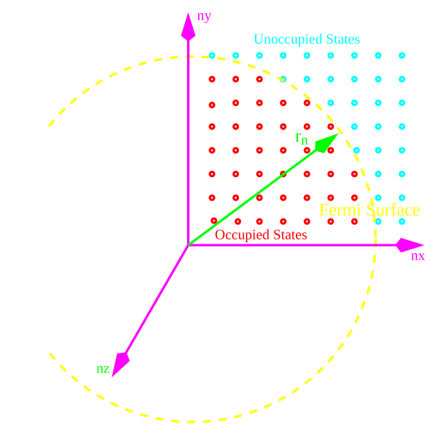

_Figure 42 (p. 197)_

The number of states within the radius is

```math
N = ( 2 )_{spin} \frac{1}{8} \frac{4}{3} \pi r_{n}^{3}
```

where we have added a factor of 2 because fermions have two spin states. This is an **approximate** **counting of the number of states** based on the volume of a sphere in $`n`$-space. The factor of $`\frac{1}{8}`$ indicates that we are just using one eighth of the sphere in $`n`$-space because all the quantum numbers must be positive.

<div align="right"><a href="book.pdf#page=197" target="_blank" title="This page in the PDF"><sup>[p. 197]</sup></a></div>
<hr class="page" style="height:2px;border:0;background:currentColor;opacity:0.25">
<a id="p198" href="book.pdf#page=198" target="_blank" title="This page in the PDF"><sup>[p. 198]</sup></a>

We can now **relate the Fermi energy to the number of particles in the box**.

```math
E_{F} = \frac{\pi^{2} \hbar^{2}}{2 mL^{2}} r_{n}^{2} = \frac{\pi^{2} \hbar^{2}}{2 mL^{2}} \left( \frac{3 N}{\pi} \right)^{\tfrac{2}{3}} = \frac{\pi^{2} \hbar^{2}}{2 m} \left( \frac{3 N}{\pi L^{3}} \right)^{\tfrac{2}{3}} = \frac{\pi^{2} \hbar^{2}}{2 m} \left( \frac{3 n}{\pi} \right)^{\tfrac{2}{3}}
```

We can also integrate to get the **total energy** of all the fermions.

```math
E_{t ot} = 2 \frac{1}{8} \int_{0}^{r_{n}} 4 \pi r^{2} \frac{r^{2} \pi^{2} \hbar^{2}}{2 mL^{2}} dr = \frac{\pi^{3} \hbar^{2}}{2 mL^{2}} \frac{r_{n}^{5}}{5} = \frac{\pi^{3} \hbar^{2}}{1 0 mL^{2}} \left( \frac{3 N}{\pi} \right)^{\tfrac{5}{3}} = \frac{\pi^{3} \hbar^{2}}{1 0 m} \left( \frac{3 n}{\pi} \right)^{\tfrac{5}{3}} L^{3}
```

where the last step shows how the total energy depends on the number of particles per unit volume $`n`$. It makes sense that this energy is proportional to the volume.

The step in which $`E_{F}`$ and $`E_{tot}`$ is related to $`N`$ is often useful.

```math
E_{F} = \frac{\pi^{2} \hbar^{2}}{2 m} \left( \frac{3 N}{\pi L^{3}} \right)^{\tfrac{2}{3}}
```

```math
E_{t ot} = \frac{\pi^{3} \hbar^{2}}{1 0 mL^{2}} \left( \frac{3 N}{\pi} \right)^{\tfrac{5}{3}}
```

## <a id="s-13-1-2-degeneracy-pressure-in-stars"></a>13.1.2 Degeneracy Pressure in Stars

The pressure exerted by fermions squeezed into a small box is what keeps cold stars from collapsing. White Dwarfs are held up by electrons and Neutron Stars are held up by neutrons in a much smaller box.

We can **compute the pressure** from the dependence of the energy on the volume for a fixed number of fermions.

```math
dE = \vec{F} \cdot d \vec{s} = PAds = PdV
```

```math
P = - \frac{\partial E_{t ot}}{\partial V}
```

```math
E_{t ot} = \frac{\pi^{3} \hbar^{2}}{1 0 m} \left( \frac{3 N}{\pi} \right)^{\tfrac{5}{3}} V^{- \tfrac{2}{3}}
```

```math
P = \frac{\pi^{3} \hbar^{2}}{1 5 m} \left( \frac{3 N}{\pi} \right)^{\tfrac{5}{3}} V^{- \tfrac{5}{3}}
```

```math
P = \frac{\pi^{3} \hbar^{2}}{1 5 m} \left( \frac{3 N}{\pi} \right)^{\tfrac{5}{3}} L^{- 5} = \frac{\pi^{3} \hbar^{2}}{1 5 m} \left( \frac{3 n}{\pi} \right)^{\tfrac{5}{3}}
```

The last step verifies that the pressure only depends on the density, not the volume and the $`N`$ independently, as it should. We will use.

```math
P = \frac{\pi^{3} \hbar^{2}}{1 5 m} \left( \frac{3 N}{\pi} \right)^{\tfrac{5}{3}} L^{- 5} = \frac{\pi^{3} \hbar^{2}}{1 5 m} \left( \frac{3 N}{\pi} \right)^{\tfrac{5}{3}} V^{\tfrac{- 5}{3}}
```

<div align="right"><a href="book.pdf#page=198" target="_blank" title="This page in the PDF"><sup>[p. 198]</sup></a></div>
<hr class="page" style="height:2px;border:0;background:currentColor;opacity:0.25">
<a id="p199" href="book.pdf#page=199" target="_blank" title="This page in the PDF"><sup>[p. 199]</sup></a>

To understand the collapse of stars, we must compare this to the **pressure of gravity**. We compute this approximately, ignoring general relativity and, more significantly, the variation of gravitational pressure with radius.

```math
E = - \int_{0}^{R} \frac{GM_{i nside} 4 \pi r^{2} \rho}{r} dr
```

```math
= - \int_{0}^{R} \frac{G ( \tfrac{4}{3} \pi r^{3} \rho ) 4 \pi r^{2} \rho}{r} dr
```

```math
= - \frac{( 4 \pi )^{2}}{1 5} G\rho^{2} R^{5} = - \frac{3 GM^{2}}{5 R}
```

The mass of the star is dominated by nucleons.

```math
M = NM_{N}
```

Putting this into our energy formula, we get.

```math
E = - \frac{3}{5} G ( NM_{N} )^{2} \left( \frac{4 \pi}{3} \right)^{\tfrac{1}{3}} V^{- \tfrac{1}{3}}
```

We can now compute the pressure.

```math
P_{g} = - \frac{\partial E}{\partial V} = - \frac{1}{5} G ( NM_{N} )^{2} \left( \frac{4 \pi}{3} \right)^{\tfrac{1}{3}} V^{- \tfrac{4}{3}}
```

The pressures must balance. For a **white dwarf**, the pressure from electrons is.

```math
P_{e} = \frac{\pi^{3} \hbar^{2}}{1 5 m_{e}} \left( \frac{3 N_{e}}{\pi} \right)^{\tfrac{5}{3}} V^{- \tfrac{5}{3}}
```

We can solve for the radius.

```math
R = \left( \frac{3}{4 \pi} \right)^{\tfrac{2}{3}} \frac{\pi^{3} \hbar^{2}}{3 Gm_{e} M_{N}^{2}} \left( \frac{3}{\pi} \right)^{\tfrac{5}{3}} \frac{N_{e}^{\tfrac{5}{3}}}{N^{2}}
```

There are about two nucleons per electron

```math
N \approx 2 N_{e}
```

so the radius becomes.

```math
R = \left( \frac{8 1 \pi^{2}}{5 1 2} \right)^{\tfrac{1}{3}} \frac{\hbar^{2}}{Gm_{e} M_{N}^{2}} N^{- \tfrac{1}{3}}
```

The radius decreases as we add mass. For one solar mass, $`N = 1 0`$<sup>57</sup>, we get a radius of 7200 km, the size of the earth. The Fermi energy is about 0.2 MeV.

A **white dwarf** is the remnant of a normal star. It has used up its nuclear fuel, fusing light elements into heavier ones, until most of what is left is Fe<sup>56</sup> which is the most tightly bound nucleus. Now the star begins to cool and to shrink. It is stopped by the pressure of electrons. Since the **pressure**<span class="page" style="float:left;width:100%;margin:0.4em 0 0.6em"><span style="display:block;text-align:right"><a href="book.pdf#page=199" target="_blank" title="This page in the PDF"><sup>[p. 199]</sup></a></span><span style="display:block;height:2px;background:currentColor;opacity:0.25"></span><a id="p200" href="book.pdf#page=200" target="_blank" title="This page in the PDF"><sup>[p. 200]</sup></a></span> **from the electrons grows faster than the pressure of gravity**, the star will stay at about earth size even when it cools.

If the star is more massive, the Fermi energy goes up and it becomes possible to absorb the electrons into the nucleons, converting protons into neutrons. The Fermi energy needs to be above 1 MeV. If the electrons disappear this way, the star collapses suddenly down to a size for which the Fermi pressure of the neutrons stops the collapse (with quite a shock). Actually some white dwarfs stay at earth size for a long time as they suck in mass from their surroundings. When they have just enough, they collapse forming a neutron star and making a supernova. The supernovae are all nearly identical since the dwarfs are gaining mass very slowly. The brightness of this type of supernova has been used to **measure the accelerating expansion of the universe**.

We can estimate the **neutron star radius**.

```math
R \to R \frac{M_{N}}{m_{e}} N^{\tfrac{1}{3}} 2^{- \tfrac{5}{3}} = 1 0
```

Its about 10 kilometers. If the pressure at the center of a neutron star becomes too great, it collapses to become a black hole. This collapse is probably brought about by general relativistic effects, aided by strange quarks.

# <a id="s-13-2-the-3d-harmonic-oscillator"></a>13.2 The 3D Harmonic Oscillator

The 3D harmonic oscillator can also be separated in Cartesian coordinates. For the case of a central potential, $`V = \tfrac{1}{2} m\omega^{2} r^{2}`$, this problem can also be solved nicely in spherical coordinates using rotational symmetry. The cartesian solution is easier and better for counting states though.

Lets **assume the central potential** so we can compare to our later solution. We could have three different spring constants and the solution would be as simple. The Hamiltonian is

```math
H = \frac{p^{2}}{2 m} + \frac{1}{2} m\omega^{2} r^{2}
```

```math
H = \frac{p_{x}^{2}}{2 m} + \frac{1}{2} m\omega^{2} x^{2} + \frac{p_{y}^{2}}{2 m} + \frac{1}{2} m\omega^{2} y^{2} + \frac{p_{z}^{2}}{2 m} + \frac{1}{2} m\omega^{2} z^{2}
```

```math
H = H_{x} + H_{y} + H_{z}
```

The problem separates nicely, giving us **three independent harmonic oscillators**.

```math
E = \left( n_{x} + n_{y} + n_{z} + \frac{3}{2} \right) \hbar \omega
```

```math
\psi_{nx,ny,nz} ( x,y,z ) = u_{nx} ( x ) u_{ny} ( y ) u_{nz} ( z )
```

This was really easy.

This problem has a different Fermi surface in $`n`$-space than did the particle in a box. The boundary between filled and unfilled energy levels is a plane defined by

```math
n_{x} + n_{y} + n_{z} = \frac{E_{F}}{\hbar \omega} - \frac{3}{2}
```

<div align="right"><a href="book.pdf#page=200" target="_blank" title="This page in the PDF"><sup>[p. 200]</sup></a></div>
<hr class="page" style="height:2px;border:0;background:currentColor;opacity:0.25">
<a id="p201" href="book.pdf#page=201" target="_blank" title="This page in the PDF"><sup>[p. 201]</sup></a>

# <a id="s-13-3-sample-test-problems"></a>13.3 Sample Test Problems

1. A particle of mass $`m`$ in 3 dimensions is in a potential $`V ( x,y,z ) = \tfrac{1}{2} k ( x^{2}`$ + 2$`y^{2}`$ + 3$`z^{2} )`$. Find the energy eigenstates in terms of **3 quantum numbers**. What is the energy of the ground state and first excited state?

2. **\*** N identical fermions are bound (at low temperature) in a potential $`V ( r ) = \tfrac{1}{2} m\omega^{2} r^{2}`$. Use separation in Cartesian coordinates to find the energy eigenvalues in terms of a set of three quantum numbers (which correspond to 3 mutually commuting operators). Find the Fermi energy of the system. If you are having trouble finding the number of states with energy less than $`E_{F}`$, you may assume that it is $`\alpha ( E_{F} / \hbar \omega )^{3}`$.

3. A particle of mass m is in the potential $`V (`$**r**$`) = \tfrac{1}{2} m\omega^{2} ( x^{2} + y^{2} )`$. Find operators that commute with the Hamiltonian and use them to simplify the Schrödinger equation. Solve this problem in the simplest way possible to find the eigen-energies in terms of a set of ”quantum numbers” that describe the system.

4. A particle is in a cubic box. That is, the potential is zero inside a cube of side L and infinite outside the cube. Find the 3 lowest allowed energies. Find the number of states (level of degeneracy) at each of these 3 energies.

<div align="center">

5. A particle of mass m is bound in the 3 dimensional potential $`V (`$**r**$`) = kr^{2}`$.

</div>

a) Find the energy levels for this particle.

b) Determine the number of degenerate states for the first three energy levels.

6. A particle of mass $`m`$ is in a cubic box. That is, the potential is zero inside a cube of side $`L`$ and infinite outside.

a) Find the three lowest allowed energies.

b) Find the number of states (level of degeneracy) at each of these three energies.

c) Find the Fermi Energy $`E_{F}`$ for $`N`$ particles in the box. (N is large.)

7. A particle is confined in a rectangular box of length $`L`$, width $`W`$, and “tallness” $`T`$. Find the energy eigenvalues in terms of a set of three quantum numbers (which correspond to 3 mutually commuting operators). What are the energies of the three lowest energy states if $`L`$ = 2$`a , W`$ = 1$`a`$, and $`T`$ = 0$`. 5 a`$.

<div align="center">

8. A particle of mass m is bound in the 3 dimensional potential $`V (`$**r**$`) = kr^{2}`$.

</div>

9. a) Find the energy levels for this particle.

10. b) Determine the number of degenerate states for the first three energy levels.

11. In 3 dimensions, a particle of mass $`m`$ is bound in a potential $`V (`$**r**$`) = \tfrac{e^{2}}{\sqrt{x^{2} + z^{2}}}^{-}`$.

a) The definite energy states will, of course, be eigenfunctions of $`H`$. What other operators

can they be eigenfunctions of?

b) Simplify the three dimensional Schrödinger equation by using these operators.

---

<a id="14-angular-momentum"></a>

<hr class="page" style="height:2px;border:0;background:currentColor;opacity:0.25">
<a id="p202" href="book.pdf#page=202" target="_blank" title="This page in the PDF"><sup>[p. 202]</sup></a>

# 14 Angular Momentum

# <a id="s-14-1-rotational-symmetry"></a>14.1 Rotational Symmetry

If the potential only depends on the distance between two particles,

```math
V ( \vec{r} ) = V ( r )
```

the Hamiltonian has **Rotational Symmetry**. This is true for the coulomb (and gravitational) potential as well as many others. We know from classical mechanics that these are important problems.

If a the Hamiltonian has rotational symmetry, we can show that the Angular Momentum operators commute with the Hamiltonian (See section 14.4.1).

```math
[ H,L_{i} ] = 0
```

We therefore expect each component of $`\vec{L}`$ to be conserved.

We will not be able to label our states with the quantum numbers for the three components of angular momentum. Recall that we are looking for **a set of mutually commuting operators** to label our energy eigenstates. We actually want two operators plus $`H`$ to give us three quantum numbers for states in three dimensions.

The components of angular momentum do not commute (See section 14.4.2) with each other

```math
[ L_{x} ,L_{y} ] = i \hbar L_{z}
```

```math
1 2 . \quad [ L_{i} ,L_{j} ] = i \hbar \epsilon_{ijk} L_{k}
```

but the **square of the angular momentum commutes** with any of the components

```math
[ L^{2} ,L_{i} ] = 0
```

These commutators lead us to choose the **mutually commuting set of operators** to be $`H , L^{2}`$, and $`L_{z}`$. We could have chosen any component, however, it is most convenient to choose $`L_{z}`$ given the standard definition of spherical coordinates.

The Schrödinger equation can now be rewritten (See section 14.4.3) with only radial derivatives and $`L^{2}`$.

```math
\begin{aligned} \frac{- \hbar^{2}}{2 \mu} \nabla^{2} u_{E} ( \vec{r} ) + V ( r ) u_{E} ( \vec{r} ) &= Eu_{E} ( \vec{r} ) \\ \frac{- \hbar^{2}}{2 \mu} \left[ \frac{1}{r^{2}} \left( r \frac{\partial}{\partial r} \right)^{2} + \frac{1}{r} \frac{\partial}{\partial r} - \frac{L^{2}}{\hbar^{2} r^{2}} \right] u_{E} ( \vec{r} ) + V ( r ) u_{E} ( \vec{r} ) &= Eu_{E} ( \vec{r} ) \end{aligned}
```

<div align="right"><a href="book.pdf#page=202" target="_blank" title="This page in the PDF"><sup>[p. 202]</sup></a></div>
<hr class="page" style="height:2px;border:0;background:currentColor;opacity:0.25">
<a id="p203" href="book.pdf#page=203" target="_blank" title="This page in the PDF"><sup>[p. 203]</sup></a>

This leads to a great simplification of the 3D problem.

It is possible to **separate the Schrödinger equation** since $`r`$ and $`L^{2}`$ appear separately. Write the solution as a product

```math
u_{E} ( \vec{r} ) = R_{E\ell} ( r ) Y_{\ell m} ( \theta ,\varphi )
```

where $`\ell`$ labels the eigenvalue of the $`L^{2}`$ operator and $`m`$ labels the eigenvalue of the $`L_{z}`$ operator. Since $`L_{z}`$ does not appear in the Schrödinger equation, we only label the radial solutions with the energy and the eigenvalues of $`\ell`$.

We get the three equations.

```math
L^{2} Y_{\ell m} ( \theta ,\varphi ) = \ell ( \ell + 1 ) \hbar^{2} Y_{\ell m} ( \theta ,\varphi )
```

```math
\begin{aligned} L_{z} Y_{\ell m} ( \theta ,\varphi ) &= m \hbar Y_{\ell m} ( \theta ,\varphi ) \\ \frac{- \hbar^{2}}{2 \mu} \left[ \frac{1}{r^{2}} \left( r \frac{\partial}{\partial r} \right)^{2} + \frac{1}{r} \frac{\partial}{\partial r} - \frac{\ell ( \ell + 1 )}{r^{2}} \right] R_{E\ell} ( r ) + V ( r ) R_{E\ell} ( r ) &= ER_{E\ell} ( r ) \end{aligned}
```

By assuming the eigenvalues of $`L^{2}`$ have the form $`\ell ( \ell`$ + 1)$`\hbar^{2}`$, we have **anticipated the solution** **but not constrained it**, since the units of angular momentum are those of $`\hbar`$ and since we expect $`L^{2}`$ to have positive eigenvalues.

```math
\langle Y_{\ell m} | L^{2} | Y_{\ell m} \rangle = \langle L_{x} Y_{\ell m} | L_{x} Y_{\ell m} \rangle + \langle L_{y} Y_{\ell m} | L_{y} Y_{\ell m} \rangle + \langle L_{z} Y_{\ell m} | L_{z} Y_{\ell m} \rangle \geq 0
```

The assumption that the eigenvalues of $`L_{z}`$ are some (dimensionless) number times $`\hbar`$ does not constrain our solutions at all.

We will use the algebra of the angular momentum operators to help us **solve the angular part of** **the problem in general**.

For any given problem with rotational symmetry, we will need to **solve a particular differential** **equation in one variable** $`r`$. This radial equation can be simplified a bit.

```math
\frac{- \hbar^{2}}{2 \mu} \left[ \frac{\partial^{2}}{\partial r^{2}} + \frac{2}{r} \frac{\partial}{\partial r} \right] R_{E\ell} ( r ) + \left( V ( r ) + \frac{\ell ( \ell + 1 ) \hbar^{2}}{2 \mu r^{2}} \right) R_{E\ell} ( r ) = ER_{E\ell} ( r )
```

We have grouped the term due to angular momentum with the potential. It is often called a pseudo-potential. For $`\ell \neq 0`$, it is like a repulsive potential.

# <a id="s-14-2-angular-momentum-algebra-raising-and-lowering-operators"></a>14.2 Angular Momentum Algebra: Raising and Lowering Operators

We have already derived the **commutators of the angular momentum operators**

```math
[ L_{x} ,L_{y} ] = i \hbar L_{z}
```

<div align="right"><a href="book.pdf#page=203" target="_blank" title="This page in the PDF"><sup>[p. 203]</sup></a></div>
<hr class="page" style="height:2px;border:0;background:currentColor;opacity:0.25">
<a id="p204" href="book.pdf#page=204" target="_blank" title="This page in the PDF"><sup>[p. 204]</sup></a>

```math
[ L_{i} ,L_{j} ] = i \hbar \epsilon_{ijk} L_{k}
```

```math
[ L^{2} ,L_{i} ] = 0 .
```

We have shown that angular momentum is quantized for a rotor with a single angular variable. To progress toward the possible quantization of angular momentum variables in 3D, we **define the** **operator** $`L_{+}`$ and its Hermitian conjugate $`L_{-}`$.

```math
L_{\pm} \equiv L_{x} \pm iL_{y} .
```

Since $`L^{2}`$ commutes with $`L_{x}`$ and $`L_{y}`$, it commutes with these operators.

```math
[ L^{2} ,L_{\pm} ] = 0
```

The commutator with $`L_{z}`$ is.

```math
[ L_{\pm} ,L_{z} ] = [ L_{x} ,L_{z} ] \pm i [ L_{y} ,L_{z} ] = i \hbar ( - L_{y} \pm iL_{x} ) = \mp \hbar L_{\pm} .
```

From the commutators $`[ L^{2} ,L_{\pm} ]`$ = 0 and [$`L_{\pm} ,L_{z} ] = \mp \hbar L_{\pm}`$, we can derive the effect of the operators (See section 14.4.5) $`L_{\pm}`$ on the eigenstates $`Y_{\ell m}`$, and in so doing, show that $`\ell`$ is an integer greater than or equal to 0, and that $`m`$ is also an integer

```math
\ell = 0 , 1 , 2 ,\dots
```

```math
- \ell \leq m \leq \ell
```

```math
m = - \ell , - \ell + 1 ,\dots ,\ell
```

```math
L_{\pm} Y_{\ell m} = \hbar \sqrt{\ell ( \ell + 1 ) - m ( m \pm 1 ) Y_{\ell ( m \pm 1 )}}
```

Therefore, $`L_{+}`$ raises the $`z`$ component of angular momentum by one unit of $`\hbar`$ and $`L_{-}`$ lowers it by one unit. The raising stops when $`m = \ell`$ and the operation gives zero, $`L_{+} Y_{\ell \ell}`$ = 0. Similarly, the lowering stops because $`L_{-} Y_{\ell - \ell}`$ = 0.

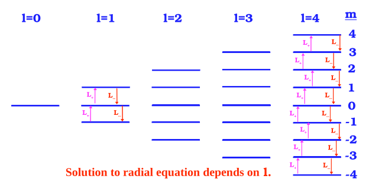

_Figure 43 (p. 204)_

**Angular momentum is quantized**. Any measurement of a component of angular momentum will give some integer times $`\hbar`$. Any measurement of the total angular momentum gives the somewhat curious result **L**

```math
| L | = \sqrt{\ell ( \ell + 1 )} \hbar
```

<div align="right"><a href="book.pdf#page=204" target="_blank" title="This page in the PDF"><sup>[p. 204]</sup></a></div>
<hr class="page" style="height:2px;border:0;background:currentColor;opacity:0.25">
<a id="p205" href="book.pdf#page=205" target="_blank" title="This page in the PDF"><sup>[p. 205]</sup></a>

where $`\ell`$ is an integer.

Note that we can easily write the components of angular momentum in terms of the raising and lowering operators.

```math
L_{x} = \frac{1}{2} ( L_{+} + L_{-} )
```

```math
L_{y} = \frac{1}{2 i} ( L_{+} - L_{-} )
```

We will also find the following equations useful (and easy to compute).

```math
[ L_{+} ,L_{-} ] = i [ L_{y} ,L_{x} ] - i [ L_{x} ,L_{y} ] = \hbar ( L_{z} + L_{z} ) = 2 \hbar L_{z}
```

```math
L^{2} = L_{+} L_{-} + L_{z}^{2} - \hbar L_{z} .
```

\* See Example 14.5.1: What is the expectation value of $`L_{z}`$ in the state $`\psi ( \vec{r} ) = R ( r ) ( \surd_{3}^{2} Y_{1 1} ( \theta ,\varphi ) -`$

```math
i \surd_{3}^{1} Y_{1 - 1} ( \theta ,\varphi ) ) ? *
```

\* See Example 14.5.2: What is the expectation value of $`L_{x}`$ in the state $`\psi ( \vec{r} ) = R ( r ) ( \surd_{3}^{2} Y_{1 1} ( \theta ,\varphi ) -`$

```math
\surd_{3}^{1} Y_{1 0} ( \theta ,\varphi ) ) ? *
```

# <a id="s-14-3-the-angular-momentum-eigenfunctions"></a>14.3 The Angular Momentum Eigenfunctions

The angular momentum eigenstates are **eigenstates of two operators**.

```math
L_{z} Y_{\ell m} ( \theta ,\varphi ) = m \hbar Y_{\ell m} ( \theta ,\varphi )
```

```math
L^{2} Y_{\ell m} ( \theta ,\varphi ) = \ell ( \ell + 1 ) \hbar^{2} Y_{\ell m} ( \theta ,\varphi )
```

All we know about the states are the two quantum numbers $`\ell`$ and $`m`$. We have no additional knowledge about $`L_{x}`$ and $`L_{y}`$ since these operators don’t commute with $`L_{z}`$. The **raising and** **lowering operators** $`L_{\pm} = L_{x} \pm iL_{y}`$ raise or lower $`m`$, leaving $`\ell`$ unchanged.

```math
L_{\pm} Y_{\ell m} = \hbar \sqrt{\ell ( \ell + 1 ) - m ( m \pm 1 )} Y_{\ell ( m \pm 1 )}
```

The differential operators take some work to derive (See section 14.4.4).

```math
L_{z} = \frac{\hbar}{i} \frac{\partial}{\partial \varphi}
```

```math
L_{\pm} = \hbar e^{\pm i\varphi} \left( \pm \frac{\partial}{\partial \theta} + i \cot \theta \frac{\partial}{\partial \varphi} \right)
```

<div align="right"><a href="book.pdf#page=205" target="_blank" title="This page in the PDF"><sup>[p. 205]</sup></a></div>
<hr class="page" style="height:2px;border:0;background:currentColor;opacity:0.25">
<a id="p206" href="book.pdf#page=206" target="_blank" title="This page in the PDF"><sup>[p. 206]</sup></a>

Its easy to find functions that give the eigenvalue of $`L_{z}`$.

```math
Y_{\ell m} ( \theta ,\varphi ) = \Theta ( \theta ) \Phi ( \varphi ) = \Theta ( \theta ) e^{im\varphi}
```

```math
L_{z} Y_{\ell m} ( \theta ,\varphi ) = \frac{\hbar}{i} \frac{\partial}{\partial \varphi} \Theta ( \theta ) e^{im\varphi} = \frac{\hbar}{i} im \Theta ( \theta ) e^{im\varphi} = m \hbar Y_{\ell m} ( \theta ,\varphi )
```

To find the $`\theta`$ dependence, we will use the fact that there are limits on $`m`$. The state with maximum $`m`$ must give zero when raised.

```math
L_{+} Y_{\ell \ell} = \hbar e^{i\varphi} \left( \frac{\partial}{\partial \theta} + i \cot \theta \frac{\partial}{\partial \varphi} \right) \Theta_{\ell} ( \theta ) e^{i\ell \varphi} = 0
```

This gives us a differential equation for that state.

```math
\frac{d \Theta ( \theta )}{d\theta} + i \Theta ( \theta ) \cot \theta ( i\ell ) = 0
```

```math
\frac{d \Theta ( \theta )}{d\theta} = \ell \cot \theta \Theta ( \theta )
```

The solution is

```math
\Theta ( \theta ) = C \sin^{\ell} \theta .
```

Check the solution.

```math
\frac{d \Theta}{d\theta} = C\ell \cos \theta \sin^{\ell - 1} \theta = \ell \cot \theta \Theta
```

Its correct.

Here we should note that only the integer value of $`\ell`$ work for these solutions. If we were to use half-integers, the wave functions would not be single valued, for example at $`\varphi`$ = 0 and $`\varphi`$ = 2$`\pi`$. Even though the probability may be single valued, discontinuities in the amplitude would lead to infinities in the Schrödinger equation. We will find later that the **half-integer angular momentum states** **are used** for internal angular momentum (spin), for which no $`\theta`$ or $`\varphi`$ coordinates exist.

Therefore, **the eigenstate** $`Y_{\ell \ell}`$ **is**.

```math
Y_{\ell \ell} = C \sin^{\ell} ( \theta ) e^{i\ell \varphi}
```

We can compute the next state down by operating with $`L_{-}`$.

```math
Y_{\ell ( \ell - 1 )} = CL_{-} Y_{\ell \ell}
```

We can continue to lower $`m`$ to get all of the eigenfunctions.

We call these eigenstates the **Spherical Harmonics**. The spherical harmonics are **normalized**.

```math
\int_{- 1}^{1} d ( \cos \theta ) \int_{0}^{2 \pi} d\varphi Y_{\ell m}^{*} Y_{\ell m} = 1
```

```math
\int d \Omega Y_{\ell m}^{*} Y_{\ell m} = 1
```

Since they are eigenfunctions of Hermitian operators, they are **orthogonal**.

<div align="right"><a href="book.pdf#page=206" target="_blank" title="This page in the PDF"><sup>[p. 206]</sup></a></div>
<hr class="page" style="height:2px;border:0;background:currentColor;opacity:0.25">
<a id="p207" href="book.pdf#page=207" target="_blank" title="This page in the PDF"><sup>[p. 207]</sup></a>

```math
\int d \Omega Y_{\ell m}^{*} Y_{\ell^{\prime} m^{\prime}} = \delta_{\ell \ell^{\prime}} \delta_{mm^{\prime}}
```

We will use the **actual function** in some problems.

```math
Y_{0 0} = \frac{1}{\sqrt{4 \pi}}
```

```math
Y_{1 1} = - \sqrt{\frac{3}{8 \pi}} e^{i\varphi} \sin \theta
```

```math
Y_{1 0} = \sqrt{\frac{3}{4 \pi}} \cos \theta
```

```math
Y_{2 2} = \sqrt{\frac{1 5}{3 2 \pi}} e^{2 i\varphi} \sin^{2} \theta
```

```math
Y_{2 1} = - \sqrt{\frac{1 5}{8 \pi}} e^{i\varphi} \sin \theta \cos \theta
```

```math
Y_{2 0} = \sqrt{\frac{5}{1 6 \pi}} ( 3 \cos^{2} \theta - 1 )
```

The spherical harmonics with negative $`m`$ can be easily compute from those with positive $`m`$.

```math
Y_{\ell ( - m )} = ( - 1 )^{m} Y_{\ell m}^{*}
```

Any function of $`\theta`$ and $`\varphi`$ can be **expanded in the spherical harmonics**.

```math
f ( \theta ,\varphi ) = \sum_{\ell = 0 m = - \ell}^{\infty} \sum^{\ell} C_{\ell m} Y_{\ell m} ( \theta ,\varphi )
```

The spherical harmonics form a **complete set**.

```math
\sum_{\ell = 0 m = - \ell}^{\infty} \sum^{\ell} | Y_{\ell m} \rangle \langle Y_{\ell m} | = \sum_{\ell = 0 m = - \ell}^{\infty} \sum^{\ell} | \ell m \rangle \langle \ell m | = 1
```

When using bra-ket notation, $`| \ell m \rangle`$ is sufficient to identify the state.

The spherical harmonics are **related to the Legendre polynomials** which are functions of $`\theta`$.

```math
Y_{\ell 0} ( \theta ,\varphi ) = \left( \frac{2 \ell + 1}{4 \pi} \right)^{\tfrac{1}{2}} P_{\ell} ( \cos \theta )
```

```math
Y_{\ell m} = ( - 1 )^{m} \left[ \frac{2 \ell + 1}{4 \pi} \frac{( \ell - m ) !}{( \ell + m ) !} \right]^{\tfrac{1}{2}} P_{\ell}^{m} ( \cos \theta ) e^{im\varphi}
```

<div align="right"><a href="book.pdf#page=207" target="_blank" title="This page in the PDF"><sup>[p. 207]</sup></a></div>
<hr class="page" style="height:2px;border:0;background:currentColor;opacity:0.25">
<a id="p208" href="book.pdf#page=208" target="_blank" title="This page in the PDF"><sup>[p. 208]</sup></a>

## <a id="s-14-3-1-parity-of-the-spherical-harmonics"></a>14.3.1 Parity of the Spherical Harmonics

In spherical coordinates, the **parity operation** is

```math
r \quad \to \quad r
```

```math
\theta \quad \to \quad \pi - \theta
```

```math
\varphi \quad \to \quad \varphi + \pi .
```

The radial part of the wavefunction, therefore, is unchanged and the

```math
R ( r ) \to R ( r )
```

**parity of the state is determined from the angular part**. We know the state $`Y_{\ell \ell}`$ in general. A parity transformation gives.

```math
Y_{\ell \ell} ( \theta ,\varphi ) \to Y_{\ell \ell} ( \pi - \theta ,\varphi + \pi ) = e^{i\ell \varphi} e^{i\ell \pi} \sin^{\ell} ( \theta ) = e^{i\ell \pi} Y_{\ell \ell} = ( - 1 )^{\ell} Y_{\ell \ell}
```

The states are either even or odd parity depending on the quantum number $`\ell`$.

```math
parity = ( - 1 )^{\ell}
```

The angular momentum operators are axial vectors and do not change sign under a parity transformation. Therefore, $`L_{-}`$ does not change under parity and all the $`Y_{\ell m}`$ with have the same parity as $`Y_{\ell \ell}`$

```math
L_{-} Y_{\ell \ell} \to ( - 1 )^{\ell} L_{-} Y_{\ell \ell}
```

```math
Y_{\ell m} ( \pi - \theta ,\varphi + \pi ) = ( - 1 )^{\ell} Y_{\ell m} ( \theta ,\varphi )
```

# <a id="s-14-4-derivations-and-computations"></a>14.4 Derivations and Computations

## <a id="s-14-4-1-rotational-symmetry-implies-angular-momentum-conservation"></a>14.4.1 Rotational Symmetry Implies Angular Momentum Conservation

In three dimensions, this means that we can change our coordinates by rotating about any one of the axes and the equations should not change. Lets try and infinitesimal rotation about the $`z`$ axis. The $`x`$ and $`y`$ coordinates will change.

```math
x^{\prime} = x + d\theta y
```

```math
y^{\prime} = y - d\theta x
```

The original Schrödinger Equation is

```math
H\psi ( x,y,z ) = E\psi ( x,y,z )
```

and the transformed equation is

```math
H\psi ( x + d\theta y,y - d\theta x,z ) = E\psi ( x + d\theta y,y - d\theta x,z ) .
```

<div align="right"><a href="book.pdf#page=208" target="_blank" title="This page in the PDF"><sup>[p. 208]</sup></a></div>
<hr class="page" style="height:2px;border:0;background:currentColor;opacity:0.25">
<a id="p209" href="book.pdf#page=209" target="_blank" title="This page in the PDF"><sup>[p. 209]</sup></a>

Now we Taylor expand this equation.

```math
H\psi ( x,y,z ) + Hd\theta \left( \frac{\partial \psi}{\partial x} y - \frac{\partial \psi}{\partial y} x \right) = E\psi ( x,y,z ) + Ed\theta \left( \frac{\partial \psi}{\partial x} y - \frac{\partial \psi}{\partial y} x \right)
```

Subtract off the original equation.

```math
H \left( \frac{\partial}{\partial x} y - \frac{\partial}{\partial y} x \right) \psi = \left( \frac{\partial}{\partial x} y - \frac{\partial}{\partial y} x \right) H\psi
```

We find an operator that commutes with the Hamiltonian.

```math
\left[ H, \frac{\hbar}{i} \left( x \frac{\partial}{\partial y} - y \frac{\partial}{\partial x} \right) \right] = 0
```

Note that we have inserted the constant $`\frac{\hbar}{i}`$ in anticipation of identifying this operator as the $`z`$ component of angular momentum.

```math
\vec{L} = \vec{r} \times \vec{p}
```

```math
L_{z} = \frac{\hbar}{i} \left( x \frac{\partial}{\partial y} - y \frac{\partial}{\partial x} \right) = xp_{y} - yp_{x}
```

We could have done infinitesimal rotations about the $`x`$ or $`y`$ axes and shown that all the components of the angular momentum operator commute with the Hamiltonian.

```math
[ H,L_{z} ] = [ H,L_{x} ] = [ H,L_{y} ] = 0
```

Remember that operators that commute with the Hamiltonian imply physical quantities that are conserved.

## <a id="s-14-4-2-the-commutators-of-the-angular-momentum-operators"></a>14.4.2 The Commutators of the Angular Momentum Operators

```math
[ L_{x} ,L_{y} ] \neq 0 ,
```

however, the square of the angular momentum vector commutes with all the components.

```math
[ L^{2} ,L_{z} ] = 0
```

This will give us the operators we need to label states in 3D central potentials.

Lets just compute the commutator.

```math
[ L_{x} ,L_{y} ] = [ yp_{z} - zp_{y} ,zp_{x} - xp_{z} ] = y [ p_{z} ,z ] p_{x} + [ z,p_{z} ] p_{y} x
```

```math
= \frac{\hbar}{i} [ yp_{x} - xp_{y} ] = i \hbar L_{z}
```

Since there is no difference between $`x , y`$ and $`z`$, we can generalize this to

```math
[ L_{i} ,L_{j} ] = i \hbar \epsilon_{ijk} L_{k}
```

<div align="right"><a href="book.pdf#page=209" target="_blank" title="This page in the PDF"><sup>[p. 209]</sup></a></div>
<hr class="page" style="height:2px;border:0;background:currentColor;opacity:0.25">
<a id="p210" href="book.pdf#page=210" target="_blank" title="This page in the PDF"><sup>[p. 210]</sup></a>

where $`\epsilon_{ijk}`$ is the completely antisymmetric tensor and we assume a sum over repeated indices.

```math
\epsilon_{ijk} = - \epsilon_{jik} = - \epsilon_{ikj} = - \epsilon_{kji}
```

The tensor is equal to 1 for cyclic permutations of 123, equal to -1 for anti-cyclic permutations, and equal to zero if any index is repeated. It is commonly used for a cross product. For example, if

```math
\vec{L} = \vec{r} \times \vec{p}
```

then

```math
L_{i} = r_{j} p_{k} \epsilon_{ijk}
```

where we again assume a sum over repeated indices.

Now lets compute commutators of the $`L^{2}`$ operator.

```math
L^{2} = L_{x}^{2} + L_{y}^{2} + L_{z}^{2}
```

```math
[ L_{z} ,L^{2} ] = [ L_{z} ,L_{x}^{2} ] + [ L_{z} ,L_{y}^{2} ]
```

```math
= [ L_{z} ,L_{x} ] L_{x} + L_{x} [ L_{z} ,L_{x} ] + [ L_{z} ,L_{y} ] L_{y} + L_{y} [ L_{z} ,L_{y} ]
```

```math
= i \hbar ( L_{y} L_{x} + L_{x} L_{y} - L_{x} L_{y} - L_{y} L_{x} ) = 0
```

We can generalize this to

```math
[ L_{i} ,L^{2} ] = 0 .
```

$`L^{2}`$ commutes with every component of $`\vec{L}`$.

## <a id="s-14-4-3-rewriting-2-p-2-mu-using-l-2"></a>14.4.3 Rewriting $`\frac{p^{2}}{2 \mu}`$ Using $`L^{2}`$

We wish to use the $`L^{2}`$ and $`L_{z}`$ operators to help us solve the central potential problem. If we can rewrite $`H`$ in terms of these operators, and remove all the angular derivatives, problems will be greatly simplified. We will work in Cartesian coordinates for a while, where we know the commutators.

First, write out $`L^{2}`$.

```math
L^{2} = ( \vec{r} \times \vec{p} )^{2}
```

```math
= - \hbar^{2} \left[ \left( y \frac{\partial}{\partial z} - z \frac{\partial}{\partial y} \right)^{2} + \left( z \frac{\partial}{\partial x} - x \frac{\partial}{\partial z} \right)^{2} + \left( x \frac{\partial}{\partial y} - y \frac{\partial}{\partial x} \right)^{2} \right]
```

Group the terms.

```math
\begin{aligned} L^{2} &= - \quad \hbar^{2} \left[ x^{2} \left( \frac{\partial^{2}}{\partial z^{2}} + \frac{\partial^{2}}{\partial y^{2}} \right) + y^{2} \left( \frac{\partial^{2}}{\partial x^{2}} + \frac{\partial^{2}}{\partial z^{2}} \right) + z^{2} \left( \frac{\partial^{2}}{\partial x^{2}} + \frac{\partial^{2}}{\partial y^{2}} \right) \right. \\ & \quad \left. - \left( 2 xy \frac{\partial^{2}}{\partial x\partial y} + 2 yz \frac{\partial^{2}}{\partial y\partial z} + 2 xz \frac{\partial^{2}}{\partial x\partial z} + 2 x \frac{\partial}{\partial x} + 2 y \frac{\partial}{\partial y} + 2 z \frac{\partial}{\partial z} \right) \right] \end{aligned}
```

<div align="right"><a href="book.pdf#page=210" target="_blank" title="This page in the PDF"><sup>[p. 210]</sup></a></div>
<hr class="page" style="height:2px;border:0;background:currentColor;opacity:0.25">
<a id="p211" href="book.pdf#page=211" target="_blank" title="This page in the PDF"><sup>[p. 211]</sup></a>

We expect to need to keep the radial derivatives so lets identify those by dotting $`\vec{r}`$ into $`\vec{p}`$. This will also make the units match $`L^{2}`$.

```math
( \vec{r} \cdot \vec{p} )^{2} = - \hbar^{2} \left( x \frac{\partial}{\partial x} + y \frac{\partial}{\partial y} + z \frac{\partial}{\partial z} \right)^{2}
```

```math
\begin{aligned} &= - \hbar^{2} \left( x^{2} \frac{\partial^{2}}{\partial x^{2}} + y^{2} \frac{\partial^{2}}{\partial y^{2}} + z^{2} \frac{\partial^{2}}{\partial z^{2}} + 2 xy \frac{\partial^{2}}{\partial x\partial y} + 2 yz \frac{\partial^{2}}{\partial y\partial z} + 2 xz \frac{\partial^{2}}{\partial x\partial z} \right. \\ & \quad \left. + x \frac{\partial}{\partial x} + y \frac{\partial}{\partial y} + z \frac{\partial}{\partial z} \right) \end{aligned}
```

By adding these two expressions, things simplify a lot.

```math
L^{2} + ( \vec{r} \cdot \vec{p} )^{2} = r^{2} p^{2} + i \hbar \vec{r} \cdot \vec{p}
```

We can now solve for $`p^{2}`$ and we have something we can use in the Schrödinger equation.

```math
p^{2} = \frac{1}{r^{2}} \left( L^{2} + ( \vec{r} \cdot \vec{p} )^{2} - i \hbar \vec{r} \cdot \vec{p} \right)
```

```math
= \frac{1}{r^{2}} L^{2} - \frac{\hbar^{2}}{r^{2}} \left( r \frac{\partial}{\partial r} \right)^{2} - \hbar^{2} \frac{1}{r} \frac{\partial}{\partial r}
```

<div align="center">

The Schrödinger equation now can be written with only radial derivatives and $`L^{2}`$.

</div>

```math
\frac{- \hbar^{2}}{2 \mu} \left[ \frac{1}{r^{2}} \left( r \frac{\partial}{\partial r} \right)^{2} + \frac{1}{r} \frac{\partial}{\partial r} - \frac{L^{2}}{\hbar^{2} r^{2}} \right] u_{E} ( \vec{r} ) + V ( r ) u_{E} ( \vec{r} ) = Eu_{E} ( \vec{r} )
```

<div align="center">

## <a id="s-14-4-4-spherical-coordinates-and-the-angular-momentum-operators"></a>14.4.4 Spherical Coordinates and the Angular Momentum Operators

</div>

The transformation from spherical coordinates to Cartesian coordinate is.

```math
\begin{array}{lccl}
x & = & r \sin & \theta \cos \varphi \\ 
y & = & r \sin & \theta \sin \varphi \\ 
z & = & r \cos & \theta \\ 
\end{array}
```

The transformation from Cartesian coordinates to spherical coordinates is.

```math
r = \sqrt{x^{2} + y^{2} + z^{2}}
```

```math
\cos \theta = \frac{z}{\sqrt{x^{2} + y^{2} + z^{2}}}
```

```math
\tan \varphi = y
```

<div align="right"><a href="book.pdf#page=211" target="_blank" title="This page in the PDF"><sup>[p. 211]</sup></a></div>
<hr class="page" style="height:2px;border:0;background:currentColor;opacity:0.25">
<a id="p212" href="book.pdf#page=212" target="_blank" title="This page in the PDF"><sup>[p. 212]</sup></a>


_Figure 44 (p. 212)_


_Figure 45 (p. 212)_

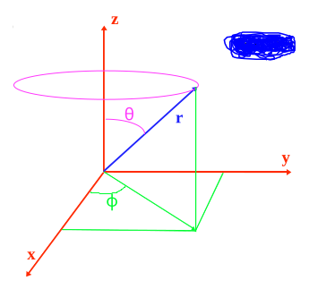

_Figure 46 (p. 212)_

We now proceed to calculate the angular momentum operators in spherical coordinates. The first step is to write the $`\frac{\partial}{\partial x_{i}}`$ in spherical coordinates. We use the chain rule and the above transformation from Cartesian to spherical. We have used $`d \cos \theta = - \sin \theta d\theta`$ and $`d \tan \varphi = \tfrac{1}{\cos^{2} \varphi} d\varphi`$. Ultimately all of these should be written in the sperical cooridnates but its convenient to use $`x`$ for example in intermediate steps of the calculation.

```math
\frac{\partial}{\partial x} = \frac{\partial r}{\partial x} \frac{\partial}{\partial r} + \frac{\partial \cos \theta}{\partial x} \frac{\partial}{\partial \cos \theta} + \frac{\partial \tan \varphi}{\partial x} \frac{\partial}{\partial \tan \varphi}
```

```math
= \frac{x}{r} \frac{\partial}{\partial r} + \frac{- xz}{r^{3}} \frac{- 1}{\sin \theta} \frac{\partial}{\partial \theta} - \frac{y}{x^{2}} \cos^{2} \varphi \frac{\partial}{\partial \varphi}
```

```math
= \sin \theta \cos \varphi \frac{\partial}{\partial r} + \frac{1}{r} \sin \theta \cos \varphi \cos \theta \frac{1}{\sin \theta} \frac{\partial}{\partial \theta} - \frac{1}{r} \frac{\sin \theta \sin \varphi}{\sin^{2} \theta \cos^{2} \varphi} \cos^{2} \varphi \frac{\partial}{\partial \varphi}
```

```math
= \sin \theta \cos \varphi \frac{\partial}{\partial r} + \frac{1}{r} \cos \varphi \cos \theta \frac{\partial}{\partial \theta} - \frac{1}{r} \frac{\sin \varphi}{\sin \theta} \frac{\partial}{\partial \varphi}
```

```math
\frac{\partial}{\partial y} = \frac{\partial r}{\partial y} \frac{\partial}{\partial r} + \frac{\partial \cos \theta}{\partial y} \frac{\partial}{\partial \cos \theta} + \frac{\partial \tan \varphi}{\partial y} \frac{\partial}{\partial \tan \varphi}
```

```math
= \frac{y}{r} \frac{\partial}{\partial r} + \frac{- yz}{r^{3}} \frac{- 1}{\sin \theta} \frac{\partial}{\partial \theta} + \frac{1}{x} \cos^{2} \varphi \frac{\partial}{\partial \varphi}
```

```math
= \sin \theta \sin \varphi \frac{\partial}{\partial r} + \frac{1}{r} \sin \theta \sin \varphi \cos \theta \frac{1}{\sin \theta} \frac{\partial}{\partial \theta} + \frac{1}{r} \frac{1}{\sin \theta \cos \varphi} \cos^{2} \varphi \frac{\partial}{\partial \varphi}
```

```math
= \sin \theta \sin \varphi \frac{\partial}{\partial r} + \frac{1}{r} \sin \varphi \cos \theta \frac{\partial}{\partial \theta} + \frac{1}{r} \frac{\cos \varphi}{\sin \theta} \frac{\partial}{\partial \varphi}
```

```math
\frac{\partial}{\partial z} = \frac{\partial r}{\partial z} \frac{\partial}{\partial r} + \frac{\partial \cos \theta}{\partial z} \frac{\partial}{\partial \cos \theta} + \frac{\partial \tan \varphi}{\partial z} \frac{\partial}{\partial \tan \varphi}
```

```math
= \frac{z}{r} \frac{\partial}{\partial r} + \left( \frac{1}{r} - \frac{z^{2}}{r^{3}} \right) \frac{- 1}{\sin \theta} \frac{\partial}{\partial \theta}
```

```math
= \cos \theta \frac{\partial}{\partial r} + \frac{1}{r} \left( 1 - \cos^{2} \theta \right) \frac{- 1}{\sin \theta} \frac{\partial}{\partial \theta}
```

```math
= \cos \theta \frac{\partial}{\partial r} - \frac{1}{r} \sin \theta \frac{\partial}{\partial \theta}
```

<div align="right"><a href="book.pdf#page=212" target="_blank" title="This page in the PDF"><sup>[p. 212]</sup></a></div>
<hr class="page" style="height:2px;border:0;background:currentColor;opacity:0.25">
<a id="p213" href="book.pdf#page=213" target="_blank" title="This page in the PDF"><sup>[p. 213]</sup></a>

Bringing together the above results, we have.

```math
\frac{\partial}{\partial x} = \sin \theta \cos \varphi \frac{\partial}{\partial r} + \frac{1}{r} \cos \varphi \cos \theta \frac{\partial}{\partial \theta} - \frac{1}{r} \frac{\sin \varphi}{\sin \theta} \frac{\partial}{\partial \varphi}
```

```math
\frac{\partial}{\partial y} = \sin \theta \sin \varphi \frac{\partial}{\partial r} + \frac{1}{r} \sin \varphi \cos \theta \frac{\partial}{\partial \theta} + \frac{1}{r} \frac{\cos \varphi}{\sin \theta} \frac{\partial}{\partial \varphi}
```

```math
\frac{\partial}{\partial z} = \cos \theta \frac{\partial}{\partial r} - \frac{1}{r} \sin \theta \frac{\partial}{\partial \theta}
```

Now simply plug these into the angular momentum formulae.

```math
L_{z} = \frac{\hbar}{i} \left( x \frac{\partial}{\partial y} - y \frac{\partial}{\partial x} \right) = \frac{\hbar}{i} \frac{\partial}{\partial \varphi}
```

```math
L_{\pm} = L_{x} \pm iL_{y} = \frac{\hbar}{i} \left( y \frac{\partial}{\partial z} - z \frac{\partial}{\partial y} \pm i \left( z \frac{\partial}{\partial x} - x \frac{\partial}{\partial z} \right) \right) = \frac{\hbar}{i} \left( ( y \mp ix ) \frac{\partial}{\partial z} - z \left( \frac{\partial}{\partial y} \mp i \frac{\partial}{\partial x} \right) \right)
```

```math
= \hbar \left( \mp ( x \pm iy ) \frac{\partial}{\partial z} \pm z \left( \frac{\partial}{\partial x} \pm i \frac{\partial}{\partial y} \right) \right)
```

```math
= \hbar r \left( \mp \sin \theta e^{\pm i\varphi} \frac{\partial}{\partial z} \pm \cos \theta \left( \frac{\partial}{\partial x} \pm i \frac{\partial}{\partial y} \right) \right)
```

```math
= \hbar \left( \mp \sin \theta e^{\pm i\varphi} \left( r \cos \theta \frac{\partial}{\partial r} - \sin \theta \frac{\partial}{\partial \theta} \right) \pm \cos \theta \left( r \sin \theta e^{\pm i\varphi} \frac{\partial}{\partial r} + \cos \theta e^{\pm i\varphi} \frac{\partial}{\partial \theta} \pm \frac{ie^{\pm i\varphi}}{\sin \theta} \frac{\partial}{\partial \varphi} \right) \right)
```

```math
= \hbar e^{\pm i\varphi} \left( \pm \sin^{2} \theta \frac{\partial}{\partial \theta} \pm \left( \cos^{2} \theta \frac{\partial}{\partial \theta} \pm \frac{i \cos \theta}{\sin \theta} \frac{\partial}{\partial \varphi} \right) \right)
```

```math
= \hbar e^{\pm i\varphi} \left( \pm \frac{\partial}{\partial \theta} + i \cot \theta \frac{\partial}{\partial \varphi} \right)
```

<div align="center">

We will use these results to find the actual eigenfunctions of angular momentum.

</div>

```math
L_{z} = \frac{\hbar}{i} \frac{\partial}{\partial \varphi}
```

```math
L_{\pm} = \hbar e^{\pm i\varphi} \left( \pm \frac{\partial}{\partial \theta} + i \cot \theta \frac{\partial}{\partial \varphi} \right)
```

## <a id="s-14-4-5-the-operators-l-pm"></a>14.4.5 The Operators $`L_{\pm}`$

The next step is to figure out how the $`L_{\pm}`$ operators change the eigenstate $`Y_{\ell m}`$. What eigenstates of $`L^{2}`$ are generated when we operate with $`L_{+}`$ or $`L_{-}`$?

```math
L^{2} ( L_{\pm} Y_{\ell m} ) = L_{\pm} L^{2} Y_{\ell m} = \ell ( \ell + 1 ) \hbar^{2} ( L_{\pm} Y_{\ell m} )
```

Because $`L^{2}`$ commutes with $`L_{\pm}`$, we see that we have the same $`\ell ( \ell`$ + 1) after operation. This is also true for operations with $`L_{z}`$.

```math
L^{2} ( L_{z} Y_{\ell m} ) = L_{z} L^{2} Y_{\ell m} = \ell ( \ell + 1 ) \hbar^{2} ( L_{z} Y_{\ell m} )
```

<div align="right"><a href="book.pdf#page=213" target="_blank" title="This page in the PDF"><sup>[p. 213]</sup></a></div>
<hr class="page" style="height:2px;border:0;background:currentColor;opacity:0.25">
<a id="p214" href="book.pdf#page=214" target="_blank" title="This page in the PDF"><sup>[p. 214]</sup></a>

The operators $`L_{+} , L_{-}`$ and $`L_{Z}`$ do not change $`\ell`$. That is, after we operate, the new state is still an eigenstate of $`L^{2}`$ with the same eigenvalue, $`\ell ( \ell`$ + 1).

The eigenvalue of $`L_{z}`$ is changed when we operate with $`L_{+}`$ or $`L_{-}`$.

```math
L_{z} ( L_{\pm} Y_{\ell m} ) = L_{\pm} L_{z} Y_{\ell m} + [ L_{z} ,L_{\pm} ] Y_{\ell m}
```

```math
= m \hbar ( L_{\pm} Y_{\ell m} ) \pm \hbar L_{\pm} Y_{\ell m} = ( m \pm 1 ) \hbar ( L_{\pm} Y_{\ell m} )
```

(This should remind you of the raising and lowering operators in the HO solution.)

From the above equation we can see that $`( L_{\pm} Y_{\ell m} )`$ is an eigenstate of $`L_{z}`$.

```math
L_{\pm} Y_{\ell m} = C_{\pm} ( \ell ,m ) Y_{\ell ( m \pm 1 )}
```

These operators raise or lower the $`z`$ component of angular momentum by one unit of $`\hbar`$.

Since $`L_{\pm}^{\dagger} \langle \rangle = L_{\mp}`$, its easy to show that the following is greater than zero.

```math
\langle L_{\pm} Y_{\ell m} | L_{\pm} Y_{\ell m} \rangle \geq 0
```

```math
\langle Y_{\ell m} | L_{\mp} L_{\pm} Y_{\ell m} \rangle \geq 0
```

Writing $`L_{+} L_{-}`$ in terms of our chosen operators,

```math
L_{\mp} L_{\pm} = ( L_{x} \mp iL_{y} ) ( L_{x} \pm iL_{y} ) = L_{x}^{2} + L_{y}^{2} \pm iL_{x} L_{y} \mp iL_{y} L_{x}
```

```math
= L_{x}^{2} + L_{y}^{2} \pm i [ L_{x} ,L_{y} ] = L^{2} - L_{z}^{2} \mp \hbar L_{z}
```

we can derive limits on the quantum numbers.

```math
\langle Y_{\ell m} | ( L^{2} - L_{z}^{2} \mp \hbar L_{z} ) Y_{\ell m} \rangle \geq 0
```

```math
( \ell ( \ell + 1 ) - m^{2} \mp m ) \hbar^{2} \geq 0
```

```math
\ell ( \ell + 1 ) \geq m ( m \pm 1 )
```

We know that the eigenvalue $`\ell ( \ell`$ + 1)$`\hbar^{2}`$ is greater than zero. We can assume that

```math
\ell \geq 0
```

because negative values just repeat the same eigenvalues of $`\ell ( \ell`$ + 1)$`\hbar^{2}`$.

The condition that $`\ell ( \ell`$ + 1) $`\geq m ( m \pm`$ 1) then becomes a limit on $`m`$.

```math
- \ell \leq m \leq \ell
```

Now, $`L_{+}`$ raises $`m`$ by one and $`L_{-}`$ lowers $`m`$ by one, and does not change $`\ell`$. Since $`m`$ is limited to be in the range $`- \ell \leq m \leq \ell`$, the raising and lowering must stop for $`m = \pm \ell`$,

```math
L_{-} Y_{\ell ( - \ell )} = 0
```

```math
L_{+} Y_{\ell \ell} = 0
```

<div align="right"><a href="book.pdf#page=214" target="_blank" title="This page in the PDF"><sup>[p. 214]</sup></a></div>
<hr class="page" style="height:2px;border:0;background:currentColor;opacity:0.25">
<a id="p215" href="book.pdf#page=215" target="_blank" title="This page in the PDF"><sup>[p. 215]</sup></a>

The raising and lowering operators change $`m`$ in integer steps, so, starting from $`m = - \ell`$, there will be states in integer steps up to $`\ell`$.

```math
m = - \ell , - \ell + 1 ,\dots ,\ell - 1 ,\ell
```

Having the minimum at $`- \ell`$ and the maximum at +$`\ell`$ with integer steps only works if $`\ell`$ **is an integer** **or a half-integer**. There are 2$`\ell`$+ 1 states with the same $`\ell`$ and different values of $`m`$. We now know what eigenstates are allowed.

The eigenstates of $`L^{2}`$ and $`L_{z}`$ should be normalized

```math
\langle Y_{\ell m} | Y_{\ell m} \rangle = 1 .
```

The raising and lowering operators acting on $`Y_{\ell m}`$ give

```math
L_{\pm} Y_{\ell m} = C_{\pm} ( \ell ,m ) Y_{\ell ( m \pm 1 )}
```

The coefficient $`C_{\pm} ( \ell ,m )`$ can be computed.

```math
\langle L_{\pm} Y_{\ell m} | L_{\pm} Y_{\ell m} \rangle = | C ( \ell ,m ) |^{2} \langle Y_{\ell ( m \pm 1 )} | Y_{\ell ( m \pm 1 )} \rangle
```

```math
= | C ( \ell ,m ) |^{2}
```

```math
\langle L_{\pm} Y_{\ell m} | L_{\pm} Y_{\ell m} \rangle = \langle Y_{\ell m} | L_{\mp} L_{\pm} Y_{\ell m} \rangle
```

```math
= \langle Y_{\ell m} | ( L^{2} - L_{z}^{2} \mp \hbar L_{z} ) Y_{\ell m} \rangle
```

```math
= ( \ell ( \ell + 1 ) - m^{2} \mp m ) \hbar^{2}
```

```math
| C ( \ell ,m ) |^{2} = \left( \ell ( \ell + 1 ) - m^{2} \mp m \right) \hbar^{2}
```

```math
C_{\pm} ( l,m ) = \hbar \sqrt{\ell ( \ell + 1 ) - m ( m \pm 1 )}
```

We now have the effect of the raising and lowering operators in terms of the normalized eigenstates.

```math
L_{\pm} Y_{\ell m} = \hbar \sqrt{\ell ( \ell + 1 ) - m ( m \pm 1 )} Y_{\ell ( m \pm 1 )}
```

# <a id="s-14-5-examples"></a>14.5 Examples

## <a id="s-14-5-1-the-expectation-value-of-l-z"></a>14.5.1 The Expectation Value of $`L_{z}`$

What is the expectation value of $`L_{z}`$ in the state $`\psi ( \vec{r} ) = R ( r ) ( \sqrt{\frac{2}{3}} Y_{1 1} ( \theta ,\varphi ) - i \sqrt{\frac{1}{3}} Y_{1 - 1} ( \theta ,\varphi )`$)?

The radial part plays no role. The angular part is properly normalized.

```math
\langle \psi | L_{z} | \psi \rangle = \left\langle \sqrt{\frac{2}{3}} Y_{1 1} - i \sqrt{\frac{1}{3}} Y_{1 - 1} | L_{z} | \sqrt{\frac{2}{3}} Y_{1 1} - i \sqrt{\frac{1}{3}} Y_{1 - 1} \right\rangle
```

```math
= \begin{pmatrix} \sqrt{\frac{2}{3}} \quad \sqrt{\frac{1}{3}} \quad \sqrt{\frac{2}{3}} & \sqrt{\frac{1}{3}} \\ Y_{1 1} - i \quad Y_{1 - 1} | & \hbar Y_{1 1} + i \quad \hbar Y_{1 - 1} \end{pmatrix}
```

```math
= \left( \frac{2}{3} - \frac{1}{3} \right) \hbar = \frac{1}{3} \hbar
```

<div align="right"><a href="book.pdf#page=215" target="_blank" title="This page in the PDF"><sup>[p. 215]</sup></a></div>
<hr class="page" style="height:2px;border:0;background:currentColor;opacity:0.25">
<a id="p216" href="book.pdf#page=216" target="_blank" title="This page in the PDF"><sup>[p. 216]</sup></a>

## <a id="s-14-5-2-the-expectation-value-of-l-x"></a>14.5.2 The Expectation Value of $`L_{x}`$

What is the expectation value of $`L_{x}`$ in the state $`\psi ( \vec{r} ) = R ( r ) ( \sqrt{\frac{2}{3}} Y_{1 1} ( \theta ,\varphi ) - \sqrt{\frac{1}{3}} Y_{1 0} ( \theta ,\varphi )`$)?

We need $`L_{x} = ( L_{+} + L_{-} ) / 2 .`$

```math
\langle \psi | L_{x} | \psi \rangle = \frac{1}{2} \left\langle \sqrt{\frac{2}{3}} Y_{1 1} - \sqrt{\frac{1}{3}} Y_{1 0} | L_{+} + L_{-} | \sqrt{\frac{2}{3}} Y_{1 1} - \sqrt{\frac{1}{3}} Y_{1 0} \right\rangle
```

```math
= \frac{1}{2} \left\langle \sqrt{\frac{2}{3}} Y_{1 1} - \sqrt{\frac{1}{3}} Y_{1 0} | \sqrt{\frac{2}{3}} L_{-} Y_{1 1} - \sqrt{\frac{1}{3}} L_{+} Y_{1 0} \right\rangle
```

```math
= \frac{\hbar}{2} \left\langle \sqrt{\frac{2}{3}} Y_{1 1} - \sqrt{\frac{1}{3}} Y_{1 0} | \sqrt{\frac{2}{3}} \sqrt{2} Y_{1 0} - \sqrt{\frac{1}{3}} \sqrt{2} Y_{1 1} \right\rangle
```

```math
= \frac{\hbar}{2} \frac{2}{3} ( - 1 - 1 ) = - \frac{2}{3} \hbar
```

# <a id="s-14-6-sample-test-problems"></a>14.6 Sample Test Problems

1. Derive the commutators $`[ L^{2} ,L_{+} ]`$ and [$`L_{z} ,L_{+} ]`$. Now show that $`L_{+} Y_{\ell m} = CY_{\ell ( m + 1 )}`$, that is, $`L_{+}`$ raises the $`L_{z}`$ eigenvalue but does not change the $`L^{2}`$ eigenvalue.

**Answer**

```math
L_{+} = L_{x} + iL_{y}
```

Since $`L^{2}`$ commutes with both $`L_{x}`$ and $`L_{y}`$,

```math
[ L^{2} ,L_{+} ] = 0 .
```

```math
[ L_{z} ,L_{+} ] = [ L_{z} ,L_{x} + iL_{y} ] = [ L_{z} ,L_{x} ] + i [ L_{z} ,L_{y} ] = i \hbar ( L_{y} - iL_{x} ) = \hbar ( L_{x} + iL_{y} ) = \hbar L_{+}
```

We have the commutators. Now we apply them to a $`Y_{\ell m}`$.

```math
[ L^{2} ,L_{+} ] Y_{\ell m} = L^{2} L_{+} Y_{\ell m} - L_{+} L^{2} Y_{\ell m} = 0
```

```math
L^{2} ( L_{+} Y_{\ell m} ) = \ell ( \ell + 1 ) \hbar^{2} ( L_{+} Y_{\ell m} )
```

So, $`L_{+} Y_{\ell m}`$ is also an eigenfunction of $`L^{2}`$ with the same eigenvalue. $`L_{+}`$ does not change $`\ell`$.

```math
[ L_{z} ,L_{+} ] Y_{\ell m} = L_{z} L_{+} Y_{\ell m} - L_{+} L_{z} Y_{\ell m} = \hbar L_{+} Y_{\ell m}
```

```math
L_{z} ( L_{+} Y_{\ell m} ) - m \hbar ( L_{+} Y_{\ell m} ) = \hbar ( L_{+} Y_{\ell m} )
```

```math
L_{z} ( L_{+} Y_{\ell m} ) = ( m + 1 ) \hbar ( L_{+} Y_{\ell m} )
```

So, $`L_{+}`$ raises the eigenvalue of $`L_{z}`$.

2. Write the (normalized) state which is an eigenstate of $`L^{2}`$ with eigenvalue $`\ell ( \ell`$ + 1)$`\hbar^{2}`$ = 2$`\hbar^{2}`$ and also an **eigenstate of** $`L_{x}`$ with eigenvalue 0$`\hbar`$ in terms of the usual $`Y_{\ell m}`$.

**Answer**<span class="page" style="float:left;width:100%;margin:0.4em 0 0.6em"><span style="display:block;text-align:right"><a href="book.pdf#page=216" target="_blank" title="This page in the PDF"><sup>[p. 216]</sup></a></span><span style="display:block;height:2px;background:currentColor;opacity:0.25"></span><a id="p217" href="book.pdf#page=217" target="_blank" title="This page in the PDF"><sup>[p. 217]</sup></a></span> An eigenvalue of $`\ell ( \ell`$ + 1)$`\hbar^{2}`$ = 2$`\hbar^{2}`$ implies $`\ell`$ = 1. We will need a linear combination of the $`Y_{1 m}`$ to get the eigenstate of $`L_{x} = \tfrac{L_{+} + L_{-}}{2}`$.

```math
\frac{L_{+} + L_{-}}{2} ( AY_{1 1} + BY_{1 0} + CY_{1 - 1} ) = 0
```

```math
\frac{\hbar}{\sqrt{2}} ( AY_{1 0} + BY_{1 1} + BY_{1 - 1} + CY_{1 0} ) = 0
```

```math
( BY_{1 1} + ( A + C ) Y_{1 0} + BY_{1 - 1} ) = 0
```

Since this is true for all $`\theta`$ and $`\varphi`$, each term must be zero.

```math
B = 0
```

```math
A = - C
```

The state is

```math
\frac{1}{\sqrt{2}} ( Y_{1 1} - Y_{1 - 1} )
```

The trivial solution that $`A = B = C`$ = 0 is just a zero state, not normalizable to 1.

3. Write the (normalized) state which is an eigenstate of $`L^{2}`$ with eigenvalue $`\ell ( \ell`$ + 1)$`\hbar^{2}`$ = 2$`\hbar^{2}`$ and

<div align="center">

also an **eigenstate of** $`L_{y}`$ with eigenvalue 1$`\hbar`$ in terms of the usual $`Y_{\ell m}`$.

</div>

4. Calculate the **commutators** $`[ p_{z} ,L_{x} ]`$ and [$`L_{x}^{2} ,L_{z} ]`$.

5. **Derive** the relation $`L_{+} Y_{\ell m} = \hbar \sqrt{\ell ( \ell}`$ + 1) $`- m ( m`$ + 1)$`Y_{\ell ( m + 1 )}`$.

6. A particle is in a $`l`$ = 1 state and is known to have angular momentum in the $`x`$ direction equal to +$`\hbar`$. That is $`L_{x} \psi = \hbar \psi`$. Since we know $`l`$ = 1, $`\psi`$ must have the form $`\psi = R ( r ) ( aY_{1 , 1} + bY_{1 , 0} + cY_{1 , - 1} )`$. Find the coefficients $`a,b,`$ and $`c`$ for $`\psi`$ normalized.

7. Calculate the following commutators: $`[ x,L_{z} ]`$, [$`L_{+} ,L^{2} ]`$, [$`\tfrac{1}{2} m\omega^{2} r^{2} ,p_{x} ]`$.

8. Prove that, if the Hamiltonian is symmetric under rotations, then $`[ H,L_{z} ]`$ = 0.

9. In 3 dimensions, a particle is in the state:

```math
\psi ( \boldsymbol{r} ) = C ( iY_{3 3} - 2 Y_{3 0} + 3 Y_{3 1} ) R ( r )
```

<div align="center">

where $`R ( r )`$ is some arbitrary radial wave function normalized such that

</div>

```math
\int_{0}^{\infty} R^{*} ( r ) R ( r ) r^{2} dr = 1 .
```

a) Find the value of C that will normalize this wave function.

b) If a measurement of $`L_{z}`$ is made, what are the possible measured values and what are

probabilities for each.

c) Find the expected value of $`<L_{x} >`$ in the above state.

10. Two (different) atoms of masses $`M_{1}`$ and $`M_{2}`$ are bound together into the ground state of a diatomic molecule. The binding is such that radial excitations can be neglected at low energy and that the atoms can be assumed to be a constant distance $`a`$ = 3˚$`A`$ apart. (We will ignore the small spread around $`r = a . )`$

<div align="center">

a) What is the energy spectrum due to rotations of the molecule?

</div>

<div align="right"><a href="book.pdf#page=217" target="_blank" title="This page in the PDF"><sup>[p. 217]</sup></a></div>
<hr class="page" style="height:2px;border:0;background:currentColor;opacity:0.25">
<a id="p218" href="book.pdf#page=218" target="_blank" title="This page in the PDF"><sup>[p. 218]</sup></a>

b) Assuming that $`R ( r )`$ is given, write down the energy eigenfunctions for the ground state

and the first excited state.

c) Assuming that both masses are about 1000 MeV, how does the excitation energy of the

first excited state compare to thermal energies at $`3 0 0^{◦}`$K.

---

<a id="15-the-radial-equation-and-constant-potentials"></a>

# 15 The Radial Equation and Constant Potentials *

# <a id="s-15-1-the-radial-equation"></a>15.1 The Radial Equation \*

After separation of variables, the radial equation depends on $`\ell`$.

```math
\frac{- \hbar^{2}}{2 \mu} \left[ \frac{1}{r^{2}} \left( r \frac{\partial}{\partial r} \right)^{2} + \frac{1}{r} \frac{\partial}{\partial r} - \frac{\ell ( \ell + 1 )}{r^{2}} \right] R_{E\ell} ( r ) + V ( r ) R_{E\ell} ( r ) = ER_{E\ell} ( r )
```

It can be simplified a bit.

```math
\frac{- \hbar^{2}}{2 \mu} \left[ \frac{\partial^{2}}{\partial r^{2}} + \frac{2}{r} \frac{\partial}{\partial r} - \frac{\ell ( \ell + 1 )}{r^{2}} \right] R_{E\ell} ( r ) + V ( r ) R_{E\ell} ( r ) = ER_{E\ell} ( r )
```

The **term due to angular momentum** is often included with the potential.

```math
1 1 . \quad \frac{- \hbar^{2}}{2 \mu} \left[ \frac{\partial^{2}}{\partial r^{2}} + \frac{2}{r} \frac{\partial}{\partial r} \right] R_{n\ell} ( r ) + \left( V ( r ) + \frac{\ell ( \ell + 1 ) \hbar^{2}}{2 \mu r^{2}} \right) R_{n\ell} ( r ) = ER_{n\ell} ( r )
```

This pseudo-potential repels the particle from the origin.

# <a id="s-15-2-behavior-at-the-origin"></a>15.2 Behavior at the Origin \*

The **pseudo-potential dominates the behavior of the wavefunction at the origin** if the potential is less singular than $`\frac{1}{r^{2}}`$.

```math
\frac{- \hbar^{2}}{2 \mu} \left[ \frac{\partial^{2}}{\partial r^{2}} + \frac{2}{r} \frac{\partial}{\partial r} \right] R_{n\ell} ( r ) + \left( V ( r ) + \frac{\ell ( \ell + 1 ) \hbar^{2}}{2 \mu r^{2}} \right) R_{n\ell} ( r ) = ER_{n\ell} ( r )
```

For small $`r`$, the equation becomes

```math
\left[ \frac{\partial^{2}}{\partial r^{2}} + \frac{2}{r} \frac{\partial}{\partial r} \right] R_{n\ell} ( r ) - \frac{\ell ( \ell + 1 )}{r^{2}} R_{n\ell} ( r ) = 0
```

The dominant term at the origin will be given by some power of $`r`$

```math
R ( r ) = r^{s} .
```

<div align="right"><a href="book.pdf#page=218" target="_blank" title="This page in the PDF"><sup>[p. 218]</sup></a></div>
<hr class="page" style="height:2px;border:0;background:currentColor;opacity:0.25">
<a id="p219" href="book.pdf#page=219" target="_blank" title="This page in the PDF"><sup>[p. 219]</sup></a>

Higher powers of $`r`$ are OK, but are not dominant. Plugging this into the equation we get

```math
\left[ s ( s - 1 ) r^{s - 2} + 2 sr^{s - 2} \right] - \ell ( \ell + 1 ) r^{s - 2} = 0 .
```

```math
s ( s - 1 ) + 2 s = \ell ( \ell + 1 )
```

```math
s ( s + 1 ) = \ell ( \ell + 1 )
```

There are actually two solutions to this equation, $`s = \ell`$ and $`s = - \ell -`$ 1. The first solution, $`s = \ell`$, is well behaved at the origin (**regular solution**). The second solution, $`s = - \ell - 1`$, causes normalization problems at the origin (**irregular solution**).

# <a id="s-15-3-spherical-bessel-functions"></a>15.3 Spherical Bessel Functions \*

We will now give the full solutions in terms of

```math
\rho = kr.
```

These are written for $`E>V`$ but can be are also valid for $`E<V`$ where $`k`$ becomes imaginary.

```math
\rho = kr \to i\kappa r
```

The **full regular solution** of the radial equation for a constant potential for a given $`\ell`$ is

```math
j_{\ell} ( \rho ) = ( - \rho )^{\ell} \left( \frac{1}{\rho} \frac{d}{d\rho} \right)^{\ell} \frac{\sin \rho}{\rho}
```

the **spherical Bessel function**. For small $`r`$, the Bessel function has the following behavior.

```math
j_{\ell} ( \rho ) \to \frac{\rho^{\ell}}{1 \cdot 3 \cdot 5 \cdot \dots ( 2 \ell + 1 )}
```

The full **irregular solution** of the radial equation for a constant potential for a given $`\ell`$ is

```math
n_{\ell} ( \rho ) = - ( - \rho )^{\ell} \left( \frac{1}{\rho} \frac{d}{d\rho} \right)^{\ell} \frac{\cos \rho}{\rho}
```

the **spherical Neumann function**. For small $`r`$, the Neumann function has the following behavior.

```math
n_{\ell} ( \rho ) \to \frac{1 \cdot 3 \cdot 5 \cdot \dots ( 2 \ell + 1 )}{\rho^{\ell + 1}}
```

<div align="center">

The lowest $`\ell`$ **Bessel functions** (regular at the origin) solutions are listed below.

</div>

```math
j_{0} ( \rho ) = \frac{\sin \rho}{\rho}
```

```math
j_{1} ( \rho ) = \frac{\sin \rho}{\rho^{2}} - \frac{\cos \rho}{\rho}
```

```math
j_{2} ( \rho ) = \frac{3 \sin \rho}{\rho^{3}} - \frac{3 \cos \rho}{\rho^{2}} - \frac{\sin \rho}{\rho}
```

<div align="right"><a href="book.pdf#page=219" target="_blank" title="This page in the PDF"><sup>[p. 219]</sup></a></div>
<hr class="page" style="height:2px;border:0;background:currentColor;opacity:0.25">
<a id="p220" href="book.pdf#page=220" target="_blank" title="This page in the PDF"><sup>[p. 220]</sup></a>

The lowest $`\ell`$ **Neumann functions** (irregular at the origin) solutions are listed below.

```math
n_{0} ( \rho ) = - \frac{\cos \rho}{\rho}
```

```math
n_{1} ( \rho ) = - \frac{\cos \rho}{\rho^{2}} - \frac{\sin \rho}{\rho}
```

```math
n_{2} ( \rho ) = - \frac{3 \cos \rho}{\rho^{3}} - \frac{3 \sin \rho}{\rho^{2}} + \frac{\cos \rho}{\rho}
```

The most **general solution is a linear combination** of the Bessel and Neumann functions. The Neumann function should not be used in a region containing the origin. The Bessel and Neumann functions are analogous the sine and cosine functions of the 1D free particle solutions. The linear combinations analogous to the complex exponentials of the 1D free particle solutions are the **spherical Hankel functions**.

```math
h_{\ell}^{( 1 )} ( \rho ) = j_{\ell} ( \rho ) + in_{\ell} ( \rho ) = ( - \rho )^{\ell} \left( \frac{1}{\rho} \frac{d}{d\rho} \right)^{\ell} \frac{\sin \rho - i \cos \rho}{\rho} \to - \frac{i}{\rho} e^{i ( \rho - \tfrac{\ell \pi}{2} )}
```

```math
h_{\ell}^{( 2 )} ( \rho ) = j_{\ell} ( \rho ) - in_{\ell} ( \rho ) = h_{\ell}^{( 1 ) *} ( \rho )
```

The functional for for large $`r`$ is given. The **Hankel functions of the first type** are the ones that will decay exponentially as $`r`$ goes to infinity if $`E<V`$, so it is **right for bound state solutions**.

The lowest $`\ell`$ Hankel functions of the first type are shown below.

```math
h_{0}^{( 1 )} ( \rho ) = \frac{e^{i\rho}}{i\rho}
```

```math
h_{1}^{( 1 )} ( \rho ) = - \frac{e^{i\rho}}{\rho} \left( 1 + \frac{i}{\rho} \right)
```

```math
h_{2}^{( 1 )} ( \rho ) = \frac{ie^{i\rho}}{\rho} \left( 1 + \frac{3 i}{\rho} - \frac{3}{\rho^{2}} \right)
```

We should also give the **limits for large** $`r , ( \rho >>\ell )`$,of the Bessel and Neumann functions.

```math
n j_{\ell} ( \rho ) \to_{\ell} ( \rho ) \to \frac{\cos \left( \rho - \tfrac{\ell \pi}{2} \right)}{\rho} \frac{\sin \left( \rho - \tfrac{\ell \pi}{2} \right)}{\rho}
```

Decomposing the sine in the Bessel function at large $`r`$, we see that the Bessel function is composed of an incoming spherical wave and an outgoing spherical wave of the **same magnitude**.

```math
j_{\ell} ( \rho ) \to - \frac{1}{2 ikr} \left( e^{- i ( kr - \ell \pi / 2 )} - e^{i ( kr - \ell \pi / 2 )} \right)
```

This is important. If the fluxes were not equal, probability would build up at the origin. All our solutions must have equal flux in and out.

<div align="right"><a href="book.pdf#page=220" target="_blank" title="This page in the PDF"><sup>[p. 220]</sup></a></div>
<hr class="page" style="height:2px;border:0;background:currentColor;opacity:0.25">
<a id="p221" href="book.pdf#page=221" target="_blank" title="This page in the PDF"><sup>[p. 221]</sup></a>

# <a id="s-15-4-particle-in-a-sphere"></a>15.4 Particle in a Sphere \*

This is **like the particle in a box** except now the particle is confined to the inside of a sphere of radius $`a`$. Inside the sphere, the solution is a Bessel function. Outside the sphere, the wavefunction is zero. The boundary condition is that the wave function go to zero on the sphere.

```math
j_{\ell} ( ka ) = 0
```

There are an infinite number of solutions for each $`\ell`$. We only need to find the zeros of the Bessel functions. The table below gives the lowest values of $`ka = \sqrt{2 ma \hbar_{2}^{2} E}`$ which satisfy the boundary condition.

```math
\ell 4 \frac{2 \frac{1 0}{3}}{5} \quad n 8 . 1 8 \frac{5 . 7 2 \frac{4 . 4 9 3 . 1 4}{6 . 9 9}}{9 . 3 2} = 1 \quad n \frac{7 . 7 3 6 . 2 8}{1 0 . 4 2} 9 . 1 0 = 2 \quad n 9 . 4 2 = 3
```

We can see both **angular and radial excitations**.

# <a id="s-15-5-bound-states-in-a-spherical-potential-well"></a>15.5 Bound States in a Spherical Potential Well \*

We now wish to find the **energy eigenstates** for a spherical potential well of radius $`a`$ and potential $`- V_{0}`$.

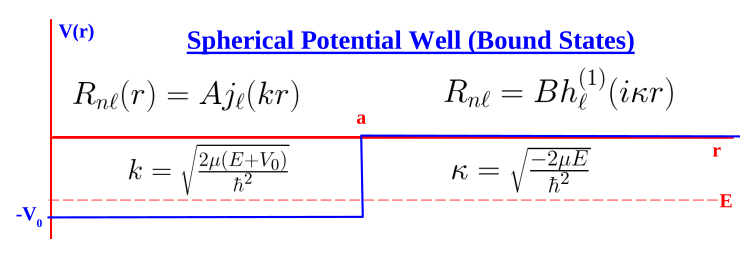

_Figure 47 (p. 221)_

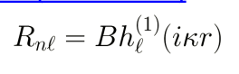

_Figure 48 (p. 221)_

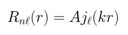

_Figure 49 (p. 221)_

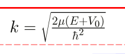

_Figure 50 (p. 221)_

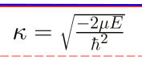

_Figure 51 (p. 221)_

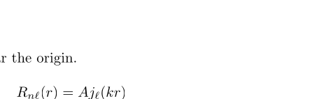

_Figure 52 (p. 221)_

We must use the Bessel function near the origin.

```math
R_{n\ell} \sqrt{( r} ) = Aj_{\ell} ( kr )
```

```math
k = \frac{2 \mu ( E + V_{0} )}{\hbar^{2}}
```

<div align="right"><a href="book.pdf#page=221" target="_blank" title="This page in the PDF"><sup>[p. 221]</sup></a></div>
<hr class="page" style="height:2px;border:0;background:currentColor;opacity:0.25">
<a id="p222" href="book.pdf#page=222" target="_blank" title="This page in the PDF"><sup>[p. 222]</sup></a>

We must use the Hankel function of the first type for large $`r`$.

```math
\begin{aligned} \rho &= kr \to i\kappa r \\ \kappa &= \sqrt{- 2 \hbar^{2} \mu E} \end{aligned}
```

```math
R_{n\ell} = Bh_{\ell}^{( 1 )} ( i\kappa r )
```

To solve the problem, we have to match the solutions at the boundary. First match the wavefunction.

```math
A [ j_{\ell} ( \rho ) ]_{\rho = ka} = B [ h_{\ell} ( \rho ) ]_{\rho = i\kappa a}
```

Then match the first derivative.

```math
Ak \left[ \frac{dj_{\ell} ( \rho )}{d\rho} \right]_{\rho = ka} = B ( i\kappa ) \left[ \frac{dh_{\ell} ( \rho )}{d\rho} \right]_{\rho = i\kappa a}
```

We can divide the two equations to eliminate the constants to get a condition on the energies.

```math
k \left[ \frac{\frac{dj_{\ell} ( \rho )}{d\rho}}{j_{\ell} ( \rho )} \right]_{\rho = ka} = ( i\kappa ) \left[ {}^{\tfrac{dh_{\ell} ( \rho )}{d\rho}} h_{\ell} ( \rho ) \right]_{\rho = i\kappa a}
```

This is often called matching the **logarithmic derivative**.

Often, the $`\ell`$ = 0 term will be sufficient to describe scattering. For $`\ell`$ = 0, the boundary condition is

```math
k \left[ \frac{\tfrac{\cos \rho}{\rho} - \tfrac{\sin \rho}{\rho^{2}}}{\frac{\sin \rho}{\rho}} \right]_{\rho = ka} = ( i\kappa ) \left[ \frac{\tfrac{ie^{i\rho}}{i\rho} - \tfrac{e^{i\rho}}{i\rho^{2}}}{\frac{e^{i\rho}}{i\rho}} \right]_{\rho = i\kappa a} .
```

Dividing and substituting for $`\rho`$, we get

```math
k \left( \cot ( ka ) - \frac{1}{ka} \right) = i\kappa \left( i - \frac{1}{i\kappa a} \right) .
```

```math
ka \cot ( ka ) - 1 = - \kappa a - 1
```

```math
k \cot ( ka ) = - \kappa
```

This is the **same transcendental equation that we had for the odd solution in one dimen-** **sion**.

```math
- \cot \begin{pmatrix} \sqrt{2 \mu ( E \hbar^{2} + V_{0} )} \\ a \end{pmatrix} = \sqrt{V_{0} - E + E}
```

The number of solutions depends on the depth and radius of the well. There can even be no solution.

<div align="right"><a href="book.pdf#page=222" target="_blank" title="This page in the PDF"><sup>[p. 222]</sup></a></div>
<hr class="page" style="height:2px;border:0;background:currentColor;opacity:0.25">
<a id="p223" href="book.pdf#page=223" target="_blank" title="This page in the PDF"><sup>[p. 223]</sup></a>

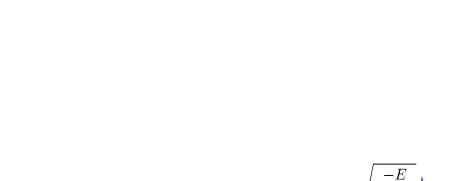

_Figure 53 (p. 223)_


_Figure 54 (p. 223)_


_Figure 55 (p. 223)_


_Figure 56 (p. 223)_

# <a id="s-15-6-partial-wave-analysis-of-scattering"></a>15.6 Partial Wave Analysis of Scattering \*

We can take a quick look at **scattering from a potential in 3D** We assume that $`V`$ = 0 far from the origin so the incoming and outgoing waves can be written in terms of our solutions for a constant potential.

In fact, an **incoming plane wave along the** $`z`$ **direction** can be expanded in Bessel functions.

```math
e^{ikz} = e^{ikr \cos \theta} = \sum_{\ell = 0}^{\infty} \sqrt{4 \pi ( 2 \ell + 1 )} i^{\ell} j_{\ell} ( kr ) Y_{\ell 0}
```

Each angular momentum $`( \ell )`$ term is called a **partial wave**. The scattering for each partial wave can be computed independently.

For large $`r`$ the Bessel function becomes

```math
j_{\ell} ( \rho ) \to - \frac{1}{2 ikr} \left( e^{- i ( kr - \ell \pi / 2 )} - e^{i ( kr - \ell \pi / 2 )} \right) ,
```

so our plane wave becomes

```math
e^{ikz} \to - \sum_{\ell = 0}^{\infty} \sqrt{4 \pi ( 2 \ell + 1 )} i^{\ell} \frac{1}{2 ikr} \left( e^{- i ( kr - \ell \pi / 2 )} - e^{i ( kr - \ell \pi / 2 )} \right) Y_{\ell 0}
```

The scattering potential will modify the plane wave, particularly the outgoing part. To maintain the outgoing flux equal to the incoming flux, the most the scattering can do is **change the relative** **phase of the incoming an outgoing waves**.

```math
R_{\ell} ( r ) \to - \frac{1}{2 ikr} = \frac{\sin ( kr - \ell \pi / 2 + \delta_{\ell} ( k ) )}{kr} \left( e^{- i ( kr - \ell \pi / 2 )} - e^{2 i\delta_{\ell} ( k )} e^{i ( kr - \ell \pi / 2 )} \right) e^{i\delta_{\ell} ( k )}
```

<div align="right"><a href="book.pdf#page=223" target="_blank" title="This page in the PDF"><sup>[p. 223]</sup></a></div>
<hr class="page" style="height:2px;border:0;background:currentColor;opacity:0.25">
<a id="p224" href="book.pdf#page=224" target="_blank" title="This page in the PDF"><sup>[p. 224]</sup></a>

The $`\delta_{\ell} ( k )`$ is called the **phase shift** for the partial wave of angular momentum $`\ell`$. We can compute the **differential cross section** for scattering

$`d\sigma`$ scattered flux into $`d`$Ω $`d`$Ω $`\equiv`$ incident flux<br>
in terms of the phase shifts.

```math
\frac{d\sigma}{d \Omega} = \frac{1}{k^{2}} \left( \sum_{\ell = 0}^{\infty} ( 2 \ell + 1 ) e^{i\delta_{\ell}} \sin ( \delta_{\ell} ) P_{\ell} ( \cos \theta ) \right)^{2}
```

The phase shifts must be computed by actually solving the problem for the particular potential.

In fact, for low energy scattering and short range potentials, the first term $`\ell`$ = 0 is often enough to solve the problem.


_Figure 57 (p. 224)_

Only the low $`\ell`$ partial waves get close enough to the origin to be affected by the potential.

# <a id="s-15-7-scattering-from-a-spherical-well"></a>15.7 Scattering from a Spherical Well \*

For the scattering problem, the energy is greater than zero. We must choose the Bessel function in the region containing the origin.

```math
\sqrt{R_{\ell}} = Aj_{\ell} ( k^{\prime} r )
```

```math
k^{\prime} = \frac{2 \mu ( E + V_{0} )}{\hbar^{2}}
```

For large $`r`$, we can have a linear combination of functions.

```math
R_{\ell} = Bj_{\ell} ( kr ) + Cn \surd_{\ell} ( kr )
```

```math
k = \frac{2 \mu E}{\hbar^{2}}
```

<div align="right"><a href="book.pdf#page=224" target="_blank" title="This page in the PDF"><sup>[p. 224]</sup></a></div>
<hr class="page" style="height:2px;border:0;background:currentColor;opacity:0.25">
<a id="p225" href="book.pdf#page=225" target="_blank" title="This page in the PDF"><sup>[p. 225]</sup></a>


_Figure 58 (p. 225)_


_Figure 59 (p. 225)_


_Figure 60 (p. 225)_


_Figure 61 (p. 225)_


_Figure 62 (p. 225)_

Matching the logarithmic derivative, we get

```math
k^{\prime} \left[ \frac{\frac{dj_{\ell} ( \rho )}{d\rho}}{j_{\ell} ( \rho )} \right]_{\rho = k^{\prime} a} = k \left[ \frac{B \tfrac{dj_{\ell} ( \rho )}{d\rho} + C \tfrac{dn_{\ell} ( \rho )}{d\rho}}{Bj_{\ell} ( \rho ) + Cn_{\ell} ( \rho )} \right]_{\rho = ka} .
```

Recalling that for $`r \to \infty`$,

```math
n_{\ell} \to j_{\ell} \to \frac{\sin ( \rho - \tfrac{\ell \pi}{2} )}{\frac{- \cos ( \rho - \tfrac{\ell \pi}{2} )}{\rho} \rho}
```

and that our formula with the phase shift is

```math
R ( r ) = \propto \quad \frac{1 \frac{\sin \left( \rho - \tfrac{\ell \pi}{2} + \delta_{\ell} ( k ) \right)}{\rho}}{\rho} \left[ \cos \delta_{\ell} \sin ( \rho - \frac{\ell \pi}{2} ) + \sin \delta_{\ell} \cos ( \rho - \frac{\ell \pi}{2} ) \right] ,
```

we can **identify the phase shift** easily.

```math
\tan \delta_{\ell} = - \frac{C}{B}
```

We need to use the boundary condition to get this phase shift.

For $`\ell`$ = 0, we get

```math
k^{\prime} \frac{\cos ( k^{\prime} a )}{\sin ( k^{\prime} a )} = k \frac{B \cos ( ka ) + C \sin ( ka )}{B \sin ( ka ) - C \cos ( ka )}
```

```math
\frac{k^{\prime}}{k} \cot ( k^{\prime} a ) ( B \sin ( ka ) - C \cos ( ka ) ) = B \cos ( ka ) + C \sin ( ka )
```

```math
\left( \frac{k^{\prime}}{k} \cot ( k^{\prime} a ) \sin ( ka ) - \cos ( ka ) \right) B = \left( \sin ( ka ) + \frac{k^{\prime}}{k} \cot ( k^{\prime} a ) \cos ( ka ) \right) C
```

We can now get the phase shift.

```math
\tan \delta_{0} = - \frac{C}{B} = \frac{k \cos ( ka ) \sin ( k^{\prime} a ) - k^{\prime} \cos ( k^{\prime} a ) \sin ( ka )}{k \sin ( ka ) \sin ( k^{\prime} a ) + k^{\prime} \cos ( k^{\prime} a ) \cos ( ka )}
```

<div align="right"><a href="book.pdf#page=225" target="_blank" title="This page in the PDF"><sup>[p. 225]</sup></a></div>
<hr class="page" style="height:2px;border:0;background:currentColor;opacity:0.25">
<a id="p226" href="book.pdf#page=226" target="_blank" title="This page in the PDF"><sup>[p. 226]</sup></a>

With just the $`\ell`$ = 0 term, the differential scattering cross section is.

```math
\frac{d\sigma}{d \Omega} \to \frac{\sin^{2} ( \delta_{\ell} )}{k^{2}}
```

The cross section will have zeros when

```math
\frac{k^{\prime}}{k} = \cot ( ka ) \tan ( k^{\prime} a )
```

```math
k^{\prime} \cot ( k^{\prime} a ) = k \cot ( ka ) .
```

There will be many solutions to this and the cross section will look like diffraction.


_Figure 63 (p. 226)_

# <a id="s-15-8-the-radial-equation-for-u-r-rr-r"></a>15.8 The Radial Equation for $`u ( r ) = rR ( r )`$ \*

It is sometimes useful to use

```math
u_{n\ell} ( r ) = rR_{n\ell} ( r )
```

to solve a radial equation problem. We can rewrite the equation for $`u`$.

```math
\left( \frac{d^{2}}{dr^{2}} + \frac{2}{r} \frac{d}{dr} \right) \frac{u ( r )}{r} = \frac{d}{dr} \left( \frac{1}{r} \frac{du}{dr} - \frac{u}{r^{2}} \right) + \frac{2}{r^{2}} \frac{du}{dr} - \frac{2 u}{r^{3}}
```

```math
= \frac{1}{r} \frac{d^{2} u}{dr^{2}} - \frac{1}{r^{2}} \frac{du}{dr} - \frac{1}{r^{2}} \frac{du}{dr} + \frac{2 u}{r^{3}} + \frac{2}{r^{2}} \frac{du}{dr} - \frac{2 u}{r^{3}} = \frac{1}{r} \frac{d^{2} u}{dr^{2}}
```

```math
\frac{1}{r} \frac{d^{2} u ( r )}{dr^{2}} + \frac{2 \mu}{\hbar^{2}} \left[ E - V ( r ) - \frac{\ell ( \ell + 1 ) \hbar^{2}}{2 \mu r^{2}} \right] \frac{u ( r )}{r} = 0
```

```math
\frac{d^{2} u ( r )}{dr^{2}} + \frac{2 \mu}{\hbar^{2}} \left[ E - V ( r ) - \frac{\ell ( \ell + 1 ) \hbar^{2}}{2 \mu r^{2}} \right] u ( r ) = 0
```

This now looks just like the one dimensional equation except the pseudo potential due to angular momentum has been added.

We do get the additional condition that

```math
u ( 0 ) = 0
```

to keep $`R`$ normalizable.

<div align="right"><a href="book.pdf#page=226" target="_blank" title="This page in the PDF"><sup>[p. 226]</sup></a></div>
<hr class="page" style="height:2px;border:0;background:currentColor;opacity:0.25">
<a id="p227" href="book.pdf#page=227" target="_blank" title="This page in the PDF"><sup>[p. 227]</sup></a>

For the case of a constant potential $`V_{0}`$, we define $`k = \sqrt{2 \mu ( E \hbar - {}_{2} V_{0} )}`$ and $`\rho = kr`$, and the radial equation becomes.

```math
\frac{d^{2} u ( r )}{dr^{2}} + \frac{2 \mu}{\hbar^{2}} \left[ E - V_{0} - \frac{\ell ( \ell + 1 ) \hbar^{2}}{2 \mu r^{2}} \right] u ( r ) = 0
```

```math
\frac{d^{2} u ( r )}{dr^{2}} + k^{2} u ( r ) - \frac{\ell ( \ell + 1 )}{r^{2}} u ( r ) = 0
```

```math
\frac{d^{2} u ( \rho )}{d\rho^{2}} - \frac{\ell ( \ell + 1 )}{\rho^{2}} u ( \rho ) + u ( \rho ) = 0
```

For $`\ell`$ = 0, its easy to see that $`\sin \rho`$ and $`\cos \rho`$ are solutions. Dividing by $`r`$ to get $`R ( \rho )`$, we see that these are $`j_{0}`$ and $`n_{0}`$. The solutions can be checked for other $`\ell`$, with some work.

# <a id="s-15-9-sample-test-problems"></a>15.9 Sample Test Problems

1. A particle has orbital angular momentum quantum number $`l`$ = 1 and is bound in the potential well $`V ( r ) = - V_{0}`$ for $`r<a`$ and $`V ( r )`$ = 0 elsewhere. Write down the form of the solution (in terms of known functions) in the two regions. Your solution should satisfy constraints at the origin and at infinity. Be sure to include angular dependence. Now use the boundary condition at $`r = a`$ to get one equation, the solution of which will quantize the energies. Do not bother to solve the equation.

2. A particle of mass $`m`$ with 0 total angular momentum is in a 3 dimensional potential well

```math
V ( r ) = - V_{0} \text{ for } r<a ( \text{ otherwise } V ( r ) = 0 ) .
```

a) Write down the form of the $`( l`$ = 0) solution, to the time independent Schrödinger equation, inside the well, which is well behaved at at $`r`$ = 0. Specify the relationship between the particles energy and any parameters in your solution.

b) Write down the form of the solution to the time independent Schrödinger equation, outside the well, which has the right behavior as $`r \to \infty`$. Again specify how the parameters depend on energy.

c) Write down the boundary conditions that must be satisfied to match the two regions.

Use $`u ( r ) = rR ( r )`$ to simplify the calculation.

d) Find the transcendental equation which will determine the energy eigenvalues.

3. A particle has orbital angular momentum quantum number $`l`$ = 1 and is bound in the potential well $`V ( r ) = - V_{0}`$ for $`r<a`$ and $`V ( r )`$ = 0 elsewhere. Write down the form of the solution (in terms of known functions) in the two regions. Your solution should satisfy constraints at the origin and at infinity. Be sure to include angular dependence. Now use the boundary condition at $`r = a`$ to get one equation, the solution of which will quantize the energies. Do not bother to solve the equation.

4. A particle is confined to the inside of a sphere of radius $`a`$. Find the energies of the two lowest energy states for $`\ell`$ = 0. Write down (but do not solve) the equation for the energies for $`\ell`$ = 1.

```math
5 .
```

---

<a id="16-hydrogen"></a>

<hr class="page" style="height:2px;border:0;background:currentColor;opacity:0.25">
<a id="p228" href="book.pdf#page=228" target="_blank" title="This page in the PDF"><sup>[p. 228]</sup></a>

# 16 Hydrogen

The Hydrogen atom consists of an electron bound to a proton by the **Coulomb potential**.

```math
V ( r ) = - \frac{e^{2}}{r}
```

We can generalize the potential to a nucleus of charge $`Ze`$ without complication of the problem.

```math
V ( r ) = - \frac{Ze^{2}}{r}
```

Since the potential is **spherically symmetric**, the problem separates and the solutions will be a product of a radial wavefunction and one of the spherical harmonics.

```math
\psi_{n\ell m} ( \vec{r} ) = R_{n\ell} ( r ) Y_{\ell m} ( \theta ,\varphi )
```

We have already studied the spherical harmonics.

The **radial wavefunction** satisfies the differential equation that depends on the angular momentum quantum number $`\ell`$,

```math
\left( \frac{d^{2}}{dr^{2}} + \frac{2}{r} \frac{d}{dr} \right) R_{E\ell} ( r ) + \frac{2 \mu}{\hbar^{2}} \left( E + \frac{Ze^{2}}{r} - \frac{\ell ( \ell + 1 ) \hbar^{2}}{2 \mu r^{2}} \right) R_{E\ell} ( r ) = 0
```

where $`\mu`$ is the reduced mass of the nucleus and electron.

```math
\mu = \frac{m_{e} m_{N}}{m_{e} + m_{N}}
```

The differential equation can be solved (See section 16.3.1) using **techniques similar to those** **used to solve the 1D harmonic oscillator** equation. We find the **eigen-energies**

```math
E = - \frac{1}{2 n^{2}} Z^{2} \alpha^{2} \mu c^{2}
```

and the **radial wavefunctions**

```math
R_{n\ell} ( \rho ) = \rho^{\ell} \sum_{k = 0}^{\infty} a_{k} \rho^{k} e^{- \rho / 2}
```

where the coefficients of the polynomials can be found from the **recursion relation**

```math
a_{k + 1} = \frac{k + \ell + 1 - n}{( k + 1 ) ( k + 2 \ell + 2 )} a_{k}
```

<div align="right"><a href="book.pdf#page=228" target="_blank" title="This page in the PDF"><sup>[p. 228]</sup></a></div>
<hr class="page" style="height:2px;border:0;background:currentColor;opacity:0.25">
<a id="p229" href="book.pdf#page=229" target="_blank" title="This page in the PDF"><sup>[p. 229]</sup></a>

and

```math
\rho = \sqrt{- 8 \hbar^{2} \mu E} r.
```

The **principle quantum number** $`n`$ is an integer from 1 to infinity.

```math
n = 1 , 2 , 3 ,\dots
```

This principle quantum number is actually the sum of the radial quantum number plus $`\ell`$ plus 1.

```math
n = n_{r} + \ell + 1
```

<div align="center">

and therefore, the total angular momentum quantum number $`\ell`$ must be less than $`n`$.

</div>

```math
\ell = 0 , 1 , 2 ,\dots ,n - 1
```

This unusual way of labeling the states comes about because a radial excitation has the same energy as an angular excitation for Hydrogen. This is often referred to as an **accidental degeneracy**.

# <a id="s-16-1-the-radial-wavefunction-solutions"></a>16.1 The Radial Wavefunction Solutions

Defining the **Bohr radius**

```math
a_{0} = \frac{\hbar}{\alpha mc} ,
```

we can compute the radial wave functions (See section 16.3.2) Here is a list of the first several radial wave functions $`R_{n\ell} ( r )`$.

```math
R_{1 0} = 2 \left( \frac{Z}{a_{0}} \right)^{\tfrac{3}{2}} e^{- Zr/a_{0}}
```

```math
R_{2 1} = \frac{1}{\sqrt{3}} \left( \frac{Z}{2 a_{0}} \right)^{\tfrac{3}{2}} \left( \frac{Zr}{a_{0}} \right) e^{- Zr/ 2 a_{0}}
```

```math
R_{2 0} = 2 \left( \frac{Z}{2 a_{0}} \right)^{\tfrac{3}{2}} \left( 1 - \frac{Zr}{2 a_{0}} \right) e^{- Zr/ 2 a_{0}}
```

```math
R_{3 2} = \frac{2 \sqrt{2}}{2 7 \sqrt{5}} \left( \frac{Z}{3 a_{0}} \right)^{\tfrac{3}{2}} \left( \frac{Zr}{a_{0}} \right)^{2} e^{- Zr/ 3 a_{0}}
```

```math
R_{3 1} = \frac{4 \sqrt{2}}{3} \left( \frac{Z}{3 a_{0}} \right)^{\tfrac{3}{2}} \left( \frac{Zr}{a_{0}} \right) \left( 1 - \frac{Zr}{6 a_{0}} \right) e^{- Zr/ 3 a_{0}}
```

```math
R_{3 0} = 2 \left( \frac{Z}{3 a_{0}} \right)^{\tfrac{3}{2}} \left( 1 - \frac{2 Zr}{3 a_{0}} + \frac{2 ( Zr )^{2}}{2 7 a_{0}^{2}} \right) e^{- Zr/ 3 a_{0}}
```

For a given principle quantum number $`n`$,the largest $`\ell`$ radial wavefunction is given by

```math
R_{n,n - 1} \propto r^{n - 1} e^{- Zr/na_{0}}
```

<div align="right"><a href="book.pdf#page=229" target="_blank" title="This page in the PDF"><sup>[p. 229]</sup></a></div>
<hr class="page" style="height:2px;border:0;background:currentColor;opacity:0.25">
<a id="p230" href="book.pdf#page=230" target="_blank" title="This page in the PDF"><sup>[p. 230]</sup></a>

The radial wavefunctions should be **normalized** as below.

```math
\int_{0}^{\infty} r^{2} R_{n\ell}^{*} R_{n\ell} dr = 1
```

\* See Example 16.4.2: Compute the expected values of $`E , L^{2} , L_{z}`$, and $`L_{y}`$ in the Hydrogen state

```math
\frac{1}{6} ( 4 \psi_{1 0 0} + 3 \psi_{2 1 1} - i\psi_{2 1 0} + \sqrt{1 0 \psi_{2 1 - 1} ) . *}
```

The pictures below depict the probability distributions in space for the Hydrogen wavefunctions.

The graphs below show the radial wave functions. Again, for a given $`n`$ the maximum $`\ell`$ state has no radial excitation, and hence no nodes in the radial wavefunction. As $`ell`$ gets smaller for a fixed $`n`$, we see more radial excitation.

<div align="right"><a href="book.pdf#page=230" target="_blank" title="This page in the PDF"><sup>[p. 230]</sup></a></div>
<hr class="page" style="height:2px;border:0;background:currentColor;opacity:0.25">
<a id="p231" href="book.pdf#page=231" target="_blank" title="This page in the PDF"><sup>[p. 231]</sup></a>

```math
2 3 1
```


_Figure 64 (p. 231)_

<div align="right"><a href="book.pdf#page=231" target="_blank" title="This page in the PDF"><sup>[p. 231]</sup></a></div>
<hr class="page" style="height:2px;border:0;background:currentColor;opacity:0.25">
<a id="p232" href="book.pdf#page=232" target="_blank" title="This page in the PDF"><sup>[p. 232]</sup></a>


_Figure 65 (p. 232)_

A **useful integral** for Hydrogen atom calculations is.

```math
\int_{0}^{\infty} dxx^{n} e^{- ax} = \frac{n !}{a^{n + 1}}
```

\* See Example 16.4.2: What is the expectation value of $`r 1`$ in the state $`\psi_{1 0 0}`$?\*

\* See Example 16.4.3: What is the expectation value of $`r`$ in the state $`\psi_{1 0 0}`$?\*

\* See Example 16.4.4: What is the expectation value of the radial component of velocity in the state

<div align="right"><a href="book.pdf#page=232" target="_blank" title="This page in the PDF"><sup>[p. 232]</sup></a></div>
<hr class="page" style="height:2px;border:0;background:currentColor;opacity:0.25">
<a id="p233" href="book.pdf#page=233" target="_blank" title="This page in the PDF"><sup>[p. 233]</sup></a>

```math
\psi_{1 0 0} ? *
```

# <a id="s-16-2-the-hydrogen-spectrum"></a>16.2 The Hydrogen Spectrum

The figure shows the transitions between Hydrogen atom states.


_Figure 66 (p. 233)_

The ground state of Hydrogen has $`n`$ = 1 and $`\ell`$ = 0. This is conventionally called the 1s state. The convention is to name $`\ell`$ = 0 states “s”, $`\ell`$ = 1 states “p”, $`\ell`$ = 2 states “d”, and $`\ell`$ = 3 states “f”. From there on follow the alphabet with g, h, i, ...

The first excited state of Hydrogen has $`n`$ = 2. There are actually four degenerate states (not counting different spin states) for $`n`$ = 2. In terms of $`\psi_{n\ell m}`$, these are $`\psi_{2 0 0} , \psi_{2 1 1} , \psi_{2 1 0}`$, and $`\psi_{2 1 - 1}`$. These would be called the 2s and 2p states. Remember, all values of $`\ell <n`$ are allowed.

The second excited state has $`n`$ = 3 with the 3s, 3p and 3d states being degenerate. This totals 9 states with the different allowed $`m`$ values.

<div align="center">

In general there are $`n^{2}`$ degenerate states, again not counting different spin states.

</div>

The Hydrogen spectrum was primarily investigated by measuring the energy of photons emitted in transitions between the states, as depicted in the figures above and below.

<div align="right"><a href="book.pdf#page=233" target="_blank" title="This page in the PDF"><sup>[p. 233]</sup></a></div>
<hr class="page" style="height:2px;border:0;background:currentColor;opacity:0.25">
<a id="p234" href="book.pdf#page=234" target="_blank" title="This page in the PDF"><sup>[p. 234]</sup></a>


_Figure 67 (p. 234)_

Transitions which change $`\ell`$ by one unit are strongly preferred, as we will later learn.

# <a id="s-16-3-derivations-and-calculations"></a>16.3 Derivations and Calculations

## <a id="s-16-3-1-solution-of-hydrogen-radial-equation"></a>16.3.1 Solution of Hydrogen Radial Equation \*

The differential equation we wish to solve is.

```math
\left( \frac{d^{2}}{dr^{2}} + \frac{2}{r} \frac{d}{dr} \right) R_{E\ell} ( r ) + \frac{2 \mu}{\hbar^{2}} \left( E + \frac{Ze^{2}}{r} - \frac{\ell ( \ell + 1 ) \hbar^{2}}{2 \mu r^{2}} \right) R_{E\ell} ( r ) = 0
```

First we change to a **dimensionless variable** $`\rho`$,

```math
\rho = \sqrt{- 8 \hbar^{2} \mu E} r,
```

giving the differential equation

```math
\frac{d^{2} R}{d\rho^{2}} + \frac{2}{\rho} \frac{dR}{d\rho} - \frac{\ell ( \ell + 1 )}{\rho^{2}} R + \left( \frac{\lambda}{\rho} - \frac{1}{4} \right) R = 0 ,
```

where the constant

```math
\lambda = \frac{Ze^{2}}{\hbar} \sqrt{\frac{- \mu}{2 E}} = Z\alpha \sqrt{- \mu c^{2} 2 E} .
```

<div align="right"><a href="book.pdf#page=234" target="_blank" title="This page in the PDF"><sup>[p. 234]</sup></a></div>
<hr class="page" style="height:2px;border:0;background:currentColor;opacity:0.25">
<a id="p235" href="book.pdf#page=235" target="_blank" title="This page in the PDF"><sup>[p. 235]</sup></a>

Next we look at the equation for **large** $`r`$.

```math
\frac{d^{2} R}{d\rho^{2}} - \frac{1}{4} R = 0
```

This can be solved by $`R = e \tfrac{- \rho}{2}`$, so we explicitly include this.

```math
R ( \rho ) = G ( \rho ) e^{\tfrac{- \rho}{2}}
```

We should also pick of the **small** $`r`$ behavior.

```math
\frac{d^{2} R}{d\rho^{2}} + \frac{2}{\rho} \frac{dR}{d\rho} - \frac{\ell ( \ell + 1 )}{\rho^{2}} R = 0
```

Assuming $`R = \rho^{s}`$, we get

```math
s ( s - 1 ) \frac{R}{\rho^{2}} + 2 s \frac{R}{\rho^{2}} - \ell ( \ell + 1 ) \frac{R}{\rho^{2}} = 0 .
```

```math
s^{2} - s + 2 s = \ell ( \ell + 1 )
```

```math
s ( s + 1 ) = \ell ( \ell + 1 )
```

So either $`s = \ell`$ or $`s = - \ell -`$ 1. The second is not well normalizable. We **write** $`G`$ **as a sum**.

```math
G ( \rho ) = \rho^{\ell} \sum_{k = 0}^{\infty} a_{k} \rho^{k} = \sum_{k = 0}^{\infty} a_{k} \rho^{k + \ell}
```

The differential equation for $`G ( \rho )`$ is

```math
\frac{d^{2} G}{d\rho^{2}} - \left( 1 - \frac{2}{\rho} \right) \frac{dG}{d\rho} + \left( \frac{\lambda - 1}{\rho} - \frac{\ell ( \ell + 1 )}{\rho^{2}} \right) G ( \rho ) = 0 .
```

We plug the sum into the differential equation.

```math
\sum_{k = 0}^{\infty} a_{k} \left( ( k + \ell ) ( k + \ell - 1 ) \rho^{k + \ell - 2} - ( k + \ell ) \rho^{k + \ell - 1} + 2 ( k + \ell ) \rho^{k + \ell - 2} \right.
```

```math
\left. + ( \lambda - 1 ) \rho^{k + \ell - 1} - \ell ( \ell + 1 ) \rho^{k + \ell - 2} \right) = 0
```

```math
\sum_{k = 0}^{\infty} a_{k} ( ( k + \ell ) ( k + \ell - 1 ) + 2 ( k + \ell ) - \ell ( \ell + 1 ) ) \rho^{k + \ell - 2}
```

```math
= \sum_{k = 0}^{\infty} a_{k} ( ( k + \ell ) - ( \lambda - 1 ) ) \rho^{k + \ell - 1}
```

Now we **shift the sum** so that each term contains $`\rho^{k + \ell - 1}`$.

```math
\sum_{k = - 1}^{\infty} a_{k + 1} ( ( k + \ell + 1 ) ( k + \ell ) + 2 ( k + \ell + 1 ) - \ell ( \ell + 1 ) ) \rho^{k + \ell - 1} = \sum_{k = 0}^{\infty} a_{k} ( ( k + \ell ) - ( \lambda - 1 ) ) \rho^{k + \ell - 1}
```

<div align="right"><a href="book.pdf#page=235" target="_blank" title="This page in the PDF"><sup>[p. 235]</sup></a></div>
<hr class="page" style="height:2px;border:0;background:currentColor;opacity:0.25">
<a id="p236" href="book.pdf#page=236" target="_blank" title="This page in the PDF"><sup>[p. 236]</sup></a>

The **coefficient of each power of** $`\rho`$ **must be zero**, so we can derive the **recursion relation** for the constants $`a_{k}`$.

```math
\frac{a_{k + 1}}{a_{k}} = \frac{k + \ell + 1 - \lambda}{( k + \ell + 1 ) ( k + \ell ) + 2 ( k + \ell + 1 ) - \ell ( \ell + 1 )}
```

```math
= \frac{k + \ell + 1 - \lambda}{k ( k + 2 \ell + 1 ) + 2 ( k + \ell + 1 )} = \frac{k + \ell + 1 - \lambda}{k ( k + 2 \ell + 2 ) + ( k + 2 \ell + 2 )}
```

```math
= \frac{k + \ell + 1 - \lambda}{( k + 1 ) ( k + 2 \ell + 2 )} \to \frac{1}{k}
```

This is then the power series for

```math
G ( \rho ) \to \rho^{\ell} e^{\rho}
```

unless it somehow terminates. We can **terminate the series** if for some value of $`k = n_{r}`$,

```math
\lambda = n_{r} + \ell + 1 \equiv n.
```

The number of nodes in $`G`$ will be $`n_{r}`$. We will call $`n`$ the principal quantum number, since the energy will depend only on $`n`$.

Plugging in for $`\lambda`$ we get the **energy eigenvalues**.

```math
Z\alpha \sqrt{- \mu c^{2} 2 E} = n.
```

```math
E = - \frac{1}{2 n^{2}} Z^{2} \alpha^{2} \mu c^{2}
```

The **solutions** are $`\infty`$

```math
R_{n\ell} ( \rho ) = \rho^{\ell} \sum_{k = 0} a_{k} \rho^{k} e^{- \rho / 2} .
```

The recursion relation is

```math
a_{k + 1} = \frac{k + \ell + 1 - n}{( k + 1 ) ( k + 2 \ell + 2 )} a_{k} .
```

We can rewrite $`\rho`$, substituting the energy eigenvalue.

```math
\rho = \sqrt{- 8 \hbar^{2} \mu E} r = \sqrt{4 \mu^{2} \hbar^{2} n^{2} c^{2} Z^{2} \alpha^{2}} r = \frac{2 \mu cZ\alpha}{\hbar n} r = \frac{2 Z}{na_{0}} r
```

## <a id="s-16-3-2-computing-the-radial-wavefunctions"></a>16.3.2 Computing the Radial Wavefunctions \*

The radial wavefunctions are given by

```math
R ( \rho ) = \rho^{\ell} \sum_{k = 0}^{n - \ell - 1} a_{k} \rho^{k} e^{- \rho / 2}
```

<div align="right"><a href="book.pdf#page=236" target="_blank" title="This page in the PDF"><sup>[p. 236]</sup></a></div>
<hr class="page" style="height:2px;border:0;background:currentColor;opacity:0.25">
<a id="p237" href="book.pdf#page=237" target="_blank" title="This page in the PDF"><sup>[p. 237]</sup></a>

where

```math
\rho = \frac{2 Z}{na_{0}} r
```

and the coefficients come from the recursion relation

```math
a_{k + 1} = \frac{k + \ell + 1 - n}{( k + 1 ) ( k + 2 \ell + 2 )} a_{k} .
```

The series terminates for $`k = n - \ell - 1 .`$

Lets start with $`R_{1 0}`$.

```math
R_{1 0} ( r ) = \rho^{0} \sum_{k = 0}^{0} a_{k} \rho^{k} e^{- \rho / 2}
```

```math
R_{1 0} ( r ) = Ce^{- Zr/a_{0}}
```

We determine $`C`$ from the normalization condition.

```math
\int_{0}^{\infty} r^{2} R_{n\ell}^{*} R_{n\ell} dr = 1
```

```math
| C |^{2} \int_{0}^{\infty} r^{2} e^{- 2 Zr/a_{0}} dr = 1
```

This can be integrated by parts twice.

```math
2 \left( \frac{a_{0}}{2 Z} \right)^{2} | C |^{2} \int_{0}^{\infty} e^{- 2 Zr/a_{0}} dr = 1
```

```math
2 \left( \frac{a_{0}}{2 Z} \right)^{3} | C |^{2} = 1
```

```math
C^{2} = \frac{1}{2} \left( \frac{2 Z}{a_{0}} \right)^{3}
```

```math
C = \frac{1}{\sqrt{2}} \left( \frac{2 Z}{a_{0}} \right)^{\tfrac{3}{2}}
```

```math
R_{1 0} ( r ) = 2 \left( \frac{Z}{a_{0}} \right)^{\tfrac{3}{2}} e^{- Zr/a_{0}}
```

$`R_{2 1}`$ can be computed in a similar way. No recursion is needed.

Lets try $`R_{2 0}`$.

```math
R_{2 0} ( r ) = \rho^{0} \sum_{k = 0}^{1} a_{k} \rho^{k} e^{- \rho / 2}
```

```math
R_{2 0} ( r ) = ( a_{0} + a_{1} \rho ) e^{- \rho / 2}
```

<div align="right"><a href="book.pdf#page=237" target="_blank" title="This page in the PDF"><sup>[p. 237]</sup></a></div>
<hr class="page" style="height:2px;border:0;background:currentColor;opacity:0.25">
<a id="p238" href="book.pdf#page=238" target="_blank" title="This page in the PDF"><sup>[p. 238]</sup></a>

```math
a_{k + 1} = \frac{k + \ell + 1 - n}{( k + 1 ) ( k + 2 \ell + 2 )} a_{k}
```

```math
a_{1} = \frac{0 + 0 + 1 - 2}{( 0 + 1 ) ( 0 + 2 ( 0 ) + 2 )} a_{0} = \frac{- 1}{2} a_{0}
```

```math
R_{2 0} ( r ) = C \left( 1 - \frac{Zr}{2 a_{0}} \right) e^{- Zr/ 2 a_{0}}
```

We again normalize to determine the constant.

# <a id="s-16-4-examples"></a>16.4 Examples

## <a id="s-16-4-1-expectation-values-in-hydrogen-states"></a>16.4.1 Expectation Values in Hydrogen States

An **electron in the Coulomb field of a proton** is in the state described by the wave function

$`\tfrac{1}{6} ( 4 \psi_{1 0 0}`$ + 3$`\psi_{2 1 1} - i\psi_{2 1 0} + \sqrt{1 0} \psi_{2 1 - 1} )`$. Find the expected value of the Energy, $`L^{2} , L_{z}`$, and $`L_{y}`$.

First check the normalization.

```math
\frac{| 4 |^{2} + | 3 |^{2} + |- i |^{2} + | \sqrt{1 0 |}^{2}}{3 6} = \frac{3 6}{3 6} = 1
```

The terms are eigenstates of $`E , L^{2}`$, and $`L_{z}`$, so we can easily compute expectation values of those operators.

```math
E_{n} = - \frac{1}{2} \alpha^{2} \mu c^{2} \frac{1}{n^{2}}
```

```math
\langle E \rangle = - \frac{1}{2} \alpha^{2} \mu c^{2} \frac{1 6 \tfrac{1}{1^{2}} + 9 \tfrac{1}{2^{2}} + 1 \tfrac{1}{2^{2}} + 1 0_{2} \tfrac{1}{2}}{3 6} = - \frac{1}{2} \alpha^{2} \mu c^{2} \frac{2 1}{3 6} = - \frac{1}{2} \alpha^{2} \mu c^{2} \frac{7}{1 2}
```

Similarly, we can just square probability amplitudes to compute the expectation value of $`L^{2}`$. The eigenvalues are $`\ell ( \ell`$ + 1)$`\hbar^{2}`$.

```math
\langle L^{2} \rangle = \hbar^{2} \frac{1 6 ( 0 ) + 9 ( 2 ) + 1 ( 2 ) + 1 0 ( 2 )}{3 6} = \frac{1 0}{9} \hbar^{2}
```

The Eigenvalues of $`L_{z}`$ are $`m \hbar`$.

```math
\langle L_{z} \rangle = \hbar \frac{1 6 ( 0 ) + 9 ( 1 ) + 1 ( 0 ) + 1 0 ( - 1 )}{3 6} = \frac{- 1}{3 6} \hbar
```

Computing the expectation value of $`L_{y}`$ is harder because the states are not eigenstates of $`L_{y}`$. We must write $`L_{y} = ( L_{+} - L_{-} ) / 2 i`$ and compute.

```math
\langle L_{y} \rangle = \frac{1}{7 2 i} \langle 4 \psi_{1 0 0} + 3 \psi_{2 1 1} - i\psi_{2 1 0} + \sqrt{1 0} \psi_{2 1 - 1} | L_{+} - L_{-} | 4 \psi_{1 0 0} + 3 \psi_{2 1 1} - i\psi_{2 1 0} + \sqrt{1 0} \psi_{2 1 - 1} \rangle
```

```math
= \frac{1}{7 2 i} \langle 4 \psi_{1 0 0} + 3 \psi_{2 1 1} - i\psi_{2 1 0} + \sqrt{1 0} \psi_{2 1 - 1} |- 3 L_{-} \psi_{2 1 1} - i ( L_{+} - L_{-} ) \psi_{2 1 0} + \sqrt{1 0} L_{+} \psi_{2 1 - 1} \rangle
```

<div align="right"><a href="book.pdf#page=238" target="_blank" title="This page in the PDF"><sup>[p. 238]</sup></a></div>
<hr class="page" style="height:2px;border:0;background:currentColor;opacity:0.25">
<a id="p239" href="book.pdf#page=239" target="_blank" title="This page in the PDF"><sup>[p. 239]</sup></a>

```math
= \sqrt{\frac{\hbar}{7 2 i} \langle 4 \psi_{1 0 0} + 3 \psi_{2 1 1} - i\psi_{2 1 0} + \sqrt{1 0} \psi_{2 1 - 1} |- 3 \sqrt{2} \psi_{2 1 0} - i \sqrt{2} \psi_{2 1 1} + i \sqrt{2} \psi_{2 1 - 1} + \sqrt{1 0} \sqrt{2} \psi_{2 1 0} \rangle}
```

```math
= \sqrt{\frac{2 \hbar}{7 2 i} \langle 4 \psi_{1 0 0} + 3 \psi_{2 1 1} - i\psi_{2 1 0} + \sqrt{1 0} \psi_{2 1 - 1} |- \surd 3 \psi_{2 1 0} \surd - i\psi_{2 1 1} + \surd i\psi_{2 1 -} \surd_{1} + \sqrt{1 0} \psi_{2 1 0} \rangle}
```

```math
= \frac{2 \hbar}{7 2 i} ( - 3 i - 3 i + \sqrt{1 0} i + \sqrt{1 0} i ) = \frac{( - 6 + 2 1 0 ) i 2 \hbar}{7 2 i} = \frac{( 2 5 - 3 2 ) \hbar}{3 6}
```

## <a id="s-16-4-2-the-expectation-of-r-1-in-the-ground-state"></a>16.4.2 The Expectation of $`\frac{1}{r}`$ in the Ground State

```math
R_{1 0} = 2 \left( \frac{Z}{a_{0}} \right)^{\tfrac{3}{2}} e^{- Zr/a_{0}}
```

```math
\langle \psi_{1 0 0} | \frac{1}{r} | \psi_{1 0 0} \rangle = \int Y_{0 0}^{*} Y_{0 0} d \Omega \int_{0}^{\infty} r^{2} \frac{1}{r} R_{1 0}^{*} R_{1 0} dr
```

```math
= \int_{0}^{\infty} rR_{1 0}^{*} R_{1 0} dr = 4 \left( \frac{Z}{a_{0}} \right)^{3} \int_{0}^{\infty} re^{- 2 Zr/a_{0}} dr = 4 \left( \frac{Z}{a_{0}} \right)^{3} \left( \frac{a_{0}}{2 Z} \right)^{2} 1 !
```

```math
= \frac{Z}{a_{0}}
```

We can compute the expectation value of the potential energy.

```math
\langle \psi_{1 0 0} |- \frac{Ze^{2}}{r} | \psi_{1 0 0} \rangle = - \frac{Z^{2} e^{2}}{a_{0}} = Z^{2} e^{2} \frac{\alpha mc}{\hbar} = - Z^{2} \alpha^{2} mc^{2} = 2 E_{1 0 0}
```

## <a id="s-16-4-3-the-expectation-value-of-r-in-the-ground-state"></a>16.4.3 The Expectation Value of $`r`$ in the Ground State

```math
\langle \psi_{1 0 0} | r | \psi_{1 0 0} \rangle = \int_{0}^{\infty} r^{3} R_{1 0}^{*} R_{1 0} dr = 4 \left( \frac{Z}{a_{0}} \right)^{3} \int_{0}^{\infty} r^{3} e^{- 2 Zr/a_{0}} dr = 3 ! \frac{1}{4} \frac{a_{0}}{Z} = \frac{3}{2} \frac{a_{0}}{Z}
```

## <a id="s-16-4-4-the-expectation-value-of-v-r-in-the-ground-state"></a>16.4.4 The Expectation Value of $`v_{r}`$ in the Ground State

For $`\ell`$ = 0, there is no angular dependence to the wavefunction so no velocity except in the radial direction. So it makes sense to compute the radial component of the velocity which is the full velocity.

We can find the term for $`\frac{p_{r}^{2}}{2 m}`$ in the radial equation.

```math
\langle \psi_{1 0 0} | ( v_{r} )^{2} | \psi_{1 0 0} \rangle = \int^{\infty} r^{2} R_{1 0}^{*} \frac{- \hbar^{2}}{m^{2}} \left( \frac{d^{2}}{dr^{2}} + \frac{2}{r} \frac{d}{dr} \right) R_{1 0} dr
```

<div align="right"><a href="book.pdf#page=239" target="_blank" title="This page in the PDF"><sup>[p. 239]</sup></a></div>
<hr class="page" style="height:2px;border:0;background:currentColor;opacity:0.25">
<a id="p240" href="book.pdf#page=240" target="_blank" title="This page in the PDF"><sup>[p. 240]</sup></a>

```math
\begin{aligned} &= \frac{- \hbar^{2}}{m^{2}} 4 \left( \frac{Z}{a_{0}} \right)^{3} \int^{\infty} r^{2} e^{\tfrac{- Zr}{a 0}} \left( \frac{Z^{2}}{a_{0}^{2}} - \frac{2 Z}{a_{0} r} \right) e^{\tfrac{- Zr}{a 0}} dr \\ &= \frac{- \hbar^{2}}{m^{2}} 4 \left( \frac{Z}{a_{0}} \right)^{3 0} \left( \frac{Z^{2}}{a_{0}^{2}} 2 \left( \frac{a_{0}}{2 Z} \right)^{3} - \frac{2 Z}{a_{0}} \left( \frac{a_{0}}{2 Z} \right)^{2} \right) \end{aligned}
```

```math
= \frac{\hbar^{2}}{m^{2}} \left( \frac{Z}{a_{0}} \right)^{2}
```

Since $`a_{0} = \tfrac{\hbar}{\alpha mc}`$ , we get

```math
\langle \psi_{1 0 0} | ( v_{r} )^{2} | \psi_{1 0 0} \rangle = Z^{2} \alpha^{2} c^{2}
```

For $`Z`$ = 1, the RMS velocity is $`\alpha c`$ or

```math
\beta = \alpha = \frac{1}{1 3 7}
```

We can compute the expected value of the kinetic energy.

```math
K.E. = \frac{1}{2} mv^{2} = \frac{\hbar^{2}}{2 m} \frac{Z^{2}}{a_{0}^{2}} = \frac{1}{2} Z^{2} \alpha^{2} mc^{2} = - E_{1 0 0}
```

This is what we expect from the Virial theorem.

# <a id="s-16-5-sample-test-problems"></a>16.5 Sample Test Problems

1. A Hydrogen atom is in its 4D state $`( n`$ = 4$`,\ell`$ = 2). The atom decays to a lower state by emitting a photon. Find the possible photon energies that may be observed. Give your answers in eV. **Answer**The $`n`$<br>
= 4 state can decay into states with $`n`$ = 1$`, 2 ,`$ 3. (Really the $`n`$ = 1 state will be suppressed due to selection rules but this is supposed to be a simple question.) The energies of the states are

```math
E_{n} = - \frac{1 3 . 6}{n^{2}} eV.
```

The photon energy is given by the energy difference between the states.

```math
E_{\gamma} = 1 3 . 6 \left( \frac{1}{n^{2}} - \frac{1}{4^{2}} \right)
```

For the $`n`$ = 1 final state, $`E =`$<sup>15</sup>$`1 3 . 6`$ = 12$`. 8`$ eV.

For the $`n`$ = 2 final state, $`E =`$<sup>16</sup>$`{}^{3} 1 3 . 6`$ = 2$`. 6`$ eV.

For the $`n`$ = 3 final state, $`E = \tfrac{1 6 7}{1 4 4} 1 3 . 6`$ = 0$`. 7`$ eV.

2. Using the $`\psi_{n\ell m}`$ notation, list all the $`n`$ = 1$`, 2 ,`$ 3 hydrogen states. (Neglect the existence of spin.)<br>
**Answer**The states are,

```math
\psi_{3 2 - 2} . \quad \psi_{1 0 0} , \psi_{2 0 0} , \psi_{2 1 1} , \psi_{2 1 0} , \psi_{2 1 - 1} , \psi_{3 0 0} , \psi_{3 1 1} , \psi_{3 1 0} , \psi_{3 1 - 1} , \psi_{3 2 2} , \psi_{3 2 1} , \psi_{3 2 0} , \psi_{3 2 - 1} ,
```

3. Find the difference in wavelength between light emitted from the 3$`P \to 2 S`$ transition in **Hydrogen** and light from the same transition in Deuterium. (Deuterium is an isotope of Hydrogen with a proton and a neutron in the nucleus.) Get a numerical answer.

<div align="right"><a href="book.pdf#page=240" target="_blank" title="This page in the PDF"><sup>[p. 240]</sup></a></div>
<hr class="page" style="height:2px;border:0;background:currentColor;opacity:0.25">
<a id="p241" href="book.pdf#page=241" target="_blank" title="This page in the PDF"><sup>[p. 241]</sup></a>

4. An **electron in the Coulomb field of a proton** is in the state described by the wave function $`\tfrac{1}{6} ( 4 \psi_{1 0 0}`$ + 3$`\psi_{2 1 1} - \psi_{2 1 0} + \sqrt{1 0} \psi_{2 1 - 1} )`$. Find the expected value of the Energy, $`L^{2}`$ and $`L_{z}`$. Now find the expected value of $`L_{y}`$.

<div align="center">

5. **\*** Write out the (normalized) **hydrogen energy eigenstate** $`\psi_{3 1 1} ( r,\theta ,\varphi )`$.

</div>

6. Calculate the **expected value of** $`r`$ in the Hydrogen state $`\psi_{2 0 0}`$.

7. Write down the wave function of the hydrogen atom state $`\psi_{3 2 1} (`$**r**).

8. A Hydrogen atom is in its 4$`D`$ state $`( n`$ = 4$`,l`$ = 2). The atom decays to a lower state by emitting

a photon. Find the possible photon energies that may be observed. Give your answers in $`eV`$.

9. A Hydrogen atom is in the state:

```math
\psi ( \boldsymbol{r} ) = \frac{1}{\sqrt{3 0}} ( \psi_{1 0 0} + 2 \psi_{2 1 1} - \psi_{3 2 2} - 2 i\psi_{3 1 0} + 2 i\psi_{3 0 0} - 4 \psi_{4 3 3} )
```

For the Hydrogen eigenstates, $`\langle \psi_{nlm} | \tfrac{1}{r} | \psi_{nlm} \rangle = \tfrac{Z}{a_{0} n^{2}}`$. Find the expected value of the potential energy for this state. Find the expected value of $`L_{x}`$.

10. A Hydrogen atom is in its 3$`D`$ state $`( n`$ = 3$`,l`$ = 2). The atom decays to a lower state by emitting

a photon. Find the possible photon energies that may be observed. Give your answers in $`eV`$.

11. The hydrogen atom is made up of a proton and an electron bound together by the Coulomb force. The electron has a mass of 0.51 MeV/$`c^{2}`$. It is possible to make a hydrogen-like atom from a proton and a muon. The force binding the muon to the proton is identical to that for the electron but the muon has a mass of 106 MeV/$`c^{2}`$.

a) What is the ground state energy of muonic hydrogen (in eV).

b) What is the“Bohr Radius” of the ground state of muonic hydrogen.

12. A hydrogen atom is in the state: $`\psi (`$**r**$`) = \frac{1}{\langle \rangle 1 0} \sqrt{( \psi_{3 2 2}}`$ + 2$`\psi_{2 2 1}`$ + 2$`i\psi_{2 2 0} + \psi_{1 1 - 1} )`$ Find the possible

measured energies and the probabilities of each. Find the expected value of $`L_{z}`$.

13. Find the difference in frequency between light emitted from the 2$`P \to 1 S`$ transition in Hydrogen and light from the same transition in Deuterium. (Deuterium is an isotope of Hydrogen with a proton and a neutron in the nucleus.)

14. Tritium is an isotope of hydrogen having 1 proton and 2 neutrons in the nucleus. The nucleus is unstable and decays by changing one of the neutrons into a proton with the emission of a positron and a neutrino. The atomic electron is undisturbed by this decay process and therefore finds itself in exactly the same state immediately after the decay as before it. If the electron started off in the $`\psi_{2 0 0} ( n`$ = 2, $`l`$ = 0) state of tritium, compute the probability to find the electron in the ground state of the new atom with Z=2.

15. At $`t`$ = 0 a hydrogen atom is in the state $`\psi ( t`$ = 0) = $`\tfrac{1}{\sqrt{2}} ( \psi_{1 0 0} - \psi_{2 0 0} )`$. Calculate the expected value of $`r`$ as a function of time.

**Answer**

```math
\psi ( t ) = \frac{1}{\sqrt{2}} ( \psi_{1 0 0} e^{- iE_{1} t/ \hbar} - \psi_{2 0 0} e^{- iE_{2} t/ \hbar} ) = e^{- iE_{1} t/ \hbar} \frac{1}{\sqrt{2}} ( \psi_{1 0 0} - \psi_{2 0 0} e^{i ( E_{1} - E_{2} ) t/ \hbar} )
```

```math
\langle \psi | r | \psi \rangle = 1 \langle \psi_{1 0 0} - \psi_{2 0 0} e^{i ( E_{1} - E_{2} ) t/ \hbar} | r | \psi_{1 0 0} - \psi_{2 0 0} e^{i ( E_{1} - E_{2} ) t/ \hbar} \rangle
```

<div align="right"><a href="book.pdf#page=241" target="_blank" title="This page in the PDF"><sup>[p. 241]</sup></a></div>
<hr class="page" style="height:2px;border:0;background:currentColor;opacity:0.25">
<a id="p242" href="book.pdf#page=242" target="_blank" title="This page in the PDF"><sup>[p. 242]</sup></a>

The angular part of the integral can be done. All the terms of the wavefunction contain a $`Y_{0 0}`$ and $`r`$ does not depend on angles, so the angular integral just gives 1.

```math
\langle \psi | r | \psi \rangle = \frac{1}{2} \int_{0}^{\infty} ( R_{1 0} - R_{2 0} e^{- i ( E_{2} - E_{1} ) t/ \hbar} )^{*} r ( R_{1 0} - R_{2 0} e^{- i ( E_{2} - E_{1} ) t/ \hbar} ) r^{2} dr
```

The cross terms are not zero because of the $`r`$.

```math
\langle \psi | r | \psi \rangle = \frac{1}{2} \int_{0}^{\infty} \left( R_{1 0}^{2} + R_{2 0}^{2} - R_{1 0} R_{2 0} \left( e^{i ( E_{2} - E_{1} ) t/ \hbar} + e^{- i ( E_{2} - E_{1} ) t/ \hbar} \right) \right) r^{3} dr
```

```math
\langle \psi | r | \psi \rangle = \frac{1}{2} \int_{0}^{\infty} \left( R_{1 0}^{2} + R_{2 0}^{2} - 2 R_{1 0} R_{2 0} \cos \left( \frac{E_{2} - E_{1}}{\hbar} t \right) \right) r^{3} dr
```

Now we will need to put in the actual radial wavefunctions.

```math
R_{1 0} = 2 \left( \frac{1}{a_{0}} \right)^{\tfrac{3}{2}} e^{- r/a_{0}}
```

```math
R_{2 0} = \frac{1}{\sqrt{2}} \left( \frac{1}{a_{0}} \right)^{\tfrac{3}{2}} \left( 1 - \frac{r}{2 A_{0}} \right) e^{- r/ 2 a_{0}}
```

```math
\begin{aligned} \langle \psi | r | \psi \rangle &= \frac{1}{2 a_{0}^{3}} \int_{0}^{\infty} \left( 4 e^{- 2 r/a_{0}} + \frac{1}{2} \left( 1 - \frac{r}{a_{0}} + \frac{r^{2}}{4 a_{0}^{2}} \right) e^{- r/a_{0}} \right. \\ & \quad \left. - \quad 2 \sqrt{2} \left( 1 - \frac{r}{2 a_{0}} \right) e^{- 3 r/ 2 a_{0}} \cos \left( \frac{E_{2} - E_{1}}{\hbar} t \right) \right) r^{3} dr \end{aligned}
```

```math
\begin{aligned} &= \frac{1}{2 a_{0}^{3}} \int_{0}^{\infty} \left( 4 r^{3} e^{\tfrac{- 2 r}{a 0}} + \frac{1}{2} r^{3} e^{\tfrac{- r}{a 0}} - \frac{1}{2 a_{0}} r^{4} e^{\tfrac{- r}{a 0}} + \frac{1}{8 a_{0}^{2}} r^{5} e^{\tfrac{- r}{a 0}} \right. \\ & \quad \left. + \quad \left( - 2 \sqrt{2} r^{3} e^{\tfrac{- 3 r}{2 a 0}} + \frac{\sqrt{2}}{a_{0}} r^{4} e^{{}^{-} \tfrac{3 r}{2 a 0}} \right) \cos \left( \frac{E_{2} - E_{1}}{\hbar} t \right) \right) dr \end{aligned}
```

```math
\begin{aligned} &= \frac{1}{2 a_{0}^{3}} \left[ 2 4 \left( \frac{a_{0}}{2} \right)^{4} + 3 a_{0}^{4} - \frac{1}{2 a_{0}} 2 4 a_{0}^{5} + \frac{1}{8 a_{0}^{2}} 1 2 0 a_{0}^{5} \right. \\ & \quad \left. + \quad \left( - 2 \sqrt{2} 6 \left( \frac{2 a_{0}}{3} \right)^{4} + \frac{\sqrt{2}}{a_{0}} 2 4 \left( \frac{2 a_{0}}{3} \right)^{5} \right) \cos \left( \frac{E_{2} - E_{1}}{\hbar} t \right) \right] \end{aligned}
```

```math
= \frac{a_{0}}{2} \left[ \frac{3}{2} + 3 - 1 2 + 1 5 + \left( - 1 2 \sqrt{2} \frac{1 6}{8 1} + \frac{\sqrt{2}}{a_{0}} 2 4 \frac{3 2}{2 4 3} \right) \cos \left( \frac{E_{2} - E_{1}}{\hbar} t \right) \right]
```

```math
= \frac{a_{0}}{2} \left[ \frac{3}{2} + 3 - 1 2 + 1 5 + \left( - \sqrt{2} \frac{6 4}{2 7} + \frac{2 5 6 \sqrt{2}}{8 1} \right) \cos \left( \frac{E_{2} - E_{1}}{\hbar} t \right) \right]
```

```math
= a_{0} \left[ \frac{1 5}{4} + \frac{3 2 \sqrt{2}}{8 1} \cos \left( \frac{E_{2} - E_{1}}{\hbar} t \right) \right]
```

---

<a id="17-3d-symmetric-ho-in-spherical-coordinates"></a>

<hr class="page" style="height:2px;border:0;background:currentColor;opacity:0.25">
<a id="p243" href="book.pdf#page=243" target="_blank" title="This page in the PDF"><sup>[p. 243]</sup></a>

# 17 3D Symmetric HO in Spherical Coordinates *

We have already solved the problem of a 3D harmonic oscillator by separation of variables in Cartesian coordinates (See section 13.2). It is instructive to **solve the same problem in spherical** **coordinates** and compare the results. The potential is

```math
V ( r ) = \frac{1}{2} \mu \omega^{2} r^{2} .
```

Our radial equation is

```math
\left( \frac{d^{2}}{dr^{2}} + \frac{2}{r} \frac{d}{dr} \right) R_{E\ell} ( r ) + \frac{2 \mu}{\hbar^{2}} \left( E - V ( r ) - \frac{\ell ( \ell + 1 ) \hbar^{2}}{2 \mu r^{2}} \right) R_{E\ell} ( r ) = 0
```

```math
\frac{d^{2} R}{dr^{2}} + \frac{2}{r} \frac{dR}{dr} - \frac{\mu^{2} \omega^{2}}{\hbar^{2}} r^{2} R - \frac{\ell ( \ell + 1 )}{r^{2}} R + \frac{2 \mu E}{\hbar^{2}} R = 0
```

Write the equation in terms of the dimensionless variable

```math
y = \frac{r}{\rho} .
```

```math
\rho = \sqrt{\frac{\hbar}{\mu \omega}}
```

```math
r = \rho y
```

```math
\frac{d}{dr} = \frac{dy}{dr} \frac{d}{dy} = \frac{1}{\rho} \frac{d}{dy}
```

```math
\frac{d^{2}}{dr^{2}} = \frac{1}{\rho^{2}} \frac{d}{dy^{2}}
```

Plugging these into the radial equation, we get

```math
\frac{1}{\rho^{2}} \frac{d^{2} R}{dy^{2}} + \frac{1}{\rho^{2}} \frac{2}{y} \frac{dR}{dy} - \frac{1}{\rho^{4}} \rho^{2} y^{2} R - \frac{1}{\rho^{2}} \frac{\ell ( \ell + 1 )}{y^{2}} R + \frac{2 \mu E}{\hbar^{2}} R = 0
```

```math
\frac{d^{2} R}{dy^{2}} + \frac{2}{y} \frac{dR}{dy} - y^{2} R - \frac{\ell ( \ell + 1 )}{y^{2}} R + \frac{2 E}{\hbar \omega} R = 0 .
```

Now find the behavior for large $`y`$.

```math
\frac{d^{2} R}{dy^{2}} - y^{2} R = 0
```

```math
R \approx e^{- y^{2} / 2}
```

Also, find the behavior for small $`y`$.

```math
\frac{d^{2} R}{dy^{2}} + \frac{2}{y} \frac{dR}{dy} - \frac{\ell ( \ell + 1 )}{y^{2}} R = 0
```

```math
R \approx y^{s}
```

```math
s ( s - 1 ) y^{s - 2} + 2 sy^{s - 2} = \ell ( \ell + 1 ) y^{s - 2}
```

```math
s ( s + 1 ) = \ell ( \ell + 1 )
```

```math
R \approx y^{\ell}
```

<div align="right"><a href="book.pdf#page=243" target="_blank" title="This page in the PDF"><sup>[p. 243]</sup></a></div>
<hr class="page" style="height:2px;border:0;background:currentColor;opacity:0.25">
<a id="p244" href="book.pdf#page=244" target="_blank" title="This page in the PDF"><sup>[p. 244]</sup></a>

Explicitly put in this behavior and use a power series expansion to solve the full equation.

```math
R = y^{\ell} \sum_{k = 0}^{\infty} a_{k} y^{k} e^{- y^{2} / 2} = \sum_{k = 0}^{\infty} a_{k} y^{\ell + k} e^{- y^{2} / 2}
```

We’ll need to compute the derivatives.

```math
\frac{dR}{dy} = \sum_{k = 0}^{\infty} a_{k} [ ( \ell + k ) y^{\ell + k - 1} - y^{\ell + k + 1} ] e^{- y^{2} / 2}
```

```math
\frac{d^{2} R}{dy^{2}} = \sum_{k = 0}^{\infty} a_{k} [ ( \ell + k ) ( \ell + k - 1 ) y^{\ell + k - 2} - ( \ell + k ) y^{\ell + k}
```

```math
- ( \ell_{\infty} + k + 1 ) y^{\ell + k} + y^{\ell + k + 2} ] e^{- y^{2} / 2}
```

```math
\frac{d^{2} R}{dy^{2}} = \sum_{k = 0} a_{k} [ ( \ell + k ) ( \ell + k - 1 ) y^{\ell + k - 2}
```

```math
- ( 2 \ell + 2 k + 1 ) y^{\ell + k} + y^{\ell + k + 2} ] e^{- y^{2} / 2}
```

We can now plug these into the radial equation.

```math
\frac{d^{2} R}{dy^{2}} + \frac{2}{y} \frac{dR}{dy} - y^{2} R - \frac{\ell ( \ell + 1 )}{y^{2}} R + \frac{2 E}{\hbar \omega} R = 0
```

Each term will contain the exponential $`e^{- y^{2} / 2}`$, so we can factor that out. We can also run a single sum over all the terms.

```math
\sum_{k = 0}^{\infty} a_{k} \left[ ( \ell + k ) ( \ell + k - 1 ) y^{\ell + k - 2} - ( 2 \ell + 2 k + 1 ) y^{\ell + k} + y^{\ell + k + 2} \right.
```

```math
\left. + 2 ( \ell + k ) y^{\ell + k - 2} - 2 y^{\ell + k} - y^{\ell + k + 2} - \ell ( \ell + 1 ) y^{\ell + k - 2} + \frac{2 E}{\hbar \omega} y^{\ell + k} \right] = 0
```

The terms for large $`y`$ which go like $`y^{\ell + k + 2}`$ and some of the terms for small $`y`$ which go like $`y^{\ell + k - 2}`$ should cancel if we did our job right.

```math
\sum_{k = 0}^{\infty} a_{k} \left[ [ ( \ell + k ) ( \ell + k - 1 ) - \ell ( \ell + 1 ) + 2 ( \ell + k ) ] y^{\ell + k - 2} \right.
```

```math
\left. \sum_{{}^{\infty} a} \left[ [ \ell ( \ell - 1 ) + k ( 2 \ell + k - 1 ) - \ell ( \ell + 1 ) + 2 \ell + 2 k ] y^{\ell + k - 2} \right. + \left[ \frac{2 E}{\hbar \omega} - 2 - ( 2 \ell + 2 k + 1 ) \right] y^{\ell + k} \right] = 0
```

```math
\left. {}^{k = 0 k} \quad + \left[ \frac{2 E}{\hbar \omega} - 2 - ( 2 \ell + 2 k + 1 ) \right] y^{\ell + k} \right] = 0
```

```math
\sum_{k = 0}^{\infty} a_{k} \left[ [ k ( 2 \ell + k + 1 ) ] y^{\ell + k - 2} + \left[ \frac{2 E}{\hbar \omega} - ( 2 \ell + 2 k + 3 ) \right] y^{\ell + k} \right] = 0
```

<div align="right"><a href="book.pdf#page=244" target="_blank" title="This page in the PDF"><sup>[p. 244]</sup></a></div>
<hr class="page" style="height:2px;border:0;background:currentColor;opacity:0.25">
<a id="p245" href="book.pdf#page=245" target="_blank" title="This page in the PDF"><sup>[p. 245]</sup></a>

Now as usual, the coefficient for each power of $`y`$ must be zero for this sum to be zero for all $`y`$. Before shifting terms, we must examine the first few terms of this sum to learn about conditions on $`a_{0}`$ and $`a_{1}`$. The first term in the sum runs the risk of giving us a power of $`y`$ which cannot be canceled by the second term if $`k< 2`$. For $`k`$ = 0, there is no problem because the term is zero. For $`k`$ = 1 the term is (2$`\ell`$ + 2)$`y^{\ell - 1}`$ which cannot be made zero unless

```math
a_{1} = 0 .
```

This indicates that all the odd terms in the sum will be zero, as we will see from the recursion relation.

Now we will do the usual shift of the first term of the sum so that everything has a $`y^{\ell + k}`$ in it.

```math
{}_{\infty} \quad k \to k + 2
```

```math
\sum_{k = 0} \left[ a_{k + 2} ( k + 2 ) ( 2 \ell + k + 3 ) y^{\ell + k} + a_{k} \left[ \frac{2 E}{\hbar \omega} - ( 2 \ell + 2 k + 3 ) \right] y^{\ell + k} \right] = 0
```

```math
a_{k + 2} ( k + 2 ) ( 2 \ell + k + 3 ) + a_{k} \left[ \frac{2 E}{\hbar \omega} - ( 2 \ell + 2 k + 3 ) \right] = 0
```

```math
\begin{aligned} a_{k + 2} ( k + 2 ) ( 2 \ell + k + 3 ) &= - a_{k} \left[ \frac{2 E}{\hbar \omega} - ( 2 \ell + 2 k + 3 ) \right] \\ a_{k + 2} &= - \frac{\tfrac{2 E}{\hbar \omega} - ( 2 \ell + 2 k + 3 )}{( k + 2 ) ( 2 \ell + k + 3 )} a_{k} \end{aligned}
```

For large $`k`$,

```math
a_{k + 2} \approx \frac{2}{k} a_{k} ,
```

Which will cause the wave function to diverge. We must terminate the series for some $`k = n_{r} = 0 , 2 , 4 \dots`$, by requiring

```math
\frac{2 E}{\hbar \omega} - ( 2 \ell + 2 n_{r} + 3 ) = 0
```

```math
E = \left( n_{r} + \ell + \frac{3}{2} \right) \hbar \omega
```

These are the same energies as we found in Cartesian coordinates. Lets plug this back into the recursion relation.

```math
a_{k + 2} = - \frac{( 2 \ell + 2 n_{r} + 3 ) - ( 2 \ell + 2 k + 3 )}{( k + 2 ) ( 2 \ell + k + 3 )} a_{k}
```

```math
a_{k + 2} = \frac{2 ( k - n_{r} )}{( k + 2 ) ( 2 \ell + k + 3 )} a_{k}
```

To rewrite the series in terms of $`y^{2}`$ and let $`k`$ take on every integer value, we make the substitutions $`n_{r} \to 2 n_{r}`$ and $`k \to 2 k`$ in the recursion relation for $`a_{k + 1}`$ in terms of $`a_{k}`$.

<div align="right"><a href="book.pdf#page=245" target="_blank" title="This page in the PDF"><sup>[p. 245]</sup></a></div>
<hr class="page" style="height:2px;border:0;background:currentColor;opacity:0.25">
<a id="p246" href="book.pdf#page=246" target="_blank" title="This page in the PDF"><sup>[p. 246]</sup></a>

```math
a_{k + 1} = \frac{( k - n_{r} )}{( k + 1 ) ( \ell + k + 3 / 2 )} a_{k}
```

```math
R_{n_{r} \ell} = \sum_{k = 0}^{\infty} a_{k} y^{\ell + 2 k} e^{- y^{2} / 2}
```

```math
E = \left( 2 n_{r} + \ell + \frac{3}{2} \right) \hbar \omega
```

The table shows the quantum numbers for the states of each energy for our separation in spherical coordinates, and for separation in Cartesian coordinates. Remember that there are 2$`\ell`$ + 1 states with different $`z`$ components of angular momentum for the spherical coordinate states.

```math
\frac{E}{\frac{\hbar \hbar \omega \omega}{\tfrac{\frac{\frac{7 2}{2}}{1 1} \frac{9}{2}}{2} \hbar \omega} \hbar \omega} \tfrac{3}{5 2} \hbar \omega \quad \frac{n_{r} \ell}{\frac{1 0 , 0 2 0 1}{2 0 , 1 2 , 0 4} 1 1 , 0 3} 0 0 \quad \frac{n_{x} n_{y} n_{z}}{0 0 3 ( 3 \text{ perm } ) , 2 1 0 ( 6 \text{ perm } ) , 1 1 1 \frac{0 0 2 ( 3 \text{ perm } ) , 0 1 1 ( 3 \text{ perm } ) 0 0 1 ( 3 \text{ perm } )}{0 0 4 ( 3 ) , 3 1 0 ( 6 ) , 2 2 0 ( 3 ) , 2 1 1 ( 3 )}} 0 0 0 \quad \frac{N_{Spherical}}{1 0 \frac{6 3}{1 5}} 1 \quad \frac{N_{Cartesian}}{1 0 \frac{6 3}{1 5}} 1
```

The number of states at each energy matches exactly. The parities of the states also match. Remember that the parity is $`( - 1 )^{\ell}`$ for the angular momentum states and that it is $`( - 1 )^{n_{x} + n_{y} + n_{z}}`$ for the Cartesian states. If we were more industrious, we could verify that the wavefunctions in spherical coordinates are just linear combinations of the solutions in Cartesian coordinates.

---

<a id="18-operators-matrices-and-spin"></a>

<hr class="page" style="height:2px;border:0;background:currentColor;opacity:0.25">
<a id="p247" href="book.pdf#page=247" target="_blank" title="This page in the PDF"><sup>[p. 247]</sup></a>

# 18 Operators Matrices and Spin

We have already solved many problems in Quantum Mechanics using wavefunctions and differential operators. Since the eigenfunctions of Hermitian operators are orthogonal (and we normalize them) we can now use the standard linear algebra to solve quantum problems with vectors and matrices. To include the spin of electrons and nuclei in our discussion of atomic energy levels, we will need the matrix representation.

These topics are covered at very different levels in **Gasiorowicz Chapter 14, Griffiths Chapters** **3, 4** and, more rigorously, in **Cohen-Tannoudji et al. Chapters II, IV and IX.**

# <a id="s-18-1-the-matrix-representation-of-operators-and-wavefunctions"></a>18.1 The Matrix Representation of Operators and Wavefunctions

We will define our vectors and matrices using a complete set of, orthonormal basis states (See Section8.1) $`u_{i}`$, usually the set of eigenfunctions of a Hermitian operator. These basis states are analogous to the orthonormal unit vectors in Euclidean space $`\hat{x}_{i}`$.

```math
\langle u_{i} | u_{j} \rangle = \delta_{ij}
```

Define the **components of a state vector** $`\psi`$ (analogous to $`x_{i} )`$.

```math
\psi_{i} \equiv \langle u_{i} | \psi \rangle \quad | \psi \rangle = \sum_{i} \psi_{i} | u_{i} \rangle
```

The wavefunctions are therefore represented as **vectors.** Define the **matrix element**

```math
O_{ij} \equiv \langle u_{i} | O | u_{j} \rangle .
```

We know that an **operator acting on a wavefunction** gives a wavefunction.

```math
| O\psi \rangle = O | \psi \rangle = O \sum_{j} \psi_{j} | u_{j} \rangle = \sum_{j} \psi_{j} O | u_{j} \rangle
```

If we dot $`\langle u_{i} |`$ into this equation from the left, we get

```math
( O\psi )_{i} = \langle u_{i} | O\psi \rangle = \sum_{j} \psi_{j} \langle u_{i} | O | u_{j} \rangle = \sum_{j} O_{ij} \psi_{j}
```

This is exactly the formula for a state vector equals a **matrix operator** times a state vector.

```math
\begin{pmatrix} ( O\psi )_{1} \\ ( O\psi )_{2} \\ \dots \\ ( O\psi )_{i} \\ \dots \end{pmatrix} = \begin{pmatrix} O_{1 1} & O_{1 2} & \dots & O_{1 j} & \dots \\ O_{2 1} & O_{2 2} & \dots & O_{2 j} & \dots \\ \dots & \dots & \dots & \dots & \dots \\ O_{i 1} & O_{i 2} & \dots & O_{ij} & \dots \\ \dots & \dots & \dots & \dots & \dots \end{pmatrix} \begin{pmatrix} \psi_{1} \\ \psi_{2} \\ \dots \\ \psi_{j} \\ \dots \end{pmatrix}
```

Similarly, we can look at the **product of two operators** (using the identity $`\sum | u_{k} \rangle \langle u_{k} |`$ = 1).

```math
( OP )_{ij} = \langle u_{i} | OP | u_{j} \rangle = \sum_{k} \langle u_{i} | O | u_{k} \rangle \langle u_{k} | P | u_{j} \rangle = \sum_{k} O_{ik} P_{kj}^{k}
```

<div align="right"><a href="book.pdf#page=247" target="_blank" title="This page in the PDF"><sup>[p. 247]</sup></a></div>
<hr class="page" style="height:2px;border:0;background:currentColor;opacity:0.25">
<a id="p248" href="book.pdf#page=248" target="_blank" title="This page in the PDF"><sup>[p. 248]</sup></a>

This is exactly the formula for the product of two matrices.

```math
\frac{\dots \dots}{\frac{\dots}{\begin{pmatrix} O_{1 1} & \dots P_{1 j} & \dots \\ O_{2 1} & \dots P_{2 j} & \dots \\ \dots & \begin{pmatrix} ( OP )_{1 j} & \dots \\ ( OP )_{2 j} & \dots \\ \dots & \dots \\ ( OP )_{ij} & \dots \\ \dots & \dots \\ P_{1 1} \quad P_{1 2} & \\ P_{2 1} \quad P_{2 2} & \\ \dots \quad \dots & \dots \\ P_{i 1} \quad P_{i 2} & \dots \\ \dots \quad \dots & \dots \end{pmatrix} \dots & \dots \\ O_{i 1} & P_{ij} & \dots \\ \dots & \dots & \dots \end{pmatrix}} \dots} \begin{pmatrix} ( OP )_{1 1} & ( OP )_{1 2} \\ ( OP )_{2 1} & ( OP )_{2 2} \\ \dots & \dots \\ ( OP )_{i 1} & ( OP )_{i 2} \\ \dots & \dots \\ O_{1 2} \quad \dots & O_{1 j} \quad \dots \\ O_{2 2} \quad \dots & O_{2 j} \quad \dots \\ \dots \quad \dots & \dots \quad \dots \\ O_{i 2} \quad \dots & O_{ij} \quad \dots \\ \dots \quad \dots & \dots \quad \dots \end{pmatrix} \dots =
```

**So, wave functions are represented by vectors and operators by matrices,** all in the space of orthonormal functions.

```math
\begin{array}{ll}
\text{* See Example 18.10.1:} & \text{The Harmonic Oscillator Hamiltonian Matrix. *} \\ 
\text{* See Example 18.10.2:} & \text{The harmonic oscillator raising operator. *} \\ 
\text{* See Example 18.10.3:} & \text{The harmonic oscillator lowering operator. *} \\ 
\end{array}
```

Now compute the matrix for the Hermitian Conjugate (See Section8.2) of an operator.

```math
( O^{\dagger} )_{ij} = \langle u_{i} | O^{\dagger} | u_{j} \rangle = \langle Ou_{i} | u_{j} \rangle = \langle u_{j} | Ou_{i} \rangle^{*} = O_{ji}^{*}
```

The Hermitian Conjugate matrix is the (complex) **conjugate transpose.**

Check that this is true for $`A`$ and $`A^{\dagger}`$.

We know that there is a difference between a **bra vector** and a ket vector. This becomes explicit in the matrix representation. If $`\psi = \sum \psi_{j} u_{j}`$ and $`\varphi = \sum \varphi_{k} u_{k}`$ then, the dot product is

```math
\langle \psi | \varphi \rangle = \sum_{j,k} \psi_{j}^{* j} \varphi_{k} \langle u_{j} | u_{k} \rangle = \sum_{j,k}^{k} \psi_{j}^{*} \varphi_{k} \delta_{jk} = \sum_{k} \psi_{k}^{*} \varphi_{k} .
```

We can write this in **dot product in matrix notation** as

```math
\langle \psi | \varphi \rangle = ( \psi_{1}^{*} \quad \psi_{2}^{*} \quad \psi_{3}^{*} \quad \dots ) \begin{pmatrix} \varphi_{1} \\ \varphi_{2} \\ \varphi_{3} \\ \dots \end{pmatrix}
```

The bra vector is the conjugate transpose of the ket vector. The both represent the same state but are different mathematical objects.

# <a id="s-18-2-the-angular-momentum-matrices"></a>18.2 The Angular Momentum Matrices\*

An important case of the use of the matrix form of operators is that of Angular Momentum (See Section14.1) Assume we have an atomic state with $`\ell`$ = 1 (fixed) but $`m`$ free. We may use the

<div align="right"><a href="book.pdf#page=248" target="_blank" title="This page in the PDF"><sup>[p. 248]</sup></a></div>
<hr class="page" style="height:2px;border:0;background:currentColor;opacity:0.25">
<a id="p249" href="book.pdf#page=249" target="_blank" title="This page in the PDF"><sup>[p. 249]</sup></a>

eigenstates of $`L_{z}`$ as a basis for our states and operators. Ignoring the (fixed) radial part of the wavefunction, our state vectors for $`\ell`$ = 1 must be a linear combination of the $`Y_{1 m}`$

```math
\psi = \psi_{+} Y_{1 1} + \psi_{0} Y_{1 0} + \psi_{-} Y_{1 1}
```

where $`\psi_{+}`$, for example, is just the numerical coefficient of the eigenstate.

We will write our **3 component vectors** like

```math
\psi = \begin{pmatrix} \psi_{+} \\ \psi_{0} \\ \psi_{-} \end{pmatrix} .
```

The angular momentum operators are therefore 3X3 matrices. We can easily **derive** (see section 18.11.1) the matrices representing the angular momentum operators for $`\ell`$ = 1.

<a id="eq-1"></a>

```math
L_{x} = \frac{\hbar}{\sqrt{2}} \begin{pmatrix} 0 & 1 & 0 \\ 1 & 0 & 1 \\ 0 & 1 & 0 \end{pmatrix} \quad L_{y} = \frac{\hbar}{\sqrt{2 i}} \begin{pmatrix} 0 & 1 & 0 \\ - 1 & 0 & 1 \\ 0 & - 1 & 0 \end{pmatrix} \quad L_{z} = \hbar \begin{pmatrix} 1 & 0 & 0 \\ 0 & 0 & 0 \\ 0 & 0 & - 1 \end{pmatrix} \qquad \text{(1)}
```

The matrices must satisfy the same **commutation relations** as the differential operators.

```math
[ L_{x} ,L_{y} ] = i \hbar L_{z}
```

We verify this with an **explicit computation of the commutator.** (see section 18.11.2)

Since these matrices represent physical variables, we expect them to be **Hermitian.** That is, they are equal to their conjugate transpose. Note that they are also **traceless.**

As an example of the use of these matrices, let’s compute an **expectation value** of $`L_{x}`$ in the matrix representation for the general state $`\psi`$.

```math
\langle \psi | L_{x} | \psi \rangle = ( \psi_{1}^{*} \quad \psi_{2}^{*} \quad \psi_{3}^{*} \quad ) \frac{\hbar}{\sqrt{2}} \begin{pmatrix} 0 & 1 & 0 \\ 1 & 0 & 1 \\ 0 & 1 & 0 \end{pmatrix} \begin{pmatrix} \psi_{1} \\ \psi_{2} \\ \psi_{3} \end{pmatrix}
```

```math
= \frac{\hbar}{\sqrt{2}} ( \psi_{1}^{*} \quad \psi_{2}^{*} \quad \psi_{3}^{*} ) \begin{pmatrix} \psi_{2} \\ \psi_{1} + \psi_{3} \\ \psi_{2} \end{pmatrix}
```

```math
= \frac{\hbar}{\sqrt{2}} ( \psi_{1}^{*} \psi_{2} + \psi_{2}^{*} ( \psi_{1} + \psi_{3} ) + \psi_{3}^{*} \psi_{2} )
```

# <a id="s-18-3-eigenvalue-problems-with-matrices"></a>18.3 Eigenvalue Problems with Matrices

It is often convenient to solve **eigenvalue problems** like $`A\psi = a\psi`$ using matrices. Many problems in Quantum Mechanics are solved by limiting the calculation to a finite, manageable, number of states, then finding the linear combinations which are the energy eigenstates. The calculation is simple in principle but large dimension matrices are difficult to work with by hand. Standard<span class="page" style="float:left;width:100%;margin:0.4em 0 0.6em"><span style="display:block;text-align:right"><a href="book.pdf#page=249" target="_blank" title="This page in the PDF"><sup>[p. 249]</sup></a></span><span style="display:block;height:2px;background:currentColor;opacity:0.25"></span><a id="p250" href="book.pdf#page=250" target="_blank" title="This page in the PDF"><sup>[p. 250]</sup></a></span> computer utilities are readily available to help solve this problem.

```math
\begin{pmatrix} A_{1 1} & A_{1 2} & A_{1 3} & \dots \\ A_{2 1} & A_{2 2} & A_{2 3} & \dots \\ A_{3 1} & A_{3 2} & A_{3 3} & \dots \\ \dots & \dots & \dots & \dots \end{pmatrix} \begin{pmatrix} \psi_{1} \\ \psi_{2} \\ \psi_{3} \\ \dots \end{pmatrix} = a \begin{pmatrix} \psi_{1} \\ \psi_{2} \\ \psi_{3} \\ \dots \end{pmatrix}
```

Subtracting the right hand side of the equation, we have

```math
\begin{pmatrix} A_{1 1} - a & A_{1 2} & A_{1 3} & \dots \\ A_{2 1} & A_{2 2} - a & A_{2 3} & \dots \\ A_{3 1} & A_{3 2} & A_{3 3} - a & \dots \\ \dots & \dots & \dots & \dots \end{pmatrix} \begin{pmatrix} \psi_{1} \\ \psi_{2} \\ \psi_{3} \\ \dots \end{pmatrix} = 0 .
```

For the product to be zero, the **determinant** of the matrix must be zero. We solve this equation to get the eigenvalues.

```math
\begin{vmatrix} A_{1 1} - a & A_{1 2} & A_{1 3} & \dots \\ A_{2 1} & A_{2 2} - a & A_{2 3} & \dots \\ A_{3 1} & A_{3 2} & A_{3 3} - a & \dots \\ \dots & \dots & \dots & \dots \end{vmatrix} = 0
```

\* See Example 18.10.4: Eigenvectors of $`L_{x} . *`$

The eigenvectors computed in the above example show that the x axis is not really any different than the z axis. The **eigenvalues** are +$`\hbar`$, 0, and $`- \hbar`$, the same as for z. The normalized **eigenvectors** of $`L_{x}`$ are

```math
\psi_{+ \hbar}^{( x )} = \left( \tfrac{\frac{1}{2} 1}{\frac{\frac{\surd}{1} 2}{2}} \right) \quad \psi_{0 \hbar}^{( x )} = \begin{pmatrix} {}^{\surd} \frac{1}{0^{2}} \\ - \sqrt{\tfrac{1}{2}} \end{pmatrix} \quad \psi_{- \hbar}^{( x )} = \begin{pmatrix} {}^{- 1} \tfrac{1 2}{\sqrt{2}} \\ {}^{-} \tfrac{1}{2} \end{pmatrix} .
```

These vectors, and any $`\ell`$ = 1 vectors, can be written in terms of the eigenvectors of $`S_{z}`$.

We can check whether the **eigenvectors are orthogonal,** as they must be.

```math
\langle \psi_{0 \hbar} | \psi_{+ \hbar} \rangle = \left( \tfrac{1}{\sqrt{2}}^{*} \quad 0 \quad - \tfrac{1}{\sqrt{2}}^{*} \right) \left( {}^{\surd} \tfrac{1 \frac{1}{2}}{\frac{1}{2} 2} \right) = 0
```

The others will also prove orthogonal.

Should $`\psi_{+ \hbar}^{( x )}`$ and $`\psi_{- \hbar}^{( z )}`$ be orthogonal?

NO. They are eigenvectors of different hermitian operators.

The eigenvectors may be used to compute the probability or amplitude of a particular measurement. For example, if a particle is in a angular momentum state $`\chi`$ and the angular momentum in the x direction is measured, the probability to measure +$`\hbar`$ is

```math
P_{+ \hbar} = \left| \langle \psi_{+ \hbar}^{( x )} | \chi \rangle \right|^{2}
```

<div align="right"><a href="book.pdf#page=250" target="_blank" title="This page in the PDF"><sup>[p. 250]</sup></a></div>
<hr class="page" style="height:2px;border:0;background:currentColor;opacity:0.25">
<a id="p251" href="book.pdf#page=251" target="_blank" title="This page in the PDF"><sup>[p. 251]</sup></a>

# <a id="s-18-4-an-ell-1-system-in-a-magnetic-field"></a>18.4 An $`\ell`$ = 1 System in a Magnetic Field\*

We will derive the Hamiltonian terms added when an atom is put in a magnetic field in section 20. For now, we can be satisfied with the classical explanation that the circulating current associated with nonzero angular momentum generates a **magnetic moment,** as does a classical current loop. This magnetic moment has the same interaction as in classical EM,

```math
H = - \vec{\mu} \cdot \vec{B} .
```

<div align="center">

For the **orbital angular momentum** in a normal atom, the magnetic moment is

</div>

```math
\vec{\mu} = \frac{- e}{2 mc} \vec{L} .
```

For the electron mass, in normal atoms, the magnitude of $`\vec{\mu}`$ is one **Bohr magneton,**

```math
\mu_{B} = \frac{e \hbar}{2 m_{e} c} .
```

If we choose the direction of $`B`$ to be the $`z`$ direction, then the **magnetic moment term in the** **Hamiltonian** becomes

```math
H = \frac{\mu_{B} B}{\hbar} L_{z} = \mu_{B} B \begin{pmatrix} 1 & 0 & 0 \\ 0 & 0 & 0 \\ 0 & 0 & - 1 \end{pmatrix} .
```

So the eigenstates of this magnetic interaction are the eigenstates of $`L_{z}`$ and the **energy eigenvalues** are +$`\mu_{B} B`$, 0, and $`- \mu_{B} B`$.

\* See Example 18.10.6: The energy eigenstates of an $`\ell`$ = 1 system in a B-field.\*<br>
\* See Example 18.10.8: Time development of a state in a B field.\*

# <a id="s-18-5-splitting-the-eigenstates-with-stern-gerlach"></a>18.5 Splitting the Eigenstates with Stern-Gerlach

A beam of atoms can be split into the eigenstates of $`L_{z}`$ with a **Stern-Gerlach apparatus**. A magnetic moment is associated with angular momentum.

```math
\vec{\mu} = \frac{- e}{2 mc} \vec{L} = \mu_{B} \frac{\vec{L}}{\hbar}
```

This magnetic moment interacts with an external field, adding a term to the Hamiltonian.

```math
H = - \vec{\mu} \cdot \vec{B}
```

If the magnetic field has a gradient in the z direction, there is a force exerted (classically).

```math
F = - \frac{\partial U}{\partial z} = \mu_{z} \frac{\partial B}{\partial z}
```

A magnet with a **strong gradient to the field** is shown below.

<div align="right"><a href="book.pdf#page=251" target="_blank" title="This page in the PDF"><sup>[p. 251]</sup></a></div>
<hr class="page" style="height:2px;border:0;background:currentColor;opacity:0.25">
<a id="p252" href="book.pdf#page=252" target="_blank" title="This page in the PDF"><sup>[p. 252]</sup></a>


_Figure 68 (p. 252)_

Lets assume the field gradient is in the z direction.

In the Stern-Gerlach experiment, a **beam of atoms** (assume $`\ell`$ = 1) is sent into a magnet with a strong field gradient. The atoms come from an oven through some collimator to form a beam. The beam is said to be unpolarized since the three m states are equally likely no particular state has been prepared. An unpolarized, $`\ell`$ = 1 beam of atoms will be split into the three beams (of equal intensity) corresponding to the different eigenvalues of $`L_{z}`$.


_Figure 69 (p. 252)_

The atoms in the top beam are in the $`m`$ = 1 state. If we put them through another Stern-Gerlach apparatus, they will **all** go into the top beam again. Similarly for the middle beam in the $`m`$ = 0 state and the lower beam in the $`m = - 1`$ state.

We can make a **fancy Stern-Gerlach apparatus** which puts the beam back together as shown below.


_Figure 70 (p. 252)_

```math
\begin{Bmatrix} + \\ 0 \\ - \end{Bmatrix}_{z} \to
```

We can represent the apparatus by the symbol to the right.

<div align="right"><a href="book.pdf#page=252" target="_blank" title="This page in the PDF"><sup>[p. 252]</sup></a></div>
<hr class="page" style="height:2px;border:0;background:currentColor;opacity:0.25">
<a id="p253" href="book.pdf#page=253" target="_blank" title="This page in the PDF"><sup>[p. 253]</sup></a>

We can use this apparatus to **prepare an eigenstate**. The apparatus below picks out the $`m`$ = 1 state


_Figure 71 (p. 253)_

```math
-| 0 |_{z} \to
```

again representing the apparatus by the symbol at the right. We could also represent our apparatus plus blocking by an operator

```math
O = | + \rangle \langle + |
```

where we are writing the states according to the $`m`$ value, either +, -, or 0. This is a projection operator onto the + state.

An apparatus which blocks both the + and - beams


_Figure 72 (p. 253)_

```math
0_{z} \to
```

would be represented by the projection operator

```math
O = | 0 \rangle \langle 0 |
```

Similarly, an apparatus with no blocking could be written as the sum of the three projection operators.

```math
\begin{Bmatrix} + \\ 0 \\ - \end{Bmatrix}_{z} \to = | + \rangle \langle + | + | 0 \rangle \langle 0 | \quad + | - \rangle \langle - | = \sum_{m = - 1}^{+ 1} | z_{m} \rangle \langle z_{m} | = 1
```

<div align="right"><a href="book.pdf#page=253" target="_blank" title="This page in the PDF"><sup>[p. 253]</sup></a></div>
<hr class="page" style="height:2px;border:0;background:currentColor;opacity:0.25">
<a id="p254" href="book.pdf#page=254" target="_blank" title="This page in the PDF"><sup>[p. 254]</sup></a>

If we block only the $`m`$ = 1 beam, the apparatus would be represented by

```math
\begin{Bmatrix} + | \\ 0 \\ - \end{Bmatrix}_{z} \to = | 0 \rangle \langle 0 | \quad + | - \rangle \langle - | .
```

\* See Example 18.10.7: A series of Stern-Gerlachs.\*

# <a id="s-18-6-rotation-operators-for-ell-1"></a>18.6 Rotation operators for $`\ell`$ = 1 \*

We have chosen the $`z`$ axis arbitrarily. We could choose any other direction to define our basis states. We wish to know how to **transform from one coordinate system to another.** Experience has shown that knowing how an object transforms under rotations is important in classifying the object: scalars, vectors, tensors...

We can **derive** (see section 18.11.3) the operator for rotations about the z-axis. This operator transforms an angular momentum state vector into an angular momentum state vector in the rotated system.

```math
R_{z} ( \theta_{z} ) = e^{i\theta_{z} L_{z} / \hbar}
```

```math
\psi^{\prime} = R_{z} ( \theta_{z} ) \psi
```

Since there is nothing special about the z-axis, rotations about the other axes follow the same form.

```math
R_{x} ( \theta_{x} ) = e^{i\theta_{x} L_{x} / \hbar}
```

```math
R_{y} ( \theta_{y} ) = e^{i\theta_{y} L_{y} / \hbar}
```

The above formulas for the **rotation operators** must apply in both the matrix representation and in the differential operator representation.

Redefining the coordinate axes cannot change any scalars, like dot products of state vectors. Operators which preserve dot products are called **unitary.** We proved that operators of the above form, (with hermitian matrices in the exponent) are unitary.

A **computation** (see section 18.11.4) of the operator for rotations about the z-axis gives

```math
R_{z} ( \theta_{z} ) = \begin{pmatrix} e^{i\theta_{z}} & 0 & 0 \\ 0 & 1 & 0 \\ 0 & 0 & e^{- i\theta_{z}} \end{pmatrix} .
```

A **computation** (see section 18.11.5) of the operator for rotations about the y-axis yields

```math
R_{y} ( \theta_{y} ) = \begin{pmatrix} \tfrac{1}{2} ( 1 + \cos ( \theta_{y} ) ) & \tfrac{1}{2}^{\surd} \sin ( \theta_{y} ) & \tfrac{1}{2} ( 1 - \cos ( \theta_{y} ) ) \\ - \sqrt{\tfrac{1}{2} \sin ( \theta_{y} )} & c \text{ os } ( \theta_{y} ) & \tfrac{1}{\sqrt{2}} \sin ( \theta_{y} ) \\ \tfrac{1}{2} ( 1 - \cos ( \theta_{y} ) ) & - \sqrt{\tfrac{1}{2} \sin ( \theta_{y} )} & \tfrac{1}{2} ( 1 + \cos ( \theta_{y} ) ) \end{pmatrix} .
```

Try calculating the rotation operator for the x-axis yourself.

<div align="right"><a href="book.pdf#page=254" target="_blank" title="This page in the PDF"><sup>[p. 254]</sup></a></div>
<hr class="page" style="height:2px;border:0;background:currentColor;opacity:0.25">
<a id="p255" href="book.pdf#page=255" target="_blank" title="This page in the PDF"><sup>[p. 255]</sup></a>

Note that both of the above **rotation matrices** reduce to the identity matrix for rotations of 2$`\pi`$ radians. For a rotation of $`\pi`$ radians, $`R_{y}`$ interchanges the plus and minus components (and changes the sign of the zero component), which is consistent with what we expect. Note also that the above rotation matrices are quite different than the ones used to transform vectors and tensors in normal Euclidean space. Hence, the states here are of a new type and are referred to as **spinors.**

\* See Example 18.10.5: A 90 degree rotation about the z axis.\*

# <a id="s-18-7-a-rotated-stern-gerlach-apparatus"></a>18.7 A Rotated Stern-Gerlach Apparatus\*

Imagine a Stern-Gerlach apparatus that first separates an $`\ell`$ = 1 atomic beam with a strong B-field gradient in the z-direction. Let’s assume the beam has atoms moving in the y-direction. The apparatus blocks two separated beams, leaving only the eigenstate of $`L_{z}`$ with eigenvalue +$`\hbar`$. We follow this with an apparatus which separates in the u-direction, which is at an angle $`\theta`$ from the z-direction, but still perpendicular to the direction of travel of the beam, y. **What fraction of the** **(remaining) beam will go into each of the three beams which are split in the u-direction?**

We could represent this problem with the following **diagram**.

```math
\text{ Oven } \to \begin{Bmatrix} + \\ 0 | \\ -| \end{Bmatrix}_{z} \to \begin{Bmatrix} + D_{+} \\ 0 D_{0} \\ - D_{-} \end{Bmatrix}_{u}
```

We put a detector in each of the beams split in $`u`$ to determine the intensity.

To solve this with the rotation matrices, we first determine the **state after the first apparatus**.

```math
( ) 1
```

It is just $`\psi_{+}^{( z )} = ( 0 )`$ with the usual basis. Now we **rotate to a new (primed) set of basis**

```math
( ) 0
```

**states** with the $`z^{\prime}`$ along the $`u`$ direction. This means a rotation through an angle $`\theta`$ about the y direction. The problem didn’t clearly define whether it is +$`\theta`$ or $`- \theta`$, but, if we only need to know the intensities, it doesn’t matter. So the **state coming out of the second apparatus** is

```math
R_{y} ( \theta ) \psi_{+}^{( z )} = \begin{pmatrix} \tfrac{1}{2} ( 1 + \cos ( \theta_{y} ) ) & \tfrac{1}{\sqrt{2}} \sin ( \theta_{y} ) & \tfrac{1}{2} ( 1 - \cos ( \theta_{y} ) ) \\ - \tfrac{1}{2} \sqrt{\sin ( \theta_{y} )} & c \text{ os } ( \theta_{y} ) & \tfrac{1}{2}^{\surd} \sin ( \theta_{y} ) \\ \tfrac{1}{2} ( 1 - \cos ( \theta_{y} ) ) & - \tfrac{1}{\sqrt{2}} \sin ( \theta_{y} ) & \tfrac{1}{2} ( 1 + \cos ( \theta_{y} ) ) \end{pmatrix} \begin{pmatrix} 1 \\ 0 \\ 0 \end{pmatrix}
```

```math
= \begin{pmatrix} {}_{\tfrac{1}{2}} \quad \theta_{y} ) ) \\ - \frac{( 1 + \cos ( {}_{1}}{\sqrt{2}} \sin ( \theta_{y} ) \\ \tfrac{1}{2} ( 1 - \cos ( \theta_{y} ) ) \end{pmatrix}
```

The 3 amplitudes in this vector just need to be (absolute) **squared to get the 3 intensities**.

```math
I_{+} = \frac{1}{4} ( 1 + \cos ( \theta_{y} ) )^{2} \quad I_{0} = \frac{1}{2} \sin^{2} ( \theta_{y} ) \quad I_{-} = \frac{1}{4} ( 1 - \cos ( \theta_{y} ) )^{2}
```

These add up to 1.

An alternate solution would be to use the $`L_{u} = \hat{u} \cdot \vec{L} = \cos \theta L_{z} + \sin \theta L_{x}`$ operator. Find the eigenvectors of this operator, like $`\psi_{+}^{( u )}`$. The intensity in the + beam is then $`I_{+} = | \langle \psi_{+}^{( u )} | \psi_{+}^{( z )} \rangle |^{2}`$.

<div align="right"><a href="book.pdf#page=255" target="_blank" title="This page in the PDF"><sup>[p. 255]</sup></a></div>
<hr class="page" style="height:2px;border:0;background:currentColor;opacity:0.25">
<a id="p256" href="book.pdf#page=256" target="_blank" title="This page in the PDF"><sup>[p. 256]</sup></a>

# <a id="s-18-8-spin-2-1"></a>18.8 Spin $`\frac{1}{2}`$

Earlier, we showed that both integer and half integer angular momentum could satisfy (See section 14.4.5) the commutation relations for angular momentum operators but that there is no single valued functional representation for the half integer type.

Some particles, like electrons, neutrinos, and quarks have half integer **internal angular momen-** **tum,** also called **spin.** We will now develop a **spinor representation** for spin $`\frac{1}{2}`$. There are no coordinates $`\theta`$ and $`\varphi`$ associated with internal angular momentum so the only thing we have is our spinor representation.

Electrons, for example, have total spin one half. There are no spin 3/2 electrons so there are only two possible spin states for an electron. The usual basis states are the eigenstates of $`S_{z}`$. We know from our study of angular momentum, that the eigenvalues of $`S_{z}`$ are +$`\tfrac{1}{2} \hbar`$ and $`- \tfrac{1}{2} \hbar`$. We will simply represent the +$`\tfrac{1}{2} \hbar`$ eigenstate as the upper component of a 2-component vector. The $`- \tfrac{1}{2} \hbar`$ eigenstate amplitude is in the lower component. So the pure eigenstates are.

```math
\chi_{+} = \begin{pmatrix} 1 \\ 0 \end{pmatrix}
```

```math
\chi_{-} = \begin{pmatrix} 0 \\ 1 \end{pmatrix}
```

An arbitrary spin one half state can be represented by a spinor.

```math
\chi = \begin{pmatrix} a \\ b \end{pmatrix}
```

with the normalization condition that $`| a |^{2} + | b |^{2}`$ = 1.

It is easy to **derive** (see section 18.11.6) the matrix operators for spin.

```math
S_{x} = \frac{\hbar}{2} \begin{pmatrix} 0 & 1 \\ 1 & 0 \end{pmatrix} \quad S_{y} = \frac{\hbar}{2} \begin{pmatrix} 0 & - i \\ i & 0 \end{pmatrix} \quad S_{z} = \frac{\hbar}{2} \begin{pmatrix} 1 & 0 \\ 0 & - 1 \end{pmatrix}
```

These satisfy the usual commutation relations from which we derived the properties of angular momentum operators. For example lets calculate the basic commutator.

```math
[ S_{x} ,S_{y} ] = \frac{\hbar^{2}}{4} \left[ \begin{pmatrix} 0 & 1 \\ 1 & 0 \end{pmatrix} \begin{pmatrix} 0 & - i \\ i & 0 \end{pmatrix} - \begin{pmatrix} 0 & - i \\ i & 0 \end{pmatrix} \begin{pmatrix} 0 & 1 \\ 1 & 0 \end{pmatrix} \right]
```

```math
= \frac{\hbar^{2}}{4} \left[ \begin{pmatrix} i & 0 \\ 0 & - i \end{pmatrix} - \begin{pmatrix} - i & 0 \\ 0 & i \end{pmatrix} \right] = \frac{\hbar^{2}}{2} \begin{pmatrix} i & 0 \\ 0 & - i \end{pmatrix} = i \hbar \frac{\hbar}{2} \begin{pmatrix} 1 & 0 \\ 0 & - 1 \end{pmatrix} = i \hbar S_{z}
```

The spin operators are an (axial) **vector of matrices**. To form the spin operator for an arbitrary direction $`\hat{u}`$, we simply dot the unit vector into the vector of matrices.

```math
S_{u} = \hat{u} \cdot \vec{S}
```

The **Pauli Spin Matrices,** $`\sigma_{i}`$, are simply defined and have the following properties.

```math
S_{i} \equiv \frac{\hbar}{2} \sigma_{i}
```

<div align="right"><a href="book.pdf#page=256" target="_blank" title="This page in the PDF"><sup>[p. 256]</sup></a></div>
<hr class="page" style="height:2px;border:0;background:currentColor;opacity:0.25">
<a id="p257" href="book.pdf#page=257" target="_blank" title="This page in the PDF"><sup>[p. 257]</sup></a>

```math
\vec{S} = \frac{\hbar}{2} \vec{\sigma}
```

```math
\sigma_{x} = \begin{pmatrix} 0 & 1 \\ 1 & 0 \end{pmatrix} \quad \sigma_{y} = \begin{pmatrix} 0 & - i \\ i & 0 \end{pmatrix} \quad \sigma_{z} = \begin{pmatrix} 1 & 0 \\ 0 & - 1 \end{pmatrix}
```

```math
[ \sigma_{i} ,\sigma_{j} ] = 2 i\epsilon_{ijk} \sigma_{k}
```

```math
\sigma_{i}^{2} = 1
```

They also **anti-commute.**

```math
\sigma_{x} \sigma_{y} = - \sigma_{y} \sigma_{x} \quad \sigma_{x} \sigma_{z} = - \sigma_{z} \sigma_{x} \quad \sigma_{z} \sigma_{y} = - \sigma_{y} \sigma_{z}
```

```math
\{ \sigma_{i} ,\sigma_{j} \} = 2 \delta_{ij}
```

The $`\sigma`$ matrices are the **Hermitian, Traceless matrices** of dimension 2. Any 2 by 2 matrix can be written as a linear combination of the $`\sigma`$ matrices and the identity.

\* See Example 18.10.9: The expectation value of $`S_{x} . *`$<br>
\* See Example 18.10.10: The eigenvectors of $`S_{x} . *`$<br>
\* See Example 18.10.11: The eigenvectors of $`S_{y} . *`$

The (passive) **rotation operators,** for rotations of the coordinate axes can be **computed** (see section 18.11.7) from the formula $`R_{i} ( \theta_{i} ) = e^{iS_{i} \theta_{i} / \hbar}`$.

```math
R_{z} ( \theta ) = \begin{pmatrix} e^{i\theta / 2} & 0 \\ 0 & e^{- i\theta / 2} \end{pmatrix} \quad R_{x} ( \theta ) = \begin{pmatrix} \cos \tfrac{\theta}{2 \theta} & i \sin \tfrac{\theta}{\theta 2} \\ i \sin_{2} & \cos_{2} \end{pmatrix} \quad R_{y} ( \theta ) = \begin{pmatrix} \cos \tfrac{\theta}{2} & \sin \tfrac{\theta}{\theta 2} \\ - \sin \tfrac{\theta}{2} & \cos_{2} \end{pmatrix}
```

Note that the operator for a rotation through 2$`\pi`$ radians is minus the identity matrix for any of the axes (because $`\frac{\theta}{2}`$ appears everywhere). The **surprising result** is that the sign of the wave function of all fermions is changed if we **rotate through 360 degrees.**

\* See Example 18.10.12: The eigenvectors of $`S_{u} . *`$

As for orbital angular momentum $`( \vec{L} )`$, there is also a **magnetic moment** associated with internal

```math
\text{ angular momentum } ( \vec{S} ) .
```

```math
\vec{\mu}_{spin} = - \frac{eg}{2 mc} \vec{S}
```

This formula has an additional factor of $`g`$, the **gyromagnetic ratio,** compared to the formula for orbital angular momenta. For point-like particles, like the electron, $`g`$ has been computed in Quantum ElectroDynamics to be a bit over 2, $`g`$ = 2 + $`\tfrac{\alpha}{\pi} + \dots`$. For particles with structure, like the proton or neutron, $`g`$ is hard to compute, but has been measured. Because the factor of 2 from $`g`$ cancels the factor of 2 from $`s = \tfrac{1}{2}`$, the magnetic moment due to the spin of an electron is almost exactly equal to the magnetic moment due to the orbital angular momentum in an $`\ell`$ = 1 state. Both are 1 **Bohr Magneton,** $`\mu_{B} = \tfrac{e \hbar}{2 mc}`$ .

```math
H = - \vec{\mu} \cdot \vec{B} = \frac{eg \hbar}{4 mc} \vec{\sigma} \cdot \vec{B} = \mu_{B} \vec{\sigma} \cdot \vec{B}
```

If we choose the $`z`$ axis to be in the direction of $`B`$, then this reduces to

```math
H = \mu_{B} B\sigma_{z} .
```

\* See Example 18.10.13: The time development of an arbitrary electron state in a magnetic field.\* \* See Example 18.10.14: Nuclear Magnetic Resonance (NMR and MRI).\*<span class="page" style="float:left;width:100%;margin:0.4em 0 0.6em"><span style="display:block;text-align:right"><a href="book.pdf#page=257" target="_blank" title="This page in the PDF"><sup>[p. 257]</sup></a></span><span style="display:block;height:2px;background:currentColor;opacity:0.25"></span><a id="p258" href="book.pdf#page=258" target="_blank" title="This page in the PDF"><sup>[p. 258]</sup></a></span> A beam of spin one-half particles can also be separated by a Stern-Gerlach apparatus (See section 18.5) which uses a large gradient in the magnetic field to exert a force on particles proprtional to the component of spin along the field gradient. Thus, we can measure the component of spin along a direction we choose. A field gradient will separate a beam of spin one-half particles into two beams. The particles in each of those beams will be in a definite spin state, the eigenstate with the component of spin along the field gradient direction either up or down, depending on which beam the particle is in.

We may represent a Stern-Gerlach appartatus which blocks the lower beam by the symbol below.

```math
\begin{Bmatrix} + \\ -| \end{Bmatrix}_{z} \to
```

This apparatus is equivalent to the operator that projects out the +$`\frac{\hbar}{2}`$ eigenstate.

```math
| + \rangle \langle + | = \begin{pmatrix} 1 \\ 0 \end{pmatrix} ( 1^{*} \quad 0^{*} ) = \begin{pmatrix} 1 & 0 \\ 0 & 0 \end{pmatrix}
```

We can perform several thought experiments. The appartus below starts with an unpolarized beam. In such a beam we don’t know the state of any of the particles. For a really unpolarized beam, half of the particles will go into each of the separated beams. (Note that an unpolarized beam cannot be simply represented by a state vector.) In the apparatus below, we block the upper beam so that only half of the particles come out of the first part of the apparatus and all of those particles are in the definite state having spin down along the z axis. The second part of the apparatus blocks the lower separated beam. All of the particles are in the lower beam so nothing is left coming out of the apparatus.

```math
\text{ Unpolarized Beam } ( N \text{ particles } ) \to \begin{Bmatrix} + | \\ - \end{Bmatrix}_{z} \to \frac{N}{2} \begin{pmatrix} 0 \\ 1 \end{pmatrix} \to \begin{Bmatrix} + \\ -| \end{Bmatrix}_{z} \to 0
```

The result is unaffected if we insert an additional apparatus that separates in the x direction in the middle of the apparatus above. While the apparatus separates, neither beam is blocked (and we assume we cannot observe which particles go into which beam). This apparatus does not change the state of the beam!

```math
( N \text{ particles } ) \to \begin{Bmatrix} + | \\ - \end{Bmatrix}_{z} \to \frac{N}{2} \begin{pmatrix} 0 \\ 1 \end{pmatrix} \to \begin{Bmatrix} + \\ - \end{Bmatrix}_{x} \to \frac{N}{2} \begin{pmatrix} 0 \\ 1 \end{pmatrix} \to \begin{Bmatrix} + \\ -| \end{Bmatrix}_{z} \to 0
```

Now if we block one of the beams separated according to the x direction, particles can get through the whole apparatus. The middle part of the apparatus projects the state onto the positive eigenstate of $`S_{x}`$. This state has equal amplitudes to have spin up and spin down along the z direction. So now, 1/8 of the particles come out of the apparatus. By blocking one beam, the number of particles coming out increased from 0 to $`N/ 8`$. This seems a bit strange but the simple explanation is that the upper and lower beams of the middle part of the apparatus were interfering to give zero particles. With one beam blocked, the inteference is gone.

```math
( N ) \to \begin{Bmatrix} + | \\ - \end{Bmatrix}_{z} \to \frac{N}{2} \begin{pmatrix} 0 \\ 1 \end{pmatrix} \to \begin{Bmatrix} + \\ -| \end{Bmatrix}_{x} \to \frac{N}{4} \left( \tfrac{\tfrac{1}{\sqrt{2}} 1}{\sqrt{2}} \right) \to \begin{Bmatrix} + \\ -| \end{Bmatrix}_{z} \to \frac{N}{8} \begin{pmatrix} 1 \\ 0 \end{pmatrix} \to
```

Note that we can compute the number of particles coming out of the second (and third) part by squaring the amplitude to go from the input state to the output state

```math
\frac{N}{2} \left| \left( \sqrt{\tfrac{1}{2} \quad \tfrac{1}{2} \surd} \right) \begin{pmatrix} 0 \\ 1 \end{pmatrix} \right|^{2} = \frac{N}{4}
```

<div align="right"><a href="book.pdf#page=258" target="_blank" title="This page in the PDF"><sup>[p. 258]</sup></a></div>
<hr class="page" style="height:2px;border:0;background:currentColor;opacity:0.25">
<a id="p259" href="book.pdf#page=259" target="_blank" title="This page in the PDF"><sup>[p. 259]</sup></a>

```math
\frac{1}{\sqrt{1 2}} \quad 1 \frac{1}{2} \quad \frac{1}{2} 1
```

or we can just use the projection operator $`\left( \tfrac{1}{\sqrt{2}} \quad \tfrac{1}{\sqrt{2}} \right) =`$.

```math
\begin{pmatrix} \tfrac{1}{1 2} & \tfrac{1}{1 2} \\ 2 & 2 \end{pmatrix} \frac{N}{2} \sqrt{2} \begin{pmatrix} 0 \\ 1 \end{pmatrix} = \frac{N}{4} \left( \frac{\tfrac{1}{2} \frac{\surd}{1}}{\sqrt{2}} \right)^{2 2}
```

# <a id="s-18-9-other-two-state-systems"></a>18.9 Other Two State Systems\*

## <a id="s-18-9-1-the-ammonia-molecule-maser"></a>18.9.1 The Ammonia Molecule (Maser)

The Feynman Lectures (Volume III, chapters 8 and 9) makes a complete study of the two ground states of the Ammonia Molecule. Feynman’s discussion is very instructive. Feynman starts with two states, one with the Nitrogen atom above the plane defined by the three Hydrogen atoms, and the other with the Nitrogen below the plane. There is clearly symmetry between these two states. They have identical properties. This is an example of an SU(2) symmetry, like that in angular momentum (and the weak interactions). We just have two states which are different but completely symmetric.

Since the Nitrogen atom can tunnel from one side of the molecule to the other, there are cross terms in the Hamiltonian (limiting ourselves to the two symmetric ground states).

```math
\langle \psi_{above} | H | \psi_{above} \rangle = \langle \psi_{below} | H | \psi_{below} \rangle = E_{0}
```

```math
\langle \psi_{above} | H | \psi_{below} \rangle = - A
```

```math
H = \begin{pmatrix} E_{0} & - A \\ - A & E_{0} \end{pmatrix}
```

We can adjust the phases of the above and below states to make $`A`$ real.

The energy eigenvalues can be found from the usual equation.

```math
\begin{vmatrix} E_{0} - E & - A \\ - A & E_{0} - E \end{vmatrix} = 0
```

```math
( E_{0} - E )^{2} = A^{2}
```

```math
E - E_{0} = \pm A
```

```math
E = E_{0} \pm A
```

Now find the eigenvectors.

```math
H\psi = E\psi
```

```math
\begin{pmatrix} E_{0} & - A \\ - A & E_{0} \end{pmatrix} \begin{pmatrix} a \\ b \end{pmatrix} = ( E_{0} \pm A ) \begin{pmatrix} a \\ b \end{pmatrix}
```

```math
\begin{pmatrix} E_{0} a - Ab \\ E_{0} b - Aa \end{pmatrix} = \begin{pmatrix} ( E_{0} \pm A ) a \\ ( E_{0} \pm A ) b \end{pmatrix}
```

These are solved if $`b = \mp a`$. Substituting auspiciously, we get.

```math
\begin{pmatrix} E_{0} a \pm Aa \\ E_{0} b \pm Ab \end{pmatrix} = \begin{pmatrix} ( E_{0} \pm A ) a \\ ( E_{0} \pm A ) b \end{pmatrix}
```

<div align="right"><a href="book.pdf#page=259" target="_blank" title="This page in the PDF"><sup>[p. 259]</sup></a></div>
<hr class="page" style="height:2px;border:0;background:currentColor;opacity:0.25">
<a id="p260" href="book.pdf#page=260" target="_blank" title="This page in the PDF"><sup>[p. 260]</sup></a>

So the eigenstates are

```math
E = E_{0} - A \quad \left( \tfrac{\tfrac{1}{\sqrt{2}} 1}{\sqrt{2}} \right)
```

```math
E = E_{0} + A \quad \left( - \sqrt{\tfrac{\tfrac{1}{\sqrt{2}} 1}{2}} \right)
```

The states are split by the interaction term.

Feynman goes on to further split the states by putting the molecules in an electric field. This makes the diagonal terms of the Hamiltonian slightly different, like a magnetic field does in the case of spin.

Finally, Feynman studies the effect of Ammonia in an oscillating Electric field, the Ammonia Maser.

## <a id="s-18-9-2-the-neutral-kaon-system"></a>18.9.2 The Neutral Kaon System\*

The neutral Kaons, $`K^{0}`$ and $`\bar{K}^{0}`$ form a very interesting two state system. As in the Ammonia molecule, there is a small amplitude to make a transition form one to the other. The Energy (mass) eigenstates are similar to those in the example above, but the CP (Charge conjugation times Parity) eigenstates are important because they determine how the particles can decay. A violation of CP symmetry is seen in the decays of these particles.

# <a id="s-18-10examples"></a>18.10 Examples

## <a id="s-18-10-1-harmonic-oscillator-hamiltonian-matrix"></a>18.10.1 Harmonic Oscillator Hamiltonian Matrix

We wish to find the matrix form of the Hamiltonian for a 1D harmonic oscillator.

The basis states are the harmonic oscillator energy eigenstates. We know the eigenvalues of $`H`$.

```math
Hu_{j} = E_{j} u_{j}
```

```math
\langle i | H | j \rangle = E_{j} \delta_{ij} = \left( j + \frac{1}{2} \right) \hbar \omega \delta_{ij}
```

The Kronecker delta gives us a diagonal matrix.

```math
H = \hbar \omega \begin{pmatrix} \frac{1}{0^{2}} & 0 \quad 0 \quad \dots \\ & \frac{0_{3}}{0^{2}} \quad 0 \quad \dots \\ 0 & \frac{0_{5}}{0^{2}} \quad \dots \\ 0 & 0 \quad \frac{0_{7}}{2} \quad \dots \\ \dots & \dots \dots \dots \dots \end{pmatrix}
```

## <a id="s-18-10-2-harmonic-oscillator-raising-operator"></a>18.10.2 Harmonic Oscillator Raising Operator

We wish to find the matrix representing the 1D harmonic oscillator raising operator.

<div align="right"><a href="book.pdf#page=260" target="_blank" title="This page in the PDF"><sup>[p. 260]</sup></a></div>
<hr class="page" style="height:2px;border:0;background:currentColor;opacity:0.25">
<a id="p261" href="book.pdf#page=261" target="_blank" title="This page in the PDF"><sup>[p. 261]</sup></a>

We use the raising operator (See section 10) equation for an energy eigenstate.

```math
A^{\dagger} u_{n} = \sqrt{n + 1} u_{n + 1}
```

Now simply compute the matrix element.

```math
A_{ij}^{\dagger} = \langle i | A^{\dagger} | j \rangle = \sqrt{j + 1} \delta_{i ( j + 1 )}
```

Now this Kronecker delta puts us one off the diagonal. As we have it set up, i gives the row and j gives the column. Remember that in the Harmonic Oscillator we start counting at 0. For i=0, there is no allowed value of j so the first row is all 0. For i=1, j=0, so we have an entry for $`A_{1 0}^{\dagger}`$ in the second row and first column. All he entries will be on a diagonal from that one.

```math
A^{\dagger} = \begin{pmatrix} 0 & 0 & 0 & 0 & \dots \\ \sqrt{1} & 0 & 0 & 0 & \dots \\ 0 & \sqrt{2} & 0 & 0 & \dots \\ 0 & 0 & \sqrt{3} & 0 & \dots \\ 0 & 0 & 0 & \sqrt{4} & \dots \\ \dots & \dots & \dots & \dots & \dots \end{pmatrix}
```

## <a id="s-18-10-3-harmonic-oscillator-lowering-operator"></a>18.10.3 Harmonic Oscillator Lowering Operator

We wish to find the matrix representing the 1D harmonic oscillator lowering operator. This is similar to the last section.

The lowering operator (See section 10) equation is.

```math
Au_{n} = \sqrt{n} u_{n - 1}
```

Now we compute the matrix element from the definition.

```math
A_{ij} = \sqrt{\langle i | A | j \rangle} = \sqrt{j} \delta_{i ( j - 1 )}
```

```math
A = \begin{pmatrix} 0 & 1 & 0 & 0 & 0 & \dots \\ 0 & 0 & \sqrt{2} & 0 & 0 & \dots \\ 0 & 0 & 0 & \sqrt{3} & 0 & \dots \\ 0 & 0 & 0 & 0 & \sqrt{4} & \dots \\ \dots & \dots & \dots & \dots & \dots & \dots \end{pmatrix}
```

This should be the Hermitian conjugate of $`A^{\dagger}`$.

## <a id="s-18-10-4-eigenvectors-of-l-x"></a>18.10.4 Eigenvectors of $`L_{x}`$

We will do it as if we don’t already know that the eigenvalues are $`m \hbar`$.

```math
L_{x} \psi = a\psi
```

```math
\begin{pmatrix} 0 & 1 & 0 \\ 1 & 0 & 1 \\ 0 & 1 & 0 \end{pmatrix} \begin{pmatrix} \psi_{1} \\ \psi_{2} \\ \psi_{3} \end{pmatrix} = \tfrac{\sqrt{2} a}{\hbar} \begin{pmatrix} \psi_{1} \\ \psi_{2} \\ \psi_{3} \end{pmatrix} \equiv b \begin{pmatrix} \psi_{1} \\ \psi_{2} \\ \psi_{3} \end{pmatrix}
```

<div align="right"><a href="book.pdf#page=261" target="_blank" title="This page in the PDF"><sup>[p. 261]</sup></a></div>
<hr class="page" style="height:2px;border:0;background:currentColor;opacity:0.25">
<a id="p262" href="book.pdf#page=262" target="_blank" title="This page in the PDF"><sup>[p. 262]</sup></a>

```math
\begin{vmatrix} - b & 1 & 0 \\ 1 & - b & 1 \\ 0 & 1 & - b \end{vmatrix} = 0
```

where $`a = \tfrac{\hbar}{\sqrt{2}} b`$.

```math
- b ( b^{2} - 1 ) - 1 ( - b - 0 ) = 0
```

```math
b ( b^{2} - 2 ) = 0
```

There are three solutions to this equation: $`b`$ = 0, $`b`$ = +$`\sqrt{2}`$, and $`b = - \sqrt{2}`$ or $`a`$ = 0, $`a`$ = +$`\hbar`$, and $`a = - \hbar`$. These are the eigenvalues we expected for $`\ell`$ = 1. For each of these three eigenvalues, we should go back and find the corresponding eigenvector by using the matrix equation.

```math
\begin{pmatrix} 0 & 1 & 0 \\ 1 & 0 & 1 \\ 0 & 1 & 0 \end{pmatrix} \begin{pmatrix} \psi_{1} \\ \psi_{2} \\ \psi_{3} \end{pmatrix} = b \begin{pmatrix} \psi_{1} \\ \psi_{2} \\ \psi_{3} \end{pmatrix}
```

```math
\begin{pmatrix} \psi_{2} \\ \psi_{1} + \psi_{3} \\ \psi_{2} \end{pmatrix} = b \begin{pmatrix} \psi_{1} \\ \psi_{2} \\ \psi_{3} \end{pmatrix}
```

Up to a normalization constant, the solutions are:

```math
\psi_{+ \hbar} = c \left( \frac{\surd}{\sqrt{\tfrac{1}{2}}} \frac{1}{1^{2}} \right) \quad \psi_{0 \hbar} = c \begin{pmatrix} 1 \\ 0 \\ - 1 \end{pmatrix} \quad \psi_{- \hbar} = c \left( \frac{- 1}{1^{2}} \frac{\surd}{\tfrac{- 1}{2} \surd} \right) .
```

We should normalize these eigenvectors to represent one particle. For example:

```math
\langle \psi_{+ \hbar} | \psi_{+ \hbar} \rangle = 1
```

```math
| c |^{2} \left( \tfrac{1}{\sqrt{2}}^{*} \quad 1^{*} \quad \tfrac{1}{\sqrt{2}}^{*} \right) \left( \frac{1}{\sqrt{2} 1}_{\tfrac{1}{\sqrt{2}}} \right) = 2 | c |^{2} = 1
```

```math
c = \frac{1}{\sqrt{2}} .
```

Try calculating the eigenvectors of $`L_{y}`$.

You already know what the eigenvalues are.

## <a id="s-18-10-5-a-90-degree-rotation-about-the-z-axis"></a>18.10.5 A 90 degree rotation about the z axis.

If we rotate our coordinate system by 90 degrees about the z axis, the old x axis becomes the new -y axis. So we would expect that the state with angular momentum +$`\hbar`$ in the x direction, $`\psi_{+}^{( x )}`$, will rotate into $`\psi_{-}^{( y )}`$ within a phase factor. Lets do the rotation.

```math
R_{z} ( \theta_{z} ) = \begin{pmatrix} e^{i\theta_{z}} & 0 & 0 \\ 0 & 1 & 0 \\ 0 & 0 & e^{- i\theta_{z}} \end{pmatrix} .
```

```math
R_{z} ( \theta_{z} = 9 0 ) = \begin{pmatrix} i & 0 & 0 \\ 0 & 1 & 0 \\ 0 & 0 & - i \end{pmatrix} .
```

<div align="right"><a href="book.pdf#page=262" target="_blank" title="This page in the PDF"><sup>[p. 262]</sup></a></div>
<hr class="page" style="height:2px;border:0;background:currentColor;opacity:0.25">
<a id="p263" href="book.pdf#page=263" target="_blank" title="This page in the PDF"><sup>[p. 263]</sup></a>

Before rotation the state is $`1`$

```math
\psi_{+ \hbar}^{( x )} = \left( \tfrac{1 2}{\frac{1}{2} 2}^{\surd} \right)
```

The rotated state is.

```math
\psi^{\prime} = \begin{pmatrix} i & 0 & 0 \\ 0 & 1 & 0 \\ 0 & 0 & - i \end{pmatrix} \left( \tfrac{\frac{1}{2} 1}{\sqrt{\frac{1}{2} 2}} \right) = \left( \tfrac{1 \frac{i}{2}}{- \frac{\sqrt{2 i}}{2}} \right)
```

Now, what remains is to check whether this state is the one we expect. What is $`\psi_{-}^{( y )}`$? We find that state by solving the eigenvalue problem.

```math
L_{y} \psi_{-}^{( y )} = - \hbar \psi_{-}^{( y )}
```

```math
\frac{\hbar}{\sqrt{2} i} \begin{pmatrix} 0 & 1 & 0 \\ - 1 & 0 & 1 \\ 0 & - 1 & 0 \end{pmatrix} \begin{pmatrix} a \\ b \\ c \end{pmatrix} = - \hbar \begin{pmatrix} a \\ b \\ c \end{pmatrix}
```

```math
\left( \tfrac{i ( c \frac{ib}{\sqrt{2}} - a )}{\frac{- ib 2}{2} \surd}^{\surd} \right) = \begin{pmatrix} a \\ b \\ c \end{pmatrix}
```

Setting $`b`$ = 1, we get the unnormalized result.

```math
\psi_{-}^{( y )} = C \left( \frac{i}{\sqrt{1^{2}}}_{\tfrac{i}{\sqrt{2}} -} \right)
```

Normalizing, we get. $`i`$

```math
\psi_{-}^{( y )} = \left( {}^{\surd} \tfrac{1 2}{\frac{2 i}{2} -} \right)
```

This is exactly the same as the rotated state. A 90 degree rotation about the z axis changes $`\psi_{+}^{( x )}`$ into $`\psi_{-}^{( y )}`$.

## <a id="s-18-10-6-energy-eigenstates-of-an-ell-1-system-in-a-b-field"></a>18.10.6 Energy Eigenstates of an $`\ell`$ = 1 System in a B-field

Recall that the Hamiltonian for a magnetic moment in an external B-field is

```math
H = \frac{\mu_{B} B}{\hbar} L_{z} .
```

As usual, we find the eigenstates (eigenvectors) and eigenvalues of a system by solving the timeindependent Schrödinger equation $`H\psi = E\psi`$. We see that everything in the Hamiltonian above is a (scalar) constant except the operator $`L_{z}`$, so that

```math
H\psi = \frac{\mu_{B} B}{\hbar} L_{z} \psi = constant * ( L_{z} \psi ) .
```

<div align="right"><a href="book.pdf#page=263" target="_blank" title="This page in the PDF"><sup>[p. 263]</sup></a></div>
<hr class="page" style="height:2px;border:0;background:currentColor;opacity:0.25">
<a id="p264" href="book.pdf#page=264" target="_blank" title="This page in the PDF"><sup>[p. 264]</sup></a>

Now if $`\psi_{m}`$ is an eigenstate of $`L_{z}`$, then $`L_{z} \psi_{m} = m \hbar \psi_{m}`$, thus

```math
H\psi_{m} = \frac{\mu_{B} B}{\hbar} * ( m \hbar \psi_{m} ) = ( m\mu_{B} B ) \psi_{m}
```

Hence the normalized eigenstates must be just those of the operator $`L_{z}`$ itself, i.e., for the three values of $`m`$ (eigenvalues of $`L_{z} )`$, we have

```math
\psi_{m = + 1} = \begin{pmatrix} 1 \\ 0 \\ 0 \end{pmatrix} \quad \psi_{m = 0} = \begin{pmatrix} 0 \\ 1 \\ 0 \end{pmatrix} \quad \psi_{m = - 1} = \begin{pmatrix} 0 \\ 0 \\ 1 \end{pmatrix} .
```

and the energy eigenvalues are just the values that $`E = m\mu_{B} B`$ takes on for the three values of m i.e.,

```math
E_{m = + 1} = + \mu_{B} B \quad E_{m = 0} = 0 \quad E_{m = - 1} = - \mu_{B} B.
```

## <a id="s-18-10-7-a-series-of-stern-gerlachs"></a>18.10.7 A series of Stern-Gerlachs

Now that we have the **shorthand notation for a Stern-Gerlach** apparatus, we can put some together and think about what happens. The following is a simple example in which three successive apparati separate the atomic beam using a field gradient along the z direction.

```math
\text{ Oven } ( I_{0} ) \to \begin{Bmatrix} + | \\ 0 \\ - \end{Bmatrix}_{z} ( I_{1} ) \to \begin{Bmatrix} + \\ 0 | \\ - \end{Bmatrix}_{z} ( I_{2} ) \to \begin{Bmatrix} + | \\ 0 \\ -| \end{Bmatrix}_{z} ( I_{3} ) \to
```

**If the intensity coming out of the oven is** $`I_{0}`$**, what are the intensities at positions 1,** **2, and 3?** We assume an unpolarized beam coming out of the oven so that 1/3 of the atoms will go into each initial beam in apparatus 1. This is essentially a classical calculation since we don’t know the exact state of the particles coming from the oven. Now apparatus 1 removes the $`m`$ = 1 component of the beam, leaving a state with a mixture of $`m`$ = 0 and $`m = - 1 .`$

```math
I_{1} = \frac{2}{3} I_{0}
```

We still don’t know the relative phase of those two components and, in fact, different atoms in the beam will have different phases.

The beam will split into only two parts in the second apparatus since there is no $`m`$ = 1 component left. Apparatus 2 blocks the $`m`$ = 0 part, now leaving us with a state that we can write.

```math
I_{2} = \frac{1}{3} I_{0}
```

All the particles in the beam are in the same state.

```math
\psi = \psi_{-}^{( z )}
```

<div align="right"><a href="book.pdf#page=264" target="_blank" title="This page in the PDF"><sup>[p. 264]</sup></a></div>
<hr class="page" style="height:2px;border:0;background:currentColor;opacity:0.25">
<a id="p265" href="book.pdf#page=265" target="_blank" title="This page in the PDF"><sup>[p. 265]</sup></a>

The beam in apparatus 3 all goes along the same path, the lower one. Apparatus 3 blocks that path.

```math
I_{3} = 0
```

The following is a more complex example using a field gradients in the z and x directions (assuming the beam is moving in y).

```math
\text{ Oven } ( I_{0} ) \to \begin{Bmatrix} + \\ 0 | \\ -| \end{Bmatrix}_{z} ( I_{1} ) \to \begin{Bmatrix} + | \\ 0 | \\ - \end{Bmatrix}_{x} ( I_{2} ) \to \begin{Bmatrix} + | \\ 0 \\ - \end{Bmatrix}_{z} ( I_{3} ) \to
```

**If the intensity coming out of the oven is** $`I_{0}`$**, what are the intensities at positions 1, 2,** **and 3?**

Now we have a Quantum Mechanics problem. After the first apparatus, we have an intensity as before

```math
I_{1} = \frac{1}{3} I_{0}
```

and all the particles are in the state

```math
\psi_{+}^{( z )} = \begin{pmatrix} 1 \\ 0 \\ 0 \end{pmatrix} .
```

The second apparatus is oriented to separate the beam in the x direction. The beam separates into 3 parts. We can compute the intensity of each but lets concentrate on the bottom one because we block the other two. $`2`$

```math
I_{2} = \left| \langle \psi_{-}^{( x )} | \psi_{+}^{( z )} \rangle \right| I_{1}
```

We have written the probability that one particle, initially in the the state $`\psi_{+}^{( z )}`$, goes into the state $`\psi_{-}^{( x )}`$ when **measured** in the x direction (times the intensity coming into the apparatus). Lets compute that probability.

```math
\langle \psi_{-}^{( x )} | \psi_{+}^{( z )} \rangle = \left( - \tfrac{1}{2} \quad \tfrac{1}{2}^{\surd} \quad - \tfrac{1}{2} \right) \begin{pmatrix} 1 \\ 0 \\ 0 \end{pmatrix} = - \frac{1}{2}
```

So the probability is $`\frac{1}{4}`$.

```math
I_{2} = \frac{1}{4} I_{1} = \frac{1}{1 2} I_{0}
```

The third apparatus goes back to a separation in z and blocks the $`m`$ = 1 component. The incoming state is

```math
\psi_{-}^{( x )} = \left( \frac{- \tfrac{1}{1 2}}{- \tfrac{2 1}{2}}^{\surd} \right)
```

Remember that the components of this vector are just the amplitudes to be in the different $`m`$ states (using the z axis). The probability to get through this apparatus is just the probability to be in the $`m`$ = 0 beam plus the probability to be in the $`m = - 1`$ beam.

```math
P = \left| - \frac{1}{\sqrt{2}} \right|^{2} + \left| \frac{1}{2} \right|^{2} = \frac{3}{4}
```

<div align="right"><a href="book.pdf#page=265" target="_blank" title="This page in the PDF"><sup>[p. 265]</sup></a></div>
<hr class="page" style="height:2px;border:0;background:currentColor;opacity:0.25">
<a id="p266" href="book.pdf#page=266" target="_blank" title="This page in the PDF"><sup>[p. 266]</sup></a>

```math
I_{3} = \frac{3}{4} I_{2} = \frac{1}{1 6} I_{0}
```

Now lets see what happens if we remove the blocking in apparatus 2.

```math
\text{ Oven } ( I_{0} ) \to \begin{Bmatrix} + \\ 0 | \\ -| \end{Bmatrix}_{z} ( I_{1} ) \to \begin{Bmatrix} + \\ 0 \\ - \end{Bmatrix}_{x} ( I_{2} ) \to \begin{Bmatrix} + | \\ 0 \\ - \end{Bmatrix}_{z} ( I_{3} ) \to
```

Assuming there are no bright lights in apparatus 2, the beam splits into 3 parts then recombines yielding the same state as was coming in, $`\psi_{+}^{( z )}`$. The intensity coming out of apparatus 2 is $`I_{2} = I_{1}`$. Now with the pure state $`\psi_{+}^{( z )}`$ going into apparatus 3 and the top beam being blocked there, no particles come out of apparatus 3.

```math
I_{3} = 0
```

**By removing the blocking in apparatus 2, the intensity dropped** from $`\tfrac{1}{1 6} I_{0}`$ to zero. How could this happen?

## <a id="s-what-would-happen-if-there-were-bright-lights-in-apparatus-2"></a>What would happen if there were bright lights in apparatus 2?

## <a id="s-18-10-8-time-development-of-an-ell-1-system-in-a-b-field-version-i"></a>18.10.8 Time Development of an $`\ell`$ = 1 System in a B-field: Version I

We wish to determine how an angular momentum 1 state develops with time (See Section 7.4), develops with time, in an applied B field. In particular, if an atom is in the state with x component of angular momentum equal to +$`\hbar , \psi_{+}^{( x )}`$, what is the state at a later time $`t`$? What is the expected value of $`L_{x}`$ as a function of time?

We will choose the z axis so that the B field is in the z direction. Then we know the energy eigenstates are the eigenstates of $`L_{z}`$ and are the basis states for our vector representation of the wave function. Assume that we start with a general state which is known at $`t`$ = 0.

```math
\psi ( t = 0 ) = \begin{pmatrix} \psi_{+} \\ \psi_{0} \\ \psi_{-} \end{pmatrix} .
```

But we know how each of the energy eigenfunctions develops with time so its easy to write

```math
\psi ( t ) = \begin{pmatrix} \psi_{+} e^{- t/ \hbar} \\ \psi_{0} e^{-} \begin{matrix} iE_{+} \\ iE_{0} \\ iE_{-} \end{matrix}^{t/ \hbar} \\ \psi_{-} e^{- t/ \hbar} \end{pmatrix} = \begin{pmatrix} \psi_{+} e^{- i\mu_{B} Bt/ \hbar} \\ \psi_{0} \\ \psi_{-} e^{i\mu_{B} Bt/ \hbar} \end{pmatrix} .
```

As a concrete example, let’s assume we start out in the eigenstate of $`L_{x}`$ with eigenvalue +$`\hbar`$.

```math
\psi ( t = 0 ) = \psi_{x +} = \left( {}^{\surd} \tfrac{1 \frac{1}{2}}{\frac{1}{2} 2} \right)
```

```math
\psi ( t ) = \psi_{x +} = \left( \tfrac{e^{- i\mu BBt/ \hbar}}{e^{i\mu BB} \frac{1 2}{\sqrt{2}}^{t/ \hbar}} \right)
```

<div align="right"><a href="book.pdf#page=266" target="_blank" title="This page in the PDF"><sup>[p. 266]</sup></a></div>
<hr class="page" style="height:2px;border:0;background:currentColor;opacity:0.25">
<a id="p267" href="book.pdf#page=267" target="_blank" title="This page in the PDF"><sup>[p. 267]</sup></a>

```math
\langle \psi ( t ) | L_{x} | \psi ( t ) \rangle = \left( \tfrac{e^{+ i\mu BBt/ \hbar}}{2} \quad \tfrac{1}{\sqrt{2}} \quad \tfrac{e^{- i\mu BBt/ \hbar}}{2} \right) \frac{\hbar}{\sqrt{2}} \begin{pmatrix} 0 & 1 & 0 \\ 1 & 0 & 1 \\ 0 & 1 & 0 \end{pmatrix} \left( \tfrac{e^{- i\mu BBt/ \hbar}}{e^{i\mu BB t/ \hbar} \sqrt{\frac{1 2}{2}}}_{2} \right)
```

```math
\langle \psi ( t ) | L_{x} | \psi ( t ) \rangle = \frac{\hbar}{\sqrt{2}} \left( \frac{e^{+ i\mu_{B} Bt/ \hbar}}{2} \frac{1}{\sqrt{2}} + \frac{1}{\sqrt{2}} \left( \frac{e^{- i\mu_{B} Bt/ \hbar}}{2} + \frac{e^{i\mu_{B} Bt/ \hbar}}{2} \right) + \frac{e^{- i\mu_{B} Bt/ \hbar}}{2} \frac{1}{\sqrt{2}} \right)
```

```math
= \frac{\hbar}{4} ( 4 \cos ( \frac{\mu_{B} Bt}{\hbar} ) ) = \hbar \cos ( \frac{\mu_{B} Bt}{\hbar} )
```

Note that this agrees with what we expect at $`t`$ = 0 and is consistent with the angular momentum precessing about the z axis. If we checked $`\langle \psi | L_{y} | \psi \rangle`$, we would see a sine instead of a cosine, confirming the precession.

## <a id="s-18-10-9-expectation-of-s-x-in-general-spin-2-1-state"></a>18.10.9 Expectation of $`S_{x}`$ in General Spin $`\frac{1}{2}`$ State

```math
\alpha_{+}
```

Let $`\chi =`$, be some arbitrary spin $`\frac{1}{2}`$ state. Then the expectation value of the operator

```math
\alpha_{-} \quad \langle S_{x} \rangle = \langle \chi | S_{x} | \chi \rangle
```

```math
= ( \alpha_{+}^{*} \quad \alpha_{-}^{*} ) \frac{\hbar}{2} \begin{pmatrix} 0 & 1 \\ 1 & 0 \end{pmatrix} \begin{pmatrix} \alpha_{+} \\ \alpha_{-} \end{pmatrix}
```

```math
= \frac{\hbar}{2} ( \alpha_{+}^{*} \quad \alpha_{-}^{*} ) \begin{pmatrix} \alpha_{-} \\ \alpha_{+} \end{pmatrix} = \frac{\hbar}{2} ( \alpha_{+}^{*} \alpha_{-} + \alpha_{-}^{*} \alpha_{+} ) .
```

## <a id="s-18-10-10eigenvectors-of-s-x-for-spin-2-1"></a>18.10.10 Eigenvectors of $`S_{x}`$ for Spin $`\frac{1}{2}`$

First the quick solution. Since there is no difference between x and z, we know the eigenvalues of $`S_{x}`$ must be $`\pm \tfrac{\hbar}{2}`$. So, factoring out the constant, we have

```math
\begin{pmatrix} 0 & 1 \\ 1 & 0 \end{pmatrix} \begin{pmatrix} a \\ b \end{pmatrix} = \pm \begin{pmatrix} a \\ b \end{pmatrix}
```

```math
\begin{pmatrix} b \\ a \end{pmatrix} = \pm \begin{pmatrix} a \\ b \end{pmatrix}
```

```math
a = \pm b
```

```math
\chi_{+}^{( x )} = \begin{pmatrix} \tfrac{\sqrt{\tfrac{1}{2} 1}}{2} \\ \surd \end{pmatrix}
```

```math
\chi_{-}^{( x )} = \begin{pmatrix} \tfrac{- \tfrac{1}{\sqrt{2}} 1}{2} \\ \surd \end{pmatrix}
```

These are the eigenvectors of $`S_{x}`$. We see that if we are in an eigenstate of $`S_{x}`$ the spin measured in the z direction is equally likely to be up and down since the absolute square of either amplitude is

```math
\tfrac{1}{2} .
```

The remainder of this section goes into more detail on this calculation but is currently notationally challenged.

<div align="right"><a href="book.pdf#page=267" target="_blank" title="This page in the PDF"><sup>[p. 267]</sup></a></div>
<hr class="page" style="height:2px;border:0;background:currentColor;opacity:0.25">
<a id="p268" href="book.pdf#page=268" target="_blank" title="This page in the PDF"><sup>[p. 268]</sup></a>

Recall the standard method of finding eigenvectors and eigenvalues:

```math
A\psi = \alpha \psi
```

```math
( A - \alpha ) \psi = 0
```

For spin $`\frac{1}{2}`$ system we have, in matrix notation,

```math
\begin{pmatrix} a_{1} & a_{2} \\ a_{3} & a_{4} \end{pmatrix} \begin{pmatrix} \chi_{1} \\ \chi_{2} \end{pmatrix} = \alpha \begin{pmatrix} 1 & 0 \\ 0 & 1 \end{pmatrix} \begin{pmatrix} \chi_{1} \\ \chi_{2} \end{pmatrix}
```

```math
\Rightarrow \quad \begin{pmatrix} a_{1} - \alpha & a_{2} \\ a_{3} & a_{4} - \alpha \end{pmatrix} \begin{pmatrix} \chi_{1} \\ \chi_{2} \end{pmatrix} = 0
```

For a matrix times a nonzero vector to give zero, the determinant of the matrix must be zero. This gives the “characteristic equation” which for spin $`\frac{1}{2}`$ systems will be a quadratic equation in the eigenvalue $`\alpha`$:

```math
\begin{vmatrix} a_{1} - \alpha & a_{2} \\ a_{3} & a_{4} - \alpha \end{vmatrix} = ( a_{1} - \alpha ) ( a_{4} - \alpha ) - a_{2} a_{3} = 0
```

```math
\alpha^{2} - ( a_{1} + a_{4} ) \alpha + ( a_{1} a_{4} - a_{2} a_{3} ) = 0
```

whose solution is

```math
\alpha_{\pm} = \frac{( a_{1} + a_{4} )}{4} \pm \sqrt{\frac{( a_{1} + a_{4} )}{2}^{2} - ( a_{1} a_{4} - a_{2} a_{3} )}
```

To find the eigenvectors, we simply replace (one at a time) each of the eigenvalues above into the equation

```math
\begin{pmatrix} a_{1} - \alpha & a_{2} \\ a_{3} & a_{4} - \alpha \end{pmatrix} \begin{pmatrix} \chi_{1} \\ \chi_{2} \end{pmatrix} = 0
```

and solve for $`\chi_{1}`$ and $`\chi_{2}`$.

```math
0 1
```

Now specifically, for the operator $`A = S_{x} = \tfrac{\hbar}{2}`$, the eigenvalue equation $`( S_{x} - \alpha ) \chi`$ = 0

```math
1 0
```

becomes, in matrix notation,

```math
\begin{aligned} \frac{\hbar}{2} \begin{pmatrix} 0 & 1 \\ 1 & 0 \end{pmatrix} \begin{pmatrix} \chi_{1} \\ \chi_{2} \end{pmatrix} - \begin{pmatrix} \alpha & 0 \\ 0 & \alpha \end{pmatrix} \begin{pmatrix} \chi_{1} \\ \chi_{2} \end{pmatrix} &= 0 \\ \Rightarrow \quad \begin{pmatrix} - \alpha & \hbar / 2 \\ \hbar / 2 & - \alpha \end{pmatrix} \begin{pmatrix} \chi_{1} \\ \chi_{2} \end{pmatrix} &= 0 \end{aligned}
```

The characteristic equation is $`det | S_{x} - \alpha |`$ = 0, or

```math
\alpha^{2} - \frac{\hbar^{2}}{4} = 0 \quad \Rightarrow \quad \alpha = \pm \frac{\hbar}{2}
```

These are the two eigenvalues (we knew this, of course). Now, substituting $`\alpha_{+}`$ back into the eigenvalue equation, we obtain

```math
\begin{pmatrix} - \alpha_{+} & \hbar / 2 \\ \hbar / 2 & - \alpha_{+} \end{pmatrix} \begin{pmatrix} \chi_{1} \\ \chi_{2} \end{pmatrix} = \begin{pmatrix} - \hbar / 2 & \hbar / 2 \\ \hbar / 2 & - \hbar / 2 \end{pmatrix} \begin{pmatrix} \chi_{1} \\ \chi_{2} \end{pmatrix} = \frac{\hbar}{2} \begin{pmatrix} - 1 & 1 \\ 1 & - 1 \end{pmatrix} \begin{pmatrix} \chi_{1} \\ \chi_{2} \end{pmatrix} = 0
```

<div align="right"><a href="book.pdf#page=268" target="_blank" title="This page in the PDF"><sup>[p. 268]</sup></a></div>
<hr class="page" style="height:2px;border:0;background:currentColor;opacity:0.25">
<a id="p269" href="book.pdf#page=269" target="_blank" title="This page in the PDF"><sup>[p. 269]</sup></a>

The last equality is satisfied only if $`\chi_{1} = \chi_{2}`$ (just write out the two component equations to see this). Hence the normalized eigenvector corresponding to the eigenvalue $`\alpha`$ = +$`\hbar / 2`$ is

```math
\chi_{+}^{( x )} = \frac{1}{\sqrt{2}} \begin{pmatrix} 1 \\ 1 \end{pmatrix} .
```

Similarly, we find for the eigenvalue $`\alpha = - \hbar / 2 ,`$

```math
\chi_{-}^{( x )} = \frac{1}{\sqrt{2}} \begin{pmatrix} 1 \\ - 1 \end{pmatrix} .
```

## <a id="s-18-10-11eigenvectors-of-s-y-for-spin-2-1"></a>18.10.11 Eigenvectors of $`S_{y}`$ for Spin $`\frac{1}{2}`$

To find the eigenvectors of the operator $`S_{y}`$ we follow precisely the same procedure as we did for $`S_{x}`$ (see previous example for details). The steps are:

1. Write the eigenvalue equation $`( S_{y} - \alpha ) \chi`$ = 0

2. Solve the characteristic equation for the eigenvalues $`\alpha_{\pm}`$

3. Substitute the eigenvalues back into the original equation

4. Solve this equation for the eigenvectors

Here we go! The operator $`S = \tfrac{\hbar}{2}`$ 0 $`- i`$ , so that, in matrix notation the eigenvalue equation

```math
{}_{y} \quad \left( i \quad 0 \right)
```

becomes

```math
\begin{pmatrix} - \alpha & - i \hbar / 2 \\ i \hbar / 2 & - \alpha \end{pmatrix} \begin{pmatrix} \chi_{1} \\ \chi_{2} \end{pmatrix} = 0
```

The characteristic equation is $`det | S y - \alpha |`$ = 0, or

```math
\alpha^{2} - \frac{\hbar^{2}}{4} = 0 \quad \Rightarrow \quad \alpha = \pm \frac{\hbar}{2}
```

These are the same eigenvalues we found for $`S_{x}`$ (no surprise!) Plugging $`\alpha_{+}`$ back into the equation, we obtain

```math
\begin{pmatrix} - \alpha_{+} & - i \hbar / 2 \\ i \hbar / 2 & - \alpha_{+} \end{pmatrix} \begin{pmatrix} \chi_{1} \\ \chi_{2} \end{pmatrix} = \frac{\hbar}{2} \begin{pmatrix} - 1 & - i \\ i & - 1 \end{pmatrix} \begin{pmatrix} \chi_{1} \\ \chi_{2} \end{pmatrix} = 0
```

Writing this out in components gives the pair of equations

```math
- \chi_{1} - i\chi_{2} = 0 \quad and \quad i\chi_{1} - \chi_{2} = 0
```

which are both equivalent to $`\chi_{2} = i\chi_{1}`$. Repeating the process for $`\alpha_{-}`$, we find that $`\chi_{2} = - i\chi_{1}`$. Hence the two eigenvalues and their corresponding normalized eigenvectors are

```math
\alpha_{+} = + \hbar / 2 \quad \chi_{+}^{( y )} = \frac{1}{\sqrt{2}} \begin{pmatrix} 1 \\ i \end{pmatrix}
```

```math
\alpha_{-} = - \hbar / 2 \quad \chi_{-}^{( y )} = \frac{1}{\surd} \begin{pmatrix} 1 \\ - i \end{pmatrix}
```

<div align="right"><a href="book.pdf#page=269" target="_blank" title="This page in the PDF"><sup>[p. 269]</sup></a></div>
<hr class="page" style="height:2px;border:0;background:currentColor;opacity:0.25">
<a id="p270" href="book.pdf#page=270" target="_blank" title="This page in the PDF"><sup>[p. 270]</sup></a>

## <a id="s-18-10-12eigenvectors-of-s-u"></a>18.10.12 Eigenvectors of $`S_{u}`$

As an example, lets take the $`u`$ direction to be in the $`xz`$ plane, between the positive $`x`$ and $`z`$ axes, 30 degrees from the x axis. The unit vector is then $`\hat{u}`$ = (cos(30)$`, 0 ,`$ sin(30)) = $`( \sqrt{\tfrac{3}{4} ,} 0 , \tfrac{1}{2} )`$. We may simply calculate the matrix $`S_{u} = \hat{u} \cdot \vec{S}`$.

```math
S_{u} = \sqrt{\frac{3}{4}} S_{x} + \frac{1}{2} S_{z} = \frac{\hbar}{2} \left( \sqrt{\frac{3}{4}}^{\tfrac{1}{2}} \quad \frac{\sqrt{\frac{3}{4}}}{- \tfrac{1}{2}} \right)
```

We expect the eigenvalues to be $`\pm \tfrac{\hbar}{2}`$ as for all axes.

Factoring out the $`\frac{\hbar}{2}`$, the equation for the eigenvectors is.

```math
\begin{pmatrix} \tfrac{1}{2} & \sqrt{1 \frac{3}{4}} \\ \sqrt{\frac{3}{4}} & - {}_{2} \end{pmatrix} \begin{pmatrix} a \\ b \end{pmatrix} = \pm \begin{pmatrix} a \\ b \end{pmatrix}
```

```math
\begin{pmatrix} \tfrac{1}{2} a + \sqrt{\frac{3}{4}} b \\ \sqrt{\frac{3}{4}} a^{1} b \\ - {}_{2} \end{pmatrix} \surd = \pm \begin{pmatrix} a \\ b \end{pmatrix}_{( u )} \quad \sqrt{\frac{3}{4}}
```

For the positive eigenvalue, we have $`a`$ = $`3 b`$, giving the eigenvector $`\chi_{+}`$ = $`\left( 1 \right)`$. For the

```math
{}_{( u )} \quad - \tfrac{1}{2}^{2}
```

negative eigenvalue, we have $`a = - \sqrt{\frac{1}{3}} b`$, giving the eigenvector $`\chi_{-}`$ = . Of course each of

```math
\sqrt{\frac{3}{4}}
```

these could be multiplied by an arbitrary phase factor.

There is an alternate way to solve the problem using rotation matrices. We take the states $`\chi_{\pm}^{( z )}`$ and rotate the axes so that the $`u`$ axis is where the $`z`$ axis was. We must think carefully about exacty what rotation to do. Clearly we need a rotation about the $`y`$ axis. Thinking about the signs carefully, we see that a rotation of -60 degrees moves the $`u`$ axis to the old $`z`$ axis.

```math
\begin{aligned} R_{y} &= \begin{pmatrix} \cos \tfrac{\theta}{2} & \sin \tfrac{\theta}{2} \\ - \sin \tfrac{\theta}{2} & \cos \tfrac{\theta}{2} \end{pmatrix} \\ R_{y} ( - 6 0 ) &= \begin{pmatrix} \cos ( 3 0 ) & - \sin ( 3 0 ) \\ \sin ( 3 0 ) & \cos ( 3 0 ) \end{pmatrix} = \left( \frac{\sqrt{\frac{3}{4}}}{\tfrac{1}{2}} \quad \sqrt{\frac{3}{4}} - \tfrac{1}{2} \right) \end{aligned}
```

```math
\chi_{+}^{( u )} = \left( \frac{\sqrt{\frac{3}{4}}}{\tfrac{1}{2}} \quad \sqrt{\frac{3}{4}} - \tfrac{1}{2} \right) \begin{pmatrix} 1 \\ 0 \end{pmatrix} = \left( \sqrt{\frac{3}{4}}_{\tfrac{1}{2}} \right)
```

```math
\chi_{-}^{( u )} = \left( \frac{\sqrt{\frac{3}{4}}}{\tfrac{1}{2}} \quad \sqrt{\frac{3}{4}} - \tfrac{1}{2} \right) \begin{pmatrix} 0 \\ 1 \end{pmatrix} = \begin{pmatrix} - \tfrac{1}{2} \\ \sqrt{\frac{3}{4}} \end{pmatrix}
```

This gives the same answer. By using the rotation operator, the phase of the eigenvectors is consistent with the choice made for $`\chi_{\pm}^{( z )}`$. For most problems, this is not important but it is for some.

<div align="right"><a href="book.pdf#page=270" target="_blank" title="This page in the PDF"><sup>[p. 270]</sup></a></div>
<hr class="page" style="height:2px;border:0;background:currentColor;opacity:0.25">
<a id="p271" href="book.pdf#page=271" target="_blank" title="This page in the PDF"><sup>[p. 271]</sup></a>

## <a id="s-18-10-13time-development-of-a-spin-2-1-state-in-a-b-field"></a>18.10.13 Time Development of a Spin $`\frac{1}{2}`$ State in a B field

```math
a
```

Assume that we are in an arbitrary spin state $`\chi ( t`$ = 0) = and we have chosen the z axis to

```math
b
```

be in the field direction. The upper component of the vector (a) is the amplitude to have spin up along the z direction, and the lower component (b) is the amplitude to have spin down. Because of our choice of axes, the spin up and spin down states are also the energy eigenstates with energy eigenvalues of $`\mu_{B} B`$ and $`- \mu_{B} B`$ respectively. We know that the energy eigenstates evolve with time quite simply (recall the separation of the Schrödinger equation where $`T ( t ) = e^{- iEt/ \hbar} )`$. So its simple to write down the time evolved state vector.

```math
\chi ( t ) = \begin{pmatrix} ae^{- i\mu_{B} Bt/ \hbar} \\ be^{i\mu_{B} Bt/ \hbar} \end{pmatrix} = \begin{pmatrix} ae^{- i\omega t} \\ be^{i\omega t} \end{pmatrix}
```

where $`\omega = \tfrac{\mu_{B} B}{\hbar}`$.

```math
\frac{1}{\sqrt{1 2}}
```

So let’s say we start out in the state with spin up along the x axis, $`\chi`$(0) = . We then have

```math
\chi ( t ) = \left( \frac{1}{{}^{\sqrt{2}} \frac{{}_{1} e}{\sqrt{2}}} e^{- i\omega t i\omega t} \right) . \quad \sqrt{2}
```

```math
\langle \chi ( t ) | S_{x} | \chi ( t ) \rangle = \left( \tfrac{1}{\sqrt{2}} e^{+ i\omega t} \quad \tfrac{1}{\sqrt{2}} e^{- i\omega t} \right) \frac{\hbar}{2} \begin{pmatrix} 0 & 1 \\ 1 & 0 \end{pmatrix} \left( {}^{\surd} \frac{1}{\frac{{}_{1} e}{\sqrt{2}}^{2}} e^{- i\omega t i\omega t} \right)
```

```math
= \frac{\hbar}{2} \left( {}^{\surd} \tfrac{1}{2} e^{+ i\omega t} \quad \tfrac{1}{2}^{\surd} e^{- i\omega t} \right) \begin{pmatrix} e^{+ i\omega t} \\ \frac{\frac{\surd}{1} \tfrac{1}{2}}{\sqrt{2}} e^{- i\omega t} \end{pmatrix}
```

```math
= \frac{\hbar}{2} \frac{1}{2} \left( e^{+ 2 i\omega t} + e^{- 2 i\omega t} \right) = \frac{\hbar}{2} \cos ( 2 \mu_{B} Bt/ \hbar )
```

So again the spin precesses around the magnetic field. Because $`g`$ = 2 the rate is twice as high as for $`\ell`$ = 1.

## <a id="s-18-10-14nuclear-magnetic-resonance-nmr-and-mri"></a>18.10.14 Nuclear Magnetic Resonance (NMR and MRI)

**Nuclear Magnetic Resonance** is an important tool in chemical analysis. As the name implies, it uses the spin magnetic moments of nuclei (particularly hydrogen) and resonant excitation. **Mag-** **netic Resonance Imaging** uses the same principle to get an image (of the inside of the body for example).

In basic NMR, a strong static B field is applied. A spin $`\frac{1}{2}`$ proton in a hydrogen nucleus then has two energy eigenstates. After some time, most of the protons fall into the lower of the two states. We now use an electromagnetic wave (RF pulse) to excite some of the protons back into the higher energy state. Surprisingly, we can calculate this process already. The proton’s magnetic moment interacts with the oscillating B field of the EM wave.

<div align="right"><a href="book.pdf#page=271" target="_blank" title="This page in the PDF"><sup>[p. 271]</sup></a></div>
<hr class="page" style="height:2px;border:0;background:currentColor;opacity:0.25">
<a id="p272" href="book.pdf#page=272" target="_blank" title="This page in the PDF"><sup>[p. 272]</sup></a>


_Figure 73 (p. 272)_

As we derived, the Hamiltonian is

```math
H = - \vec{\mu} \cdot \vec{B} = - \frac{g_{p} e}{2 m_{p} c} \vec{S} \cdot \vec{B} = \frac{g_{p} e \hbar}{4 m_{p} c} \vec{\sigma} \cdot \vec{B} = - \frac{g_{p}}{2} \mu_{N} \vec{\sigma} \cdot \vec{B}
```

Note that the gyromagnetic ratio of the proton is about +5.6. The magnetic moment is 2.79 $`\mu_{N}`$ (**Nuclear Magnetons**). Different nuclei will have different gyromagnetic ratios, giving us more tools to work with. Let’s choose our strong static B field to be in the z direction and the polarization on our oscillating EM wave so that the B field points in the x direction. The EM wave has (angular) frequency $`\omega`$.

```math
H = - \frac{g_{p}}{2} \mu_{N} ( B_{z} \sigma_{z} + B_{x} \cos ( \omega t ) \sigma_{x} ) = - \frac{g_{p}}{2} \mu_{N} \begin{pmatrix} B_{z} & B_{x} \cos \omega t \\ B_{x} \cos \omega t & - B_{z} \end{pmatrix}
```

Now we apply the time dependent Schrödinger equation.

```math
i \hbar \frac{d\chi}{dt} = H\chi
```

```math
i \hbar \begin{pmatrix} \dot{a} \\ \dot{b} \end{pmatrix} = - \frac{g_{p}}{2} \mu_{N} \begin{pmatrix} B_{z} & B_{x} \cos \omega t \\ B_{x} \cos \omega t & - B_{z} \end{pmatrix} \begin{pmatrix} a \\ b \end{pmatrix}
```

```math
\begin{pmatrix} \dot{a} \\ \dot{b} \end{pmatrix} = i \frac{g_{p} \mu_{N}}{2 \hbar} \begin{pmatrix} B_{z} & B_{x} \cos \omega t \\ B_{x} \cos \omega t & - B_{z} \end{pmatrix} \begin{pmatrix} a \\ b \end{pmatrix}
```

```math
= i \begin{pmatrix} \omega_{0} & \omega_{1} \cos \omega t \\ \omega_{1} \cos \omega t & - \omega_{0} \end{pmatrix} \begin{pmatrix} a \\ b \end{pmatrix}
```

The **solution** (see section 18.11.8) of these equations represents and early example of time dependent perturbation theory.

```math
\frac{d}{dt} ( be^{i\omega_{0} t} ) = \frac{i\omega_{1}}{2} ( e^{i ( \omega + 2 \omega_{0} ) t} + e^{- i ( \omega - 2 \omega_{0} t )} )
```

Terms that oscillate rapidly will average to zero. The first term oscillates very rapidly. The second term will only cause significant transitions if $`\omega \approx 2 \omega_{0}`$. Note that this is exactly the condition that

<div align="right"><a href="book.pdf#page=272" target="_blank" title="This page in the PDF"><sup>[p. 272]</sup></a></div>
<hr class="page" style="height:2px;border:0;background:currentColor;opacity:0.25">
<a id="p273" href="book.pdf#page=273" target="_blank" title="This page in the PDF"><sup>[p. 273]</sup></a>

requires the energy of the photons in the EM field $`E = \hbar \omega`$ to be equal to the energy difference between the two spin states ∆$`E`$ = 2$`\hbar \omega_{0}`$. The conservation of energy condition must be satisfied well enough to get a significant transition rate. Actually we will find later that for rapid transitions, energy conservation does not have to be exact.

So we have proven that we should set the frequency $`\omega`$ of our EM wave according to the energy difference between the two spin states. This allows us to cause transitions to the higher energy state. In NMR, we observe the transitions back to the lower energy state. These emit EM radiation at the same frequency and we can detect it after the stronger input pulse ends (or by more complex methods). We don’t yet know why the higher energy state will spontaneously decay to the lower energy state. To calculate this, we will have to quantize the field. But we already see that the energy terms $`e^{- iEt/ \hbar}`$ of standard wave mechanics will require energy conservation with photon energies of $`E = \hbar \omega`$.

NMR is a powerful tool in chemical analysis because the molecular field adds to the external B field so that the resonant frequency depends on the molecule as well as the nucleus. We can learn about molecular fields or just use NMR to see what molecules are present in a sample.

In MRI, we typically concentrate on one nucleus like hydrogen. We can put a gradient in $`B_{z}`$ so that only a thin slice of the material has $`\omega`$ tuned to the resonant frequency. Therefore we can excite transitions to the higher energy state in only a slice of the sample. If we vary (in the orthogonal direction!) the B field during the decay of the excited state, we can get a two dimensional picture. If we vary B as a function of time during the decay, we can get to 3D. While there are more complex methods used in MRI, we now understand the basis of the technique. MRIs are a very safe way to examine the inside of the body. All the field variation takes some time though. Ultimately, a very powerful tool for scanning materials (a la Star Trek) is possible.

# <a id="s-18-11derivations-and-computations"></a>18.11 Derivations and Computations

## <a id="s-18-11-1-the-ell-1-angular-momentum-operators"></a>18.11.1 The $`\ell`$ = 1 Angular Momentum Operators\*

We will use states of definite $`L_{z}`$, the $`Y_{1 m}`$.

```math
\langle \ell m^{\prime} | L_{z} | \ell m \rangle = m \hbar \delta_{m^{\prime} m}
```

```math
L_{z} = \hbar \begin{pmatrix} 1 & 0 & 0 \\ 0 & 0 & 0 \\ 0 & 0 & - 1 \end{pmatrix}
```

```math
\langle \ell m^{\prime} | L_{\pm} | \ell m \rangle = \sqrt{\ell ( \ell + 1 ) \sqrt{- m ( m \pm 1 )}} \hbar \delta_{m^{\prime} ( m \pm 1 )}
```

```math
L_{+} = \hbar \begin{pmatrix} 0 & 2 & 0 \\ 0 & 0 & \sqrt{2} \\ 0 & 0 & 0 \end{pmatrix}
```

```math
L_{-} = \hbar \begin{pmatrix} 0 & 0 & 0 \\ \sqrt{2} & 0 & 0 \\ 0 & \sqrt{2} & 0 \end{pmatrix}
```

<div align="right"><a href="book.pdf#page=273" target="_blank" title="This page in the PDF"><sup>[p. 273]</sup></a></div>
<hr class="page" style="height:2px;border:0;background:currentColor;opacity:0.25">
<a id="p274" href="book.pdf#page=274" target="_blank" title="This page in the PDF"><sup>[p. 274]</sup></a>

```math
L_{x} = \frac{1}{2} ( L_{+} + L_{-} ) = \frac{\hbar}{\sqrt{2}} \begin{pmatrix} 0 & 1 & 0 \\ 1 & 0 & 1 \\ 0 & 1 & 0 \end{pmatrix}
```

```math
L_{y} = \frac{1}{2 i} ( L_{+} - L_{-} ) = \frac{\hbar}{\sqrt{2} i} \begin{pmatrix} 0 & 1 & 0 \\ - 1 & 0 & 1 \\ 0 & - 1 & 0 \end{pmatrix}
```

What is the dimension of the matrices for $`\ell`$ = 2?

Dimension 5. Derive the matrix operators for $`\ell`$ = 2.

Just do it.

## <a id="s-18-11-2-compute-l-x-l-y-using-matrices"></a>18.11.2 Compute $`[ L_{x} ,L_{y} ]`$ Using Matrices \*

```math
[ L_{x} ,L_{y} ] = \frac{\hbar^{2}}{2 i} \left( \begin{pmatrix} 0 & 1 & 0 \\ 1 & 0 & 1 \\ 0 & 1 & 0 \end{pmatrix} \begin{pmatrix} 0 & 1 & 0 \\ - 1 & 0 & 1 \\ 0 & - 1 & 0 \end{pmatrix} - \begin{pmatrix} 0 & 1 & 0 \\ - 1 & 0 & 1 \\ 0 & - 1 & 0 \end{pmatrix} \begin{pmatrix} 0 & 1 & 0 \\ 1 & 0 & 1 \\ 0 & 1 & 0 \end{pmatrix} \right)
```

```math
\frac{\hbar^{2}}{2 i} \left( \begin{pmatrix} - 1 & 0 & 1 \\ 0 & 0 & 0 \\ - 1 & 0 & 1 \end{pmatrix} - \begin{pmatrix} 1 & 0 & 1 \\ 0 & 0 & 0 \\ - 1 & 0 & - 1 \end{pmatrix} \right) = \frac{\hbar^{2}}{2 i} \begin{pmatrix} - 2 & 0 & 0 \\ 0 & 0 & 0 \\ 0 & 0 & 2 \end{pmatrix} = i \hbar \hbar \begin{pmatrix} 1 & 0 & 0 \\ 0 & 0 & 0 \\ 0 & 0 & - 1 \end{pmatrix} = i \hbar L_{z}
```

The other relations will prove to be correct too, as they must. Its a reassuring check and a calculational example.

## <a id="s-18-11-3-derive-the-expression-for-rotation-operator-r-z"></a>18.11.3 Derive the Expression for Rotation Operator $`R_{z}`$ \*

The laws of physics do not depend on what axes we choose for our coordinate system- There is rotational symmetry. If we make an infinitesimal rotation (through and angle $`d\varphi )`$ about the z-axis, we get the transformed coordinates

```math
x^{\prime} = x - d\varphi y
```

```math
y^{\prime} = y + d\varphi x.
```

We can Taylor expand any function $`f`$,

```math
f ( x^{\prime} ,y^{\prime} ) = f ( x,y ) - \frac{\partial f}{\partial x} d\varphi y + \frac{\partial f}{\partial y} d\varphi x = ( 1 + \frac{i}{\hbar} d\varphi L_{z} ) f ( x,y ) .
```

So the rotation operator for the function is

```math
R_{z} ( d\varphi ) = ( 1 + \frac{i}{\hbar} d\varphi L_{z} )
```

A finite rotation can be made by applying the operator for an infinitesimal rotation over and over. Let $`\theta_{z} = nd\varphi`$. Then

```math
R_{z} ( \theta_{z} ) = \lim_{n \to \infty} ( 1 + \frac{i}{\hbar} \frac{\theta_{z}}{n} L_{z} )^{n} = e^{i\theta_{z} L_{z} / \hbar} .
```

The last step, converting the limit to an exponential is a known identity. We can verify it by using the log of the quantity. First we expand $`ln ( x )`$ about $`x`$ = 1: $`ln ( x ) = ln`$(1) + $`\left( \tfrac{1}{x} \right)_{x = 1} ( x - 1`$) = $`( x - 1 ) .`$

```math
\lim_{n \to \infty} ln ( 1 + \frac{i}{\hbar} \frac{\theta_{z}}{n} L_{z} )^{n} = n ( \frac{i}{\hbar} \frac{\theta_{z}}{n} L_{z} ) = \frac{i}{\hbar} \theta_{z} L_{z}
```

So exponentiating, we get the identity.

<div align="right"><a href="book.pdf#page=274" target="_blank" title="This page in the PDF"><sup>[p. 274]</sup></a></div>
<hr class="page" style="height:2px;border:0;background:currentColor;opacity:0.25">
<a id="p275" href="book.pdf#page=275" target="_blank" title="This page in the PDF"><sup>[p. 275]</sup></a>

## <a id="s-18-11-4-compute-the-ell-1-rotation-operator-r-z-theta-z"></a>18.11.4 Compute the $`\ell`$ = 1 Rotation Operator $`R_{z} ( \theta_{z} )`$ \*

```math
e^{i\theta L_{z} / \hbar} = \sum_{n = 0}^{\infty} \frac{\left( \frac{i\theta L_{z}}{\hbar} \right) n}{n !}
```

```math
\left( \frac{L_{z}}{\hbar} \right)^{0} = \begin{pmatrix} 1 & 0 & 0 \\ 0 & 1 & 0 \\ 0 & 0 & 1 \end{pmatrix}
```

```math
\left( \frac{L_{z}}{\hbar} \right)^{1} = \begin{pmatrix} 1 & 0 & 0 \\ 0 & 0 & 0 \\ 0 & 0 & - 1 \end{pmatrix}
```

```math
\left( \frac{L_{z}}{\hbar} \right)^{2} = \begin{pmatrix} 1 & 0 & 0 \\ 0 & 0 & 0 \\ 0 & 0 & 1 \end{pmatrix}
```

```math
\left( \frac{L_{z}}{\hbar} \right)^{3} = \begin{pmatrix} 1 & 0 & 0 \\ 0 & 0 & 0 \\ 0 & 0 & - 1 \\ & \dots & \end{pmatrix} = L_{z} / \hbar
```

All the odd powers are the same. All the nonzero even powers are the same. The $`\hbar`$s all cancel out. We now must look at the sums for each term in the matrix and identify the function it represents. If we look at the sum for the upper left term of the matrix, we get a 1 times $`\frac{( i\theta )^{n}}{n !}`$. This is just $`e^{i\theta}`$. There is only one contribution to the middle term, that is a one from $`n`$ = 0. The lower right term is like the upper left except the odd terms have a minus sign. We get $`\frac{( - i\theta )^{n}}{n !}`$ term n. This is just $`e^{- i\theta}`$. The rest of the terms are zero.

```math
R_{z} ( \theta_{z} ) = \begin{pmatrix} e^{i\theta_{z}} & 0 & 0 \\ 0 & 1 & 0 \\ 0 & 0 & e^{- i\theta_{z}} \end{pmatrix} .
```

## <a id="s-18-11-5-compute-the-ell-1-rotation-operator-r-y-theta-y"></a>18.11.5 Compute the $`\ell`$ = 1 Rotation Operator $`R_{y} ( \theta_{y} )`$ \*

```math
e^{i\theta L_{y} / \hbar} = \sum_{n = 0}^{\infty} \frac{\left( \frac{i\theta L_{y}}{\hbar} \right) n}{n !}
```

```math
\left( \frac{L_{y}}{\hbar} \right)^{0} = \begin{pmatrix} 1 & 0 & 0 \\ 0 & 1 & 0 \\ 0 & 0 & 1 \end{pmatrix}
```

```math
\left( \frac{L_{y}}{\hbar} \right)^{1} = \frac{1}{\sqrt{2} i} \begin{pmatrix} 0 & 1 & 0 \\ - 1 & 0 & 1 \\ 0 & - 1 & 0 \end{pmatrix}
```

```math
\left( \frac{L_{y}}{\hbar} \right)^{2} = \frac{1}{2} \begin{pmatrix} 1 & 0 & - 1 \\ 0 & 2 & 0 \\ - 1 & 0 & 1 \end{pmatrix}
```

<div align="right"><a href="book.pdf#page=275" target="_blank" title="This page in the PDF"><sup>[p. 275]</sup></a></div>
<hr class="page" style="height:2px;border:0;background:currentColor;opacity:0.25">
<a id="p276" href="book.pdf#page=276" target="_blank" title="This page in the PDF"><sup>[p. 276]</sup></a>

```math
\left( \frac{L_{y}}{\hbar} \right)^{3} = \frac{1}{\sqrt{2} i} \frac{1}{2} \begin{pmatrix} 0 & 2 & 0 \\ - 2 & 0 & 2 \\ 0 & - 2 & 0 \\ \dots & & \end{pmatrix} = \left( \frac{L_{y}}{\hbar} \right)
```

All the odd powers are the same. All the nonzero even powers are the same. The $`\hbar`$s all cancel out. We now must look at the sums for each term in the matrix and identify the function it represents.

$`•`$ The $`n`$ = 0 term contributes 1 on the diagonals.

$`•`$ The $`n`$ = 1$`, 3 , 5 ,\dots`$ terms sum to sin$`( \theta ) \left( \tfrac{iL_{y}}{\hbar} \right)`$.

$`•`$ The $`n`$ = 2$`, 4 , 6 ,\dots`$ terms (with a -1 in the matrix) are nearly the series for $`\frac{1}{2}`$ cos$`( \theta )`$. The $`n`$ = 0 term is is missing so subtract 1. The middle matrix element is twice the other even terms.

```math
e^{i\theta L_{y} / \hbar} = \begin{pmatrix} 1 & 0 & 0 \\ 0 & 1 & 0 \\ 0 & 0 & 1 \end{pmatrix} + \sin ( \theta ) \frac{1}{\sqrt{2}} \begin{pmatrix} 0 & 1 & 0 \\ - 1 & 0 & 1 \\ 0 & - 1 & 0 \end{pmatrix} + \frac{1}{2} ( \cos ( \theta ) - 1 ) \begin{pmatrix} 1 & 0 & - 1 \\ 0 & 2 & 0 \\ - 1 & 0 & 1 \end{pmatrix}
```

Putting this all together, we get

```math
R_{y} ( \theta_{y} ) = \begin{pmatrix} \tfrac{1}{2} ( 1 + \cos ( \theta_{y} ) ) & \tfrac{1}{\sqrt{2}} \sin ( \theta_{y} ) & \tfrac{1}{2} ( 1 - \cos ( \theta_{y} ) ) \\ - \sqrt{\tfrac{1}{2} \sin ( \theta_{y} )} & c \text{ os } ( \theta_{y} ) & \tfrac{1}{\sqrt{2}} \sin ( \theta_{y} ) \\ \tfrac{1}{2} ( 1 - \cos ( \theta_{y} ) ) & - \sqrt{\tfrac{1}{2} \sin ( \theta_{y} )} & \tfrac{1}{2} ( 1 + \cos ( \theta_{y} ) ) \end{pmatrix} .
```

## <a id="s-18-11-6-derive-spin-2-1-operators"></a>18.11.6 Derive Spin $`\frac{1}{2}`$ Operators

We will again use eigenstates of $`S_{z}`$, as the basis states.

```math
\chi_{+} = \begin{pmatrix} 1 \\ 0 \end{pmatrix}
```

```math
\chi_{-} = \begin{pmatrix} 0 \\ 1 \end{pmatrix}
```

```math
S_{z} \chi_{\pm} = \pm \frac{\hbar}{2} \chi_{\pm}
```

```math
S_{z} = \frac{\hbar}{2} \begin{pmatrix} 1 & 0 \\ 0 & - 1 \end{pmatrix}
```

Its easy to see that this is the only matrix that works. It must be diagonal since the basis states are eigenvectors of the matrix. The correct eigenvalues appear on the diagonal.

Now we do the raising and lowering operators.

```math
S_{+} \chi_{+} = 0
```

```math
S_{+} \chi_{-} = \sqrt{s ( s + 1 ) - m ( m + 1 )} \hbar \chi_{+} = \hbar \chi_{+}
```

<div align="right"><a href="book.pdf#page=276" target="_blank" title="This page in the PDF"><sup>[p. 276]</sup></a></div>
<hr class="page" style="height:2px;border:0;background:currentColor;opacity:0.25">
<a id="p277" href="book.pdf#page=277" target="_blank" title="This page in the PDF"><sup>[p. 277]</sup></a>

```math
S_{+} = \hbar \begin{pmatrix} 0 & 1 \\ 0 & 0 \end{pmatrix}
```

```math
S_{-} \chi_{-} = 0
```

```math
S_{-} \chi_{+} = \sqrt{s ( s + 1 ) - m ( m - 1 )} \hbar \chi_{-} = \hbar \chi_{-}
```

```math
S_{-} = \hbar \begin{pmatrix} 0 & 0 \\ 1 & 0 \end{pmatrix}
```

We can now calculate $`S_{x}`$ and $`S_{y}`$.

```math
S_{x} = \frac{1}{2} ( S_{+} + S_{-} ) = \frac{\hbar}{2} \begin{pmatrix} 0 & 1 \\ 1 & 0 \end{pmatrix}
```

```math
S_{y} = \frac{1}{2 i} ( S_{+} - S_{-} ) = \frac{\hbar}{2} \begin{pmatrix} 0 & - i \\ i & 0 \end{pmatrix}
```

These are again Hermitian, Traceless matrices.

## <a id="s-18-11-7-derive-spin-2-1-rotation-matrices"></a>18.11.7 Derive Spin $`\frac{1}{2}`$ Rotation Matrices \*

In section 18.11.3, we derived the expression for the rotation operator for orbital angular momentum vectors. The rotation operators for internal angular momentum will follow the same formula.

```math
R_{z} ( \theta ) = e^{\tfrac{i\theta Sz}{\hbar}} = e^{i \tfrac{\theta}{2} \sigma_{z}}
```

```math
R_{x} ( \theta ) = e^{i \tfrac{\theta}{2} \sigma_{x}}
```

```math
R_{y} ( \theta ) = e_{\infty n}^{i \tfrac{\theta}{2} \sigma_{y}}
```

```math
e^{i \tfrac{\theta}{2} \sigma_{j}} = \sum_{n = 0} \frac{\left( \frac{i\theta}{2} \right)}{n !} \sigma_{j}^{n}
```

We now can compute the series by looking at the behavior of $`\sigma_{j}^{n}`$.

```math
\sigma_{z} = \begin{pmatrix} 1 & 0 \\ 0 & - 1 \end{pmatrix} \quad \sigma_{z}^{2} = \begin{pmatrix} 1 & 0 \\ 0 & 1 \end{pmatrix}
```

```math
\sigma_{y} = \begin{pmatrix} 0 & - i \\ i & 0 \end{pmatrix} \quad \sigma_{y}^{2} = \begin{pmatrix} 1 & 0 \\ 0 & 1 \end{pmatrix}
```

```math
\sigma_{x} = \begin{pmatrix} 0 & 1 \\ 1 & 0 \end{pmatrix} \quad \sigma_{x}^{2} = \begin{pmatrix} 1 & 0 \\ 0 & 1 \end{pmatrix}
```

Doing the sums

```math
R_{z} ( \theta ) = e^{i \tfrac{\theta}{2} \sigma_{z}} = \begin{pmatrix} \sum_{n = 0}^{\infty} \frac{( \tfrac{i\theta}{2} )^{n}}{n !} & 0 \\ 0 & \sum_{n = 0}^{\infty} \frac{( \tfrac{- i\theta}{2} )^{n}}{n !} \end{pmatrix} = \begin{pmatrix} e^{i \tfrac{\theta}{2}} & 0 \\ 0 & e^{- i \tfrac{\theta}{2}} \end{pmatrix}
```

```math
R_{y} ( \theta ) = \begin{pmatrix} \sum_{n = 0 , 2 , 4 \dots}^{\infty} \frac{( \tfrac{i\theta}{2} )^{n}}{n !} & - i_{n = 1} \sum^{\infty}_{, 3 , 5} \frac{( \tfrac{i\theta}{2} )^{n}}{n !} \\ i \sum_{n = 1 , 3 , 5 \dots}^{\infty} \frac{( \tfrac{i\theta}{2} )^{n}}{n !} & \sum_{n = 0 , 2 , 4 \dots}^{\infty} \frac{{}^{\dots} ( \tfrac{i\theta}{2} )^{n}}{n !} \end{pmatrix} = \begin{pmatrix} \cos \tfrac{\theta}{2} & \sin \tfrac{\theta}{2} \\ - \sin \tfrac{\theta}{2} & \cos \tfrac{\theta}{2} \end{pmatrix}
```

<div align="right"><a href="book.pdf#page=277" target="_blank" title="This page in the PDF"><sup>[p. 277]</sup></a></div>
<hr class="page" style="height:2px;border:0;background:currentColor;opacity:0.25">
<a id="p278" href="book.pdf#page=278" target="_blank" title="This page in the PDF"><sup>[p. 278]</sup></a>

```math
R_{x} ( \theta ) = \begin{pmatrix} \sum_{n = 0 , 2 , 4 \dots}^{\infty} \frac{( \tfrac{i\theta}{2} )^{n}}{n !} & \sum_{n = 1 , 3 , 5 \dots}^{\infty} \frac{( \tfrac{i\theta}{2} )^{n}}{n !} \\ \sum_{n = 1 , 3 , 5 \dots}^{\infty} \frac{( \tfrac{i\theta}{2} )^{n}}{n !} & \sum_{n = 0 , 2 , 4 \dots}^{\infty} \frac{( \tfrac{i\theta}{2} )^{n}}{n !} \end{pmatrix} = \begin{pmatrix} \cos \tfrac{\theta}{2} & i \sin \tfrac{\theta}{2} \\ i \sin \tfrac{\theta}{2} & \cos \tfrac{\theta}{2} \end{pmatrix}
```

Note that all of these rotation matrices become the identity matrix for rotations through 720 degrees and are minus the identity for rotations through 360 degrees.

## <a id="s-18-11-8-nmr-transition-rate-in-a-oscillating-b-field"></a>18.11.8 NMR Transition Rate in a Oscillating B Field

We have the time dependent Schrödinger equation for a proton in a static field in the z direction plus an oscillating field in the x direction.

```math
i \hbar \frac{d\chi}{dt} = H\chi
```

```math
i \hbar \begin{pmatrix} \dot{a} \\ \dot{b} \end{pmatrix} = - \frac{g_{p}}{2} \mu_{N} \begin{pmatrix} B_{z} & B_{x} \cos \omega t \\ B_{x} \cos \omega t & - B_{z} \end{pmatrix} \begin{pmatrix} a \\ b \end{pmatrix}
```

```math
\begin{pmatrix} \dot{a} \\ \dot{b} \end{pmatrix} = i \frac{g_{p} \mu_{N}}{2 \hbar} \begin{pmatrix} B_{z} & B_{x} \cos \omega t \\ B_{x} \cos \omega t & - B_{z} \end{pmatrix} \begin{pmatrix} a \\ b \end{pmatrix} = i \begin{pmatrix} \omega_{0} & \omega_{1} \cos \omega t \\ \omega_{1} \cos \omega t & - \omega_{0} \end{pmatrix} \begin{pmatrix} a \\ b \end{pmatrix}
```

So far all we have done is plugged things into the Schrödinger equation. Now we have to solve this system of two equations. This could be hard but we will do it only near $`t`$ = 0, when the EM wave starts. Assume that at $`t`$ = 0, $`a`$ = 1 and $`b`$ = 0, that is, the nucleus is in the lower energy state. Then we have

```math
\dot{a} = i\omega_{0} a
```

```math
a = 1 e^{i\omega_{0} t}
```

```math
\dot{b} = i\omega_{1} \cos \omega ta - i\omega_{0} b = i\omega_{1} \cos \omega te^{i\omega_{0} t} - i\omega_{0} b
```

```math
\dot{b} = \frac{i\omega_{1}}{2} ( e^{i ( \omega + \omega_{0} ) t} + e^{- i ( \omega - \omega_{0} ) t} ) - i\omega_{0} b
```

Now comes the one tricky part of the calculation. The diagonal terms in the Hamiltonian cause a very rapid time dependence to the amplitudes. To get b to grow, we need to keep adding $`\dot{b}`$ in phase with b. To see that clearly, let’s compute the time derivative of $`be^{i\omega_{0} t}`$.

```math
\frac{d}{dt} ( be^{i\omega_{0} t} ) = \frac{i\omega_{1}}{2} ( e^{i ( \omega + 2 \omega_{0} ) t} + e^{- i ( \omega - 2 \omega_{0} ) t} ) - i\omega_{0} be^{i\omega_{0} t} + i\omega_{0} be^{i\omega_{0} t}
```

```math
= \frac{i\omega_{1}}{2} ( e^{i ( \omega + 2 \omega_{0} ) t} + e^{- i ( \omega - 2 \omega_{0} ) t} )
```

Terms that oscillate rapidly will average to zero. To get a net change in $`be^{i\omega_{0} t}`$, we need to have $`\omega \approx 2 \omega_{0}`$. Then the first term is important and we can neglect the second which oscillates with a frequency of the order of 10<sup>11</sup>. Note that this is exactly the condition that requires the energy of the photons in the EM field $`E = \hbar \omega`$ to be equal to the energy difference between the two spin states ∆$`E`$ = 2$`\hbar \omega_{0}`$.

<div align="right"><a href="book.pdf#page=278" target="_blank" title="This page in the PDF"><sup>[p. 278]</sup></a></div>
<hr class="page" style="height:2px;border:0;background:currentColor;opacity:0.25">
<a id="p279" href="book.pdf#page=279" target="_blank" title="This page in the PDF"><sup>[p. 279]</sup></a>

```math
\frac{d}{dt} ( be^{i\omega_{0} t} ) = \frac{i\omega_{1}}{2}
```

```math
be^{i\omega_{0} t} = \frac{i\omega_{1}}{2} t
```

It appears that the amplitude grows linearly with time and hence the probability would grow like $`t^{2}`$. Actually, once we do the calculation (only a bit) more carefully, we will see that the probability increases linearly with time and there is a delta function of energy conservation. We will do this more generally in the section on time dependent perturbation theory.

In any case, we can only cause transitions if the EM field is tuned so that $`\omega \approx 2 \omega_{0}`$ which means the photons in the EM wave have an energy equal to the difference in energy between the spin down state and the spin up state. The transition rate increases as we increase the strength of the oscillating B field.

# <a id="s-18-12homework-problems"></a>18.12 Homework Problems

```math
1
```

1. An angular momentum 1 system is in the state $`\chi = \tfrac{1}{\sqrt{2 6}} \left( 3 \right)`$. What is the probability that

```math
a \text{ measurement of } L_{x} \text{ yields a value of } 0 ? \quad 4
```

2. A spin $`\frac{1}{2}`$ particle is in an eigenstate of $`S_{y}`$ with eigenvalue +$`\frac{\hbar}{2}`$ at time $`t`$ = 0. At that time it is placed in a constant magnetic field $`B`$ in the $`z`$ direction. The spin is allowed to precess for a time $`T`$. At that instant, the magnetic field is very quickly switched to the $`x`$ direction. After another time interval $`T`$, a measurement of the $`y`$ component of the spin is made. What is the probability that the value $`- \tfrac{\hbar}{2}`$ will be found?

3. Consider a system of spin $`\frac{1}{2}`$. What are the eigenstates and eigenvalues of the operator $`S_{x} + S_{y}`$? Suppose a measurement of this quantity is made, and the system is found to be in the eigenstate with the larger eigenvalue. What is the probability that a subsequent measurement of $`S_{y}`$ yields

```math
\tfrac{\hbar}{2} ?
```

4. The Hamiltonian matrix is given to be

```math
H = \hbar \omega \begin{pmatrix} 8 & 4 & 6 \\ 4 & 1 0 & 4 \\ 6 & 4 & 8 \end{pmatrix} .
```

What are the eigen-energies and corresponding eigenstates of the system? (This isn’t too messy.)

5. What are the eigenfunctions and eigenvalues of the operator $`L_{x} L_{y} + L_{y} L_{x}`$ for a spin 1 system?

6. Calculate the $`\ell`$ = 1 operator for arbitrary rotations about the x-axis. Use the usual $`L_{z}`$

eigenstates as a basis.

7. An electron is in an eigenstate of $`S_{x}`$ with eigenvalue $`\frac{\hbar}{2}`$. What are the amplitudes to find the electron with a) $`S_{z}`$ = +$`\frac{\hbar}{2}`$, b) $`S_{z} = - \tfrac{\hbar}{2} , S_{y}`$ = +$`\tfrac{\hbar}{2} , S_{u}`$ = +$`\frac{\hbar}{2}`$, where the $`u`$-axis is assumed to be in the $`x - y`$ plane rotated by and angle $`\theta`$ from the $`x`$-axis.

<div align="right"><a href="book.pdf#page=279" target="_blank" title="This page in the PDF"><sup>[p. 279]</sup></a></div>
<hr class="page" style="height:2px;border:0;background:currentColor;opacity:0.25">
<a id="p280" href="book.pdf#page=280" target="_blank" title="This page in the PDF"><sup>[p. 280]</sup></a>

8. Particles with angular momentum 1 are passed through a Stern-Gerlach apparatus which separates them according to the z-component of their angular momentum. Only the $`m = - 1`$ component is allowed to pass through the apparatus. A second apparatus separates the beam according to its angular momentum component along the u-axis. The u-axis and the z-axis are both perpendicular to the beam direction but have an angle $`\theta`$ between them. Find the relative intensities of the three beams separated in the second apparatus.

9. Find the eigenstates of the harmonic oscillator lowering operator $`A`$. They should satisfy the equation $`A | \alpha \rangle = \alpha | \alpha \rangle`$. Do this by finding the coefficients $`\langle n | \alpha \rangle`$ where $`| n \rangle`$ is the $`n^{th}`$ energy eigenstate. Make sure that the states $`| \alpha \rangle`$ are normalized so that $`\langle \alpha | \alpha \rangle`$ = 1. Suppose $`| \alpha^{\prime} \rangle`$ is another such state with a different eigenvalue. Compute $`\langle \alpha^{\prime} | \alpha \rangle`$. Would you expect these states to be orthogonal?

10. Find the matrix which represents the $`p^{2}`$ operator for a 1D harmonic oscillator. Write out the

upper left $`5 \times 5`$ part of the matrix.

11. Let’s define the u axis to be in the x-z plane, between the positive x and z axes and at an angle of 30 degrees to the x axis. Given an unpolarized spin $`\frac{1}{2}`$ beam of intensity $`I`$ going into the following Stern-Gerlach apparati, what intensity comes out?

```math
\frac{I \to}{I \to} I \to \frac{\frac{I \to \begin{Bmatrix} + \\ -| \\ + \end{Bmatrix}_{z} \to}{\begin{Bmatrix} + \\ -| \end{Bmatrix}_{z}} I \to \left\{ -| \right\} \to \frac{\begin{Bmatrix} + \\ -| \end{Bmatrix}_{x} \to ?}{\begin{Bmatrix} {}^{z} + | \\ - \end{Bmatrix}_{u} \to} \to \begin{Bmatrix} + | \\ - \end{Bmatrix} \to ? {}_{z} \to ?}{\left\{ \begin{Bmatrix} + \\ -| \\ + \\ -| \end{Bmatrix} \right\} \frac{z}{z} \to \left\{ - \right\}_{u} \to \left\{ - \right\}_{x} \to ?} \to \begin{Bmatrix} + \\ - \\ + | \end{Bmatrix}_{u} \to \left\{ \begin{Bmatrix} {}^{u} + | \\ - \\ + | \\ - \\ + | \end{Bmatrix} \right\}_{z} \to ?
```

# <a id="s-18-13sample-test-problems"></a>18.13 Sample Test Problems

1. **\*** We have shown that the Hermitian conjugate of a rotation operator $`R ( \vec{\theta} )`$ is $`R ( - \vec{\theta} )`$. Use this to prove that if the $`\varphi_{i}`$ form an orthonormal complete set, then the set $`\varphi_{i}^{\prime} = R ( \vec{\theta} ) \varphi_{i}`$ are also orthonormal and complete.

2. Given that $`u_{n}`$ is the $`n^{th}`$ one dimensional harmonic oscillator energy eigenstate: a) Evaluate the matrix element $`\langle u_{m} | p^{2} | u_{n} \rangle`$. b) Write the upper left 5 by 5 part of the $`p^{2}`$ matrix.

```math
\sqrt{2}
```

3. A spin 1 system is in the following state in the usual $`Lz`$ basis: $`\chi = {}^{\surd} \tfrac{1}{5} ( )`$ 1 + $`( i )`$. What

```math
- i
```

is the probability that a measurement of the $`x`$ component of spin yields zero? What is the probability that a measurement of the $`y`$ component of spin yields +$`\hbar`$?

4. In a three state system, the matrix elements are given as $`\langle \psi_{1} | H | \psi_{1} \rangle = E_{1} , \langle \psi_{2} | H | \psi_{2} \rangle = \langle \psi_{3} | H | \psi_{3} \rangle = E_{2} , \langle \psi_{1} | H | \psi_{2} \rangle`$ = 0, $`\langle \psi_{1} | H | \psi_{3} \rangle`$ = 0, and $`\langle \psi_{2} | H | \psi_{3} \rangle = \alpha`$. Assume all of the matrix elements are real. What are the energy eigenvalues and eigenstates of the system? At $`t`$ = 0 the system is in the state $`\psi_{2}`$. What is $`\psi ( t )`$?

<div align="right"><a href="book.pdf#page=280" target="_blank" title="This page in the PDF"><sup>[p. 280]</sup></a></div>
<hr class="page" style="height:2px;border:0;background:currentColor;opacity:0.25">
<a id="p281" href="book.pdf#page=281" target="_blank" title="This page in the PDF"><sup>[p. 281]</sup></a>

5. Find the (normalized) eigenvectors and eigenvalues of the $`S_{x}`$ (matrix) operator for $`s`$ = 1 in

the usual $`( S_{z} )`$ basis.

6. **\*** A spin $`\frac{1}{2}`$ particle is in a magnetic field in the $`x`$ direction giving a Hamiltonian $`H = \mu_{B} B\sigma_{x}`$.

```math
1
```

Find the time development (matrix) operator $`e^{- iHt/ \hbar}`$ in the usual basis. If $`\chi ( t`$ = 0) = ,

```math
0
```

```math
\text{ find } \chi ( t ) . \quad \sqrt{3}
```

7. A spin $`\frac{1}{2}`$ system is in the following state in the usual $`S_{z}`$ basis: $`\chi = \tfrac{1}{\sqrt{5}}`$. What is the

```math
1 + i
```

<div align="center">

probability that a measurement of the $`x`$ component of spin yields +$`\frac{1}{2}`$?

</div>

```math
i
```

8. A spin $`\frac{1}{2}`$ system is in the state $`\chi = \sqrt{\tfrac{1}{5} ( )}`$ (in the usual $`S_{z}`$ eigenstate basis). What is the

```math
2
```

probability that a measurement of $`S_{x}`$ yields$`( ) \frac{- \hbar}{2}`$? What is the probability that a measurement of $`S_{y}`$ yields $`\frac{\hbar}{2} -`$?

9. A spin $`\frac{1}{2}`$ object is in an eigenstate of $`S_{y}`$ with eigenvalue $`\frac{\hbar}{2}`$ at t=0. The particle is in a magnetic field **B** = (0$`, 0 ,B )`$ which makes the Hamiltonian for the system $`H = \mu_{B} B\sigma_{z}`$. Find the probability to measure $`S_{y} = \tfrac{\hbar}{2}`$ as a function of time.

10. Two degenerate eigenfunctions of the Hamiltonian are properly normalized and have the following properties.

```math
H\psi_{1} = E_{0} \psi_{1} \quad H\psi_{2} = E_{0} \psi_{2}
```

```math
P\psi_{1} = - \psi_{2} \quad P\psi_{2} = - \psi_{1}
```

What are the properly normalized states that are eigenfunctions of H and P? What are their energies?

<div align="center">

11. What are the eigenvectors and eigenvalues for the spin $`\frac{1}{2}`$ operator $`S_{x} + S_{z}`$?

</div>

12. A spin $`\frac{1}{2}`$ object is in an eigenstate of $`S_{y}`$ with eigenvalue $`\frac{\hbar}{2}`$ at t=0. The particle is in a magnetic field **B** = (0$`, 0 ,B )`$ which makes the Hamiltonian for the system $`H = \mu_{B} B\sigma_{z}`$. Find the probability to measure $`S_{y} = \tfrac{\hbar}{2}`$ as a function of time.

<div align="center">

13. A spin 1 system is in the following state, (in the usual $`L_{z}`$ eigenstate basis):

</div>

```math
\chi = \frac{1}{\sqrt{5}} \begin{pmatrix} i \\ \sqrt{2} \\ 1 + i \end{pmatrix} .
```

What is the probability that a measurement of $`L_{x}`$ yields 0? What is the probability that a measurement of $`L_{y}`$ yields $`- \hbar`$?

14. A spin $`\frac{1}{2}`$ object is in an eigenstate of $`S_{z}`$ with eigenvalue $`\frac{\hbar}{2}`$ at t=0. The particle is in a magnetic field **B** = (0$`,B, 0`$) which makes the Hamiltonian for the system $`H = \mu_{B} B\sigma_{y}`$. Find the probability to measure $`S_{z} = \tfrac{\hbar}{2}`$ as a function of time.

15. A spin 1 particle is placed in an external field in the $`u`$ direction such that the Hamiltonian is

```math
\text{ given by } \quad H = \alpha \left( \frac{\sqrt{3}}{2} S_{x} + \frac{1}{2} S_{y} \right)
```

Find the energy eigenstates and eigenvalues.

<div align="right"><a href="book.pdf#page=281" target="_blank" title="This page in the PDF"><sup>[p. 281]</sup></a></div>
<hr class="page" style="height:2px;border:0;background:currentColor;opacity:0.25">
<a id="p282" href="book.pdf#page=282" target="_blank" title="This page in the PDF"><sup>[p. 282]</sup></a>

16. A (spin $`\tfrac{1}{2} )`$ electron is in an eigenstate of $`S_{y}`$ with eigenvalue $`- \tfrac{\hbar}{2}`$ at $`t`$ = 0. The particle is in a magnetic field $`\vec{B}`$ = (0$`, 0 ,B )`$ which makes the Hamiltonian for the system $`H = \mu_{B} B\sigma_{z}`$. Find the spin state of the particle as a function of time. Find the probability to measure $`S_{y}`$ = +$`\frac{\hbar}{2}`$ as a function of time.

---

<a id="19-homework-problems-130a"></a>

<hr class="page" style="height:2px;border:0;background:currentColor;opacity:0.25">
<a id="p283" href="book.pdf#page=283" target="_blank" title="This page in the PDF"><sup>[p. 283]</sup></a>

# 19 Homework Problems 130A

# <a id="s-19-1-homework-1"></a>19.1 HOMEWORK 1

1. A polished Aluminum plate is hit by beams of photons of known energy. It is measured that the maximum electron energy is 2$`. 3 \pm 0 . 1`$ eV for 2000 Angstrom light and 0$`. 9 0 \pm 0 . 04`$ eV for 2580 Angstrom light. Determine Planck’s constant and its error based on these measurements.

2. A 200 keV photon collides with an electron initially at rest. The photon is observed to scatter at 90 degrees in the electron rest frame. What are the kinetic energies of the electron and photon after the scattering?

3. Use the energy density in a cavity as a function of frequency and T

```math
u ( \nu ,T ) = \frac{8 \pi h}{c^{3}} \frac{\nu^{3}}{e^{h\nu /kT} - 1}
```

to calculate the emissive power of a black body $`E ( \lambda ,T )`$ as a function of wavelength and temperature.

4. What is the DeBroglie wavelength for each of the following particles? The energies given are the kinetic energies.

```math
\begin{array}{ll}
• & \text{a 1 eV electron} \\ 
• & a 1 0^{4} \text{ MeV proton } \\ 
• & \text{a 1 gram lead ball moving with a velocity of 100 cm/sec.} \\ 
\end{array}
```

5. The Dirac delta function has the property that $`\int_{-\infty}^{\infty} f ( x ) \delta ( x - x_{0} ) dx = f ( x_{0} )`$ Find the

momentum space wave function $`\varphi ( p )`$ if $`\psi ( x ) = \delta ( x - x_{0} )`$.

6. Use the calculation of a spreading Gaussian wave packet to find the fractional change in size of a wave packet between $`t`$ = 0 and $`t`$ = 1 second for an electron localized to 1 Angstrom. Now find the fraction change for a 1 gram weight localized to 1 nanometer.

7. Use the uncertainty principle to estimate the energy of the ground state of a harmonic oscillator

with the Hamiltonian $`H = \tfrac{p^{2}}{2 m} + \tfrac{1}{2} kx^{2}`$.

8. Estimate the kinetic energy of an electron confined to be inside a nucleus of radius 5 Fermis. Estimate the kinetic energy of a neutron confined inside the same nucleus.

<div align="right"><a href="book.pdf#page=283" target="_blank" title="This page in the PDF"><sup>[p. 283]</sup></a></div>
<hr class="page" style="height:2px;border:0;background:currentColor;opacity:0.25">
<a id="p284" href="book.pdf#page=284" target="_blank" title="This page in the PDF"><sup>[p. 284]</sup></a>

# <a id="s-19-2-homework-2"></a>19.2 Homework 2

1. Show that $`\infty \quad \infty`$

```math
\int_{-\infty} \psi^{*} ( x ) x\psi ( x ) dx = \int_{-\infty} \varphi^{*} ( p ) \left( i \hbar \frac{\partial}{\partial p} \right) \varphi ( p ) dp.
```

Remember that the wave functions go to zero at infinity.

```math
1
```

2. Directly calculate the the RMS uncertainty in $`x`$ for the state $`\psi ( x ) = \left( \tfrac{a}{\pi} \right)^{4} e \tfrac{- ax 2}{2}`$ by computing

```math
\Delta x = \sqrt{\langle \psi | ( x - \langle x \rangle )^{2} | \psi \rangle .}
```

3. Calculate $`\langle p^{n} \rangle`$ for the state in the previous problem. Use this to calculate ∆$`p`$ in a similar way

to the ∆$`x`$ calculation.

4. Calculate the commutator $`[ p^{2} ,x^{2} ]`$.

5. Consider the functions of one angle $`\psi ( \theta )`$ with $`- \pi \leq \theta \leq \pi`$ and $`\psi ( - \pi ) = \psi ( \pi )`$. Show that the

angular momentum operator $`L = \tfrac{\hbar}{i} \tfrac{d}{d\theta}`$ has real expectation values.

6. A particle is in the first excited state of a box of length $`L`$. What is that state? Now one wall of the box is suddenly moved outward so that the new box has length $`D`$. What is the probability for the particle to be in the ground state of the new box? What is the probability for the particle to be in the first excited state of the new box? You may find it useful to know that

```math
\int \sin ( Ax ) \sin ( Bx ) dx = \frac{\sin ( ( A - B ) x )}{2 ( A - B )} - \frac{\sin ( ( A + B ) x )}{2 ( A + B )} .
```

7. A particle is initially in the $`n^{th}`$ eigenstate of a box of length L. Suddenly the walls of the box are completely removed. Calculate the probability to find that the particle has momentum between $`p`$ and $`p + dp`$. Is energy conserved?

8. A particle is in a box with solid walls at $`x = \pm \tfrac{a}{2}`$. The state at $`t`$ = 0 is constant $`\psi ( x, 0`$) = $`\sqrt{\frac{2}{a}}`$ for $`- \tfrac{a}{2} <x< 0`$ and the $`\psi ( x, 0`$) = 0 everywhere else. Write this state as a sum of energy eigenstates of the particle in a box. Write $`\psi ( x,t )`$ in terms of the energy eigenstates. Write the state at $`t`$ = 0 as $`\varphi ( p )`$. Would it be correct (and why) to use $`\varphi ( p )`$ to compute $`\psi ( x,t )`$?

9. The wave function for a particle is initially $`\psi ( x ) = Ae^{ikx} + Be^{- ikx}`$. What is the probability

flux $`j ( x )`$?

10. Prove that the parity operator defined by $`P\psi ( x ) = \psi ( - x )`$ is a hermitian operator and find its possible eigenvalues.

<div align="right"><a href="book.pdf#page=284" target="_blank" title="This page in the PDF"><sup>[p. 284]</sup></a></div>
<hr class="page" style="height:2px;border:0;background:currentColor;opacity:0.25">
<a id="p285" href="book.pdf#page=285" target="_blank" title="This page in the PDF"><sup>[p. 285]</sup></a>

# <a id="s-19-3-homework-3"></a>19.3 Homework 3

1. A general one dimensional scattering problem could be characterized by an (arbitrary) potential $`V ( x )`$ which is localized by the requirement that $`V ( x )`$ = 0 for $`| x | >a`$. Assume that the

```math
\text{ wave } - \text{ function is } \quad \begin{cases} Ae^{ikx} + Be^{- ikx} & x< - a \\ Ce^{ikx} + De^{- ikx} & x>a \end{cases}
```

```math
\psi ( x ) =
```

Relating the “outgoing” waves to the “incoming” waves by the matrix equation

```math
\begin{pmatrix} C \\ B \end{pmatrix} = \begin{pmatrix} S_{1 1} & S_{1 2} \\ S_{2 1} & S_{2 2} \end{pmatrix} \begin{pmatrix} A \\ D \end{pmatrix}
```

show that

```math
| S_{1 1} |^{2} + | S_{2 1} |^{2} = 1
```

```math
| S_{1 2} |^{2} + | S_{2 2} |^{2} = 1
```

```math
S_{1 1} S_{1 2}^{*} + S_{2 1} S_{2 2}^{*} = 0
```

Use this to show that the $`S`$ matrix is unitary.

2. Calculate the $`S`$ matrix for the potential

```math
V ( x ) = \begin{cases} V_{0} & | x | <a \\ 0 & | x | >a \end{cases}
```

and show that the above conditions are satisfied.

3. The odd bound state solution to the potential well problem bears many similarities to the zero angular momentum solution to the 3D spherical potential well. Assume the range of the potential is 2$`. 3 \times 1 0^{- 1 3}`$ cm, the binding energy is -2.9 MeV, and the mass of the particle is 940 MeV. Find the depth of the potential in MeV. (The equation to solve is transcendental.)

4. Find the three lowest energy wave-functions for the harmonic oscillator.

5. Assume the potential for particle bound inside a nucleus is given by

```math
V ( x ) = \begin{cases} - V & x<R \\ \tfrac{\hbar^{2} \ell ( \ell + 1 ) 0}{2 mx^{2}} & x>R \end{cases}
```

and that the particle has mass $`m`$ and energy $`e> 0`$. Estimate the lifetime of the particle inside this potential.

<div align="right"><a href="book.pdf#page=285" target="_blank" title="This page in the PDF"><sup>[p. 285]</sup></a></div>
<hr class="page" style="height:2px;border:0;background:currentColor;opacity:0.25">
<a id="p286" href="book.pdf#page=286" target="_blank" title="This page in the PDF"><sup>[p. 286]</sup></a>

# <a id="s-19-4-homework-4"></a>19.4 Homework 4

1. The 1D model of a crystal puts the following constraint on the wave number $`k`$.

```math
\cos ( \varphi ) = \cos ( ka ) + \frac{ma^{2} V_{0}}{\hbar^{2}} \frac{\sin ( ka )}{ka}
```

Assume that $`\tfrac{ma^{2} V_{0}}{\hbar^{2}} =`$<sup>3</sup>$`2 \pi`$ and plot the constraint as a function of $`ka`$. Plot the allowed energy bands on an energy axis assuming $`V_{0}`$ = 2 eV and the spacing between atoms is 5 Angstroms.

2. In a 1D square well, there is always at least one bound state. Assume the width of the square well is $`a`$. By the uncertainty principle, the kinetic energy of an electron localized to that width is $`\frac{\hbar^{2}}{2 ma^{2}}`$. How can there be a bound state even for small values of $`V_{0}`$?

3. At $`t`$ = 0 a particle is in the one dimensional Harmonic Oscillator state $`\psi ( t`$ = 0) = $`\tfrac{1}{2}^{\surd} ( u_{0} + u_{1} )`$. Is $`\psi`$ correctly normalized? Compute the expected value of $`x`$ as a function of time by doing the integrals in the $`x`$ representation.

4. Prove the Schwartz inequality $`| \langle \psi | \varphi \rangle |^{2} \leq \langle \psi | \psi \rangle \langle \varphi | \varphi \rangle`$. (Start from the fact that $`\langle \psi + C\varphi | \psi +`$

$`C\varphi \rangle \geq 0`$ for any $`C`$.

5. The hyper-parity operator $`H`$ has the property that $`H^{4} \psi = \psi`$ for any state $`\psi`$. Find the

eigenvalues of $`H`$ for the case that it is not Hermitian and the case that it is Hermitian.

6. Find the correctly normalized energy eigenfunction $`u_{5} ( x )`$ for the 1D harmonic oscillator.

7. A beam of particles of energy $`E> 0`$ coming from $`-\infty`$ is incident upon a double delta function potential in one dimension. That is $`V ( x ) = \lambda \delta ( x + a ) - \lambda \delta ( x - a )`$.

a) Find the solution to the Schrödinger equation for this problem.

b) Determine the coefficients needed to satisfy the boundary conditions.

c) Calculate the probability for a particle in the beam to be reflected by the potential and the probability to be transmitted.

<div align="right"><a href="book.pdf#page=286" target="_blank" title="This page in the PDF"><sup>[p. 286]</sup></a></div>
<hr class="page" style="height:2px;border:0;background:currentColor;opacity:0.25">
<a id="p287" href="book.pdf#page=287" target="_blank" title="This page in the PDF"><sup>[p. 287]</sup></a>

# <a id="s-19-5-homework-5"></a>19.5 Homework 5

1. At $`t`$ = 0, a 1D harmonic oscillator is in a linear combination of the energy eigenstates

```math
\psi = \sqrt{\frac{2}{5}} u_{3} + i \sqrt{\frac{3}{5}} u_{4}
```

Find the expected value of $`p`$ as a function of time using operator methods.

2. Evaluate the “uncertainty” in $`x`$ for the 1D HO ground state $`\sqrt{\langle u_{0} | ( x - \bar{x} )}`$<sup>2</sup>$`| u 0 \rangle`$ where $`\bar{x} = \langle u_{0} | x | u_{0} \rangle`$. Similarly, evaluate the uncertainty in $`p`$ for the ground state. What is the product ∆$`p`$∆$`x`$? Now do the same for the first excited state. What is the product ∆$`p`$∆$`x`$ for this state?

3. An operator is Unitary if $`UU^{\dagger} = U^{\dagger} U`$ = 1. Prove that a unitary operator preserves inner products, that is $`\langle U\psi | U\varphi \rangle = \langle \psi | \varphi \rangle`$. Show that if the states $`| u_{i} \rangle`$ are orthonormal, that the states $`U | u_{i} \rangle`$ are also orthonormal. Show that if the states $`| u_{i} \rangle`$ form a complete set, then the states $`U | u_{i} \rangle`$ also form a complete set.

4. Show at if an operator $`H`$ is hermitian, then the operator $`e^{iH}`$ is unitary.

```math
5 . \text{ Calculate } \langle u_{i} | x | u_{j} \rangle \text{ and } \langle u_{i} | p | u_{j} \rangle .
```

6. Calculate $`\langle u_{i} | xp | u_{j} \rangle`$ by direct calculation. Now calculate the same thing using $`\sum \langle u_{i} | x | u_{k} \rangle \langle u_{k} | p | u_{j} \rangle`$.

```math
k
```

7. If $`h ( A^{\dagger} )`$ is a polynomial in the operator $`A^{\dagger}`$, show that $`Ah ( A^{\dagger} ) u_{0} = \tfrac{dh ( A^{\dagger} )}{dA^{\dagger}} u_{0}`$. As a result of this, note that since any energy eigenstate can be written as a series of raising operators times the ground state, we can represent $`A`$ by $`\frac{d}{dA^{\dagger}}`$.

8. At $`t`$ = 0 a particle is in the one dimensional Harmonic Oscillator state $`\psi ( t`$ = 0) = $`\tfrac{1}{\sqrt{2}} ( u_{0} + u_{1} )`$.

$`•`$ Compute the expected value of $`x`$ as a function of time using $`A`$ and $`A^{\dagger}`$ in the Schrod̈inger

picture.

$`•`$ Now do the same in the Heisenberg picture.

<div align="right"><a href="book.pdf#page=287" target="_blank" title="This page in the PDF"><sup>[p. 287]</sup></a></div>
<hr class="page" style="height:2px;border:0;background:currentColor;opacity:0.25">
<a id="p288" href="book.pdf#page=288" target="_blank" title="This page in the PDF"><sup>[p. 288]</sup></a>

# <a id="s-19-6-homework-6"></a>19.6 Homework 6

1. The energy spectrum of hydrogen can be written in terms of the principal quantum number $`n`$ to be $`E = - \tfrac{\alpha^{2} \mu c^{2}}{2 n^{2}}`$. What are the energies (in eV) of the photons from the $`n`$ = $`2 \to n`$ = 1 transition in hydrogen and deuterium? What is the difference in photon energy between the two isotopes of hydrogen?

2. Prove that the operator that exchanges two identical particles is Hermitian.

3. Two identical, non-interacting spin $`\frac{1}{2}`$ particles are in a box. Write down the full lowest energy wave function for both particles with spin up and for one with spin up and the other spin down. Be sure your answer has the correct symmetry under the interchange of identical particles.

4. At $`t`$ = 0 a particle is in the one dimensional Harmonic Oscillator state $`\psi ( t`$ = 0) = $`\tfrac{1}{2}^{\surd} ( u_{1} + u_{3} )`$.

Compute the expected value of $`x^{2}`$ as a function of time.

5. Calculate the Fermi energy of a gas of massless fermions with $`n`$ particles per unit volume.

6. The number density of conduction electrons in copper is 8$`. 5 \times 1 0`$<sup>22</sup> per cubic centimeter. What

is the Fermi energy in electron volts?

7. The volume of a nucleus is approximately 1$`. 1 A^{\tfrac{1}{3}}`$ Fermis, where $`A = N + Z , N`$ is the number of neutrons, and $`Z`$ is the number of protons. A Lead nucleus consists of 82 protons and 126 neutrons. Estimate the Fermi energy of the protons and neutrons separately.

8. The momentum operator conjugate to any cooridinate $`x_{i}`$ is $`\frac{\hbar}{i} \frac{\partial}{\partial x_{i}}`$. Calculate the commutators of the center of mass coordinates and momenta $`[ P_{i} ,R_{j} ]`$ and of the internal coordinates and momenta $`[ p_{i} ,r_{j} ]`$. Calculate the commutators [$`P_{i} ,r_{j} ]`$ and [$`p_{i} ,R_{j} ]`$.

<div align="right"><a href="book.pdf#page=288" target="_blank" title="This page in the PDF"><sup>[p. 288]</sup></a></div>
<hr class="page" style="height:2px;border:0;background:currentColor;opacity:0.25">
<a id="p289" href="book.pdf#page=289" target="_blank" title="This page in the PDF"><sup>[p. 289]</sup></a>

# <a id="s-19-7-homework-7"></a>19.7 Homework 7

1. A particle is in the state $`\psi = R ( r ) \begin{pmatrix} \sqrt{\frac{1}{3}} Y & + i \sqrt{\frac{1}{3}} Y & \sqrt{\frac{1}{3}} Y \\ 2 1 & {}_{2 0} - & 2 2 \end{pmatrix}`$. Find the expected values of

```math
L^{2} , L_{z} , L_{x} , \text{ and } L_{y} .
```

2. A particle is in the state $`\psi = R ( r ) \left( \sqrt{\frac{1}{3}} Y_{1 1} + i \sqrt{\frac{2}{3}} Y_{1 0} \right)`$. If a measurement of the $`x`$ component of angular momentum is made, what are the possilbe outcomes and what are the probabilities of each?

3. Calculate the matrix elements $`\langle Y_{\ell m_{1}} | L_{x} | Y_{\ell m_{2}} \rangle`$ and $`\langle Y_{\ell m_{1}} | L_{x}^{2} | Y_{\ell m_{2}} \rangle`$

4. The Hamiltonian for a rotor with axial symmetry is $`H = \tfrac{L_{x}^{2} + L_{y}^{2}}{2 I_{1}} + \tfrac{L_{z}^{2}}{2 I_{2}}`$ where the $`I`$ are constant moments of inertia. Determine and plot the eigenvalues of $`H`$ for dumbbell-like case that $`I_{1} >>I_{2}`$.

5. Prove that $`\langle L_{x}^{2} \rangle = \langle L_{y}^{2} \rangle`$ = 0 is only possible for $`\ell`$ = 0.

6. Write the spherical harmonics for $`\ell \leq 2`$ in terms of the Cartesian coordinates $`x , y`$, and $`z`$.

7. A particle in a spherically symmetric potential has the wave-function $`\psi ( x,y,z ) = C ( xy + yz + zx ) e^{- \alpha r^{2}}`$. A measurement of $`L^{2}`$ is made. What are the possible results and the probabilities of each? If the measurement of $`L^{2}`$ yields 6$`\hbar^{2}`$, what are the possible measured values of $`L_{z}`$ and what are the corresponding probabilities?

8. The deuteron, a bound state of a proton and neutron with $`\ell`$ = 0, has a binding energy of -2.18 MeV. Assume that the potential is a spherical well with potential of $`- V_{0}`$ for $`r< 2 . 8`$ Fermis and zero potential outside. Find the approximate value of $`V_{0}`$ using numerical techniques.

<div align="right"><a href="book.pdf#page=289" target="_blank" title="This page in the PDF"><sup>[p. 289]</sup></a></div>
<hr class="page" style="height:2px;border:0;background:currentColor;opacity:0.25">
<a id="p290" href="book.pdf#page=290" target="_blank" title="This page in the PDF"><sup>[p. 290]</sup></a>

# <a id="s-19-8-homework-8"></a>19.8 Homework 8

1. Calculate the $`\ell`$ = 0 phase shift for the spherical potential well for both and attractive and

repulsive potential.

2. Calculate the $`\ell`$ = 0 phase shift for a hard sphere $`V = \infty`$ for $`r<a`$ and $`V`$ = 0 for $`r>a`$. What

are the limits for $`ka`$ large and small?

3. Show that at large $`r`$, the radial flux is large compared to the angular components of the flux

for wave-functions of the form $`C \tfrac{e^{\pm ikr}}{r} Y_{\ell m} ( \theta ,\varphi )`$.

4. Calculate the difference in wavelengths of the 2p to 1s transition in Hydrogen and Deuterium.

Calculate the wavelength of the 2p to 1s transition in positronium.

5. Tritium is a unstable isotope of Hydrogen with a proton and two neutrons in the nucleus. Assume an atom of Tritium starts out in the ground state. The nucleus (beta) decays suddenly into that of He<sup>3</sup>. Calculate the probability that the electron remains in the ground state.

6. A hydrogen atom is in the state $`\psi = \tfrac{1}{6} ( 4 \psi_{1 0 0} )`$ + 3$`( \psi_{2 1 1} - \psi_{2 1 0} + \sqrt{1 0} \psi_{2 1 - 1} )`$. What are the possible energies that can be measured and what are the probabilities of each? What is the expectation value of $`L^{2}`$? What is the expectation value of $`L_{z}`$? What is the expectation value of $`L_{x}`$?

7. What is $`P ( p_{z} )`$, the probability distribution of $`p_{z}`$ for the Hydrogen energy eigenstate $`\psi_{2 1 0}`$?

You may find the expansion of $`e^{ikz}`$ in terms of Bessel functions useful.

8. The differential equation for the 3D harmonic oscillator $`H = \tfrac{p^{2}}{2 m} + \tfrac{1}{2} m\omega^{2} r^{2}`$ has been solved in the notes, using the same techniques as we used for Hydrogen. Use the recursion relations derived there to write out the wave functions $`\psi_{n\ell m} ( r,\theta ,\varphi )`$ for the three lowest energies. You may write them in terms of the standard $`Y_{\ell m}`$ but please write out the radial parts of the wavefunction completely. Note that there is a good deal of degeneracy in this problem so the three lowest energies actually means 4 radial wavefunctions and 10 total states. Try to write the solutions $`\psi_{0 0 0}`$ and $`\psi_{0 1 0}`$ in terms of the solutions in cartesian coordinates with the same energy $`\psi_{nx,ny,nz}`$.

<div align="right"><a href="book.pdf#page=290" target="_blank" title="This page in the PDF"><sup>[p. 290]</sup></a></div>
<hr class="page" style="height:2px;border:0;background:currentColor;opacity:0.25">
<a id="p291" href="book.pdf#page=291" target="_blank" title="This page in the PDF"><sup>[p. 291]</sup></a>

# <a id="s-19-9-homework-9"></a>19.9 Homework 9

1. An electron in the Hydrogen potential $`V ( r ) = - {}^{e} \tfrac{2}{r}`$ is in the state $`\psi ( \vec{r} ) = Ce^{- \alpha r}`$. Find the value of $`C`$ that properly normalizes the state. What is the probability that the electron be found in the ground state of Hydrogen?

2. An electron is in the $`\psi_{2 1 0}`$ state of hydrogen. Find its wave function in momentum space.

3. A spin $`\frac{1}{2}`$ particle is in an eigenstate of $`S_{y}`$ with eigenvalue +$`\frac{\hbar}{2}`$ at time $`t`$ = 0. At that time it is placed in a constant magnetic field $`B`$ in the $`z`$ direction. The spin is allowed to precess for a time $`T`$. At that instant, the magnetic field is very quickly switched to the $`x`$ direction. After another time interval $`T`$, a measurement of the $`y`$ component of the spin is made. What is the probability that the value $`- \tfrac{\hbar}{2}`$ will be found?

4. Consider a system of spin $`\frac{1}{2}`$. What are the eigenstates and eigenvalues of the operator $`S_{x} + S_{y}`$? Suppose a measurement of this quantity is made, and the system is found to be in the eigenstate with the larger eigenvalue. What is the probability that a subsequent measurement of $`S_{y}`$ yields

```math
\tfrac{\hbar}{2} ?
```

5. Let’s define the u axis to be in the x-z plane, between the positive x and z axes and at an angle of 30 degrees to the x axis. Given an unpolarized spin $`\frac{1}{2}`$ beam of intensity $`I`$ going into the following Stern-Gerlach apparati, what intensity comes out?

```math
\frac{I \to}{I \to} I \to \frac{\frac{I \to \begin{Bmatrix} + \\ -| \\ + \end{Bmatrix}_{z} \to}{\begin{Bmatrix} + \\ -| \end{Bmatrix}_{z}} I \to \left\{ -| \right\} \to \frac{\begin{Bmatrix} + \\ -| \end{Bmatrix}_{x} \to ?}{\begin{Bmatrix} {}^{z} + | \\ - \end{Bmatrix}_{u} \to} \to \begin{Bmatrix} + | \\ - \end{Bmatrix} \to ? {}_{z} \to ?}{\left\{ \begin{Bmatrix} + \\ -| \\ + \\ -| \end{Bmatrix} \right\} \frac{z}{z} \to \left\{ - \right\}_{u} \to \left\{ - \right\}_{x} \to ?} \to \begin{Bmatrix} + \\ - \\ + | \end{Bmatrix}_{u} \to \left\{ \begin{Bmatrix} {}^{u} + | \\ - \\ + | \\ - \\ + | \end{Bmatrix} \right\}_{z} \to ?
```

---

<a id="20-electrons-in-an-electromagnetic-field"></a>

<hr class="page" style="height:2px;border:0;background:currentColor;opacity:0.25">
<a id="p292" href="book.pdf#page=292" target="_blank" title="This page in the PDF"><sup>[p. 292]</sup></a>

# 20 Electrons in an Electromagnetic Field

In this section, we will study the interactions of electrons in an electromagnetic field. We will compute the additions to the Hamiltonian for magnetic fields. The gauge symmetry exhibited in electromagnetism will be examined in quantum mechanics. We will show that a symmetry allowing us to change the phase of the electron wave function requires the existence of EM interactions (with the gauge symmetry).

These topics are covered in **Gasiorowicz Chapter 13,** and in **Cohen-Tannoudji et al. Com-** **plements** $`E_{VI} \boldsymbol{,} D_{VII}`$ **and** $`H_{III}`$**.**

# <a id="s-20-1-review-of-the-classical-equations-of-electricity-and-magnetism-in-cgs-units"></a>20.1 Review of the Classical Equations of Electricity and Magnetism in CGS Units

You may be most familiar with Maxwell’s equations and the Lorentz force law in SI units as given below.

```math
\vec{\nabla} \cdot \vec{B} = 0
```

```math
\vec{\nabla} \times \vec{E} + \frac{\partial B}{\partial t} = 0
```

```math
\vec{\nabla} \cdot \vec{E} = \frac{\rho}{\epsilon_{0}}
```

```math
\vec{\nabla} \times \vec{B} - \frac{1}{c^{2}} \frac{\partial E}{\partial t} = \mu_{0} \vec{J}
```

```math
\vec{F} = - e ( \vec{E} + \vec{v} \times \vec{B} ) .
```

These equations have needless extra constants (not) of nature in them so we don’t like to work in these units. Since the Lorentz force law depends on the product of the charge and the field, there is the freedom to, for example, increase the field by a factor of 2 but decrease the charge by a factor of 2 at the same time. This will put a factor of 4 into Maxwell’s equations but not change physics. Similar tradeoffs can be made with the magnetic field strength and the constant on the Lorentz force law.

The choices made in CGS units are more physical (but still not perfect). There are no extra constants other than $`\pi`$. Our textbook and many other advanced texts use CGS units and so will we in this chapter. **Maxwell’s Equations** in CGS units are

```math
\vec{\nabla} \cdot \vec{B} = 0
```

```math
\vec{\nabla} \times \vec{E} + \frac{1}{c} \frac{\partial B}{\partial t} = 0
```

```math
\vec{\nabla} \cdot \vec{E} = 4 \pi \rho
```

```math
\vec{\nabla} \times \vec{B} - \frac{1}{c} \frac{\partial E}{\partial t} = \frac{4 \pi}{c} \vec{J} .
```

The **Lorentz Force** is

```math
\vec{F} = - e ( \vec{E} + \frac{1}{c} \vec{v} \times \vec{B} ) .
```

In fact, an even better definition (rationalized Heaviside-Lorentz units) of the charges and fields can be made as shown in the introduction to field theory in chapter 32. For now we will stick with the more standard CGS version of Maxwell’s equations.

<div align="right"><a href="book.pdf#page=292" target="_blank" title="This page in the PDF"><sup>[p. 292]</sup></a></div>
<hr class="page" style="height:2px;border:0;background:currentColor;opacity:0.25">
<a id="p293" href="book.pdf#page=293" target="_blank" title="This page in the PDF"><sup>[p. 293]</sup></a>

If we derive the fields from **potentials,**

```math
\vec{B} = \vec{\nabla} \times \vec{A}
```

```math
\vec{E} = - \vec{\nabla} \varphi - \frac{1}{c} \frac{\partial A}{\partial t}
```

then the first two Maxwell equations are automatically satisfied. Applying the second two equations we get **wave equations** in the potentials.

```math
-\nabla^{2} \varphi - \frac{1}{c} \frac{\partial}{\partial t} ( \vec{\nabla} \cdot \vec{A} ) = 4 \pi \rho
```

```math
-\nabla^{2} \vec{A} + \frac{1}{c^{2}} \frac{\partial^{2} \vec{A}}{\partial t^{2}} + \vec{\nabla} \left( \vec{\nabla} \cdot \vec{A} + \frac{1}{c} \frac{\partial \varphi}{\overline{\partial t}} \right) = \frac{4 \pi}{c} \vec{J}
```

These **derivations** (see section 20.5.1) are fairly simple using Einstein notation.

The two results we want to use as inputs for our study of Quantum Physics are

$`•`$ the classical gauge symmetry and

$`•`$ the classical Hamiltonian.

The Maxwell equations are invariant under a **gauge transformation** of the potentials.

```math
\vec{A} \varphi \quad \to \to \quad \vec{A} \varphi + \frac{1}{c} \frac{\partial f ( \vec{r} , t )}{\partial t} - \vec{\nabla} f ( \vec{r} , t )
```

Note that when we quantize the field, the potentials will play the role that wave functions do for the electron, so this gauge symmetry will be important in quantum mechanics. We can use the gauge symmetry to simplify our equations. For time independent charge and current distributions, the **coulomb gauge,** $`\vec{\nabla} \cdot \vec{A}`$ = 0, is often used. For time dependent conditions, the **Lorentz gauge,** $`\vec{\nabla} \cdot \vec{A} + \tfrac{1}{c} \tfrac{\partial \varphi}{\partial t}`$ = 0, is often convenient. These greatly simplify the above wave equations in an obvious way.

Finally, the classical **Hamiltonian for electrons in an electromagnetic field** becomes

```math
H = \frac{p^{2}}{2 m} \to \frac{1}{2 m} \left( \vec{p} + \frac{e}{c} \vec{A} \right)^{2} - e\varphi
```

The magnetic force is not a conservative one so we cannot just add a scalar potential. We know that there is momentum contained in the field so the additional momentum term, as well as the usual force due to an electric field, makes sense. The electron generates an E-field and if there is a B-field present, $`\vec{E} \times \vec{B}`$ gives rise to momentum density in the field. The evidence that this is the correct classical Hamiltonian is that we can **derive** (see section 20.5.2) the Lorentz Force from it.

# <a id="s-20-2-the-quantum-hamiltonian-including-a-b-field"></a>20.2 The Quantum Hamiltonian Including a B-field

We will quantize the Hamiltonian

```math
H = \frac{1}{2 m} \left( \vec{p} + \frac{e}{c} \vec{A} \right)^{2} - e\varphi
```

<div align="right"><a href="book.pdf#page=293" target="_blank" title="This page in the PDF"><sup>[p. 293]</sup></a></div>
<hr class="page" style="height:2px;border:0;background:currentColor;opacity:0.25">
<a id="p294" href="book.pdf#page=294" target="_blank" title="This page in the PDF"><sup>[p. 294]</sup></a>

in the usual way, by replacing the momentum by the momentum operator, for the case of a constant magnetic field.

Note that the momentum operator will now include momentum in the field, not just the particle’s momentum. As this Hamiltonian is written, $`\vec{p}`$ is the variable conjugate to $`\vec{r}`$ and is related to the velocity by

```math
\vec{p} = m \vec{v} - \frac{e}{c} \vec{A}
```

as seen in our derivation of the Lorentz force (See Section 20.5.2).

The **computation** (see section 20.5.3) yields

```math
\frac{- \hbar^{2}}{2 m} \nabla^{2} \psi + \frac{e}{2 mc} \vec{B} \cdot \vec{L} \psi + \frac{e^{2}}{8 mc^{2}} \left( r^{2} B^{2} - ( \vec{r} \cdot \vec{B} )^{2} \right) \psi = ( E + e\varphi ) \psi .
```

The usual kinetic energy term, the first term on the left side, has been recovered. The standard potential energy of an electron in an Electric field is visible on the right side. We see two additional terms due to the magnetic field. An **estimate** (see section 20.5.4) of the size of the two B field terms for atoms shows that, for realizable magnetic fields, the first term is fairly small (down by a factor of $`\frac{B}{2 . 4 \times 1 0^{9}}`$ gauss compared to hydrogen binding energy), and the second can be neglected. The second term may be important in very high magnetic fields like those produced near neutron stars or if distance scales are larger than in atoms like in a plasma (see example below).

So, for atoms, the dominant additional term is the one we anticipated classically in section 18.4,

```math
H_{B} = \frac{e}{2 mc} \vec{B} \cdot \vec{L} = - \vec{\mu} \cdot \vec{B} ,
```

where $`\vec{\mu} = - \tfrac{e}{2 mc} \vec{L}`$. This is, effectively, the **magnetic moment** due to the electron’s orbital angular momentum. In atoms, this term gives rise to the **Zeeman effect:** otherwise degenerate atomic states split in energy when a magnetic field is applied. Note that the electron spin which is not included here also contributes to the splitting and will be studied later.

The **Zeeman effect**, neglecting electron spin, is particularly simple to calculate because the the hydrogen energy eigenstates are also eigenstates of the additional term in the Hamiltonian. Hence, the correction can be calculated exactly and easily.

\* See Example 20.4.1: Splitting of orbital angular momentum states in a B field.\*

The result is that the shifts in the eigen-energies are

```math
\Delta E = \mu_{B} Bm_{\ell}
```

where $`m_{\ell}`$ is the usual quantum number for the z component of orbital angular momentum. The Zeeman splitting of Hydrogen states, with spin included, was a powerful tool in understanding Quantum Physics and we will discuss it in detail in chapter 23.

The additional magnetic field terms are important in a plasma because the typical radii can be much bigger than in an atom. A **plasma** is composed of ions and electrons, together to make a (usually) electrically neutral mix. The charged particles are essentially free to move in the plasma. If we apply an external magnetic field, we have a quantum mechanics problem to solve. On earth, we use plasmas in magnetic fields for many things, including nuclear fusion reactors. Most regions of space contain plasmas and magnetic fields.

<div align="right"><a href="book.pdf#page=294" target="_blank" title="This page in the PDF"><sup>[p. 294]</sup></a></div>
<hr class="page" style="height:2px;border:0;background:currentColor;opacity:0.25">
<a id="p295" href="book.pdf#page=295" target="_blank" title="This page in the PDF"><sup>[p. 295]</sup></a>

In the example below, we will solve the Quantum Mechanics problem two ways: one using our new Hamiltonian with B field terms, and the other writing the Hamiltonian in terms of A. The first one will exploit both **rotational symmetry about the B field direction and translational** **symmetry along the B field direction**. We will turn the radial equation into the **equation we** **solved for Hydrogen**. In the second solution, we will use **translational symmetry along the B** **field direction as well as translational symmetry transverse** to the B field. We will now turn the remaining 1D part of the Schrödinger equation into the 1D **harmonic oscillator equation**, showing that the two problems we have solved analytically are actually related to each other!

\* See Example 20.4.2: A neutral plasma in a constant magnetic field.\*

The result in either solution for the eigen-energies can be written as

```math
E_{n} = \frac{eB \hbar}{m_{e} c} \left( n + \frac{1}{2} \right) + \frac{\hbar^{2} k^{2}}{2 m_{e}} .
```

which depends on 2 quantum numbers. $`\hbar k`$ is the conserved momentum along the field direction which can take on any value. $`n`$ is an integer dealing with the state in x and y. In the first solution we understand $`n`$ in terms of the radial wavefunction in cylindrical coordinates and the angular momentum about the field direction. In the second solution, the physical meaning is less clear.

# <a id="s-20-3-gauge-symmetry-in-quantum-mechanics"></a>20.3 Gauge Symmetry in Quantum Mechanics

Gauge symmetry in Electromagnetism was recognized before the advent of quantum mechanics. We have seen that symmetries play a very important role in the quantum theory. Indeed, in quantum mechanics, gauge symmetry can be seen as the basis for electromagnetism and conservation of charge.

We know that the all observables are unchanged if we make a global change of the phase of the wavefunction, $`\psi \to e^{i\lambda} \psi`$. We could call this **global phase symmetry.** All relative phases (say for amplitudes to go through different slits in a diffraction experiment) remain the same and no physical observable changes. This is a symmetry in the theory which we already know about. Let’s postulate that there is a bigger symmetry and see what the consequences are.

```math
\psi ( \vec{r} , t ) \to e^{i\lambda ( \vec{r} ,t )} \psi ( \vec{r} , t )
```

That is, we can change the phase by a different amount at each point in spacetime and the physics will remain unchanged. This **local phase symmetry** is bigger than the global one.

Its clear that this transformation leaves the **absolute square of the wavefunction the same**, but what about the Schrödinger equation? It must also be unchanged. The **derivatives in the** **Schrödinger equation** will act on $`\lambda ( \vec{r} , t )`$ changing the equation unless we do something else to cancel the changes.

```math
\frac{1}{2 m} \left( \vec{p} + \frac{e}{c} \vec{A} \right)^{2} \psi = ( E + e\varphi ) \psi
```

A little **calculation** (see section 20.5.7) shows that the equation remains unchanged if we also transform the potentials

```math
\frac{\vec{A}}{\varphi} \quad \frac{\to}{\to} \quad \frac{\vec{A} - \vec{\nabla} f ( \vec{r} , t )}{\varphi +} 1 \partial f ( \vec{r} , t )
```

```math
f ( \vec{r} , t ) = \frac{\hbar c}{e} \lambda ( c \vec{r} , t ) \partial t .
```

<div align="right"><a href="book.pdf#page=295" target="_blank" title="This page in the PDF"><sup>[p. 295]</sup></a></div>
<hr class="page" style="height:2px;border:0;background:currentColor;opacity:0.25">
<a id="p296" href="book.pdf#page=296" target="_blank" title="This page in the PDF"><sup>[p. 296]</sup></a>

This is just the **standard gauge transformation of electromagnetism**, but, we now see that local phase symmetry of the wavefunction requires gauge symmetry for the fields and indeed even requires the existence of the EM fields to cancel terms in the Schrödinger equation. Electromagnetism is called a **gauge theory** because the gauge symmetry actually defines the theory. It turns out that the **weak and the strong interactions are also gauge theories** and, in some sense, have the next simplest possible gauge symmetries after the one in Electromagnetism.

We will write our **standard gauge transformation** in the traditional way to conform a bit better to the textbooks.

```math
\frac{\vec{A}}{\psi ( \vec{r} , t )} \varphi \quad \to \frac{\to}{\to} \quad \varphi \frac{\vec{A} - \vec{\nabla} f ( \vec{r} , t )}{e^{- i} \frac{\frac{1}{{}_{e} c}}{\hbar c} f^{( \vec{r} ,t )} \psi ( \vec{r} , t )} + \frac{\partial f ( \vec{r} , t )}{\partial t}
```

There are measurable **quantum physics consequences** of this symmetry. We can understand a number of them by looking at the **vector potential in a field free regions**. If $`B`$ = 0 then $`\vec{A}`$ can be written as the gradient of a function $`f ( \vec{r} )`$. To be specific, take our gauge transformation of the vector potential. Make a gauge transformation such that $`\vec{A}^{\prime}`$ = 0. This of course is still consistent with $`\vec{B}`$ = 0.

```math
\vec{A}^{\prime} = \vec{A} - \vec{\nabla} f ( \vec{r} ) = 0
```

Then the old vector potential is then given by

```math
\vec{A} = \vec{\nabla} f ( \vec{r} ) .
```

Integrating this equation, we can write the function $`f ( \vec{r} )`$ in terms of $`\vec{A} ( \vec{r} )`$.

```math
\int_{\vec{r}_{0}}^{\vec{r}} d \vec{r} \cdot \vec{A} = \int_{\vec{r}_{0}}^{\vec{r}} d \vec{r} \cdot \vec{\nabla} f = f ( \vec{r} ) - f ( \vec{r}_{0} )
```

If we choose $`f`$ so that $`f ( \vec{r}_{0} )`$ = 0, then we have a **very useful relation between the gauge** **function and the vector potential in a field free region.**

```math
f ( \vec{r} ) = \int_{\vec{r}_{0}}^{\vec{r}} d \vec{r} \cdot \vec{A} .
```

We can **derive** (see section 20.5.8) the quantization of magnetic flux by calculating the line integral of $`\vec{A}`$ around a closed loop in a field free region.

```math
\Phi = \frac{2 n\pi \hbar c}{e}
```

A good example of a $`B`$ = 0 region is a **superconductor**. Magnetic flux is excluded from the superconducting region. If we have a superconducting ring, we have a B=0 region surrounding some flux. We have shown then, that the flux going through a ring of superconductor is quantized.

<div align="right"><a href="book.pdf#page=296" target="_blank" title="This page in the PDF"><sup>[p. 296]</sup></a></div>
<hr class="page" style="height:2px;border:0;background:currentColor;opacity:0.25">
<a id="p297" href="book.pdf#page=297" target="_blank" title="This page in the PDF"><sup>[p. 297]</sup></a>


_Figure 74 (p. 297)_

Flux is observed to be quantized but the charge of the particle seen is 2$`e`$.

```math
\Phi = \frac{2 n\pi \hbar c}{2 e}
```

This is due to the pairing of electrons inside a superconductor.

The **Aharanov Böhm Effect** brings us back to the two slit diffraction experiment but adds magnetic fields.


_Figure 75 (p. 297)_

The electron beams travel through two slits in field free regions but we have the ability to vary a magnetic field enclosed by the path of the electrons. At the screen, the amplitudes from the two<span class="page" style="float:left;width:100%;margin:0.4em 0 0.6em"><span style="display:block;text-align:right"><a href="book.pdf#page=297" target="_blank" title="This page in the PDF"><sup>[p. 297]</sup></a></span><span style="display:block;height:2px;background:currentColor;opacity:0.25"></span><a id="p298" href="book.pdf#page=298" target="_blank" title="This page in the PDF"><sup>[p. 298]</sup></a></span> slits interfere $`\psi = \psi_{1} + \psi_{2}`$. Let’s start with $`B`$ = 0 and $`A`$ = 0 everywhere. When we change the $`B`$ field, the wavefunctions must change.

```math
\psi \psi_{1 2} \psi \quad \to \to = \left( \psi_{1} e^{- i \tfrac{e \Phi}{\hbar c}} + \psi_{2} \right) \int^{\psi \psi_{1} e \frac{- i \tfrac{e}{\hbar c}_{1} d \vec{r} \cdot \vec{A}}{- i \tfrac{e}{\hbar c}_{2} d \vec{r} \cdot \vec{A}}_{2} e} \int e \int^{- i \tfrac{e}{\hbar c}_{2} d \vec{r} \cdot \vec{A}}
```

The relative phase from the two slits depends on the flux between the slits. By varying the $`B`$ field, we will **shift the diffraction pattern** even though $`B`$ = 0 along the whole path of the electrons. While this may at first seem amazing, we have seen similar effects in classical E&M with an EMF induced in a loop by a changing $`B`$ field which does not touch the actual loop.

# <a id="s-20-4-examples"></a>20.4 Examples

## <a id="s-20-4-1-the-naive-zeeman-splitting"></a>20.4.1 The Naive Zeeman Splitting

The additional term we wish to consider in the Hamiltonian is $`\tfrac{e}{2 \mu c} \vec{B} \cdot \vec{L}`$. Choosing the z axis so that the constant field points in the z direction, we have

```math
H_{\text{ Zeeman }} = \frac{eB_{z}}{2 \mu c} L_{z} .
```

In general, the addition of a new term to the Hamiltonian will require us to use an approximation to solve the problem. In this case, however, the energy eigenstates we derived in the Hydrogen problem are **still eigenstates of the full Hamiltonian** $`H = H_{\text{ hydrogen }} + H_{\text{ Zeeman }}`$. Remember, our hydrogen states are eigenstates of H, $`L^{2}`$ and $`L_{z}`$.

```math
( H_{\text{ hydrogen }} + H_{\text{ Zeeman }} ) \psi_{n\ell m} = ( E_{n} + m\mu_{B} B ) \psi_{n\ell m}
```

This would be a really nice tool to study the number of degenerate states in each hydrogen level. When the experiment was done, things did not work our according to plan at all. The magnetic moment of the electron’ s spin greatly complicates the problem. We will solve this later.

## <a id="s-20-4-2-a-plasma-in-a-magnetic-field"></a>20.4.2 A Plasma in a Magnetic Field

An important place where both magnetic terms come into play is in a **plasma.** There, many electrons are not bound to atoms and external Electric fields are screened out. Let’s assume there is a constant (enough) B field in the z direction. We then have cylindrical symmetry and will work in the coordinates, $`\rho , \varphi`$, and $`z`$.

```math
\frac{- \hbar^{2}}{2 m_{e}} \nabla^{2} \psi + \frac{eB}{2 m_{e} c} L_{z} \psi + \frac{e^{2} B^{2}}{8 m_{e} c^{2}} ( x^{2} + y^{2} ) \psi = ( E + e\varphi ) \psi
```

The problem clearly has **translational symmetry along the z direction and rotational sym-** **metry around the z axis**. Given the symmetry, we know that $`L_{z}`$ and $`p_{z}`$ commute with the

<div align="right"><a href="book.pdf#page=298" target="_blank" title="This page in the PDF"><sup>[p. 298]</sup></a></div>
<hr class="page" style="height:2px;border:0;background:currentColor;opacity:0.25">
<a id="p299" href="book.pdf#page=299" target="_blank" title="This page in the PDF"><sup>[p. 299]</sup></a>

Hamiltonian and will give constants of the motion. We therefore will be able to separate variables in the usual way.

```math
\psi ( \vec{r} ) = u_{nmk} ( \rho ) e^{im\varphi} e^{ikz}
```

In **solving** (see section 20.5.5) the equation in $`\rho`$ we may reuse the Hydrogen solution ultimately get the energies

```math
E = \frac{eB \hbar}{m_{e} c} \left( n + \frac{1 + m + | m |}{2} \right) + \frac{\hbar^{2} k^{2}}{2 m}
```

and associated LaGuerre polynomials (as in Hydrogen) in $`\rho^{2}`$ (instead of $`r )`$.

The solution turns out to be **simpler using the Hamiltonian written in terms of** (see section 20.5.6) $`\vec{A}`$ if we choose the right gauge by setting $`\vec{A} = Bx \hat{y}`$.

```math
H = \frac{1}{2 m_{e}} \left( \vec{p} + \frac{e}{c} \vec{A} \right)^{2} = \frac{1}{2 m_{e}} \left( p_{x}^{2} + \left( p_{y} + \frac{eB}{c} x \right)^{2} + p_{z}^{2} \right)
```

```math
= \frac{1}{2 m_{e}} \left( p_{x}^{2} + p_{y}^{2} + \frac{2 eB}{c} xp_{y} + \left( \frac{eB}{c} \right)^{2} x^{2} + p_{z}^{2} \right)
```

This Hamiltonian does not depend on $`y`$ or $`z`$ and therefore has **translational symmetry in both** **x and y** so their conjugate momenta are conserved. We can use this symmetry to write the solution and reduce to a 1D equation in $`v ( x )`$.

```math
\psi = v ( x ) e^{ik_{y} y} e^{ik_{z} z}
```

Then we actually can use our harmonic oscillator solution instead of hydrogen! The energies come out to be

```math
E_{n} = \frac{eB \hbar}{m_{e} c} \left( n + \frac{1}{2} \right) + \frac{\hbar^{2} k^{2}}{2 m_{e}} .
```

Neglecting the free particle behavior in $`z`$, these are called the **Landau Levels.** This is an example of the equivalence of the two real problems we know how to solve.

# <a id="s-20-5-derivations-and-computations"></a>20.5 Derivations and Computations

## <a id="s-20-5-1-deriving-maxwell-s-equations-for-the-potentials"></a>20.5.1 Deriving Maxwell’s Equations for the Potentials

We take Maxwell’s equations and the fields written in terms of the potentials as input. In the left column the equations are given in the standard form while the right column gives the equivalent equation in terms of indexed components. The right column uses the totally antisymmetric tensor in 3D $`\epsilon_{ijk}`$ and assumes summation over repeated indices (Einstein notaton). So in this notation, dot products can be simply written as $`\vec{a} \cdot \vec{b} = a_{i} b_{i}`$ and any component of a cross product is written $`( \vec{a} \times \vec{b} )_{k} = a_{i} b_{j} \epsilon_{ijk}`$.

```math
\vec{\nabla} \cdot \vec{B} = 0 \quad \frac{\partial}{\partial x_{i}} B_{i} = 0
```

```math
\vec{\nabla} \times \vec{E} + \frac{1}{c} \frac{\partial B}{\partial t} = 0 \quad \frac{\partial}{\partial x_{i}} E_{j} \epsilon_{ijk} + \frac{1}{c} \frac{\partial B_{k}}{\partial t} = 0
```

```math
\vec{\nabla} \cdot \vec{E} = 4 \pi \rho \quad \frac{\partial}{\partial x_{k}} E_{k} = 4 \pi \rho
```

<div align="right"><a href="book.pdf#page=299" target="_blank" title="This page in the PDF"><sup>[p. 299]</sup></a></div>
<hr class="page" style="height:2px;border:0;background:currentColor;opacity:0.25">
<a id="p300" href="book.pdf#page=300" target="_blank" title="This page in the PDF"><sup>[p. 300]</sup></a>

```math
\vec{\nabla} \times \vec{B} - \frac{1}{c} \frac{\partial E}{\partial t} = \frac{4 \pi}{c} \vec{J} \quad \frac{\partial}{\partial x_{i}} B_{j} \epsilon_{ijk} - \frac{1}{c} \frac{\partial E_{k}}{\partial t} = \frac{4 \pi}{c} J_{k}
```

```math
\vec{B} = \vec{\nabla} \times \vec{A} \quad B_{j} = \frac{\partial}{\partial x_{m}} A_{n} \epsilon_{mnj}
```

```math
\vec{E} = - \vec{\nabla} \varphi - \frac{1}{c} \frac{\partial A}{\partial t} \quad E_{k} = - \frac{\partial}{\partial x_{k}} \varphi - \frac{1}{c} \frac{\partial A_{k}}{\partial t}
```

If the fields are written in terms of potentials, then the first two Maxwell equations are automatically satisfied. Lets verify the first equation by plugging in the B field in terms of the potential and noticing that we can interchange the order of differentiation.

```math
\vec{\nabla} \cdot \vec{B} = \frac{\partial}{\partial x_{i}} B_{i} = \frac{\partial}{\partial x_{i}} \frac{\partial}{\partial x_{m}} A_{n} \epsilon_{mni} = \frac{\partial}{\partial x_{m}} \frac{\partial}{\partial x_{i}} A_{n} \epsilon_{mni}
```

We could also just interchange the index names $`i`$ and $`m`$ then switch those indices around in the antisymmetric tensor.

```math
\vec{\nabla} \cdot \vec{B} = \frac{\partial}{\partial x_{m}} \frac{\partial}{\partial x_{i}} A_{n} \epsilon_{inm} = - \frac{\partial}{\partial x_{m}} \frac{\partial}{\partial x_{i}} A_{n} \epsilon_{mni}
```

We have the same expression except for a minus sign which means that $`\vec{\nabla} \cdot \vec{B}`$ = 0.

For the second equation, we write it out in terms of the potentials and notice that the first term $`\tfrac{\partial}{\partial x_{i}} \tfrac{\partial}{\partial x_{j}} \varphi \epsilon_{ijk}`$ = 0 for the same reason as above.

```math
\frac{\partial}{\partial x_{i}} E_{j} \epsilon_{ijk} + \frac{1}{c} \frac{\partial B_{k}}{\partial t} = - \frac{\partial}{\partial x_{i}} \left( \frac{\partial}{\partial x_{j}} \varphi + \frac{1}{c} \frac{\partial A_{j}}{\partial t} \right) \epsilon_{ijk} + \frac{1}{c} \frac{\partial}{\partial t} \frac{\partial}{\partial x_{m}} A_{n} \epsilon_{mnk}
```

```math
= \frac{1}{c} \left( - \frac{\partial}{\partial x_{i}} \frac{\partial A_{j}}{\partial t} \epsilon_{ijk} + \frac{\partial}{\partial x_{m}} \frac{\partial A_{n}}{\partial t} \epsilon_{mnk} \right)
```

```math
= \frac{1}{c} \left( - \frac{\partial}{\partial x_{i}} \frac{\partial A_{j}}{\partial t} \epsilon_{ijk} + \frac{\partial}{\partial x_{i}} \frac{\partial A_{j}}{\partial t} \epsilon_{ijk} \right) = 0
```

The last step was simply done by renaming dummy indices (that are summed over) so the two terms cancel.

Similarly we may work with the Gauss’s law equation

```math
\vec{\nabla} \cdot \vec{E} = \frac{\partial}{\partial x_{k}} E_{k} = - \frac{\partial}{\partial x_{k}} \left( \frac{\partial}{\partial x_{k}} \varphi + \frac{1}{c} \frac{\partial A_{k}}{\partial t} \right) = 4 \pi \rho
```

```math
-\nabla^{2} \varphi - \frac{1}{c} \frac{\partial}{\partial t} ( \vec{\nabla} \cdot \vec{A} ) = 4 \pi \rho
```

For the fourth equation we have.

```math
\frac{\partial}{\partial x_{i}} B_{j} \epsilon_{ijk} - \frac{1}{c} \frac{\partial E_{k}}{\partial t} = \frac{4 \pi}{c} J_{k}
```

```math
\frac{\partial}{\partial x_{i}} \frac{\partial}{\partial x_{m}} A_{n} \epsilon_{mnj} \epsilon_{ijk} + \frac{1}{c} \frac{\partial}{\partial t} \left( \frac{\partial}{\partial x_{k}} \varphi + \frac{1}{c} \frac{\partial A_{k}}{\partial t} \right) = \frac{4 \pi}{c} J_{k}
```

Its easy to derive an identity for the product of two totally antisymmetric tensors $`\epsilon_{mnj} \epsilon_{ijk}`$ as occurs above. All the indices of any tensor have to be different in order to get a nonzero result. Since the

<div align="right"><a href="book.pdf#page=300" target="_blank" title="This page in the PDF"><sup>[p. 300]</sup></a></div>
<hr class="page" style="height:2px;border:0;background:currentColor;opacity:0.25">
<a id="p301" href="book.pdf#page=301" target="_blank" title="This page in the PDF"><sup>[p. 301]</sup></a>

$`j`$ occurs in both tensors (and is summed over) we can simplify things. Take the case that $`i`$ = 1 and $`k`$ = 2. We only have a nonzero term if $`j`$ = 3 so the other 2 terms in the sum are zero. But if $`j`$ = 3, we must have either $`m`$ = 1 and $`n`$ = 2 or vice versa. We also must not have $`i = k`$ since all the indices have to be different on each epsilon. So we can write.

```math
\epsilon_{mnj} \epsilon_{ijk} = \epsilon_{mnj} \epsilon_{kij} = ( \delta_{km} \delta_{in} - \delta_{kn} \delta_{im} )
```

Applying this identity to the Maxwell equation above, we get.

```math
\frac{\partial}{\partial x_{i}} \frac{\partial}{\partial x_{k}} A_{i} - \frac{\partial}{\partial x_{i}} \frac{\partial}{\partial x_{i}} A_{k} + \frac{1}{c} \frac{\partial}{\partial x_{k}} \frac{\partial \varphi}{\partial t} + \frac{1}{c^{2}} \frac{\partial^{2} A_{k}}{\partial t^{2}} = \frac{4 \pi}{c} J_{k}
```

```math
\frac{\partial}{\partial x_{k}} \vec{\nabla} \cdot \vec{A} -\nabla^{2} A_{k} + \frac{1}{c} \frac{\partial}{\partial x_{k}} \frac{\partial \varphi}{\partial t} + \frac{1}{c^{2}} \frac{\partial^{2} A_{k}}{\partial t^{2}} = \frac{4 \pi}{c} J_{k}
```

```math
-\nabla^{2} A_{k} + \frac{1}{c^{2}} \frac{\partial^{2} A_{k}}{\partial t^{2}} + \frac{\partial}{\partial x_{k}} \left( \vec{\nabla} \cdot \vec{A} + \frac{1}{c} \frac{\partial \varphi}{\partial t} \right) = \frac{4 \pi}{c} J_{k}
```

```math
-\nabla^{2} \vec{A} + \frac{1}{c^{2}} \frac{\partial^{2} \vec{A}}{\partial t^{2}} + \vec{\nabla} \left( \vec{\nabla} \cdot \vec{A} + \frac{1}{c} \frac{\partial \varphi}{\partial t} \right) = \frac{4 \pi}{c} \vec{J}
```

The last two equations derived are wave equations with source terms obeyed by the potentials. As discussed in the opening section of this chapter, they can be simplified with a choice of gauge.

## <a id="s-20-5-2-the-lorentz-force-from-the-classical-hamiltonian"></a>20.5.2 The Lorentz Force from the Classical Hamiltonian

In this section, we wish to verify that the Hamiltonian

```math
H = \frac{1}{2 m} \left( \vec{p} + \frac{e}{c} \vec{A} \right)^{2} - e\varphi
```

gives the correct Lorentz Force law in classical physics. We will then proceed to use this Hamiltonian in Quantum Mechanics.

**Hamilton’s equations** are

```math
\dot{q} = \frac{\partial H}{\partial p}
```

```math
\dot{p} = - \frac{\partial H}{\partial q}
```

where $`\vec{q} \equiv \vec{r}`$ and the conjugate momentum is already identified correctly $`\vec{p} \equiv \vec{p}`$. Remember that these are applied assuming q and p are independent variables.

Beginning with $`\dot{q} = \partial H/\partial p`$, we have

```math
\frac{d \vec{r}}{dt} = \frac{1}{m} \left( \vec{p} + \frac{e}{c} \vec{A} \right)
```

```math
m \vec{v} = \vec{p} + \frac{e}{c} \vec{A}
```

```math
\vec{p} = m \vec{v} - e \vec{A}
```

<div align="right"><a href="book.pdf#page=301" target="_blank" title="This page in the PDF"><sup>[p. 301]</sup></a></div>
<hr class="page" style="height:2px;border:0;background:currentColor;opacity:0.25">
<a id="p302" href="book.pdf#page=302" target="_blank" title="This page in the PDF"><sup>[p. 302]</sup></a>

Note that $`\vec{p} \neq m \vec{v}`$. The momentum conjugate to $`\vec{r}`$ includes momentum in the field. We now time differentiate this equation and write it in terms of the components of a vector.

```math
\frac{dp_{i}}{dt} = m \frac{dv_{i}}{dt} - \frac{e}{c} \frac{dA_{i}}{dt.}
```

Similarly for the other Hamilton equation (in each vector component) $`\dot{p}_{i} = - \tfrac{\partial H}{i}_{\partial x}`$, we have

```math
\frac{dp_{i}}{dt} = \dot{p}_{i} = - \frac{e}{mc} \left( \vec{p} + \frac{e}{c} \vec{A} \right) \cdot \frac{\partial \vec{A}}{\partial x_{i}} + e \frac{\vec{\partial} \varphi}{\partial x_{i}} .
```

We now have two equations for $`\frac{dp_{i}}{dt}`$ derived from the two Hamilton equations. We equate the two right hand sides yielding

```math
ma_{i} = m \frac{dv_{i}}{dt} = - \frac{e}{mc} \left( \vec{p} + \frac{e}{c} \vec{A} \right) \cdot \frac{\partial \vec{A}}{\partial x_{i}} + e \frac{\partial \varphi}{\partial x_{i}} + \frac{e}{c} \frac{dA_{i}}{dt} .
```

```math
ma_{i} = - \frac{e}{mc} ( m \vec{v} ) \cdot \frac{\partial \vec{A}}{\partial x_{i}} + e \frac{\partial \varphi}{\partial x_{i}} + \frac{e}{c} \frac{dA_{i}}{dt} .
```

The **total time derivative** of $`A`$ has one part from $`A`$ changing with time and another from the particle moving and $`A`$ changing in space.

```math
\frac{d \vec{A}}{dt} = \frac{\partial \vec{A}}{\partial t} + \left( \vec{v} \cdot \vec{\nabla} \right) \vec{A}
```

so that

```math
F_{i} = ma_{i} = - \frac{e}{c} \vec{v} \cdot \frac{\partial \vec{A}}{\partial x_{i}} + e \frac{\partial \varphi}{\partial x_{i}} + \frac{e}{c} \frac{\partial A_{i}}{\partial t} + \frac{e}{c} \left( \vec{v} \cdot \vec{\nabla} \right) A_{i} .
```

We notice the electric field term in this equation.

```math
e \frac{\partial \varphi}{\partial x_{i}} + \frac{e}{c} \frac{\partial A_{i}}{\partial t} = - eE_{i}
```

```math
F_{i} = ma_{i} = - eE_{i} + \frac{e}{c} \left[ - \vec{v} \cdot \frac{\partial \vec{A}}{\partial x_{i}} + \left( \vec{v} \cdot \vec{\nabla} \right) A_{i} \right] .
```

Let’s work with the other two terms to see if they give us the rest of the Lorentz Force.

```math
\frac{e}{c} \left[ \left( \vec{v} \cdot \vec{\nabla} \right) A_{i} - \vec{v} \cdot \frac{\partial \vec{A}}{\partial x_{i}} \right] = \frac{e}{c} \left[ v_{j} \frac{\partial}{\partial x_{j}} A_{i} - v_{j} \frac{\partial A_{j}}{\partial x_{i}} \right] = \frac{e}{c} v_{j} \left[ \frac{\partial A_{i}}{\partial x_{j}} - \frac{\partial A_{j}}{\partial x_{i}} \right]
```

We need only prove that

```math
\left( \vec{v} \times \vec{B} \right)_{i} = v_{j} \left( \frac{\partial A_{j}}{\partial x_{i}} - \frac{\partial A_{i}}{\partial x_{j}} \right) .
```

To prove this, we will expand the expression using the totally antisymmetric tensor.

```math
\left( \vec{v} \times \vec{B} \right)_{i} = \left( \vec{v} \times \left( \nabla \times \vec{A} \right) \right)_{i} = v_{j} \left( \frac{\partial A_{n}}{\partial x_{m}} \epsilon_{mnk} \right) \epsilon_{jki} = v_{j} \frac{\partial A_{n}}{\partial x_{m}} ( \epsilon_{mnk} \epsilon_{jki} )
```

```math
= - v_{j} \frac{\partial A_{n}}{\partial x_{m}} ( \epsilon_{mnk} \epsilon_{jik} ) = - v_{j} \frac{\partial A_{n}}{\partial x_{m}} ( \delta_{mj} \delta_{ni} - \delta_{mi} \delta_{nj} ) = + v_{j} \left( \frac{\partial A_{j}}{\partial x_{i}} - \frac{\partial A_{i}}{\partial x_{j}} \right) .
```

<div align="right"><a href="book.pdf#page=302" target="_blank" title="This page in the PDF"><sup>[p. 302]</sup></a></div>
<hr class="page" style="height:2px;border:0;background:currentColor;opacity:0.25">
<a id="p303" href="book.pdf#page=303" target="_blank" title="This page in the PDF"><sup>[p. 303]</sup></a>

Q.E.D.

So we have

```math
F_{i} = - eE_{i} - \frac{e}{c} \left( \vec{v} \times \vec{B} \right)_{i}
```

which is the Lorentz force law. So this is the right Hamiltonian for an electron in a electromagnetic field. We now need to quantize it.

## <a id="s-20-5-3-the-hamiltonian-in-terms-of-b"></a>20.5.3 The Hamiltonian in terms of B

Start with the **Hamiltonian**

```math
H = \frac{1}{2 \mu} \left( \vec{p} + \frac{e}{c} \vec{A} \right)^{2} - e\varphi
```

Now write the **Schrödinger equation**.

```math
\begin{aligned} \frac{1}{2 \mu} \left( \frac{\hbar}{i} \vec{\nabla} + \frac{e}{c} \vec{A} \right) \cdot \left( \frac{\hbar}{i} \vec{\nabla} \psi + \frac{e}{c} \vec{A} \psi \right) &= ( E + e\varphi ) \psi \\ \frac{- \hbar^{2}}{2 \mu} \nabla^{2} \psi - \frac{ie \hbar}{2 \mu c} \vec{\nabla} \cdot \left( \vec{A} \psi \right) - \frac{ie \hbar}{2 \mu c} \vec{A} \cdot \vec{\nabla} \psi + \frac{e^{2}}{2 mc^{2}} A^{2} \psi &= ( E + e\varphi ) \psi \\ \frac{- \hbar^{2}}{2 \mu} \nabla^{2} \psi - \frac{ie \hbar}{2 \mu c} \left( \vec{\nabla} \cdot \vec{A} \right) \psi - \frac{ie \hbar}{\mu c} \vec{A} \cdot \vec{\nabla} \psi + \frac{e^{2}}{2 mc^{2}} A^{2} \psi &= ( E + e\varphi ) \psi \end{aligned}
```

The second term vanishes in the **Coulomb gauge** i.e., $`\vec{\nabla} \cdot \vec{A}`$ = 0, so

```math
- \frac{\hbar^{2}}{2 \mu} \nabla^{2} \psi - \frac{ie \hbar}{\mu c} \vec{A} \cdot \vec{\nabla} \psi + \frac{e^{2}}{2 mc^{2}} A^{2} \psi = ( E + e\varphi ) \psi
```

Now for constant $`B_{z}`$, we **choose the vector potential**

```math
\vec{A} = - \frac{1}{2} \vec{r} \times \vec{B}
```

since

```math
\left( \vec{\nabla} \times \vec{A} \right)_{k} = \frac{\partial}{\partial x_{i}} A_{j} \epsilon_{ijk} = - \frac{1}{2} \frac{\partial}{\partial x_{i}} ( x_{m} B_{n} \epsilon_{mnj} ) \epsilon_{ijk}
```

```math
= - \frac{1}{2} \delta_{im} B_{n} \epsilon_{mnj} \epsilon_{ijk} = - \frac{1}{2} B_{n} \epsilon_{inj} \epsilon_{ijk}
```

```math
= \frac{1}{2} B_{n} \left( \sum_{i} \sum_{j} \epsilon_{ijn} \epsilon_{ijk} \right) = \frac{1}{2} B_{k} \left( \sum_{i} \sum_{j} \epsilon_{ijk}^{2} \right) = B_{k}
```

it gives the right field and satisfies the Coulomb gauge condition.

Substituting back, we obtain

```math
\frac{- \hbar^{2}}{2 \mu} \nabla^{2} \psi + \frac{ie \hbar}{2 \mu c} \vec{r} \times \vec{B} \cdot \vec{\nabla} \psi + \frac{e^{2}}{8 mc^{2}} \left( \vec{r} \times \vec{B} \right)^{2} \psi = ( E + e\varphi ) \psi
```

Now let’s work on the **vector arithmetic**.

```math
\left( \vec{r} \times \vec{B} \cdot \vec{\nabla} \psi \right) = r_{i} B_{j} \epsilon_{ijk} \frac{\partial \psi}{\partial x_{k}} = - B_{j} \left( r_{i} \frac{\partial \psi}{\partial x_{k}} \epsilon_{ikj} \right) = - \vec{B} \cdot \vec{r} \times \vec{\nabla} \psi = - \frac{i}{\hbar} \vec{B} \cdot \vec{L} \psi
```

<div align="right"><a href="book.pdf#page=303" target="_blank" title="This page in the PDF"><sup>[p. 303]</sup></a></div>
<hr class="page" style="height:2px;border:0;background:currentColor;opacity:0.25">
<a id="p304" href="book.pdf#page=304" target="_blank" title="This page in the PDF"><sup>[p. 304]</sup></a>

```math
\left( \vec{r} \times \vec{B} \right)^{2} = r_{i} B_{j} \epsilon_{ijk} r_{m} B_{n} \epsilon_{mnk} = ( r_{i} B_{j} r_{i} B_{j} - r_{i} B_{j} r_{j} B_{i} )
```

```math
= r^{2} B^{2} - \left( \vec{r} \cdot \vec{B} \right)^{2} - 0
```

So, plugging these two equations in, we get

```math
\frac{- \hbar^{2}}{2 \mu} \nabla^{2} \psi + \frac{e}{2 \mu c} \vec{B} \cdot \vec{L} \psi + \frac{e^{2}}{8 mc^{2}} \left[ r^{2} B^{2} - \left( \vec{r} \cdot \vec{B} \right)^{2} \right] \psi = ( E + e\varphi ) \psi .
```

We see that there are two new terms due to the magnetic field. The first one is the magnetic moment term we have already used and the second will be negligible in atoms.

## <a id="s-20-5-4-the-size-of-the-b-field-terms-in-atoms"></a>20.5.4 The Size of the B field Terms in Atoms

In the equation

```math
\frac{- \hbar^{2}}{2 \mu} \nabla^{2} \psi + \frac{e}{2 \mu c} \vec{B} \cdot \vec{L} \psi + \frac{e^{2}}{8 mc^{2}} \left[ r^{2} B^{2} - \left( \vec{r} \cdot \vec{B} \right)^{2} \right] \psi = ( E + e\varphi ) \psi .
```

the second term divided by $`( e^{2} /a_{0} )`$

```math
\frac{e}{2 \mu c} \vec{B} \cdot \vec{L} / ( e^{2} /a_{0} ) \sim \frac{e}{2 \mu c} B ( m \hbar ) / ( e^{2} /a_{0} )
```

```math
= m \frac{\alpha eBa_{0}}{2} / \left( e^{2} /a_{0} \right) = m \frac{\alpha a_{0}^{2}}{2 e} B
```

```math
= mB \frac{\left( 0 . 5 \times 1 0^{- 8} \text{ cm } \right)^{2}}{( 2 ) ( 1 3 7 ) ( 4 . 8 \times 1 0^{- 1 0} )} = m \frac{B}{5 \times 1 0^{9} \text{ gauss }}
```

```math
\left( \alpha = \frac{e^{2}}{\hbar c} \quad a_{0} = \frac{\hbar}{\alpha mc} \right)
```

Divide the third term by the second:

```math
\frac{B^{2} a_{0}^{2} \tfrac{e^{2}}{8 mc^{2}}}{\tfrac{e}{2 \mu c} B \hbar} = \alpha \frac{a_{0}^{2}}{4 e} B = \frac{\left( 0 . 5 \times 1 0^{- 8} \right)^{2}}{( 4 ) ( 1 3 7 ) ( 4 . 8 \times 1 0^{- 1 0} )} = \frac{B}{1 0^{1 0} \text{ gauss }}
```

## <a id="s-20-5-5-energy-states-of-electrons-in-a-plasma-i"></a>20.5.5 Energy States of Electrons in a Plasma I

```math
- \frac{\hbar^{2}}{2 m_{e}} \nabla^{2} \psi + \frac{eB}{2 m_{e} c} L_{z} \psi + \frac{e^{2} B^{2}}{8 m_{e} c^{2}} \left( x^{2} + y^{2} \right) \psi = E\psi
```

For uniform $`\vec{B}`$ field, cylindrical symmetry $`\Rightarrow`$ apply **cylindrical coordinates** $`\rho , \varphi , z`$. Then

```math
\nabla^{2} = \frac{\partial^{2}}{\partial z^{2}} + \frac{\partial^{2}}{\partial \rho^{2}} + \frac{1}{\rho} \frac{\partial}{\partial \rho} + \frac{1}{\rho^{2}} \frac{\partial^{2}}{\partial \varphi^{2}}
```

<div align="right"><a href="book.pdf#page=304" target="_blank" title="This page in the PDF"><sup>[p. 304]</sup></a></div>
<hr class="page" style="height:2px;border:0;background:currentColor;opacity:0.25">
<a id="p305" href="book.pdf#page=305" target="_blank" title="This page in the PDF"><sup>[p. 305]</sup></a>

From the symmetry of the problem, we can guess (and verify) that $`[ H,p_{z} ]`$ = [$`H,L_{z} ]`$ = 0. These variables will be constants of the motion and we therefore choose

```math
\psi ( \vec{r} ) = u_{mk} ( \rho ) e^{im\varphi} e^{ikz} .
```

```math
L_{z} \psi = \frac{\hbar}{i} \frac{\partial}{\partial \varphi} \psi = m \hbar \psi
```

```math
p_{z} \psi = \frac{\hbar}{i} \frac{\partial}{\partial z} \psi = \hbar k\psi
```

```math
\nabla^{2} \psi = - k^{2} \psi - \frac{m^{2}}{\rho^{2}} \psi + \frac{\partial^{2} u}{\partial \rho^{2}} e^{im\varphi} e^{ikz} + \frac{1}{\rho} \frac{\partial u}{\partial \rho} e^{im\varphi} e^{ikz}
```

```math
\frac{d^{2} u}{d\rho^{2}} + \frac{1}{\rho} \frac{du}{d\rho} - \frac{m^{2}}{\rho^{2}} u - \frac{e^{2} B^{2}}{4 \hbar^{2} c^{2}} \rho^{2} u + \left( \frac{2 m_{e} E}{\hbar^{2}} - \frac{eBm}{\hbar c} - k^{2} \right) u = 0
```

Let $`x = \sqrt{\frac{eB}{2 \hbar c}} \rho`$ (dummy variable, not the coordinate) and $`\lambda =`$<sup>4</sup>$`\frac{m_{e} c}{eB \hbar} \left( E - \tfrac{\hbar^{2} k^{2}}{2 m_{e}} \right) - 2 m`$. Then

```math
\frac{d^{2} u}{dx^{2}} + \frac{1}{x} \frac{du}{dx} - \frac{m^{2}}{x^{2}} u - x^{2} u + \lambda = 0
```

```math
\text{ In the limit } x \to \infty , {}_{2}
```

```math
\frac{d u}{dx^{2}} - x^{2} u = 0 \quad \Rightarrow \quad u \sim e^{- x^{2} / 2}
```

while in the other limit $`x \to 0`$,

```math
\frac{d^{2} u}{dx^{2}} + \frac{1}{x} \frac{du}{dx} - \frac{m^{2}}{x^{2}} u = 0
```

Try a solution of the form $`x^{s}`$. Then

```math
s ( s - 1 ) x^{s - 2} + sx^{s - 2} - m^{2} x^{s - 2} = 0 \quad \Rightarrow \quad s^{2} = m^{2}
```

A well behaved function $`\Rightarrow s \geq 0`$ $`\Rightarrow s = | m |`$

```math
u ( x ) = x^{| m |} e^{- x^{2} / 2} G ( x )
```

Plugging this in, we have

```math
\frac{d^{2} G}{dx^{2}} + \left( \frac{2 | m | + 1}{x} - 2 x \right) \frac{dG}{dx} + ( \lambda - 2 - 2 | m | ) G = 0
```

We can **turn this into the hydrogen equation** for

```math
y = x^{2}
```

and hence

```math
dy = 2 xdx
```

```math
\frac{d}{dy} = \frac{1}{2 x} \frac{d}{dx} .
```

Transforming the equation we get

```math
\frac{d^{2} G}{dy^{2}} + \left( \frac{| m | + 1}{y} - 1 \right) \frac{dG}{dy} + \frac{\lambda - 2 - 2 | m |}{4 y} G = 0 .
```

Compare this to the equation we had for hydrogen

```math
\frac{d^{2} H}{d\rho^{2}} + \left( \frac{2 \ell + 2}{\rho} - 1 \right) \frac{dH}{d\rho} + \frac{\lambda - 1 - \ell}{\rho} H = 0
```

<div align="right"><a href="book.pdf#page=305" target="_blank" title="This page in the PDF"><sup>[p. 305]</sup></a></div>
<hr class="page" style="height:2px;border:0;background:currentColor;opacity:0.25">
<a id="p306" href="book.pdf#page=306" target="_blank" title="This page in the PDF"><sup>[p. 306]</sup></a>

with $`\lambda = n_{r} + \ell`$ + 1. The equations are the same if WE set our $`\tfrac{\lambda}{4} = n_{r} + \tfrac{1 + | m |}{2}`$ where $`n_{r} = 0 , 1 , 2 ,\dots`$. Recall that our $`\lambda =`$<sup>4</sup>$`\tfrac{m_{e} c}{eB \hbar} \left( E - \tfrac{\hbar^{2} k^{2}}{2 m_{e}} \right) - 2 m`$. This gives us the **energy eigenvalues**

```math
\Rightarrow \quad E - \frac{\hbar^{2} k^{2}}{2 m_{e}} = \frac{eB \hbar}{m_{e} c} \left( n_{r} + \frac{1 + | m | + m}{2} \right) .
```

As in Hydrogen, the **eigenfunctions** are

```math
G ( y ) = L_{n_{r}}^{| m |} ( y ) .
```

We can localize electrons in classical orbits for large E and $`n_{r} \approx 0`$. This is the classical limit.

```math
n_{r} = 0 \quad \Rightarrow \quad L_{0} = \operatorname{const} \quad \Rightarrow \quad | \psi |^{2} \sim e^{- x^{2}} x^{2 | m |}
```

Max when

```math
\frac{d | \psi |^{2}}{dx} = 0 = \left( - 2 xe^{- x^{2}} x^{2 | m |} + 2 | m | e^{- x^{2}} x^{2 | m |- 1} \right)
```

```math
| m | = x^{2} \quad \Rightarrow \quad \rho = \left( \frac{2 c}{eB} \hbar m \right)^{1 / 2}
```

Now let’s put in some numbers: Let $`B \approx 20`$ kGauss = $`2 \times 1 0`$<sup>4</sup> Gauss. Then

```math
\rho = \sqrt{\frac{2 \begin{pmatrix} 3 \times 1 0^{1 0} \frac{\text{ cm }}{\sec_{-}} \\ ( 4 . 8 \times 1 0 \end{pmatrix} ( 1 . 0 5 \times 1 0^{- 2 7} \text{ erg } \sec )}{{}^{1 0} \text{ esu } ) ( 2 \times 1 0^{4} g )} m} \approx 2 . 5 \times 1 0^{- 6} \sqrt{m} \text{ cm }
```

This can be compared to the purely classical calculation for an electron with angular momentum $`m \hbar`$ which gives $`\rho = \sqrt{\frac{m \hbar c}{Be}}`$. This simple calculation neglects to count the angular momentum stored in the field.

## <a id="s-20-5-6-energy-states-of-electrons-in-a-plasma-ii"></a>20.5.6 Energy States of Electrons in a Plasma II

We are going to solve the same plasma in a constant B field in a different gauge. If $`\vec{A}`$ = (0$`,Bx, 0 ) ,`$ then

```math
\vec{B} = \vec{\nabla} \times \vec{A} = \frac{\partial A_{y}}{\partial x} \hat{z} = B \hat{z} .
```

This $`A`$ gives us the **same B field**. We can then compute H for a constant B field in the z direction.

```math
H = \frac{1}{2 m_{e}} \left( \vec{p} + \frac{e}{c} \vec{A} \right)^{2} = \frac{1}{2 m_{e}} \left( p_{x}^{2} + \left( p_{y} + \frac{eB}{c} x \right)^{2} + p_{z}^{2} \right)
```

```math
= \frac{1}{2 m_{e}} \left( p_{x}^{2} + p_{y}^{2} + \frac{2 eB}{c} xp_{y} + \left( \frac{eB}{c} \right)^{2} x^{2} + p_{z}^{2} \right)
```

With this version of the same problem, we have

```math
[ H,p_{y} ] = [ H,p_{z} ] = 0 .
```

We can treat $`p_{z}`$ and $`p_{y}`$ as constants of the motion and solve the problem in **Cartesian coordinates!** The terms in $`x`$ and $`p_{y}`$ are actually a perfect square.

<div align="right"><a href="book.pdf#page=306" target="_blank" title="This page in the PDF"><sup>[p. 306]</sup></a></div>
<hr class="page" style="height:2px;border:0;background:currentColor;opacity:0.25">
<a id="p307" href="book.pdf#page=307" target="_blank" title="This page in the PDF"><sup>[p. 307]</sup></a>

```math
\psi = v ( x ) e^{ik_{y} y} e^{ik_{z} z}
```

```math
\begin{aligned} \frac{1}{2 m_{e}} \left( - \hbar^{2} \frac{d^{2}}{dx^{2}} + \left( \frac{eB}{c} \right)^{2} \left( x + \frac{\hbar ck_{y}}{eB} \right)^{2} \right) v ( x ) &= \left( E - \frac{\hbar^{2} k_{z}^{2}}{2 m_{e}} \right) v ( x ) \\ \frac{- \hbar^{2}}{2 m_{e}} \frac{d^{2}}{dx^{2}} + \left( \frac{1}{2} m_{e} \left( \frac{eB}{m_{e} c} \right)^{2} \left( x + \frac{\hbar ck_{y}}{eB} \right)^{2} \right) v ( x ) &= \left( E - \frac{\hbar^{2} k_{z}^{2}}{2 m_{e}} \right) v ( x ) \end{aligned}
```

This is the **same as the 1D harmonic oscillator equation** with $`\omega = \tfrac{eB}{m_{e} c}`$ and $`x_{0} = - \tfrac{\hbar ck}{eB}`$.

```math
E = \left( n + \frac{1}{2} \right) \hbar \omega = \frac{\hbar eB}{m_{e} c} \left( n + \frac{1}{2} \right) + \frac{\hbar^{2} k_{z}^{2}}{2 m_{e}}
```

So we get the **same energies with a much simpler calculation**. The resulting **states are** **somewhat strange** and are not analogous to the classical solutions. (Note that an electron could be circulating about any field line so there are many possible states, just in case you are worrying about the choice of $`k_{y}`$ and $`x_{0}`$ and counting states.)

## <a id="s-20-5-7-a-hamiltonian-invariant-under-wavefunction-phase-or-gauge-transformations307-20-5-8-magnetic-flux-quantization-from-gauge-symmetry"></a>20.5.7 A Hamiltonian Invariant Under Wavefunction Phase (or Gauge) Transforma-

**tions**

We want to investigate what it takes for the **Hamiltonian to be invariant under a local phase** **transformation** of the wave function.

```math
\psi ( \vec{r} , t ) \to e^{i\lambda ( \vec{r} ,t )} \psi ( \vec{r} , t )
```

That is, we can change the phase by a different amount at each point in spacetime and the physics will remain unchanged. We know that the absolute square of the wavefunction is the same. The Schrödinger must also be unchanged.

```math
\left( \vec{p} + \frac{e}{c} \vec{A} \right)^{2} \psi = ( E + e\varphi ) \psi
```

So let’s **postulate the following transformation** then see what we need to keep the equation invariant.

```math
\psi ( \vec{r} , t ) \quad \to \quad e^{i\lambda ( \vec{r} ,t )} \psi ( \vec{r} , t )
```

```math
\vec{A} \quad \to \quad \vec{A} + \vec{\Delta} A
```

```math
\varphi \quad \to \quad \varphi + \Delta \varphi
```

We now need to apply this transformation to the Schrödinger equation.

```math
\left( \frac{\hbar}{i} \vec{\nabla} + \frac{e}{c} \vec{A} + \frac{e}{c} \vec{\Delta} A \right)^{2} e^{i\lambda ( \vec{r} ,t )} \psi = \left( i \hbar \frac{\partial}{\partial t} + e\varphi + e \Delta \varphi \right) e^{i\lambda ( \vec{r} ,t )} \psi
```

<div align="right"><a href="book.pdf#page=307" target="_blank" title="This page in the PDF"><sup>[p. 307]</sup></a></div>
<hr class="page" style="height:2px;border:0;background:currentColor;opacity:0.25">
<a id="p308" href="book.pdf#page=308" target="_blank" title="This page in the PDF"><sup>[p. 308]</sup></a>

Now we will **apply the differential operator to the exponential** to identify the new terms. Note that $`\vec{\nabla} e^{i\lambda ( \vec{r} ,t )} = e^{i\lambda ( \vec{r} ,t )} i \vec{\nabla} \lambda ( \vec{r} , t )`$.

```math
e^{i\lambda ( \vec{r} ,t )} \left( \frac{\hbar}{i} \vec{\nabla} + \frac{e}{c} \vec{A} + \frac{e}{c} \vec{\Delta} A + \hbar \left( \vec{\nabla} \lambda ( \vec{r} , t ) \right) \right)^{2} \psi = e^{i\lambda ( \vec{r} ,t )} \left( i \hbar \frac{\partial}{\partial t} + e\varphi + e \Delta \varphi - \hbar \frac{\partial \lambda ( \vec{r} , t )}{\partial t} \right) \psi
```

```math
\left( \frac{\hbar}{i} \vec{\nabla} + \frac{e}{c} \vec{A} + \frac{e}{c} \vec{\Delta} A + \hbar \left( \vec{\nabla} \lambda ( \vec{r} , t ) \right) \right)^{2} \psi = \left( i \hbar \frac{\partial}{\partial t} + e\varphi + e \Delta \varphi - \hbar \frac{\partial \lambda ( \vec{r} , t )}{\partial t} \right) \psi
```

Its easy to see that we can **leave this equation invariant with the following choices.**

```math
\vec{\Delta} A = - \frac{\hbar c}{e} \vec{\nabla} \lambda ( \vec{r} , t )
```

```math
\Delta \varphi = \frac{\hbar}{e} \frac{\partial \lambda ( \vec{r} , t )}{\partial t}
```

We can argue that **we need Electromagnetism to give us the local phase transformation** **symmetry** for electrons. We now rewrite the gauge transformation in the more conventional way, the convention being set before quantum mechanics.

```math
\psi ( \vec{r} , t ) \quad \to \quad e^{i\lambda ( \vec{r} ,t )} \psi ( \vec{r} , t )
```

```math
\frac{\vec{A}}{\varphi} \quad \frac{\to}{\to} \quad \frac{\vec{A} - \vec{\nabla} f ( \vec{r} , t )}{\varphi +} 1 \partial f ( \vec{r} , t )
```

```math
f ( \vec{r} , t ) = \frac{\hbar c}{e} \lambda ( c \vec{r} , t ) \partial t .
```

**20.5.8 Magnetic Flux Quantization from Gauge Symmetry**

We’ve shown that we can compute the function $`f ( \vec{r} )`$ from the vector potential.

```math
f ( \vec{r} ) = \int_{\vec{r}_{0}}^{\vec{r}} d \vec{r} \cdot \vec{A}
```

A superconductor excludes the magnetic field so we have our field free region. If we take a ring of superconductor, as shown, we get a condition on the magnetic flux through the center.

<div align="right"><a href="book.pdf#page=308" target="_blank" title="This page in the PDF"><sup>[p. 308]</sup></a></div>
<hr class="page" style="height:2px;border:0;background:currentColor;opacity:0.25">
<a id="p309" href="book.pdf#page=309" target="_blank" title="This page in the PDF"><sup>[p. 309]</sup></a>


_Figure 76 (p. 309)_

Consider two different paths from $`\vec{r}_{0}`$ to $`\vec{r}`$.

```math
f_{1} ( \vec{r} ) - f_{2} ( \vec{r} ) = \oint ( ) d \vec{r} \cdot \vec{A} = \int d \vec{S} \cdot \vec{\nabla} \times \vec{A} = \int d \vec{S} \cdot \vec{B} = \Phi
```

**The difference between the two calculations of f is the flux.**

Now $`f`$ is not a physical observable so the $`f_{1} - f_{2}`$ does not have to be zero, but, $`\psi`$ does have to be single valued.

```math
\psi_{1} = \psi_{2}
```

```math
\Rightarrow \quad e^{- i \tfrac{e}{\hbar c} f_{1}} = e^{- i \tfrac{e}{\hbar c} f_{2}}
```

```math
\Rightarrow \quad \frac{e}{\hbar c} ( f_{1} - f_{2} ) = 2 n\pi
```

```math
\Rightarrow \quad \Phi = f_{1} - f_{2} = \frac{2 n\pi \hbar c}{e}
```

**The flux is quantized.**

Magnetic flux is observed to be quantized in a region enclosed by a superconductor. however, the fundamental charge seen is 2$`e`$.

# <a id="s-20-6-homework-problems"></a>20.6 Homework Problems

1. Show that the Hamiltonian $`H = \tfrac{1}{2 \mu} [ \vec{p} + \tfrac{e}{c} \vec{A} ( \vec{r} , t ) ]^{2} - e\varphi ( \vec{r} , t )`$ yields the Lorentz force law for an electron. Note that the fields must be evaluated at the position of the electron. This means that the total time derivative of $`\vec{A}`$ must also account for the motion of the electron.

2. Calculate the wavelengths of the three Zeeman lines in the 3$`d \to 2 p`$ transition in Hydrogen

atoms in a 10<sup>4</sup> gauss field.

3. Show that the probability flux for system described by the Hamiltonian

```math
H = \frac{1}{2 \mu} [ \vec{p} + \frac{e}{c} \vec{A} ]^{2}
```

<div align="right"><a href="book.pdf#page=309" target="_blank" title="This page in the PDF"><sup>[p. 309]</sup></a></div>
<hr class="page" style="height:2px;border:0;background:currentColor;opacity:0.25">
<a id="p310" href="book.pdf#page=310" target="_blank" title="This page in the PDF"><sup>[p. 310]</sup></a>

is given by

```math
\vec{j} = \frac{\hbar}{2 i\mu} [ \psi^{*} \vec{\nabla} \psi - ( \vec{\nabla} \psi^{*} ) \psi + \frac{2 ie}{\hbar c} \vec{A} \psi^{*} \psi ] .
```

Remember the flux satisfies the equations $`\tfrac{\partial ( \psi^{*} \psi )}{\partial t} + \vec{\nabla} \vec{j}`$ = 0.

4. Consider the problem of a charged particle in an external magnetic field $`\vec{B}`$ = (0$`, 0 ,B )`$ with the gauge chosen so that $`\vec{A} = ( - yB, 0 , 0`$). What are the constants of the motion? Go as far as you can in solving the equations of motion and obtain the energy spectrum. Can you explain why the same problem in the gauges $`\vec{A} = ( - yB/ 2 ,xB/ 2 ,`$ 0) and $`\vec{A}`$ = (0$`,xB, 0`$) can represent the same physical situation? Why do the solutions look so different?

5. Calculate the top left $`4 \times 4`$ corner of the matrix representation of $`x^{4}`$ for the harmonic oscillator.

Use the energy eigenstates as the basis states.

6. The Hamiltonian for an electron in a electromagnetic field can be written as $`H`$ = $`\tfrac{1}{2 m} [ \vec{p} + \tfrac{e}{c} \vec{A} ( \vec{r} , t ) ]^{2} - e\varphi ( \vec{r} , t ) + \tfrac{e \hbar}{2 mc} \vec{\sigma} \cdot B ( \vec{\hbar} r,t )`$. Show that this can be written as the Pauli Hamiltonian

```math
H = \frac{1}{2 m} \left( \vec{\sigma} \cdot [ \vec{p} + \frac{e}{c} \vec{A} ( \vec{r} , t ) ] \right)^{2} - e\varphi ( \vec{r} , t ) .
```

# <a id="s-20-7-sample-test-problems"></a>20.7 Sample Test Problems

1. A charged particle is in an external magnetic field. The vector potential is given by **A** = $`( - yB, 0 ,`$ 0). What are the constants of the motion? Prove that these are constants by evaluating their commutator with the Hamiltonian.

2. A charged particle is in an external magnetic field. The vector potential is given by **A** = $`( 0 ,xB,`$ 0). What are the constants of the motion? Prove that these are constants by evaluating their commutator with the Hamiltonian.

3. Gauge symmetry was noticed in electromagnetism before the advent of Quantum Mechanics. What is the symmetry transformation for the wave function of an electron from which the gauge symmetry for EM can be derived?

---

<a id="21-addition-of-angular-momentum"></a>

<hr class="page" style="height:2px;border:0;background:currentColor;opacity:0.25">
<a id="p311" href="book.pdf#page=311" target="_blank" title="This page in the PDF"><sup>[p. 311]</sup></a>

# 21 Addition of Angular Momentum

Since total angular momentum is conserved in nature, we will find that eigenstates of the total angular momentum operator are usually energy eigenstates. The exceptions will be when we apply external Fields which break the rotational symmetry. We must therefore learn how to add different components of angular momentum together. One of our first uses of this will be to add the orbital angular momentum in Hydrogen to the spin angular momentum of the electron.

```math
\vec{J} = \vec{L} + \vec{S}
```

audio

Our results can be applied to the addition of all types of angular momentum.

This material is covered in **Gasiorowicz Chapter 15,** in **Cohen-Tannoudji et al. Chapter X** and very briefly in Griffiths Chapter 6.

# <a id="s-21-1-adding-the-spins-of-two-electrons"></a>21.1 Adding the Spins of Two Electrons

The coordinates of two particles commute with each other: $`[ p_{( 1 ) i} ,x_{( 2 ) j} ]`$ = 0. They are independent variables except that the overall wave functions for identical particles must satisfy the (anti)symmetrization requirements. This will also be the case for the spin coordinates.

```math
[ S_{( 1 ) i} ,S_{( 2 ) j} ] = 0
```

We define the **total spin operators**

```math
\vec{S} = \vec{S}_{( 1 )} + \vec{S}_{( 2 )} .
```

Its easy to **show** (see section 21.8.1) the total spin operators obey the same commutation relations as individual spin operators

```math
[ S_{i} ,S_{j} ] = i \hbar \epsilon_{ijk} S_{k} .
```

audio

This is a very important result since we derived everything about angular momentum from the commutators. The sum of angular momentum will be quantized in the same way as orbital angular momentum.

As with the combination of independent spatial coordinates, we can make **product states** to describe the spins of two particles. These products just mean, for example, the spin of particle 1 is up **and** the spin of particle 2 is down. There are four possible (product) spin states when we combine two spin $`\frac{1}{2}`$ particles. These **product states are eigenstates of total** $`S_{z}`$ but not necessarily of total $`S^{2}`$. The states and their $`S_{z}`$ eigenvalues are given below.

Product State Total $`S_{z}`$ eigenvalue

```math
\chi_{+}^{( 1 )} \chi_{+}^{( 2 )} \quad \hbar
```

```math
\chi_{+}^{( 1 )} \chi_{-}^{( 2 )} \quad 0
```

```math
\chi_{-}^{( 1 )} \chi_{+}^{( 2 )} \quad 0
```

```math
\chi_{-}^{( 1 )} \chi_{-}^{( 2 )} \quad - \hbar
```

<div align="right"><a href="book.pdf#page=311" target="_blank" title="This page in the PDF"><sup>[p. 311]</sup></a></div>
<hr class="page" style="height:2px;border:0;background:currentColor;opacity:0.25">
<a id="p312" href="book.pdf#page=312" target="_blank" title="This page in the PDF"><sup>[p. 312]</sup></a>

audio

Verify the quoted eigenvalues by calculation using the operator $`S_{z} = S_{( 1 ) z} + S_{( 2 ) z}`$.

We expect to be able to form **eigenstates of** $`S^{2}`$ from linear combinations of these four states. From pure counting of the number of states for each $`S_{z}`$ eigenvalue, we can guess that we can make one $`s`$ = 1 **multiplet** plus one $`s`$ = 0 multiplet. The $`s`$ = 1 multiplet has three component states, two of which are obvious from the list above. We can use the lowering operator to **derive** (see section 21.8.2) the other eigenstates of $`S^{2}`$.

```math
\chi_{s = 1 ,m = 1} = \chi_{+}^{( 1 )} \chi_{+}^{( 2 )}
```

```math
\chi_{s = 1 ,m = 0} = \frac{1}{\sqrt{2}} \left( \chi_{+}^{( 1 )} \chi_{-}^{( 2 )} + \chi_{-}^{( 1 )} \chi_{+}^{( 2 )} \right)
```

```math
\chi_{s = 1 ,m = - 1} = \chi_{-}^{( 1 )} \chi_{-}^{( 2 )}
```

```math
\chi_{s = 0 ,m = 0} = \frac{1}{\sqrt{2}} \left( \chi_{+}^{( 1 )} \chi_{-}^{( 2 )} - \chi_{-}^{( 1 )} \chi_{+}^{( 2 )} \right)
```

audio

As a necessary check, we operate on these states with $`S^{2}`$ and **verify** (see section 21.8.3) that they are indeed the correct eigenstates.

Note that by deciding to add the spins together, we could not change the nature of the electrons. They are still spin $`\frac{1}{2}`$and hence, these are all still eigenstates of $`S_{( 1 )}^{2}`$ and $`S_{( 2 )}^{2}`$ , however, (some of) the above states are not eigenstates of $`S_{( 1 ) z}`$ and $`S_{( 2 ) z}`$. This will prove to be a general feature of adding angular momenta. Our states of definite total angular momentum and z component of total angular momentum will still also be eigenstates of the individual angular momenta squared.

# <a id="s-21-2-total-angular-momentum-and-the-spin-orbit-interaction"></a>21.2 Total Angular Momentum and The Spin Orbit Interaction

The **spin-orbit interaction** (between magnetic dipoles) will play a role in the fine structure of Hydrogen as well as in other problems. It is a good example of the need for states of total angular momentum. The additional term in the Hamiltonian is

```math
H_{SO} = \frac{Ze^{2}}{2 m^{2} c^{2}} \frac{\vec{L} \cdot \vec{S}}{r^{3}}
```

If we define the **total angular momentum** $`\vec{J}`$ in the obvious way we can write $`\vec{L} \cdot \vec{S}`$ in terms of quantum numbers.

audio

```math
\vec{J} = \vec{L} + \vec{S}
```

```math
J^{2} = L^{2} + 2 \vec{L} \cdot \vec{S} + S_{2}^{2}
```

```math
\vec{L} \cdot \vec{S} = \frac{1}{2} ( J^{2} - L^{2} - S^{2} ) \to \frac{\hbar}{2} ( j ( j + 1 ) - \ell ( \ell + 1 ) - s ( s + 1 ) )
```

<div align="right"><a href="book.pdf#page=312" target="_blank" title="This page in the PDF"><sup>[p. 312]</sup></a></div>
<hr class="page" style="height:2px;border:0;background:currentColor;opacity:0.25">
<a id="p313" href="book.pdf#page=313" target="_blank" title="This page in the PDF"><sup>[p. 313]</sup></a>

Since our eigenstates of $`J^{2}`$ and $`J_{z}`$ are also eigenstates of $`L^{2}`$ and $`S^{2}`$ (but not $`L_{z}`$ or $`S_{z} )`$, these are ideal for computing the spin orbit interaction. In fact, they are going to be the true energy eigenstates, as rotational symmetry tells us they must.

<div align="center">

# <a id="s-21-3-adding-spin-2-1-to-integer-orbital-angular-momentum"></a>21.3 Adding Spin $`\frac{1}{2}`$ to Integer Orbital Angular Momentum

</div>

Our goal is to add orbital angular momentum with quantum number $`\ell`$ to spin $`\frac{1}{2}`$. We can show in several ways that, for $`\ell \neq 0`$, that the total angular momentum quantum number has **two possible** **values** $`j = \ell + \tfrac{1}{2}`$ **or** $`j = \ell - \tfrac{1}{2}`$**.** For $`\ell`$ = 0, only $`j = \tfrac{1}{2}`$ is allowed. First lets argue that this makes sense when we are adding two **vectors.** For example if we add a vector of length 3 to a vector of length 0.5, the resulting vector could take on a length between 2.5 and 3.5 For quantized angular momentum, we will only have the half integers allowed, rather than a continuous range. Also we know that the quantum numbers like $`\ell`$ are not exactly the length of the vector but are close. So these two values make sense physically.

We can also count states for each eigenvalue of $`J_{z}`$ as in the following examples.

\* See Example 21.7.1: Counting states for $`\ell`$ = 3 plus spin $`\frac{1}{2} . *`$<br>
\* See Example 21.7.2: Counting states for any $`\ell`$ plus spin $`\frac{1}{2} . *`$<br>
As in the last section, we could start with the highest $`J_{z}`$ state, $`Y_{\ell \ell} \chi_{+}`$, and apply the **lowering** **operator** to find the rest of the multiplet with $`j = \ell + \tfrac{1}{2}`$. This works well for some specific $`\ell`$ but is hard to generalize.

We can work the problem in general. We know that each eigenstate of $`J^{2}`$ and $`J_{z}`$ will be a **linear** **combination of the two product states** with the right $`m`$.

```math
\psi_{j ( m + \tfrac{1}{2} )} = \alpha Y_{\ell m} \chi_{+} + \beta Y_{\ell ( m + 1 )} \chi_{-}
```

audio

The coefficients $`\alpha`$ and $`\beta`$ must be **determined** (see section 21.8.4) by operating with $`J^{2}`$.

```math
\psi_{( \ell + \tfrac{1}{2} ) ( m + \tfrac{1}{2} )} = \sqrt{\ell + 2 \ell + 1 m + 1} Y_{\ell m} \chi_{+} + \sqrt{2 \ell - m \ell + 1} Y_{\ell ( m + 1 )} \chi_{-}
```

```math
\psi_{( \ell - \tfrac{1}{2} ) ( m + \tfrac{1}{2} )} = \sqrt{2 \ell - m \ell + 1} Y_{\ell m} \chi_{+} - \sqrt{\ell + 2 \ell + 1 m + 1} Y_{\ell ( m + 1 )} \chi_{-}
```

We have made a choice in how to write these equations: $`m`$ must be the same throughout. The negative $`m`$ states are symmetric with the positive ones. These equations will be applied when we calculate the **fine structure of Hydrogen** and when we study the **anomalous Zeeman effect.**

# <a id="s-21-4-spectroscopic-notation"></a>21.4 Spectroscopic Notation

A common way to name states in atomic physics is to use **spectroscopic notation**. It is essentially a standard way to write down the angular momementum quantum numbers of a state. The **general** **form** is $`N^{2 s + 1} L_{j}`$, where $`N`$ is the principal quantum number and will often be omitted, $`s`$ is the total spin quantum number ((2$`s`$ + 1) is the number of spin states), $`L`$ refers to the orbital angular<span class="page" style="float:left;width:100%;margin:0.4em 0 0.6em"><span style="display:block;text-align:right"><a href="book.pdf#page=313" target="_blank" title="This page in the PDF"><sup>[p. 313]</sup></a></span><span style="display:block;height:2px;background:currentColor;opacity:0.25"></span><a id="p314" href="book.pdf#page=314" target="_blank" title="This page in the PDF"><sup>[p. 314]</sup></a></span> momentum quantum number $`\ell`$ but is written as $`S,P,D,F,\dots`$ for $`\ell`$ = 0$`, 1 , 2 , 3 ,\dots`$, and $`j`$ is the total angular momentum quantum number.

A quick example is the single electron states, as we find in Hydrogen. These are:

```math
3^{2} 1^{2} S_{\tfrac{1}{2}} D \tfrac{3}{2} 4^{2} S 2^{2} S_{\tfrac{1}{2}} \tfrac{1}{2} 4^{2} P 2^{2} P_{\tfrac{3}{{}^{2} 2}} \tfrac{3}{2} 4 P 2^{2} P_{1 2} 1_{2} 4^{2} D \tfrac{5}{2} 3^{2} S_{\tfrac{1}{2^{2}}} 4 D 3^{2} P_{3 2} \tfrac{3}{2} 4^{2} F 3^{2} P_{1 2} 7_{2} 4^{2} F 3^{2} D_{\tfrac{5}{2}} \tfrac{5}{2} \dots
```

All of these have the pre-superscript 2 because they are all spin one-half. There are two $`j`$ values for each $`\ell`$.

For atoms with more than one electron, the total spin state has more possibilities and perhaps several ways to make a state with the same quantum numbers.

# <a id="s-21-5-general-addition-of-angular-momentum-the-clebsch-gordan-series"></a>21.5 General Addition of Angular Momentum: The Clebsch-Gordan Se- ries

We have already worked several examples of addition of angular momentum. Lets work one more.

\* See Example 21.7.3: Adding $`\ell`$ = 4 to $`\ell`$ = 2.\*

The result, in agreement with our classical vector model, is multiplets with $`j`$ = 2$`, 3 , 4 , 5 , 6 .`$

The vector model qualitatively explains the limits.

audio


_Figure 77 (p. 314)_

In general, $`j`$ takes on **every value between the maximum an minimum in integer steps.**

```math
| \ell_{1} - \ell_{2} |\leq j \leq \ell_{1} + \ell_{2}
```

The maximum and minimum lengths of the sum of the vectors makes sense physically. Quantum Mechanics tells up that the result is quantized and that, because of the uncertainty principle, the two vectors can never quite achieve the maximum allowed classically. Just like the z component of one vector can never be as great as the full vector length in QM.

<div align="right"><a href="book.pdf#page=314" target="_blank" title="This page in the PDF"><sup>[p. 314]</sup></a></div>
<hr class="page" style="height:2px;border:0;background:currentColor;opacity:0.25">
<a id="p315" href="book.pdf#page=315" target="_blank" title="This page in the PDF"><sup>[p. 315]</sup></a>

We can **check** (see section 21.8.5) that the number of states agrees with the number of product states.

We have been expanding the states of definite total angular momentum $`j`$ in terms of the product states for several cases. The general expansion is called the **Clebsch-Gordan series:**

```math
\psi_{jm} = \sum_{m_{1} m_{2}} \langle \ell_{1} m_{1} \ell_{2} m_{2} | jm\ell_{1} \ell_{2} \rangle Y_{\ell_{1} m_{1}} Y_{\ell_{2} m_{2}}
```

or in terms of the ket vectors

```math
| jm\ell_{1} \ell_{2} \rangle = \sum_{m_{1} m_{2}} \langle \ell_{1} m_{1} \ell_{2} m_{2} | jm\ell_{1} \ell_{2} \rangle | \ell_{1} m_{1} \ell_{2} m_{2} \rangle
```

The Clebsch-Gordan coefficients are tabulated. We have computed some of them here by using the lowering operator and some by making eigenstates of $`J^{2}`$.

# <a id="s-21-6-interchange-symmetry-for-states-with-identical-particles"></a>21.6 Interchange Symmetry for States with Identical Particles

If we are combining the angular momentum from two identical particles, like two electrons in an atom, we will be interested in the symmetry under interchange of the angular momentum state. Lets use the combination of two spin $`\frac{1}{2}`$ particles as an example. We know that we get total spin states of $`s`$ = 1 and $`s`$ = 0. The $`s`$ = 1 state is called a **triplet** because there are three states with different $`m`$ values. The $`s`$ = 0 state is called a **singlet.** The triplet state is symmetric under interchange. The **highest total angular momentum state,** $`s = s_{1} + s_{2}`$, will always be **symmetric under** **interchange.** We can see this by looking at the highest $`m`$ state, $`m = s`$. To get the maximum $`m`$, both spins to have the maximum $`z`$ component. So the product state has just one term and it is symmetric under interchange, in this case,

```math
\chi_{1 1} = \chi_{+}^{( 1 )} \chi_{+}^{( 2 )} .
```

When we lower this state with the (symmetric) lowering operator $`S_{-} = S_{( 1 ) -} + S_{( 2 ) -}`$, the result remains symmetric under interchange. To make the **next highest state,** with two terms, we must choose a state orthogonal to the symmetric state and this will always be **antisymmetric.**

In fact, for identical particles, the **symmetry of the angular momentum wave function will** **alternate,** beginning with a symmetric state for the maximum total angular momentum. For example, if we add two spin 2 states together, the resulting states are: $`4_{S} , 3_{A} , 2_{S} , 1_{A}`$ and $`0_{S}`$. In the language of **group theory,** when we take the **direct product of two representations of** **the the SU(2) group** we get:

```math
5 \otimes 5 = 9_{S} \oplus 7_{A} \oplus 5_{S} \oplus 3_{A} \oplus 1_{S}
```

where the numbers are the number of states in the multiplet.

\* See Example 21.7.4: Two electrons in a P state.\*<br>
\* See Example 21.7.5: The parity of the pion from $`\pi d \to nn . *`$

<div align="right"><a href="book.pdf#page=315" target="_blank" title="This page in the PDF"><sup>[p. 315]</sup></a></div>
<hr class="page" style="height:2px;border:0;background:currentColor;opacity:0.25">
<a id="p316" href="book.pdf#page=316" target="_blank" title="This page in the PDF"><sup>[p. 316]</sup></a>

# <a id="s-21-7-examples"></a>21.7 Examples

## <a id="s-21-7-1-counting-states-for-ell-3-plus-spin-2-1"></a>21.7.1 Counting states for $`\ell`$ = 3 Plus spin $`\frac{1}{2}`$

For $`\ell`$ = 3 there are 2$`\ell`$ + 1 = 7 different eigenstates of $`L_{z}`$. There are two different eigenstates of $`S_{z}`$ for spin $`\frac{1}{2}`$. We can have any combination of these states, implying $`2 \times 7`$ = 14 possible product states like $`Y_{3 1} \chi_{+}`$.

We will argue based on adding vectors... that there will be two total angular momentum states that can be made up from the 14 product states, $`j = \ell \pm \tfrac{1}{2}`$, in this case $`j = \tfrac{5}{2}`$ and $`j = \tfrac{7}{2}`$. Each of these has 2$`j`$ + 1 states, that is 6 and 8 states respectively. Since 6 + 8 = 14 this gives us the right number of states.

## <a id="s-21-7-2-counting-states-for-arbitrary-ell-plus-spin-2-1"></a>21.7.2 Counting states for Arbitrary $`\ell`$ Plus spin $`\frac{1}{2}`$

For angular momentum quantum number $`\ell`$, there are (2$`\ell`$ + 1) different m states, while for spin we have 2 states $`\chi_{\pm}`$. Hence the composite system has 2(2$`\ell`$ + 1) states total.

Max $`j_{z} = \ell + \tfrac{1}{2}`$ so we have a state with $`j = \ell + \tfrac{1}{2}`$. This makes up (2$`j`$ + 1) = (2$`\ell`$ + 2) states, leaving

```math
( 4 \ell + 2 ) - ( 2 \ell + 2 ) = 2 \ell = \left( 2 \left( \ell - \frac{1}{2} \right) + 1 \right)
```

Thus we have a state with $`j = \ell - \tfrac{1}{2}`$ and that’s all.

## <a id="s-21-7-3-adding-ell-4-to-ell-2"></a>21.7.3 Adding $`\ell`$ = 4 to $`\ell`$ = 2

As an example, we count the states for each value of total m (z component quantum number) if we add $`\ell_{1}`$ = 4 to $`\ell_{2}`$ = 2.

audio

```math
\frac{\frac{\frac{\frac{\frac{\frac{\text{ Total } 6 m}{4} 5}{2} 3}{0} 1}{- 2} - 1}{- 4} - 3}{- 6} - 5 \quad ( - 3 , - 2 ) ( - 4 , - 1 ) \frac{( - 1 , - 2 ) ( - 2 , - 1 ) ( - 3 , 0 ) ( - 4 , 1 ) \frac{( 1 , - 2 ) ( 0 , - 1 ) ( - 1 , 0 ) ( - 2 , 1 ) ( - 3 , 2 ) \frac{( - 1 , 2 ) ( 0 , 1 ) ( 1 , 0 ) ( 2 , - 1 ) ( 3 , - 2 ) \frac{( 1 , 2 ) ( 2 , 1 ) ( 3 , 0 ) ( 4 , - 1 ) \frac{( 3 , 2 ) ( 4 , 1 ) \frac{( ( 4 , 2 ) m_{1} ,m_{2} )}{( 2 , 2 ) ( 3 , 1 ) ( 4 , 0 )}}{( 0 , 2 ) ( 1 , 1 ) ( 2 , 0 ) ( 3 , - 1 ) ( 4 , - 2 )}}{( - 2 , 2 ) ( - 1 , 1 ) ( 0 , 0 ) ( 1 , - 1 ) ( 2 , - 2 )}}{( 0 , - 2 ) ( - 1 , - 1 ) ( - 2 , 0 ) ( - 3 , 1 ) ( - 4 , 2 )}}{( - 2 , - 2 ) ( - 3 , - 1 ) ( - 4 , 0 )}}{( - 4 , - 2 )}
```

<div align="right"><a href="book.pdf#page=316" target="_blank" title="This page in the PDF"><sup>[p. 316]</sup></a></div>
<hr class="page" style="height:2px;border:0;background:currentColor;opacity:0.25">
<a id="p317" href="book.pdf#page=317" target="_blank" title="This page in the PDF"><sup>[p. 317]</sup></a>

Since the highest m value is 6, we expect to have a $`j`$ = 6 state which uses up one state for each m value from -6 to +6. Now the highest m value left is 5, so a $`j`$ = 5 states uses up a state at each m value between -5 and +5. Similarly we find a $`j`$ = 4, $`j`$ = 3, and $`j`$ = 2 state. This uses up all the states, and uses up the states at each value of m. So we find in this case,

```math
| \ell_{1} - \ell_{2} |\leq j \leq | \ell_{1} + \ell_{2} |
```

and that $`j`$ takes on every integer value between the limits. This makes sense in the vector model.

## <a id="s-21-7-4-two-electrons-in-an-atomic-p-state"></a>21.7.4 Two electrons in an atomic P state

If we have two atomic electrons in a P state with no external fields applied, **states of definite** **total angular momentum will be the energy eigenstates**. We will learn later that closed shells in atoms (or nuclei) have a total angular momentum of zero, allowing us to treat only the valence electrons. Examples of atoms like this would be Carbon, Silicon, and Germanium.

Our two electrons each have $`ell`$ = 1 (P state) and $`s = \tfrac{1}{2}`$ (electrons). We need to add four angluar momenta together to get the total.

```math
\vec{J} = \vec{L}_{1} + \vec{L}_{2} + \vec{S}_{1} + \vec{S}_{2}
```

We will find it useful to do this addition in two steps. For low Z atoms, it is most useful to add $`\vec{L}_{1} + \vec{L}_{2} = \vec{L}`$ and $`\vec{S}_{1} + \vec{S}_{2} = \vec{S}`$ then to add these results $`\vec{L} + \vec{S} = \vec{J}`$.

Since the electrons are identical particles and they are in the same radial state, the angular momentum part of the wavefunction must be antisymmetric under interchange. This will limit the allowed states. So let’s do the spinor arithmetic.

```math
| \ell_{1} - \ell_{2} |\leq \quad \ell \leq \ell_{1} + \ell_{2}
```

```math
\ell = 0 , 1 , 2
```

```math
s = 0 , 1
```

These states have a definite symmetry under interchange. Before going on to make the total angular momentum states, lets note the symmetry of each of the above states. The maximum allowed state will always need to be symmetric in order to achieve the maximum. The symmetry will alternate as we go down in the quantum number. So, for example, the $`\ell`$ = 2 and $`\ell`$ = 0 states are symmetric, while the $`\ell`$ = 1 state is antisymmetric. The $`s`$ = 1 state is symmetric and the $`s`$ = 0 state is antisymmetric. The overall symmetry of a state will be a product of the these two symmetries (since when we add $`\ell`$ and $`s`$ to give $`j`$ we are not adding identical things anymore). The overall state must be antisymmetic so we can use:

```math
\ell = 1 s = 1 j = 0 , 1 , 2^{3} P_{0} , {}^{3} P_{1} , {}^{3} P_{2}
```

```math
\ell = 2 s = 0 j = 2^{1} D_{2}
```

```math
\ell = 0 s = 0 j = 0^{1} S_{0}
```

Each atomic state will have the angular momentum quantum numbers

```math
\ell_{1} ,\ell_{2} ,s_{1} ,s_{2} ,\ell ,s,j,m.
```

<div align="right"><a href="book.pdf#page=317" target="_blank" title="This page in the PDF"><sup>[p. 317]</sup></a></div>
<hr class="page" style="height:2px;border:0;background:currentColor;opacity:0.25">
<a id="p318" href="book.pdf#page=318" target="_blank" title="This page in the PDF"><sup>[p. 318]</sup></a>

Normally we will not bother to include that the spins are one half since that’s always true for electrons. We will (and must) keep track of the intermediate $`\ell`$ and $`s`$ quantum numbers. As can be seen above, we need them to identify the states.

In the atomic physics section, we will even deal with more than two electrons outside a closed shell.

## <a id="s-21-7-5-the-parity-of-the-pion-from-pi-d-to-nn"></a>21.7.5 The parity of the pion from $`\pi d \to nn`$.

audio

We can determine the internal parity of the pion by studying **pion capture by a deuteron**, $`\pi + d \to n + n.`$ The pion is known to have spin 0, the deuteron spin 1, and the neutron spin $`\frac{1}{2}`$. The internal parity of the deuteron is +1. The pion is captured by the deuteron from a 1S states, implying $`\ell`$ = 0 in the initial state. So the total angular momentum quantum number of the initial state is $`j`$ = 1.

So the parity of the initial state is

```math
( - 1 )^{\ell} P_{\pi} P_{d} = ( - 1 )^{0} P_{\pi} P_{d} = P_{\pi}
```

The parity of the final state is

```math
P_{n} P_{n} ( - 1 )^{\ell} = ( - 1 )^{\ell}
```

Therefore,

```math
P_{\pi} = ( - 1 )^{\ell} .
```

Because the neutrons are identical fermions, the allowed states of two neutrons are<sup>1</sup>$`S_{0}`$,<sup>3</sup>$`P_{0 , 1 , 2}`$,<sup>1</sup>$`D_{2}`$,

<sup>3</sup>$`F_{2 , 3 , 4} \dots`$ The only state with $`j`$ = 1 is the<sup>3</sup>$`P_{1}`$ state, so $`\ell`$ = 1

```math
\Rightarrow P_{\pi} = - 1 .
```

# <a id="s-21-8-derivations-and-computations"></a>21.8 Derivations and Computations

## <a id="s-21-8-1-commutators-of-total-spin-operators"></a>21.8.1 Commutators of Total Spin Operators

```math
\vec{S} = \vec{S}_{( 1 )} + \vec{S}_{( 2 )}
```

```math
[ S_{i} ,S_{j} ] = [ S_{i}^{( 1 )} + S_{i}^{( 2 )} ,S_{j}^{( 1 )} + S_{j}^{( 2 )} ]
```

```math
= [ S_{i}^{( 1 )} ,S_{j}^{( 1 )} ] + [ S_{i}^{( 1 )} ,S_{j}^{( 2 )} ] + [ S_{i}^{( 2 )} ,S_{j}^{( 1 )} ] + [ S_{i}^{( 2 )} ,S_{j}^{( 2 )} ]
```

```math
= i \hbar \epsilon_{ijk} S_{k}^{( 1 )} + 0 + 0 + i \hbar \epsilon_{ijk} S_{k}^{( 2 )} = i \hbar \epsilon_{ijk} S_{k}
```

Q.E.D.

<div align="right"><a href="book.pdf#page=318" target="_blank" title="This page in the PDF"><sup>[p. 318]</sup></a></div>
<hr class="page" style="height:2px;border:0;background:currentColor;opacity:0.25">
<a id="p319" href="book.pdf#page=319" target="_blank" title="This page in the PDF"><sup>[p. 319]</sup></a>

## <a id="s-21-8-2-using-the-lowering-operator-to-find-total-spin-states"></a>21.8.2 Using the Lowering Operator to Find Total Spin States

The total spin lowering operator is

```math
S_{-} = S_{-}^{( 1 )} + S_{-}^{( 2 )} .
```

First lets remind ourselves of what the individual lowering operators do.

```math
S_{-}^{( 1 )} \chi_{+}^{( 1 )} = \hbar \sqrt{\frac{1}{2} \left( \frac{3}{2} \right) - \left( \frac{1}{2} \right) \left( \frac{- 1}{2} \right)} \chi_{-}^{( 1 )} = \hbar \chi_{-}^{( 1 )}
```

Now we want to identify $`\chi_{1 1} = \chi_{+}^{( 1 )} \chi_{+}^{( 2 )}`$ . Lets operate on this equation with $`S_{-}`$. First the RHS gives

```math
S_{-} \chi_{+}^{( 1 )} \chi_{+}^{( 2 )} = \left( S_{-}^{( 1 )} \chi_{+}^{( 1 )} \right) \chi_{+}^{( 2 )} + \chi_{+}^{( 1 )} \left( S_{-}^{( 2 )} \chi_{+}^{( 2 )} \right) = \hbar \left( \chi_{-}^{( 1 )} \chi_{+}^{( 2 )} + \chi_{+}^{( 1 )} \chi_{-}^{( 2 )} \right) .
```

Operating on the LHS gives

```math
S_{-} \chi_{1 1} = \hbar \sqrt{( 1 ) ( 2 ) - ( 1 ) ( 0 )} \chi_{1 0} = \sqrt{2} \hbar \chi_{1 0} .
```

So equating the two we have

```math
\sqrt{2} \hbar \chi_{1 0} = \hbar \left( \chi_{-}^{( 1 )} \chi_{+}^{( 2 )} + \chi_{+}^{( 1 )} \chi_{-}^{( 2 )} \right) .
```

```math
\chi_{1 0} = \frac{1}{\sqrt{2}} \left( \chi_{-}^{( 1 )} \chi_{+}^{( 2 )} + \chi_{+}^{( 1 )} \chi_{-}^{( 2 )} \right) .
```

Now we can lower this state. Lowering the LHS, we get

```math
S_{-} \chi_{1 0} = \hbar \sqrt{( 1 ) ( 2 ) - ( 0 ) ( - 1 )} \chi_{1 ( - 1 )} = \sqrt{2} \hbar \chi_{1 , - 1} .
```

Lowering the RHS, gives

```math
S_{-} \frac{1}{\sqrt{2}} \left( \chi_{+}^{( 1 )} \chi_{-}^{( 2 )} + \chi_{-}^{( 1 )} \chi_{+}^{( 2 )} \right) = \hbar \frac{1}{\sqrt{2}} \left( \chi_{-}^{( 1 )} \chi_{-}^{( 2 )} + \chi_{-}^{( 1 )} \chi_{-}^{( 2 )} \right) = \sqrt{2} \hbar \chi_{-}^{( 1 )} \chi_{-}^{( 2 )}
```

```math
\Rightarrow \quad \chi_{1 , - 1} = \chi_{-}^{( 1 )} \chi_{-}^{( 2 )}
```

Therefore we have found 3 s=1 states that work together. They are all symmetric under interchange of the two particles.

There is one state left over which is orthogonal to the three states we identified. Orthogonal state:

```math
\chi_{0 0} = \frac{1}{\sqrt{2}} \left( \chi_{+}^{( 1 )} \chi_{-}^{( 2 )} - \chi_{-}^{( 1 )} \chi_{+}^{( 2 )} \right)
```

We have guessed that this is an $`s`$ = 0 state since there is only one state and it has m=0. We could verify this by using the $`S^{2}`$ operator.

<div align="right"><a href="book.pdf#page=319" target="_blank" title="This page in the PDF"><sup>[p. 319]</sup></a></div>
<hr class="page" style="height:2px;border:0;background:currentColor;opacity:0.25">
<a id="p320" href="book.pdf#page=320" target="_blank" title="This page in the PDF"><sup>[p. 320]</sup></a>

## <a id="s-21-8-3-applying-the-s-2-operator-to-chi-1-m-and-chi-0-0"></a>21.8.3 Applying the $`S^{2}`$ Operator to $`\chi_{1 m}`$ and $`\chi_{0 0}`$.

We wish to verify that the states we have deduced are really eigenstates of the $`S^{2}`$ operator. We will really compute this in the most brute force.

```math
S^{2} = \left( \vec{S}_{1} + \vec{S}_{2} \right)^{2} = S_{1}^{2} + S_{2}^{2} + 2 \vec{S}_{1} \cdot \vec{S}_{2}
```

```math
S^{2} \chi_{+}^{( 1 )} \chi_{+}^{( 2 )} = s_{1} ( s_{1} + 1 ) \hbar^{2} \chi_{+}^{( 1 )} \chi_{+}^{( 2 )} + s_{2} ( s_{2} + 1 ) \hbar^{2} \chi_{+}^{( 1 )} \chi_{+}^{( 2 )} + 2 \vec{S}_{1} \chi_{+}^{( 1 )} \cdot \vec{S}_{2} \chi_{+}^{( 2 )}
```

```math
= \frac{3}{2} \hbar^{2} \chi_{+}^{( 1 )} \chi_{+}^{( 2 )} + 2 \left( S_{x}^{( 1 )} S_{x}^{( 2 )} + S_{y}^{( 1 )} S_{y}^{( 2 )} + S_{z}^{( 1 )} S_{z}^{( 2 )} \right) \chi_{+}^{( 1 )} \chi_{+}^{( 2 )}
```

```math
S_{x} \chi_{+} = \frac{\hbar}{2} \begin{pmatrix} 0 & 1 \\ 1 & 0 \end{pmatrix} \begin{pmatrix} 1 \\ 0 \end{pmatrix} = \frac{\hbar}{2} \begin{pmatrix} 0 \\ 1 \end{pmatrix} = \frac{\hbar}{2} \chi_{-}
```

```math
S_{y} \chi_{+} = \frac{\hbar}{2} \begin{pmatrix} 0 & - i \\ i & 0 \end{pmatrix} \begin{pmatrix} 1 \\ 0 \end{pmatrix} = \frac{\hbar}{2} \begin{pmatrix} 0 \\ i \end{pmatrix} = i \frac{\hbar}{2} \chi_{-}
```

```math
S_{x} \chi_{-} = \frac{\hbar}{2} \begin{pmatrix} 0 & 1 \\ 1 & 0 \end{pmatrix} \begin{pmatrix} 0 \\ 1 \end{pmatrix} = \frac{\hbar}{2} \begin{pmatrix} 1 \\ 0 \end{pmatrix} = \frac{\hbar}{2} \chi_{+}
```

```math
S_{y} \chi_{-} = \frac{\hbar}{2} \begin{pmatrix} 0 & - i \\ i & 0 \end{pmatrix} \begin{pmatrix} 0 \\ 1 \end{pmatrix} = \frac{\hbar}{2} \begin{pmatrix} - i \\ 0 \end{pmatrix} = - i \frac{\hbar}{2} \chi_{+}
```

```math
S^{2} \chi_{+}^{( 1 )} \chi_{+}^{( 2 )} = \frac{3}{2} \hbar^{2} \chi_{+}^{( 1 )} \chi_{+}^{( 2 )} + \frac{\hbar^{2}}{2} \left[ \begin{pmatrix} 0 \\ 1 \end{pmatrix}_{1} \begin{pmatrix} 0 \\ 1 \end{pmatrix}_{2} + \begin{pmatrix} 0 \\ i \end{pmatrix}_{1} \begin{pmatrix} 0 \\ i \end{pmatrix}_{2} + \begin{pmatrix} 1 \\ 0 \end{pmatrix}_{1} \begin{pmatrix} 1 \\ 0 \end{pmatrix}_{2} \right]
```

```math
= \frac{3}{2} \hbar^{2} \chi_{+}^{( 1 )} \chi_{+}^{( 2 )} + \frac{\hbar^{2}}{2} \left[ \begin{pmatrix} 0 \\ 1 \end{pmatrix}_{1} \begin{pmatrix} 0 \\ 1 \end{pmatrix}_{2} - \begin{pmatrix} 0 \\ 1 \end{pmatrix}_{1} \begin{pmatrix} 0 \\ 1 \end{pmatrix}_{2} + \begin{pmatrix} 1 \\ 0 \end{pmatrix}_{1} \begin{pmatrix} 1 \\ 0 \end{pmatrix}_{2} \right]
```

```math
= \frac{3}{2} \hbar^{2} \chi_{+}^{( 1 )} \chi_{+}^{( 2 )} + \frac{\hbar^{2}}{2} \chi_{+}^{( 1 )} \chi_{+}^{( 2 )} = 2 \hbar^{2} \chi_{+}^{( 1 )} \chi_{+}^{( 2 )}
```

Note that $`s ( s`$ + 1) = 2, so that the 2$`\hbar`$ is what we expected to get. This confirms that we have an s=1 state.

Now lets do the $`\chi_{0 0}`$ state.

```math
S^{2} \chi_{0 0} = \left( S_{1}^{2} + S_{2}^{2} + 2 \vec{S}_{1} \cdot \vec{S}_{2} \right) \chi_{0 0}
```

```math
= \left( S_{1}^{2} + S_{2}^{2} + 2 \left( S_{x}^{( 1 )} S_{x}^{( 2 )} + S_{y}^{( 1 )} S_{y}^{( 2 )} + S_{z}^{( 1 )} S_{z}^{( 2 )} \right) \right) \chi_{0 0}
```

```math
= \left( S_{1}^{2} + S_{2}^{2} + 2 S_{z}^{( 1 )} S_{z}^{( 2 )} + 2 \left( S_{x}^{( 1 )} S_{x}^{( 2 )} + S_{y}^{( 1 )} S_{y}^{( 2 )} \right) \right) \chi_{0 0}
```

```math
= \left( \frac{3}{4} + \frac{3}{4} - 2 \frac{1}{4} \right) \hbar^{2} \chi_{0 0} + 2 \left( S_{x}^{( 1 )} S_{x}^{( 2 )} + S_{y}^{( 1 )} S_{y}^{( 2 )} \right) \chi_{0 0}
```

```math
= \hbar^{2} \chi_{0 0} + 2 \left( S_{x}^{( 1 )} S_{x}^{( 2 )} + S_{y}^{( 1 )} S_{y}^{( 2 )} \right) \frac{1}{\sqrt{2}} \left( \chi_{+}^{( 1 )} \chi_{-}^{( 2 )} - \chi_{-}^{( 1 )} \chi_{+}^{( 2 )} \right)
```

```math
= \hbar^{2} \chi_{0 0} + \frac{\hbar^{2}}{2} \frac{1}{\sqrt{2}} \left( \chi_{-}^{( 1 )} \chi_{+}^{( 2 )} - \chi_{+}^{( 1 )} \chi_{-}^{( 2 )} + i ( - i ) \chi_{-}^{( 1 )} \chi_{+}^{( 2 )} - ( - i ) i\chi_{+}^{( 1 )} \chi_{-}^{( 2 )} \right)
```

<div align="right"><a href="book.pdf#page=320" target="_blank" title="This page in the PDF"><sup>[p. 320]</sup></a></div>
<hr class="page" style="height:2px;border:0;background:currentColor;opacity:0.25">
<a id="p321" href="book.pdf#page=321" target="_blank" title="This page in the PDF"><sup>[p. 321]</sup></a>

```math
= \hbar^{2} \left( \chi_{0 0} - \frac{1}{2 \sqrt{2}} \left( \chi_{+}^{( 1 )} \chi_{-}^{( 2 )} - \chi_{-}^{( 1 )} \chi_{+}^{( 2 )} + \chi_{+}^{( 1 )} \chi_{-}^{( 2 )} - \chi_{-}^{( 1 )} \chi_{+}^{( 2 )} \right) \right)
```

```math
= \hbar^{2} ( 1 - 1 ) \chi_{0 0} = 0 \hbar^{2} \chi_{0 0}
```

## <a id="s-21-8-4-adding-any-ell-plus-spin-2-1"></a>21.8.4 Adding any $`\ell`$ plus spin $`\frac{1}{2}`$.

We wish to write the states of total angular momentum $`j`$ in terms of the product states $`Y_{\ell m} \chi_{\pm}`$. We will do this by operating with the $`J^{2}`$ operator and setting the coefficients so that we have eigenstates.

```math
J^{2} \psi_{jm_{j}} = j ( j + 1 ) \hbar^{2} \psi_{jm_{j}}
```

We choose to write the the quantum number $`m_{j}`$ as $`m + \tfrac{1}{2}`$. This is really just the defintion of the dummy variable $`m`$. (Other choices would have been possible.)

The z component of the total angular momentum is just the sum of the z components from the orbital and the spin.

```math
m_{j} = m_{l} + m_{s}
```

There are only two product states which have the right $`m_{j} = m + \tfrac{1}{2}`$. If the spin is up we need $`Y_{\ell m}`$ and if the spin is down, $`Y_{\ell ( m + 1 )}`$.

```math
\psi_{j ( m + \tfrac{1}{2} )} = \alpha Y_{\ell m} \chi_{+} + \beta Y_{\ell ( m + 1 )} \chi_{-}
```

audio

We will find the coefficients $`\alpha`$ and $`\beta`$ so that $`\psi`$ will be an eigenstate of

```math
J^{2} = ( \vec{L} + \vec{S} )^{2} = L^{2} + S^{2} + 2 L_{z} S_{z} + L_{+} S_{-} + L_{-} S_{+} .
```

So operate on the right hand side with $`J^{2}`$.

```math
\begin{aligned} J^{2} \psi_{j,m + \tfrac{1}{2}} &= \alpha \quad \hbar^{2} \left[ \ell ( \ell + 1 ) Y_{lm} \chi_{+} + \frac{3}{4} Y_{lm} \chi_{+} + 2 m \frac{1}{2} Y_{lm} \chi_{+} \right. \\ & \quad \left. + \sqrt{\ell ( \ell + 1 ) - m ( m + 1 )} \sqrt{1} Y_{l ( m + 1 )} \chi_{-} \right] \\ & \quad + \quad \beta \hbar^{2} \left[ \ell ( \ell + 1 ) Y_{\ell ,m + 1} \chi_{-} + \frac{3}{4} Y_{\ell ,m + 1} \chi_{-} + 2 ( m + 1 ) \left( \frac{- 1}{2} \right) Y_{\ell ,m + 1} \chi_{-} \right. \\ & \quad \left. + \sqrt{\ell ( \ell + 1 ) - ( m + 1 ) m} \sqrt{( 1 )} Y_{lm} \chi_{+} \right] \end{aligned}
```

And operate on the left hand side.

```math
J^{2} \psi_{j,m + \tfrac{1}{2}} = j ( j + 1 ) \hbar^{2} \psi_{j,m + \tfrac{1}{2}} = j ( j + 1 ) \hbar^{2} \left( \alpha Y_{lm} \chi_{+} + \beta Y_{\ell , ( m + 1 )} \chi_{-} \right)
```

Since the two terms are orthogonal, we can equate the coefficients for each term, giving us two equations. The $`Y_{\ell m} \chi_{+}`$ term gives

```math
\alpha j ( j + 1 ) = \alpha \left( \ell ( \ell + 1 ) + 3 + m \right) + \beta \sqrt{\ell ( \ell + 1 ) - m ( m + 1 )} .
```

<div align="right"><a href="book.pdf#page=321" target="_blank" title="This page in the PDF"><sup>[p. 321]</sup></a></div>
<hr class="page" style="height:2px;border:0;background:currentColor;opacity:0.25">
<a id="p322" href="book.pdf#page=322" target="_blank" title="This page in the PDF"><sup>[p. 322]</sup></a>

The $`Y_{\ell ( m + 1 )} \chi_{-}`$ term gives

```math
\beta j ( j + 1 ) = \beta \left( \ell ( \ell + 1 ) + \frac{3}{4} - ( m + 1 ) \right) + \alpha \sqrt{\ell ( \ell + 1 ) - m ( m + 1 ) .}
```

Collecting $`\alpha`$ terms on the LHS and $`\beta`$ terms on the RHS, we get two equations.

```math
\left( j ( j + 1 ) - \ell ( \ell + 1 ) - \frac{3}{4} - m \right) \alpha = \sqrt{( \ell - m ) ( \ell + m + 1 )} \beta
```

```math
\sqrt{( \ell - m ) ( \ell + m + 1 )} \alpha = \left[ j ( j + 1 ) - \ell ( \ell + 1 ) - \frac{3}{4} + ( m + 1 ) \right] \beta
```

Now we just cross multiply so we have one equation with a common factor of $`\alpha \beta`$.

```math
( \ell - m ) ( \ell + m + 1 ) = \left[ j ( j + 1 ) - \ell ( \ell + 1 ) - \frac{3}{4} - m \right] \left[ j ( j + 1 ) - \ell ( \ell + 1 ) - \frac{3}{4} + ( m + 1 ) \right]
```

While this equation looks like a mess to solve, if we notice the similarity between the LHS and RHS, we can solve it if

```math
\ell = j ( j + 1 ) - \ell ( \ell + 1 ) - \frac{3}{4} .
```

If we look a little more carefully at the LHS, we can see that another solution (which just interchanges the two terms in parentheses) is to replace $`\ell`$ by $`- \ell - 1 .`$

```math
- \ell - 1 = j ( j + 1 ) - \ell ( \ell + 1 ) - \frac{3}{4} .
```

These are now simple to solve

```math
j ( j + 1 ) = \ell ( \ell + 1 ) + \ell + \frac{3}{4} \Rightarrow \quad j = \ell + \frac{1}{2}
```

```math
j ( j + 1 ) = \ell ( \ell + 1 ) - \ell - 1 + \frac{3}{4} \Rightarrow \quad j = \ell - \frac{1}{2}
```

So these are (again) the two possible values for $`j`$. We now need to go ahead and find $`\alpha`$ and $`\beta`$.

Plugging $`j = \ell + \tfrac{1}{2}`$ into our first equation,

```math
( \ell - m ) \alpha = \sqrt{( \ell - m ) ( \ell + m + 1 )} \beta
```

we get the ratio between $`\beta`$ and $`\alpha`$. We will normalize the wave function by setting $`\alpha^{2} + \beta^{2}`$ = 1. So lets get the squares.

```math
\beta^{2} = \frac{( \ell - m )^{2}}{( \ell - m ) ( \ell + m + 1 )} \alpha^{2} = \frac{( \ell - m )}{( \ell + m + 1 )} \alpha^{2}
```

```math
\alpha^{2} + \beta^{2} = 1 \Rightarrow \quad \frac{\ell + m + 1 + \ell - m}{\ell + m + 1} \alpha^{2} = 1
```

```math
\alpha = \sqrt{\ell + 2 \ell + 1 m + 1}
```

```math
\beta = \sqrt{\ell + \ell - m m + 1} \sqrt{\ell + 2 \ell + 1 m + 1} = \sqrt{2 \ell - m \ell + 1}
```

<div align="right"><a href="book.pdf#page=322" target="_blank" title="This page in the PDF"><sup>[p. 322]</sup></a></div>
<hr class="page" style="height:2px;border:0;background:currentColor;opacity:0.25">
<a id="p323" href="book.pdf#page=323" target="_blank" title="This page in the PDF"><sup>[p. 323]</sup></a>

So we have completed the calculation of the coefficients. We will make use of these in the hydrogen atom, particularly for the anomalous Zeeman effect.

Writing this in the **notation of matrix elements or Clebsch-Gordan coefficients** of the form,

```math
\langle jm_{j} \ell s | \ell m_{\ell} sm_{s} \rangle
```

we get.

audio

```math
\left\langle \left( \ell + \frac{1}{2} \right) \left( m + \frac{1}{2} \right) \ell \frac{1}{2} \left| \ell m \frac{1}{2} \frac{1}{2} \right\rangle = \alpha = \sqrt{\ell + 2 \ell + 1 m + 1} \right.
```

```math
\left\langle \left( \ell + \frac{1}{2} \right) \left( m + \frac{1}{2} \right) \ell \frac{1}{2} \left| \ell ( m + 1 ) \frac{1}{2} \frac{- 1}{2} \right\rangle = \beta = \sqrt{2 \ell - m \ell + 1} \right.
```

```math
\left\langle \left( \ell + \frac{1}{2} \right) \left( m + \frac{1}{2} \right) \ell \frac{1}{2} \left| \ell m \frac{1}{2} \frac{- 1}{2} \right\rangle = 0 \right.
```

```math
\left\langle \left( \ell + \frac{1}{2} \right) \left( m + \frac{1}{2} \right) \ell \frac{1}{2} \left| \ell ( m + 1 ) \frac{1}{2} \frac{1}{2} \right\rangle = 0 \right.
```

Similarly

```math
\left\langle \left( \ell - \frac{1}{2} \right) \left( m + \frac{1}{2} \right) \ell \frac{1}{2} \left| \ell m \frac{1}{2} \frac{1}{2} \right\rangle = \sqrt{2 \ell - m \ell + 1} \right.
```

```math
\left\langle \left( \ell - \frac{1}{2} \right) \left( m + \frac{1}{2} \right) \ell \frac{1}{2} \left| \ell ( m + 1 ) \frac{1}{2} \frac{- 1}{2} \right\rangle = - \sqrt{\ell + 2 \ell + 1 m + 1} \right.
```

## <a id="s-21-8-5-counting-the-states-for-ell-1-ell-2-leq-j-leq-ell-1-ell-2"></a>21.8.5 Counting the States for $`| \ell_{1} - \ell_{2} |\leq j \leq \ell_{1} + \ell_{2}`$.

If we add $`\ell_{1}`$ to $`\ell_{2}`$ there are (2$`\ell_{1}`$ + 1)(2$`\ell_{2}`$ + 1) product states. Lets add up the number of states of total $`\ell`$. To keep things simple we assume we ordered things so $`\ell_{1} \geq \ell_{2}`$.

```math
\sum_{\ell = \ell_{1} - \ell_{2}}^{\ell_{1} + \ell_{2}} ( 2 \ell + 1 ) = \sum_{n = 0}^{2 \ell_{2}} ( 2 ( \ell_{1} - \ell_{2} + n ) + 1 ) = ( 2 \ell_{2} + 1 ) ( 2 \ell_{1} - 2 \ell_{2} + 1 ) + 2 \sum_{n = 0}^{2 \ell_{2}} n
```

```math
= ( 2 \ell_{2} + 1 ) ( 2 \ell_{1} - 2 \ell_{2} + 1 ) + ( 2 \ell_{2} + 1 ) ( 2 \ell_{2} ) = ( 2 \ell_{2} + 1 ) ( 2 \ell_{1} + 1 )
```

This is what we expect.

# <a id="s-21-9-homework-problems"></a>21.9 Homework Problems

1. Find the allowed total spin states of two spin 1 particles. Explicitly write out the 9 states

which are eigenfunctions of $`S^{2}`$ and $`S_{z}`$.

2. The Hamiltonian of a spin system is given by $`H = A + \tfrac{B \vec{S}_{1} \vec{S}_{2}}{\hbar^{2}}^{\cdot} + {}^{C} \tfrac{( S_{1 z} + S_{2 z} )}{\hbar}`$. Find the eigenvalues and eigenfunctions of the system of two particles (a) when both particles have spin $`\frac{1}{2}`$, (b) when one particle has spin $`\frac{1}{2}`$ and the other spin 1. What happens in (a) when the two particles are identical?

<div align="right"><a href="book.pdf#page=323" target="_blank" title="This page in the PDF"><sup>[p. 323]</sup></a></div>
<hr class="page" style="height:2px;border:0;background:currentColor;opacity:0.25">
<a id="p324" href="book.pdf#page=324" target="_blank" title="This page in the PDF"><sup>[p. 324]</sup></a>

3. Consider a system of two spinless identical particles. Show that the orbital angular momentum of their relative motion can only be even. $`( l`$ = 0$`, 2 , 4 ,\dots )`$ Show by direct calculation that, for the triplet spin states of two spin $`\frac{1}{2}`$ particles, $`\vec{\sigma}_{1} \cdot \vec{\sigma}_{2} \chi_{1 m} = \chi_{1 m}`$ for all allowed $`m`$. Show that for the singlet state $`\vec{\sigma}_{1} \cdot \vec{\sigma}_{2} \chi_{0 0} = - 3 \chi_{0 0}`$.

4. A deuteron has spin 1. What are the possible spin and total angular momentum states of two

deuterons. Include orbital angular momentum and assume the two particles are identical.

5. The state of an electron is given by $`\psi = R ( r ) [ \sqrt{\frac{1}{3}} Y_{1 0} ( \theta ,\varphi ) \chi_{+} + \sqrt{\frac{2}{3}} Y_{1 1} ( \theta ,\varphi ) \chi_{-} ]`$. Find the possible values and the probabilities of the $`z`$ component of the electron’s total angular momentum. Do the same for the total angular momentum squared. What is the probability density for finding an electron with spin up at $`r,\theta ,\varphi`$? What is it for spin down? What is the probability density independent of spin? (Do not leave your answer in terms of spherical harmonics.)

6. The $`n`$ = 2 states of hydrogen have an 8-fold degeneracy due to the various $`l`$ and $`m`$ states allowed and the two spin states of the electron. The spin orbit interaction partially breaks the degeneracy by adding a term to the Hamiltonian $`H_{1}`$ = $`\tfrac{Ae^{2}}{2 m^{2} c^{2} r^{3}} \vec{L} \cdot \vec{S}`$. Use first order perturbation theory to find how the degeneracy is broken under the full Hamiltonian and write the approximate energy eigenstates in terms of $`R_{nl} , Y_{lm}`$, and $`\chi_{\pm}`$.

7. The nucleus of a deuterium (A=2 isotope of H) atom is found to have spin 1. With a neutral atom, we have three angular momenta to add, the nuclear spin, the electron spin, and the orbital angular momentum. Define $`\vec{J} = \vec{L} + \vec{S}`$ in the usual way and $`\vec{F} = \vec{J} + \vec{I}`$ where $`I`$ denotes the nuclear spin operator. What are the possible quantum numbers $`j`$ and $`f`$ for an atom in the ground state? What are the possible quantum numbers for an atom in the 2p state?

# <a id="s-21-10sample-test-problems"></a>21.10 Sample Test Problems

1. Two identical spin $`\frac{3}{2}`$ particles are bound together into a state with total angular momentum $`l`$. a) What are the allowed states of total spin for $`l`$ = 0 and for $`l`$ = 1? b) List the allowed states using spectroscopic notation for $`l`$ = 0 and 1. (<sup>2</sup>$`{}^{s + 1} L_{j} )`$

2. A hydrogen atom is in the state $`\psi = R_{4 3} Y_{3 0} \chi_{+}`$. A combined measurement of of $`J^{2}`$ and of $`J_{z}`$ is made. What are the possible outcomes of this combined measurement and what are the probabilities of each? You may ignore nuclear spin in this problem.

3. We want to find the eigenstates of total $`S^{2}`$ and $`S_{z}`$ for two spin 1 particles which have an $`S_{1} \cdot S_{2}`$ interaction. (**S** = **S**$`{}_{\boldsymbol{1}} +`$ **S**$`{}_{\boldsymbol{2}} )`$

(a) What are the allowed values of $`s`$, the total spin quantum number.

(b) Write down the states of maximum $`m_{s}`$ for the maximum $`s`$ state. Use $`| sm_{s} \rangle`$ notation and

$`| s_{1} m_{1} \rangle | s_{2} m_{2} \rangle`$ for the product states.

(c) Now apply the lowering operator to get the other $`m_{s}`$ states. You only need to go down

to $`m_{s}`$ = 0 because of the obvious symmetry.

(d) Now find the states with the other values of $`s`$ in a similar way.

4. Two (identical) electrons are bound in a Helium atom. What are the allowed states $`| jlsl_{1} l_{2} \rangle`$ if both electrons have principal quantum number $`n`$ = 1? What are the states if one has $`n`$ = 1 and the other $`n`$ = 2?

<div align="right"><a href="book.pdf#page=324" target="_blank" title="This page in the PDF"><sup>[p. 324]</sup></a></div>
<hr class="page" style="height:2px;border:0;background:currentColor;opacity:0.25">
<a id="p325" href="book.pdf#page=325" target="_blank" title="This page in the PDF"><sup>[p. 325]</sup></a>

5. A hydrogen atom is in an eigenstate $`( \psi )`$ of $`J^{2} , L^{2}`$, and of $`J_{z}`$ such that $`J^{2} \psi`$ = $`\tfrac{1 5}{4} \hbar^{2} \psi`$, $`L^{2} \psi`$ = 6$`\hbar^{2} \psi , J_{z} \psi = - \tfrac{1}{2} \hbar \psi`$, and of course the electron’s spin is $`\frac{1}{2}`$. Determine the quantum numbers of this state as well as you can. If a measurement of $`L_{z}`$ is made, what are the possible outcomes and what are the probabilities of each.

6. A hydrogen atom is in the state $`\psi = R_{3 2} Y_{2 1} \chi_{-}`$. If a measurement of $`J^{2}`$ and of $`J_{z}`$ is made, what are the possible outcomes of this measurement and what are the probabilities for each outcome? If a measurement of the energy of the state is made, what are the possible energies and the probabilities of each? You may ignore the nuclear spin in this problem.

7. Two identical spin 1 particles are bound together into a state with orbital angular momentum $`l`$. What are the allowed states of total spin (s) for $`l`$ = 2, for $`l`$ = 1, and for $`l`$ = 0? List all the allowed states giving, for each state, the values of the quantum numbers for total angular momentum $`( j )`$, orbital angular momentum ($`l )`$ and spin angular momentum ($`s )`$ if $`l`$ is 2 or less. You need not list all the different $`m_{j}`$ values.

8. List all the allowed states of total spin and total z-component of spin for 2 identical spin 1 particles. What $`\ell`$ values are allowed for each of these states? Explicitly write down the (2$`s`$+ 1) states for the highest $`s`$ in terms of $`\chi_{+}^{( 1 )} ,\chi_{+}^{( 2 )} ,\chi_{0}^{( 1 )} ,\chi_{0}^{( 2 )} ,\chi_{-}^{( 1 )}`$ , and $`\chi_{-}^{( 2 )}`$ .

9. Two different spin $`\frac{1}{2}`$ particles have a Hamiltonian given by $`H = E_{0} + \tfrac{A}{\hbar^{2}} \vec{S}_{1} \cdot \vec{S}_{2} + \tfrac{B}{\hbar} ( S_{1 z} + S_{2 z} )`$. Find the allowed energies and the energy eigenstates in terms of the four basis states $`|`$ + +$`\rangle`$, $`| + - \rangle , |- + \rangle`$, and $`| - - \rangle`$.

10. A spin 1 particle is in an $`\ell`$ = 2 state. Find the allowed values of the total angular momentum quantum number, $`j`$. Write out the $`| j,m j \rangle`$ states for the largest allowed $`j`$ value, in terms of the $`| m l ,m s \rangle`$ basis. (That is give one state for every $`m_{j}`$ value.) If the particle is prepared in the state $`| m_{l}`$ = 0$`,m_{s}`$ = 0$`\rangle`$, what is the probability to measure $`J^{2}`$ = 12$`\hbar^{2}`$?

11. Two different spin $`\frac{1}{2}`$ particles have a Hamiltonian given by $`H = E_{0} + A \vec{S}_{1} \cdot \vec{S}_{2} + B ( S_{1 z} + S_{2 z} )`$. Find the allowed energies and the energy eigenstates in terms of the four product states $`\chi_{+}^{( 1 )} \chi_{+}^{( 2 )}`$ , $`\chi_{+}^{( 1 )} \chi_{-}^{( 2 )}`$ , $`\chi_{-}^{( 1 )} \chi_{+}^{( 2 )}`$ , and $`\chi_{-}^{( 1 )} \chi_{-}^{( 2 )}`$ .

---

<a id="22-time-independent-perturbation-theory"></a>

<hr class="page" style="height:2px;border:0;background:currentColor;opacity:0.25">
<a id="p326" href="book.pdf#page=326" target="_blank" title="This page in the PDF"><sup>[p. 326]</sup></a>

# 22 Time Independent Perturbation Theory

Perturbation Theory is developed to deal with **small corrections to problems which we have** **solved exactly**, like the harmonic oscillator and the hydrogen atom. We will make a series expansion of the energies and eigenstates for cases where there is only a small correction to the exactly soluble problem.

First order perturbation theory will give quite accurate answers if the energy shifts calculated are (nonzero and) much smaller than the zeroth order energy differences between eigenstates. If the first order correction is zero, we will go to second order. If the eigenstates are (nearly) degenerate to zeroth order, we will diagonalize the full Hamiltonian using only the (nearly) degenerate states.

Cases in which the Hamiltonian is time dependent will be handled later.

This material is covered in **Gasiorowicz Chapter 16,** in **Cohen-Tannoudji et al. Chapter XI,** and in Griffiths Chapters 6 and 7.

# <a id="s-22-1-the-perturbation-series"></a>22.1 The Perturbation Series

Assume that the energy eigenvalue problem for the Hamiltonian $`H_{0}`$ can be **solved exactly**

```math
H_{0} \varphi_{n} = E_{n}^{( 0 )} \varphi_{n}
```

but that the true Hamiltonian has a small additional term or **perturbation** $`H_{1}`$.

```math
H = H_{0} + H_{1}
```

The Schrödinger equation for the **full problem** is

```math
( H_{0} + H_{1} ) \psi_{n} = E_{n} \psi_{n}
```

Presumably this full problem, like most problems, cannot be solved exactly. To solve it using a **perturbation series,** we will expand both our energy eigenvalues and eigenstates in powers of the small perturbation.

```math
E_{n} = E_{n}^{( 0 )} + E_{n}^{( 1 )} + E_{n}^{( 2 )} + \dots
```

```math
\psi_{n} = N \left( \varphi_{n} + \sum_{k \neq n} c_{nk} \varphi_{k} \right)
```

```math
c_{nk} = c_{nk}^{( 1 )} + c_{nk}^{( 2 )} + \dots
```

where the superscript (0), (1), (2) are the zeroth, first, and second order terms in the series. $`N`$ is there to keep the wave function normalized but will not play an important role in our results.

By solving the Schrödinger equation at each order of the perturbation series, we **compute the** **corrections to the energies and eigenfunctions.** (see section 22.4.1)

```math
E_{n}^{( 1 )} = \langle \varphi_{n} | H_{1} | \varphi_{n} \rangle
```

<div align="right"><a href="book.pdf#page=326" target="_blank" title="This page in the PDF"><sup>[p. 326]</sup></a></div>
<hr class="page" style="height:2px;border:0;background:currentColor;opacity:0.25">
<a id="p327" href="book.pdf#page=327" target="_blank" title="This page in the PDF"><sup>[p. 327]</sup></a>

```math
c_{nk}^{( 1 )} = \frac{\langle \varphi_{k} | H_{1} | \varphi_{n} \rangle}{E_{n}^{( 0 )} - E_{k}^{( 0 )}}
```

```math
E_{n}^{( 2 )} = \sum_{k \neq n} \frac{| \langle \varphi_{k} | H_{1} | \varphi_{n} \rangle |^{2}}{E_{n}^{( 0 )} - E_{k}^{( 0 )}}
```

audio

So the **first order correction to the energy** of the $`n^{th}`$ eigenstate, $`E_{n}^{( 1 )}`$, is just the expectation value of the perturbation in the unperturbed state. The first order admixture of $`\varphi_{k}`$ in $`\psi_{n} , c_{nk}^{( 1 )}`$, depends on a matrix element and the energy difference between states. The **second order correc-** **tion to the energy**, $`E_{n}^{( 2 )}`$, has a similar dependence. Note that the higher order corrections may not be small if states are nearby in energy.

The application of the first order perturbation equations is quite simple in principal. The actual calculation of the matrix elements depends greatly on the problem being solved.

\* See Example 22.3.1: H.O. with anharmonic perturbation $`( ax^{4} ) . *`$

Sometimes the first order correction to the energy is zero. Then we will need to use the second order term $`E_{n}^{( 2 )}`$ to estimate the correction. This is true when we apply an electric field to a hydrogen atom.

\* See Example 22.3.2: Hydrogen Atom in a E-field, the Stark Effect.\*

We will exercise the use of perturbation theory in section 23 when we compute the fine structure, and other effects in Hydrogen.

# <a id="s-22-2-degenerate-state-perturbation-theory"></a>22.2 Degenerate State Perturbation Theory

The perturbation expansion has a problem for states very close in energy. The energy difference in the denominators goes to zero and the **corrections are no longer small.** The series does not converge. We can very effectively solve this problem by **treating all the (nearly) degenerate** **states like we did** $`\varphi_{n}`$ in the regular perturbation expansion. That is, the zeroth order state will be allowed to be an arbitrary linear combination of the degenerate states and the eigenvalue problem will be solved.

Assume that two or more states are (nearly) degenerate. Define $`\mathcal{N}`$ to be the set of those nearly degenerate states. Choose a set of basis state in $`\mathcal{N}`$ which are orthonormal

```math
\langle \varphi^{( j )} | \varphi^{( i )} \rangle = \delta_{ji}
```

where $`i`$ and $`j`$ are in the set $`\mathcal{N}`$. We will use the indices $`i`$ and $`j`$ to label the states in $`\mathcal{N}`$.

By looking at the zeroth and first order terms in the Schrödinger equation and dotting it into one of the degenerate states $`\varphi^{( j )}`$, we **derive** (see section 22.4.2) the energy equation for first order (nearly)<span class="page" style="float:left;width:100%;margin:0.4em 0 0.6em"><span style="display:block;text-align:right"><a href="book.pdf#page=327" target="_blank" title="This page in the PDF"><sup>[p. 327]</sup></a></span><span style="display:block;height:2px;background:currentColor;opacity:0.25"></span><a id="p328" href="book.pdf#page=328" target="_blank" title="This page in the PDF"><sup>[p. 328]</sup></a></span> degenerate state perturbation theory

```math
\sum_{i \in \mathcal{N}} \langle \varphi^{( j )} | H_{0} + H_{1} | \varphi^{( i )} \rangle \alpha_{i} = E\alpha_{j} ,
```

This is an eigenvalue equation with as many solutions as there are degnerate states in our set. audio

We recognize this as simply the (matrix) energy eigenvalue equation limited the list of degenerate states. We solve the equation to get the energy eigenvalues and energy eigenstates, correct to first order.

Written as a matrix, the equation is

```math
\begin{pmatrix} H_{1 1} & H_{1 2} & \dots & H_{1 n} \\ H_{2 1} & H_{2 2} & \dots & H_{2 n} \\ \dots & \dots & \dots & \dots \\ H_{n 1} & H_{n 2} & \dots & H_{nn} \end{pmatrix} \begin{pmatrix} \alpha_{1} \\ \alpha_{2} \\ \dots \\ \alpha_{n} \end{pmatrix} = E \begin{pmatrix} \alpha_{1} \\ \alpha_{2} \\ \dots \\ \alpha_{n} \end{pmatrix}
```

where $`H_{ji} = \langle \varphi^{( j )} | H_{0} + H_{1} | \varphi^{( i )} \rangle`$ is the matrix element of the full Hamiltonian. If there are n nearly degenerate states, there are n solutions to this equation.

The Stark effect for the (principle quantum number) n=2 states of hydrogen requires the use of degenerate state perturbation theory since there are four states with (nearly) the same energies. For our first calculation, we will ignore the hydrogen fine structure and assume that the four states are exactly degenerate, each with unperturbed energy of $`E_{0}`$. That is $`H_{0} \varphi_{2 \ell m} = E_{0} \varphi_{2 \ell m}`$. The degenerate states $`\varphi_{2 0 0} , \varphi_{2 1 1} , \varphi_{2 1 0}`$, and $`\varphi_{2 1 ( - 1 )}`$.

\* See Example 22.3.3: The Stark Effect for n=2 States.\*

The perturbation due to an electric field in the z direction is $`H_{1}`$ = +$`e \mathcal{E} z`$. The linear combinations that are found to diagonalize the full Hamiltonian in the subspace of degenerate states are: $`\varphi_{2 1 1}`$, $`\varphi_{2 1 ( - 1 )}`$ and $`\tfrac{1}{\sqrt{2}} ( \varphi_{2 0 0} \pm \varphi_{2 1 0} )`$ with energies of $`E_{2} , E_{2}`$, and $`E_{2} \mp 3 e \mathcal{E} a_{0}`$.

# <a id="s-22-3-examples"></a>22.3 Examples

## <a id="s-22-3-1-h-o-with-anharmonic-perturbation-ax-4"></a>22.3.1 H.O. with anharmonic perturbation $`\boldsymbol{(} ax^{4} \boldsymbol{)}`$.

We add an anharmonic perturbation to the Harmonic Oscillator problem.

```math
H_{1} = ax^{4}
```

Since this is a symmetric perturbation we expect that it will give a nonzero result in first order perturbation theory. First, write x in terms of $`A`$ and $`A^{\dagger}`$ and compute the expectation value as we have done before.

```math
\Delta E_{n}^{( 1 )} = a \langle n | x^{4} | n \rangle = \frac{a \hbar^{2}}{4 m^{2} \omega^{2}} \langle n | ( A + A^{\dagger} )^{4} | n \rangle
```

```math
= \frac{a \hbar^{2}}{4 m^{2} \omega^{2}} \langle n | ( AAA^{\dagger} A^{\dagger} + AA^{\dagger} AA^{\dagger} + AA^{\dagger} A^{\dagger} A + A^{\dagger} AAA^{\dagger} + A^{\dagger} AA^{\dagger} A + A^{\dagger} A^{\dagger} AA ) | n \rangle
```

```math
= \frac{a \hbar^{2}}{4 m^{2} \omega^{2}} \left[ ( n + 1 ) ( n + 2 ) + ( n + 1 )^{2} + n ( n + 1 ) + n ( n + 1 ) + n^{2} + n ( n - 1 ) \right]
```

```math
= \frac{3 a \hbar^{2}}{4 m^{2} \omega^{2}} ( 2 n^{2} + 2 n + 1 )
```

<div align="right"><a href="book.pdf#page=328" target="_blank" title="This page in the PDF"><sup>[p. 328]</sup></a></div>
<hr class="page" style="height:2px;border:0;background:currentColor;opacity:0.25">
<a id="p329" href="book.pdf#page=329" target="_blank" title="This page in the PDF"><sup>[p. 329]</sup></a>

## <a id="s-22-3-2-hydrogen-atom-ground-state-in-a-e-field-the-stark-effect"></a>22.3.2 Hydrogen Atom Ground State in a E-field, the Stark Effect.

We have solved the Hydrogen problem with the following Hamiltonian.

```math
H_{0} = \frac{p^{2}}{2 \mu} - \frac{Ze^{2}}{r}
```

Now we want to find the correction to that solution if an **Electric field is applied to the atom**. We choose the axes so that the Electric field is in the z direction. The **perturbtion** is then.

```math
H_{1} = e \mathcal{E} z
```

It is typically a small perturbation. **For non-degenerate states**, the first order correction to the energy is zero because the expectation value of z is an odd function.

```math
E_{nlm}^{( 1 )} = e \mathcal{E} \langle \varphi_{nlm} | z | \varphi_{nlm} \rangle = 0
```

We therefore need to calculate the **second order correction**. This involves a sum over all the other states.

```math
E_{1 0 0}^{( 2 )} = e^{2} \mathcal{E}^{2} \sum_{nlm \neq 1 0 0} \frac{| \langle \varphi_{nlm} | z | \varphi_{1 0 0} \rangle |^{2}}{E_{1}^{( 0 )} - E_{n}^{( 0 )}}
```

We need to compute all the matrix elements of z between the ground state and the other Hydrogen states.

```math
\langle \varphi_{nlm} | z | \varphi_{1 0 0} \rangle = \int d^{3} rR_{nl}^{*} ( r \cos \theta ) R_{1 0} Y_{lm}^{*} Y_{0 0}
```

We can do the angular integral by converting the $`\cos \theta`$ term into a spherical harmonic.

```math
Y_{0 0} \cos \theta = \frac{1}{\sqrt{4 \pi}} \sqrt{\frac{4 \pi}{3}} Y_{1 0}
```

The we can just use the orthonormality of the spherical harmonics to do the angular integral, leaving us with a radial integral to do.

```math
\langle \varphi_{nlm} | z | \varphi_{1 0 0} \rangle = \frac{1}{\sqrt{3}} \int r^{3} drR_{nl}^{*} R_{1 0} \int d \Omega Y_{lm}^{*} Y_{1 0}
```

```math
= \frac{\delta_{\ell 1} \delta_{m 0}}{\sqrt{3}} \int r^{3} R_{nl}^{*} R_{1 0} dr
```

The radial part of the integral can be done with some work, yielding.

```math
| \langle \varphi_{nlm} | z | \varphi_{1 0 0} \rangle |^{2} = \frac{1}{3} \frac{2^{8} n^{7} ( n - 1 )^{2 n - 5}}{( n + 1 )^{2 n + 5}} a_{0}^{2} \delta_{\ell 0} \delta m 0 \equiv f ( n ) a_{0}^{2} \delta_{\ell 0} \delta m 0
```

We put this back into the sum. The Kronecker deltas eliminate the sums over $`\ell`$ and $`m`$. We write the energy denominators in terms of the Bohr radius.

```math
E_{1 0 0}^{( 2 )} = e^{2} \mathcal{E}^{2} \sum_{n = 2}^{\infty} \frac{f ( n ) a_{0}^{2}}{\tfrac{e^{2}}{2 a_{0}}^{-} + \tfrac{e^{2}}{2 a_{0} n^{2}}}
```

<div align="right"><a href="book.pdf#page=329" target="_blank" title="This page in the PDF"><sup>[p. 329]</sup></a></div>
<hr class="page" style="height:2px;border:0;background:currentColor;opacity:0.25">
<a id="p330" href="book.pdf#page=330" target="_blank" title="This page in the PDF"><sup>[p. 330]</sup></a>

```math
= a_{0}^{3} \mathcal{E}^{2} \sum_{n = 2}^{\infty} \frac{2 f ( n )}{- 1 + \tfrac{1}{n^{2}}}
```

```math
= - 2 a_{0}^{3} \mathcal{E}^{2} \sum_{n = 2}^{\infty} \frac{n^{2} f ( n )}{n^{2} - 1}
```

This is all a little dissatisfying because we had to insert the general formula for the radial integral and it just goes into a nasty sum. In fact, we could just start with the first few states to get a good idea of the size of the effect. The result comes out to be.

```math
E_{1 0 0}^{( 2 )} = - 2 a_{0}^{3} \mathcal{E}^{2} ( 0 . 7 4 + 0 . 1 0 + \dots ) = - 2 . 2 5 a_{0}^{3} \mathcal{E}^{2}
```

The first two terms of the sum get us pretty close to the right answer. We could have just done those radial integrals.

Now we compute $`d`$, the **electric dipole moment** of the atom which is induced by the electric field.

```math
d = - \frac{\partial \Delta E}{\partial \mathcal{E}} = 4 ( 1 . 1 2 5 ) a_{0}^{3} \mathcal{E}
```

The dipole moment is proportional to the Electric field, indicating that it is induced. The E field induces the dipole moment, then the dipole moment interacts with the E field causing a energy shift. This indicates why the energy shift is second order.

## <a id="s-22-3-3-the-stark-effect-for-n-2-hydrogen"></a>22.3.3 The Stark Effect for n=2 Hydrogen.

The Stark effect for the n=2 states of hydrogen requires the use of degenerate state perturbation theory since there are four states with (nearly) the same energies. For our first calculation, we will ignore the hydrogen fine structure and assume that the four states are exactly degenerate, each with unperturbed energy of $`E_{0}`$. That is $`H_{0} \varphi_{2 \ell m} = E_{0} \varphi_{2 \ell m}`$. The degenerate states $`\varphi_{2 0 0} , \varphi_{2 1 1} , \varphi_{2 1 0}`$, and $`\varphi_{2 1 ( - 1 )}`$.

The perturbation due to an electric field in the z direction is $`H_{1}`$ = +$`e \mathcal{E} z`$. So our first order degenerate state perturbation theory equation is

```math
\sum_{i} \alpha_{i} \left\langle \varphi^{( j )} | H_{0} + e \mathcal{E} z | \varphi^{( i )} \right\rangle = ( E_{0} + E^{( 1 )} ) \alpha_{j} .
```

This is esentially a 4X4 matrix eigenvalue equation. There are 4 eigenvalues $`( E_{0} + E^{( 1 )} )`$, distinguished by the index $`n`$.

Because of the exact degeneracy $`( H_{0} \varphi^{( j )} = E_{0} \varphi^{( j )} ) , H_{0}`$ and $`E_{0}`$ can be eliminated from the equation.

```math
\sum_{i} \alpha_{i} ( E_{0} \delta_{ij} + \left\langle \varphi^{( j )} | e \mathcal{E} z | \varphi^{( i )} \right\rangle ) = ( E_{0} + E^{( 1 )} ) \alpha_{j}
```

```math
E_{0} \alpha_{j} + \sum_{i} \alpha_{i} \left\langle \varphi^{( j )} | e \mathcal{E} z | \varphi^{( i )} \right\rangle = E_{0} \alpha_{j} + E^{( 1 )} \alpha_{j}
```

```math
\sum \alpha_{i} \left\langle \varphi^{( j )} | e \mathcal{E} z | \varphi^{( i )} \right\rangle = E^{( 1 )} \alpha_{j}
```

<div align="right"><a href="book.pdf#page=330" target="_blank" title="This page in the PDF"><sup>[p. 330]</sup></a></div>
<hr class="page" style="height:2px;border:0;background:currentColor;opacity:0.25">
<a id="p331" href="book.pdf#page=331" target="_blank" title="This page in the PDF"><sup>[p. 331]</sup></a>

This is just the eigenvalue equation for $`H_{1}`$ which we can write out in (pseudo)matrix form

```math
\left( H_{1} \right) \begin{pmatrix} \alpha_{1} \\ \alpha_{2} \\ \alpha_{3} \\ \alpha_{4} \end{pmatrix} = E^{( 1 )} \begin{pmatrix} \alpha_{1} \\ \alpha_{2} \\ \alpha_{3} \\ \alpha_{4} \end{pmatrix}
```

Now, in fact, most of the matrix elements of $`H_{1}`$ are zero. We will show that because $`[ L_{z} ,z ]`$ = 0, that all the matrix elements between states of unequal $`m`$ are zero. Another way of saying this is that the operator z doesn’t “change” $`m`$. Here is a little proof.

```math
\langle Y_{lm} | [ L_{z} ,z ] | Y_{l^{\prime} m^{\prime}} \rangle = 0 = ( m - m^{\prime} ) \langle Y_{lm} | z | Y_{l^{\prime} m^{\prime}} \rangle
```

This implies that $`\langle Y_{lm} | z | Y_{l^{\prime} m^{\prime}} \rangle`$ = 0 unless $`m = m^{\prime}`$.

Lets define the one remaining nonzero (real) matrix element to be $`\gamma`$.

```math
\gamma = e \mathcal{E} \langle \varphi_{2 0 0} | z | \varphi_{2 1 0} \rangle
```

The equation (labeled with the basis states to define the order) is.

```math
\frac{\varphi \varphi_{2 0 0 2 1 1}}{\varphi \varphi_{2 1 0 2 1 - 1}} \begin{pmatrix} 0 & 0 & \gamma & 0 \\ 0 & 0 & 0 & 0 \\ \gamma & 0 & 0 & 0 \\ 0 & 0 & 0 & 0 \end{pmatrix} \begin{pmatrix} \alpha_{1} \\ \alpha_{2} \\ \alpha_{3} \\ \alpha_{4} \end{pmatrix} = E^{( 1 )} \begin{pmatrix} \alpha_{1} \\ \alpha_{2} \\ \alpha_{3} \\ \alpha_{4} \end{pmatrix}
```

We can see by inspection that the eigenfunctions of this operator are $`\varphi_{2 1 1} , \varphi_{2 1 - 1}`$, and $`\tfrac{1}{2}^{\surd} ( \varphi_{2 0 0} \pm \varphi_{2 1 0} )`$ with eigenvalues (of $`H_{1} )`$ of 0, 0, and $`\pm \gamma`$.

What remains is to compute $`\gamma`$. Recall $`Y_{0 0} = \tfrac{1}{\sqrt{4 \pi}}`$ and $`Y_{1 0} = \sqrt{\frac{3}{4 \pi}} \cos \theta`$.

```math
\gamma = e \mathcal{E} \int ( 2 a_{0} )^{- 3 / 2} 2 \left( 1 - \frac{r}{2 a_{0}} \right) e^{- r/ 2 a_{0}} Y_{0 0} z ( 2 a_{0} )^{- 3 / 2} \frac{1}{\sqrt{3}} \left( \frac{r}{a_{0}} \right) e^{- r/ 2 a_{0}} Y_{1 0} d^{3} r
```

```math
= 2 e \mathcal{E} ( 2 a_{0} )^{- 3} \frac{1}{\sqrt{3}} \int r^{3} d^{3} r \left( 1 - \frac{r}{2 a_{0}} \right) \left( \frac{r}{a_{0}} \right) e^{- r/a_{0}} \int \frac{1}{\sqrt{4 \pi}} \cos \theta Y_{1 0} d \Omega
```

```math
= 2 eE ( 2 )^{- 3} \frac{1}{\sqrt{3}} \frac{1}{\sqrt{3}} \int_{0}^{\infty} \left( \frac{r^{4}}{a_{0}^{4}} - \frac{r^{5}}{2 a_{0}^{5}} \right) e^{- r/a_{0}} dr
```

```math
= \frac{a_{0} e \mathcal{E}}{1 2} \left[ \int_{0}^{\infty} x^{4} e^{- x} dx - \frac{1}{2} \int_{0}^{\infty} x^{5} e^{- x} dx \right]
```

```math
= \frac{a_{0} e \mathcal{E}}{1 2} \left[ 4 \cdot 3 \cdot 2 \cdot 1 - \frac{5 \cdot 4 \cdot 3 \cdot 2 \cdot 1}{2} \right]
```

```math
= \frac{a_{0} e \mathcal{E}}{1 2} ( - 3 6 )
```

```math
= - 3 e \mathcal{E} a_{0} \quad \Rightarrow \quad E^{( 1 )} = \mp 3 e \mathcal{E} a_{0}
```

This is first order in the electric field, as we would expect in first order (degenerate) perturbation theory.

If the states are not exactly degenerate, we have to leave in the diagonal terms of $`H_{0}`$. Assume that the energies of the two (mixed) states are $`E_{0} \pm`$ ∆, where ∆ comes from some other perturbation, like the hydrogen fine structure. (The $`\varphi_{2 1 1}`$ and $`\varphi_{2 1 ( - 1 )}`$ are still not mixed by the electric field.)

```math
\left( E_{0} \gamma - \Delta \quad E_{0} + \Delta \gamma \right) \begin{pmatrix} \alpha_{1} \\ \alpha_{2} \end{pmatrix} = E \begin{pmatrix} \alpha_{1} \\ \alpha_{2} \end{pmatrix}
```

<div align="right"><a href="book.pdf#page=331" target="_blank" title="This page in the PDF"><sup>[p. 331]</sup></a></div>
<hr class="page" style="height:2px;border:0;background:currentColor;opacity:0.25">
<a id="p332" href="book.pdf#page=332" target="_blank" title="This page in the PDF"><sup>[p. 332]</sup></a>

```math
E = E_{0} \pm \sqrt{\gamma^{2} + \Delta^{2}}
```

This is OK in both limits, ∆ $`\gg \gamma`$, and $`\gamma \gg`$ ∆. It is also correct when the two corrections are of the same order.

# <a id="s-22-4-derivations-and-computations"></a>22.4 Derivations and Computations

## <a id="s-22-4-1-derivation-of-1st-and-2nd-order-perturbation-equations"></a>22.4.1 Derivation of 1st and 2nd Order Perturbation Equations

To keep track of powers of the perturbation in this derivation we will make the substitution $`H_{1} \to`$ $`\lambda H_{1}`$ where $`\lambda`$ is assumed to be a small parameter in which we are making the series expansion of our energy eigenvalues and eigenstates. It is there to do the book-keeping correctly and can go away at the end of the derivations.

To solve the problem using a **perturbation series**, we will expand both our energy eigenvalues and eigenstates in powers of $`\lambda`$.

```math
E_{n} = E_{n}^{( 0 )} + \lambda E_{n}^{( 1 )} + \lambda^{2} E_{n}^{( 2 )} + \dots
```

```math
\psi_{n} = N ( \lambda ) \left( \varphi_{n} + \sum_{k \neq n} c_{nk} ( \lambda ) \varphi_{k} \right)
```

```math
c_{nk} ( \lambda ) = \lambda c_{nk}^{( 1 )} + \lambda^{2} c_{nk}^{( 2 )} + \dots
```

The **full Schrödinger equation** is

```math
( H_{0} + \lambda H_{1} ) \left( \varphi_{n} + \sum_{k \neq n} c_{nk} ( \lambda ) \varphi_{k} \right) = ( E_{n}^{( 0 )} + \lambda E_{n}^{( 1 )} + \lambda^{2} E_{n}^{( 2 )} + \dots ) \left( \varphi_{n} + \sum_{k \neq n} c_{nk} ( \lambda ) \varphi_{k} \right)
```

where the $`N ( \lambda )`$ has been factored out on both sides. For this equation to hold as we vary $`\lambda`$, it must hold for each power of $`\lambda`$. We will investigate the first three terms.

```math
\lambda^{0} \quad H_{0} \varphi_{n} = E_{n}^{( 0 )} \varphi_{n}
```

```math
\lambda^{1} \quad \lambda H_{1} \varphi_{n} + H_{0} \lambda \sum_{k \neq n} c_{nk}^{( 1 )} \varphi_{k} = \lambda E_{n}^{( 1 )} \varphi_{n} + \lambda E_{n}^{( 0 )} \sum_{k \neq n} c_{nk}^{( 1 )} \varphi_{k}
```

```math
\lambda^{2} \quad H_{0} \sum_{k \neq n} \lambda^{2} c_{nk}^{( 2 )} \varphi_{k} + \lambda H_{1} \sum_{k \neq n} \lambda c_{nk}^{( 1 )} \varphi_{k} = E_{n}^{( 0 )} \sum_{k \neq n} \lambda^{2} c_{nk}^{( 2 )} \varphi_{k} + \lambda E_{n}^{( 1 )} \sum_{k \neq n} \lambda c_{nk}^{( 1 )} \varphi_{k} + \lambda^{2} E_{n}^{( 2 )} \varphi_{n}
```

The zero order term is just the solution to the unperturbed problem so there is no new information there. The other two terms contain linear combinations of the orthonormal functions $`\varphi_{i}`$. This means we can dot the equations into each of the $`\varphi_{i}`$ to get information, much like getting the components of a vector individually. Since $`\varphi_{n}`$ is treated separately in this analysis, we will dot the equation into $`\varphi_{n}`$ and separately into all the other functions $`\varphi_{k}`$.

The first order equation dotted into $`\varphi_{n}`$ yields

```math
\langle \varphi_{n} | \lambda H_{1} | \varphi_{n} \rangle = \lambda E_{n}^{( 1 )}
```

<div align="right"><a href="book.pdf#page=332" target="_blank" title="This page in the PDF"><sup>[p. 332]</sup></a></div>
<hr class="page" style="height:2px;border:0;background:currentColor;opacity:0.25">
<a id="p333" href="book.pdf#page=333" target="_blank" title="This page in the PDF"><sup>[p. 333]</sup></a>

and dotted into $`\varphi_{k}`$ yields

```math
\langle \varphi_{k} | \lambda H_{1} | \varphi_{n} \rangle + E_{k}^{( 0 )} \lambda c_{nk}^{( 1 )} = E_{n}^{( 0 )} \lambda c_{nk}^{( 1 )} .
```

From these it is simple to derive **the first order corrections**

```math
\lambda E_{n}^{( 1 )} = \langle \varphi_{n} | \lambda H_{1} | \varphi_{n} \rangle
```

```math
\lambda c_{nk}^{( 1 )} = \frac{\langle \varphi_{k} | \lambda H_{1} | \varphi_{n} \rangle}{E_{n}^{( 0 )} - E_{k}^{( 0 )}}
```

The second order equation projected on $`\varphi_{n}`$ yields

```math
\sum_{k \neq n} \lambda c_{nk}^{( 1 )} \langle \varphi_{n} | \lambda H_{1} | \varphi_{k} \rangle = \lambda^{2} E_{N}^{( 2 )} .
```

We will not need the projection on $`\varphi_{k}`$ but could proceed with it to get the second order correction to the wave function, if that were needed. Solving for the **second order correction to the energy** and substituting for $`c_{nk}^{( 1 )}`$, we have

```math
\lambda^{2} E_{n}^{( 2 )} = \sum_{k \neq n} \frac{| \langle \varphi_{k} | \lambda H_{1} | \varphi_{n} \rangle |^{2}}{E_{n}^{( 0 )} - E_{k}^{( 0 )}} .
```

The **normalization factor** $`N ( \lambda )`$ played no role in the solutions to the Schrödinger equation since that equation is independent of normalization. We do need to go back and check whether the first order corrected wavefunction needs normalization.

```math
\tfrac{1}{N ( \lambda )^{2}} = \langle \varphi_{n} + \sum_{k \neq n} \lambda c_{nk}^{( 1 )} \varphi_{k} | \varphi_{n} + \sum_{k \neq n} \lambda c_{nk}^{( 1 )} \varphi_{k} \rangle = 1 + \sum_{k \neq n} \lambda^{2} | c_{nk}^{( 1 )} |^{2}
```

```math
N ( \lambda ) \approx 1 - \tfrac{1}{2}_{k} \sum_{\not = n} \lambda^{2} | c_{nk}^{( 1 )} |^{2}
```

<div align="center">

The correction is of order $`\lambda^{2}`$ and **can be neglected** at this level of approximation.

</div>

These results are rewritten with all the $`\lambda`$ removed in section 22.1.

## <a id="s-22-4-2-derivation-of-1st-order-degenerate-perturbation-equations"></a>22.4.2 Derivation of 1st Order Degenerate Perturbation Equations

To deal with the problem of degenerate states, we will allow an arbitrary linear combination of those states at zeroth order. In the following equation, the sum over $`i`$ is the sum over all the states degenerate with $`\varphi_{n}`$ and the sum over k runs over all the other states.

```math
\psi_{n} = N ( \lambda ) \left( \sum_{i \in \mathcal{N}} \alpha_{i} \varphi^{( i )} + \sum_{k 6 \in \mathcal{N}} \lambda c_{nk}^{( 1 )} \varphi_{k} + \dots \right)
```

where $`\mathcal{N}`$ is the set of zeroth order states which are (nearly) degenerate with $`\varphi_{n}`$. We will only go to first order in this derivation and we will use $`\lambda`$ as in the previous derivation to keep track of the order in the perturbation.

<div align="right"><a href="book.pdf#page=333" target="_blank" title="This page in the PDF"><sup>[p. 333]</sup></a></div>
<hr class="page" style="height:2px;border:0;background:currentColor;opacity:0.25">
<a id="p334" href="book.pdf#page=334" target="_blank" title="This page in the PDF"><sup>[p. 334]</sup></a>

The full Schrödinger equation is.

```math
( H_{0} + \lambda H_{1} ) \left( \sum_{i \in \mathcal{N}} \alpha_{i} \varphi^{( i )} + \sum_{k 6 \in \mathcal{N}} c_{nk} ( \lambda ) \varphi_{k} \right) = ( E_{n}^{( 0 )} + \lambda E^{( 1 )} + \dots ) \left( \sum_{i \in \mathcal{N}} \alpha_{i} \varphi^{( i )} + \sum_{k 6 \in \mathcal{N}} c_{nk} ( \lambda ) \varphi_{k} \right)
```

If we keep the zeroth and first order terms, we have

```math
( H_{0} + \lambda H_{1} ) \sum_{i \in \mathcal{N}} \alpha_{i} \varphi^{( i )} + H_{0} \sum_{k 6 \in \mathcal{N}} \lambda c_{nk}^{( 1 )} \varphi_{k} = ( E_{n}^{( 0 )} + \lambda E^{( 1 )} ) \sum_{i \in \mathcal{N}} \alpha_{i} \varphi^{( i )} + E_{n}^{( 0 )} \sum_{k 6 \in \mathcal{N}} \lambda c_{nk}^{( 1 )} \varphi_{k} .
```

Projecting this onto one of the degenerate states $`\varphi^{( j )}`$, we get

```math
\sum_{i \in \mathcal{N}} \langle \varphi^{( j )} | H_{0} + \lambda H_{1} | \varphi^{( i )} \rangle \alpha_{i} = ( E_{n}^{( 0 )} + \lambda E^{( 1 )} ) \alpha_{j} .
```

By putting both terms together, our calculation gives us the full energy to first order, not just the correction. It is useful both for degenerate states and for nearly degenerate states. The result may be simplified to

```math
\sum_{i \in \mathcal{N}} \langle \varphi^{( j )} | H | \varphi^{( i )} \rangle \alpha_{i} = E\alpha_{j} .
```

This is just the standard eigenvalue problem for the full Hamiltonian in the **subspace of (nearly)** **degenerate states.**

# <a id="s-22-5-homework-problems"></a>22.5 Homework Problems

1. An electron is bound in a harmonic oscillator potential $`V_{0} = \tfrac{1}{2} m\omega^{2} x^{2}`$. Small electric fields in the $`x`$ direction are applied to the system. Find the lowest order nonzero shifts in the energies of the ground state and the first excited state if a constant field $`E_{1}`$ is applied. Find the same shifts if a field $`E_{1} x^{3}`$ is applied.

2. A particle is in a box from $`- a`$ to $`a`$ in one dimension. A small additional potential $`V_{1} = \lambda`$ cos$`( \tfrac{\pi x}{2 b} )`$ is applied. Calculate the energies of the first and second excited states in this new potential.

3. The proton in the hydrogen nucleus is not really a point particle like the electron is. It has a complicated structure, but, a good approximation to its charge distribution is a uniform charge density over a sphere of radius 0.5 fermis. Calculate the effect of this potential change for the energy of the ground state of hydrogen. Calculate the effect for the $`n`$ = 2 states.

4. Consider a two dimensional harmonic oscillator problem described by the Hamiltonian $`H_{0} = \tfrac{p_{x}^{2} + p_{y}^{2}}{2 m} + \tfrac{1}{2} m\omega^{2} ( x^{2} + y^{2} )`$. Calculate the energy shifts of the ground state and the degenerate first excited states, to first order, if the additional potential $`V`$ = 2$`\lambda xy`$ is applied. Now solve the problem exactly. Compare the exact result for the ground state to that from second order perturbation theory.

5. Prove that $`\sum ( E_{n} - E_{a} ) | \langle n | x | a \rangle |^{2} = \tfrac{\hbar^{2}}{2 m}`$ by starting from the expectation value of the commu-

```math
n
```

tator $`[ p,x ]`$ in the state $`a`$ and summing over all energy eigenstates. Assume $`p = m \tfrac{dx}{dt}`$ and write $`\frac{dx}{dt}`$ in terms of the commutator $`[ H,x ]`$ to get the result.

6. If the general form of the spin-orbit coupling for a particle of mass $`m`$ and spin $`\vec{S}`$ moving in a potential $`V ( r )`$ is $`H_{SO} = \tfrac{1}{2 m^{2} c^{2}} \vec{L} \cdot \vec{S} \tfrac{1}{r} \tfrac{dV ( r )}{dr}`$, what is the effect of that coupling on the spectrum of a three dimensional harmonic oscillator? Compute the relativistic correction for the ground state of the three dimensional harmonic oscillator.

<div align="right"><a href="book.pdf#page=334" target="_blank" title="This page in the PDF"><sup>[p. 334]</sup></a></div>
<hr class="page" style="height:2px;border:0;background:currentColor;opacity:0.25">
<a id="p335" href="book.pdf#page=335" target="_blank" title="This page in the PDF"><sup>[p. 335]</sup></a>

# <a id="s-22-6-sample-test-problems"></a>22.6 Sample Test Problems

1. Assume an electron is bound to a heavy positive particle with a harmonic potential $`V ( x ) =`$

$`\tfrac{1}{2} m\omega^{2} x^{2}`$. Calculate the energy shifts to all the energy eigenstates in an electric field $`E`$ (in the $`x`$ direction).

2. Find the energies of the $`n`$ = 2 hydrogen states in a strong uniform electric field in the z-direction. (Note, since spin plays no role here there are just 4 degenerate states. Ignore the fine structure corrections to the energy since the E-field is strong. Remember to use the fact that $`[ L_{z} ,z ]`$ = 0. If you are pressed for time, don’t bother to evaluate the radial integrals.)

3. An electron is in a three dimensional harmonic oscillator potential $`V ( r ) = \tfrac{1}{2} m\omega^{2} r^{2}`$. A small electric field, of strength $`E_{z}`$, is applied in the $`z`$ direction. Calculate the lowest order nonzero correction to the ground state energy.

4. Hydrogen atoms in the $`n`$ = 2 state are put in a strong Electric field. Assume that the 2s and 2p states of Hydrogen are degenerate and spin is not important. Under these assumptions, there are 4 states: the 2s and three 2p states. Calculate the shifts in energy due to the E-field and give the states that have those energies. Please work out the problem in principle before attempting any integrals.

---

<a id="23-fine-structure-in-hydrogen"></a>

<hr class="page" style="height:2px;border:0;background:currentColor;opacity:0.25">
<a id="p336" href="book.pdf#page=336" target="_blank" title="This page in the PDF"><sup>[p. 336]</sup></a>

# 23 Fine Structure in Hydrogen

In this section, we will calculate the fine structure corrections to the Hydrogen spectrum. Some of the degeneracy will be broken. Since the Hydrogen problem still has spherical symmetry, states of definite total angular momentum will be the energy eigenstates.

We will break the spherical symmetry by applying a weak magnetic field, further breaking the degeneracy of the energy eigenstates. The effect of a weak magnetic field is known as the anomalous Zeeman effect, because it was hard to understand at the time it was first measured. It will not be anomalous for us.

We will use many of the tools of the last three sections to make our calculations. Nevertheless, a few of the correction terms we use will not be fully derived here.

This material is covered in **Gasiorowicz Chapter 17,** in **Cohen-Tannoudji et al. Chapter** **XII,** and in **Griffiths 6.3 and 6.4**.

# <a id="s-23-1-hydrogen-fine-structure"></a>23.1 Hydrogen Fine Structure

The basic hydrogen problem we have solved has the following Hamiltonian.

```math
H_{0} = \frac{p^{2}}{2 \mu} - \frac{Ze^{2}}{r}
```

To this simple Coulomb problem, we will add **several corrections**:

1. The relativistic correction to the electron’s kinetic energy.

2. The Spin-Orbit correction.

3. The “Darwin Term” correction to s states from Dirac eq.

4. The ((anomalouus) Zeeman) effect of an external magnetic field.

Correction (1) comes from **relativity**. The electron’s velocity in hydrogen is of order $`\alpha c`$. It is not very relativistic but a small correction is in order. By **calculating** (see section 23.4.1) the next order relativistic correction to the kinetic energy we find the additional term in the Hamiltonian

```math
H_{1} = - \frac{1}{8} \frac{p_{e}^{4}}{m^{3} c^{2}} .
```

Our energy eigenstates are not eigenfunctions of this operator so we will have to **treat it as a** **perturbation.**

We can **estimate the size** of this correction compared to the Hydrogen binding energy by taking the ratio to the Hydrogen kinetic energy. (Remember that, in the hydrogen ground state, $`\langle \tfrac{p^{2}}{2 m} \langle \rangle = - E = \tfrac{1}{2} \alpha^{2} mc^{2} . )`$

```math
\frac{p^{4}}{8 m^{3} c^{2}} ÷ \frac{p^{2}}{2 m} = \frac{p^{2}}{4 m^{2} c^{2}} = \frac{( p^{2} / 2 m )}{2 mc^{2}} = \frac{1}{4} \alpha^{2}
```

<div align="right"><a href="book.pdf#page=336" target="_blank" title="This page in the PDF"><sup>[p. 336]</sup></a></div>
<hr class="page" style="height:2px;border:0;background:currentColor;opacity:0.25">
<a id="p337" href="book.pdf#page=337" target="_blank" title="This page in the PDF"><sup>[p. 337]</sup></a>

Like all the fine structure corrections, this is down by a factor of order $`\alpha^{2}`$ from the Hydrogen binding energy.

The second term, due to **Spin-Orbit interactions,** is harder to derive correctly. We understand the basis for this term. The magnetic moment from the electron’s spin interacts with the B field produced by the current seen in the electron’s rest frame from the circulating proton.

```math
H_{2} = - \vec{\mu}_{e} \cdot \vec{B}
```

We can **derive** (see section 23.4.2) B from a Lorentz transformation of the E field of a static proton (We must also add in the Thomas Precession which we will not try to understand here).

```math
H_{2} = \frac{1}{2} \frac{ge^{2}}{2 m^{2} c^{2} r^{3}} \vec{L} \cdot \vec{S}
```

This will be of the same order as the relativistic correction.

Now we **compute** (see section 23.4.3) the relativity correction in first order perturbation theory .

```math
\langle \psi_{nlm} | H_{1} | \psi_{nlm} \rangle = + \frac{E_{n}^{( 0 ) 2}}{2 mc^{2}} \left[ 3 - \frac{4 n}{\ell + \tfrac{1}{2}} \right]
```

The result depends on $`\ell`$ and $`n`$, but not on $`m_{\ell}`$ or $`j`$. This means that we could use either the $`\psi_{njm_{j} \ell s}`$ or the $`\psi_{n\ell m_{\ell} sm_{s}}`$ to calculate the effect of $`H_{1}`$. We will need to use the $`\psi_{njm_{j} \ell s}`$ to add in the spin-orbit.

The first order perturbation **energy shift from the spin orbit correction** is **calculated** (see section 23.4.4) for the states of definite $`j`$.

```math
\langle \psi_{nlm} | H_{2} | \psi_{nlm} \rangle = \frac{ge^{2} \hbar^{2}}{4 m^{2} c^{2}} \frac{1}{2} [ j ( j + 1 ) - \ell ( \ell + 1 ) - s ( s + 1 ) ] \left\langle \frac{1}{r^{3}} \right\rangle_{nlm}
```

```math
= {}^{( 0 ) 2} \quad j = \ell + \tfrac{1}{2}
```

```math
\begin{pmatrix} g \\ 2 \end{pmatrix} E_{n} 2 mc^{2} 2 \left[ ( \ell \frac{n}{\tfrac{+ \tfrac{1}{2} - n ) ( \ell}{\ell ( \ell + \tfrac{1}{2} )}} + 1 ) \right] \quad j = \ell - \tfrac{1}{2}
```

Actually, the $`\vec{L} \cdot \vec{S}`$ term should give 0 for $`\ell`$ = 0! In the above calculation there is an $`\frac{\ell}{\ell}`$ factor which makes the result for $`\ell`$ = 0 undefined. There is an additional Dirac Equation contribution called the **“Darwin term”** (see section 23.4.5) which is important for $`\ell`$ = 0 and surprisingly makes the above calculation right, even for $`\ell`$ = 0!

We will now add these three fine structure corrections together for states of definite $`j`$. We start with a formula which has slightly different forms for $`j = \ell \pm \tfrac{1}{2}`$.

```math
E_{njm_{j} \ell s} = E_{n}^{( 0 )} + \frac{E_{n}^{( 0 )}}{2 mc^{2}}^{2} \left[ 3 - \frac{4 n}{\ell + \tfrac{1}{2}} + \left\{ \frac{2 n}{{}^{( \ell +} - \tfrac{\tfrac{1}{2} ) ( 2 n \ell + 1 )}{\ell ( \ell + \tfrac{1}{2} )}} \right\} \frac{( + )}{( - )} \right]
```

```math
E_{njm_{j} \ell s} = E_{n}^{( 0 )} + \frac{E_{n}^{( 0 )}}{2 mc^{2}}^{2} \left[ 3 - \frac{n}{( \ell + \tfrac{1}{2} )} \begin{Bmatrix} 4 - \tfrac{2}{\ell + 1 \frac{2}{\ell}} \\ 4 + \end{Bmatrix} \frac{( + )}{( - )} \right]
```

<div align="right"><a href="book.pdf#page=337" target="_blank" title="This page in the PDF"><sup>[p. 337]</sup></a></div>
<hr class="page" style="height:2px;border:0;background:currentColor;opacity:0.25">
<a id="p338" href="book.pdf#page=338" target="_blank" title="This page in the PDF"><sup>[p. 338]</sup></a>

```math
E_{njm_{j} \ell s} = E_{n}^{( 0 )} + \frac{E_{n}^{( 0 )}}{2 mc^{2}}^{2} \left[ 3 - n \frac{4 \mp \tfrac{2}{j + \tfrac{1}{2}}}{\ell + \tfrac{1}{2}} \right]
```

We can write $`( \ell + \tfrac{1}{2} )`$ as ($`j + \tfrac{1}{2} \mp \tfrac{1}{2} )`$, so that

```math
\frac{4 \mp \tfrac{2}{j + \tfrac{1}{2}}}{\ell + \tfrac{1}{2}} = \frac{4 j + 2 \mp 2}{( j + \tfrac{1}{2} ) ( j + \tfrac{1}{2} \mp \tfrac{1}{2} )} = 4 \frac{( j + \tfrac{1}{2} \mp \tfrac{1}{2} )}{( j + \tfrac{1}{2} \mp \tfrac{1}{2} ) ( j + \tfrac{1}{2} )}
```

and we get a nice cancellation giving us a simple formula.

```math
E_{nlm} = E_{n}^{( 0 )} + \tfrac{E_{n}^{( 0 ) 2}}{2 mc^{2}} \left[ 3 - \tfrac{4 n}{j + \tfrac{1}{2}} \right]
```

This is independent of $`\ell`$ so the states of different total angular momentum split in energy but there is still a good deal of degeneracy.


_Figure 78 (p. 338)_

We have calculated the fine structure effects in Hydrogen. There are, of course, other, smaller corrections to the energies. A correction from field theory, the Lamb Shift, causes states of different $`\ell`$ to shift apart slightly. Nevertheless, the states of definite total angular momentum are the energy eigenstates until we somehow break spherical symmetry.

<div align="right"><a href="book.pdf#page=338" target="_blank" title="This page in the PDF"><sup>[p. 338]</sup></a></div>
<hr class="page" style="height:2px;border:0;background:currentColor;opacity:0.25">
<a id="p339" href="book.pdf#page=339" target="_blank" title="This page in the PDF"><sup>[p. 339]</sup></a>

# <a id="s-23-2-hydrogen-atom-in-a-weak-magnetic-field"></a>23.2 Hydrogen Atom in a Weak Magnetic Field

One way to break the spherical symmetry is to apply an external B field. Lets assume that the field is weak enough that the energy shifts due to it are smaller than the fine structure corrections. Our Hamiltonian can now be written as $`H = H_{0} + ( H_{1} + H_{2} ) + H_{3}`$, where $`H_{0} = \tfrac{p^{2}}{2 \mu} - \tfrac{Ze^{2}}{r}`$ is the normal Hydrogen problem, $`H_{1} + H_{2}`$ is the fine structure correction, and

```math
H_{3} = \frac{e \vec{B}}{2 mc} \cdot ( \vec{L} + 2 \vec{S} ) = \frac{eB}{2 mc} ( L_{z} + 2 S_{z} )
```

is the term due to the weak magnetic field.

We now run into a problem because $`H_{1} + H_{2}`$ picks eigenstates of $`J^{2}`$ and $`J_{z}`$ while $`H_{3}`$ picks eigenstates of $`L_{z}`$ and $`S_{z}`$. In the weak field limit, we can do perturbation theory using the states of definite $`j`$. A direct **calculation** (see section 23.4.6) of the Anomalous Zeeman Effect gives the energy shifts in a weak B field.

```math
\Delta E = \left\langle \psi_{n\ell jm_{j}} \left| \tfrac{eB}{2 mc} ( L_{z} + 2 S_{z} ) \right| \psi_{n\ell jm_{j}} \right\rangle = \tfrac{e \hbar B}{2 mc} m_{j} \left( 1 \pm \tfrac{1}{2 \ell + 1} \right)
```

This is the correction, due to a weak magnetic field, which we should add to the fine structure energies.

```math
E_{njm_{j} \ell s} = - \frac{1}{2} \alpha^{2} mc^{2} \left( \frac{1}{n^{2}} + \frac{\alpha^{2}}{n^{3}} \left[ \frac{1}{j + \tfrac{1}{2}} - \frac{3}{4 n} \right] \right)
```

Thus, in a weak field, the **the degeneracy is completely broken for the states** $`\psi_{njm_{j} \ell s}`$. All the states can be detected spectroscopically.

<div align="right"><a href="book.pdf#page=339" target="_blank" title="This page in the PDF"><sup>[p. 339]</sup></a></div>
<hr class="page" style="height:2px;border:0;background:currentColor;opacity:0.25">
<a id="p340" href="book.pdf#page=340" target="_blank" title="This page in the PDF"><sup>[p. 340]</sup></a>


_Figure 79 (p. 340)_

The factor $`\left( 1 \pm \tfrac{1}{2 \ell + 1} \right)`$ is known as the **Lande** $`g`$ **Factor** because the state splits as if it had this gyromagnetic ratio. We know that it is in fact a combination of the orbital and spin g factors in a state of definite $`j`$.

In the strong field limit we could use states of definite $`m_{\ell}`$ and $`m_{s}`$ and calculate the effects of the fine structure, $`H_{1} + H_{2}`$, as a correction. We will not calculate this here. If the field is very strong, we can neglect the fine structure entirely. Then the calculation is easy.

```math
E = E_{n}^{0} + \frac{eB \hbar}{2 mc} ( m_{\ell} + 2 m_{s} )
```

In this limit, the field has partially removed the degeneracy in $`m_{\ell}`$ and $`m_{s}`$, but not $`\ell`$. For example, the energies of all these $`n`$ = 3 states are the same.

```math
\ell = 2 \quad m_{\ell} = 0 \quad m_{s} = \tfrac{1}{2}
```

```math
\ell = 1 \quad m_{\ell} = 0 \quad m_{s} = \tfrac{1}{2}
```

```math
\ell = 2 \quad m_{\ell} = 2 \quad m_{s} = - \tfrac{1}{2}
```

<div align="right"><a href="book.pdf#page=340" target="_blank" title="This page in the PDF"><sup>[p. 340]</sup></a></div>
<hr class="page" style="height:2px;border:0;background:currentColor;opacity:0.25">
<a id="p341" href="book.pdf#page=341" target="_blank" title="This page in the PDF"><sup>[p. 341]</sup></a>

# <a id="s-23-3-examples"></a>23.3 Examples

# <a id="s-23-4-derivations-and-computations"></a>23.4 Derivations and Computations

## <a id="s-23-4-1-the-relativistic-correction"></a>23.4.1 The Relativistic Correction

Moving from the non-relativistic formula for the energy of an electron to the relativistic formula we make the change

```math
mc^{2} + \frac{p_{e}^{2}}{2 m} \to \left( p^{2} c^{2} + m^{2} c^{4} \right)^{1 / 2} = mc^{2} \left( 1 + \frac{p^{2} c^{2}}{m^{2} c^{4}} \right)^{1 / 2} .
```

Taylor expanding the square root around $`p^{2}`$ = 0, we find

```math
\left( p^{2} c^{2} + m^{2} c^{4} \right)^{1 / 2} = mc^{2} + \frac{1}{2} \frac{p^{2} c^{2}}{mc^{2}} - \frac{1}{8} \frac{p^{4} c^{4}}{m^{3} c^{6}} + \cdot \cdot \cdot \approx mc^{2} + \frac{p^{2}}{2 m} - \frac{p^{4}}{8 m^{3} c^{2}}
```

So we have our next order correction term. Notice that $`\frac{p^{2}}{2 m}`$ was just the lowest order correction to $`mc^{2}`$.

What about the “reduced mass problem”? The proton is very non-relativistic so only the electron term is important and the reduced mass is very close to the electron mass. We can therefore neglect the small correction to the small correction and use

```math
H_{1} = - \frac{1}{8} \frac{p_{e}^{4}}{m^{3} c^{2}} .
```

## <a id="s-23-4-2-the-spin-orbit-correction"></a>23.4.2 The Spin-Orbit Correction

We calculate the classical Hamiltonian for the spin-orbit interaction which we will later apply as a perturbation. The B field from the proton in the electron’s rest frame is

```math
\vec{B} = - \frac{\vec{v}}{c} \times \vec{E} .
```

Therefore the correction is

```math
H_{2} = \frac{ge}{2 mc} \vec{S} \cdot \vec{B} = - \frac{ge}{2 mc^{2}} \vec{S} \cdot \vec{v} \times \vec{E}
```

```math
= \frac{ge}{2 m^{2} c^{2}} \vec{S} \cdot \vec{p} \times \vec{\nabla} \varphi .
```

$`\varphi`$ only depends on $`r \Rightarrow \nabla \varphi = \hat{r} \tfrac{d\varphi}{dr} = \tfrac{\vec{r}}{r} \tfrac{d\varphi}{dr}`$

```math
H_{2} = \frac{ge}{2 m^{2} c^{2}} \vec{S} \cdot \vec{p} \times \vec{r} \frac{1}{r} \frac{d\varphi}{dr} = \frac{- ge}{2 m^{2} c^{2}} \vec{S} \cdot \vec{L} \frac{1}{r} \frac{d\varphi}{dr}
```

```math
\varphi = \frac{e}{r} \quad \Rightarrow \quad \frac{d\varphi}{dr} = - \frac{e}{r^{2}}
```

```math
H_{2} = \frac{1}{2} \frac{ge^{2}}{2 m^{2} c^{2} r^{3}} \vec{L} \cdot \vec{S}
```

<div align="right"><a href="book.pdf#page=341" target="_blank" title="This page in the PDF"><sup>[p. 341]</sup></a></div>
<hr class="page" style="height:2px;border:0;background:currentColor;opacity:0.25">
<a id="p342" href="book.pdf#page=342" target="_blank" title="This page in the PDF"><sup>[p. 342]</sup></a>

Note that this was just a classical calculation which we will apply to quantum states later. It is correct for the EM forces, but, the electron is actually in a rotating system which gives an additional $`\vec{L} \cdot \vec{S}`$ term (not from the B field!). This term is 1/2 the size and of opposite sign. We have already included this factor of 2 in the answer given above.

Recall that

```math
H_{2} \propto \vec{L} \cdot \vec{S} = \frac{1}{2} \left[ J^{2} - L^{2} - S^{2} \right]
```

and we will therefore want to work with states of definite $`j , \ell`$, and $`s`$.

## <a id="s-23-4-3-perturbation-calculation-for-relativistic-energy-shift"></a>23.4.3 Perturbation Calculation for Relativistic Energy Shift

```math
2
```

Rewriting $`H_{1} = - \tfrac{1}{8} \tfrac{p_{e}^{4}}{m^{3} c^{2}}`$ as $`H_{1} = - \tfrac{1}{2 mc^{2}} \left( \tfrac{p^{2}}{2 m} \right)`$ we calculate the energy shift for a state $`\psi_{njm_{j} \ell s}`$. While there is no spin involved here, we will need to use these states for the spin-orbit interaction

```math
\left\langle \psi_{njm_{j} \ell s} | H_{1} | \psi_{njm_{j} \ell s} \right\rangle = - \frac{1}{2 mc^{2}} \left\langle \psi_{njm_{j} \ell s} \left| \left( \frac{p^{2}}{2 m} \right)^{2} \right| \psi_{njm_{j} \ell s} \right\rangle
```

```math
= - \frac{1}{2 mc^{2}} \left\langle \psi_{njm_{j} \ell s} \left| \left( H_{0} + \frac{e^{2}}{r} \right)^{2} \right| \psi_{njm_{j} \ell s} \right\rangle
```

```math
= - \frac{1}{2 mc^{2}} \left\langle \psi_{njm_{j} \ell s} \left| H_{0}^{2} + \frac{e^{2}}{r} H_{0} + H_{0} \frac{e^{2}}{r} + \frac{e^{4}}{r^{2}} \right| \psi_{njm_{j} \ell s} \right\rangle
```

```math
\begin{aligned} &= - \frac{1}{2 mc^{2}} \left[ E_{n}^{2} + \left\langle \psi_{njm_{j} \ell s} \left| \frac{e^{2}}{r} \right| H_{0} \psi_{njm_{j} \ell s} \right\rangle \right. \\ & \quad + \left\langle H_{0} \psi_{njm_{j} \ell s} \left| \frac{e^{2}}{r} \right| \psi_{njm_{j} \ell s} \right\rangle \\ & \quad \left. + \left\langle \psi_{njm_{j} \ell s} \left| \frac{e^{4}}{r^{2}} \right| \psi_{njm_{j} \ell s} \right\rangle \right] \end{aligned}
```

```math
= - \frac{1}{2 mc^{2}} \left[ E_{n}^{2} + 2 E_{n} e^{2} \left\langle \frac{1}{r} \right\rangle_{n} + e^{4} \left\langle \frac{1}{r^{2}} \right\rangle_{nl} \right]
```

where we can use some of our previous results.

```math
E_{n} = - \frac{1}{2} \alpha^{2} mc^{2} /n^{2} = \frac{- e^{2}}{2 a_{0} n^{2}}
```

```math
\left\langle \frac{1}{r} \right\rangle_{n} = \left( \frac{1}{a_{0} n^{2}} \right)
```

```math
\left\langle \frac{1}{r^{2}} \right\rangle = \left( \frac{1}{a_{0}^{2} n^{3} ( \ell + \tfrac{1}{2} )} \right)
```

```math
\left\langle \psi_{njm_{j} \ell s} | H_{1} | \psi_{njm_{j} \ell s} \right\rangle = - \frac{1}{2 mc^{2}} \left[ \left( \frac{- \tfrac{1}{2} \alpha^{2} mc^{2}}{n^{2}} \right)^{2} + 2 \left( \frac{- \tfrac{1}{2} \alpha^{2} mc^{2}}{n^{2}} \right) \frac{e^{2}}{a_{0} n^{2}} + \frac{e^{4}}{a_{0}^{2} n^{3} ( \ell + \tfrac{1}{2} )} \right]
```

```math
= - \frac{1}{2 mc^{2}} E_{n}^{( 0 ) 2} \left[ 1 - 4 + \frac{4 n}{\ell + \tfrac{1}{2}} \right]
```

```math
= + \frac{E_{n}^{( 0 ) 2}}{2 mc^{2}} \left[ 3 - \frac{4 n}{\ell + \tfrac{1}{2}} \right]
```

<div align="right"><a href="book.pdf#page=342" target="_blank" title="This page in the PDF"><sup>[p. 342]</sup></a></div>
<hr class="page" style="height:2px;border:0;background:currentColor;opacity:0.25">
<a id="p343" href="book.pdf#page=343" target="_blank" title="This page in the PDF"><sup>[p. 343]</sup></a>

Since this does not depend on either $`m_{\ell}`$ or $`j`$, total $`j`$ states and the product states give the same answer. We will choose to use the total $`j`$ states, $`\psi_{njm_{j} \ell s}`$, so that we can combine this correction with the spin-orbit correction.

## <a id="s-23-4-4-perturbation-calculation-for-h2-energy-shift"></a>23.4.4 Perturbation Calculation for H2 Energy Shift

We now calculate the expectation value of $`H_{2}`$. We will immediately use the fact that $`j = \ell \pm \tfrac{1}{2}`$.

```math
\left\langle \psi_{njm_{j} \ell s} | H_{2} | \psi_{njm_{j} \ell s} \right\rangle = \frac{ge^{2} \hbar^{2}}{4 m^{2} c^{2}} \frac{1}{2} [ j ( j + 1 ) - \ell ( \ell + 1 ) - s ( s + 1 ) ] \left\langle \frac{1}{r^{3}} \right\rangle_{nl}
```

```math
= \frac{ge^{2} \hbar^{2}}{8 m^{2} c^{2}} \left[ ( \ell \pm \frac{1}{2} ) ( \ell + 1 \pm \frac{1}{2} ) - \ell ( \ell + 1 ) - \frac{3}{4} \right] \frac{1}{a_{0}^{3}} \left( \frac{1}{n^{3} \ell ( \ell + \tfrac{1}{2} ) ( \ell + 1 )} \right)
```

```math
= - E_{n} \frac{g \hbar^{2}}{4 m^{2} c^{2} a_{0}^{2}} \left[ \ell^{2} + \ell \pm \ell \pm \frac{1}{2} + \frac{1}{4} - \ell^{2} - \ell - \frac{3}{4} \right] \left( \frac{1}{n\ell ( \ell + \tfrac{1}{2} ) ( \ell + 1 )} \right)
```

```math
= \left( \frac{g}{2} \right) \left( \frac{- E_{n}}{2 mc^{2}} \right) \frac{\hbar^{2}}{ma_{0}^{2} n^{2}} \begin{bmatrix} \ell \\ - ( \ell + 1 ) \end{bmatrix} \frac{( + )}{( - )} \frac{n}{\ell ( \ell + \tfrac{1}{2} ) ( \ell + 1 )}
```

```math
= \left( \frac{g}{2} \right) \left( \frac{- E_{n}}{2 mc^{2}} \right) \frac{\hbar^{2} \alpha^{2} m^{2} c^{2}}{m \hbar^{2} n^{2}} \begin{bmatrix} \ell \\ - ( \ell + 1 ) \end{bmatrix} \frac{( + )}{( - )} \frac{n}{\ell ( \ell + \tfrac{1}{2} ) ( \ell + 1 )}
```

```math
= \left( \frac{g}{2} \right) \frac{E_{n}^{( 0 ) 2}}{2 mc^{2}} 2 \left[ \quad j = \ell + \tfrac{1}{2} \right.
```

```math
{}^{( \ell} \tfrac{+ \tfrac{1}{2} - n ) ( \ell}{\ell ( \ell + \tfrac{1}{2} )}^{n} \left. {}^{+ 1 )} \right] \quad j = \ell - \tfrac{1}{2}
```

Note that in the above equation, we have canceled a term $`\frac{\ell}{\ell}`$ which is not defined for $`\ell`$ = 0. We will return to this later.

## <a id="s-23-4-5-the-darwin-term"></a>23.4.5 The Darwin Term

We get a correction at the origin from the **Dirac equation**.

```math
H_{D} = \frac{\pi e^{2} \hbar^{2}}{2 m_{e}^{2} c^{2}} \delta^{3} ( \vec{r} )
```

When we take the expectation value of this, we get the probability for the electron and proton to be at the same point.

```math
\langle \psi | H_{D} | \psi \rangle = {}_{3 / 2} \frac{\pi e^{2} \hbar^{2}}{2 m_{e}^{2} c^{2}} | \psi ( 0 ) |^{2}
```

Now, $`\psi`$(0) = 0 for $`\ell > 0`$ and $`\psi`$(0) = $`\tfrac{1}{\sqrt{4 \pi}} 2 \left( \tfrac{z}{na_{0}} \right)`$ for $`\ell`$ = 0, so

```math
\langle H_{D} \rangle_{n 0 0} = \frac{4 e^{2} \hbar^{2}}{8 n^{3} a_{0}^{3} m^{2} c^{2}} = \frac{e^{2} \hbar^{2} \alpha^{2} m^{2} c^{2}}{2 n^{3} a_{0} m^{2} c^{2} \hbar^{2}} = \frac{2 nE_{n}^{2}}{mc^{2}}
```

This is the same as $`\ell`$ = 0 term that we got for the spin orbit correction. This actually replaces the $`\ell`$ = 0 term in the spin-orbit correction (which should be zero) making the formula correct!<span class="page" style="float:left;width:100%;margin:0.4em 0 0.6em"><span style="display:block;text-align:right"><a href="book.pdf#page=343" target="_blank" title="This page in the PDF"><sup>[p. 343]</sup></a></span><span style="display:block;height:2px;background:currentColor;opacity:0.25"></span><a id="p344" href="book.pdf#page=344" target="_blank" title="This page in the PDF"><sup>[p. 344]</sup></a></span> **23.4.6 The Anomalous Zeeman Effect**

We compute the energy change due to a weak magnetic field using first order Perturbation Theory.

```math
\begin{pmatrix} \psi_{n\ell jm_{j}} \begin{vmatrix} \frac{eB}{2 mc} ( L_{z} + 2 S_{z} ) \\ {}_{z} + 2 S_{z} ) = J_{z} + \end{vmatrix} \psi_{n\ell jm_{j}} \\ ( L \quad S_{z} \end{pmatrix}
```

The $`J_{z}`$ part is easy since we are in eigenstates of that operator.

```math
\left\langle \psi_{n\ell jm_{j}} \left| \frac{eB}{2 mc} J_{z} \right| \psi_{n\ell jm_{j}} \right\rangle = \frac{eB}{2 mc} \hbar m_{j}
```

The $`S_{z}`$ is harder since we are not in eigenstates of that one. We need $`\left\langle \psi_{n\ell jm_{j}} \left| \tfrac{eB}{2 mc} S_{z} \right| \psi_{n\ell jm_{j}} \right\rangle`$, but we don’t know how $`S_{z}`$ acts on these. So, we must write $`\left| \psi_{njm_{j} \ell s} \right\rangle`$ in terms of $`| \psi_{n\ell m_{\ell} sm_{s}} \rangle`$.

```math
E_{n}^{( 1 )} = \left\langle \psi_{nj\ell m_{j}} \left| \frac{eB}{2 mc} ( J_{z} + S_{z} ) \right| \psi_{nj\ell m_{j}} \right\rangle
```

```math
= \frac{eB}{2 mc} \left( m_{j} \hbar + \left\langle \psi_{nj\ell m_{j}} | S_{z} | \psi_{nj\ell m_{j}} \right\rangle \right)
```

We already know how to write in terms of these states of definite $`m_{\ell}`$ and $`m_{s}`$.

```math
\psi_{n ( \ell + \tfrac{1}{2} ) \ell ( m + \tfrac{1}{2} )} = \alpha Y_{\ell m} \chi_{+} + \beta Y_{\ell ( m + 1 )} \chi_{-}
```

```math
\psi_{n ( \ell - \tfrac{1}{2} ) \ell ( m + \tfrac{1}{2} )} = \beta Y_{\ell m} \chi_{+} - \alpha Y_{\ell ( m + 1 )} \chi_{-}
```

```math
\alpha = \sqrt{\frac{\ell + m + 1}{2 \ell + 1}}
```

```math
\beta = \sqrt{2 \ell - m \ell + 1}
```

Let’s do the $`j = \ell + \tfrac{1}{2}`$ state first.

```math
\left\langle \psi_{nj\ell m_{j}} | S_{z} | \psi_{nj\ell m_{j}} \right\rangle = \left\langle \alpha Y_{\ell ( m_{j} - \tfrac{1}{2} )} \chi_{+} + \beta Y_{\ell ( m_{j} + \tfrac{1}{2} )} \chi_{-} | S_{z} | \alpha Y_{\ell ( m_{j} - \tfrac{1}{2} )} \chi_{+} + \beta Y_{\ell ( m_{j} + \tfrac{1}{2} )} \chi_{-} \right\rangle
```

```math
= \frac{1}{2} \hbar \left( \alpha^{2} - \beta^{2} \right)_{m = m_{j} - \tfrac{1}{2}}
```

For $`j = \ell - \tfrac{1}{2}`$,

```math
\left\langle \psi_{nj\ell m_{j}} | S_{z} | \psi_{nj\ell m_{j}} \right\rangle = \frac{1}{2} \hbar \left( \beta^{2} - \alpha^{2} \right)_{m = m_{j} - \tfrac{1}{2}}
```

We can combine the two formulas for $`j = \ell \pm \tfrac{1}{2}`$.

```math
\left\langle \psi_{nj\ell m_{j}} | S_{z} | \psi_{nj\ell m_{j}} \right\rangle = \pm \frac{\hbar}{2} \left( \alpha^{2} - \beta^{2} \right) = \pm \frac{\hbar}{2} \frac{\ell + m + 1 - \ell + m}{2 \ell + 1}
```

```math
= \pm \frac{\hbar}{2} \frac{2 ( m_{j} - \tfrac{1}{2} ) + 1}{2 \ell + 1} = \pm \frac{m_{j} \hbar}{2 \ell + 1}
```

<div align="right"><a href="book.pdf#page=344" target="_blank" title="This page in the PDF"><sup>[p. 344]</sup></a></div>
<hr class="page" style="height:2px;border:0;background:currentColor;opacity:0.25">
<a id="p345" href="book.pdf#page=345" target="_blank" title="This page in the PDF"><sup>[p. 345]</sup></a>

So adding this to the (easier) part above, we have

```math
E_{n}^{( 1 )} = \frac{eB}{2 mc} \left( m_{j} \hbar \pm \frac{m_{j} \hbar}{2 \ell + 1} \right) = \frac{e \hbar B}{2 mc} m_{j} \left( 1 \pm \frac{1}{2 \ell + 1} \right)
```

for $`j = \ell \pm \tfrac{1}{2}`$.

In summary then, we rewrite the fine structure shift.

```math
\Delta E = - \frac{1}{2} mc^{2} ( Z\alpha )^{4} \frac{1}{n^{3}} \left[ \frac{1}{j + \tfrac{1}{2}} - \frac{3}{4 n} \right] .
```

## <a id="s-23-4-6-the-anomalous-zeeman-effect"></a>To this we add the anomalous Zeeman effect

```math
\Delta E = \frac{e \hbar B}{2 mc} m_{j} \left( 1 \pm \frac{1}{2 \ell + 1} \right) .
```

# <a id="s-23-5-homework-problems"></a>23.5 Homework Problems

1. Consider the fine structure of the $`n`$ = 2 states of the hydrogen atom. What is the spectrum in the absence of a magnetic field? How is the spectrum changed when the atom is placed in a magnetic field of 25,000 gauss? Give numerical values for the energy shifts in each of the above cases. Now, try to estimate the binding energy for the lowest energy $`n`$ = 2 state including the relativistic, spin-orbit, and magnetic field.

2. Verify the relations used for $`\tfrac{1}{r} , \tfrac{1}{r^{2}}`$, and $`\frac{1}{r^{3}}`$ for hydrogen atom states up to $`n`$ = 3 and for any

```math
n \text{ if } l = n - 1 .
```

3. Calculate the fine structure of hydrogen atoms for spin 1 electrons for $`n`$ = 1 and $`n`$ = 2.

Compute the energy shifts in eV.

# <a id="s-23-6-sample-test-problems"></a>23.6 Sample Test Problems

1. The relativistic correction to the Hydrogen Hamiltonian is $`H_{1}`$ = $`- {}_{8} \tfrac{p^{4}}{m^{3} c^{2}}`$. Assume that electrons have spin zero and that there is therefore no spin orbit correction. Calculate the energy shifts and draw an energy diagram for the n=3 states of Hydrogen. You may use $`\langle \psi_{nlm} | \tfrac{1}{r} | \psi_{nlm} \rangle = \tfrac{1}{n^{2} a_{0}}`$ and $`\langle \psi_{nlm} | \tfrac{1}{r^{2}} | \psi_{nlm} \rangle = \tfrac{1}{n^{3} a_{0}^{2} ( l + \tfrac{1}{2} )}`$.

2. Calculate the fine structure energy shifts (in eV!) for the $`n`$ = 1, $`n`$ = 2, and $`n`$ = 3 states of Hydrogen. Include the effects of relativistic corrections, the spin-orbit interaction, and the so-called Darwin term (due to Dirac equation). Do not include hyperfine splitting or the effects of an external magnetic field. (Note: I am not asking you to derive the equations.) Clearly list the states in spectroscopic notation and make a diagram showing the allowed electric dipole decays of these states.

3. Calculate and show the splitting of the $`n`$ = 3 states (as in the previous problem) in a weak

magnetic field B. Draw a diagram showing the states before and after the field is applied

4. If the general form of the spin-orbit coupling for a particle of mass $`m`$ and spin $`\vec{S}`$ moving in a potential $`V ( r )`$ is $`H_{SO} = \tfrac{1}{2 m^{2} c^{2}} \vec{L} \cdot \vec{S} \tfrac{1}{r} \tfrac{dV}{dr}`$, what is the effect of that coupling on the spectrum of

<div align="right"><a href="book.pdf#page=345" target="_blank" title="This page in the PDF"><sup>[p. 345]</sup></a></div>
<hr class="page" style="height:2px;border:0;background:currentColor;opacity:0.25">
<a id="p346" href="book.pdf#page=346" target="_blank" title="This page in the PDF"><sup>[p. 346]</sup></a>

an electron bound in a 3D harmonic oscillator? Give the energy shifts and and draw a diagram for the 0$`s`$ and 1$`p`$ states.

```math
V = \tfrac{1}{2} m\omega^{2} r^{2}
```

```math
\tfrac{dV}{dr} = m\omega^{2} r
```

```math
\langle H_{SO} \rangle = \tfrac{\hbar^{2}}{2 m^{2} c^{2}} \tfrac{1}{2} [ j ( j + 1 ) - l ( l + 1 ) - s ( s + 1 ) ] m\omega^{2}
```

```math
\langle H_{SO} \rangle = \tfrac{\hbar^{2} \omega^{2}}{4 mc^{2}} [ j ( j + 1 ) - l ( l + 1 ) - s ( s + 1 ) ]
```

for the 0$`S_{2} 1`$, ∆$`E`$ = 0,

```math
\text{ for the } 1 P_{1 2} , \Delta E = - 2 \tfrac{\hbar^{2} \omega^{2}}{4 mc^{2}} ,
```

for the 1$`P_{3 2}`$, ∆$`E`$ = +1$`\frac{\hbar^{2} \omega^{2}}{4 mc^{2}}`$.

5. We computed that the energies after the fine structure corrections to the hydrogen spectrum are $`E_{nlj} = - \tfrac{\alpha^{2} mc^{2}}{2 n^{2}} + \tfrac{\alpha^{4} mc^{2}}{8 n^{4}} ( 3 - \tfrac{4 n}{j + \tfrac{1}{2}} )`$. Now a weak magnetic field $`B`$ is applied to hydrogen atoms in the 3$`d`$ state. Calculate the energies of all the 3$`d`$ states (ignoring hyperfine effects). Draw an energy level diagram, showing the quantum numbers of the states and the energy splittings.

6. In Hydrogen, the $`n`$ = 3 state is split by fine structure corrections into states of definite $`j , m_{j} , \ell`$, and $`s`$. According to our calculations of the fine structure, the energy only depends on $`j`$. We label these states in spectroscopic notation: $`N^{2 s + 1} L_{j}`$. Draw an energy diagram for the $`n`$ = 3 states, labeling each state in spectroscopic notation. Give the energy shift due to the fine structure corrections in units of $`\alpha^{4} mc^{2}`$.

7. The energies of photons emitted in the Hydrogen atom transition between the 3S and the 2P states are measured, first with no external field, then, with the atoms in a uniform magnetic field B. Explain in detail the spectrum of photons before and after the field is applied. Be sure to give an expression for any relevant energy differences.

---

<a id="24-hyperfine-structure"></a>

<hr class="page" style="height:2px;border:0;background:currentColor;opacity:0.25">
<a id="p347" href="book.pdf#page=347" target="_blank" title="This page in the PDF"><sup>[p. 347]</sup></a>

# 24 Hyperfine Structure

The interaction between the magnetic moment, due to the spin of the nucleus, and the larger magnetic moment, due to the electron’s spin, results in energy shifts which are much smaller than those of the fine structure. They are of order $`\tfrac{m_{e}}{m_{p}} \alpha^{2} E_{n}`$ and are hence called hyperfine.

The hyperfine corrections may be difficult to measure in transitions between states of different $`n`$, however, they are quite measurable and important because they split the ground state. The different hyperfine levels of the ground state are populated thermally. Hyperfine transitions, which emit radio frequency waves, can be used to detect interstellar gas.

This material is covered in **Gasiorowicz Chapter 17,** in **Cohen-Tannoudji et al. Chapter** **XII,** and briefly in **Griffiths 6.5**.

# <a id="s-24-1-hyperfine-splitting"></a>24.1 Hyperfine Splitting

We can think of the nucleus as a single particle with spin $`\vec{I}`$. This particle is actually made up of protons and neutrons which are both spin $`\frac{1}{2}`$ particles. The protons and neutrons in turn are made of spin $`\frac{1}{2}`$ quarks. The magnetic dipole moment due to the nuclear spin is much smaller than that of the electron because the mass appears in the denominator. The magnetic moment of the nucleus is

```math
\vec{\mu}_{N} = \frac{Zeg_{N}}{2 M_{N} c} \vec{I}
```

where $`\vec{I}`$ is the **nuclear spin** vector. Because the nucleus has internal structure, the nuclear gyromagnetic ratio is not just 2. For the proton, it is $`g_{p} \approx 5 . 56`$. This is the nucleus of hydrogen upon which we will concentrate. Even though the neutron is neutral, the gyromagnetic ratio is about -3.83. (The quarks have gyromagnetic ratios of 2 (plus corrections) like the electron but the problem is complicated by the strong interactions which make it hard to define a quark’s mass.) We can compute (to some accuracy) the gyromagnetic ratio of nuclei from that of protons and neutrons as we can compute the proton’s gyromagnetic ratio from its quark constituents.

In any case, the nuclear dipole moment is about 1000 times smaller than that for e-spin or $`\vec{L}`$. We will calculate ∆$`E`$ for $`\ell`$ = 0 states (see Condon and Shortley for more details). This is particularly important because it will break the degeneracy of the Hydrogen ground state.

To get the perturbation, we should find $`\vec{B}`$ from $`\vec{\mu}`$ (see Gasiorowicz page 287) then calculate the energy change in first order perturbation theory ∆$`E = \left\langle - \vec{\mu}_{e} \cdot \vec{B} \right\rangle`$. **Calculating** (see section 24.4.1) the energy shift for $`\ell`$ = 0 states.

```math
\Delta E = \left\langle \frac{e}{mc} \vec{S} \cdot \vec{B} \right\rangle = \frac{4}{3} ( Z\alpha )^{4} \left( \frac{m}{M_{N}} \right) ( mc^{2} ) g_{N} \frac{1}{n^{3}} \frac{\vec{S} \cdot \vec{I}}{\hbar^{2}}
```

Now, just as in the case of the $`\vec{L} \cdot \vec{S}`$, spin-orbit interaction, we will define the total angular momentum

```math
\vec{F} = \vec{S} + \vec{I} .
```

<div align="right"><a href="book.pdf#page=347" target="_blank" title="This page in the PDF"><sup>[p. 347]</sup></a></div>
<hr class="page" style="height:2px;border:0;background:currentColor;opacity:0.25">
<a id="p348" href="book.pdf#page=348" target="_blank" title="This page in the PDF"><sup>[p. 348]</sup></a>

It is in the states of definite $`f`$ and $`m_{f}`$ that the hyperfine perturbation will be diagonal. In essence, we are doing degenerate state perturbation theory. We could diagonalize the 4 by 4 matrix for the perturbation to solve the problem or we can use what we know to pick the right states to start with. Again like the spin orbit interaction, the **total angular momentum states** will be the right states **because we can write the perturbation in terms of quantum numbers of those states.**

```math
\vec{S} \cdot \vec{I} = \frac{1}{2} \left( F^{2} - S^{2} - I^{2} \right) = \frac{1}{2} \hbar^{2} \left( f ( f + 1 ) - \frac{3}{4} - \frac{3}{4} \right)
```

```math
\Delta E = \tfrac{2}{3} ( Z\alpha )^{4} \left( \tfrac{m}{M_{N}} \right) ( mc^{2} ) g_{N} \tfrac{1}{n^{3}} \left( f ( f + 1 ) - \tfrac{3}{2} \right) \equiv \tfrac{\mathcal{A}}{2} \left( f ( f + 1 ) - \tfrac{3}{2} \right)
```

For the hydrogen ground state we are just adding two spin $`\frac{1}{2}`$ particles so the possible values are $`f`$ = 0$`, 1 .`$

\* See Example 24.3.1: The Hyperfine Splitting of the Hydrogen Ground State.\*

The transition between the two states gives rise to EM waves with $`\lambda`$ = 21 cm.

# <a id="s-24-2-hyperfine-splitting-in-a-b-field"></a>24.2 Hyperfine Splitting in a B Field

If we apply a B-field the states will split further. As usual, we choose our coordinates so that the field is in $`\hat{z}`$ direction. The perturbation then is

```math
W_{z} = - \vec{B} \cdot ( \vec{\mu}_{L} + \vec{\mu}_{S} + \vec{\mu}_{I} )
```

```math
= \frac{\mu_{B} B}{\hbar} ( L_{z} + 2 S_{z} ) + \frac{g\mu_{N}}{\hbar} BI_{z}
```

where the magnetic moments from orbital motion, electron spin, and nuclear spin are considered for now. Since we have already specialized to s states, we can drop the orbital term. For fields achievable in the laboratory, we can **neglect the nuclear magnetic moment** in the perturbation. Then we have

```math
W_{z} = 2 \mu_{B} B \frac{S_{z}}{\hbar} .
```

As an examples of perturbation theory, we will work this problem for weak fields, for strong fields, and also work the general case for intermediate fields. Just as in the Zeeman effect, **if one perturbation** **is much bigger than another, we choose the set of states in which the larger perturbation** **is diagonal**. In this case, the hyperfine splitting is diagonal in states of definite $`f`$ while the above perturbation due to the B field is diagonal in states of definite $`m_{s}`$. For a weak field, the hyperfine dominates and we use the states of definite $`f`$. For a strong field, we use the $`m_{s} ,m_{f}`$ states. If the two perturbations are of the same order, we must diagonalize the full perturbation matrix. This calculation will always be correct but more time consuming.

We can estimate the field at which the perturbations are the same size by comparing $`\mu_{B} B`$ to

$`\tfrac{2}{3} \alpha^{4} \tfrac{m_{e}}{m_{p}} mc^{2} g_{N}`$ = 2$`. 9 \times 1 0^{- 6}`$. The weak field limit is achieved if $`B \ll 500`$ gauss.

<div align="right"><a href="book.pdf#page=348" target="_blank" title="This page in the PDF"><sup>[p. 348]</sup></a></div>
<hr class="page" style="height:2px;border:0;background:currentColor;opacity:0.25">
<a id="p349" href="book.pdf#page=349" target="_blank" title="This page in the PDF"><sup>[p. 349]</sup></a>

\* See Example 24.3.2: The Hyperfine Splitting in a Weak B Field.\*

The result of this is example is quite simple $`E = E_{n 0 0} + \tfrac{\mathcal{A}}{2} ( f ( f )`$ + 1) $`- \tfrac{3}{2} ( ) + \mu_{B} Bm_{f}`$. It has the hyperfine term we computed before and adds a term proportional to $`B`$ which depends on $`m_{f}`$.

In the strong field limit we use states $`| m_{s} m_{i} \rangle`$ and treat the hyperfine interaction as a perturbation. The unperturbed energies of these states are $`E = E_{n 0 0}`$ + 2$`\mu_{B} Bm_{s} + g\mu_{N} Bm_{I}`$. We kept the small term due to the nuclear moment in the B field without extra effort.

\* See Example 24.3.3: The Hyperfine Splitting in a Strong B Field.\*

The result in this case is

```math
E = E_{n 0 0} + 2 \mu_{B} Bm_{s} + g\mu_{n} Bm_{I} + \mathcal{A} m_{s} m_{I} .
```

Finally, we do the full calculation.

\* See Example 24.3.4: The Hyperfine Splitting in an Intermediate B Field.\*<br>
The general result consists of four energies which depend on the strength of the B field. Two of the energy eigenstates mix in a way that also depends on B. The four energies are

```math
E = E_{n 0 0} + \frac{\mathcal{A}}{4} \pm \mu_{B} B
```

and

```math
E = E_{n 0 0} - \frac{\mathcal{A}}{4} \pm \sqrt{\left( \frac{\mathcal{A}}{2} \right)^{2} + ( \mu_{B} B )^{2} .}
```

These should agree with the previous calculations in the two limits: B small, or B large. The figure shows how the eigenenergies depend on B.

<div align="right"><a href="book.pdf#page=349" target="_blank" title="This page in the PDF"><sup>[p. 349]</sup></a></div>
<hr class="page" style="height:2px;border:0;background:currentColor;opacity:0.25">
<a id="p350" href="book.pdf#page=350" target="_blank" title="This page in the PDF"><sup>[p. 350]</sup></a>


_Figure 80 (p. 350)_

We can make a more general calculation, in which the interaction of the nuclear magnetic moment is of the same order as the electron. This occurs in muonic hydrogen or positronium. \* See Example 24.3.6: The Hyperfine Splitting in an Intermediate B Field.\*

# <a id="s-24-3-examples"></a>24.3 Examples

## <a id="s-24-3-1-splitting-of-the-hydrogen-ground-state"></a>24.3.1 Splitting of the Hydrogen Ground State

The ground state of Hydrogen has a spin $`\frac{1}{2}`$ electron coupled to a spin $`\frac{1}{2}`$ proton, giving total angular momentum state of $`f`$ = 0$`,`$ 1. We have computed in first order perturbation theory that

```math
\Delta E = \frac{2}{3} ( Z\alpha )^{4} \left( \frac{m}{M_{N}} \right) ( mc^{2} ) g_{N} \frac{1}{n^{3}} \left( f ( f + 1 ) - \frac{3}{2} \right) .
```

The energy difference between the two hyperfine levels determines the wave length of the radiation emitted in hyperfine transitions.

```math
\Delta E_{f = 1} - \Delta E_{f = 0} = \frac{4}{3} ( Z\alpha )^{4} \left( \frac{m}{M_{N}} \right) ( mc^{2} ) g_{N} \frac{1}{n^{3}}
```

For $`n`$ = 1 Hydrogen, this gives

<div align="right"><a href="book.pdf#page=350" target="_blank" title="This page in the PDF"><sup>[p. 350]</sup></a></div>
<hr class="page" style="height:2px;border:0;background:currentColor;opacity:0.25">
<a id="p351" href="book.pdf#page=351" target="_blank" title="This page in the PDF"><sup>[p. 351]</sup></a>

```math
\Delta E_{f = 1} - \Delta E_{f = 0} = \frac{4}{3} \left( \frac{1}{1 3 7} \right)^{4} \left( \frac{. 5 1}{9 3 8} \right) ( . 5 1 \times 1 0^{6} ) ( 5 . 5 6 ) = 5 . 8 4 \times 1 0^{- 6} \text{ eV }
```

Recall that at room temperature, $`k_{B} t`$ is about $`\frac{1}{4 0}`$ eV, so the states have about equal population at room temperature. Even at a few degrees Kelvin, the upper state is populated so that transitions are possible. The wavelength is well known.

```math
\lambda = 2 \pi \frac{\hbar c}{E} = 2 \pi \frac{1 9 7 3}{5 . 8 4 \times 1 0^{- 6}} ˚ A = 2 \times 1 0^{9} ˚ A = 2 1 . 2 \text{ cm }
```

This transition is seen in interstellar gas. The $`f`$ = 1 state is excited by collisions. Electromagnetic transitions are slow because of the selection rule ∆$`\ell = \pm 1`$ we will learn later, and because of the small energy difference. The $`f`$ = 1 state does emit a photon to de-excite and those photons have a long mean free path in the gas.

## <a id="s-24-3-2-hyperfine-splitting-in-a-weak-b-field"></a>24.3.2 Hyperfine Splitting in a Weak B Field

Since the field is weak we work in the states $`| fm_{f} \rangle`$ in which the hyperfine perturbation is diagonal and compute the matrix elements for $`W_{z} = \mu_{B} B\sigma_{z}`$. But to do the computation, we will have to write those states in terms of $`| m_{s} m_{i} \rangle`$ which we will abbreviate like $`| + - \rangle`$, which means the electron’s spin is up and the proton’s spin is down.

```math
\sigma_{z} | 1 1 \rangle = \sigma_{z} | + + \rangle = | 1 1 \rangle
```

```math
\sigma_{z} | 1 - 1 \rangle = \sigma_{z} | - - \rangle = -| 1 - 1 \rangle
```

```math
\sigma_{z} | 1 0 \rangle = \sigma_{z} \tfrac{1}{\sqrt{2}} ( | + - \rangle + |- + \rangle ) = \tfrac{1}{\sqrt{2}} ( | + - \rangle - | - + \rangle ) = | 0 0 \rangle
```

```math
\sigma_{z} | 0 0 \rangle = \sigma_{z} \tfrac{1}{\sqrt{2}} ( | + - \rangle - | - + \rangle ) = \tfrac{1}{\sqrt{2}} ( | + - \rangle + |- + \rangle ) = | 1 0 \rangle
```

Now since the three $`( f`$ = 1) states are degenerate, we have to make sure all the matrix elements between those states are zero, otherwise we should bite the bullet and do the full problem as in the intermediate field case. The $`f`$ = 1 matrix is diagonal, as we could have guessed.

```math
\mu_{B} B \begin{pmatrix} 1 & 0 & 0 \\ 0 & 0 & 0 \\ 0 & 0 & - 1 \end{pmatrix}
```

The only nonzero connection between states is between $`f`$ = 1 and $`f`$ = 0 and we are assuming the hyperfine splitting between these states is large compared to the matrix element.

So the full answer is

```math
E_{z}^{( 1 )} = \mu_{B} Bm_{f}
```

which is correct for both $`f`$ states.

<div align="right"><a href="book.pdf#page=351" target="_blank" title="This page in the PDF"><sup>[p. 351]</sup></a></div>
<hr class="page" style="height:2px;border:0;background:currentColor;opacity:0.25">
<a id="p352" href="book.pdf#page=352" target="_blank" title="This page in the PDF"><sup>[p. 352]</sup></a>

## <a id="s-24-3-3-hydrogen-in-a-strong-b-field"></a>24.3.3 Hydrogen in a Strong B Field

We need to compute the matrix elements of the hyperfine perturbation using $`| m_{s} m_{i} \rangle`$ as a basis with energies $`E = E_{n 0 0}`$ + 2$`\mu_{B} Bm_{s}`$. The perturbation is

```math
H_{hf} = \mathcal{A} \frac{\vec{S} \cdot \vec{I}}{\hbar^{2}}
```

```math
\text{ where } \mathcal{A} = \tfrac{4}{3} ( Z\alpha )^{4} \left( \tfrac{m_{e}}{M_{N}} \right) m_{e} c^{2} g_{N} \tfrac{1}{n^{3}} .
```

Recalling that we can write

```math
\vec{S} \cdot \vec{I} = I_{z} S_{z} + \frac{1}{2} I_{+} S_{-} + \frac{1}{2} I_{-} S_{+} ,
```

the matrix elements can be easily computed. Note that the terms like $`I_{-} S_{+}`$ which change the state will give zero.

```math
\frac{\mathcal{A}}{\hbar^{2}} \left\langle + - \left| \vec{I} \cdot \vec{S} \right| + - \right\rangle = \frac{\mathcal{A}}{\hbar^{2}} \left\langle + - \left| I_{z} S_{z} + \frac{1}{2} I_{+} S_{-} + \frac{1}{2} I_{-} S_{+} \right| + - \right\rangle
```

```math
= \frac{\mathcal{A}}{\hbar^{2}} \langle + -| I_{z} S_{z} | + - \rangle = - \frac{\mathcal{A}}{4}
```

```math
\langle - + | H_{hf} |- + \rangle = - \frac{\mathcal{A}}{4} .
```

```math
\langle + + | H_{hf} | + + \rangle = \frac{\mathcal{A}}{4}
```

```math
\langle - - | H_{hf} | - - \rangle = \frac{\mathcal{A}}{4}
```

We can write all of these in one simple formula that only depends on relative sign of $`m_{s}`$ and $`m_{i}`$.

```math
E = E_{n 0 0} + 2 \mu_{B} Bm_{s} \pm \frac{\mathcal{A}}{4} = E_{n 0 0} + 2 \mu_{B} Bm_{s} + \mathcal{A} ( m_{s} m_{I} )
```

## <a id="s-24-3-4-intermediate-field"></a>24.3.4 Intermediate Field

Now we will work the full problem with no assumptions about which perturbation is stronger. This is really not that hard so if we were just doing this problem on the homework, this assumption free method would be the one to use. The reason we work the problem all three ways is as an example of how to apply degenerate state perturbation theory to other problems.

We continue on as in the last section but work in the states of $`| fm f \rangle`$. The matrix for $`\langle fm_{f} | H_{hf} + H_{B} | f^{\prime} m_{f}^{\prime} \rangle`$ is

```math
1 \frac{1}{0 1} \quad - \frac{1}{0 0} 1 \begin{pmatrix} \frac{\mathcal{A}}{4} + \mu_{B} B & 0 & 0 & 0 \\ 0 & \frac{\mathcal{A}}{4} - \mu_{B} B & 0 & 0 \\ 0 & 0 & \tfrac{\mathcal{A}}{4} & \mu B \\ 0 & 0 & \mu_{B} B & \tfrac{B 3}{4}^{- \mathcal{A}} \end{pmatrix} .
```

<div align="right"><a href="book.pdf#page=352" target="_blank" title="This page in the PDF"><sup>[p. 352]</sup></a></div>
<hr class="page" style="height:2px;border:0;background:currentColor;opacity:0.25">
<a id="p353" href="book.pdf#page=353" target="_blank" title="This page in the PDF"><sup>[p. 353]</sup></a>

The top part is already diagonal so we only need to work in bottom right 2 by 2 matrix, solving the eigenvalue problem.

```math
\begin{pmatrix} A & B \\ B & - 3 A \end{pmatrix} \begin{pmatrix} a \\ b \end{pmatrix} = E \begin{pmatrix} a \\ b \end{pmatrix} \quad w here \quad A \equiv \tfrac{\mathcal{A}}{4}
```

```math
B \equiv \mu_{B} B
```

Setting the determinant equal to zero, we get

```math
( A - E ) ( - 3 A - E ) - B^{2} = 0 .
```

```math
\begin{aligned} E^{2} + 2 AE - 3 A^{2} - B^{2} &= 0 \\ E &= \frac{- 2 A \pm \sqrt{4 A^{2} + 4 ( 3 A^{2} + B^{2} )}}{2} = - A \pm \sqrt{A^{2} + ( 3 A^{2} + B^{2} )} \end{aligned}
```

```math
= - A \pm \sqrt{4 A^{2} + B^{2}}
```

The eigenvalues for the $`m_{f}`$ = 0 states, which mix differently as a function of the field strength, are

```math
E = - \frac{\mathcal{A}}{4} \pm \sqrt{\left( \frac{\mathcal{A}}{2} \right)^{2} + ( \mu_{B} B )^{2} .}
```

The eigenvalues for the other two states which remain eigenstates independent of the field strength are

```math
\frac{\mathcal{A}}{4} + \mu_{B} B
```

and

```math
\frac{\mathcal{A}}{4} - \mu_{B} B.
```

## <a id="s-24-3-5-positronium"></a>24.3.5 Positronium

Positronium, the Hydrogen-like bound state of an electron and a positron, has a “hyperfine” correction which is as large as the fine structure corrections since the magnetic moment of the positron is the same size as that of the electron. It is also an interesting laboratory for the study of Quantum Physics. The two particles bound together are symmetric in mass and all other properties. Positronium can decay by anihilation into two or more photons.

In analyzing positronium, we must take some care to correctly handle the relativistic correction in the case of a reduced mass much different from the electron mass and to correctly handle the large magnetic moment of the positron.

The zero order energy of positronium states is

```math
E_{n} = \frac{1}{2} \alpha^{2} \mu c^{2} \frac{1}{n^{2}}
```

where the reduced mass is given by $`\mu = \tfrac{m_{e}}{2} .`$

The relativistic correction must take account of both the motion of the electron and the positron. We use $`\vec{r} \equiv \vec{r}_{1} - \vec{r}_{2}`$ and $`\vec{p} = \mu \dot{\hbar} r = \tfrac{m \vec{r} ˙_{1} - m \vec{r} ˙_{2}}{2}`$. Since the electron and positron are of equal mass, they<span class="page" style="float:left;width:100%;margin:0.4em 0 0.6em"><span style="display:block;text-align:right"><a href="book.pdf#page=353" target="_blank" title="This page in the PDF"><sup>[p. 353]</sup></a></span><span style="display:block;height:2px;background:currentColor;opacity:0.25"></span><a id="p354" href="book.pdf#page=354" target="_blank" title="This page in the PDF"><sup>[p. 354]</sup></a></span> are always exactly oposite each other in the center of mass and so the momentum vector we use is easily related to an individual momentum.

```math
\vec{p} = \frac{\vec{p}_{1} - \vec{p}_{2}}{2} = \vec{p}_{1}
```

We will add the relativistic correction for both the electron and the positron.

```math
H_{rel} = - \frac{1}{8} \frac{p_{1}^{4} + p_{2}^{4}}{m^{3} c^{2}} = - \frac{1}{4} \frac{p^{4}}{m^{3} c^{2}} = \frac{- 1}{3 2} \frac{p^{4}}{\mu^{3} c^{2}} = \frac{- 1}{8 \mu c^{2}} \left( \frac{p^{2}}{2 \mu} \right)^{2}
```

This is just half the correction we had in Hydrogen (with $`m_{e}`$ essentially replaced by $`\mu )`$.

The spin-orbit correction should be checked also. We had $`H_{SO} = \tfrac{ge}{2 mc^{2}} \vec{S} \cdot \vec{v} \times \vec{\nabla} \varphi`$ as the interaction between the spin and the B field producded by the orbital motion. Since $`\vec{p} = \mu \vec{v}`$, we have

```math
H_{SO} = \frac{ge}{2 m\mu c^{2}} \vec{S} \cdot \vec{p} \times \vec{\nabla} \varphi
```

for the electron. We just need to add the positron. A little thinking about signs shows that we just at the positron spin. Lets assume the Thomas precession is also the same. We have the same fomula as in the fine structure section except that we have $`m\mu`$ in the denominator. The final formula then is

```math
H_{SO} = \frac{1}{2} \frac{ge^{2}}{2 m\mu c^{2} r^{3}} \vec{L} \cdot \left( \vec{S}_{1} + \vec{S}_{2} \right) = \frac{1}{2} \frac{e^{2}}{2 \mu^{2} c^{2} r^{3}} \vec{L} \cdot \left( \vec{S}_{1} + \vec{S}_{2} \right)
```

again just one-half of the Hydrogen result if we write everything in terms of $`\mu`$ for the electron spin, but, we add the interaction with the positron spin.

The calculation of the spin-spin (or hyperfine) term also needs some attention. We had

```math
\Delta E_{SS} = \frac{2}{3} \frac{Ze^{2} g_{N}}{2 m_{e} M_{N} c^{2}} \vec{S} \cdot \vec{I} \frac{4}{n^{3}} \left( \frac{Z\alpha m_{e} c}{\hbar} \right)^{3}
```

where the masses in the deonominator of the first term come from the magnetic moments and thus are correctly the mass of the particle and the mas in the last term comes from the wavefunction and should be replaced by $`\mu`$. For positronium, the result is

```math
\Delta E_{SS} = \frac{2}{3} \frac{e^{2} 2}{2 m_{e}^{2} c^{2}} \vec{S}_{1} \cdot \vec{S}_{2} \frac{4}{n^{3}} \left( \frac{\alpha \mu c}{\hbar} \right)^{3}
```

```math
= \frac{2}{3} \frac{e^{2} 8}{2 \mu^{2} c^{2}} \vec{S}_{1} \cdot \vec{S}_{2} \frac{4}{n^{3}} \left( \frac{\alpha \mu c}{\hbar} \right)^{3}
```

```math
= \frac{3 2}{3} \alpha^{4} \mu c^{2} \frac{1}{n^{3}} \frac{\vec{S}_{1} \cdot \vec{S}_{2}}{\hbar^{2}}
```

## <a id="s-24-3-6-hyperfine-and-zeeman-for-h-muonium-positronium"></a>24.3.6 Hyperfine and Zeeman for H, muonium, positronium

We are able to set up the full hyperfine (plus B field) problem in a general way so that different hydrogen-like systems can be handled. We know that as the masses become more equal, the hyperfine interaction becomes more important.

<div align="right"><a href="book.pdf#page=354" target="_blank" title="This page in the PDF"><sup>[p. 354]</sup></a></div>
<hr class="page" style="height:2px;border:0;background:currentColor;opacity:0.25">
<a id="p355" href="book.pdf#page=355" target="_blank" title="This page in the PDF"><sup>[p. 355]</sup></a>

Let’s define our perturbation $`W`$ as

```math
W \equiv \frac{\mathcal{A}}{\hbar^{2}} \vec{S}_{1} \cdot \vec{S}_{2} + w_{1} S_{1 z} + w_{2} S_{2 z}
```

Here, we have three constants that are determined by the strength of the interactions. We include the interaction of the “nuclear” magnetic moment with the field, which we have so far neglected. This is required because the positron, for example, has a magnetic moment equal to the electron so that it could not be neglected.

```math
1 \frac{1 1}{0} \quad - \frac{1}{0 0} 1 \begin{pmatrix} \frac{\mathcal{A}}{4} + \tfrac{\hbar}{2} ( w_{1} + w_{2} ) & 0 & 0 & 0 \\ 0 & \frac{\mathcal{A}}{4} - \tfrac{\hbar}{2} ( w_{1} + w_{2} ) & 0 & 0 \\ 0 & 0 & \mathcal{A} 4 & \tfrac{\hbar}{2} ( w_{1} - w_{2} ) \\ 0 & 0 & \tfrac{\hbar}{2} ( w_{1} - w_{2} ) & \tfrac{- 3 \mathcal{A}}{4} \end{pmatrix} \sqrt{\left( \frac{\mathcal{A}}{2} \right)^{2} + \left( \frac{\hbar^{2}}{2} ( w_{1} - w_{2} ) \right)^{2}} E_{3} = - \frac{\mathcal{A}}{4} +
```

```math
E_{4} = - \frac{\mathcal{A}}{4} - \sqrt{\left( \frac{\mathcal{A}}{2} \right)^{2} + \left( \frac{\hbar^{2}}{2} ( w_{1} - w_{2} ) \right)^{2}}
```

Like previous hf except now we take (proton) other $`\vec{B} \cdot \vec{S}`$ term into account.

# <a id="s-24-4-derivations-and-computations"></a>24.4 Derivations and Computations

## <a id="s-24-4-1-hyperfine-correction-in-hydrogen"></a>24.4.1 Hyperfine Correction in Hydrogen

We start from the magnetic moment of the nucleus

```math
\vec{\mu} = \frac{Zeg_{N}}{2 M_{N} c} \vec{I} .
```

Now we use the classical vector potential from a point dipole (see (green) Jackson page 147)

```math
\vec{A} ( \vec{r} ) = - ( \vec{\mu} \times \vec{\nabla} ) \frac{1}{r} .
```

We compute the field from this.

```math
\vec{B} = \vec{\nabla} \times \vec{A}
```

```math
B_{k} = \frac{\partial}{\partial x_{i}} A_{j} \epsilon_{ijk} = - \frac{\partial}{\partial x_{i}} \mu_{m} \frac{\partial}{\partial x_{n}} \epsilon_{mnj} \frac{1}{r} \epsilon_{ijk} = - \mu_{m} \frac{\partial}{\partial x_{i}} \frac{\partial}{\partial x_{n}} ( - \epsilon_{mnj} \epsilon_{ikj} ) \frac{1}{r}
```

```math
= - \mu_{m} \frac{\partial}{\partial x_{i}} \frac{\partial}{\partial x_{n}} ( \delta_{km} \delta_{in} - \delta_{kn} \delta_{im} ) \frac{1}{r} = - \left( \mu_{k} \frac{\partial}{\partial x_{n}} \frac{\partial}{\partial x_{n}} - \mu_{i} \frac{\partial}{\partial x_{i}} \frac{\partial}{\partial x_{k}} \right) \frac{1}{r}
```

```math
\vec{B} = - \left( \vec{\mu} \nabla^{2} \frac{1}{r} - \vec{\nabla} ( \vec{\mu} \cdot \vec{\nabla} ) \frac{1}{r} \right)
```

<div align="right"><a href="book.pdf#page=355" target="_blank" title="This page in the PDF"><sup>[p. 355]</sup></a></div>
<hr class="page" style="height:2px;border:0;background:currentColor;opacity:0.25">
<a id="p356" href="book.pdf#page=356" target="_blank" title="This page in the PDF"><sup>[p. 356]</sup></a>

Then we compute the energy shift in first order perturbation theory for s states.

```math
\Delta E = \left\langle \frac{e}{m_{e} c} \vec{S} \cdot \vec{B} \right\rangle = - \frac{Ze^{2} g_{N}}{2 m_{e} M_{N} c^{2}} \left( \vec{S} \cdot \vec{I} \left\langle \nabla^{2} \frac{1}{r} \right\rangle - \left\langle S_{i} I_{j} \frac{\partial}{\partial x_{i}} \frac{\partial}{\partial x_{j}} \frac{1}{r} \right\rangle \right)
```

The second term can be simplified because of the spherical symmetry of s states. (Basically the derivative with respect to x is odd in x so when the integral is done, only the terms where $`i = j`$ are nonzero).

```math
\int d^{3} r | \varphi_{n 0 0} ( \vec{r} ) |^{2} \frac{\partial}{\partial x_{i}} \frac{\partial}{\partial x_{j}} \frac{1}{r} = \frac{\delta_{ij}}{3} \int d^{3} r | \varphi_{n 0 0} ( \vec{r} ) |^{2} \nabla^{2} \frac{1}{r}
```

So we have

```math
\Delta E = - \frac{2}{3} \frac{Ze^{2} g_{N}}{2 m_{e} M_{N} c^{2}} \vec{S} \cdot \vec{I} \left\langle \nabla^{2} \frac{1}{r} \right\rangle .
```

Now working out the $`\nabla^{2}`$ term in spherical coordinates,

```math
\left( \frac{\partial^{2}}{\partial r^{2}} + \frac{2}{r} \frac{\partial}{\partial r} \right) \frac{1}{r} = \frac{2}{r^{3}} + \frac{2}{r} \left( \frac{- 1}{r^{2}} \right) = 0
```

we find that it is zero everywhere but we must be careful at $`r`$ = 0.

To find the effect at $`r`$ = 0 we will integrate.

```math
\begin{aligned} \int_{r = 0}^{\epsilon} \vec{\nabla}^{2} \frac{1}{r} d^{3} r &= \int_{r = 0}^{\epsilon} \vec{\nabla} \cdot ( \vec{\nabla} \frac{1}{r} ) d^{3} r = \int ( \vec{\nabla} \frac{1}{r} ) \cdot d \vec{S} = \int \frac{\partial}{\partial r} \frac{1}{r} dS \\ &= \int_{r = 0}^{\epsilon} \frac{- 1}{r^{2}} dS = ( 4 \pi \epsilon^{2} ) ( \frac{- 1}{\epsilon^{2}} ) = - 4 \pi \end{aligned}
```

So the integral is nonzero for any region including the origin, which implies

```math
\left( \nabla^{2} \frac{1}{r} \right) = - 4 \pi \delta^{3} ( \vec{r} ) .
```

We can now evaluate the expectation value.

```math
\Delta E = - \frac{2}{3} \frac{Ze^{2} g_{N}}{2 m_{e} M_{N} c^{2}} \vec{S} \cdot \vec{I} ( - 4 \pi | \varphi_{n 0 0} ( 0 ) |^{2} )
```

```math
4 \pi | \varphi_{n 0 0} ( 0 ) |^{2} = | R_{n 0} ( 0 ) |^{2} = \frac{4}{n^{3}} \left( \frac{Z\alpha m_{e} c}{\hbar} \right)^{3}
```

```math
\Delta E = \frac{2}{3} \frac{Ze^{2} g_{N}}{2 m_{e} M_{N} c^{2}} \vec{S} \cdot \vec{I} \frac{4}{n^{3}} \left( \frac{Z\alpha m_{e} c}{\hbar} \right)^{3}
```

Simply writing the $`e^{2}`$ in terms of $`\alpha`$ and regrouping, we get

```math
\Delta E = \frac{4}{3} ( Z\alpha )^{4} \left( \frac{m_{e}}{M_{N}} \right) ( m_{e} c^{2} ) g_{N} \frac{1}{n^{3}} \frac{\vec{S} \cdot \vec{I}}{\hbar^{2}} .
```

<div align="right"><a href="book.pdf#page=356" target="_blank" title="This page in the PDF"><sup>[p. 356]</sup></a></div>
<hr class="page" style="height:2px;border:0;background:currentColor;opacity:0.25">
<a id="p357" href="book.pdf#page=357" target="_blank" title="This page in the PDF"><sup>[p. 357]</sup></a>

We will sometimes group the constants such that

```math
\Delta E \equiv \frac{\mathcal{A}}{\hbar^{2}} \vec{S} \cdot \vec{I} .
```

(The textbook has numerous mistakes in this section.)

# <a id="s-24-5-homework-problems"></a>24.5 Homework Problems

1. Calculate the shifts in the hydrogen ground states due to a 1 kilogauss magnetic field.

2. Consider positronium, a hydrogen-like atom consisting of an electron and a positron (antielectron). Calculate the fine structure of positronium for $`n`$ = 1 and $`n`$ = 2. Determine the hyperfine structure for the ground state. Compute the energy shifts in eV.

3. List the spectroscopic states allowed that arise from combining $`( s = \tfrac{1}{2}`$ with $`l`$ = 3), $`( s`$ = 2 with

```math
l = 1 ) , \text{ and } ( s_{1} = \tfrac{1}{2} , \quad s_{2} = 1 \text{ and } l = 4 ) .
```

# <a id="s-24-6-sample-test-problems"></a>24.6 Sample Test Problems

1. Calculate the energy shifts to the four hyperfine ground states of hydrogen in a weak magnetic

field. (The field is weak enough so that the perturbation is smaller than the hyperfine splitting.)

2. Calculate the splitting for the ground state of positronium due to the spin-spin interaction between the electron and the positron. Try to correctly use the reduced mass where required but don’t let this detail keep you from working the problem.

3. A muonic hydrogen atom (proton plus muon) is in a relative 1$`s`$ state in an external magnetic field. Assume that the perturbation due to the hyperfine interaction and the magnetic field is given by $`W = A \vec{S}_{1} \cdot \vec{S}_{2} + \omega_{1} S_{1 z} + \omega_{2} S_{2 z}`$. Calculate the energies of the four nearly degenerate ground states. Do not assume that any terms in the Hamiltonian are small.

4. A hydrogen atom in the ground state is put in a magnetic field. Assume that the energy shift due to the B field is of the same order as the hyperfine splitting of the ground state. Find the eigenenergies of the (four) ground states as a function of the B field strength. Make sure you define any constants (like $`\mathcal{A} )`$ you use in terms of fundamental constants.

---

<a id="25-the-helium-atom"></a>

<hr class="page" style="height:2px;border:0;background:currentColor;opacity:0.25">
<a id="p358" href="book.pdf#page=358" target="_blank" title="This page in the PDF"><sup>[p. 358]</sup></a>

# 25 The Helium Atom

Hydrogen has been a great laboratory for Quantum Mechanics. After Hydrogen, Helium is the simplest atom we can use to begin to study atomic physics. Helium has two protons in the nucleus $`( Z`$ = 2), usually two neutrons $`( A`$ = 4), and two electrons bound to the nucleus.

This material is covered in **Gasiorowicz Chapters 18,** in **Cohen-Tannoudji et al. Comple-** **ment** $`B_{XIV}`$**,** and briefly in Griffiths Chapter 7.

# <a id="s-25-1-general-features-of-helium-states"></a>25.1 General Features of Helium States

We can use the hydrogenic states to begin to understand Helium. The Hamiltonian has the same terms as Hydrogen but has a large perturbation due to the repulsion between the two electrons.

```math
H = \frac{p_{1}^{2}}{2 m} + \frac{p_{2}^{2}}{2 m} - \frac{Ze^{2}}{r_{1}} - \frac{Ze^{2}}{r_{2}} + \frac{e^{2}}{| \vec{r}_{1} - \vec{r}_{2} |}
```

We can write this in terms of the $`( Z`$ = 2) Hydrogen Hamiltonian for each electron plus a perturbation,

```math
H = H_{1} + H_{2} + V
```

where $`V ( \vec{r}_{1} , \vec{r}_{2} ) = \tfrac{e^{2}}{| \vec{r}_{1} - \vec{r}_{2} |}`$. Note that $`V`$ is about the same size as the the rest of the Hamiltonian so first order perturbation theory is unlikely to be accurate.

For our zeroth order energy eigenstates, we will use **product states of Hydrogen wavefunctions**.

```math
u ( \vec{r}_{1} , \vec{r}_{2} ) = \varphi_{n_{1} \ell_{1} m_{1}} ( \vec{r}_{1} ) \varphi_{n_{2} \ell_{2} m_{2}} ( \vec{r}_{2} )
```

These are not eigenfunctions of H because of $`V`$, the electron coulomb repulsion term. Ignoring $`V`$, the problem separates into the energy for electron 1 and the energy for electron 2 and we can solve the problem exactly.

```math
( H_{1} + H_{2} ) u = Eu
```

We can write these **zeroth order energies** in terms of the principal quantum numbers of the two electrons, $`n_{1}`$ and $`n_{2}`$. Recalling that there is a factor of $`Z^{2}`$ = 4 in these energies compared to hydrogen, we get

```math
E = E_{n_{1}} + E_{n_{2}} = - \frac{1}{2} Z^{2} \alpha^{2} m_{e} c^{2} \left( \frac{1}{n_{1}^{2}} + \frac{1}{n_{2}^{2}} \right) = - 5 4 . 4 e V \left( \frac{1}{n_{1}^{2}} + \frac{1}{n_{2}^{2}} \right) .
```

```math
E_{1 1} = E_{gs} = - 1 0 8 . 8 e V
```

```math
E_{1 2} = E_{1 st} = - 6 8 . 0 e V
```

```math
E_{1 \infty} = E_{ionization} = - 5 4 . 4 e V
```

```math
E_{2 2} = - 2 7 . 2 e V
```

Note that $`E_{2 2}`$ is above ionization energy, so the state can decay rapidly by ejecting an electron.

<div align="right"><a href="book.pdf#page=358" target="_blank" title="This page in the PDF"><sup>[p. 358]</sup></a></div>
<hr class="page" style="height:2px;border:0;background:currentColor;opacity:0.25">
<a id="p359" href="book.pdf#page=359" target="_blank" title="This page in the PDF"><sup>[p. 359]</sup></a>


_Figure 81 (p. 359)_

Now let’s look at the (anti) **symmetry of the states** of two identical electrons. For the ground state, the spatial state is symmetric, so the spin state must be antisymmetric $`\Rightarrow s`$ = 0.

```math
u_{0} = \varphi_{1 0 0} \varphi_{1 0 0} \frac{1}{\sqrt{2}} ( \chi_{+} \chi_{-} - \chi_{-} \chi_{+} )
```

For excited states, we can make either symmetric or antisymmetric space states.

```math
u_{1}^{( s )} = \frac{1}{\sqrt{2}} ( \varphi_{1 0 0} \varphi_{2 \ell m} + \varphi_{2 \ell m} \varphi_{1 0 0} ) \frac{1}{\sqrt{2}} ( \chi_{+} \chi_{-} - \chi_{-} \chi_{+} )
```

```math
u_{1}^{( t )} = \frac{1}{\sqrt{2}} ( \varphi_{1 0 0} \varphi_{2 \ell m} - \varphi_{2 \ell m} \varphi_{1 0 0} ) \chi_{+} \chi_{+}
```

The first state is $`s`$ = 0 or spin **singlet**. The second state is $`s`$ = 1 or spin **triplet** and has three $`m_{s}`$ states. Only the +1 state is shown. **Because the large correction due to electron repulsion** **is much larger for symmetric space states, the spin of the state determines the energy.**

We label the states according to the spin quantum numbers, singlet or triplet. We will treat V as a perturbation. It is very large, so first order perturbation theory will be quite inaccurate.

<div align="right"><a href="book.pdf#page=359" target="_blank" title="This page in the PDF"><sup>[p. 359]</sup></a></div>
<hr class="page" style="height:2px;border:0;background:currentColor;opacity:0.25">
<a id="p360" href="book.pdf#page=360" target="_blank" title="This page in the PDF"><sup>[p. 360]</sup></a>

# <a id="s-25-2-the-helium-ground-state"></a>25.2 The Helium Ground State

Calculating the first order correction to the ground state is simple in principle.

```math
\Delta E_{gs} = \langle u_{0} | V | u_{0} \rangle = \int d^{3} r_{1} d^{3} r_{2} | \varphi_{1 0 0} ( \vec{r}_{1} ) |^{2} | \varphi_{1 0 0} ( \vec{r}_{2} ) |^{2} \frac{e^{2}}{| \vec{r}_{1} - \vec{r}_{2} |}
```

```math
= \frac{5}{8} \frac{Ze^{2}}{a_{0}} = \frac{5}{4} Z ( \frac{1}{2} \alpha^{2} mc^{2} ) = \frac{5}{4} ( 2 ) ( 1 3 . 6 ) = 3 4 e V
```

The **calculation** (see section 25.7.1) of the energy shift in first order involves an integral over the coordinates of both electrons.

So the ground state energy to first order is

```math
E_{gs} = - 1 0 8 . 8 + 3 4 = - 7 4 . 8 e V
```

compared to -78.975 eV from experiment. A 10% error is not bad considering the size of the perturbation. First order perturbation theory neglects the change in the electron’s wavefunction due to screening of the nuclear charge by the other electron. Higher order perturbation theory would correct this, however, it is hard work doing that infinite sum. We will find a better way to improve the calculation a bit.

# <a id="s-25-3-the-first-excited-state-s"></a>25.3 The First Excited State(s)

Now we will look at the energies of the excited states. The Pauli principle will cause big energy differences between the different spin states, even though we neglect all spin contribution in $`H_{1}`$ This effect is called the exchange interaction. In the equation below, the $`s`$ stands for singlet corresponding to the plus sign.

```math
E_{1 st}^{( s,t )} = \frac{e^{2}}{2} \left\langle \varphi_{1 0 0} \varphi_{2 \ell m} \pm \varphi_{2 \ell m} \varphi_{1 0 0} \left| \frac{1}{| \vec{r}_{1} - \vec{r}_{2} |} \right| \varphi_{1 0 0} \varphi_{2 \ell m} \pm \varphi_{2 \ell m} \varphi_{1 0 0} \right\rangle
```

```math
= \frac{e^{2}}{2} \left\{ 2 \left\langle \varphi_{1 0 0} \varphi_{2 \ell m} \left| \frac{1}{| \vec{r}_{1} - \vec{r}_{2} |} \right| \varphi_{1 0 0} \varphi_{2 \ell m} \right\rangle \pm 2 \left\langle \varphi_{1 0 0} \varphi_{2 \ell m} \left| \frac{1}{| \vec{r}_{1} - \vec{r}_{2} |} \right| \varphi_{2 \ell m} \varphi_{1 0 0} \right\rangle \right\}
```

```math
\equiv J_{2 \ell} \pm K_{2 \ell}
```

It’s easy to show that $`K_{2 \ell} > 0`$. Therefore, the spin triplet energy is lower. We can write the energy in terms of the Pauli matrices:

```math
\vec{S}_{1} \cdot \vec{S}_{2} = \frac{1}{2} ( S^{2} - S_{1}^{2} - S_{2}^{2} ) = \frac{1}{2} \left[ s ( s + 1 ) - \frac{3}{2} \right] \hbar^{2}
```

```math
\vec{\sigma}_{1} \cdot \vec{\sigma}_{2} = 4 \vec{S}_{1} \cdot \vec{S}_{2} / \hbar^{2} = 2 \left[ s ( s + 1 ) - \frac{3}{2} \right] = \begin{Bmatrix} 1 \quad \text{ triplet } \\ - 3 \text{ singlet } \end{Bmatrix}
```

```math
\frac{1}{2} ( 1 + \vec{\sigma}_{1} \cdot \vec{\sigma}_{2} ) = \begin{Bmatrix} 1 \quad \text{ triplet } \\ - 1 \text{ singlet } \end{Bmatrix}
```

```math
E_{1 st}^{( s,t )} = J_{n\ell} - \frac{1}{2} ( 1 + \vec{\sigma}_{1} \cdot \vec{\sigma}_{2} ) K_{n\ell}
```

<div align="right"><a href="book.pdf#page=360" target="_blank" title="This page in the PDF"><sup>[p. 360]</sup></a></div>
<hr class="page" style="height:2px;border:0;background:currentColor;opacity:0.25">
<a id="p361" href="book.pdf#page=361" target="_blank" title="This page in the PDF"><sup>[p. 361]</sup></a>

Thus we have a large effective spin-spin interaction entirely due to electron repulsion. There is a large difference in energy between the singlet and triplet states. This is due to the exchange antisymmetry and the effect of the spin state on the spatial state (as in ferromagnetism).

The first diagram below shows the result of our calculation. All states increase in energy due to the Coulomb repulsion of the electrons. Before the perturbation, the first excited state is degenerate. After the perturbation, the singlet and triplet spin states split significantly due to the symmetry of the spatial part of the wavefunction. We designate the states with the usual spectroscopic notation.


_Figure 82 (p. 361)_

In addition to the large energy shift between the singlet and triplet states, **Electric Dipole** decay selection rules

```math
\Delta \ell = \pm 1
```

```math
\Delta s = 0
```

cause decays from triplet to singlet states (or vice-versa) to be suppressed by a large factor (compared to decays from singlet to singlet or from triplet to triplet). This caused early researchers to think that there were two separate kinds of Helium. The diagrams below shows the levels for ParaHelium (singlet) and for OtrhoHelium (triplet). The second diagrams shows the dominant decay modes.<span class="page" style="float:left;width:100%;margin:0.4em 0 0.6em"><span style="display:block;text-align:right"><a href="book.pdf#page=361" target="_blank" title="This page in the PDF"><sup>[p. 361]</sup></a></span><span style="display:block;height:2px;background:currentColor;opacity:0.25"></span><a id="p362" href="book.pdf#page=362" target="_blank" title="This page in the PDF"><sup>[p. 362]</sup></a></span> 362


_Figure 83 (p. 362)_

<div align="right"><a href="book.pdf#page=362" target="_blank" title="This page in the PDF"><sup>[p. 362]</sup></a></div>
<hr class="page" style="height:2px;border:0;background:currentColor;opacity:0.25">
<a id="p363" href="book.pdf#page=363" target="_blank" title="This page in the PDF"><sup>[p. 363]</sup></a>


_Figure 84 (p. 363)_

# <a id="s-25-4-the-variational-principle-rayleigh-ritz-approximation"></a>25.4 The Variational Principle (Rayleigh-Ritz Approximation)

Because the ground state has the lowest possible energy, we can vary a test wavefunction, minimizing the energy, to get a good estimate of the ground state energy.

```math
H\psi_{E} = E\psi_{E}
```

for the ground state $`\psi_{E}`$.

```math
E = \frac{\int \psi_{E}^{*} H\psi_{E} dx}{\int \psi_{E}^{*} \psi_{E} dx}
```

For any trial wavefunction $`\psi`$,

```math
E^{\prime} = \frac{\int \psi^{*} H\psi dx}{\int \psi^{*} \psi dx} = \frac{\langle \psi^{*} | H | \psi \rangle}{\langle \psi | \psi \rangle}
```

<div align="right"><a href="book.pdf#page=363" target="_blank" title="This page in the PDF"><sup>[p. 363]</sup></a></div>
<hr class="page" style="height:2px;border:0;background:currentColor;opacity:0.25">
<a id="p364" href="book.pdf#page=364" target="_blank" title="This page in the PDF"><sup>[p. 364]</sup></a>

We wish to show that $`E^{\prime}`$ errors are second order in $`\delta \psi`$

```math
\Rightarrow \quad \frac{\partial E}{\partial \psi} = 0
```

at eigenenergies.

To do this, we will add a variable amount of an arbitrary function $`\varphi`$ to the energy eigenstate.

```math
E^{\prime} = \frac{\langle \psi_{E} + \alpha \varphi | H | \psi_{E} + \alpha \varphi \rangle}{\langle \psi_{E} + \alpha \varphi | \psi_{E} + \alpha \varphi \rangle}
```

Assume $`\alpha`$ is real since we do this for any arbitrary function $`\varphi`$. Now we differentiate with respect to $`\alpha`$ and evaluate at zero.

```math
\frac{dE^{\prime}}{d\alpha} |_{\alpha = 0} = \frac{\langle \psi_{E} | \psi_{E} \rangle ( \langle \varphi | H | \psi_{E} \rangle + \langle \psi_{E} | H | \varphi \rangle ) - \langle \psi_{E} | H | \psi_{E} \rangle ( \langle \varphi | \psi_{E} \rangle + \langle \psi_{E} | \varphi \rangle )}{\langle \psi_{E} | \psi_{E} \rangle^{2}}
```

```math
= E \langle \varphi | \psi_{E} \rangle + E \langle \psi_{E} | \varphi \rangle - E \langle \varphi | \psi_{E} \rangle - E \langle \psi_{E} | \varphi \rangle = 0
```

We find that the derivative is zero around any eigenfunction, proving that variations of the energy are second order in variations in the wavefunction.

That is, $`E^{\prime}`$ is stationary (2nd order changes only) with respect to variation in $`\psi`$. Conversely, it can be shown that $`E^{\prime}`$ is only stationary for eigenfunctions $`\psi_{E}`$. We can use the **variational principle** to approximately find $`\psi_{E}`$ and to find an upper bound on $`E_{0}`$.

```math
\psi = \sum_{E} c_{E} \psi_{E}
```

```math
E^{\prime} = \sum_{E} | c_{E} |^{2} E \geq E_{0}
```

For higher states this also works if trial $`\psi`$ is automatically orthogonal to all lower states due to some symmetry (Parity, $`\ell`$ ...)

\* See Example 25.6.1: Energy of 1D Harmonic Oscillator using a polynomial trail wave function.\* \* See Example 25.6.2: 1D H.O. using Gaussian.\*

# <a id="s-25-5-variational-helium-ground-state-energy"></a>25.5 Variational Helium Ground State Energy

We will now add one parameter to the hydrogenic ground state wave function and optimize that parameter to minimize the energy. We could add more parameters but let’s keep it simple. We will start with the hydrogen wavefunctions but allow for the fact that one electron “screens” the nuclear charge from the other. We will assume that the wave function changes simply by the replacement

```math
Z \to Z^{*} <Z.
```

Of course the $`Z`$ in the Hamiltonian doesn’t change.

So our ground state trial function is

```math
\psi \to \varphi_{1 0 0}^{Z^{*}} ( \vec{r}_{1} ) \varphi_{1 0 0}^{Z^{*}} ( \vec{r}_{2} ) .
```

<div align="right"><a href="book.pdf#page=364" target="_blank" title="This page in the PDF"><sup>[p. 364]</sup></a></div>
<hr class="page" style="height:2px;border:0;background:currentColor;opacity:0.25">
<a id="p365" href="book.pdf#page=365" target="_blank" title="This page in the PDF"><sup>[p. 365]</sup></a>

Minimize the energy.

```math
\langle \psi | H | \psi \rangle = \int d^{3} r_{1} d^{3} r_{2} \varphi_{1 0 0}^{*} ( \vec{r}_{1} ) \varphi_{1 0 0}^{*} ( \vec{r}_{2} ) \left[ \frac{p_{1}^{2}}{2 m} - \frac{Ze^{2}}{r_{1}} + \frac{p_{2}^{2}}{2 m} - \frac{Ze^{2}}{r_{2}} + \frac{e^{2}}{| \vec{r}_{1} - \vec{r}_{2} |} \right] \varphi_{1 0 0} ( \vec{r}_{1} ) \varphi_{1 0 0} ( \vec{r}_{2} )
```

We can recycle our previous work to do these integrals. First, replace the $`Z`$ in $`H_{1}`$ with a $`Z^{*}`$ and put in a correction term. This makes the $`H_{1}`$ part just a hydrogen energy. The correction term is just a constant over $`r`$ so we can also write that in terms of the hydrogen ground state energy.

```math
x = \int d^{3} r_{1} \varphi_{1 0 0}^{*} \left( \frac{p_{1}^{2}}{2 m} - \frac{Ze^{2}}{r_{1}} \right) \varphi_{1 0 0}
```

```math
= \int d^{3} r_{1} \varphi_{1 0 0}^{*} \left( \frac{p_{1}^{2}}{2 m} - \frac{Z^{*} e^{2}}{r_{1}} + \frac{( Z^{*} - Z ) e^{2}}{r_{1}} \right) \varphi_{1 0 0}
```

```math
= Z^{* 2} ( - 1 3 . 6 e V ) + ( Z^{*} - Z ) e^{2} \int d^{3} r_{1} | \varphi_{1 0 0} |^{2} \frac{1}{r_{1}}
```

```math
= Z^{* 2} ( - 1 3 . 6 e V ) + ( Z^{*} - Z ) e^{2} \frac{Z^{*}}{a_{0}}
```

```math
= - Z^{* 2} \frac{1}{2} \alpha^{2} mc^{2} + Z^{*} ( Z^{*} - Z ) \alpha^{2} mc^{2}
```

```math
= \alpha^{2} mc^{2} \left( Z^{*} ( Z^{*} - Z ) - \frac{1}{2} Z^{* 2} \right)
```

Then we reuse the perturbation theory calculation to get the $`V`$ term.

```math
\langle \psi | H | \psi \rangle = 2 [ x ] + \frac{5}{4} Z^{*} \left( \frac{1}{2} \alpha^{2} mc^{2} \right)
```

```math
= - \frac{1}{2} \alpha^{2} mc^{2} \left[ 2 Z^{* 2} - 4 Z^{*} ( Z^{*} - Z ) - \frac{5}{4} Z^{*} \right]
```

```math
= - \frac{1}{2} \alpha^{2} mc^{2} \left[ - 2 Z^{* 2} + 4 ZZ^{*} - \frac{5}{4} Z^{*} \right]
```

Use the variational principle to determine the best $`Z^{*}`$.

```math
\frac{\partial \langle \psi | H | \psi \rangle}{\partial Z^{*}} = 0 \quad \Rightarrow \quad - 4 Z^{*} + 4 Z - \frac{5}{4} = 0
```

```math
Z^{*} = Z - \frac{5}{1 6}
```

Putting these together we get our estimate of the ground state energy.

```math
\langle \psi | H | \psi \rangle = - \frac{1}{2} \alpha^{2} mc^{2} Z^{*} \left[ - 2 Z^{*} + 4 Z - \frac{5}{4} \right]
```

```math
= - \frac{1}{2} \alpha^{2} mc^{2} ( Z - \frac{5}{1 6} ) \left[ - 2 Z + \frac{5}{8} + 4 Z - \frac{5}{4} \right]
```

```math
( really - 7 8 . 9 7 5 eV ) . = - \frac{1}{2} \alpha^{2} mc^{2} \left[ 2 \left( Z - \frac{5}{1 6} \right)^{2} \right] = - 7 7 . 3 8 e V
```

<div align="center">

Now we are within a few percent. We could use more parameters for better results.

</div>

<div align="right"><a href="book.pdf#page=365" target="_blank" title="This page in the PDF"><sup>[p. 365]</sup></a></div>
<hr class="page" style="height:2px;border:0;background:currentColor;opacity:0.25">
<a id="p366" href="book.pdf#page=366" target="_blank" title="This page in the PDF"><sup>[p. 366]</sup></a>

# <a id="s-25-6-examples"></a>25.6 Examples

## <a id="s-25-6-1-1d-harmonic-oscillator"></a>25.6.1 1D Harmonic Oscillator

Use

```math
\psi = \left( a^{2} - x^{2} \right)^{2} \quad | x |\leq a
```

and $`\psi`$ = 0 otherwise as a trial wave function. Recall the actual wave function is $`e^{- m\omega x^{2} / 2 \hbar^{2}}`$. The energy estimate is

```math
E^{\prime} = \frac{\left\langle \left( a^{2} - x^{2} \right)^{2} |^{-} \tfrac{\hbar^{2}}{2 m} \tfrac{d^{2}}{dx^{2}} + \tfrac{1}{2} m\omega^{2} x^{2} | \left( a^{2} - x^{2} \right)^{2} \right\rangle}{\left\langle ( a^{2} - x^{2} )^{2} | ( a^{2} - x^{2} )^{2} \right\rangle} .
```

We need to do some integrals of polynomials to compute

```math
E^{\prime} = \frac{3}{2} \frac{\hbar^{2}}{ma^{2}} + \frac{1}{2 2} m\omega^{2} a^{2} .
```

Now we optimize the parameter.

```math
\frac{dE^{\prime}}{da^{2}} = 0 = \frac{- 3}{2} \frac{\hbar^{2}}{ma^{4}} + \frac{1}{2 2} m\omega^{2} \Rightarrow a^{2} = \sqrt{3 3 \frac{\hbar^{2}}{m\omega^{2}}} = \sqrt{3 3} \frac{\hbar}{m\omega}
```

```math
E^{\prime} = \frac{3}{2} \frac{\hbar \omega}{\sqrt{3 3}} + \frac{1}{2 2} m\omega^{2} \sqrt{3 3} \frac{\hbar}{m\omega} = \left( \frac{3}{2 \sqrt{3 3}} + \frac{\sqrt{3 3}}{2 2} \right) \hbar \omega = \frac{1}{2} \hbar \omega \left( \frac{\sqrt{3 3} + \sqrt{3 3}}{1 1} \right)
```

```math
= \frac{1}{2} \hbar \omega \frac{\sqrt{4 \cdot 3}}{\sqrt{1 1}} = \frac{1}{2} \hbar \omega \sqrt{\frac{1 2}{1 1}}
```

This is close to the right answer. As always, it is treated as an upper limit on the ground state energy.

## <a id="s-25-6-2-1-d-h-o-with-exponential-wavefunction"></a>25.6.2 1-D H.O. with exponential wavefunction

As a check of the procedure, take trial function $`e^{- ax^{2} / 2}`$. This should give us the actual ground state energy. $`\infty`$

```math
E^{\prime} = \frac{\int_{-\infty} \psi^{*} \left[ - \tfrac{\hbar^{2}}{m}_{2} \tfrac{\partial^{2} \psi}{\partial x^{2}} + \tfrac{1}{2} m\omega^{2} x^{2} \psi \right] dx}{\infty}
```

```math
\int_{-\infty} \psi^{*} \psi dx
```

```math
= \frac{\left\{ {}^{-} \tfrac{\hbar^{2}}{2 m} \int_{-\infty}^{\infty} e^{- ax^{2}} \left[ a^{2} x^{2} - a \right] dx + \tfrac{1}{2} m\omega^{2} \int_{-\infty}^{\infty} x^{2} e^{- ax^{2}} dx \right\}}{\int^{\infty} - ax^{2}} {}_{-\infty} e dx
```

<div align="right"><a href="book.pdf#page=366" target="_blank" title="This page in the PDF"><sup>[p. 366]</sup></a></div>
<hr class="page" style="height:2px;border:0;background:currentColor;opacity:0.25">
<a id="p367" href="book.pdf#page=367" target="_blank" title="This page in the PDF"><sup>[p. 367]</sup></a>

```math
= \left[ \frac{- a^{2} \hbar^{2}}{2 m} + \frac{1}{2} m\omega^{2} \right] \frac{-\infty}{\int^{\infty} - ax^{2}} \int_{{}_{-\infty} e}^{\infty} \frac{x^{2} e^{- ax^{2}} dx}{dx} + \left[ \frac{\hbar^{2} a}{2 m} \right]
```

```math
\int_{-\infty}^{\infty} e^{- ax^{2}} dx = \sqrt{\frac{\pi}{a}} = \sqrt{\pi} a^{- 1 / 2}
```

```math
- \int_{-\infty}^{\infty} x^{2} e^{- ax^{2}} dx = \sqrt{\pi} \left( - \frac{1}{2} \right) a^{- 3 / 2}
```

```math
\begin{aligned} \int_{-\infty}^{\infty} x^{2} e^{- ax^{2}} dx &= \frac{1}{2} \sqrt{\frac{\pi}{a^{3}}} = \frac{1}{2 a} \sqrt{\frac{\pi}{a}} \\ E^{\prime} &= \left[ \frac{- a \hbar^{2}}{4 m} + \frac{1}{4 a} m\omega^{2} \right] + \frac{\hbar^{2} a}{2 m} = \frac{1}{4 a} m\omega^{2} + \frac{\hbar^{2}}{4 m} a \end{aligned}
```

```math
\frac{\partial E^{\prime}}{\partial a} = \frac{- m\omega^{2}}{4 a^{2}} + \frac{\hbar^{2}}{4 m} = 0
```

```math
4 a^{2} \hbar^{2} = 4 m^{2} \omega^{2}
```

```math
a = \frac{m\omega}{\hbar}
```

```math
\psi = e^{- \tfrac{m\omega}{2 \hbar} x^{2}}
```

```math
E^{\prime} = \frac{m\omega^{2}}{4} \frac{\hbar}{m\omega} + \frac{\hbar^{2}}{4 m} \frac{m\omega}{\hbar} = \frac{1}{4} \hbar \omega + \frac{1}{4} \hbar \omega
```

OK.

# <a id="s-25-7-derivations-and-computations"></a>25.7 Derivations and Computations

## <a id="s-25-7-1-calculation-of-the-ground-state-energy-shift"></a>25.7.1 Calculation of the ground state energy shift

To calculate the first order correction to the He ground state energy, we gotta do this integral.

```math
\Delta E_{gs} = \langle u_{0} | V | u_{0} \rangle = \int d^{3} r_{1} d^{3} r_{2} | \varphi_{1 0 0} ( \vec{r}_{1} ) |^{2} | \varphi_{1 0 0} ( \vec{r}_{2} ) |^{2} \frac{e^{2}}{| \vec{r}_{1} - \vec{r}_{2} |}
```

First, plug in the Hydrogen ground state wave function (twice).

```math
\Delta E_{gs} = \left[ \frac{1}{4 \pi} 4 \left( \frac{Z}{a_{0}} \right)^{3} \right]^{2} e^{2} \int_{0}^{\infty} r_{1}^{2} dr_{1} e^{- 2 Zr_{1} /a_{0}} \int_{0}^{\infty} r_{2}^{2} dr_{1} e^{- 2 Zr_{2} /a_{0}} \int d \Omega_{1} \int d \Omega_{2} \frac{1}{| \vec{r}_{1} - \vec{r}_{2} |}
```

<div align="right"><a href="book.pdf#page=367" target="_blank" title="This page in the PDF"><sup>[p. 367]</sup></a></div>
<hr class="page" style="height:2px;border:0;background:currentColor;opacity:0.25">
<a id="p368" href="book.pdf#page=368" target="_blank" title="This page in the PDF"><sup>[p. 368]</sup></a>

```math
\frac{1}{| \vec{r}_{1} - \vec{r}_{2} |} = \frac{1}{\sqrt{r_{1}^{2} + r_{2}^{2} - 2 r_{1} r_{2} \cos \theta}}
```

Do the $`d`$Ω$`1`$ integral and prepare the other.

```math
\Delta E_{gs} = \frac{4 \pi}{\pi^{2}} e^{2} \left( \frac{Z}{a_{0}} \right)^{6} \int_{0}^{\infty} r_{1}^{2} dr_{1} e^{- 2 Zr_{1} /a_{0}} \int_{0}^{\infty} r_{2}^{2} dr_{2} e^{- 2 Zr_{2} /a_{0}} \int d\varphi_{2} d \cos \theta_{2} \frac{1}{\sqrt{r_{1}^{2} + r_{2}^{2} - 2 r_{1} r_{2} \cos \theta_{2}}}
```

The angular integrals are not hard to do.

```math
\Delta E_{gs} = \frac{4 \pi}{\pi^{2}} e^{2} \left( \frac{Z}{a_{0}} \right)^{6} \int_{0}^{\infty} r_{1}^{2} dr_{1} e^{- 2 Zr_{1} /a_{0}} \int_{0}^{\infty} r_{2}^{2} dr_{2} e^{- 2 Zr_{2} /a_{0}} 2 \pi \left[ \frac{- 2}{2 r_{1} r_{2}} \sqrt{r_{1}^{2} + r_{2}^{2} - 2 r_{1} r_{2} \cos \theta_{2}} \right] \frac{1}{- 1}
```

```math
\begin{aligned} \Delta E_{gs} &= \frac{4 \pi}{\pi^{2}} e^{2} \left( \frac{Z}{a_{0}} \right)^{6} \int_{0}^{\infty} r_{1}^{2} dr_{1} e^{- 2 Zr_{1} /a_{0}} \int_{0}^{\infty} r_{2}^{2} dr_{2} e^{- 2 Zr_{2} /a_{0}} \frac{2 \pi}{r_{1} r_{2}} \\ & \quad \left[ - \sqrt{r_{1}^{2} + r_{2}^{2} - 2 r_{1} r_{2}} + \sqrt{r_{1}^{2} + r_{2}^{2} + 2 r_{1} r_{2}} \right] \end{aligned}
```

```math
\Delta E_{gs} = \frac{4 \pi}{\pi^{2}} e^{2} \left( \frac{Z}{a_{0}} \right)^{6} \int_{0}^{\infty} r_{1}^{2} dr_{1} e^{- 2 Zr_{1} /a_{0}} \int_{0}^{\infty} r_{2}^{2} dr_{2} e^{- 2 Zr_{2} /a_{0}} \frac{2 \pi}{r_{1} r_{2}} [ -| r_{1} - r_{2} | + ( r_{1} + r_{2} ) ]
```

```math
\Delta E_{gs} = 8 e^{2} \left( \frac{Z}{a_{0}} \right)^{6} \int_{0}^{\infty} r_{1} dr_{1} e^{- 2 Zr_{1} /a_{0}} \int_{0}^{\infty} r_{2} dr_{2} e^{- 2 Zr_{2} /a_{0}} ( r_{1} + r_{2} -| r_{1} - r_{2} | )
```

We can do the integral for $`r_{2} <r_{1}`$ and simplify the expression. Because of the symmetry between $`r_{1}`$ and $`r_{2}`$ the rest of the integral just doubles the result.

```math
\Delta E_{gs} = 1 6 e^{2} \left( \frac{Z}{a_{0}} \right)^{6} \int_{0}^{\infty} r_{1} dr_{1} e^{- 2 Zr_{1} /a_{0}} \int_{0}^{r_{1}} r_{2} dr_{2} e^{- 2 Zr_{2} /a_{0}} ( 2 r_{2} )
```

```math
\Delta E_{gs} = e^{2} \frac{Z}{a_{0}} \int_{0}^{\infty} x_{1} dx_{1} e^{- x_{1}} \int_{0}^{x_{1}} x_{2}^{2} dx_{2} e^{- x_{2}}
```

```math
= \frac{Ze^{2}}{a_{0}} \int_{0}^{\infty} x_{1} dx_{1} e^{- x_{1}} \left\{ - x_{1}^{2} e^{- x_{1}} + \int_{0}^{x_{1}} 2 x_{2} dx_{2} e^{- x_{2}} \right\}
```

```math
= \frac{Ze^{2}}{a_{0}} \int_{0}^{\infty} x_{1} dx_{1} e^{- x_{1}} \left\{ - x_{1}^{2} e^{- x_{1}} - 2 x_{1} e^{- x_{1}} + 2 \int_{0}^{x_{1}} e^{- x_{2}} dx_{2} \right\}
```

```math
= \frac{Ze^{2}}{a_{0}} \int_{0}^{\infty} x_{1} dx_{1} e^{- x_{1}} \left\{ - x_{1}^{2} e^{- x_{1}} - 2 x_{1} e^{- x_{1}} - 2 \left( e^{- x_{1}} - 1 \right) \right\}
```

```math
= - \frac{Ze^{2}}{a_{0}} \int^{\infty} \left[ \left( x_{1}^{3} + 2 x_{1}^{2} + 2 x_{1} \right) e^{- 2 x_{1}} - 2 x_{1} e^{- x_{1}} \right] dx_{1}
```

<div align="right"><a href="book.pdf#page=368" target="_blank" title="This page in the PDF"><sup>[p. 368]</sup></a></div>
<hr class="page" style="height:2px;border:0;background:currentColor;opacity:0.25">
<a id="p369" href="book.pdf#page=369" target="_blank" title="This page in the PDF"><sup>[p. 369]</sup></a>

```math
= - \frac{Ze^{2}}{a_{0}} \left[ \frac{3}{2} \frac{2}{2} \frac{1}{2} \frac{1}{2} + 2 \frac{2}{2} \frac{1}{2} \frac{1}{2} + 2 \frac{1}{2} \frac{1}{2} - 2 \frac{1}{1} \frac{1}{1} \right]
```

```math
\Delta E_{gs} = - \frac{Ze^{2}}{a_{0}} \left[ \frac{3}{8} + \frac{4}{8} + \frac{4}{8} - \frac{1 6}{8} \right] = + \frac{5}{8} \frac{Ze^{2}}{a_{0}}
```

```math
= \frac{5}{4} Z ( 1 3 . 6 e V ) \quad \to 3 4 \text{ eV for Z } = 2
```

# <a id="s-25-8-homework-problems"></a>25.8 Homework Problems

1. Calculate the lowest order energy shift for the (0th order degenerate first) excited states of Helium ∆$`E_{2 ,l}^{( s,t )}`$ where $`\ell`$ = 0$`,`$ 1. This problem is set up in the discussion of the first excited states (See section 25.3). The following formulas will aid you in the computation. First, we can expand the formula for the inverse distance between the two electrons as follows.

```math
\frac{1}{| \vec{r}_{1} - \vec{r}_{2} |} = \sum_{\ell = 0}^{\infty} \frac{r_{<}^{\ell}}{r_{>}^{\ell + 1}} P_{\ell} ( \cos \theta_{1 2} )
```

Here $`r_{<}`$ is the smaller of the two radii and $`r_{>}`$ is the larger. As in the ground state calculation, we can use the symmetry of the problem to specify which radius is the larger. Then we can use a version of the addition theorem to write the Legendre Polynomial $`P_{\ell}`$(cos$`\theta_{1 2} )`$ in terms of the spherical hamonics for each electron.

```math
P_{\ell} ( \cos \theta_{1 2} ) = \frac{4 \pi}{2 \ell + 1} \sum_{m = - \ell}^{\ell} ( - 1 )^{m} Y_{\ell m} ( \theta_{1} ,\varphi_{1} ) Y_{\ell ( - m )} ( \theta_{2} ,\varphi_{2} )
```

Using the equation $`Y_{\ell ( - m )} = ( - 1 )^{\ell} Y_{\ell m}^{*}`$ , this sets us up to do our integrals nicely.

2. Consider the lowest state of ortho-helium. What is the magnetic moment? That is what is

the interaction with an external magnetic field?

3. A proton and neutron are bound together into a deuteron, the nucleus of an isotope of hydrogen. The binding energy is found to be -2.23 MeV for the nuclear ground state, an $`\ell`$ = 0 state. Assuming a potential of the form $`V ( r ) = V_{0} \tfrac{e^{- r/r 0}}{r/r_{0}}`$, with $`r_{0}`$ = 2$`. 8`$ Fermis, use the variational principle to estimate the strength of the potential.

4. Use the variational principle with a gaussian trial wave function to prove that a one dimensional

attractive potential will always have a bound state.

5. Use the variational principle to estimate the ground state energy of the anharmonic oscillator,

```math
H = \tfrac{p^{2}}{2 m} + \lambda x^{4} .
```

# <a id="s-25-9-sample-test-problems"></a>25.9 Sample Test Problems

1. We wish to get a good upper limit on the Helium ground state energy. Use as a trial wave function the 1s hydrogen state with the parameter a screened nuclear charge $`Z^{*}`$ to get this limit. Determine the value of $`Z^{*}`$ which gives the best limit. The integral $`\langle ( 1 s )^{2} |_{|} \tfrac{e^{2}}{\vec{r}_{1} - \vec{r}_{2} |} | ( 1 s )^{2} \rangle =`$

$`\tfrac{5}{8} Z^{*} \alpha^{2} mc^{2}`$ for a nucleus of charge $`Z^{*} e`$.

<div align="right"><a href="book.pdf#page=369" target="_blank" title="This page in the PDF"><sup>[p. 369]</sup></a></div>
<hr class="page" style="height:2px;border:0;background:currentColor;opacity:0.25">
<a id="p370" href="book.pdf#page=370" target="_blank" title="This page in the PDF"><sup>[p. 370]</sup></a>

2. A Helium atom has two electrons bound to a $`Z`$ = 2 nucleus. We have to add the coulomb repulsion term (between the two electrons) to the zeroth order Hamiltonian.

```math
H = \frac{p_{1}^{2}}{2 m} - \frac{Ze^{2}}{r_{1}} + \frac{p_{2}^{2}}{2 m} - \frac{Ze^{2}}{r_{2}} + \frac{e^{2}}{| \vec{r}_{1} - \vec{r}_{2} |} = H_{1} + H_{2} + V
```

The first excited state of Helium has one electron in the 1S state and the other in the 2S state. Calculate the energy of this state to zeroth order in the perturbation V. Give the answer in eV. The spins of the two electrons can be added to give states of total spin $`\vec{S}`$. The possible total spin states are $`s`$ = 0 and $`s`$ = 1. Write out the full first excited Helium state which has $`s`$ = 1 and $`m_{s} = - 1`$. Include the spatial wave function and don’t forget the Pauli principle. Use bra-ket notation to calculate the energy shift to this state in first order perturbation theory. Don’t do any integrals.

---

<a id="26-atomic-physics"></a>

<hr class="page" style="height:2px;border:0;background:currentColor;opacity:0.25">
<a id="p371" href="book.pdf#page=371" target="_blank" title="This page in the PDF"><sup>[p. 371]</sup></a>

# 26 Atomic Physics

This material is covered in **Gasiorowicz Chapter 19,** and in **Cohen-Tannoudji et al. Com-** **plement** $`A_{XIV}`$**.**

# <a id="s-26-1-atomic-shell-model"></a>26.1 Atomic Shell Model

The Hamiltonian for an atom with $`Z`$ electrons and protons is

```math
\left[ \sum_{i = 1}^{Z} \left( \frac{p_{i}^{2}}{2 m} - \frac{Ze^{2}}{r_{i}} \right) + \sum_{i>j} \frac{e^{2}}{| \vec{r}_{i} - \vec{r}_{j} |} \right] \psi = E\psi .
```

We have seen that the coulomb repulsion between electrons is a very large correction in Helium and that the three body problem in quantum mechanics is only solved by approximation. The states we have from hydrogen are modified significantly. What hope do we have to understand even more complicated atoms?

The physics of **closed shells** and angular momentum enable us to make sense of even the most complex atoms. Because of the Pauli principle, we can put only one electron into each state. When we have enough electrons to fill a shell, say the 1s or 2p, The resulting electron distribution is spherically symmetric because

```math
\sum_{m = - \ell}^{\ell} | Y_{\ell m} ( \theta ,\varphi ) |^{2} = \frac{2 \ell + 1}{4 \pi} .
```

With all the states filled and the relative phases determined by the antisymmetry required by Pauli, the quantum numbers of the closed shell are determined. **There is only one possible state** **representing a closed shell.**

As in Helium, the two electrons in the same spatial state, $`\varphi_{n\ell m}`$, must by symmetric in space and hence antisymmetric in spin. This implies each pair of electrons has a total spin of 0. Adding these together gives a total spin state with $`s`$ = 0, which is antisymmetric under interchange. The spatial state must be totally symmetric under interchange and, since all the states in the shell have the same $`n`$ and $`\ell`$, it is the different $`m`$ states which are symmetrized. This can be shown to give us a total $`\ell`$ = 0 state.

So the **closed shell contributes a spherically symmetric charge and spin distribution** with the quantum numbers

```math
s = 0
```

```math
\ell = 0
```

```math
j = 0
```

The closed shell screens the nuclear charge. Because of the **screening**, the potential no longer has a pure $`\frac{1}{r}`$ behavior. Electrons which are far away from the nucleus see less of the nuclear charge and shift up in energy. This is a large effect and single electron states with larger $`\ell`$ have larger energy. From lowest to highest energy, the atomic shells have the order

```math
1 s, 2 s, 2 p, 3 s, 3 p, 4 s, 3 d, 4 p, 5 s, 4 d, 5 p, 6 s, 4 f, 5 d, 6 p.
```

<div align="right"><a href="book.pdf#page=371" target="_blank" title="This page in the PDF"><sup>[p. 371]</sup></a></div>
<hr class="page" style="height:2px;border:0;background:currentColor;opacity:0.25">
<a id="p372" href="book.pdf#page=372" target="_blank" title="This page in the PDF"><sup>[p. 372]</sup></a>

The effect of screening not only breaks the degeneracy between states with the same $`n`$ but different $`\ell`$, it even moves the 6s state, for example, to have lower energy than the 4f or 5d states. The 4s and 3d states have about the same energy in atoms because of screening.

# <a id="s-26-2-the-hartree-equations"></a>26.2 The Hartree Equations

The Hartree method allows us to to change the 3$`Z`$ dimensional Schrödinger equation $`( Z`$ electrons in 3 dimensions) into a 3 dimensional **equation for each electron**. This equation depends on the wavefunctions of the other electrons but can be solved in a self consistent way using the variational principle and iterating.

```math
\begin{aligned} \psi &= \varphi_{1} ( \vec{r}_{1} ) \varphi_{2} ( \vec{r}_{2} ) \dots \varphi_{Z} ( \vec{r}_{Z} ) \\ \left[ \frac{- \hbar^{2}}{2 m} \nabla_{i}^{2} - \frac{Ze^{2}}{r_{i}} + e^{2} \sum_{j \neq i} \int d^{3} r_{j} \frac{| \varphi_{j} ( \vec{r}_{j} ) |^{2}}{| \vec{r} i - \vec{r} j |} \right] \varphi_{i} ( \vec{r}_{i} ) &= \epsilon_{i} \varphi_{i} ( \vec{r}_{i} ) \end{aligned}
```

In the Hartree equation above, $`\epsilon_{i}`$ represents the energy contribution of electron $`i`$. The term $`e^{2} \sum \int d^{3} r_{j} \tfrac{| \varphi_{j} ( \vec{r}_{j} ) |^{2}}{| \vec{r}_{i} - \vec{r}_{j} |}`$ represents the potential due to the other electrons in which electron $`i`$ moves.

```math
j \neq i
```

In this equation we can formally see the effect of screening by the other electrons. The equation is derived (see Gasiorowicz pp 309-311) from the Schrödinger equation using $`\psi = \varphi_{1} \varphi_{2} \dots \varphi_{Z}`$. Since we will not apply these equations to solve problems, we will not go into the derivation, however, it is useful to know how one might proceed to solve more difficult problems.

An improved formalism known as the Hartree-Fock equations, accounts for the required antisymmetry and gives slightly different results.

# <a id="s-26-3-hund-s-rules"></a>26.3 Hund’s Rules

A set of guidelines, known as Hund’s rules, help us determine the quantum numbers for the ground states of atoms. The hydrogenic shells fill up giving well defined $`j`$ = 0 states for the closed shells. As we add **valence electrons** we follow Hund’s rules to determine the ground state. We get a great simplification by treating nearly closed shells as a closed shell plus positively charged, spin $`\frac{1}{2}`$ **holes**. For example, if an atom is two electrons short of a closed shell, we treat it as a closed shell plus two positive holes.)

1. Couple the valence electrons (or holes) to give **maximum total spin**.

2. Now choose the state of maximum $`\ell`$ (subject to the Pauli principle. The Pauli principle rather

than the rule, often determines everything here.)

3. If the shell is more than half full, pick the highest total angular momentum state $`j = \ell + s`$

otherwise pick the lowest $`j = | \ell - s |`$.

This method of adding up all the spins and all the Ls, is called LS or **Russel-Saunders coupling**. This method and these rule are quite good until the electrons become relativistic in heavy atoms and spin-orbit effects become comparable to the electron repulsion (arond Z=40). We choose the

<div align="right"><a href="book.pdf#page=372" target="_blank" title="This page in the PDF"><sup>[p. 372]</sup></a></div>
<hr class="page" style="height:2px;border:0;background:currentColor;opacity:0.25">
<a id="p373" href="book.pdf#page=373" target="_blank" title="This page in the PDF"><sup>[p. 373]</sup></a>

states in which the total $`s`$ and the total $`\ell`$ are good quantum numbers are best for minimizing the overlap of electrons, and hence the positive contribution to the energy.

For very heavy atoms, we add the total angular momentum from each electron first then add up the Js. This is called **j-j coupling**. For heavy atoms, electrons are relativistic and the spin-orbit interaction becomes more important than the effect of electron repulsion. Thus we need to use states in which the total angular momentum of each electron is a good quantum number.

We can understand Hund’s rules to some extent. The maximum spin state is symmetric under interchange, requiring an antisymmetric spatial wavefunction which has a lower energy as we showed for Helium. We have not demonstated it, but, the larger the total $`\ell`$ the more lobes there are in the overall electron wavefunction and the lower the effect of electron repulsion. Now the spin orbit interaction comes into play. For electrons with their negative charge, larger $`j`$ increases the energy. The reverse is true for holes which have an effective postive charge.

A simpler set of rules has been developed for chemists, who can’t understand addition of angular momentum. It is based on the same principles. The only way to have a totally antisymmetric state is to have no two electrons in the same state. We use the same kind of trick we used to get a feel for addition of angular momentum; that is, we look at the maximum z component we can get consistent with the Pauli principle. Make a table with space for each of the different $`m_{\ell}`$ states in the outer shell. We can put two electrons into each space, one with spin up and one with spin down. Fill the table with the number of valence electrons according to the following rules.

<div align="center">

1. Make as many spins as possible parallel, then compute $`m_{s}`$ and call that $`s`$.

</div>

2. Now set the orbital states to make maximum $`m_{\ell}`$, and call this $`\ell`$, but don’t allow any two

electrons to be in the same state (of $`m_{s}`$ and $`m_{\ell} )`$.

3. Couple to get $`j`$ as before.

This method is rather easy to use compared to the other where addition of more than two angular momenta can make the symmetry hard to determine.

```math
\begin{array}{ll}
\text{* See Example 26.6.1:} & \text{The Boron ground State. *} \\ 
\text{* See Example 26.6.2:} & \text{The Carbon ground State. *} \\ 
\text{* See Example 26.6.3:} & \text{The Nitrogen ground State. *} \\ 
\text{* See Example 26.6.4:} & \text{The Oxygen ground State. *} \\ 
\end{array}
```

# <a id="s-26-4-the-periodic-table"></a>26.4 The Periodic Table

The following table gives the electron configurations for the ground states of light atoms.<span class="page" style="float:left;width:100%;margin:0.4em 0 0.6em"><span style="display:block;text-align:right"><a href="book.pdf#page=373" target="_blank" title="This page in the PDF"><sup>[p. 373]</sup></a></span><span style="display:block;height:2px;background:currentColor;opacity:0.25"></span><a id="p374" href="book.pdf#page=374" target="_blank" title="This page in the PDF"><sup>[p. 374]</sup></a></span> Z El. Electron Configuration $`{}^{2 s + 1} L_{j}`$ Ioniz. Pot.

```math
5 4 \frac{2 6 \frac{2 4 \frac{2 2 \frac{2 0 \frac{1 8 \frac{1 6 \frac{1 2 3 4 5 6 7 8 9 1 0 1 1 1 2 1 3 1 4 1 5}{1 7}}{1 9}}{2 1}}{2 3}}{2 5}}{3 6}}{8 6} \quad \frac{\frac{\frac{\frac{\frac{\frac{\frac{\text{ Mg } \text{ He } \text{ Ne } \text{ Na } \text{ Be } \text{ Li } \text{ Al } O \text{ Si } H B C N F P}{\text{ Cl }} S}{K} \text{ Ar }}{\text{ Sc }} \text{ Ca }}{V} \text{ Ti }}{\text{ Mn }} \text{ Cr }}{\text{ Kr }} \text{ Fe }}{\text{ Rn }} \text{ Xe } \quad ( \text{ Kr } ) ( 5 \frac{\text{ Ar } ( 4 \frac{\text{ Ar } ( 4 \frac{\text{ Ar } ( 4 \frac{\text{ Ne } ( 3 \frac{\text{ Ne } ( 3 \frac{\text{ Ne } ( 3 \frac{( 1 ( 1 \text{ He } ( 2 \text{ He } ( 2 \text{ He } ( 2 \text{ He } ( 2 \text{ He } ( 2 \text{ He } ( 2 \text{ He } ( 2 \text{ He } ( 2 \text{ Ne } ( 3 \text{ Ne } ( 3 \text{ Ne } ( 3 s s ) ) 2 s s s s s s s s s s s ) ) ) ) ) ) ) ) ) ) ) 2 2 2 2 2 2 2 2 2 ( 2 ( 2 ( 2 ( 2 ( 2 ( 2 ( 3 p p p p p p p ) ) ) ) ) ) ) 2 3 4 5 6}{\text{ Ne } ( 3 s ) ( 3 p )} s )_{2}^{2} ( 3 p )_{3}^{2}}{\text{ Ne } ( 3 s ) ( 3 p )} s )_{2}^{2} ( 3 p )_{5}^{4}}{\text{ Ar } ( 4 \text{ Ar } ( 4 s ) s )^{2}} s )^{2} ( 3 p )^{6}}{\text{ Ar } ( 4 s ) ( 3 d )} s )_{2}^{2} ( 3 d )_{2}}{\text{ Ar } ( 4 \text{ Ar } ( 4 s ) ( 3 d ) s )^{2} ( 3 d )^{5}} s )^{2} ( 3 d_{5} )^{3}}{( \text{ Ar } ) ( 4 s )^{2} ( 3 d )^{1 0} ( 4 p )^{6}} s )^{2} ( 3 d )^{6}}{( \text{ Xe } ) ( 6 s ) ( 4 f ) ( 5 d )} s )_{2}^{2} ( 4 d )_{1 4}^{1 0} ( 5 p )_{1 0}^{6} ( 6 p )^{6} \quad \frac{\frac{\frac{\frac{\frac{\frac{\frac{2 2 2 2 2 4 2 4 1 1 3 3 1 1 3 3 S S P S P S P S S S P P S S P 1 1 3 1 3 1 3 1 / 0 / 0 / / / 0 / 0 / / 0 2 0 2 2 2 2 2 2 2 2}{2 1 P 3 / 2} P_{2}}{\frac{2}{1} S_{1 / 2}} S_{0}}{{}^{2} D_{3 3 / 2}} S_{0}}{\tfrac{4}{7} F_{3 / 2}} F_{2}}{\frac{6}{5} S_{3 / 2}} S_{3}}{\frac{1}{1} s_{0}} D_{4}}{{}^{1} s_{0}} s_{0} \quad 1 2 . 1 \frac{\frac{\frac{\frac{\frac{1 5 . 8 \frac{1 0 . 4 \frac{1 3 . 6 2 4 . 6 1 1 . 3 1 4 . 5 1 3 . 6 1 7 . 4 2 1 . 6 1 1 . 0 5 . 4 9 . 3 8 . 3 5 . 1 7 . 6 6 . 0 8 . 1}{1 3 . 0}}{4 . 3}}{6 . 5} 6 . 1}{6 . 7} 6 . 8}{7 . 4} 6 . 7}{1 4 . 0} 7 . 9}{1 0 . 7}
```

We see that the atomic shells fill up in the order 1s, 2s, 2p, 3s, 3p, 4s, 3d, 4p, 5s, 4d, 5p, 6s, 4f, 5d, 6p. The effect of screening increasing the energy of higher $`\ell`$ states is clear. Its no wonder that the periodic table is not completely periodic.

The **Ionization Potential** column gives the energy in eV needed to remove one electron from the atom, essentially the Binding energy of the last electron. The Ionization Potential peaks for atoms with closed shells, as the elctron gains binding energy from more positive charge in the the nucleus without much penalty from repulsion of the other electrons in the shell. As charge is added to the nucleus, the atom shrinks in size and becomes more tightly bound. A single electron outside a closed shell often has the lowest Ionization Potential because it is well screened by the inner electrons. The figure below shows a plot of ionization potential versus Z.

<div align="right"><a href="book.pdf#page=374" target="_blank" title="This page in the PDF"><sup>[p. 374]</sup></a></div>
<hr class="page" style="height:2px;border:0;background:currentColor;opacity:0.25">
<a id="p375" href="book.pdf#page=375" target="_blank" title="This page in the PDF"><sup>[p. 375]</sup></a>

```math
3 7 5
```


_Figure 85 (p. 375)_

<div align="right"><a href="book.pdf#page=375" target="_blank" title="This page in the PDF"><sup>[p. 375]</sup></a></div>
<hr class="page" style="height:2px;border:0;background:currentColor;opacity:0.25">
<a id="p376" href="book.pdf#page=376" target="_blank" title="This page in the PDF"><sup>[p. 376]</sup></a>

The perodic table of elements is based on the fact that atoms with the same number of electrons outside a closed shell have similar properties. The rows of the periodic table contain the following states.

1. 1s

2. 2s, 2p

3. 3s, 3p

4. 4s, 3d, 4p

5. 5s, 4d, 5p

Soon after, the periodicity is broken and special “series” are inserted to contain the 4f and 5f shells.

# <a id="s-26-5-the-nuclear-shell-model"></a>26.5 The Nuclear Shell Model

We see that the atomic shell model works even though the hydrogen states are not very good approximations due to the coulomb repulsion between electrons. It works because of the **tight** **binding and simplicity of closed shells**. This is **based on angular momentum and the** **Pauli principle**.

<div align="right"><a href="book.pdf#page=376" target="_blank" title="This page in the PDF"><sup>[p. 376]</sup></a></div>
<hr class="page" style="height:2px;border:0;background:currentColor;opacity:0.25">
<a id="p377" href="book.pdf#page=377" target="_blank" title="This page in the PDF"><sup>[p. 377]</sup></a>

Even with the strong nuclear force, a shell model describes important features of nuclei. **Nuclei** **have tightly bound closed shells for both protons and neutrons**. Tightly bound nuclei correspond to the most abundant elements. What elements exist is governed by nuclear physics and we can get a good idea from a simple shell model. **Nuclear magic numbers** occur for neutron or proton number of 2, 8, 20, 28, 50, 82, and 126, as indicated in the figure below. Nuclei where the number of protons or neutrons is magic are more tightly bound and often more abundant. Heavier nuclei tend to have **more neutrons than protons because of the coulomb repulsion** of the protons (and the otherwise symmetric strong interactions). Nuclei which are **doubly magic** are very tightly bound compared to neighboring nuclei. $`8 2`$Pb<sup>208</sup> is a good example of a doubly magic nucleus with many more neutrons than protons.

Remember, its only hydrogen states which are labeled with a principle quantum number $`n = n_{r} + \ell`$ + 1. In the nuclear shell model, $`n`$ **refers only to the radial excitation** so states like the 1$`h_{9 2}`$ show up in real nuclei and on the following chart. The other feature of note in the nuclear shell model is that the nuclear **spin orbit interaction is strong** and of the opposite sign to that in atoms. The splitting between states of different $`j`$ is smaller than that but of the same order as splitting between radial or angular excitations. It is this effect and the shell model for which Maria Mayer got her Nobel prize.

<div align="right"><a href="book.pdf#page=377" target="_blank" title="This page in the PDF"><sup>[p. 377]</sup></a></div>
<hr class="page" style="height:2px;border:0;background:currentColor;opacity:0.25">
<a id="p378" href="book.pdf#page=378" target="_blank" title="This page in the PDF"><sup>[p. 378]</sup></a>


_Figure 86 (p. 378)_

Another feature of nuclei not shown in the table is that the **spin-spin force very much favors** **nucleons which are paired**. So nuclear isotopes with odd numbers of protons or odd numbers of neutrons have less binding energy and nuclei with odd numbers of both protons and neutrons are unstable (with one exception).

# <a id="s-26-6-examples"></a>26.6 Examples

## <a id="s-26-6-1-boron-ground-state"></a>26.6.1 Boron Ground State

Boron, with $`Z`$ = 5 has the 1S and 2S levels filled. They add up to $`j`$ = 0 as do all closed shells. The valence electron is in the 2P state and hence has $`\ell`$ = 1 and $`s = \tfrac{1}{2}`$. Since the shell is not half full we couple to the the lowest $`j = | \ell - s | = \tfrac{1}{2}`$. So the ground state is<sup>2</sup>$`P 1_{2}`$.

<div align="right"><a href="book.pdf#page=378" target="_blank" title="This page in the PDF"><sup>[p. 378]</sup></a></div>
<hr class="page" style="height:2px;border:0;background:currentColor;opacity:0.25">
<a id="p379" href="book.pdf#page=379" target="_blank" title="This page in the PDF"><sup>[p. 379]</sup></a>

```math
m_{\ell} \quad e
```

```math
1 \quad ↑
```

```math
\begin{aligned} & \quad 0 \\ & \quad - 1 \end{aligned}
```

```math
s = \sum m_{s} = \tfrac{1}{2}
```

```math
\ell = \sum m_{\ell} = 1
```

## <a id="s-26-6-2-carbon-ground-state"></a>26.6.2 Carbon Ground State

Carbon, with $`Z`$ = 6 has the 1S and 2S levels filled giving $`j`$ = 0 as a base. It has two valence 2P electrons. Hund’s first rule , maximum total $`s`$, tells us to couple the two electron spins to $`s`$ = 1. This is the symmetric spin state so we’ll need to make the space state antisymmetric. Hund’s second rule, maximum $`\ell`$, doesn’t play a role because only the $`\ell`$ = 1 state is antisymmetric. Remember, adding two P states together, we get total $`\ell`$ = 0$`, 1 , 2`$. The maximum state is symmetric, the next antisymmetric, and the $`\ell`$ = 0 state is again symmetric under interchange. This means $`\ell`$ = 1 is the only option. Since the shell is not half full we couple to the the lowest $`j = | \ell - s |`$ = 0. So the ground state is<sup>3</sup>$`P_{0}`$. The simpler way works with a table.

```math
s \frac{m_{\ell} 1}{- 1} 0 = \sum m_{s} ↑ \frac{e}{↑} = 1
```

```math
\ell = \sum m_{\ell} = 1
```

We can take a look at the excited states of carbon to get an appreciation of Hund’s rules. The following chart shows the states of a carbon atom. For most states, a basis of (1$`s )^{2} ( 2 s )^{2} ( 2 p )^{1}`$ is assumed and the state of the sixth electron is given. Some states have other excited electrons and are indicated by a superscript. Different $`j`$ states are not shown since the splitting is small. Electric dipole transitions are shown changing $`\ell`$ by one unit.

<div align="right"><a href="book.pdf#page=379" target="_blank" title="This page in the PDF"><sup>[p. 379]</sup></a></div>
<hr class="page" style="height:2px;border:0;background:currentColor;opacity:0.25">
<a id="p380" href="book.pdf#page=380" target="_blank" title="This page in the PDF"><sup>[p. 380]</sup></a>


_Figure 87 (p. 380)_

The ground state has $`s`$ = 1 and $`\ell`$ = 1 as we predicted. Other states labeled 2$`p`$ are the ones that Hund’s first two rules determined to be of higher energy. They are both spin singlets so its the symmetry of the space wavefunction that is making the difference here.

## <a id="s-26-6-3-nitrogen-ground-state"></a>26.6.3 Nitrogen Ground State

Now, with $`Z`$ = 7 we have three valence 2P electrons and the shell is half full. Hund’s first rule , maximum total $`s`$, tells us to couple the three electron spins to $`s = \tfrac{3}{2}`$. This is again the symmetric spin state so we’ll need to make the space state antisymmetric. We now have the truly nasty problem of figuring out which total $`\ell`$ states are totally antisymmetric. All I have to say is $`3 \otimes`$ $`3 \otimes 3`$ = $`7_{S} \oplus 5_{MS} \oplus 3_{MS} \oplus 5_{MA} \oplus 3_{MA} \oplus 1_{A} \oplus 3_{MS}`$. Here MS means mixed symmetric. That is; it is symmetric under the interchange of two of the electrons but not with the third. Remember, adding two P states together, we get total $`\ell_{1 2}`$ = 0$`, 1 ,`$ 2. Adding another P state to each of these gives total $`\ell`$ = 1 for $`\ell_{1 2}`$ = 0, $`\ell`$ = 0$`, 1 ,`$ 2 for $`\ell_{1 2}`$ = 1, and $`\ell`$ = 1$`, 2 ,`$ 3 for $`\ell_{1 2}`$ = 2. Hund’s second rule, maximum $`\ell`$,

<div align="right"><a href="book.pdf#page=380" target="_blank" title="This page in the PDF"><sup>[p. 380]</sup></a></div>
<hr class="page" style="height:2px;border:0;background:currentColor;opacity:0.25">
<a id="p381" href="book.pdf#page=381" target="_blank" title="This page in the PDF"><sup>[p. 381]</sup></a>

doesn’t play a role, again, because only the $`\ell`$ = 0 state is totally antisymmetric. Since the shell is just half full we couple to the the lowest $`j = | \ell - s | = \tfrac{3}{2}`$. So the ground state is<sup>4</sup>$`S_{\tfrac{3}{2}}`$.

```math
m_{\ell} \quad e
```

```math
1 \quad ↑
```

```math
\begin{aligned} & \quad 0 \quad ↑ \\ & \quad - 1 \quad ↑ \end{aligned}
```

```math
s = \sum m_{s} = \tfrac{3}{2}
```

```math
\ell = \sum m_{\ell} = 0
```

The chart of nitrogen states is similar to the chart in the last section. Note that the chart method is clearly easier to use in this case. Our prediction of the ground state is again correct and a few space symmetric states end up a few eV higher than the ground state.


_Figure 88 (p. 381)_

<div align="right"><a href="book.pdf#page=381" target="_blank" title="This page in the PDF"><sup>[p. 381]</sup></a></div>
<hr class="page" style="height:2px;border:0;background:currentColor;opacity:0.25">
<a id="p382" href="book.pdf#page=382" target="_blank" title="This page in the PDF"><sup>[p. 382]</sup></a>

## <a id="s-26-6-4-oxygen-ground-state"></a>26.6.4 Oxygen Ground State

Oxygen, with $`Z`$ = 8 has the 1S and 2S levels filled giving $`j`$ = 0 as a base. It has four valence 2P electrons which we will treat as two valence 2P holes. Hund’s first rule , maximum total $`s`$, tells us to couple the two hole spins to $`s`$ = 1. This is the symmetric spin state so we’ll need to make the space state antisymmetric. Hund’s second rule, maximum $`\ell`$, doesn’t play a role because only the $`\ell`$ = 1 state is antisymmetric. Since the shell is more than half full we couple to the the highest $`j = \ell + s`$ = 2. So the ground state is<sup>3</sup>$`P_{2}`$.

```math
s \frac{m_{\ell} 1}{- 1} 0 = \sum m \frac{↑↓ e}{↑} ↑_{s} = 1
```

```math
\ell = \sum m_{\ell} = 1
```

# <a id="s-26-7-homework-problems"></a>26.7 Homework Problems

1. List the possible spectroscopic states that can arise in the following electronic configurations: $`( 1 s )^{2}`$, (2$`p )^{2}`$, (2$`p )^{3}`$, (2$`p )^{4}`$, and (3$`d )^{4}`$. Take the exclusion principle into account. Which should be the ground state?

2. Use Hund’s rules to find the spectroscopic description of the ground states of the following

atoms: N$`( Z`$=7), K$`( Z`$=19), Sc$`( Z`$=21), Co$`( Z`$=27). Also determine the electronic configuration.

3. Use Hund’s rules to check the $`( S,L,J )`$ quantum numbers of the elements with $`Z`$ =14, 15, 24,

30, 34.

# <a id="s-26-8-sample-test-problems"></a>26.8 Sample Test Problems

1. Write down the electron configuration and ground state for the elements from $`Z`$ = 1 to $`Z`$ = 10.

Use the standard<sup>2</sup>$`{}^{s + 1} L_{j}`$ notation.

2. Write down the ground state (in spectroscopic notation) for the element Oxygen $`( Z`$ = 8).

---

<a id="27-molecular-physics"></a>

<hr class="page" style="height:2px;border:0;background:currentColor;opacity:0.25">
<a id="p383" href="book.pdf#page=383" target="_blank" title="This page in the PDF"><sup>[p. 383]</sup></a>

# 27 Molecular Physics

In this section, we will study the binding and excitation of simple molecules. Atoms bind into molecules by sharing electrons, thus reducing the kinetic energy. Molecules can be excited in three ways.

$`•`$ Excitation of electrons to higher states. $`E \sim 4`$ eV

$`•`$ Vibrational modes (Harmonic Oscillator). Nuclei move slowly in background of electrons. $`E \sim`$

0.1 eV

$`•`$ Rotational modes $`( L = n \hbar )`$. Entire molecule rotates. $`E \sim 0.001`$ eV

Why don’t atoms have rotational states?

The atomic state already accounts for electrons angular momentum around the nucleus.

About which axes can a molecule rotate?

Do you think identical atoms will make a difference?

This material is covered in **Gasiorowicz Chapter 20,** and in **Cohen-Tannoudji et al. Com-** **plements** $`C_{V} I \boldsymbol{,} E_{VII} \boldsymbol{,} C_{XI}`$**.**

# <a id="s-27-1-the-h2-ion"></a>27.1 The H$`2 +`$ Ion

The simplest molecule we can work with is the H$`2 +`$ ion. It has two nuclei (A and B) sharing one electron (1).

```math
H_{0} = \frac{p_{e}^{2}}{2 m} - \frac{e^{2}}{r_{1 A}} - \frac{e^{2}}{r_{1 B}} + \frac{e^{2}}{R_{AB}}
```

$`R_{AB}`$ is the distance between the two nuclei.

The lowest energy wavefunction can be thought of as a (anti)symmetric linear combination of an electron in the ground state near nucleus A and the ground state near nucleus B

```math
\psi_{\pm} \left( \vec{r} , \vec{R} \right) = C_{\pm} ( R ) [ \psi_{A} \pm \psi_{B} ]
```

where $`\psi_{A} = \sqrt{\frac{1}{\pi a_{0}^{3}}} e^{- r_{1 A} /a_{0}}`$ is g.s. around nucleus A. $`\psi_{A}`$ and $`\psi_{B}`$ are not orthogonal; there is overlap. We must compute the normalization constant to estimate the energy.

```math
\frac{1}{C_{\pm}^{2}} = \langle \psi_{A} \pm \psi_{B} | \psi_{A} \pm \psi_{B} \rangle = 2 \pm 2 \langle \psi_{A} | \psi_{B} \rangle \equiv 2 \pm 2 S ( R )
```

where

```math
S ( R ) \equiv \langle \psi_{A} | \psi_{B} \rangle = \left( 1 + \frac{R}{a_{0}} + \frac{R^{2}}{3 a_{0}^{2}} \right) e^{- R/a_{0}}
```

These calculations are “straightforward but tedious” (Gasiorowicz).

<div align="right"><a href="book.pdf#page=383" target="_blank" title="This page in the PDF"><sup>[p. 383]</sup></a></div>
<hr class="page" style="height:2px;border:0;background:currentColor;opacity:0.25">
<a id="p384" href="book.pdf#page=384" target="_blank" title="This page in the PDF"><sup>[p. 384]</sup></a>

We can now compute the energy of these states.

```math
\langle H_{0} \rangle_{\pm} = \frac{1}{2 [ 1 \pm S ( R ) ]} \langle \psi_{A} \pm \psi_{B} | H_{0} | \psi_{A} \pm \psi_{B} \rangle
```

```math
= \frac{1}{2 [ 1 \pm S ( R ) ]} [ \langle \psi_{A} | H_{0} | \psi_{A} \rangle + \langle \psi_{B} | H_{0} | \psi_{B} \rangle \pm \langle \psi_{A} | H_{0} | \psi_{B} \rangle \pm \langle \psi_{B} | H_{0} | \psi_{A} \rangle ]
```

```math
= \frac{\langle \psi_{A} | H_{0} | \psi_{A} \rangle \pm \langle \psi_{A} | H_{0} | \psi_{B} \rangle}{1 \pm S ( R )}
```

We can compute the integrals needed.

```math
\langle \psi_{A} | H_{0} | \psi_{A} \rangle = E_{1} + \frac{e^{2}}{R} \left( 1 + \frac{R}{a_{0}} \right) e^{- 2 R/a_{0}}
```

```math
\langle \psi_{A} | H_{0} | \psi_{B} \rangle = \left( E_{1} + \frac{e^{2}}{R} \right) S ( R ) - \frac{e^{2}}{a_{0}} \left( 1 + \frac{R}{a_{0}} \right) e^{- R/a_{0}}
```

We have reused the calculation of $`S ( R )`$ in the above. Now, we plug these in and rewrite things in terms of $`y = R/a_{0}`$, the distance between the atoms in units of the Bohr radius.

```math
\langle H_{0} \rangle_{\pm} = \frac{E_{1} + \tfrac{e^{2}}{R} ( 1 + R/a_{0} ) e^{- 2 R/a_{0}} \pm \left( E_{1} + \tfrac{e^{2}}{R} \right) S ( R ) - \tfrac{e^{2}}{a_{0}} ( 1 + R/a_{0} ) e^{- R/a_{0}}}{1 \pm S ( R )}
```

```math
\langle H_{0} \rangle_{\pm} = E_{1} \frac{1 - ( 2 /y ) ( 1 + y ) e^{- 2 y} \pm \left[ ( 1 - 2 /y ) ( 1 + y + y^{2} / 3 ) e^{- y} - 2 ( 1 + y ) e^{- y} \right]}{1 \pm ( 1 + y + y^{2} / 3 ) e^{- y}}
```

The symmetric (bonding) state has a large probability for the electron to be found between nuclei. The antisymmetric (antibonding) state has a small probability there, and hence, a much larger energy.

The graph below shows the energies from our calculation for the space symmetric $`( E_{g} )`$ and antisymmetric $`( E_{u} )`$ states as well as the result of a more complete calculation (Exact $`E_{g} )`$ as a function of the distance between the protons $`R`$. Our calculation for the symmetric state shows a minimum arount 1.3 Angstroms between the nuclei and a Binding Energy of 1.76 eV. We could get a better estimate by introduction some parameters in our trial wave function and using the variational method.

The antisymmetric state shows no minimum and never goes below -13.6 eV so there is no binding in this state.

<div align="right"><a href="book.pdf#page=384" target="_blank" title="This page in the PDF"><sup>[p. 384]</sup></a></div>
<hr class="page" style="height:2px;border:0;background:currentColor;opacity:0.25">
<a id="p385" href="book.pdf#page=385" target="_blank" title="This page in the PDF"><sup>[p. 385]</sup></a>


_Figure 89 (p. 385)_

By setting $`\frac{d \langle H \rangle}{dy}`$ = 0, we can get the distance between atoms and the energy.

Distance Energy

Calculated 1.3 ˚A -1.76 eV Actual 1.06 ˚A -2.8 eV

<div align="center">

Its clear we would need to introduce some wfn. parameters to get good precision.

</div>

# <a id="s-27-2-the-h2-molecule"></a>27.2 The H$`2`$ Molecule

The H$`2`$ molecule consists of four particles bound together: $`e_{1} , e_{2}`$, proton$`A`$, and proton$`B`$. The Hamiltonian can be written in terms of the H$`2 +`$ Hamiltonian, the repulsion between electrons, plus a correction term for double counting the repulsion between protons.

```math
H = H_{1} + H_{2} + \frac{e^{2}}{r_{1 2}} - \frac{e^{2}}{R_{AB}}
```

```math
H_{1} = \frac{p_{1}^{2}}{2 m} - \frac{e^{2}}{r_{A 1}} - \frac{e^{2}}{r_{B 1}} + \frac{e^{2}}{R_{AB}}
```

We wish to compute variational upper bound on $`R_{AB}`$ and the energy.

We will again use symmetric electron wavefunctions,

```math
\psi ( r_{1} ,r_{2} ) = \frac{1}{2 [ 1 + S ( R_{AB} ) ]} [ \psi_{A} ( \vec{r}_{1} ) + \psi_{B} ( \vec{r}_{1} ) ] [ \psi_{A} ( \vec{r}_{2} ) + \psi_{B} ( \vec{r}_{2} ) ] \chi_{s}
```

<div align="right"><a href="book.pdf#page=385" target="_blank" title="This page in the PDF"><sup>[p. 385]</sup></a></div>
<hr class="page" style="height:2px;border:0;background:currentColor;opacity:0.25">
<a id="p386" href="book.pdf#page=386" target="_blank" title="This page in the PDF"><sup>[p. 386]</sup></a>

where the spin singlet is required because the spatial wfn is symmetric under interchange.

The space symmetric state will be the ground state as before.

```math
\langle \psi | H | \psi \rangle = 2 E_{H_{2}^{+}} ( R_{AB} ) - \frac{e^{2}}{R_{AB}} + \left\langle \psi \left| \frac{e^{2}}{r_{1 2}} \right| \psi \right\rangle
```

## <a id="s-from-this-point-we-can-do-the-calculation-to-obtain"></a>From this point, we can do the calculation to obtain

Distance Energy

<div align="center">

Calculated 0.85 ˚A -2.68 eV<br>
Actual 0.74 ˚A -4.75 eV.

</div>

wIth a multiterm wavefunction, we could get good agreement.

# <a id="s-27-3-importance-of-unpaired-valence-electrons"></a>27.3 Importance of Unpaired Valence Electrons

Inner (closed shell) electrons stick close to nucleus so they do not get near to other atoms. The outer (valence) electrons may participate in bonding either by sharing or migrating to the other atom. **Electrons which are paired into spin singlets don’t bond**. If we try to share one of the paired electrons, in a bonding state, with another atom, the electron from the other atom is not antisymmetric with the (other) paired electron. Therefore only the antibonding (or some excited state) will work and binding is unlikely. Unpaired electrons don’t have this problem.

$`↓↑↓↑↑`$ . . . first four don’t bond!

The strongest bonds come from s and p orbitals (not d,f).

# <a id="s-27-4-molecular-orbitals"></a>27.4 Molecular Orbitals

Even with additional parameters, parity symmetry in diatomic molecules implies we will have symmetric and antisymmetric wavefunctions for single electrons. The **symmetric or bonding state** **has a larger probability to be between the two nuclei**, sees more positive charge, and is therefore lower energy. As in our simple model of a molecule, the kinetic energy can be lowered by sharing an electron.

There is an axis of symmetry for **diatomic molecules**. This means $`L_{z}`$ commutes with $`H`$ and $`m_{\ell}`$ is a good quantum number. The different $`m_{\ell}`$ states, we have seen, have quite different shapes therefore bond differently. Imagine that a valence electron is in a $`d`$ state. The $`m_{\ell}`$ = 0$`, \pm 1 , \pm 2`$ are called molecular orbitals $`\sigma ,\pi ,\delta`$ respectively. Each has a bonding and an antibonding state.

Pictures of **molecular orbitals** are shown for $`s`$ and $`p`$ states in the following figure. Both bonding and antibonding orbitals are shown first as atomic states then as molecular. The antibonding states are denoted by a \*.

<div align="right"><a href="book.pdf#page=386" target="_blank" title="This page in the PDF"><sup>[p. 386]</sup></a></div>
<hr class="page" style="height:2px;border:0;background:currentColor;opacity:0.25">
<a id="p387" href="book.pdf#page=387" target="_blank" title="This page in the PDF"><sup>[p. 387]</sup></a>

```math
3 8 7
```


_Figure 90 (p. 387)_

<div align="right"><a href="book.pdf#page=387" target="_blank" title="This page in the PDF"><sup>[p. 387]</sup></a></div>
<hr class="page" style="height:2px;border:0;background:currentColor;opacity:0.25">
<a id="p388" href="book.pdf#page=388" target="_blank" title="This page in the PDF"><sup>[p. 388]</sup></a>

# <a id="s-27-5-vibrational-states"></a>27.5 Vibrational States

We have seen that the energy of a molecule has a minimum for some particular separation between atoms. This **looks just like a harmonic oscillator potential** for small variations from the minimum. The molecule can “vibrate” in this potential giving rise to a harmonic oscillator energy spectrum.

We can **estimate the energy of the vibrational levels**. If $`E_{e} \sim \hbar \omega = \hbar \sqrt{\frac{k}{m_{e}}}`$, then crudely the proton has the same spring constant $`\sqrt{k} \approx \tfrac{E_{e} \sqrt{m_{e}}}{\hbar}`$.

```math
E_{vib} \sim \hbar \sqrt{\frac{k}{M}} = \sqrt{\frac{m}{M}} E_{e} \sim \frac{1}{1 0} \text{ eV }
```

Recalling that room temperature is about $`\frac{1}{4 0}`$ eV, this is approximately thermal energy, infrared. The energy levels are simply

```math
E = ( n + \frac{1}{2} ) \hbar \omega_{vib}
```

Complex molecules can have many different modes of vibration. Diatomic molecules have just one.

The graph below shows the energy spectrum of electrons knocked out of molecular hydrogen by UV photons (photoelectric effect). The **different peaks correspond to the vibrational state of** **the final H**$`2 +`$ **ion**.


_Figure 91 (p. 388)_

Can you calculate the number of vibrational modes for a molecule compose of $`N> 3`$ atoms.

<div align="right"><a href="book.pdf#page=388" target="_blank" title="This page in the PDF"><sup>[p. 388]</sup></a></div>
<hr class="page" style="height:2px;border:0;background:currentColor;opacity:0.25">
<a id="p389" href="book.pdf#page=389" target="_blank" title="This page in the PDF"><sup>[p. 389]</sup></a>

# <a id="s-27-6-rotational-states"></a>27.6 Rotational States

Molecules can rotate like classical rigid bodies subject to the constraint that angular momentum is quantized in units of $`\hbar`$. We can estimate the energy of these rotations to be

```math
E_{rot} = \frac{1}{2} \frac{L^{2}}{I} = \frac{\ell ( \ell + 1 ) \hbar^{2}}{2 I} \approx \frac{\hbar^{2}}{2 Ma_{0}^{2}} = \frac{m}{M} \frac{\alpha^{2} mc^{2}}{2} \approx \frac{m}{M} E \approx \frac{1}{1 0 0 0} eV
```

where we have used $`a_{0} = \tfrac{\hbar}{\alpha mc}`$ . These states are strongly excited at room temperature.

Let’s look at the energy changes between states as we might get in a radiative transition with ∆$`\ell`$ = 1..

```math
E = \frac{\ell ( \ell + 1 ) \hbar^{2}}{2 I}
```

```math
\Delta E = \frac{\hbar^{2}}{2 I} [ \ell ( \ell + 1 ) - ( \ell - 1 ) \ell ] = \frac{\hbar^{2}}{2 I} ( 2 \ell ) = \frac{\hbar^{2} \ell}{I}
```

These also have equal energy steps in emitted photon energy.

With identical nuclei, $`\ell`$ is required to be even for (nuclear) spin singlet and odd for triplet. This means steps will be larger.

A complex molecule will have three principle axes, and hence, three moments of inertia to use in our quantized formula.

Counting degrees of freedom, which should be equal to the number of quantum numbers needed to describe the state, we have 3 coordinates to give the position of the center of mass, 3 for the rotational state, and 3N-6 for vibrational. This formula should be modified if the molecule is too simple to have three principle axes.

The graph below shows the absorption coefficient of water for light of various energies. For low energies, rotational and vibrational states cause the absorption of light. At higher energies, electronic excitation and photoelectric effect take over. It is only in the region around the visible spectrum that water transmits light well. Can you think of a reason for that?

<div align="right"><a href="book.pdf#page=389" target="_blank" title="This page in the PDF"><sup>[p. 389]</sup></a></div>
<hr class="page" style="height:2px;border:0;background:currentColor;opacity:0.25">
<a id="p390" href="book.pdf#page=390" target="_blank" title="This page in the PDF"><sup>[p. 390]</sup></a>


_Figure 92 (p. 390)_

# <a id="s-27-7-examples"></a>27.7 Examples

# <a id="s-27-8-derivations-and-computations"></a>27.8 Derivations and Computations

# <a id="s-27-9-homework-problems"></a>27.9 Homework Problems

1. In HCl, absorption lines with wave numbers in inverse centimeters of 83.03, 103.73, 124.30, 145.05, 165.51 and 185.86 have been observed. Are these rotational or vibrational transitions? Estimate some physical parameters of the molecule from these data.

2. What is the ratio of the number of HCl molecules in the $`j`$ = 10 rotational state to that in the

$`j`$ = 0 state if the gas is at room temperature?

# <a id="s-27-10sample-test-problems"></a>27.10 Sample Test Problems

---

<a id="28-time-dependent-perturbation-theory"></a>

<hr class="page" style="height:2px;border:0;background:currentColor;opacity:0.25">
<a id="p391" href="book.pdf#page=391" target="_blank" title="This page in the PDF"><sup>[p. 391]</sup></a>

# 28 Time Dependent Perturbation Theory

We have used time independent perturbation theory to find the energy shifts of states and to find the change in energy eigenstates in the presence of a small perturbation. We will now consider the case of a perturbation that is time dependent. Such a perturbation can cause transitions between energy eigenstates. We will calculate the rate of those transitions.

This material is covered in **Gasiorowicz Chapter 21,** in **Cohen-Tannoudji et al. Chapter** **XIII,** and briefly in Griffiths Chapter 9.

# <a id="s-28-1-general-time-dependent-perturbations"></a>28.1 General Time Dependent Perturbations

Assume that we solve the unperturbed energy eigenvalue problem exactly: $`H_{0} \varphi_{n} = E_{n} \varphi_{n}`$. Now we add a perturbation that depends on time, $`\mathcal{V} ( t )`$. Our problem is now inherently time dependent so we go back to the **time dependent Schrödinger equation**.

```math
( H_{0} + \mathcal{V} ( t ) ) \psi ( t ) = i \hbar \frac{\partial \psi ( t )}{\partial t}
```

We will **expand** $`\psi`$ in terms of the eigenfunctions: $`\psi ( t ) = \sum c_{k} ( t ) \varphi_{k} e^{- iE_{k} t/ \hbar}`$ with $`c_{k} ( t ) e^{- iE_{k} t/ \hbar} =`$

```math
k
```

$`\langle \varphi_{k} | \psi ( t ) \rangle`$. The time dependent Schrödinger equations is

```math
\sum_{k} ( H_{0} + \mathcal{V} ( t ) ) c_{k} ( t ) e^{- iE_{k} t/ \hbar} \varphi_{k} = i \hbar \sum_{k} \frac{\partial c_{k} ( t ) e^{- iE_{k} t/ \hbar}}{\partial t} \varphi_{k}
```

```math
\sum_{k} c_{k} ( t ) e^{- iE_{k} t/ \hbar} ( E_{k} + \mathcal{V} ( t ) ) \varphi_{k} = \sum_{k} \left( i \hbar \frac{\partial c_{k} ( t )}{\partial t} + E_{k} c_{k} ( t ) \right) e^{- iE_{k} t/ \hbar} \varphi_{k}
```

```math
\sum_{k} \mathcal{V} ( t ) c_{k} ( t ) e^{- iE_{k} t/ \hbar} \varphi_{k} = i \hbar \sum_{k} \frac{\partial c_{k} ( t )}{\partial t} e^{- iE_{k} t/ \hbar} \varphi_{k}
```

Now dot $`\langle \varphi_{n} |`$ into this equation to get the time dependence of one coefficient.

```math
\sum_{k} \mathcal{V}_{nk} ( t ) c_{k} ( t ) e^{- iE_{k} t/ \hbar} = i \hbar \frac{\partial c_{n} ( t )}{\partial t} e^{- iE_{n} t/ \hbar}
```

```math
\frac{\partial c_{n} ( t )}{\partial t} = \frac{1}{i \hbar} \sum_{k} \mathcal{V}_{nk} ( t ) c_{k} ( t ) e^{i ( E_{n} - E_{k} ) t/ \hbar}
```

Assume that at $`t`$ = 0, we are in an **initial state** $`\psi ( t`$ = 0) = $`\varphi_{i}`$ and hence all the other $`c_{k}`$ are equal to zero: $`c_{k} = \delta_{ki}`$.

```math
\frac{\partial c_{n} ( t )}{\partial t} = \frac{1}{i \hbar} \left( \mathcal{V}_{ni} ( t ) e^{i\omega_{ni} t} + \sum_{k \neq i} \mathcal{V}_{nk} ( t ) c_{k} ( t ) e^{i\omega_{nk} t} \right)
```

<div align="right"><a href="book.pdf#page=391" target="_blank" title="This page in the PDF"><sup>[p. 391]</sup></a></div>
<hr class="page" style="height:2px;border:0;background:currentColor;opacity:0.25">
<a id="p392" href="book.pdf#page=392" target="_blank" title="This page in the PDF"><sup>[p. 392]</sup></a>

Now we want to calculate transition rates. To first order, all the $`c_{k} ( t )`$ are small compared to $`c_{i} ( t ) \approx`$= 1, so the sum can be neglected.

```math
\frac{\partial c_{n}^{( 1 )} ( t )}{\partial t} = \frac{1}{i \hbar} \mathcal{V}_{ni} ( t ) e^{i\omega_{ni} t}
```

```math
c_{n}^{( 1 )} ( t ) = \frac{1}{i \hbar} \int_{0}^{t} e^{i\omega_{ni} t^{\prime}} \mathcal{V}_{ni} ( t^{\prime} ) dt^{\prime}
```

This is the **equation to use to compute transition probabilities for a general time de-** **pendent perturbation**. We will also use it as a basis to compute transition rates for the specific problem of harmonic potentials. Again we are assuming $`t`$ is small enough that $`c_{i}`$ has not changed much. This is not a limitation. We can deal with the decrease of the population of the initial state later.

Note that, if there is a large energy difference between the initial and final states, a slowly varying perturbation can average to zero. We will find that the perturbation will need frequency components compatible with $`\omega_{ni}`$ to cause transitions.

If the first order term is zero or higher accuracy is required, the second order term can be computed. In second order, a transition can be made to an intermediate state $`\varphi_{k}`$, then a transition to $`\varphi_{n}`$. We just put the first order $`c_{k}^{( 1 )} ( t )`$ into the sum.

```math
\frac{\partial c_{n} ( t )}{\partial t} = \frac{1}{i \hbar} \left( \mathcal{V}_{ni} ( t ) e^{i\omega_{ni} t} + \sum_{k \neq i} \mathcal{V}_{nk} ( t ) c_{k}^{( 1 )} ( t ) e^{i\omega_{nk} t} \right)
```

```math
\begin{aligned} \frac{\partial c_{n} ( t )}{\partial t} &= \frac{1}{i \hbar} \left( \mathcal{V}_{ni} ( t ) e^{i\omega_{ni} t} + \sum_{k \neq i} \mathcal{V}_{nk} ( t ) \frac{1}{i \hbar} e^{i\omega_{nk} t} \int_{0}^{t} e^{i\omega_{ki} t^{\prime}} \mathcal{V}_{ki} ( t^{\prime} ) dt^{\prime} \right) \\ c_{n}^{( 2 )} ( t ) &= \frac{- 1}{\hbar^{2}} \sum \int_{k \neq i 0}^{t} dt^{\prime \prime} \mathcal{V}_{nk} ( t^{\prime \prime} ) e^{i\omega_{nk} t^{\prime \prime}} \int_{0}^{t^{\prime \prime}} dt^{\prime} e^{i\omega_{ki} t^{\prime}} \mathcal{V}_{ki} ( t^{\prime} ) \\ c_{n}^{( 2 )} ( t ) &= \frac{- 1}{\hbar^{2}} \sum \int_{k \neq i 0}^{t} dt^{\prime \prime} \mathcal{V}_{nk} ( t^{\prime \prime} ) e^{i\omega_{nk} t^{\prime \prime}} \int_{0}^{t^{\prime \prime}} dt^{\prime} e^{i\omega_{ki} t^{\prime}} \mathcal{V}_{ki} ( t^{\prime} ) \end{aligned}
```

\* See Example 28.3.1: Transitions of a 1D harmonic oscillator in a transient E field.\*

# <a id="s-28-2-sinusoidal-perturbations"></a>28.2 Sinusoidal Perturbations

An important case is a pure sinusoidal oscillating (harmonic) perturbation. We can **make up** **any time dependence from a linear combination** of sine and cosine waves. We define our

<div align="right"><a href="book.pdf#page=392" target="_blank" title="This page in the PDF"><sup>[p. 392]</sup></a></div>
<hr class="page" style="height:2px;border:0;background:currentColor;opacity:0.25">
<a id="p393" href="book.pdf#page=393" target="_blank" title="This page in the PDF"><sup>[p. 393]</sup></a>

perturbation carefully.

```math
\mathcal{V} ( \vec{r} , t ) = 2 V ( \vec{r} ) \cos ( \omega t ) \to 2 V \cos ( \omega t ) = V \left( e^{i\omega t} + e^{- i\omega t} \right)
```

We have introduced the factor of 2 for later convenience. With that factor, we have $`V`$ times a positive exponential plus a negative exponential. As before, $`V`$ depends on position but we don’t bother to write that for most of our calculations.

Putting this perturbation into the expression for $`c_{n} ( t )`$, we get

```math
c_{n} ( t ) = \frac{1}{i \hbar} \int_{0}^{t} e^{i\omega_{ni} t^{\prime}} \mathcal{V}_{ni} ( t^{\prime} ) dt^{\prime}
```

```math
= \frac{1}{i \hbar} V_{ni} \int_{0}^{t} dt^{\prime} e^{i\omega_{ni} t^{\prime}} \left( e^{i\omega t^{\prime}} + e^{- i\omega t^{\prime}} \right)
```

```math
= \frac{1}{i \hbar} V_{ni} \int_{0}^{t} dt^{\prime} \left( e^{i ( \omega_{ni} + \omega ) t^{\prime}} + e^{i ( \omega_{ni} - \omega ) t^{\prime}} \right)
```

Note that the terms in the time integral will **average to zero unless one of the exponents is** **nearly zero**. If one of the exponents is zero, the amplitude to be in the state $`\varphi_{n}`$ will increase with time. To make an exponent zero we must have one of two conditions satisfied.

```math
\omega = - \omega_{ni}
```

```math
\omega = - \frac{E_{n} - E_{i}}{\hbar}
```

```math
\hbar \omega = E_{i} - E_{n}
```

```math
E_{i} = E_{n} + \hbar \omega
```

This is energy conservation for the emission of a quantum of energy $`\hbar \omega`$.

```math
\omega = \omega_{ni}
```

```math
\omega = \frac{E_{n} - E_{i}}{\hbar}
```

```math
\hbar \omega = E_{n} - E_{i}
```

```math
E_{i} = E_{n} - \hbar \omega
```

This is energy conservation for the absorption of a quantum of energy $`\hbar \omega`$. We can see the possibility of absorption of radiation or of stimulated emission.

For $`t \to \infty`$, the time integral of the exponential gives (some kind of) **delta function of energy** **conservation**. We will expend some effort to determine exactly what delta function it is.

Lets take the **case of radiation of an energy quantum** $`\hbar \omega`$. If the initial and final states have energies such that this transition goes, the absorption term is completely negligible. (We can just use one of the exponentials at a time to make our formulas simpler.)

The amplitude to be in state $`\varphi_{n}`$ as a function of time is

```math
c_{n} ( t ) = \frac{1}{i \hbar} V_{ni} \int^{t} dt^{\prime} e^{i ( \omega_{ni} + \omega ) t^{\prime}}
```

<div align="right"><a href="book.pdf#page=393" target="_blank" title="This page in the PDF"><sup>[p. 393]</sup></a></div>
<hr class="page" style="height:2px;border:0;background:currentColor;opacity:0.25">
<a id="p394" href="book.pdf#page=394" target="_blank" title="This page in the PDF"><sup>[p. 394]</sup></a>

```math
= \frac{V_{ni}}{i \hbar} \left[ \frac{e^{i ( \omega_{ni} + \omega ) t^{\prime}}}{i ( \omega_{ni} + \omega )} \right] \frac{t^{\prime} = t}{t^{\prime} = 0}
```

```math
= \frac{V_{ni}}{i \hbar} \left[ \frac{e^{i ( \omega_{ni} + \omega ) t} - 1}{i ( \omega_{ni} + \omega )} \right]
```

```math
= \frac{V_{ni}}{i \hbar} e^{i ( \omega_{ni} + \omega ) t/ 2} \left[ \frac{e^{i ( \omega_{ni} + \omega ) t/ 2} - e^{- i ( \omega_{ni} + \omega ) t/ 2}}{i ( \omega_{ni} + \omega )} \right]
```

```math
= \frac{V_{ni}}{i \hbar} e^{i ( \omega_{ni} + \omega ) t/ 2} \frac{2 \sin ( ( \omega_{ni} + \omega ) t/ 2 )}{i ( \omega_{ni} + \omega )}
```

```math
P_{n} ( t ) = \frac{V_{ni}^{2}}{\hbar^{2}} \left[ \frac{4 \sin^{2} ( ( \omega_{ni} + \omega ) t/ 2 )}{( \omega_{ni} + \omega )^{2}} \right]
```

In the last line above we have squared the amplitude to get the probability to be in the final state. The last formula is appropriate to use, as is, for short times. For long times (compared to $`\frac{1}{\omega_{ni} + \omega}`$ which can be a VERY short time), the term in square brackets looks like some kind of delta function.

We will show (See section 28.4.1), that the quantity in square brackets in the last equation is $`2 \pi t\delta ( \omega_{ni} + \omega )`$. The probability to be in state $`\varphi_{n}`$ then is

```math
P_{n} ( t ) = \frac{V_{ni}^{2}}{\hbar^{2}} 2 \pi t\delta ( \omega_{ni} + \omega ) = \frac{2 \pi V_{ni}^{2}}{\hbar^{2}} \delta ( \omega_{ni} + \omega ) t = \frac{2 \pi V_{ni}^{2}}{\hbar} \delta ( E_{n} - E_{i} + \hbar \omega ) t
```

The probability to be in the final state $`\varphi_{n}`$ increases linearly with time. There is a delta function expressing energy conservation. The frequency of the harmonic perturbation must be set so that $`\hbar \omega`$ is the energy difference between initial and final states. This is true both for the (stimulated) emission of a quantum of energy and for the absorption of a quantum.

Since the probability to be in the final state increases linearly with time, it is reasonable to describe this in terms of a **transition rate**. The transition rate is then given by

```math
\Gamma_{i \to n} \equiv \frac{dP_{n}}{dt} = \frac{2 \pi V_{ni}^{2}}{\hbar} \delta ( E_{n} - E_{i} + \hbar \omega )
```

We would get a similar result for increasing $`E`$ (absorbing energy) from the other exponential.

```math
\Gamma_{i \to n} = \frac{2 \pi V_{ni}^{2}}{\hbar} \delta ( E_{n} - E_{i} - \hbar \omega )
```

It does not make a lot of sense to use this equation with a delta function to calculate the transition rate from a discrete state to a discrete state. If we tune the frequency just right we get infinity otherwise we get zero. This formula is what we need if either the initial or final state is a continuum state. If there is a free particle in the initial state or the final state, we have a continuum state. So, the absorption or emission of a particle, satisfies this condition.

The above results are very close to a transition rate formula known as **Fermi’s Golden Rule**. Imagine that instead of one final state $`\varphi_{n}`$ there are a **continuum of final states**. The total rate to that continuum would be obtained by integrating over final state energy, an integral done simply with the delta function. We then have

<div align="right"><a href="book.pdf#page=394" target="_blank" title="This page in the PDF"><sup>[p. 394]</sup></a></div>
<hr class="page" style="height:2px;border:0;background:currentColor;opacity:0.25">
<a id="p395" href="book.pdf#page=395" target="_blank" title="This page in the PDF"><sup>[p. 395]</sup></a>

```math
\Gamma_{i \to f} = \frac{2 \pi V_{ni}^{2}}{\hbar} \rho_{f} ( E )
```

where $`\rho_{f} ( E )`$ is the density of final states. When particles (like photons or electrons) are emitted, the final state will be a continuum due to the continuum of states available to a free particle. We will need to carefully compute the density of those states, often known as **phase space**.

# <a id="s-28-3-examples"></a>28.3 Examples

## <a id="s-28-3-1-harmonic-oscillator-in-a-transient-e-field"></a>28.3.1 Harmonic Oscillator in a Transient E Field

Assume we have an electron in a standard one dimensional harmonic oscillator of frequency $`\omega`$ in its ground state. An weak electric field is applied for a time interval $`T`$. Calculate the probability to make a transition to the first (and second) excited state.

The perturbation is $`eEx`$ for $`0 <t<T`$ and zero for other times. We can write this in terms of the raising an lowering operators.

```math
\mathcal{V} = eE \sqrt{\frac{\hbar}{2 m\omega}} ( A + A^{\dagger} )
```

We now use our time dependent perturbation result to compute the transition probability to the first excited state.

```math
c_{n} ( t ) = \frac{1}{i \hbar} \int_{0}^{t} e^{i\omega_{ni} t^{\prime}} \mathcal{V}_{ni} ( t^{\prime} ) dt^{\prime}
```

```math
c_{1} = \frac{1}{i \hbar} eE \int_{0}^{\sqrt{\frac{\hbar}{2 m\omega}}^{T}} e^{i\omega t^{\prime}} \langle 1 | A + A^{\dagger} | 0 \rangle dt^{\prime}
```

```math
= \frac{eE}{i \hbar} \int_{0}^{\sqrt{\frac{\hbar}{2 m\omega}}^{T}} e^{i\omega t^{\prime}} dt^{\prime}
```

```math
= \frac{eE}{i \hbar} \sqrt{\frac{\hbar}{2 m\omega}} \left[ \frac{e^{i\omega t^{\prime}}}{i\omega} \right] \frac{T}{0}
```

```math
= - \frac{eE}{\hbar \omega} \sqrt{\frac{\hbar}{2 m\omega}} \left[ e^{i\omega T} - 1 \right]
```

```math
= - \frac{eE}{\hbar \omega} \sqrt{\frac{\hbar}{2 m\omega}} e^{i\omega T/ 2} \left[ e^{i\omega T/ 2} - e^{- i\omega T/ 2} \right]
```

```math
= - \frac{eE}{\hbar \omega} \sqrt{\frac{\hbar}{2 m\omega}} e^{i\omega T/ 2} 2 i \sin ( \omega T/ 2 )
```

```math
P_{1} = \frac{e^{2} E^{2}}{\hbar^{2} \omega^{2}} \frac{\hbar}{2 m\omega} 4 \sin^{2} ( \omega T/ 2 )
```

```math
P_{1} = \frac{2 e^{2} E^{2}}{m \hbar \omega^{3}} \sin^{2} ( \omega T/ 2 )
```

<div align="right"><a href="book.pdf#page=395" target="_blank" title="This page in the PDF"><sup>[p. 395]</sup></a></div>
<hr class="page" style="height:2px;border:0;background:currentColor;opacity:0.25">
<a id="p396" href="book.pdf#page=396" target="_blank" title="This page in the PDF"><sup>[p. 396]</sup></a>

As long as the E field is weak, the initial state will not be significantly depleted and the assumption we have made concerning that is valid. We do see that the transition probability oscillates with the time during which the E field is applied. We would get a (much) larger transition probability if we applied an oscillating E field tuned to have the right frequency to drive the transition.

Clearly the probability to make a transition to the second excited state is zero in first order. If we really want to compute this, we can use our first order result for $`c_{1}`$ and calculate the transition probability to the $`n`$ = 2 state from that. This is a second order calculation. Its not too bad to do since there is only one intermediate state.

# <a id="s-28-4-derivations-and-computations"></a>28.4 Derivations and Computations

## <a id="s-28-4-1-the-delta-function-of-energy-conservation"></a>28.4.1 The Delta Function of Energy Conservation

For harmonic perturbations, we have derived a probability to be in the final state $`\varphi_{n}`$ proportional to the following.

```math
P_{n} \propto \left[ \frac{4 \sin^{2} ( ( \omega_{ni} + \omega ) t/ 2 )}{( \omega_{ni} + \omega )^{2}} \right]
```

For simplicity of analysis lets consider the characteristics of the function

```math
g ( \Delta \equiv \omega_{ni} + \omega ) = \left[ \frac{4 \sin^{2} ( ( \omega_{ni} + \omega ) t/ 2 )}{( \omega_{ni} + \omega )^{2} t^{2}} \right] \equiv \frac{4 \sin^{2} ( \Delta t/ 2 )}{\Delta^{2} t^{2}}
```

for values of $`t>> \tfrac{1}{\Delta}`$. (Note that we have divided our function to be investigated by $`t^{2}`$. For ∆ = 0, $`g`$(∆) = 1 while for all other values for ∆, $`g`$(∆) approaches zero for large $`t`$. This is clearly some form of a delta function.

To find out exactly what delta function it is, we need to integrate over ∆.

```math
\int_{-\infty}^{\infty} d \Delta f ( \Delta ) g ( \Delta ) = f ( \Delta = 0 ) \int_{-\infty}^{\infty} d \Delta g ( \Delta )
```

```math
= f ( \Delta = 0 ) \int_{-\infty}^{\infty} d \Delta \frac{4 \sin^{2} ( \Delta t/ 2 )}{\Delta^{2} t^{2}}
```

```math
= f ( \Delta = 0 ) \int_{-\infty}^{\infty} d \Delta \frac{4 \sin^{2} ( y )}{4 y^{2}}
```

```math
= f ( \Delta = 0 ) \frac{2}{t} \int_{-\infty}^{\infty} dy \frac{\sin^{2} ( y )}{y^{2}}
```

```math
= f ( \Delta = 0 ) \frac{2}{t} \int_{-\infty}^{\infty} dy \frac{\sin^{2} ( y )}{y^{2}}
```

We have made the substitution that $`y = \tfrac{\Delta t}{2}`$. The definite integral over $`y`$ just gives $`\pi`$ (consult your<span class="page" style="float:left;width:100%;margin:0.4em 0 0.6em"><span style="display:block;text-align:right"><a href="book.pdf#page=396" target="_blank" title="This page in the PDF"><sup>[p. 396]</sup></a></span><span style="display:block;height:2px;background:currentColor;opacity:0.25"></span><a id="p397" href="book.pdf#page=397" target="_blank" title="This page in the PDF"><sup>[p. 397]</sup></a></span> table of integrals), so the result is simple.

```math
\int_{-\infty}^{\infty} d \Delta f ( \Delta ) g ( \Delta ) = f ( \Delta = 0 ) \frac{2 \pi}{t}
```

```math
g ( \Delta ) = \frac{2 \pi}{t} \delta ( \Delta )
```

```math
\left[ \frac{4 \sin^{2} ( ( \omega_{ni} + \omega ) t/ 2 )}{( \omega_{ni} + \omega )^{2}} \right] = 2 \pi t\delta ( \omega_{ni} + \omega )
```

Q.E.D.

# <a id="s-28-5-homework-problems"></a>28.5 Homework Problems

1. A hydrogen atom is placed in an electric field which is uniform in space and turns on at $`t`$ = 0 then decays exponentially. That is, $`\vec{E} ( t )`$ = 0 for $`t< 0`$ and $`\vec{E} ( t ) = \vec{E}_{0} e^{- \gamma t}`$ for $`t> 0`$. What is the probability that, as $`t \to \infty`$, the hydrogen atom has made a transition to the 2$`p`$ state?

2. A one dimensional harmonic oscillator is in its ground state. It is subjected to the additional potential $`W = - e\xi x`$ for a a time interval $`\tau`$. Calculate the probability to make a transition to the first excited state (in first order). Now calculate the probability to make a transition to the second excited state. You will need to calculate to second order.

# <a id="s-28-6-sample-test-problems"></a>28.6 Sample Test Problems

1. A hydrogen atom is in a uniform electric field in the $`z`$ direction which turns on abruptly at $`t`$ = 0 and decays exponentially as a function of time, $`E ( t ) = E_{0} e^{- t/\tau}`$. The atom is initially in its ground state. Find the probability for the atom to have made a transition to the 2$`P`$ state as $`t \to \infty`$. You need not evaluate the radial part of the integral. What $`z`$ components of orbital angular momentum are allowed in the 2$`P`$ states generated by this transition?

---

<a id="29-radiation-in-atoms"></a>

<hr class="page" style="height:2px;border:0;background:currentColor;opacity:0.25">
<a id="p398" href="book.pdf#page=398" target="_blank" title="This page in the PDF"><sup>[p. 398]</sup></a>

# 29 Radiation in Atoms

Now we will go all the way back to **Plank** who proposed that the emission of radiation be in quanta with $`E = \hbar \omega`$ to solve the problem of Black Body Radiation. So far, in our treatment of atoms, we have not included the possibility to **emit or absorb real photons** nor have we worried about the fact that Electric and Magnetic fields are made up of virtual photons. This is really the realm of Quantum Electrodynamics, but we do have the tools to understand what happens as we quantize the EM field.

We now have the solution of the Harmonic Oscillator problem using operator methods. Notice that the **emission of a quantum of radiation** with energy of $`\hbar \omega`$ is **like the raising of a Harmonic** **Oscillator state**. Similarly the absorption of a quantum of radiation is like the lowering of a HO state. Plank was already integrating over an infinite number of photon (like HO) states, the same integral we would do if we had an infinite number of Harmonic Oscillator states. Plank was also correctly counting this infinite number of states to get the correct Black Body formula. He did it by considering a cavity with some volume, setting the boundary conditions, then letting the volume go to infinity.

This material is covered in **Gasiorowicz Chapter 22,** in **Cohen-Tannoudji et al. Chapter** **XIII,** and briefly in Griffiths Chapter 9.

# <a id="s-29-1-the-photon-field-in-the-quantum-hamiltonian"></a>29.1 The Photon Field in the Quantum Hamiltonian

The Hamiltonian for a charged particle in an ElectroMagnetic field (See Section 20.1) is given by

```math
H = \frac{1}{2 m} \left( \vec{p} + \frac{e}{c} \vec{A} \right)^{2} + V ( r ) .
```

Lets **assume that there is some ElectroMagnetic field around the atom**. The field is not extremely strong so that the $`A^{2}`$ term can be neglected (for our purposes) and we will work in the **Coulomb gauge** for which $`\vec{p} \cdot \vec{A} = \tfrac{\hbar}{i} \vec{\nabla} \cdot \vec{A}`$ = 0. The Hamiltonian then becomes

```math
H \approx \frac{p^{2}}{2 m} + \frac{e}{mc} \vec{A} \cdot \vec{p} + V ( r ) .
```

Now we have **a potentially time dependent perturbation** that may drive transitions between the atomic states.

```math
\mathcal{V} = \frac{e}{mc} \vec{A} \cdot \vec{p}
```

Lets also assume that the field has **some frequency** $`\omega`$ and corresponding wave vector $`\vec{k}`$. (In fact, and arbitrary field would be a linear combination of many frequencies, directions of propagation, and polarizations.)

```math
\vec{A} ( \vec{r} , t ) \equiv 2 \vec{A}_{0} \cos ( \vec{k} \cdot \vec{r} - \omega t )
```

where $`\vec{A}_{0}`$ is a real vector and we have again introduced the factor of 2 for convenience of splitting the cosine into two exponentials.

We need to quantize the EM field into photons satisfying Plank’s original hypothesis, $`E = \hbar \omega`$. Lets start by writing $`A`$ **in terms of the number of photons in the field** (at frequency $`\omega`$ and wave

<div align="right"><a href="book.pdf#page=398" target="_blank" title="This page in the PDF"><sup>[p. 398]</sup></a></div>
<hr class="page" style="height:2px;border:0;background:currentColor;opacity:0.25">
<a id="p399" href="book.pdf#page=399" target="_blank" title="This page in the PDF"><sup>[p. 399]</sup></a>

vector $`\vec{k} )`$. Using classical E&M to compute the energy in a field (See Section 29.14.1) represented by a vector potential $`\vec{A} ( \vec{r} , t )`$ = 2$`\vec{A}_{0}`$ cos$`( \vec{k} \cdot \vec{r} - \omega t )`$, we find that the energy inside a volume $`V`$ is

```math
Energy = \frac{\omega^{2}}{2 \pi c^{2}} V | A_{0} |^{2} = N \hbar \omega .
```

We may then turn this around and write $`\vec{A}`$ **in terms of the number of photons** $`N`$.

```math
| A_{0} |^{2} = N \hbar \omega \frac{2 \pi c^{2}}{\omega^{2} V} = \frac{2 \pi \hbar c^{2} N}{\omega V}
```

```math
\vec{A} ( \vec{r} , t ) = \left[ \frac{2 \pi \hbar c^{2} N}{\omega V} \right]^{\tfrac{1}{2}} \hat{\epsilon} \left( 2 \cos ( \vec{k} \cdot \vec{r} - \omega t ) \right)
```

```math
\vec{A} ( \vec{r} , t ) = \left[ \frac{2 \pi \hbar c^{2} N}{\omega V} \right]^{\tfrac{1}{2}} \hat{\epsilon} \left( e^{i ( \vec{k} \cdot \vec{r} - \omega t )} + e^{- i ( \vec{k} \cdot \vec{r} - \omega t )} \right)
```

We have introduced the unit vector $`\hat{\epsilon}`$ to give the direction (or polarization) of the vector potential. We now have a perturbation that may induce radiative transitions. There are terms with both negative and positive $`\omega`$ so that we expect to see **both stimulated emission of quanta and** **absorption of quanta** in the the presence of a time dependent EM field.

But what about decays of atoms with no applied field? Here we need to go beyond our classical E&M calculation and quantize the field. Since the terms in the perturbation above emit or absorb a photon, and the photon has energy $`\hbar \omega`$, lets **assume the number of photons in the field is** **the** $`n`$ **of a harmonic oscillator**. It has the right steps in energy. Essentially, we are postulating that the vacuum contains an infinite number of harmonic oscillators, one for each wave vector (or frequency...) of light.

We now want to go from a classical harmonic oscillator to a quantum oscillator, in which the ground state energy is not zero, and the hence the perturbing field is never really zero. We do this by **changing** $`N`$ **to** $`N`$ + 1 **in the term that creates a photon** in analogy to the raising operator $`A^{\dagger}`$ in the HO. With this change, our **perturbation becomes**

```math
\vec{A} ( \vec{r} , t ) = \left[ \frac{2 \pi \hbar c^{2}}{\omega V} \right]^{\tfrac{1}{2}} \hat{\epsilon} \left( \sqrt{N} e^{i ( \vec{k} \cdot \vec{r} - \omega t )} + \sqrt{N + 1} e^{- i ( \vec{k} \cdot \vec{r} - \omega t )} \right)
```

Remember that one exponential corresponds to the emission of a photon and the other corresponds to the the absorption of a photon. We view $`\vec{A}`$ as an operator which either creates or absorbs a photon, raising or lowering the harmonic oscillator in the vacuum.

Now there is a **perturbation even with no applied field** $`( N`$ = 0).

```math
\mathcal{V}_{N = 0} = V_{N = 0} e^{i\omega t} = \frac{e}{mc} \vec{A} \cdot \vec{p} = \frac{e}{mc} \left[ \frac{2 \pi \hbar c^{2}}{\omega V} \right]^{\tfrac{1}{2}} e^{- i ( \vec{k} \cdot \vec{r} - \omega t )} \hat{\epsilon} \cdot \vec{p}
```

We can plug this right into our expression for the decay rate (removing the $`e^{i\omega t}`$ into the delta function as was done when we considered a general sinusoidal time dependent perturbation). Of course we have this for all frequencies, not just the one we have been assuming without justification. Also note that **our perturbation still depends on the volume** we assume. This factor will be canceled when we correctly compute the density of final states.

<div align="right"><a href="book.pdf#page=399" target="_blank" title="This page in the PDF"><sup>[p. 399]</sup></a></div>
<hr class="page" style="height:2px;border:0;background:currentColor;opacity:0.25">
<a id="p400" href="book.pdf#page=400" target="_blank" title="This page in the PDF"><sup>[p. 400]</sup></a>

We have taken a step toward quantization of the EM field, at least when we emit or absorb a photon. With this step, we can correctly compute the EM transition rates in atoms. Note that we have postulated that the vacuum has an infinite number of oscillators corresponding to the different possible modes of EM waves. When we quantize these oscillators, the vacuum has a ground state energy density in the EM field (equivalent to half a photon of each type). That vacuum EM field is then responsible for the spontaneous decay of excited states of atoms through the emission of a photon. We have not yet written the quantum equations that the EM field must satisfy, although they are closely related to Maxwell’s equations.

# <a id="s-29-2-decay-rates-for-the-emission-of-photons"></a>29.2 Decay Rates for the Emission of Photons

Our **expression for the decay rate** of an initial state $`\varphi_{i}`$ into some particular final state $`\varphi_{n}`$ is

```math
\Gamma_{i \to n} = \frac{2 \pi V_{ni}^{2}}{\hbar} \delta ( E_{n} - E_{i} + \hbar \omega ) .
```

The delta function reminds us that we will have to integrate over final states to get a sensible answer. Nevertheless, we proceed to include the matrix element of the perturbing potential.

Taking out the harmonic time dependence (to the delta function) as before, we have the **matrix** **element of the perturbing potential**.

```math
V_{ni} = \langle \varphi_{n} | \frac{e}{mc} \vec{A} \cdot \vec{p} | \varphi_{i} \rangle = \frac{e}{mc} \left[ \frac{2 \pi \hbar c^{2}}{\omega V} \right]^{\tfrac{1}{2}} \langle \varphi_{n} | e^{- i \vec{k} \cdot \vec{r}} \hat{\epsilon} \cdot \vec{p} | \varphi_{i} \rangle
```

We just put these together to get

```math
\Gamma_{i \to n} = \frac{2 \pi}{\hbar} \frac{e^{2}}{m^{2} c^{2}} \left[ \frac{2 \pi \hbar c^{2}}{\omega V} \right] | \langle \varphi_{n} | e^{- i \vec{k} \cdot \vec{r}} \hat{\epsilon} \cdot \vec{p} | \varphi_{i} \rangle |^{2} \delta ( E_{n} - E_{i} + \hbar \omega )
```

```math
\Gamma_{i \to n} = \frac{( 2 \pi )^{2} e^{2}}{m^{2} \omega V} | \langle \varphi_{n} | e^{- i \vec{k} \cdot \vec{r}} \hat{\epsilon} \cdot \vec{p} | \varphi_{i} \rangle |^{2} \delta ( E_{n} - E_{i} + \hbar \omega )
```

We must sum (or integrate) over final states. The states are distinguishable so we add the decay rates, not the amplitudes. We will integrate over photon energies and directions, with the aid of the delta function. We will sum over photon polarizations. We will sum over the final atomic states when that is applicable. All of this is quite doable. Our first step is to understand the number of states of photons as Plank (and even Rayleigh) did to get the Black Body formulas.

# <a id="s-29-3-phase-space-the-density-of-final-states"></a>29.3 Phase Space: The Density of Final States

We have some experience with calculating the number of states for fermions in a 3D box (See Section 13.1.1). For the box we had boundary conditions that the wavefunction go to zero at the wall of the box. Now we wish to know how many photon states are in a region of **phase space** centered on the wave vector $`\vec{k}`$ with (small) volume in k-space of $`d^{3} \vec{k}`$. (Remember $`\omega = | \vec{k} | c`$ for light.) We will assume for the sake of calculation that the photons are confined to a cubic volume in position space of $`V = L^{3}`$ and impose **periodic boundary conditions** on our fields. (Really we could require the fields to be zero on the boundaries of the box by choosing a sine wave. The PBC are equivalent to

<div align="right"><a href="book.pdf#page=400" target="_blank" title="This page in the PDF"><sup>[p. 400]</sup></a></div>
<hr class="page" style="height:2px;border:0;background:currentColor;opacity:0.25">
<a id="p401" href="book.pdf#page=401" target="_blank" title="This page in the PDF"><sup>[p. 401]</sup></a>

this but allow us to deal with single exponentials instead of real functions.) Our final result, the decay rate, will be independent of volume so we can let the volume go to infinity.

```math
k_{x} L = 2 \pi n_{x} \quad dn_{x} = \tfrac{L}{2 \pi} dk_{x}
```

```math
k_{y} L = 2 \pi n_{y} \quad dn_{y} = \tfrac{L}{2 \pi} dk_{y}
```

```math
k_{z} L = 2 \pi n_{z} \quad dn_{z} = \tfrac{L}{2 \pi} dk_{z}
```

```math
d^{3} n = \tfrac{L^{3}}{( 2 \pi )^{3}} d^{3} k = \tfrac{V}{( 2 \pi )^{3}} d^{3} k
```

That was easy. We will use **this phase space formula** for decays of atoms emitting a photon. A more general phase space formula (See Section 29.14.2) based on our calculation can be used with more than one free particle in the final state. (In fact, even our simple case, the atom recoils in the final state, however, its momentum is fixed due to momentum conservation.)

# <a id="s-29-4-total-decay-rate-using-phase-space"></a>29.4 Total Decay Rate Using Phase Space

Now we are ready to sum over final (photon) states to get the total transition rate. Since both the momentum of the photon and the electron show up in this equation, we will label the electron’s momentum to avoid confusion.

```math
\Gamma_{tot} = \sum_{\vec{k} ,pol} \Gamma_{i \to n} \to \sum_{pol.} \int \frac{Vd^{3} k}{( 2 \pi )^{3}} \Gamma_{i \to n} = \sum_{pol.} \int \frac{Vd^{3} p}{( 2 \pi \hbar )^{3}} \Gamma_{i \to n}
```

```math
= \sum_{\lambda} \int \frac{Vd^{3} p}{( 2 \pi \hbar )^{3}} \frac{( 2 \pi )^{2} e^{2}}{m^{2} \omega V} | \langle \varphi_{n} | e^{- i \vec{k} \cdot \vec{r}} \hat{\epsilon}^{( \lambda )} \cdot \vec{p}_{e} | \varphi_{i} \rangle |^{2} \delta ( E_{n} - E_{i} + \hbar \omega )
```

```math
= \frac{e^{2}}{2 \pi \hbar^{3} m^{2}} \sum_{\lambda} \int \frac{d^{3} p}{\omega} | \langle \varphi_{n} | e^{- i \vec{k} \cdot \vec{r}} \hat{\epsilon}^{( \lambda )} \cdot \vec{p}_{e} | \varphi_{i} \rangle |^{2} \delta ( E_{n} - E_{i} + \hbar \omega )
```

```math
= \frac{e^{2}}{2 \pi \hbar^{3} m^{2}} \sum_{\lambda} \int \frac{p^{2} d ( \hbar \omega ) d \Omega_{\gamma}}{pc} \frac{\hbar}{c} | \langle \varphi_{n} | e^{- i \vec{k} \cdot \vec{r}} \hat{\epsilon}^{( \lambda )} \cdot \vec{p}_{e} | \varphi_{i} \rangle |^{2} \delta ( E_{n} - E_{i} + \hbar \omega )
```

```math
= \frac{e^{2}}{2 \pi \hbar^{2} m^{2} c^{2}} \sum_{\lambda} \int pd ( \hbar \omega ) d \Omega_{\gamma} | \langle \varphi_{n} | e^{- i \vec{k} \cdot \vec{r}} \hat{\epsilon}^{( \lambda )} \cdot \vec{p}_{e} | \varphi_{i} \rangle |^{2} \delta ( E_{n} - E_{i} + \hbar \omega )
```

```math
= \frac{e^{2}}{2 \pi \hbar^{2} m^{2} c^{2}} \sum_{\lambda} \int \frac{E_{i} - E_{n}}{c} d \Omega_{\gamma} | \langle \varphi_{n} | e^{- i \vec{k} \cdot \vec{r}} \hat{\epsilon}^{( \lambda )} \cdot \vec{p}_{e} | \varphi_{i} \rangle |^{2}
```

```math
\Gamma_{tot} = \frac{e^{2} ( E_{i} - E_{n} )}{2 \pi \hbar^{2} m^{2} c^{3}} \sum_{\lambda} \int d \Omega_{\gamma} | \langle \varphi_{n} | e^{- i \vec{k} \cdot \vec{r}} \hat{\epsilon}^{( \lambda )} \cdot \vec{p}_{e} | \varphi_{i} \rangle |^{2}
```

This is the general formula for the decay rate emitting one photon. Depending on the problem, we may also need to sum over final states of the atom. The two polarizations are transverse to the photon direction, so they must vary inside the integral.

A quick estimate of the decay rate of an atom (See Section 29.14.3) gives

```math
\tau \approx 5 0 p sec.
```

<div align="right"><a href="book.pdf#page=401" target="_blank" title="This page in the PDF"><sup>[p. 401]</sup></a></div>
<hr class="page" style="height:2px;border:0;background:currentColor;opacity:0.25">
<a id="p402" href="book.pdf#page=402" target="_blank" title="This page in the PDF"><sup>[p. 402]</sup></a>

# <a id="s-29-5-electric-dipole-approximation-and-selection-rules"></a>29.5 Electric Dipole Approximation and Selection Rules

We can now expand the $`e^{- i \vec{k} \cdot \vec{r}} \approx 1`$ $`- i \vec{k} \cdot \vec{r} + \dots`$ term to allow us to compute matrix elements more easily. Since $`\vec{k} \cdot \vec{r} \approx \tfrac{\alpha}{2}`$ and the matrix element is squared, our expansion will be in powers of $`\alpha^{2}`$ which is a small number. The dominant decays will be those from the zeroth order approximation which is

```math
e^{- i \vec{k} \cdot \vec{r}} \approx 1 .
```

This is called the **Electric dipole approximation**.

In this Electric Dipole approximation, we can make general progress on computation of the matrix element. If the Hamiltonian is of the form $`H = \tfrac{p^{2}}{2 m} + V`$ and $`[ V , \vec{r} ]`$ = 0, then

```math
[ H , \vec{r} ] = \frac{\hbar}{i} \frac{p}{m}
```

and we can write $`\vec{p} = \tfrac{im}{\hbar} [ H , \vec{r} ]`$ in terms of the commutator.

```math
\langle \varphi_{n} | e^{- i \vec{k} \cdot \vec{r}} \hat{\epsilon} \cdot \vec{p}_{e} | \varphi_{i} \rangle \approx \hat{\epsilon} \cdot \langle \varphi_{n} | \vec{p}_{e} | \varphi_{i} \rangle
```

```math
= \frac{im}{\hbar} \hat{\epsilon} \cdot \langle \varphi_{n} | [ H , \vec{r} ] | \varphi_{i} \rangle
```

```math
= \frac{im}{\hbar} ( E_{n} - E_{i} ) \hat{\epsilon} \cdot \langle \varphi_{n} | \vec{r} | \varphi_{i} \rangle
```

```math
= \frac{im ( E_{n} - E_{i} )}{\hbar} \langle \varphi_{n} | \hat{\epsilon} \cdot \vec{r} | \varphi_{i} \rangle
```

This equation indicates the origin of the name Electric Dipole: the matrix element is of the vector $`\vec{r}`$ which is a dipole.

We can proceed further, with the angular part of the (matrix element) integral.

```math
\langle \varphi_{n} | \hat{\epsilon} \cdot \vec{r} | \varphi_{i} \rangle = \int_{0}^{\infty} r^{2} drR_{n_{n} \ell_{n}}^{*} R_{n_{i} \ell_{i}} \int d \Omega Y_{\ell_{n} m_{n}}^{*} \hat{\epsilon} \cdot \vec{r} Y_{\ell_{i} m_{i}}
```

```math
= \int^{\infty} r^{3} drR_{n_{n} \ell_{n}}^{*} R_{n_{i} \ell_{i}} \int d \Omega Y_{\ell_{n} m_{n}}^{*} \hat{\epsilon} \cdot \hat{r} Y_{\ell_{i} m_{i}}
```

```math
\hat{\epsilon} \cdot \hat{r} = \epsilon_{x}^{0} \sin \theta \cos \varphi + \epsilon_{y} \sin \theta \sin \varphi + \epsilon_{z} \cos \theta
```

```math
= \sqrt{\frac{4 \pi}{3} \left( \epsilon_{z} Y_{1 0} + \frac{- \epsilon_{x} + i\epsilon_{y}}{\sqrt{2}} Y_{1 1} + \frac{\epsilon_{x} + i\epsilon_{y}}{\sqrt{2}} Y_{1 - 1} \right)}
```

```math
\langle \varphi_{n} | \hat{\epsilon} \cdot \vec{r} | \varphi_{i} \rangle = \int_{0}^{\sqrt{\frac{4 \pi}{3}}^{\infty}} r^{3} drR_{n_{n} \ell_{n}}^{*} R_{n_{i} \ell_{i}} \int d \Omega Y_{\ell_{n} m_{n}}^{*} \left( \epsilon_{z} Y_{1 0} + \frac{- \epsilon_{x} + i\epsilon_{y}}{\sqrt{2}} Y_{1 1} + \frac{\epsilon_{x} + i\epsilon_{y}}{\sqrt{2}} Y_{1 - 1} \right) Y_{\ell_{i} m_{i}}
```

At this point, lets bring all the terms in the formula back together so we know what we are doing.

```math
\Gamma_{tot} = \frac{e^{2} ( E_{i} - E_{n} )}{2 \pi \hbar^{2} m^{2} c^{3}} \sum_{\lambda} \int d \Omega_{\gamma} | \langle \varphi_{n} | e^{- i \vec{k} \cdot \vec{r}} \hat{\epsilon}^{( \lambda )} \cdot \vec{p}_{e} | \varphi_{i} \rangle |^{2}
```

<div align="right"><a href="book.pdf#page=402" target="_blank" title="This page in the PDF"><sup>[p. 402]</sup></a></div>
<hr class="page" style="height:2px;border:0;background:currentColor;opacity:0.25">
<a id="p403" href="book.pdf#page=403" target="_blank" title="This page in the PDF"><sup>[p. 403]</sup></a>

```math
= \frac{e^{2} ( E_{i} - E_{n} )}{2 \pi \hbar^{2} m^{2} c^{3}} \sum_{\lambda} \int d \Omega_{\gamma} \left| \frac{im ( E_{n} - E_{i} )}{\hbar} \langle \varphi_{n} | \hat{\epsilon} \cdot \vec{r} | \varphi_{i} \rangle \right|^{2}
```

```math
= \frac{\alpha \omega_{in}^{3}}{2 \pi c^{2}} \sum_{\lambda} \int d \Omega_{\gamma} | \langle \varphi_{n} | \hat{\epsilon} \cdot \vec{r} | \varphi_{i} \rangle |^{2}
```

This is a useful version of the **total decay rate formula** to remember.

```math
\Gamma_{tot} = \frac{\alpha \omega_{in}^{3}}{2 \pi c^{2}} \sum_{\lambda} \int d \Omega_{\gamma} | \langle \varphi_{n} | \hat{\epsilon} \cdot \vec{r} | \varphi_{i} \rangle |^{2}
```

We proceed with the calculation to find the E1 selection rules.

```math
= \frac{\alpha \omega_{in}^{3}}{2 \pi c^{2}} \sum_{\lambda} \int d \Omega_{\gamma} \left| \sqrt{\frac{4 \pi}{3}} \left\langle \varphi_{n} \right| \epsilon_{z} Y_{1 0} + \frac{- \epsilon_{x} + i\epsilon_{y}}{\sqrt{2}} Y_{1 1} + \frac{\epsilon_{x} + i\epsilon_{y}}{\sqrt{2}} Y_{1 - 1} \left| \varphi_{i} \right\rangle \right|^{2}
```

```math
= \frac{\alpha \omega_{in}^{3}}{2 \pi c^{2}} \sum_{\lambda} \int d \Omega_{\gamma} \left| \int_{0}^{\sqrt{\frac{4 \pi}{3}}^{\infty}} r^{3} drR_{n_{n} \ell_{n}}^{*} R_{n_{i} \ell_{i}} \int d \Omega Y_{\ell_{n} m_{n}}^{*} \left( \epsilon_{z} Y_{1 0} + \frac{- \epsilon_{x} + i\epsilon_{y}}{\sqrt{2}} Y_{1 1} + \frac{\epsilon_{x} + i\epsilon_{y}}{\sqrt{2}} Y_{1 - 1} \right) Y_{\ell_{i} m_{i}} \right|^{2}
```

We will attempt to clearly separate the terms due to $`\langle \varphi_{n} | \hat{\epsilon} \cdot \vec{r} | \varphi_{i} \rangle`$ for the sake of modularity of the calculation.

The integral with **three spherical harmonics** in each term looks a bit difficult, but, we can use<br>
a **Clebsch-Gordan series like the one in addition of angular momentum** to help us solve the problem. We will write the product of two spherical harmonics in terms of a sum of spherical harmonics. Its very similar to adding the angular momentum from the two $`Y`$ s. **Its the same** **series as we had for addition of angular momentum (up to a constant)**. (Note that things will be very simple if either the initial or the final state have $`\ell`$ = 0, a case we will work out below for transitions to s states.) The general formula for rewriting the product of two spherical harmonics (which are functions of the same coordinates) is

```math
Y_{\ell_{1} m_{1}} ( \theta ,\varphi ) Y_{\ell_{2} m_{2}} ( \theta ,\varphi ) = \sum_{\ell = | \ell_{1} - \ell_{2} |}^{\ell_{1} + \ell_{2}} \sqrt{( 2 \ell_{1} + 1 ) ( 2 \ell_{2} + 1 ) 4 \pi ( 2 \ell + 1 )} \langle \ell 0 | \ell_{1} \ell_{2} 0 0 \rangle \langle \ell ( m_{1} + m_{2} ) | \ell_{1} \ell_{2} m_{1} m_{2} \rangle Y_{\ell ( m_{1} + m_{2} )} ( \theta ,\varphi )
```

The square root and $`\langle \ell 0 | \ell_{1} \ell_{2} 0 0 \rangle`$ can be thought of as a normalization constant in an otherwise normal Clebsch-Gordan series. (Note that the normal addition of the orbital angular momenta of two particles would have product states of two spherical harmonics in **different coordinates**, the coordinates of particle one and of particle two.) (The derivation of the above equation involves a somewhat detailed study of the properties of rotation matrices and would take us pretty far off the current track (See Merzbacher page 396).)

First add the angular momentum from the initial state $`( Y_{\ell_{i} m_{i}} )`$ and the photon ($`Y_{1 m} )`$ using the Clebsch-Gordan series, with the usual notation for the **Clebsch-Gordan coefficients** $`\langle \ell_{n} m_{n} | \ell_{i} 1 m_{i} m \rangle`$.

```math
Y_{1 m} ( \theta ,\varphi ) Y_{\ell_{i} m_{i}} ( \theta ,\varphi ) = \sum_{\ell = | \ell - 1 |}^{\ell_{i} + 1} \sqrt{4 3 ( 2 \ell_{i} + 1 ) \pi ( 2 \ell + 1 )} \langle \ell 0 | \ell_{i} 1 0 0 \rangle \langle \ell ( m + m_{i} ) | \ell_{i} 1 m_{i} m \rangle Y_{\ell ( m_{i} + m )} ( \theta ,\varphi )
```

<div align="right"><a href="book.pdf#page=403" target="_blank" title="This page in the PDF"><sup>[p. 403]</sup></a></div>
<hr class="page" style="height:2px;border:0;background:currentColor;opacity:0.25">
<a id="p404" href="book.pdf#page=404" target="_blank" title="This page in the PDF"><sup>[p. 404]</sup></a>

```math
\begin{aligned} \int d \Omega Y_{\ell_{n} m_{n}}^{*} Y_{1 m} Y_{\ell_{i} m_{i}} &= \sqrt{4 3 ( 2 \ell_{i} + 1 ) \pi ( 2 \ell_{n} + 1 )} \langle \ell_{n} 0 | \ell_{i} 1 0 0 \rangle \langle \ell_{n} m_{n} | \ell_{i} 1 m_{i} m \rangle \\ & \quad \int d \Omega Y_{\ell_{n} m_{n}}^{*} \left( \epsilon_{z} Y_{1 0} + \frac{- \epsilon_{x} + i\epsilon_{y}}{\sqrt{2}} Y_{1 1} + \frac{\epsilon_{x} + i\epsilon_{y}}{\sqrt{2}} Y_{1 - 1} \right) Y_{\ell_{i} m_{i}} \end{aligned}
```

```math
= \sqrt{4 3 ( 2 \ell_{i} + 1 ) \pi ( 2 \ell_{n} + 1 )} \langle \ell_{n} 0 | \ell_{i} 1 0 0 \rangle \left( \epsilon_{z} \langle \ell_{n} m_{n} | \ell_{i} 1 m_{i} 0 \rangle + \frac{- \epsilon_{x} + i\epsilon_{y}}{\sqrt{2}} \langle \ell_{n} m_{n} | \ell_{i} 1 m_{i} 1 \rangle + \frac{\epsilon_{x} + i\epsilon_{y}}{\sqrt{2}} \langle \ell_{n} m_{n} | \ell_{i} 1 m_{i} - 1 \rangle \right)
```

I remind you that the Clebsch-Gordan coefficients in these equations are just numbers which are less than one. They can often be shown to be zero if the angular momentum doesn’t add up. The equation we derive can be used to give us a great deal of information.

```math
\begin{aligned} \langle \varphi_{n} | \hat{\epsilon} \cdot \vec{r} | \varphi_{i} \rangle &= \sqrt{( 2 ( 2 \ell_{i} + 1 ) \ell_{n} + 1 )} \langle \ell_{n} 0 | \ell_{i} 1 0 0 \rangle \int^{\infty} r^{3} drR_{n_{n} \ell_{n}}^{*} R_{n_{i} \ell_{i}} \\ & \quad \left( \epsilon_{z} \langle \ell_{n} m_{n} | \ell_{i} 1 m_{i} 0 \rangle + \frac{- \epsilon_{x} + i\epsilon_{y}}{\sqrt{2}}^{0} \langle \ell_{n} m_{n} | \ell_{i} 1 m_{i} 1 \rangle + \frac{\epsilon_{x} + i\epsilon_{y}}{\sqrt{2}} \langle \ell_{n} m_{n} | \ell_{i} 1 m_{i} - 1 \rangle \right) \end{aligned}
```

We know, from the addition of angular momentum, that adding angular momentum 1 to $`\ell_{1}`$ can only give answers in the range $`| \ell_{1} - 1 | <\ell_{n} <\ell_{1}`$ + 1 so the change in in $`\ell`$ between the initial and final state can only be ∆$`\ell`$ = 0$`, \pm 1`$. For other values, all the Clebsch-Gordan coefficients above will be zero.

We also know that the $`Y_{1 m}`$ are odd under parity so the other two spherical harmonics must have opposite parity to each other implying that $`\ell_{n} \neq \ell_{i}`$, therefore

```math
\Delta \ell = \pm 1 .
```

We also know from the addition of angular momentum that the z components just add like integers, so the three Clebsch-Gordan coefficients allow

```math
\Delta m = 0 , \pm 1 .
```

We can also easily note that we have no operators which can change the spin here. So certainly

```math
\Delta s = 0 .
```

We actually haven’t yet included the interaction between the spin and the field in our calculation, but, it is a small effect compared to the Electric Dipole term.

The above selection rules apply only for the Electric Dipole (E1) approximation. Higher order terms in the expansion, like the Electric Quadrupole (E2) or the Magnetic Dipole (M1), allow other decays but the rates are down by a factor of $`\alpha^{2}`$ or more. There is one absolute selection rule coming from angular momentum conservation, since the photon is spin 1. **No** $`j`$ = 0 **to** $`j`$ = 0 **transitions in** **any order of approximation.**

As a summary of our calculations in the Electric Dipole approximation, lets write out the decay rate formula.

<div align="right"><a href="book.pdf#page=404" target="_blank" title="This page in the PDF"><sup>[p. 404]</sup></a></div>
<hr class="page" style="height:2px;border:0;background:currentColor;opacity:0.25">
<a id="p405" href="book.pdf#page=405" target="_blank" title="This page in the PDF"><sup>[p. 405]</sup></a>

# <a id="s-29-6-explicit-2p-to-1s-decay-rate"></a>29.6 Explicit 2p to 1s Decay Rate

Starting from the summary equation for electric dipole transitions, above,

```math
\Gamma_{tot} = \frac{\alpha \omega_{in}^{3}}{2 \pi c^{2}} \sum_{\lambda} \int d \Omega_{\gamma} \left| \int_{0}^{\sqrt{\frac{4 \pi}{3}}^{\infty}} r^{3} drR_{n_{n} \ell_{n}}^{*} R_{n_{i} \ell_{i}} \int d \Omega Y_{\ell_{n} m_{n}}^{*} \left( \epsilon_{z} Y_{1 0} + \frac{- \epsilon_{x} + i\epsilon_{y}}{\sqrt{2}} Y_{1 1} + \frac{\epsilon_{x} + i\epsilon_{y}}{\sqrt{2}} Y_{1 - 1} \right) Y_{\ell_{i} m_{i}} \right|^{2}
```

we specialize to the 2p to 1s decay,

```math
\Gamma_{tot} = \frac{\alpha \omega_{in}^{3}}{2 \pi c^{2}} \sum_{\lambda} \int d \Omega_{\gamma} \left| \int_{0}^{\sqrt{\frac{4 \pi}{3}}^{\infty}} r^{3} drR_{1 0}^{*} R_{2 1} \int d \Omega Y_{0 0}^{*} \left( \epsilon_{z} Y_{1 0} + \frac{- \epsilon_{x} + i\epsilon_{y}}{\sqrt{2}} Y_{1 1} + \frac{\epsilon_{x} + i\epsilon_{y}}{\sqrt{2}} Y_{1 - 1} \right) Y_{1 m_{i}} \right|^{2}
```

perform the radial integration,

```math
\int_{0}^{\infty} r^{3} drR_{1 0}^{*} R_{2 1} = \int_{0}^{\infty} r^{3} dr \left[ 2 \left( \frac{1}{a_{0}} \right)^{\tfrac{3}{2}} e^{- r/a_{0}} \right] \left[ \frac{1}{\sqrt{2 4}} \left( \frac{1}{a_{0}} \right)^{\tfrac{5}{2}} re^{- r/ 2 a_{0}} \right]
```

```math
= \frac{1}{\sqrt{6}} \left( \frac{1}{a_{0}} \right)^{4} \int_{0}^{\infty} r^{4} dre^{- 3 r/ 2 a_{0}}
```

```math
= \frac{1}{\sqrt{6}} \left( \frac{1}{a_{0}} \right)^{4} \left( \frac{2 a_{0}}{3} \right)^{5} \int_{0}^{\infty} x^{4} dxe^{- x}
```

```math
= \frac{1}{\sqrt{6}} \left( \frac{2}{3} \right)^{5} a_{0} ( 4 ! )
```

```math
= 4 \sqrt{6} \left( \frac{2}{3} \right)^{5} a_{0}
```

and perform the angular integration.

```math
\int d \Omega \quad Y_{0 0}^{*} = \begin{pmatrix} \epsilon_{z} Y_{1 0} + \quad Y_{1 m_{i}} \\ \frac{1}{\sqrt{4 \pi}} \int d \Omega \begin{pmatrix} \epsilon_{x} + i\epsilon_{y} \\ \frac{- \epsilon_{x} + i\epsilon_{y}}{\sqrt{2}} Y_{1 1} + \quad \sqrt{\quad Y_{1 - 1}} \\ 2 \\ \epsilon_{z} Y_{1 0} + \frac{- \epsilon_{x} + i\epsilon_{y}}{\sqrt{2}} Y_{1 1} + \end{pmatrix} \frac{\epsilon_{x} + i\epsilon_{y}}{\sqrt{2}} Y_{1 - 1} \end{pmatrix} Y_{1 m_{i}}
```

```math
\begin{aligned} &= \frac{1}{\sqrt{4 \pi}} \left( \epsilon_{z} \delta_{m_{i} 0} + \frac{- \epsilon_{x} + i\epsilon_{y}}{\sqrt{2}} \delta_{m_{i} ( - 1 )} + \frac{\epsilon_{x} + i\epsilon_{y}}{\sqrt{2}} \delta_{m_{i} 1} \right) \\ & \quad \left| \int d \Omega \quad Y_{0 0}^{*} \quad \left( \epsilon_{z} Y_{1 0} + \frac{- \epsilon_{x} + i\epsilon_{y}}{\sqrt{2}} Y_{1 1} + \frac{\epsilon_{x} + i\epsilon_{y}}{\sqrt{2}} Y_{1 - 1} \right) Y_{1 m_{i}} \right|^{2} \end{aligned}
```

```math
= \frac{1}{4 \pi} \left( \epsilon_{z}^{2} \delta_{m_{i} 0} + \frac{1}{2} ( \epsilon_{x}^{2} + \epsilon_{y}^{2} ) ( \delta_{m_{i} ( - 1 )} + \delta_{m_{i} 1} ) \right)
```

Lets assume the initial state is unpolarized, so we will sum over $`m_{i}`$ and divide by 3, the number of different $`m_{i}`$ allowed.

```math
\frac{1}{3} \sum_{m_{i}} \left| \int d \Omega \quad Y_{\ell_{n} m_{n}}^{*} \quad \left( \epsilon_{z} Y_{1 0} + \frac{- \epsilon_{x} + i\epsilon_{y}}{\sqrt{2}} Y_{1 1} + \frac{\epsilon_{x} + i\epsilon_{y}}{\sqrt{2}} Y_{1 - 1} \right) Y_{\ell_{i} m_{i}} \right|^{2}
```

<div align="right"><a href="book.pdf#page=405" target="_blank" title="This page in the PDF"><sup>[p. 405]</sup></a></div>
<hr class="page" style="height:2px;border:0;background:currentColor;opacity:0.25">
<a id="p406" href="book.pdf#page=406" target="_blank" title="This page in the PDF"><sup>[p. 406]</sup></a>

```math
= \frac{1}{4 \pi} \frac{1}{3} \sum_{m_{i}} \left( \epsilon_{z}^{2} \delta_{m_{i} 0} + \frac{1}{2} ( \epsilon_{x}^{2} + \epsilon_{y}^{2} ) ( \delta_{m_{i} ( - 1 )} + \delta_{m_{i} 1} ) \right)
```

```math
= \frac{1}{1 2 \pi} \left( \epsilon_{z}^{2} + \frac{1}{2} ( \epsilon_{x}^{2} + \epsilon_{y}^{2} ) ( 1 + 1 ) \right)
```

```math
= \frac{1}{1 2 \pi} \left( \epsilon_{z}^{2} + \epsilon_{x}^{2} + \epsilon_{y}^{2} \right)
```

```math
= \frac{1}{1 2 \pi}
```

Our result is independent of photon polarization since we assumed the initial state was unpolarized, but, we must still sum over photon polarization. Lets assume that we are not interested in measuring the photon’s polarization. The polarization vector is constrained to be perpendicular to the photons direction

```math
\hat{\epsilon} \cdot \vec{k}_{p} = 0
```

so there are two linearly independent polarizations to sum over. This just introduces a factor of two as we sum over final polarization states.

The integral over photon direction clearly just gives a factor of 4$`\pi`$ since there is no direction dependence left in the integrand (due to our assumption of an unpolarized initial state).

```math
\Gamma_{tot} = \frac{2 \alpha \omega_{in}^{3}}{3 c^{2}} ( 2 ) ( 4 \pi ) \left| 4 \sqrt{6} \left( \frac{2}{3} \right)^{5} a_{0} \right|^{2} \frac{1}{1 2 \pi} = \frac{4 \alpha \omega_{in}^{3}}{9 c^{2}} \left| 4 \sqrt{6} \left( \frac{2}{3} \right)^{5} a_{0} \right|^{2}
```

# <a id="s-29-7-general-unpolarized-initial-state"></a>29.7 General Unpolarized Initial State

If we are just interested in the total decay rate, we can go further. The decay rate should not depend on the polarization of the initial state, based on the rotational symmetry of our theory. Usually we only want the total decay rate to some final state so we sum over polarizations of the photon, integrate over photon directions, and (eventually) sum over the different $`m_{n}`$ of the final state atoms. We begin with a simple version of the total decay rate formula in the E1 approximation.

```math
\Gamma_{tot} = \frac{\alpha \omega_{in}^{3}}{2 \pi c^{2}} \sum_{\lambda} \int d \Omega_{\gamma} | \langle \varphi_{n} | \hat{\epsilon} \cdot \vec{r} | \varphi_{i} \rangle |^{2}
```

```math
\Gamma_{tot} = \frac{\alpha \omega_{in}^{3}}{2 \pi c^{2}} \sum_{\lambda} \int d \Omega_{\gamma} | \langle \varphi_{n} | \vec{r} | \varphi_{i} \rangle \cdot \hat{\epsilon} |^{2}
```

```math
\Gamma_{tot} = \frac{\alpha \omega_{in}^{3}}{2 \pi c^{2}} \sum_{\lambda} \int d \Omega_{\gamma} | \vec{r}_{ni} \cdot \hat{\epsilon} |^{2}
```

```math
\Gamma_{tot} = \frac{\alpha \omega_{in}^{3}}{2 \pi c^{2}} \sum_{\lambda} \int d \Omega_{\gamma} | \vec{r}_{ni} |^{2} \cos^{2} \Theta
```

Where Θ is the angle between the matrix element of the position vector $`\vec{r}_{ni}`$ and the polarization vector $`\hat{\epsilon}`$. It is far easier to understand the sum over polarizations in terms of familiar vectors in 3-space than by using sums of Clebsch-Gordan coefficients.

<div align="right"><a href="book.pdf#page=406" target="_blank" title="This page in the PDF"><sup>[p. 406]</sup></a></div>
<hr class="page" style="height:2px;border:0;background:currentColor;opacity:0.25">
<a id="p407" href="book.pdf#page=407" target="_blank" title="This page in the PDF"><sup>[p. 407]</sup></a>

Lets pick two transverse polarization vectors (to sum over) that form a right handed system with the direction of photon propagation.

```math
\hat{\epsilon}^{( 1 )} \times \hat{\epsilon}^{( 2 )} = \hat{k}
```

The figure below shows the angles, basically picking the photon direction as the polar axis, and the $`\hat{\epsilon}^{( 1 )}`$ direction as what is usually called the x-axis.


_Figure 93 (p. 407)_

The projection of the vector $`\vec{r}_{ni}`$ into the transverse plan gives a factor of $`\sin \theta`$. It is then easy to see that

cos Θ$`1`$ = $`\sin \theta \cos \varphi`$ cos Θ$`2`$ = $`\sin \theta \sin \varphi`$

The sum of cos<sup>2</sup> Θ over the two polarizations then just gives sin<sup>2</sup> $`\theta`$. Therefore the decay rate becomes

```math
\Gamma_{tot} = \frac{\alpha \omega_{in}^{3}}{2 \pi c^{2}} \sum_{\lambda} \int d \Omega_{\gamma} | \vec{r}_{ni} |^{2} \cos^{2} \Theta
```

```math
\Gamma_{tot} = \frac{\alpha \omega_{in}^{3}}{2 \pi c^{2}} | \vec{r}_{ni} |^{2} \int d \Omega_{\gamma} \sin^{2} \theta
```

```math
\Gamma_{tot} = \frac{\alpha \omega_{in}^{3}}{2 \pi c^{2}} | \vec{r}_{ni} |^{2} 2 \pi \int d ( \cos \theta ) \sin^{2} \theta
```

```math
\Gamma_{tot} = \frac{\alpha \omega_{in}^{3}}{2 \pi c^{2}} | \vec{r}_{ni} |^{2} 2 \pi \int_{- 1}^{1} d ( \cos \theta ) ( 1 - \cos^{2} \theta ) \theta
```

<div align="right"><a href="book.pdf#page=407" target="_blank" title="This page in the PDF"><sup>[p. 407]</sup></a></div>
<hr class="page" style="height:2px;border:0;background:currentColor;opacity:0.25">
<a id="p408" href="book.pdf#page=408" target="_blank" title="This page in the PDF"><sup>[p. 408]</sup></a>

```math
\Gamma_{tot} = \frac{\alpha \omega_{in}^{3}}{2 \pi c^{2}} | \vec{r}_{ni} |^{2} 2 \pi \int_{- 1}^{1} dx ( 1 - x^{2} )
```

```math
\Gamma_{tot} = \frac{\alpha \omega_{in}^{3}}{2 \pi c^{2}} | \vec{r}_{ni} |^{2} 2 \pi \left[ x - \frac{x^{3}}{3} \right] \frac{1}{- 1}
```

```math
\Gamma_{tot} = \frac{\alpha \omega_{in}^{3}}{2 \pi c^{2}} | \vec{r}_{ni} |^{2} 2 \pi \left[ 2 - \frac{2}{3} \right]
```

```math
\Gamma_{tot} = \frac{\alpha \omega_{in}^{3}}{2 \pi c^{2}} | \vec{r}_{ni} |^{2} \frac{8 \pi}{3}
```

```math
\Gamma_{tot} = \frac{4 \alpha \omega_{in}^{3}}{3 c^{2}} | \vec{r}_{ni} |^{2}
```

This is now a very nice and simple result for the total decay rate of a state, summed over photon polarizations and integrated over photon direction.

```math
\Gamma_{tot} = \frac{4 \alpha \omega_{in}^{3}}{3 c^{2}} | \vec{r}_{ni} |^{2}
```

We still need to sum over the final atomic states as necessary. For the case of a transition in a single electron atom $`\psi_{n\ell m} \to \psi_{n^{\prime} \ell^{\prime} m^{\prime}} + \gamma`$, summed over $`m^{\prime}`$, the properties of the Clebsch-Gordan coefficients can be used to show (See Merzbacher, second edition, page 467).

```math
\Gamma_{tot} = \frac{4 \alpha \omega_{in}^{3}}{3 c^{2}} \begin{Bmatrix} \tfrac{\ell + 1}{2 \ell + 1} \\ \tfrac{\ell}{2 \ell + 1} \end{Bmatrix} \left| \int_{0}^{\infty} R_{n^{\prime} \ell^{\prime}}^{*} R_{n\ell} r^{3} dr \right|^{2} \quad f or \quad \ell^{\prime} = \{ \} \frac{\ell + 1}{\ell - 1}
```

The result is independent of $`m`$ as we would expect from rotational symmetry.

As a simple check, lets recompute the 2p to 1s decay rate for hydrogen. We must choose the $`\ell^{\prime} = \ell - 1`$ case and $`\ell`$ = 1.

```math
\Gamma_{tot} = \frac{4 \alpha \omega_{in}^{3}}{3 c^{2}} \frac{\ell}{2 \ell + 1} \left| \int_{0}^{\infty} R_{1 0}^{*} R_{2 1} r^{3} dr \right|^{2} = \frac{4 \alpha \omega_{in}^{3}}{9 c^{2}} \left| \int_{0}^{\infty} R_{1 0}^{*} R_{2 1} r^{3} dr \right|^{2}
```

This is the same result we got in the explicit calculation.

# <a id="s-29-8-angular-distributions"></a>29.8 Angular Distributions

We may also deduce the angular distribution of photons from our calculation. Lets take the 2p to 1s calculation as an example. We had the equation for the decay rate.

```math
\Gamma_{tot} = \frac{\alpha \omega_{in}^{3}}{2 \pi c^{2}} \sum_{\lambda} \int d \Omega_{\gamma} \left| \int^{\sqrt{\frac{4 \pi}{3}}^{\infty}} r^{3} drR_{1 0}^{*} R_{2 1} \int d \Omega Y_{0 0}^{*} \left( \epsilon_{z} Y_{1 0} + \frac{- \epsilon_{x} + i\epsilon_{y}}{\sqrt{2}} Y_{1 1} + \frac{\epsilon_{x} + i\epsilon_{y}}{\sqrt{2}} Y_{1 - 1} \right) Y_{1 m_{i}} \right|^{2}
```

<div align="right"><a href="book.pdf#page=408" target="_blank" title="This page in the PDF"><sup>[p. 408]</sup></a></div>
<hr class="page" style="height:2px;border:0;background:currentColor;opacity:0.25">
<a id="p409" href="book.pdf#page=409" target="_blank" title="This page in the PDF"><sup>[p. 409]</sup></a>

We have performed that radial integration which will be unchanged. Assume that we start in a polarized state with $`m_{i}`$ = 1. We then look at our result for the angular integration in the matrix element

```math
| \int d \Omega Y_{0 0}^{*} \begin{pmatrix} \epsilon_{z} Y_{1 0} + \quad Y_{1 m_{i}} \\ = \frac{1}{4 \pi} \begin{pmatrix} \frac{- \epsilon_{x} + i\epsilon_{y}}{\sqrt{2}} Y_{1 1} + \frac{\epsilon_{x} + i\epsilon_{y}}{\sqrt{2}} Y_{1 - 1} \\ \epsilon_{z}^{2} \delta_{m_{i} 0} + \frac{1}{2} ( \epsilon_{x}^{2} + \epsilon_{y}^{2} ) ( \delta_{m_{i} ( - 1 )} + \end{pmatrix} \delta_{m_{i} 1} ) \end{pmatrix} |^{2}
```

```math
= \frac{1}{4 \pi} \left( \frac{1}{2} ( \epsilon_{x}^{2} + \epsilon_{y}^{2} ) \right)
```

where we have set $`m_{i}`$ = 1 eliminating two terms.

Lets study the rate as a function of the angle of the photon from the z axis, $`\theta_{\gamma}`$. The rate will be independent of the azimuthal angle. We see that the rate is proportional to $`\epsilon_{x}^{2} + \epsilon_{y}^{2}`$. We still must sum over the two independent transverse polarizations. For clarity, assume that $`\varphi`$ = 0 and the photon is therefore emitted in the x-z plane. One transverse polarization can be in the y direction. The other is in the x-z plane perpendicular to the direction of the photon. The x component is proportional to $`\cos \theta_{\gamma}`$. So the rate is proportional to $`\epsilon_{x}^{2} + \epsilon_{y}^{2}`$ = 1 + cos<sup>2</sup> $`\theta_{\gamma}`$.

If we assume that $`m_{i}`$ = 0 then only the $`\epsilon_{z}`$ term remains and the rate is proportional to $`\epsilon_{z}^{2}`$. The angular distribution then goes like sin<sup>2</sup> $`\theta_{\gamma}`$.

# <a id="s-29-9-vector-operators-and-the-wigner-eckart-theorem"></a>29.9 Vector Operators and the Wigner Eckart Theorem

There are some general features that we can derive about operators which are vectors, that is, operators that transform like a vector under rotations. We have seen in the sections on the Electric Dipole approximation and subsequent calculations that the vector operator $`\vec{r}`$ could be written as its magnitude $`r`$ and the spherical harmonics $`Y_{1 m}`$. We found that the $`Y_{1 m}`$ could change the orbital angular momentum (from initial to final state) by zero or one unit. This will be true for any vector operator.

In fact, because the vector operator is very much like adding an additional $`\ell`$ = 1 to the initial state angular momentum, Wigner and Eckart proved that all matrix elements of vector operators can be written as a **reduced matrix element** which does not depend on any of the $`m`$, and Clebsch-Gordan coefficients. The basic reason for this is that all vectors transform the same way under rotations, so all have the same angular properties, being written in terms of the $`Y_{1 m}`$.

Note that it makes sense to write a vector $`\vec{V}`$ in terms of the spherical harmonics using

```math
V_{\pm} = \mp \frac{V_{x} \pm iV_{y}}{\sqrt{2}}
```

and

```math
V_{0} = V_{z} .
```

We have already done this for angular momentum operators.

Lets consider our vector $`V^{q}`$ where the integer $`q`$ runs from -1 to +1. The Wigner-Eckart theorem says

```math
\langle \alpha^{\prime} j^{\prime} m^{\prime} | V^{q} | \alpha jm \rangle = \langle j^{\prime} m^{\prime} | j 1 mq \rangle \langle \alpha^{\prime} j^{\prime} || V || \alpha j \rangle
```

<div align="right"><a href="book.pdf#page=409" target="_blank" title="This page in the PDF"><sup>[p. 409]</sup></a></div>
<hr class="page" style="height:2px;border:0;background:currentColor;opacity:0.25">
<a id="p410" href="book.pdf#page=410" target="_blank" title="This page in the PDF"><sup>[p. 410]</sup></a>

Here $`\alpha`$ represents all the (other) quantum numbers of the state, not the angular momentum quantum numbers. $`jm`$ represent the usual angular momentum quantum numbers of the states. $`\langle \alpha^{\prime} j^{\prime} || V || \alpha j \rangle`$ is a reduced matrix element. Its the same for all values of $`m`$ and $`q`$. (Its easy to understand that if we take a matrix element of 10$`r`$ it will be 10 times the matrix element of $`r`$. Nevertheless, all the angular part is the same. This theorem states that all vectors have essentially the same angular behavior. This theorem again allows us to deduce that ∆$`\ell = - 1 , 0 .`$ + 1.

The theorem can be generalized for spherical tensors of higher (or even lower) rank than a vector.

# <a id="s-29-10exponential-decay"></a>29.10 Exponential Decay

We have computed transition rates using our theory of radiation. In doing this, we have assumed that our calculations need only be valid near $`t`$ = 0. More specifically, we have assumed that we start out in some initial state $`i`$ and that the amplitude to be in that initial state is one. The probability to be in the initial state will become depleted for times on the order of the lifetime of the state. We can account for this in terms of the probability to remain in the initial state.

Assume we have computed the total transition rate.

```math
\Gamma_{tot} = \sum_{n} \Gamma_{i \to n}
```

This transition rate is the probability per unit time to make a transition away from the initial state evaluated at $`t`$ = 0. Writing this as an equation we have.

```math
\frac{dP_{i}}{dt} |_{t = 0} = - \Gamma_{tot}
```

For larger times we can assume that the probability to make a transition away from the initial state is proportional to the probability to be in the initial state.

```math
\frac{dP_{i} ( t )}{dt} = - \Gamma_{tot} P_{i} ( t )
```

The solution to this simple first order differential equation is

```math
P_{i} ( t ) = P_{i} ( t = 0 ) e^{- \Gamma_{tot} t}
```

If you are having any trouble buying this calculation, think of a large ensemble of hydrogen atoms prepared to be in the 2p state at $`t`$ = 0. Clearly the number of atoms remaining in the 2p state will obey the equation

```math
\frac{dN_{2 p} ( t )}{dt} = - \Gamma_{tot} N_{2 p} ( t )
```

and we will have our exponential time distribution.

We may define the lifetime of a state to the the time after which only $`\frac{1}{e}`$ of the decaying state remains.

```math
\tau = \frac{1}{\Gamma_{tot}}
```

<div align="right"><a href="book.pdf#page=410" target="_blank" title="This page in the PDF"><sup>[p. 410]</sup></a></div>
<hr class="page" style="height:2px;border:0;background:currentColor;opacity:0.25">
<a id="p411" href="book.pdf#page=411" target="_blank" title="This page in the PDF"><sup>[p. 411]</sup></a>

# <a id="s-29-11lifetime-and-line-width"></a>29.11 Lifetime and Line Width

Now we have computed the lifetime of a state. For some atomic, nuclear, or particle states, this lifetime can be very short. We know that energy conservation can be violated for short times according to the uncertainty principle

```math
\Delta E \Delta t \leq \frac{\hbar}{2} .
```

This means that a unstable state can have an energy width on the order of

```math
\Delta E \approx \frac{\hbar \Gamma_{tot}}{2} .
```

We may be more quantitative. If the probability to be in the initial state is proportional to $`e^{- \Gamma t}`$, then we have

```math
| \psi_{i} ( t ) |^{2} = e^{- \Gamma t}
```

```math
\psi_{i} ( t ) \propto e^{- \Gamma t/ 2}
```

```math
\psi_{i} ( t ) \propto e^{- iE_{i} t/ \hbar} e^{- \Gamma t/ 2}
```

We may take the Fourier transform of this time function to the the amplitude as a function of frequency.

```math
\varphi_{i} ( \omega ) \quad \propto \int_{0}^{\infty} \psi_{i} ( t ) e^{i\omega t} dt
```

```math
\propto \int_{0}^{\infty} e^{- iE_{i} t/ \hbar} e^{- \Gamma t/ 2} e^{i\omega t} dt
```

```math
= \int_{0}^{\infty} e^{- i\omega_{0} t} e^{- \Gamma t/ 2} e^{i\omega t} dt
```

```math
= \int_{0}^{\infty} e^{i ( \omega - \omega_{0} + i \tfrac{\Gamma}{2} ) t} dt
```

```math
= \left[ \frac{1}{i ( \omega - \omega_{0} + i \tfrac{\Gamma}{2} )} e^{i ( \omega - \omega_{0} + i \tfrac{\Gamma}{2} ) t} \right] \frac{\infty}{0}
```

```math
= \frac{i}{( \omega - \omega_{0} + i \tfrac{\Gamma}{2} )}
```

We may square this to get the probability or intensity as a function of $`\omega`$ (and hence $`E = \hbar \omega )`$.

```math
I_{i} ( \omega ) = | \varphi_{i} ( \omega ) |^{2} = \frac{1}{( \omega - \omega_{0} )^{2} + \tfrac{\Gamma^{2}}{4}}
```

This gives the energy distribution of an unstable state. It is called **the Breit-Wigner line shape**. It can be characterized by its Full Width at Half Maximum (FWHM) of Γ.

The Breit-Wigner will be the observed line shape as long as the density of final states is nearly constant over the width of the line.

<div align="right"><a href="book.pdf#page=411" target="_blank" title="This page in the PDF"><sup>[p. 411]</sup></a></div>
<hr class="page" style="height:2px;border:0;background:currentColor;opacity:0.25">
<a id="p412" href="book.pdf#page=412" target="_blank" title="This page in the PDF"><sup>[p. 412]</sup></a>

As Γ $`\to 0`$ this line shape approaches a delta function, $`\delta ( \omega - \omega_{0} )`$.

For the 2p to 1s transition in hydrogen, we’ve calculated a decay rate of 0$`. 6 \times 1 0`$<sup>9</sup> per second. We can compute the FWHM of the width of the photon line.

```math
\Delta E = \hbar \Gamma = \frac{( 1 . 0 5 \times 1 0^{- 2 7} ergsec ) ( 0 . 6 \times 1 0^{9} sec^{- 1} )}{1 . 6 0 2 \times 1 0^{- 1 2} erg/eV} \approx 0 . 4 \times 1 0^{- 6} eV
```

Since the energy of the photon is about 10 eV, the width is about $`1 0^{- 7}`$ of the photon energy. Its narrow but not enough for example make an atomic clock. Weaker transitions, like those from E2 or M1 will be relatively narrower, allowing use in precision systems.

## <a id="s-29-11-1-other-phenomena-influencing-line-width"></a>29.11.1 Other Phenomena Influencing Line Width

We have calculated the line shape due to the finite lifetime of a state. If we attempt to measure line widths, other phenomena, both of a quantum and non-quantum nature, can play a role in the observed line width. These are:

$`•`$ Collision broadening,

$`•`$ Doppler broadening, and

$`•`$ Recoil.

Collision broadening occurs when excited atoms or molecules have a large probability to change state when they collide with other atoms or molecules. If this is true, and it usually is, the mean time to collision is an important consideration when we are assessing the lifetime of a state. If the mean time between collisions is less than the lifetime, then the line-width will be dominated by collision broadening.

An atom or molecule moving through a gas sweeps through a volume per second proportional to its cross section $`\sigma`$ and velocity. The number of collisions it will have per second is then

```math
\Gamma_{c} = N_{collision/sec} = nv\sigma
```

where $`n`$ is the number density of molecules to collide with per unit volume. We can estimate the velocity from the temperature.

```math
\frac{1}{2} mv^{2} = \frac{3}{2} kT
```

```math
v_{RMS} = \sqrt{\frac{3 kT}{m}}
```

```math
\Gamma_{c} = n \sqrt{\frac{3 kT}{m}} \sigma
```

The width due to collision broadening increases with he pressure of the gas. It also depends on temperature. This is basically a quantum mechanical effect broadening a state because the state only exists for a short period of time.

<div align="right"><a href="book.pdf#page=412" target="_blank" title="This page in the PDF"><sup>[p. 412]</sup></a></div>
<hr class="page" style="height:2px;border:0;background:currentColor;opacity:0.25">
<a id="p413" href="book.pdf#page=413" target="_blank" title="This page in the PDF"><sup>[p. 413]</sup></a>

Doppler broadening is a simple non-quantum effect. We know that the frequency of photons is shifted if the source is moving – shifted higher if the source is moving toward the detector, and shifted lower if it is moving away.

```math
\Delta \omega = \frac{v_{\|}}{c} \omega
```

```math
\frac{\Delta \omega}{\omega} = \frac{\sqrt{kT/m}}{c} = \sqrt{\frac{kT}{mc^{2}}}
```

This becomes important when the temperature is high.

Finally, we should be aware of the effect of recoil. When an atom emits a photon, the atom must recoil to conserve momentum. Because the atom is heavy, it can carry a great deal of momentum while taking little energy, still the energy shift due to recoil can be bigger than the natural line width of a state. The photon energy is shifted downward compared to the energy difference between initial and final atomic states. This has the consequence that a photon emitted by an atom will not have the right energy to be absorbed by another atom, raising it up to the same excited state that decayed. The same recoil effect shifts the energy need to excite a state upward. Lets do the calculation for Hydrogen.

```math
\vec{p}_{H} = \vec{p}_{\gamma}
```

```math
p_{\gamma} \approx \frac{E}{c}
```

```math
E_{H} = \frac{p^{2}}{2 m_{p}} = \frac{E^{2}}{2 m_{p} c^{2}}
```

```math
\frac{\Delta E}{E} = \frac{E}{2 m_{p} c^{2}}
```

For our 2p to 1s decay in Hydrogen, this is about 10 eV over 1860 MeV, or less than one part in 10<sup>8</sup>. One can see that the effect of recoil becomes more important as the energy radiated increases. The energy shift due to recoil is more significant for nuclear decays.

# <a id="s-29-12phenomena-of-radiation-theory"></a>29.12 Phenomena of Radiation Theory

## <a id="s-29-12-1-the-mossbauer-effect"></a>29.12.1 The Mössbauer Effect

In the case of the emission of x-rays from atoms, the recoil of the atom will shift the energy of the x-ray so that it is not reabsorbed. For some experiments it is useful to be able to measure the energy of the x-ray by reabsorbing it. One could move the detector at different velocities to find out when re-absorption was maximum and thus make a very accurate measurement of energy shifts. One example of this would be to measure the gravitational red (blue) shift of x-rays.

Mössbauer discovered that atoms in a crystal need not recoil significantly. In fact, the whole crystal, or at least a large part of it may recoil, making the energy shift very small. Basically, the atom emitting an x-ray is in a harmonic oscillator (ground) state bound to the rest of the crystal. When the x-ray is emitted, there is a good chance the HO remains in the ground state. An analysis shows that the probability is approximately

```math
P_{0} = e^{- E_{recoil} / \hbar \omega_{HO}}
```

<div align="right"><a href="book.pdf#page=413" target="_blank" title="This page in the PDF"><sup>[p. 413]</sup></a></div>
<hr class="page" style="height:2px;border:0;background:currentColor;opacity:0.25">
<a id="p414" href="book.pdf#page=414" target="_blank" title="This page in the PDF"><sup>[p. 414]</sup></a>

Thus a large fraction of the radiation is emitted (and reabsorbed) without a large energy shift. (Remember that the crystal may have 10<sup>23</sup> atoms in it and that is a large number.

The Mössbauer effect has be used to measure the gravitational red shift on earth. The red shift was compensated by moving a detector, made from the same material as the emitter, at a velocity (should be equal to the free fall velocity). The blue shift was measured to be

```math
\frac{\Delta \omega}{\omega} = ( 5 . 1 3 \pm 0 . 5 1 ) \times 1 0^{- 1 5}
```

when 4$`. 9 2 \times 1 0^{- 1 5}`$ was expected based upon the general principle of equivalence.

## <a id="s-29-12-2-lasers"></a>29.12.2 LASERs

Light Amplification through Stimulated Emission of Radiation is the phenomenon with the acronym LASER. As the name would indicate, the LASER uses stimulated emission to genrate an intense pulse of light. Our equations show that the decay rate of a state by emission of a photon is proportional to the number (plus one) of photons in the field (with the same wave-number as the photon to be emitted).

```math
\vec{A} ( \vec{r} , t ) = \left[ \frac{2 \pi \hbar c^{2}}{\omega V} \right]^{\tfrac{1}{2}} \hat{\epsilon} \left( \sqrt{N} e^{i ( \vec{k} \cdot \vec{r} - \omega t )} + \sqrt{N + 1} e^{- i ( \vec{k} \cdot \vec{r} - \omega t )} \right)
```

Here “plus one” is not really important since the number of photons is very large.

Lets assume the material we wish to use is in a cavity. Assume this material has an excited state that can decay by the emission of a photon to the ground state. In normal equilibrium, there will be many more atoms in the ground state and transitions from one state to the other will be in equilibrium and black body radiation will exist in the cavity. We need to circumvent equilibrium to make the LASER work. To cause many more photons to be emitted than are reabsorbed a LASER is designed to produce a **poplation inversion**. That is, we find a way to put many more atoms in the excited state than would be the case in equilibrium.

If this population inversion is achieved, the emission from one atom will increase the emission rate from the other atoms and that emission will stimulate more. In a pulsed laser, the population of the excited state will become depleted and the light pulse will end until the inversion can be achieved again. If the population of the excited state can be continuously pumped up, then the LASER can run continously.

This optical pumping to achieve a population inversion can be done in a number of ways. For example, a Helium-Neon LASER has a mixture of the two gasses. If a high voltage is applied and an electric current flows through the gasses, both atoms can be excited. It turns out that the first and second excited states of Helium have almost the same excitation energy as the 4s and 5s excitations of Neon. The Helium states can’t make an E1 transition so they are likely to excite a Neon atom instead. An excited Helium atom can de-excite in a collision with a Neon atom, putting the Neon in a highly excited state. Now there is a population inversion in the Neon. The Neon decays more quickly so its de-excitation is dominated by photon emission.

<div align="right"><a href="book.pdf#page=414" target="_blank" title="This page in the PDF"><sup>[p. 414]</sup></a></div>
<hr class="page" style="height:2px;border:0;background:currentColor;opacity:0.25">
<a id="p415" href="book.pdf#page=415" target="_blank" title="This page in the PDF"><sup>[p. 415]</sup></a>


_Figure 94 (p. 415)_

He Ne

Another way to get the population inversion is just the use of a metastable state as in a ruby laser. A normal light sorce can excite a higher excited state which decays to a metastable excited state. The metastable state will have a much larger population than in equilibrium.

A laser with a beam coming out if it would be made in a cavity with a half silvered mirror so that the radiation can build up inside the cavity, but some of the radiation leaks out to make the beam.


_Figure 95 (p. 415)_

<div align="right"><a href="book.pdf#page=415" target="_blank" title="This page in the PDF"><sup>[p. 415]</sup></a></div>
<hr class="page" style="height:2px;border:0;background:currentColor;opacity:0.25">
<a id="p416" href="book.pdf#page=416" target="_blank" title="This page in the PDF"><sup>[p. 416]</sup></a>

# <a id="s-29-13examples"></a>29.13 Examples

## <a id="s-29-13-1-the-2p-to-1s-decay-rate-in-hydrogen"></a>29.13.1 The 2P to 1S Decay Rate in Hydrogen

# <a id="s-29-14derivations-and-computations"></a>29.14 Derivations and Computations

## <a id="s-29-14-1-energy-in-field-for-a-given-vector-potential"></a>29.14.1 Energy in Field for a Given Vector Potential

We have the vector potential

```math
\vec{A} ( \vec{r} , t ) \equiv 2 \vec{A}_{0} \cos ( \vec{k} \cdot \vec{r} - \omega t ) .
```

First find the fields.

```math
\begin{array}{ll}
\vec{\jmath} & 1 \partial \vec{A} \quad \vec{k} \\ 
E = - & c \partial t = 2 \frac{\omega}{c} \vec{A}_{0} \sin ( \cdot \vec{r} - \omega t ) \\ 
\vec{B} = 2 & \vec{\nabla} \times \vec{A} = 2 \vec{k} \times \vec{A}_{0} \sin ( \vec{k} \cdot \vec{r} - \omega t ) \\ 
\end{array}
```

Note that, for an EM wave, the vector potential is transverse to the wave vector. The energy density in the field is

```math
U = \frac{1}{8 \pi} \left( E^{2} + B^{2} \right) = \frac{1}{8 \pi} 4 \left( \frac{\omega^{2}}{c^{2}} + k^{2} \right) A_{0}^{2} \sin^{2} ( \vec{k} \cdot \vec{r} - \omega t ) = \frac{2 \omega^{2}}{2 \pi c^{2}} A_{0}^{2} \sin^{2} ( \vec{k} \cdot \vec{r} - \omega t )
```

Averaging the sine square gives one half, so, the energy in a volume $`V`$ is

```math
Energy = \frac{\omega^{2} A_{0}^{2} V}{2 \pi c^{2}}
```

## <a id="s-29-14-2-general-phase-space-formula"></a>29.14.2 General Phase Space Formula

If there are $`N`$ particles in the final state, we must consider the number of states available for each one. Our phase space calculation for photons was correct even for particles with masses.

```math
d^{3} n = \frac{Vd^{3} p}{( 2 \pi \hbar )^{3}}
```

Using Fermi’s Golden Rule as a basis, we include the general phase space formula into our formula for transition rates.

```math
\Gamma_{i \to f} = \int \prod_{k = 1}^{N} \left( \frac{Vd^{3} p_{k}}{( 2 \pi \hbar )^{3}} \right) | M_{fi} |^{2} \delta \left( E_{i} - E_{f} - \sum_{k} E_{k} \right) \delta^{3} \left( \vec{p}_{i} - \vec{p}_{f} - \sum^{k} \vec{p}_{k} \right)
```

In our case, for example, of an atom decaying by the emission of one photon, we have two particles in the final state and the delta function of momentum conservation will do one of the 3D integrals getting us back to the same result. We have not bothered to deal with the free particle wave function of the recoiling atom, which will give the factor of $`\frac{1}{V}`$ to cancel the $`V`$ in the phase space for the atom.

<div align="right"><a href="book.pdf#page=416" target="_blank" title="This page in the PDF"><sup>[p. 416]</sup></a></div>
<hr class="page" style="height:2px;border:0;background:currentColor;opacity:0.25">
<a id="p417" href="book.pdf#page=417" target="_blank" title="This page in the PDF"><sup>[p. 417]</sup></a>

## <a id="s-29-14-3-estimate-of-atomic-decay-rate"></a>29.14.3 Estimate of Atomic Decay Rate

We have the formula

```math
\Gamma_{tot} = \frac{e^{2} ( E_{i} - E_{n} )}{2 \pi \hbar^{2} m^{2} c^{3}} \int d \Omega_{\gamma} | \langle \varphi_{n} | e^{- i ( \vec{k} \cdot \vec{r} )} \hat{\epsilon} \cdot \vec{p}_{e} | \varphi_{i} \rangle |^{2}
```

Lets make some approximations.

```math
\hat{\epsilon} \cdot \vec{p} \approx | p | = m | v |\approx m\alpha c_{1} = \alpha mc
```

```math
\vec{k} \cdot \vec{r} \approx ka_{0} = \frac{\hbar \omega}{\hbar c} a_{0} \approx \frac{{}_{2} \alpha^{2} mc^{2}}{\hbar c} a_{0} = \frac{\alpha^{2} mc^{2}}{2 \hbar c} \frac{\hbar}{\alpha mc} = \frac{\alpha}{2}
```

```math
e^{- i ( \vec{k} \cdot \vec{r} )} \approx e^{\tfrac{i\alpha}{2}} \approx 1 + \frac{i\alpha}{2} \approx 1
```

```math
\Gamma_{tot} = \frac{e^{2} ( E_{i} - E_{n} )}{2 \pi \hbar^{2} m^{2} c^{3}} ( 4 \pi ) | \alpha mc |^{2}
```

```math
= \frac{\alpha ( E_{i} - E_{n} )}{2 \pi \hbar m^{2} c^{2}} ( 4 \pi ) | \alpha mc |^{2}
```

```math
= \frac{\alpha ( \tfrac{1}{2} \alpha^{2} mc^{2} )}{2 \pi \hbar m^{2} c^{2}} ( 4 \pi ) | \alpha mc |^{2}
```

```math
= \frac{\alpha^{5} mc^{2}}{\hbar}
```

```math
= \frac{\alpha^{5} mc^{2} c}{\hbar c}
```

```math
= \frac{( 0 . 5 1 M eV ) 3 \times 1 0^{1 0} c m/sec}{( 1 3 7^{5} ) ( 1 9 7 M eVF )} ( 1 0^{- 1 3} F /cm ) \approx 2 \times 1 0^{1 0} s ec^{- 1}
```

This gives a life time of about 50 psec.

# <a id="s-29-15homework-problems"></a>29.15 Homework Problems

1. The interaction term for Electric Quadrupole transitions correspond to a linear combination

of spherical harmonics, $`Y_{2 m}`$, and are parity even. Find the selection rules for E2 transitions.

2. Magnetic dipole transitions are due to an axial vector operator and hence are proportional to

the $`Y_{1 m}`$ but do not change parity (unlike a vector operator). What are the M1 selection rules?

3. Draw the energy level diagram for hydrogen up to $`n`$ = 3. Show the allowed E1 transitions.

Use another color to show the allowed E2 and M1 transitions.

4. Calculate the decay rate for the 3$`p \to 1 s`$ transition.

5. Calculate the decay rate for the 3$`d \to 2 p`$ transition in hydrogen.

6. Assume that we prepare Hydrogen atoms in the $`\psi_{n\ell m} = \psi_{2 1 1}`$ state. We set up an experiment with the atoms at the origin and detectors sensitive to the polariztion along each of the 3 coordinate axes. What is the probability that a photon with its wave vector pointing along the axis will be Left Circularly Polarized?

7. Photons from the 3$`p \to 1 s`$ transition are observed coming from the sun. Quantitatively compare the natural line width to the widths from Doppler broadening and collision broadening expected for radiation from the sun’s surface.

<div align="right"><a href="book.pdf#page=417" target="_blank" title="This page in the PDF"><sup>[p. 417]</sup></a></div>
<hr class="page" style="height:2px;border:0;background:currentColor;opacity:0.25">
<a id="p418" href="book.pdf#page=418" target="_blank" title="This page in the PDF"><sup>[p. 418]</sup></a>

# <a id="s-29-16sample-test-problems"></a>29.16 Sample Test Problems

1. A hydrogen atom is in the $`n`$ = 5, $`{}^{3} D_{\tfrac{5}{2}}`$ state. To which states is it allowed to decay via electric dipole transitions? What will be the polarization for a photon emitted along the $`z`$-axis if $`m_{l}`$ decreases by one unit in the decay?

2. Derive the selection rules for radiative transitions between hydrogen atom states in the electric

dipole approximation. These are rules for the change in $`l,m`$, and $`s`$.

3. State the selection rules for radiative transitions between hydrogen atom states in the electric dipole approximation. These are rules for the allowed changes in $`l,m , s`$, and parity. They can be easily derived from the matrix element given on the front of the test. Draw an energy level diagram (up to $`n`$ = 3) for hydrogen atoms in a weak $`B`$ field. Show the allowed E1 transitions from $`n`$ = 3 to $`n`$ = 1 on that diagram.

4. Calculate the differential cross section, $`\frac{d\sigma}{d \Omega}`$, for high energy scattering of particles of momentum p, from a spherical shell delta function

```math
V ( \boldsymbol{r} ) = \lambda \delta ( r - r_{0} )
```

Assume that the potential is weak so that perturbation theory can be used. Be sure to write your answer in terms of the scattering angles.

5. Assume that a heavy nucleus attracts $`K_{0}`$ mesons with a weak Yakawa potential $`V ( r ) = \tfrac{V_{0}}{r} e^{- \alpha r}`$. Calculate the differential cross section, $`\frac{d\sigma}{d \Omega}`$, for scattering high energy $`K_{0}`$ mesons (mass $`m_{K} )`$ from that nucleus. Give your answer in terms of the scattering angle $`\theta`$.

---

<a id="30-scattering"></a>

<hr class="page" style="height:2px;border:0;background:currentColor;opacity:0.25">
<a id="p419" href="book.pdf#page=419" target="_blank" title="This page in the PDF"><sup>[p. 419]</sup></a>

# 30 Scattering

This material is covered in **Gasiorowicz Chapter 23**.

Scattering of one object from another is perhaps our best way of observing and learning about the microscopic world. Indeed it is the scattering of light from objects and the subsequent detection of the scattered light with our eyes that gives us the best information about the macroscopic world. We can learn the shapes of objects as well as some color properties simply by observing scattered light.

There is a limit to what we can learn with visible light. In Quantum Mechanics we know that we cannot discern details of microscopic systems (like atoms) that are smaller than the wavelength of the particle we are scattering. Since the **minimum wavelength of visible light is about** **0.25 microns**, we cannot see atoms or anything smaller even with the use of optical microscopes. The physics of atoms, nuclei, subatomic particles, and the fundamental particles and interactions in nature must be studied by scattering particles of higher energy than the photons of visible light.

Scattering is also something that we are familiar with from our every day experience. For example, billiard balls scatter from each other in a predictable way. We can fairly easily calculate how billiard balls would scatter if the collisions were elastic but with some energy loss and the possibility of transfer of energy to spin, the calculation becomes more difficult.

Let us take the macroscopic example of **BBs scattering from billiard balls** as an example to study. We will motivate some of the terminology used in scattering macroscopically. Assume we fire a BB at a billiard ball. If we miss the BB does not scatter. If we hit, the BB bounces off the ball and goes off in a direction different from the original direction. Assume our aim is bad and that the BB has a uniform probability distribution over the area around the billiard ball. The area of the projection of the billiard ball into two dimensions is just $`\pi R^{2}`$ if $`R`$ is the radius of the billiard ball. Assume the BB is much smaller so that its radius can be neglected for now.

We can then say something about the probability for a scattering to occur if we know the area of the projection of the billiard ball and number of BBs per unit area that we shot.

```math
N_{scat} = \frac{N}{A} \pi R^{2}
```

Where $`N`$ is the number of BBs we shot, $`A`$ is the area over which they are spread, and $`R`$ is the radius of the billiard ball.

In normal scattering experiments, we have a beam of particles and we know the number of particles per second. We measure the number of scatters per second so we just divide the above equation by the time period $`T`$ to get rates.

```math
Rate_{scat} = \frac{N}{AT} \pi R^{2} = ( Incident \quad Flux ) ( cross \quad section )
```

The **incident flux** is the number of particles per unit area per unit time in the beam. This is a well defined quantity in quantum mechanics, $`| \vec{j} |`$. The **cross section** $`\sigma`$ is the projected area of the billiard ball in this case. It may be more complicated in other cases. For example, if we do not neglect the radius $`r`$ of the BB, the cross section for scattering is

```math
\sigma = \pi ( R + r )^{2} .
```

<div align="right"><a href="book.pdf#page=419" target="_blank" title="This page in the PDF"><sup>[p. 419]</sup></a></div>
<hr class="page" style="height:2px;border:0;background:currentColor;opacity:0.25">
<a id="p420" href="book.pdf#page=420" target="_blank" title="This page in the PDF"><sup>[p. 420]</sup></a>

Clearly there is more information available from scattering than whether a particle scatters or not. For example, **Rutherford discovered that atomic nucleus** by seeing that high energy alpha particles sometimes backscatter from a foil containing atoms. The atomic model of the time did not allow this since the positive charge was spread over a large volume. We measure the probability to scatter into different directions. This will also happen in the case of the BB and the billiard ball. The polar angle of scattering will depend on the “impact parameter” of the incoming BB. We can measure the scattering into some small solid angle $`d`$Ω. The part of the cross section $`\sigma`$ that scatters into that solid angle can be called the **differential cross section** $`\frac{d\sigma}{d \Omega}`$. The integral over solid angle will give us back the total cross section.

```math
\int \frac{d\sigma}{d \Omega} d \Omega = \sigma
```

The idea of cross sections and incident fluxes translates well to the quantum mechanics we are using. If the **incoming beam is a plane wave**, that is a beam of particles of definite momentum or wave number, we can describe it simply in terms of the number or particles per unit area per second, the incident flux. The **scattered particle is also a plane wave** going in the direction defined by $`d`$Ω. What is left is the interaction between the target particle and the beam particle which causes the transition from the initial plane wave state to the final plane wave state.

We have already studied one approximation method for scattering called a partial wave analysis (See section 15.6) . It is good for scattering potentials of limited range and for low energy scattering. It divides the incoming plane wave in to partial waves with definite angular momentum. The high angular momentum components of the wave will not scatter (much) because they are at large distance from the scattering potential where that potential is very small. We may then deal with just the first few terms (or even just the $`\ell`$ = 0 term) in the expansion. We showed that the incoming partial wave and the outgoing wave can differ only by a phase shift for elastic scattering. If we calculate this phase shift $`\delta_{\ell}`$, we can then determine the differential scattering cross section.

Let’s review some of the equations. A plane wave can be decomposed into a sum of spherical waves with definite angular momenta which goes to a simple sum of incoming and outgoing spherical waves at large $`r`$.

```math
e^{ikz} = e^{ikr \cos \theta} = \sum_{\ell = 0}^{\infty} \sqrt{4 \pi ( 2 \ell + 1 )} i^{\ell} j_{\ell} ( kr ) Y_{\ell 0} \to - \sum_{\ell = 0}^{\infty} \sqrt{4 \pi ( 2 \ell + 1 )} i^{\ell} \frac{1}{2 ikr} \left( e^{- i ( kr - \ell \pi / 2 )} - e^{i ( kr - \ell \pi / 2 )} \right) Y_{\ell 0}
```

A potential causing elastic scattering will modify the phases of the outgoing spherical waves.

```math
\lim_{r \to \infty} \psi = - \sum_{\ell = 0}^{\infty} \sqrt{4 \pi ( 2 \ell + 1 )} i^{\ell} \frac{1}{2 ikr} \left( e^{- i ( kr - \ell \pi / 2 )} - e^{2 i\delta_{\ell} ( k )} e^{i ( kr - \ell \pi / 2 )} \right) Y_{\ell 0}
```

We can compute the differential cross section for elastic scattering.

```math
\frac{d\sigma}{d \Omega} = \frac{1}{k^{2}} \left| \sum_{\ell} ( 2 \ell + 1 ) e^{i\delta_{\ell} ( k )} \sin ( \delta_{\ell} ( k ) ) P_{\ell} ( \cos \theta ) \right|^{2}
```

It is useful to write this in terms of the amplitudes of the scattered waves.

```math
\frac{d\sigma}{d \Omega} = | f ( \theta ,\varphi ) |^{2}
```

```math
f ( \theta ,\varphi ) = \frac{1}{k} \sum_{\ell} ( 2 \ell + 1 ) e^{i\delta_{\ell} ( k )} \sin ( \delta_{\ell} ( k ) ) P_{\ell} ( \cos \theta ) = \sum_{\ell} f_{\ell} ( \theta ,\varphi )
```

<div align="right"><a href="book.pdf#page=420" target="_blank" title="This page in the PDF"><sup>[p. 420]</sup></a></div>
<hr class="page" style="height:2px;border:0;background:currentColor;opacity:0.25">
<a id="p421" href="book.pdf#page=421" target="_blank" title="This page in the PDF"><sup>[p. 421]</sup></a>

As an example, this has been used to compute the cross section for scattering from a spherical potential well (See section 15.7) assuming only the $`\ell`$ = 0 phase shift was significant. By matching the boundary conditions at the boundary of the spherical well, we determined the phase shift.

```math
\tan \delta_{0} = - \frac{C}{B} = \frac{k \cos ( ka ) \sin ( k^{\prime} a ) - k^{\prime} \cos ( k^{\prime} a ) \sin ( ka )}{k \sin ( ka ) \sin ( k^{\prime} a ) + k^{\prime} \cos ( k^{\prime} a ) \cos ( ka )}
```

The differential cross section is

```math
\frac{d\sigma}{d \Omega} \to \frac{\sin^{2} ( \delta_{0} )}{k^{2}}
```

which will have zeros if

```math
k^{\prime} \cot ( k^{\prime} a ) = k \cot ( ka ) .
```

We can compute the total scattering cross section using the relation $`\int d`$Ω$`P_{\ell}`$(cos $`\theta ) P_{\ell}^{\prime}`$(cos$`\theta ) =`$

```math
\sigma \tfrac{4 \pi}{2 \ell + 1} \delta_{\ell \ell^{\prime}} ._{tot} = \int d \Omega | f ( \theta ,\varphi ) |^{2}
```

```math
= \int d \Omega \left[ \frac{1}{k} \sum_{\ell} ( 2 \ell + 1 ) e^{i\delta_{\ell} ( k )} \sin ( \delta_{\ell} ( k ) ) P_{\ell} ( \cos \theta ) \right] \left[ \frac{1}{k} \sum_{\ell}^{\prime} ( 2 \ell^{\prime} + 1 ) e^{- i\delta_{\ell}^{\prime} ( k )} \sin ( \delta_{\ell}^{\prime} ( k ) ) P_{\ell}^{\prime} ( \cos \theta ) \right]
```

```math
= \frac{4 \pi}{k^{2}} \sum_{\ell} ( 2 \ell + 1 ) \sin ( \delta_{\ell} ( k ) )^{2}
```

It is interesting that we can relate the total cross section to the scattering amplitude at $`\theta`$ = 0, for which $`P_{\ell}`$(1) = 1.

```math
f ( \theta = 0 ,\varphi ) = \frac{1}{k} \sum_{\ell} ( 2 \ell + 1 ) e^{i\delta_{\ell} ( k )} \sin ( \delta_{\ell} ( k ) )
```

```math
Im [ f ( \theta = 0 ,\varphi ) ] = \frac{1}{k} \sum_{\ell} ( 2 \ell + 1 ) \sin^{2} ( \delta_{\ell} ( k ) )
```

```math
\sigma_{tot} = \frac{4 \pi}{k} Im [ f ( \theta = 0 ,\varphi ) ]
```

The total cross section is related to the imaginary part of the forward elastic scattering amplitude. This seemingly strange relation is known as the **Optical Theorem**. It can be understood in terms of removal of flux from the incoming plane wave. Remember we have an incoming plane wave plus scattered spherical waves. The total cross section corresponds to removal of flux from the plane wave. The only way to do this is destructive interference with the scattered waves. Since the plane wave is at $`\theta`$ = 0 it is only the scattered amplitude at $`\theta`$ = 0 that can interfere. It is therefore reasonable that a relation like the Optical Theorem is correct, even when elastic and inelastic processes are possible.

We have not treated inelastic scattering. **Inelastic scattering** can be a complex and interesting process. It was with high energy inelastic scattering of electrons from protons that the quark structure of the proton was “seen”. In fact, the electrons appeared to be scattering from essentially free quarks inside the proton. The proton was broken up into sometimes many particles in the process but the data could be simply analyzed using the scatter electron. In a phase shift analysis, inelastic scattering removes flux from the outgoing spherical waves.

```math
\lim_{r \to \infty} \psi = - \sum_{\ell = 0}^{\infty} \sqrt{4 \pi ( 2 \ell + 1 )} i^{\ell} \frac{1}{2 ikr} \left( e^{- i ( kr - \ell \pi / 2 )} - \eta_{\ell} ( k ) e^{2 i\delta_{\ell} ( k )} e^{i ( kr - \ell \pi / 2 )} \right) Y_{\ell 0}
```

<div align="right"><a href="book.pdf#page=421" target="_blank" title="This page in the PDF"><sup>[p. 421]</sup></a></div>
<hr class="page" style="height:2px;border:0;background:currentColor;opacity:0.25">
<a id="p422" href="book.pdf#page=422" target="_blank" title="This page in the PDF"><sup>[p. 422]</sup></a>

Here $`0 <\eta_{\ell} < 1`$, with 0 represent complete absorption of the partial wave and 1 representing purely elastic scattering. An interesting example of the effect of absorption (or inelastic production of another state) is the **black disk**. The disk has a definite radius $`a`$ and absorbs partial waves for $`\ell <ka`$. If one works out this problem, one finds that there is an inelastic scattering cross section of $`\sigma_{inel} = \pi a^{2}`$. Somewhat surprisingly the total elastic scattering cross section is $`\sigma_{elas} = \pi a^{2}`$. The disk absorbs part of the beam and there is also diffraction around the sharp edges. That is, the removal of the outgoing spherical partial waves modifies the plane wave to include scattered waves.

For high energies relative to the inverse range of the potential, a partial wave analysis is not helpful and it is far better to use perturbation theory. The **Born approximation** is valid for high energy and weak potentials. If the potential is weak, only one or two terms in the perturbation series need be calculated.

If we work in the usual center of mass system, we have a problem with one particle scattering in a potential. The incoming plane wave can be written as

```math
\psi_{i} ( \vec{r} ) = \frac{1}{\sqrt{V}} e^{i \vec{k}_{i} \cdot \vec{x}} .
```

The scattered plane wave is

```math
\psi_{f} ( \vec{r} ) = \frac{1}{\sqrt{V}} e^{i \vec{k}_{f} \cdot \vec{x}} .
```

We can use Fermi’s golden rule to calculate the transition rate to first order in perturbation theory.

```math
R_{i \to f} = \frac{2 \pi}{\hbar} \int \frac{Vd^{3} \vec{k}_{f}}{( 2 \pi )^{3}} | \langle \psi_{f} | V ( \vec{r} ) | \psi_{i} \rangle |^{2} \delta ( E_{f} - E_{i} )
```

The delta function expresses energy conservation for elastic scattering which we are assuming at this point. If inelastic scattering is to be calculated, the energy of the atomic state changes and that change should be included in the delta function and the change in the atomic state should be included in the matrix element.

The elastic scattering matrix element is

```math
\langle \psi_{f} | V ( \vec{r} ) | \psi_{i} \rangle = \frac{1}{V} \int d^{3} \vec{r} e^{- i \vec{k}_{f} \cdot \vec{x}} V ( \vec{r} ) e^{i \vec{k}_{i} \cdot \vec{x}} = \frac{1}{V} \int d^{3} \vec{r} e^{- i \vec{\Delta} \cdot \vec{x}} V ( \vec{r} ) = \frac{1}{V} \tilde{V} ( \vec{\Delta} )
```

where ∆ =$`\vec{\jmath} \quad \vec{k}_{f} - \vec{k}_{i}`$. We notice that this is just proportional to the Fourier Transform of the potential.

Assuming for now non-relativistic final state particles we calculate

```math
R_{i \to f} = \frac{2 \pi}{\hbar} \int \frac{Vd \Omega_{f} k_{f}^{2} dk_{f}}{( 2 \pi )^{3}} \frac{1}{V^{2}} \left| \tilde{V} ( \vec{\Delta} ) \right|^{2} \delta \left( \frac{\hbar^{2} k_{f}^{2}}{2 \mu} - E_{i} \right)
```

```math
= \frac{2 \pi}{\hbar} \frac{1}{( 2 \pi )^{3} V} \int d \Omega_{f} k_{f}^{2} \left| \tilde{V} ( \vec{\Delta} ) \right|^{2} \frac{\mu}{\hbar^{2} k_{f}}
```

```math
= \frac{1}{4 \pi^{2} \hbar^{3} V} \int d \Omega_{f} \mu k_{f} \left| \tilde{V} ( \vec{\Delta} ) \right|^{2}
```

We now need to convert this transition rate to a cross section. Our wave functions are normalize to one particle per unit volume and we should modify that so that there is a flux of one particle

<div align="right"><a href="book.pdf#page=422" target="_blank" title="This page in the PDF"><sup>[p. 422]</sup></a></div>
<hr class="page" style="height:2px;border:0;background:currentColor;opacity:0.25">
<a id="p423" href="book.pdf#page=423" target="_blank" title="This page in the PDF"><sup>[p. 423]</sup></a>

per square centimeter per second to get a cross section. To do this we set the volume to be $`V`$ = (1 $`cm^{2} ) ( v_{rel} ) ( 1 \quad second )`$. The relative velocity is just the momentum divided by the reduced mass.

```math
\sigma = \frac{1}{4 \pi^{2} \hbar^{3} v_{rel}} \int d \Omega_{f} \mu k_{f} \left| \tilde{V} ( \vec{\Delta} ) \right|^{2}
```

```math
= \frac{1}{4 \pi^{2} \hbar^{4}} \int d \Omega_{f} \mu^{2} \left| \tilde{V} ( \vec{\Delta} ) \right|^{2}
```

```math
\frac{d\sigma}{d \Omega} = \frac{\mu^{2}}{4 \pi^{2} \hbar^{4}} \left| \tilde{V} ( \vec{\Delta} ) \right|^{2}
```

This is a very useful formula for scattering from a weak potential or for scattering at high energy for problems in which the cross section gets small because the Fourier Transform of the potential diminishes for large values of $`k`$. It is not good for scattering due to the strong interaction since cross sections are large and do not typically decrease at high energy. Note that the matrix elements and hence the scattering amplitudes calculated in the Born approximation are real and therefore do not satisfy the Optical Theorem. This is a shortcoming of the approximation.

# <a id="s-30-1-scattering-from-a-screened-coulomb-potential"></a>30.1 Scattering from a Screened Coulomb Potential

A standard Born approximation example is Rutherford Scattering, that is, Coulomb scattering of a particle of charge $`Z_{1} e`$ in a screened Coulomb potential $`\varphi ( r ) = \tfrac{Z_{2} e}{r} e^{- r/a}`$. The exponential represents the screening of the nuclear charge by atomic electrons. Without screening, the total Coulomb scattering cross section is infinite because the range of the force in infinite.

The potential energy then is

```math
V ( r ) = \frac{Z_{1} Z_{2} e^{2}}{r} e^{- r/a}
```

We need to calculate its Fourier Transform.

```math
\tilde{V} ( \vec{\Delta} ) = Z_{1} Z_{2} e^{2} \int d^{3} re^{- i \vec{\Delta} \cdot \vec{r}} \frac{e^{- r/a}}{r}
```

Since the potential has spherical symmetry, we can choose ∆ to be in the $`z`$ direction and proceed with the integral.

```math
\tilde{V} ( \vec{\Delta} ) = Z_{1} Z_{2} e^{2} 2 \pi \int_{0}^{\infty} r^{2} dr \int_{- 1}^{1} d ( \cos \theta ) e^{- i \Delta r \cos \theta} \frac{e^{- r/a}}{r}
```

```math
= Z_{1} Z_{2} e^{2} 2 \pi \int_{0}^{\infty} r^{2} dr \left[ \frac{e^{- i \Delta rx}}{- i \Delta r} \right] \frac{x = 1}{x = - 1} \frac{e^{- r/a}}{r}
```

```math
= Z_{1} Z_{2} e^{2} \frac{2 \pi}{i \Delta} \int_{0}^{\infty} dr \left[ e^{- i \Delta r} - e^{i \Delta r} \right] e^{- r/a}
```

```math
= Z_{1} Z_{2} e^{2} \frac{2 \pi}{- i \Delta} \int_{0}^{\infty} dr \left[ e^{- ( \tfrac{1}{a} + i \Delta ) r} - e^{- ( \tfrac{1}{a} - i \Delta ) r} \right]
```

<div align="right"><a href="book.pdf#page=423" target="_blank" title="This page in the PDF"><sup>[p. 423]</sup></a></div>
<hr class="page" style="height:2px;border:0;background:currentColor;opacity:0.25">
<a id="p424" href="book.pdf#page=424" target="_blank" title="This page in the PDF"><sup>[p. 424]</sup></a>

```math
= Z_{1} Z_{2} e^{2} \frac{2 \pi}{- i \Delta} \left[ - \frac{e^{- ( \tfrac{1}{a} + i \Delta ) r}}{\tfrac{1}{a} + i \Delta} + \frac{e^{- ( \tfrac{1}{a} - i \Delta ) r}}{\tfrac{1}{a} - i \Delta} \right] \frac{\infty}{0}
```

```math
= Z_{1} Z_{2} e^{2} \frac{2 \pi}{- i \Delta} \left[ \frac{1}{\tfrac{1}{a} + i \Delta} - \frac{1}{\tfrac{1}{a} - i \Delta} \right]
```

```math
= Z_{1} Z_{2} e^{2} \frac{2 \pi}{- i \Delta} \left[ \frac{\tfrac{1}{a} - i \Delta - \tfrac{1}{a} - i \Delta}{\tfrac{1}{a^{2}} + \Delta^{2}} \right]
```

```math
= Z_{1} Z_{2} e^{2} \frac{2 \pi}{- i \Delta} \left[ \frac{- 2 i \Delta}{\tfrac{1}{a^{2}} + \Delta^{2}} \right]
```

```math
= \frac{4 \pi Z_{1} Z_{2} e^{2}}{\tfrac{1}{a^{2}} + \Delta^{2}}
```

Since ∆ =$`\vec{\jmath} \quad \vec{k}_{f} - \vec{k}_{i}`$, we have ∆2 $`= k_{f}^{2} + k_{i}^{2} - 2 k_{f} k_{i} \cos \theta`$. For elastic scattering, ∆2 = 2$`k^{2} ( 1 - \cos \theta )`$. The differential cross section is

```math
\frac{d\sigma}{d \Omega} = \frac{\mu^{2}}{4 \pi^{2} \hbar^{4}} \left| \tilde{V} ( \vec{\Delta} ) \right|^{2}
```

```math
= \frac{\mu^{2}}{4 \pi^{2} \hbar^{4}} \left| \frac{4 \pi Z_{1} Z_{2} e^{2}}{\tfrac{1}{a^{2}} + 2 k^{2} ( 1 - \cos \theta )} \right|^{2}
```

```math
= \left| \frac{\mu Z_{1} Z_{2} e^{2}}{\tfrac{\hbar^{2}}{2 a^{2}} + p^{2} ( 1 - \cos \theta )} \right|^{2}
```

```math
= \left| \frac{Z_{1} Z_{2} e^{2}}{\tfrac{\hbar^{2}}{2 \mu a^{2}} + 4 E \sin^{2} \tfrac{\theta}{2}} \right|^{2}
```

In the last step we have used the non-relativistic formula for energy and 1 $`- \cos \theta = \tfrac{1}{2}`$ sin<sup>2</sup> $`\frac{\theta}{2}`$.

The screened Coulomb potential gives a finite total cross section. It corresponds well with the experiment Rutherford did in which $`\alpha`$ particles were scattered from atoms in a foil. If we scatter from a bare charge where there is no screening, we can take the limit in which $`a \to \infty`$.

```math
\left| \frac{Z_{1} Z_{2} e^{2}}{4 E \sin^{2} \tfrac{\theta}{2}} \right|^{2}
```

The total cross section diverges in due to the region around zero scattering angle.

# <a id="s-30-2-scattering-from-a-hard-sphere"></a>30.2 Scattering from a Hard Sphere

Assume a low energy beam is incident upon a small, hard sphere of radius $`r_{0}`$. We will assume that $`\hbar kr_{0} < \hbar`$ so that only the $`\ell`$ = 0 partial wave is significantly affected by the sphere. As with the particle in a box, the boundary condition on a hard surface is that the wavefunction is zero. Outside the sphere, the potential is zero and the wavefunction solution will have reached its form for large $`r`$. So we set

```math
\left( e^{- i ( kr_{0} - \ell \pi / 2 )} - e^{2 i\delta_{\ell} ( k )} e^{i ( kr_{0} - \ell \pi / 2 )} \right) = \left( e^{- ikr_{0}} - e^{2 i\delta_{0} ( k )} e^{ikr_{0}} \right) = 0
```

```math
e^{2 i\delta_{0} ( k )} = e^{- 2 ikr_{0}}
```

<div align="right"><a href="book.pdf#page=424" target="_blank" title="This page in the PDF"><sup>[p. 424]</sup></a></div>
<hr class="page" style="height:2px;border:0;background:currentColor;opacity:0.25">
<a id="p425" href="book.pdf#page=425" target="_blank" title="This page in the PDF"><sup>[p. 425]</sup></a>

```math
\delta_{0} ( k ) = - kr_{0}
```

```math
\frac{d\sigma}{d \Omega} = \frac{1}{k^{2}} \left| e^{i\delta_{\ell} ( k )} \sin ( \delta_{\ell} ( k ) ) P_{0} ( \cos \theta ) \right|^{2}
```

```math
\frac{d\sigma}{d \Omega} = \frac{1}{k^{2}} \left| e^{- ikr_{0}} \sin ( kr_{0} ) \right|^{2}
```

```math
\frac{d\sigma}{d \Omega} = \frac{\sin^{2} ( kr_{0} )}{k^{2}}
```

For very low energy, $`kr_{0} << 1`$ and

```math
\frac{d\sigma}{d \Omega} \approx \frac{( kr_{0} )^{2}}{k^{2}} = r_{0}^{2}
```

The total cross section is then $`\sigma`$ = 4$`\pi r_{0}^{2}`$ which is 4 times the area of the hard sphere.

# <a id="s-30-3-homework-problems"></a>30.3 Homework Problems

1. Photons from the 3$`p \to 1 s`$ transition are observed coming from the sun. Quantitatively compare the natural line width to the widths from Doppler broadening and collision broadening expected for radiation from the sun’s surface.

# <a id="s-30-4-sample-test-problems"></a>30.4 Sample Test Problems

1. Calculate the differential cross section, $`\frac{d\sigma}{d \Omega}`$, for high energy scattering of particles of momentum p, from a spherical shell delta function

```math
V ( \boldsymbol{r} ) = \lambda \delta ( r - r_{0} )
```

Assume that the potential is weak so that perturbation theory can be used. Be sure to write your answer in terms of the scattering angles.

2. Assume that a heavy nucleus attracts $`K_{0}`$ mesons with a weak Yakawa potential $`V ( r ) = \tfrac{V_{0}}{r} e^{- \alpha r}`$. Calculate the differential cross section, $`\frac{d\sigma}{d \Omega}`$, for scattering high energy $`K_{0}`$ mesons (mass $`m_{K} )`$ from that nucleus. Give your answer in terms of the scattering angle $`\theta`$.

---

<a id="31-classical-scalar-fields"></a>

<hr class="page" style="height:2px;border:0;background:currentColor;opacity:0.25">
<a id="p426" href="book.pdf#page=426" target="_blank" title="This page in the PDF"><sup>[p. 426]</sup></a>

# 31 Classical Scalar Fields

The **non-relativistic quantum mechanics** that we have studied so far developed largely between 1923 and 1925, based on the hypothesis of Plank from the late 19th century. It assumes that a particle has a probability that integrates to one over all space and that the particles are not created or destroyed. The theory neither deals with the **quantized electromagnetic field** nor with the relativistic energy equation.

It was not long after the non-relativistic theory was completed that Dirac introduced a **relativistic** **theory for electrons**. By about 1928, relativistic theories, in which the electromagnetic field was quantized and the creation and absorption of particles was possible, had been developed by Dirac.

Quantum Mechanics became a **quantum theory of fields**, with the fields for **bosons and fermions** **treated in a symmetric way**, yet behaving quite differently. In 1940, Pauli proved the spinstatistics theorem which showed why spin one-half particles should behave like fermions and spin zero or spin one particles should have the properties of bosons.

**Quantum Field Theory** (QFT) was quite successful in describing all detailed experiments in electromagnetic interactions and many aspects of the weak interactions. Nevertheless, by the 1960s, when our textbook was written, most particle theorists were doubtful that QFT was suitable for describing the strong interactions and some aspects of the weak interactions. This all changed dramatically around 1970 when very **successful Gauge Theories of the strong and weak** **interactions** were introduced. By now, the physics of the electromagnetic, weak, and strong interactions are well described by Quantum Field (Gauge) Theories that together from the Standard Model.

Dirac’s relativistic theory of electrons introduced many new ideas such as antiparticles and four component spinors. As we quantize the EM field, we must treat the propagation of photons relativistically. Hence we will work toward understanding relativistic QFT.

In this chapter, we will review classical field theory, learn to write our equations in a covariant way in four dimensions, and recall aspects of Lagrangian and Hamiltonian formalisms for use in field theory. The emphasis will be on learning how all these things work and on getting practice with calculations, not on mathematical rigor. While we already have a good deal of knowledge about classical electromagnetism, we will start with simple field theories to get some practice.

# <a id="s-31-1-simple-mechanical-systems-and-fields"></a>31.1 Simple Mechanical Systems and Fields

This section is a **review of mechanical systems** largely from the point of view of Lagrangian dynamics. In particular, we review the equations of a string as an example of a field theory in one dimension.

We start with the **Lagrangian of a discrete system** like a single particle.

```math
L ( q, \dot{q} ) = T - V
```

Lagrange’s equations are

```math
\frac{d}{dt} \left( \frac{\partial L}{\partial \dot{q}_{i}} \right) - \frac{\partial L}{\partial q_{i}} = 0
```

<div align="right"><a href="book.pdf#page=426" target="_blank" title="This page in the PDF"><sup>[p. 426]</sup></a></div>
<hr class="page" style="height:2px;border:0;background:currentColor;opacity:0.25">
<a id="p427" href="book.pdf#page=427" target="_blank" title="This page in the PDF"><sup>[p. 427]</sup></a>

where the $`q_{i}`$ are the coordinates of the particle. This equation is derivable from the **principle of**

```math
\text{ least action } ._{t_{2}}
```

```math
\delta \int_{t_{1}} L ( q_{i} , \dot{q}_{i} ) dt = 0
```

Similarly, we can define the **Hamiltonian**

```math
H ( q_{i} ,p_{i} ) = \sum_{i} p_{i} \dot{q}_{i} - L
```

where $`p_{i}`$ are the momenta conjugate to the coordinates $`q_{i}`$.

```math
p_{i} = \frac{\partial L}{\partial \dot{q}_{i}}
```

For a continuous system, like a **string**, the Lagrangian is an integral of a Lagrangian density function.

```math
L = \int \mathcal{L} dx
```

For example, for a string,

```math
\mathcal{L} = \frac{1}{2} \left[ \mu \dot{\eta}^{2} - Y \left( \frac{\partial \eta}{\partial x} \right)^{2} \right]
```

where $`Y`$ is Young’s modulus for the material of the string and $`\mu`$ is the mass density. The **Euler-** **Lagrange Equation** for a continuous system is also derivable from the principle of least action states above. For the string, this would be.

```math
\frac{\partial}{\partial x} \left( \frac{\partial \mathcal{L}}{\partial ( \partial \eta /\partial x )} \right) + \frac{\partial}{\partial t} \left( \frac{\partial \mathcal{L}}{\partial ( \partial \eta /\partial t )} \right) - \frac{\partial \mathcal{L}}{\partial \eta} = 0
```

Recall that the Lagrangian is a function of $`\eta`$ and its space and time derivatives.

The **Hamiltonian density** can be computed from the Lagrangian density and is a function of the coordinate $`\eta`$ and its conjugate momentum.

```math
\mathcal{H} = \dot{\eta} \frac{\partial \mathcal{L}}{\partial \dot{\eta}} - \mathcal{L}
```

In this example of a string, $`\eta ( x,t )`$ is a **simple scalar field**. The string has a displacement at each point along it which varies as a function of time.

If we apply the **Euler-Lagrange equation, we get a differential equation** that the string’s displacement will satisfy.

```math
\mathcal{L} = \frac{1}{2} \left[ \mu \dot{\eta}^{2} - Y \left( \frac{\partial \eta}{\partial x} \right)^{2} \right]
```

```math
\frac{\partial}{\partial x} \left( \frac{\partial \mathcal{L}}{\partial ( \partial \eta /\partial x )} \right) + \frac{\partial}{\partial t} \left( \frac{\partial \mathcal{L}}{\partial ( \partial \eta /\partial t )} \right) - \frac{\partial \mathcal{L}}{\partial \eta} = 0
```

```math
\frac{\partial \mathcal{L}}{\partial ( \partial \eta /\partial x )} = - Y \frac{\partial \eta}{\partial x}
```

<div align="right"><a href="book.pdf#page=427" target="_blank" title="This page in the PDF"><sup>[p. 427]</sup></a></div>
<hr class="page" style="height:2px;border:0;background:currentColor;opacity:0.25">
<a id="p428" href="book.pdf#page=428" target="_blank" title="This page in the PDF"><sup>[p. 428]</sup></a>

```math
\frac{\partial \mathcal{L}}{\partial ( \partial \eta /\partial t )} = \mu \dot{\eta}
```

```math
- Y \frac{\partial^{2} \eta}{\partial x^{2}} + \mu \ddot{\eta} + 0 = 0
```

```math
\ddot{\eta} = \frac{Y}{\mu} \frac{\partial^{2} \eta}{\partial x^{2}}
```

This is the **wave equation for the string**. There are easier ways to get to this wave equation, but, as we move away from simple mechanical systems, a formal way of proceeding will be very helpful.

# <a id="s-31-2-classical-scalar-field-in-four-dimensions"></a>31.2 Classical Scalar Field in Four Dimensions

Assume we have a **field defined everywhere in space and time**. For simplicity we will start with a **scalar field** (instead of the vector... fields of E&M).

```math
\varphi ( \vec{r} , t )
```

The property that makes this a true scalar field is that it is **invariant under rotations and** **Lorentz boosts**.

```math
\varphi ( \vec{r} , t ) = \varphi^{\prime} ( \vec{r}^{\prime} ,t^{\prime} )
```

The Euler-Lagrange equation derived from the principle of least action is

```math
\sum_{k} \frac{\partial}{\partial x_{k}} \left( \frac{\partial \mathcal{L}}{\partial ( \partial \varphi /\partial x_{k} )} \right) + \frac{\partial}{\partial t} \left( \frac{\partial \mathcal{L}}{\partial ( \partial \varphi /\partial t )} \right) - \frac{\partial \mathcal{L}}{\partial \varphi} = 0 .
```

Note that since there is only one field, there is only one equation.

Since we are aiming for a description of relativistic quantum mechanics, it will benefit us to write our equations in a **covariant way**. I think this also simplifies the equations. We will follow the **notation** **of Sakurai**. (The convention does not really matter and one should not get hung up on it.) As usual the Latin indices like $`i,j,k\dots`$ will run from 1 to 3 and represent the space coordinates. The Greek indices like $`\mu ,\nu ,\sigma ,\lambda \dots`$ will run from 1 to 4. Sakurai would give the **spacetime coordinate** **vector** either as

```math
( x_{1} ,x_{2} ,x_{3} ,x_{4} ) = ( x,y,z,ict )
```

or as

```math
( x_{0} ,x_{1} ,x_{2} ,x_{3} ) = ( t,x,y,z )
```

and use the former to do real computations.

We will not use the so called covariant and contravariant indices. Instead we will put an $`i`$ on the fourth component of a vector which give that component a $`-`$ sign in a dot product.

```math
x_{\mu} x_{\mu} = x^{2} + y^{2} + z^{2} - c^{2} t^{2}
```

Note we can have all lower indices. As Sakurai points out, there is no need for the complication of a metric tensor to raise and lower indices unless general relativity comes into play and the geometry of space-time is not flat. We can assume the $`i`$ in the fourth component is a calculational convenience, not an indication of the need for complex numbers in our coordinate systems. So while we may have said “farewell to ict” some time in the past, we will use it here because the notation is less

<div align="right"><a href="book.pdf#page=428" target="_blank" title="This page in the PDF"><sup>[p. 428]</sup></a></div>
<hr class="page" style="height:2px;border:0;background:currentColor;opacity:0.25">
<a id="p429" href="book.pdf#page=429" target="_blank" title="This page in the PDF"><sup>[p. 429]</sup></a>

complicated. The $`i`$ here should never really be used to multiply an $`i`$ in the complex wave function, but, everything will work out so that doesn’t happen unless we make an algebra mistake.

The spacetime coordinate $`x_{\mu}`$ is a Lorentz vector transforming under rotations and boosts as follows.

```math
x_{\mu}^{\prime} = a_{\mu \nu} x_{\nu}
```

(Note that we will always **sum over repeated indices**, Latin or Greek.) The **Lorentz transfor-** **mation** is done with a 4 by 4 matrix with the property that the **inverse is the transpose of the** **matrix**.

```math
a_{\mu \nu}^{- 1} = a_{\nu \mu}
```

The $`a_{ij}`$ and $`a_{4 4}`$ are real while the $`a_{4 j}`$ and $`a_{j 4}`$ are imaginary in our convention. Thus we may compute the coordinate using the **inverse transformation**.

```math
x_{\mu} = a_{\nu \mu} x_{\nu}^{\prime}
```

Vectors transform as we change our reference system by rotating or boosting. Higher rank tensors also transform with one Lorentz transformation matrix per index on the **tensor**.

The Lorentz transformation matrix to a coordinate system boosted along the x direction is.

```math
a_{\mu \nu} = \begin{pmatrix} \gamma & 0 & 0 & i\beta \gamma \\ 0 & 1 & 0 & 0 \\ 0 & 0 & 1 & 0 \\ - i\beta \gamma & 0 & 0 & \gamma \end{pmatrix}
```

The $`i`$ shows up on space-time elements to deal with the $`i`$ we have put on the time components of 4-vectors. It is interesting to note the similarity between Lorentz boosts and rotations. A rotation in the $`xy`$ plane through an angle $`\theta`$ is implemented with the transformation

```math
a_{\mu \nu} = \begin{pmatrix} \cos \theta & \sin \theta & 0 & 0 \\ - \sin \theta & \cos \theta & 0 & 0 \\ 0 & 0 & 1 & 0 \\ 0 & 0 & 0 & 1 \end{pmatrix} .
```

A boost along the $`x`$ direction is like a rotation in the $`xt`$ through an angle of $`\theta`$ where $`\tanh \theta = \beta`$. Since we are in Minkowski space where we need a minus sign on the time component of dot products, we need to add an $`i`$ in this rotation too.

```math
a_{\mu \nu} = \begin{pmatrix} \cos i\theta & 0 & 0 & \sin i\theta \\ 0 & 1 & 0 & 0 \\ 0 & 0 & 1 & 0 \\ - \sin i\theta & 0 & 0 & \cos i\theta \end{pmatrix} = \begin{pmatrix} \cosh \theta & 0 & 0 & i \sinh \theta \\ 0 & 1 & 0 & 0 \\ 0 & 0 & 1 & 0 \\ - i \sinh \theta & 0 & 0 & \cosh \theta \end{pmatrix} = \begin{pmatrix} \gamma & 0 & 0 & i\beta \gamma \\ 0 & 1 & 0 & 0 \\ 0 & 0 & 1 & 0 \\ - i\beta \gamma & 0 & 0 & \gamma \end{pmatrix}
```

Effectively, a Lorentz boost is a rotation in which $`\tan i\theta = \beta`$. We will make essentially no use of Lorentz transformations because **we will write our theories in terms of Lorentz scalars** whenever possible. For example, our Lagrangian density should be invariant.

```math
\mathcal{L}^{\prime} ( x^{\prime} ) = \mathcal{L} ( x )
```

The Lagrangians we have seen so far have derivatives with respect to the coordinates. The 4-vector way of writing this will be $`\frac{\partial}{\partial x_{\mu}}`$. We need to know what the transformation properties of this are. We can compute this from the transformations and the chain rule.

```math
x_{\nu} = a_{\mu \nu} x_{\mu}^{\prime}
```

```math
\frac{\partial}{\partial x_{\mu}^{\prime}} = \frac{\partial x_{\nu}}{\partial x_{\mu}^{\prime}} \frac{\partial}{\partial x_{\nu}} = a_{\mu \nu} \frac{\partial}{\partial x_{\nu}}
```

<div align="right"><a href="book.pdf#page=429" target="_blank" title="This page in the PDF"><sup>[p. 429]</sup></a></div>
<hr class="page" style="height:2px;border:0;background:currentColor;opacity:0.25">
<a id="p430" href="book.pdf#page=430" target="_blank" title="This page in the PDF"><sup>[p. 430]</sup></a>

This means that it **transforms like a vector**. Compare it to our original transformation formula for $`x_{\mu}`$.

```math
x_{\mu}^{\prime} = a_{\mu \nu} x_{\nu}
```

We may safely assume that all our derivatives with one index transform as a vector.

With this, lets work on the Euler-Lagrange equation to get it into covariant shape. Remember that the field $`\varphi`$ is a Lorentz scalar.

```math
\sum_{k} \frac{\partial}{\partial x_{k}} \left( \frac{\partial \mathcal{L}}{\partial ( \partial \varphi /\partial x_{k} )} \right) + \frac{\partial}{\partial t} \left( \frac{\partial \mathcal{L}}{\partial ( \partial \varphi /\partial t )} \right) - \frac{\partial \mathcal{L}}{\partial \varphi} = 0
```

```math
\sum_{k} \frac{\partial}{\partial x_{k}} \left( \frac{\partial \mathcal{L}}{\partial ( \partial \varphi /\partial x_{k} )} \right) + \frac{\partial}{\partial ( ict )} \left( \frac{\partial \mathcal{L}}{\partial ( \partial \varphi /\partial ( ict ) )} \right) - \frac{\partial \mathcal{L}}{\partial \varphi} = 0
```

```math
\frac{\partial}{\partial x_{\mu}} \left( \frac{\partial \mathcal{L}}{\partial ( \partial \varphi /\partial x_{\mu} )} \right) - \frac{\partial \mathcal{L}}{\partial \varphi} = 0
```

This is the **Euler-Lagrange equation for a single scalar field**. Each term in this equation is a Lorentz scalar, if $`\mathcal{L}`$ is a scalar.

```math
\frac{\partial}{\partial x_{\mu}} \left( \frac{\partial \mathcal{L}}{\partial ( \partial \varphi /\partial x_{\mu} )} \right) - \frac{\partial \mathcal{L}}{\partial \varphi} = 0
```

Now we want to **find a reasonable Lagrangian for a scalar field**. The Lagrangian depends on the $`\varphi`$ and its derivatives. It **should not depend explicitly on the coordinates** $`x_{\mu}`$, since that would violate translation and/or rotation invariance. We also want to come out with a **linear wave** **equation** so that high powers of the field should not appear. The only Lagrangian we can choose (up to unimportant constants) is

```math
\mathcal{L} = - \frac{1}{2} \left( \frac{\partial \varphi}{\partial x_{\nu}} \frac{\partial \varphi}{\partial x_{\nu}} + \mu^{2} \varphi^{2} \right)
```

The one constant $`\mu`$ sets the ratio of the two terms. The overall constant is not important except to match the $`T - V`$ definition. Remember that $`\varphi`$ is a function of the coordinates.

With this Lagrangian, the Euler-Lagrange equation is.

```math
\frac{\partial}{\partial x_{\mu}} \left( - \frac{\partial \varphi}{\partial x_{\mu}} \right) + \mu^{2} \varphi = 0
```

```math
\frac{\partial}{\partial x_{\mu}} \frac{\partial}{\partial x_{\mu}} \varphi - \mu^{2} \varphi = 0
```

```math
✷ \varphi - \mu^{2} \varphi = 0
```

This is the known as the **Klein-Gordon equation**. It is a good relativistic equation for a **massive** **scalar field**. It was also an early candidate for the relativistic equivalent of the Schrödinger equation for electrons because it basically has the **relativistic analog of the energy relation** inherent in

<div align="right"><a href="book.pdf#page=430" target="_blank" title="This page in the PDF"><sup>[p. 430]</sup></a></div>
<hr class="page" style="height:2px;border:0;background:currentColor;opacity:0.25">
<a id="p431" href="book.pdf#page=431" target="_blank" title="This page in the PDF"><sup>[p. 431]</sup></a>

the Schrödinger equation. Writing that relation in the order terms appear in the Klein-Gordon equation above we get (letting $`c`$ = 1 briefly).

```math
- p^{2} + E^{2} - m^{2} = 0
```

Its worth noting that this equation, unlike the non-relativistic Schrödinger equation, relates the second spatial derivative of the field to the **second time derivative**. (Remember the Schrödinger equation has $`i`$ times the first time derivative as the energy operator.)

So far we have the Lagrangian and wave equation for a **“free” scalar field**. There are **no sources** of the field (the equivalent of charges and currents in electromagnetism.) Lets assume the source density is $`\rho ( x_{\mu} )`$. The source term must be a scalar function so, we add the term $`\varphi \rho`$ to the Lagrangian.

```math
\mathcal{L} = - \frac{1}{2} \left( \frac{\partial \varphi}{\partial x_{\nu}} \frac{\partial \varphi}{\partial x_{\nu}} + \mu^{2} \varphi^{2} \right) + \varphi \rho
```

This adds a term to the wave equation.

```math
✷ \varphi - \mu^{2} \varphi = \rho
```

Any source density can be built up from point sources so it is useful to understand the **field gen-** **erated by a point source** as we do for electromagnetism.

```math
\rho ( \vec{x} , t ) = \rho ( x_{\mu} ) = G\delta^{3} ( \vec{x} )
```

This is a source of strength $`G`$ at the origin. It does not change with time so we expect a static field.

```math
\frac{\partial \varphi}{\partial t} = 0
```

The Euler-Lagrange equation becomes.

```math
\nabla^{2} \varphi - \mu^{2} \varphi = G\delta^{3} ( \vec{x} )
```

We will solve this for the **field from a point source** below and get the result

```math
\varphi ( \vec{x} ) = \frac{- Ge^{- \mu r}}{4 \pi r} .
```

This solution should be familiar to us from the scalar potential for an electric point charge which satisfies the same equation with $`\mu`$ = 0, $`\nabla^{2} \varphi = - \rho = - Q\delta^{3} ( \vec{x} )`$. This is a field that falls off much faster than $`\frac{1}{r}`$. **A massive scalar field falls off exponentially** and the larger the mass, the faster the fall off. (We also get a mathematical result which is useful in several applications. This is worked out another way in the section on hyperfine splitting) $`\nabla_{\overline{r}}^{2 1} = - 4 \pi \delta^{3} ( \vec{x} ) .`$

Now we solve for the scalar field from a point source by Fourier transforming the wave equation. Define the Fourier transforms to be.

```math
\tilde{\varphi} ( \vec{k} ) = \frac{1}{( 2 \pi ) 2^{3}} \int d^{3} xe^{- i \vec{k} \cdot \vec{x}} \varphi ( \vec{x} )
```

```math
\varphi ( \vec{x} ) = \frac{1}{( 2 \pi ) 2^{3}} \int d^{3} ke^{i \vec{k} \cdot \vec{x}} \tilde{\varphi} ( \vec{k} )
```

<div align="right"><a href="book.pdf#page=431" target="_blank" title="This page in the PDF"><sup>[p. 431]</sup></a></div>
<hr class="page" style="height:2px;border:0;background:currentColor;opacity:0.25">
<a id="p432" href="book.pdf#page=432" target="_blank" title="This page in the PDF"><sup>[p. 432]</sup></a>

We now **take the transform of both sides** of the equation.

```math
\nabla^{2} \varphi - \mu^{2} \varphi = G\delta^{3} ( \vec{x} )
```

```math
\frac{1}{( 2 \pi )^{3} 2} \int d^{3} xe^{- i \vec{k} \cdot \vec{x}} ( \nabla^{2} \varphi - \mu^{2} \varphi ) = \frac{1}{( 2 \pi ) \tfrac{3}{2}} \int d^{3} xe^{- i \vec{k} \cdot \vec{x}} G\delta^{3} ( \vec{x} )
```

```math
\frac{1}{( 2 \pi )^{3} 2} \int d^{3} xe^{- i \vec{k} \cdot \vec{x}} ( \nabla^{2} \varphi - \mu^{2} \varphi ) = \frac{G}{( 2 \pi ) \tfrac{3}{2}}
```

```math
\frac{1}{( 2 \pi ) \tfrac{3}{2}} \int d^{3} xe^{- i \vec{k} \cdot \vec{x}} ( - k^{2} - \mu^{2} ) \varphi = \frac{G}{( 2 \pi ) \tfrac{3}{2}}
```

```math
\begin{aligned} ( - k^{2} - \mu^{2} ) \tilde{\varphi} &= \frac{G}{( 2 \pi ) \tfrac{3}{2}} \\ \tilde{\varphi} &= \frac{- G}{( 2 \pi )^{\tfrac{3}{2}}} \frac{1}{( k^{2} + \mu^{2} )} \end{aligned}
```

To deal with the $`\nabla^{2}`$, we have integrated by parts twice assuming that the field falls off fast enough at infinity.

We now have the **Fourier transform of the field of a point source**. If we can **transform back** **to position space**, we will have the field. This is a fairly standard type of problem in quantum mechanics.

```math
\begin{aligned} \varphi ( \vec{x} ) &= \frac{1}{( 2 \pi ) \tfrac{3}{2}} \int d^{3} ke^{i \vec{k} \cdot \vec{x}} \frac{- G}{( 2 \pi ) 2^{3}} \frac{1}{( k^{2} + \mu^{2} )} \\ &= \frac{- G}{( 2 \pi )^{3}} \int d^{3} k \frac{e^{i \vec{k} \cdot \vec{x}}}{( k^{2} + \mu^{2} )} \\ &= \frac{- 2 \pi G}{( 2 \pi )^{3}} \int k^{2} dk \int^{1} \frac{e^{ikr \cos \theta_{k}}}{( k^{2} + \mu^{2} )} d \cos \theta_{k} \\ &= \frac{- G}{( 2 \pi )^{2}} \int \frac{k^{2}}{( k^{2} + \mu^{2} )}^{- 1} \int^{1} e^{ikr \cos \theta_{k}} d \cos \theta_{k} dk \\ &= \frac{- G}{( 2 \pi )^{2}} \int \frac{k^{2}}{( k^{2} + \mu^{2} )}^{-} \left[ {}^{1} \frac{1}{ikr} e^{ikr \cos \theta_{k}} \right]^{1} dk \\ &= \frac{- G}{( 2 \pi )^{2} ir} \int \frac{k}{( k^{2} + \mu^{2} )} \left( e^{ikr} - e^{- ikr} \right)^{- 1} dk \\ &= \frac{- G}{( 2 \pi )^{2} ir} \int_{0}^{\infty} \frac{k}{( k + i\mu ) ( k - i\mu )} \left( e^{ikr} - e^{- ikr} \right) dk \end{aligned}
```

This is now of a form for which we can use Cauchy’s theorem for **contour integrals**. The theorem says that an **integral around a closed contour in the complex plane** is equal to 2$`\pi i`$ times the sum of the residues at the poles enclosed in the contour. Contour Integration is a powerful technique often used in quantum mechanics.

If the integrand is a function of the complex variable $`k`$, a pole is of the form $`\frac{r}{k}`$ where $`r`$ is called the residue at the pole. The **integrand above has two poles**, one at $`k = i\mu`$ and the other at $`k = - i\mu`$. The **integral we are interested in is just along the real axis** so we want the integral along

<div align="right"><a href="book.pdf#page=432" target="_blank" title="This page in the PDF"><sup>[p. 432]</sup></a></div>
<hr class="page" style="height:2px;border:0;background:currentColor;opacity:0.25">
<a id="p433" href="book.pdf#page=433" target="_blank" title="This page in the PDF"><sup>[p. 433]</sup></a>

the rest of the contour to give zero. That’s easy to do since the integrand goes to zero at infinity on the real axis and the exponentials go to zero either at positive or negative infinity for the imaginary part of $`k`$. Examine the integral $`\oint \tfrac{k}{( k + i\mu ) ( k - i\mu )} e^{ikr} dk`$ around a contour in the upper half plane as shown below.


_Figure 96 (p. 433)_

The pole inside the contour is at $`k = i\mu`$. The residue at the pole is

```math
\left[ \frac{ke^{ikr}}{k + i\mu} \right]_{k = i\mu} = \frac{i\mu e^{- \mu r}}{i\mu + i\mu} = \frac{1}{2} e^{- \mu r} .
```

The integrand goes to zero exponentially on the semicircle at infinity so only the real axis contributes to the integral along the contour. The integral along the real axis can be manipulated to do the whole problem for us.

```math
\left. \oint \right) \frac{k}{( k + i\mu ) ( k - i\mu )} e^{ikr} dk = 2 \pi i \left[ \frac{ke^{ikr}}{k + i\mu} \right]_{k = i\mu}
```

```math
\int_{-\infty}^{\infty} \frac{k}{( k + i\mu ) ( k - i\mu )} e^{ikr} dk = 2 \pi i \frac{i\mu e^{- \mu r}}{i\mu + i\mu}
```

```math
\int^{0} \frac{k}{( k + i\mu ) ( k - i\mu )} e^{ikr} dk + \int^{\infty} \frac{k}{( k + i\mu ) ( k - i\mu )} e^{ikr} dk = 2 \pi i \frac{1}{2} e^{- \mu r}
```

```math
\begin{aligned} {}^{-\infty 0} \quad k^{\prime} &= - k \\ \int_{\infty}^{0} \frac{- k^{\prime}}{( - k^{\prime} + i\mu ) ( - k^{\prime} - i\mu )} e^{- ik^{\prime} r} ( - dk^{\prime} ) + \int_{0}^{\infty} \frac{k}{( k + i\mu ) ( k - i\mu )} e^{ikr} dk &= \pi ie^{- \mu r} \end{aligned}
```

```math
- \int_{0}^{\infty} \frac{k^{\prime}}{k^{\prime 2} + \mu^{2}} e^{- ik^{\prime} r} dk^{\prime} + \int_{0}^{\infty} \frac{k}{k^{2} + \mu^{2}} e^{ikr} dk = \pi ie^{- \mu r}
```

<div align="right"><a href="book.pdf#page=433" target="_blank" title="This page in the PDF"><sup>[p. 433]</sup></a></div>
<hr class="page" style="height:2px;border:0;background:currentColor;opacity:0.25">
<a id="p434" href="book.pdf#page=434" target="_blank" title="This page in the PDF"><sup>[p. 434]</sup></a>

```math
{}_{\infty \infty} \quad k = k^{\prime}
```

```math
- \int_{0} \frac{k}{k^{2} + \mu^{2}} e^{- ikr} dk + \int_{0} \frac{k}{k^{2} + \mu^{2}} e^{ikr} dk = \pi ie^{- \mu r}
```

```math
\int_{0}^{\infty} \frac{k}{k^{2} + \mu^{2}} e^{ikr} dk - \int_{0}^{\infty} \frac{k}{k^{2} + \mu^{2}} e^{- ikr} dk = \pi ie^{- \mu r}
```

```math
\int_{0}^{\infty} \frac{k}{k^{2} + \mu^{2}} \left( e^{ikr} - e^{- ikr} \right) dk = \pi ie^{- \mu r}
```

This is exactly the integral we wanted to do.

Plug the integral into the Fourier transform we were computing.

```math
\begin{aligned} \varphi ( \vec{x} ) &= \frac{- G}{( 2 \pi )^{2} ir} \int^{\infty} \frac{k}{k^{2} + \mu^{2}} \left( e^{ikr} - e^{- ikr} \right) dk \\ \varphi ( \vec{x} ) &= \frac{- G}{( 2 \pi )^{2} ir} \pi ie^{0 - \mu r} \\ \varphi ( \vec{x} ) &= \frac{- Ge^{- \mu r}}{4 \pi r} \end{aligned}
```

In this case, it is simple to compute the **interaction Hamiltonian** from the interaction Lagrangian and the **potential between two particles**. Lets assume we have two particles, each with the same interaction with the field.

```math
\rho ( \vec{x} , t ) = \rho ( x ) = G\delta^{3} ( \vec{x} )
```

Now compute the Hamiltonian.

```math
\mathcal{L}_{int} = - \varphi \rho
```

```math
\mathcal{H}_{int} = \dot{\varphi} \frac{\partial \mathcal{L} int}{\partial \dot{\varphi}} - \mathcal{L}_{int} = - \mathcal{L}_{int} = \varphi \rho
```

```math
\begin{aligned} H_{int} &= \int \mathcal{H}_{int} d^{3} x_{2} \\ H_{int}^{( 1 , 2 )} &= \int \varphi_{1} \rho_{2} d^{3} x_{2} = \int \frac{- Ge^{- \mu r}}{4 \pi r} G\delta^{3} ( \vec{x}_{2} ) d^{3} x_{2} = \frac{- G^{2} e^{- \mu r_{1 2}}}{4 \pi r_{1 2}} \end{aligned}
```

We see that this is a short-range, attractive potential.

This was **proposed by Yukawa as the nuclear force**. He predicted a scalar particle with a mass close to that of the pion before the pion was discovered. His prediction of the mass was based on the range of the nuclear force, on the order of one Fermi. In some sense, his prediction is approximately correct. Pion exchange can explain much of the nuclear force but does not explain all the details. Pions and nucleons have since been show to be composite particles with internal structure. Other composites with masses larger than the pion also play a role in the force between nucleons.

Pions were also found to come in three charges: $`\pi^{+} , \pi^{-}`$, and $`\pi^{0}`$. This would lead us to develop a complex scalar field as done in the text. Its not our goal right now so we will skip this. Its interesting to note that the Higgs Boson is also represented by a complex scalar field.

<div align="right"><a href="book.pdf#page=434" target="_blank" title="This page in the PDF"><sup>[p. 434]</sup></a></div>
<hr class="page" style="height:2px;border:0;background:currentColor;opacity:0.25">
<a id="p435" href="book.pdf#page=435" target="_blank" title="This page in the PDF"><sup>[p. 435]</sup></a>

We have developed a covariant **classical theory for a scalar field**. The Lagrangian density is a Lorentz scalar function. We have included an interaction term to provide a **source for the field**. Now we will attempt to do the same for classical electromagnetism.

---

<a id="32-classical-maxwell-fields"></a>

<hr class="page" style="height:2px;border:0;background:currentColor;opacity:0.25">
<a id="p436" href="book.pdf#page=436" target="_blank" title="This page in the PDF"><sup>[p. 436]</sup></a>

# 32 Classical Maxwell Fields

# <a id="s-32-1-rationalized-heaviside-lorentz-units"></a>32.1 Rationalized Heaviside-Lorentz Units

The **SI units** are based on a unit of length of the order of human size originally related to the size of the earth, a unit of time approximately equal to the time between heartbeats, and a unit of mass related to the length unit and the mass of water. None of these depend on any even nearly fundamental physical quantities. Therefore many important physical equations end up with extra (needless) constants in them like $`c`$. Even with the three basic units defined, we could have chosen the unit of charge correctly to make $`\epsilon_{0}`$ and $`\mu_{0}`$ unnecessary but instead a very arbitrary choice was made $`\mu_{0}`$ = 4$`\pi \times 1 0^{- 7}`$ and the Ampere is defined by the current in parallel wires at one meter distance from each other that gives a force of $`2 \times 1 0^{- 7}`$ Newtons per meter. The Coulomb is set so that the Ampere is one Coulomb per second. **With these choices SI units make Maxwell’s** **equations and our filed theory look very messy.**

Physicists have more often used **CGS units** in which the unit of charge and definition of the field units are set so that $`\epsilon_{0}`$ = 1 and $`\mu_{0}`$ = 1 so they need not show up in the equations. The CGS units are not perfect, however, and we will want to change them slightly to make our theory of the Maxwell Field simple. The mistake made in defining CGS units was in removing the 4$`\pi`$ that show up in Coulombs law. Coulombs law is not fundamental and the 4$`\pi`$ belonged there.

We will correct this little mistake and move to **Rationalized Heaviside-Lorentz Units** by making a minor modification to the unit of charge and the units of fields. With this modification, our field theory will have few constants to carry around. As the name of the system of units suggests, the problem with CGS has been with $`\pi`$. We don’t need to change the centimeter, gram or second to fix the problem.

In **Rationalized Heaviside-Lorentz units** we decrease the field strength by a factor of $`\sqrt{4 \pi}`$ and increase the charges by the same factor, leaving the force unchanged.

```math
\alpha = \frac{e^{2}}{\hbar c} \frac{\vec{B} \vec{E}}{e} \vec{A} \quad \to \to \frac{\to \to}{\to} \quad \frac{e^{2}}{4 \pi \hbar c} \frac{\vec{B}}{\sqrt{4 \pi}} \frac{\frac{\vec{E}}{\sqrt{4 \pi}}}{\frac{\vec{A}}{\frac{\surd}{e \sqrt{4 \pi}} 4 \pi}} \approx \frac{1}{1 3 7}
```

Its not a very big change but it would have been nice if Maxwell had started with this set of units. Of course the value of $`\alpha`$ cannot change, but, the formula for it does because we have redefined the charge $`e`$.

**Maxwell’s Equations** in CGS units are

```math
\vec{\nabla} \cdot \vec{B} = 0
```

```math
\vec{\nabla} \times \vec{E} + \frac{1}{c} \frac{\partial B}{\partial t} = 0
```

<div align="right"><a href="book.pdf#page=436" target="_blank" title="This page in the PDF"><sup>[p. 436]</sup></a></div>
<hr class="page" style="height:2px;border:0;background:currentColor;opacity:0.25">
<a id="p437" href="book.pdf#page=437" target="_blank" title="This page in the PDF"><sup>[p. 437]</sup></a>

```math
\vec{\nabla} \cdot \vec{E} = 4 \pi \rho
```

```math
\vec{\nabla} \times \vec{B} - \frac{1}{c} \frac{\partial E}{\partial t} = \frac{4 \pi}{c} \vec{j} .
```

The **Lorentz Force** is

```math
\vec{F} = - e ( \vec{E} + \frac{1}{c} \vec{v} \times \vec{B} ) .
```

When we change to **Rationalized Heaviside-Lorentz units**, the equations become

```math
\vec{\nabla} \cdot \vec{B} = 0
```

```math
\vec{\nabla} \times \vec{E} + \frac{1}{c} \frac{\partial B}{\partial t} = 0
```

```math
\vec{\nabla} \cdot \vec{E} = \rho
```

```math
\vec{\nabla} \times \vec{B} - \frac{1}{c} \frac{\partial E}{\partial t} = \frac{1}{c} \vec{j}
```

```math
\vec{F} = - e ( \vec{E} + \frac{1}{c} \vec{v} \times \vec{B} )
```

That is, the equations remain the same except the factors of 4$`\pi`$ in front of the source terms disappear. Of course, it would still be convenient to set $`c`$ = 1 since this has been confusing us about 4D geometry and $`c`$ is the last unnecessary constant in Maxwell’s equations. For our calculations, we can set $`c`$ = 1 any time we want unless we need answers in centimeters.

# <a id="s-32-2-the-electromagnetic-field-tensor"></a>32.2 The Electromagnetic Field Tensor

The transformation of electric and magnetic fields under a Lorentz boost we established even before Einstein developed the theory of relativity. We know that E-fields can transform into B-fields and vice versa. For example, a point charge at rest gives an Electric field. If we boost to a frame in which the charge is moving, there is an Electric and a Magnetic field. This means that the E-field cannot be a Lorentz vector. We need to put the Electric and Magnetic fields together into one (tensor) object to properly handle Lorentz transformations and to write our equations in a covariant way.

The simplest way and the correct way to do this is to make the Electric and Magnetic fields components of a **rank 2 (antisymmetric) tensor**.

```math
F_{\mu \nu} = \begin{pmatrix} 0 & B_{z} & - B_{y} & - iE_{x} \\ - B_{z} & 0 & B_{x} & - iE_{y} \\ B_{y} & - B_{x} & 0 & - iE_{z} \\ iE_{x} & iE_{y} & iE_{z} & 0 \end{pmatrix}
```

The fields can simply be written in terms of the **vector potential**, (which is a Lorentz vector) $`A_{\mu} = ( \vec{A} ,i\varphi`$ ).

```math
F_{\mu \nu} = \frac{\partial A_{\nu}}{\partial x_{\mu}} - \frac{\partial A_{\mu}}{\partial x_{\nu}}
```

<div align="right"><a href="book.pdf#page=437" target="_blank" title="This page in the PDF"><sup>[p. 437]</sup></a></div>
<hr class="page" style="height:2px;border:0;background:currentColor;opacity:0.25">
<a id="p438" href="book.pdf#page=438" target="_blank" title="This page in the PDF"><sup>[p. 438]</sup></a>

Note that this is automatically antisymmetric under the interchange of the indices. As before, the **first two (sourceless) Maxwell equations are automatically satisfied** for fields derived from a vector potential. We may write the **other two Maxwell equations** in terms of the 4-vector $`j_{\mu} = ( \vec{j} , i c \rho )`$.

```math
\frac{\partial F_{\mu \nu}}{\partial x_{\nu}} = \frac{j_{\mu}}{c}
```

Which is why the T-shirt given to every MIT freshman when they take Electricity and Magnetism should say

“... and God said $`\tfrac{\partial}{\partial x_{\nu}} \left( \tfrac{\partial A_{\nu}}{\partial x_{\mu}} - \tfrac{\partial A_{\mu}}{\partial x_{\nu}} \right) = \tfrac{j_{\mu}}{c}`$ and there was light.”

Of course he or she hadn’t yet quantized the theory in that statement.

For some peace of mind, lets **verify a few terms in the equations**. Clearly all the diagonal terms in the field tensor are zero by antisymmetry. Lets take some example off-diagonal terms in the field tensor, checking the (old) definition of the fields in terms of the potential.

```math
\vec{B} = \vec{\nabla} \times \vec{A}
```

```math
\vec{E} = - \vec{\nabla} \varphi - \frac{1}{c} \frac{\partial \vec{A}}{\partial t}
```

```math
F_{1 2} = \frac{\partial A_{2}}{\partial x_{1}} - \frac{\partial A_{1}}{\partial x_{2}} = ( \vec{\nabla} \times \vec{A} )_{z} = B_{z}
```

```math
F_{1 3} = \frac{\partial A_{3}}{\partial x_{1}} - \frac{\partial A_{1}}{\partial x_{3}} = - ( \vec{\nabla} \times \vec{A} )_{y} = - B_{y}
```

```math
F_{4 i} = \frac{\partial A_{i}}{\partial x_{4}} - \frac{\partial A_{4}}{\partial x_{i}} = \frac{1}{ic} \frac{\partial A_{i}}{\partial t} - \frac{\partial ( i\varphi )}{\partial x_{i}} = - i \left( \frac{1}{c} \frac{\partial A_{i}}{\partial t} + \frac{\partial \varphi}{\partial x_{i}} \right) = - i \left( \frac{\partial \varphi}{\partial x_{i}} + \frac{1}{c} \frac{\partial A_{i}}{\partial t} \right) = iE_{i}
```

Lets also **check what the Maxwell equation says** for the last row in the tensor.

```math
\frac{\partial F_{4 \nu}}{\partial x_{\nu}} = \frac{j_{4}}{c}
```

```math
\frac{\partial F_{4 i}}{\partial x_{i}} = \frac{ic\rho}{c}
```

```math
\frac{\partial ( iE_{i} )}{\partial x_{i}} = i\rho
```

```math
\frac{\partial E_{i}}{\partial x_{i}} = \rho
```

```math
\vec{\nabla} \cdot \vec{E} = \rho
```

We will not bother to check the Lorentz transformation of the fields here. Its right.

<div align="right"><a href="book.pdf#page=438" target="_blank" title="This page in the PDF"><sup>[p. 438]</sup></a></div>
<hr class="page" style="height:2px;border:0;background:currentColor;opacity:0.25">
<a id="p439" href="book.pdf#page=439" target="_blank" title="This page in the PDF"><sup>[p. 439]</sup></a>

# <a id="s-32-3-the-lagrangian-for-electromagnetic-fields"></a>32.3 The Lagrangian for Electromagnetic Fields

There are not many ways to make a **scalar Lagrangian from the field tensor**. We already know that

```math
\frac{\partial F_{\mu \nu}}{\partial x_{\nu}} = \frac{j_{\mu}}{c}
```

and we need to make our Lagrangian out of the fields, not just the current. Again, $`x_{\mu}`$ **cannot** **appear explicitly** because that violates symmetries of nature. Also we want a linear equation and so higher powers of the field should not occur. A term of the form $`mA_{\mu} A_{\mu}`$ is a mass term and would cause fields to fall off faster than $`\frac{1}{r}`$. So, the only reasonable choice is

```math
F_{\mu \nu} F_{\mu \nu} = 2 ( B^{2} - E^{2} ) .
```

One might consider

```math
e_{\mu \nu \lambda \sigma} F_{\mu \nu} F_{\lambda \sigma} = \vec{B} \cdot \vec{E}
```

but that is a pseudo-scalar, not a scalar. That is, it changes sign under a parity transformation. The EM interaction is known to conserve parity so this is not a real option. As with the scalar field, we need to **add an interaction with a source term**. Of course, we know electromagnetism well, so finding the right Lagrangian is not really guess work. The source of the field is the vector $`j_{\mu}`$, so the simple scalar we can write is $`j_{\mu} A_{\mu}`$.

The **Lagrangian for Classical Electricity and Magnetism** we will try is.

```math
\mathcal{L}_{\mathcal{E} \mathcal{M}} = - \frac{1}{4} F_{\mu \nu} F_{\mu \nu} + \frac{1}{c} j_{\mu} A_{\mu}
```

In working with this Lagrangian, we will **treat each component of** $`A`$ **as an independent field**.

The next step is to check what the Euler-Lagrange equation gives us.

```math
\frac{\partial}{\partial x_{\nu}} \left( \frac{\partial \mathcal{L}}{\partial ( \partial A_{\mu} /\partial x_{\nu} )} \right) - \frac{\partial \mathcal{L}}{\partial A_{\mu}} = 0
```

```math
\mathcal{L} = - \frac{1}{4} F_{\mu \nu} F_{\mu \nu} + \frac{1}{c} j_{\mu} A_{\mu} = - \frac{1}{4} \left( \frac{\partial A_{\nu}}{\partial x_{\mu}} - \frac{\partial A_{\mu}}{\partial x_{\nu}} \right) \left( \frac{\partial A_{\nu}}{\partial x_{\mu}} - \frac{\partial A_{\mu}}{\partial x_{\nu}} \right) + \frac{1}{c} j_{\mu} A_{\mu}
```

```math
\frac{\partial \mathcal{L}}{\partial ( \partial A_{\mu} /\partial x_{\nu} )} = - \frac{1}{4} \frac{\partial}{\partial ( \partial A_{\mu} /\partial x_{\nu} )} \left( \frac{\partial A_{\sigma}}{\partial x_{\lambda}} - \frac{\partial A_{\lambda}}{\partial x_{\sigma}} \right) \left( \frac{\partial A_{\sigma}}{\partial x_{\lambda}} - \frac{\partial A_{\lambda}}{\partial x_{\sigma}} \right)
```

```math
= - \frac{1}{4} \frac{\partial}{\partial ( \partial A_{\mu} /\partial x_{\nu} )} \left( 2 \frac{\partial A_{\sigma}}{\partial x_{\lambda}} \frac{\partial A_{\sigma}}{\partial x_{\lambda}} - 2 \frac{\partial A_{\sigma}}{\partial x_{\lambda}} \frac{\partial A_{\lambda}}{\partial x_{\sigma}} \right)
```

```math
= - \frac{1}{4} 4 \left( \frac{\partial A_{\mu}}{\partial x_{\nu}} - \frac{\partial A_{\nu}}{\partial x_{\mu}} \right)
```

```math
= - F_{\nu \mu} = F_{\mu \nu}
```

```math
\frac{\partial}{\partial x_{\nu}} F_{\mu \nu} - \frac{\partial \mathcal{L}}{\partial A_{\mu}} = 0
```

```math
\frac{\partial}{\partial x_{\nu}} F_{\mu \nu} - \frac{j_{\mu}}{c} = 0
```

```math
\frac{\partial}{\partial x_{\nu}} F_{\mu \nu} = \frac{j_{\mu}}{c}
```

<div align="right"><a href="book.pdf#page=439" target="_blank" title="This page in the PDF"><sup>[p. 439]</sup></a></div>
<hr class="page" style="height:2px;border:0;background:currentColor;opacity:0.25">
<a id="p440" href="book.pdf#page=440" target="_blank" title="This page in the PDF"><sup>[p. 440]</sup></a>

Note that, since we have four independent components of $`A_{\mu}`$ as independent fields, we have four equations; or one 4-vector equation. The **Euler-Lagrange equation gets us back Maxwell’s** **equation** with this choice of the Lagrangian. This clearly justifies the choice of $`\mathcal{L}`$.

It is important to emphasize that we have a Lagrangian based, formal classical field theory for electricity and magnetism which has **the four components of the 4-vector potential as the** **independent fields.** We could not treat each component of $`F_{\mu \nu}`$ as independent since they are clearly correlated. We could have tried using the six independent components of the antisymmetric tensor but it would not have given the right answer. Using the 4-vector potentials as the fields does give the right answer. **Electricity and Magnetism is a theory of a 4-vector field** $`A_{\mu}`$**.**

We can also calculate the **free field Hamiltonian density**, that is, the Hamiltonian density in regions with no source term. We use the standard definition of the Hamiltonian in terms of the Lagrangian.

```math
\mathcal{H} = \left( \frac{\partial \mathcal{L}}{\partial ( \partial A_{\mu} /\partial dt )} \right) \frac{\partial A_{\mu}}{\partial dt} - \mathcal{L} = \left( \frac{\partial \mathcal{L}}{\partial ( \partial A_{\mu} /\partial x_{4} )} \right) \frac{\partial A_{\mu}}{\partial x_{4}} - \mathcal{L}
```

We just calculated above that

```math
\frac{\partial \mathcal{L}}{\partial ( \partial A_{\mu} /\partial x_{\nu} )} = F_{\mu \nu}
```

which we can use to get

```math
\frac{\partial \mathcal{L}}{\partial ( \partial A_{\mu} /\partial x_{4} )} = F_{\mu 4}
```

```math
\mathcal{H} = ( F_{\mu 4} ) \frac{\partial A_{\mu}}{\partial x_{4}} - \mathcal{L}
```

```math
= F_{\mu 4} \frac{\partial A_{\mu}}{\partial x_{4}} + \frac{1}{4} F_{\mu \nu} F_{\mu \nu}
```

```math
\mathcal{H} = F_{\mu 4} \frac{\partial A_{\mu}}{\partial x_{4}} + \frac{1}{4} F_{\mu \nu} F_{\mu \nu}
```

We will use this once we have written the radiation field in a convenient form. In the meantime, we can check what this gives us in general in a region with no sources.

```math
\mathcal{H} = F_{\mu 4} \left( F_{4 \mu} + \frac{\partial A_{4}}{\partial x_{\mu}} \right) + \frac{1}{4} F_{\mu \nu} F_{\mu \nu}
```

```math
= - F_{4 \mu} \left( F_{4 \mu} + \frac{\partial A_{4}}{\partial x_{\mu}} \right) + \frac{1}{4} F_{\mu \nu} F_{\mu \nu}
```

```math
= - F_{4 \mu} F_{4 \mu} - F_{4 \mu} \frac{\partial A_{4}}{\partial x_{\mu}} + \frac{1}{4} F_{\mu \nu} F_{\mu \nu}
```

```math
= E^{2} - F_{4 i} \frac{\partial A_{4}}{\partial x_{i}} + \frac{1}{2} ( B^{2} - E^{2} )
```

```math
= \frac{1}{2} ( E^{2} + B^{2} ) - iE_{i} \frac{\partial ( i\varphi )}{\partial x_{i}}
```

```math
= 1 ( E^{2} + B^{2} ) + E_{i} \frac{\partial \varphi}{\partial x_{i}}
```

<div align="right"><a href="book.pdf#page=440" target="_blank" title="This page in the PDF"><sup>[p. 440]</sup></a></div>
<hr class="page" style="height:2px;border:0;background:currentColor;opacity:0.25">
<a id="p441" href="book.pdf#page=441" target="_blank" title="This page in the PDF"><sup>[p. 441]</sup></a>

If we integrate the last term by parts, (and the fields fall to zero at infinity), then that term contains a $`\vec{\nabla} \cdot \vec{E}`$ which is zero with no sources in the region. We can therefore drop it and are left with

```math
\mathcal{H} = \frac{1}{2} ( E^{2} + B^{2} ) .
```

This is the result we expected, the energy density and an EM field. (Remember the fields have been decreased by a factor of $`\sqrt{4 \pi}`$ compared to CGS units.)

We will study the interaction between electrons and the electromagnetic field with the Dirac equation. Until then, the Hamiltonian used for non-relativistic quantum mechanics will be sufficient. We have derived the Lorentz force law from that Hamiltonian.

```math
H = \frac{1}{2 m} \left( \vec{p} + \frac{e}{c} \vec{A} \right)^{2} + eA_{0}
```

# <a id="s-32-4-gauge-invariance-can-simplify-equations"></a>32.4 Gauge Invariance can Simplify Equations

We have already studied many aspects of gauge invariance (See Section 20.3). in electromagnetism and the corresponding invariance under a phase transformation in Quantum Mechanics. One point to note is that, with our choice to “treat each component of $`A_{\mu}`$ as an independent field”, we are making a **theory for the vector field** $`A_{\mu}`$ **with a gauge symmetry**, not really a theory for the field $`F_{\mu \nu}`$.

Recall that the gauge symmetry of Electricity and Magnetism and the phase symmetry of electron wavefunctions are really one and the same. Neither the phase of the wavefunction nor the vector potential are directly observable, but the symmetry is.

We will not go over the consequences of gauge invariance again here, but, we do want to use gauge invariance to simplify our equations.

Maxwell’s equation is

```math
\frac{\partial F_{\mu \nu}}{\partial x_{\nu}} = \frac{j_{\mu}}{c}
```

```math
\frac{\partial}{\partial x_{\nu}} \left( \frac{\partial A_{\nu}}{\partial x_{\mu}} - \frac{\partial A_{\mu}}{\partial x_{\nu}} \right) = \frac{j_{\mu}}{c}
```

```math
\frac{\partial}{\partial x_{\nu}} \frac{\partial A_{\nu}}{\partial x_{\mu}} - \frac{\partial^{2} A_{\mu}}{\partial x_{\nu}^{2}} = \frac{j_{\mu}}{c}
```

```math
\frac{\partial^{2} A_{\mu}}{\partial x_{\nu}^{2}} - \frac{\partial}{\partial x_{\mu}} \frac{\partial A_{\nu}}{\partial x_{\nu}} = - \frac{j_{\mu}}{c}
```

We can simplify this basic equation by setting the gauge according to the **Lorentz condition**.

```math
\frac{\partial A_{\nu}}{\partial x_{\nu}} = 0
```

The gauge transformation needed is

```math
A_{\mu} \to A_{\mu} + \frac{\partial \chi}{\partial x_{\mu}}
```

<div align="right"><a href="book.pdf#page=441" target="_blank" title="This page in the PDF"><sup>[p. 441]</sup></a></div>
<hr class="page" style="height:2px;border:0;background:currentColor;opacity:0.25">
<a id="p442" href="book.pdf#page=442" target="_blank" title="This page in the PDF"><sup>[p. 442]</sup></a>

```math
✷ \chi = - \left[ \frac{\partial A_{\nu}}{\partial x_{\nu}} \right]_{old}
```

The **Maxwell equation with the Lorentz condition** now reads

```math
✷ A_{\mu} = - \frac{j_{\mu}}{c} .
```

There is **still substantial gauge freedom** possible. The second derivative of Λ is set by the Lorentz condition but there is still freedom in the first derivative which will modify $`A`$. Gauge transformations can be made as shown below.

```math
A_{\mu} \to A_{\mu} + \frac{\partial \Lambda}{\partial x_{\mu}}
```

✷Λ = 0

**This transformation will not disturb the Lorentz condition** which simplifies our equation. We will use a further gauge condition in the next chapter to work with transverse fields.

---

<a id="33-quantum-theory-of-radiation"></a>

<hr class="page" style="height:2px;border:0;background:currentColor;opacity:0.25">
<a id="p443" href="book.pdf#page=443" target="_blank" title="This page in the PDF"><sup>[p. 443]</sup></a>

# 33 Quantum Theory of Radiation

# <a id="s-33-1-transverse-and-longitudinal-fields"></a>33.1 Transverse and Longitudinal Fields

In non-relativistic Quantum Mechanics, the static Electric field is represented by a scalar potential, magnetic fields by the vector potential, and the radiation field also through the vector potential. It will be convenient to keep this separation between the large static atomic Electric field and the radiation fields, however, the equations we have contain the four-vector $`A_{\mu}`$ with all the fields mixed. When we quantize the field, all E and B fields as well as electromagnetic waves will be made up of photons. It is useful to be able to **separate the E fields due to fixed charges from the EM** **radiation from moving charges**. This separation is not Lorentz invariant, but it is still useful.

Enrico Fermi showed, in 1930, that $`A_{\|}`$ together with $`A_{0}`$ give rise to Coulomb interactions between particles, whereas $`A_{\perp}`$ gives rise to the EM radiation from moving charges. With this separation, we can maintain the form of our non-relativistic Hamiltonian,

```math
H = \sum_{j} \frac{1}{2 m_{j}} \left( \vec{p} - \frac{e}{c} \vec{A}_{\perp} ( \vec{x}_{j} ) \right)^{2} + \sum_{i>j} \frac{e_{i} e_{j}}{4 \pi | \vec{x}_{i} - \vec{x}_{j} |} + H_{rad}
```

where $`H_{rad}`$ is purely the Hamiltonian of the radiation (containing only $`\vec{A}_{\perp} )`$, and $`\vec{A}_{\perp}`$ is the part of the vector potential which satisfies $`\vec{\nabla} \cdot \vec{A}_{\perp}`$ = 0. Note that $`\vec{A}_{\|}`$ and $`A_{4}`$ appear nowhere in the Hamiltonian. Instead, we have the Coulomb potential. This separation allows us to continue with our standard Hydrogen solution and just add radiation. We will not derive this result.

In a **region in which there are no source terms**,

```math
j_{\mu} = 0
```

we can **make a gauge transformation which eliminates** $`A_{0}`$ by choosing Λ such that

```math
\frac{1}{c} \frac{\partial \Lambda}{\partial t} = A_{0} .
```

Since the fourth component of $`A_{\mu}`$ is now eliminated, the Lorentz condition now implies that

```math
\vec{\nabla} \cdot \vec{A} = 0 .
```

Again, making one component of a 4-vector zero is not a Lorentz invariant way of working. We have to redo the gauge transformation if we move to another frame.

If $`j_{\mu} \neq 0`$, then we cannot eliminate $`A_{0}`$, since ✷$`A_{0} = \tfrac{j_{0}}{c}`$ and we are only allowed to make gauge transformations for which ✷Λ = 0. In this case we must separate the vector potential into the transverse and longitudinal parts, with

```math
\vec{A} = \vec{A}_{\perp} + \vec{A}_{\|}
```

```math
\vec{\nabla} \cdot \vec{A}_{\perp} = 0
```

```math
\vec{\nabla} \times \vec{A}_{\|} = 0
```

<div align="right"><a href="book.pdf#page=443" target="_blank" title="This page in the PDF"><sup>[p. 443]</sup></a></div>
<hr class="page" style="height:2px;border:0;background:currentColor;opacity:0.25">
<a id="p444" href="book.pdf#page=444" target="_blank" title="This page in the PDF"><sup>[p. 444]</sup></a>

We will now study the radiation field in a region with no sources so that $`\vec{\nabla} \cdot \vec{A}`$ = 0. We will use the equations

```math
\vec{B} = \vec{\nabla} \times \vec{A}
```

```math
\vec{E} = - \frac{1}{c} \frac{\partial \vec{A}}{\partial t}
```

```math
\nabla^{2} \vec{A} - \frac{1}{c^{2}} \frac{\partial \vec{A}}{\partial t^{2}} = 0
```

# <a id="s-33-2-fourier-decomposition-of-radiation-oscillators"></a>33.2 Fourier Decomposition of Radiation Oscillators

Our goal is to write the Hamiltonian for the radiation field in terms of a sum of harmonic oscillator Hamiltonians. The first step is to write the radiation field in as simple a way as possible, as a sum of harmonic components. We will work in a cubic volume $`V = L^{3}`$ and apply **periodic boundary** **conditions** on our electromagnetic waves. We also assume for now that there are **no sources inside** **the region** so that we can make a gauge transformation to make $`A_{0}`$ = 0 and hence $`\vec{\nabla} \cdot \vec{A}`$ = 0. We **decompose the field into its Fourier components** at $`t`$ = 0

```math
\vec{A} ( \vec{x} , t = 0 ) = \frac{1}{\sqrt{V}} \sum_{k \quad \alpha = 1} \sum^{2} \hat{\epsilon}^{( \alpha )} \left( c_{k,\alpha} ( t = 0 ) e^{i \vec{k} \cdot \vec{x}} + c_{k,\alpha}^{*} ( t = 0 ) e^{- i \vec{k} \cdot \vec{x}} \right)
```

where $`\hat{\epsilon}^{( \alpha )}`$ are real unit vectors, and $`c_{k,\alpha}`$ is the coefficient of the wave with wave vector $`\vec{k}`$ and polarization vector $`\hat{\epsilon}^{( \alpha )}`$. Once the wave vector is chosen, the two polarization vectors must be picked so that $`\hat{\epsilon}^{( 1 )} , \hat{\epsilon}^{( 2 )}`$, and $`\vec{k}`$ **form a right handed orthogonal system**. The components of the wave vector must satisfy

```math
k_{i} = \frac{2 \pi n_{i}}{L}
```

due to the periodic boundary conditions. The factor out front is set to normalize the states nicely since

```math
\frac{1}{V} \int d^{3} xe^{i \vec{k} \cdot \vec{x}} e^{- i \vec{k}^{\prime} \cdot \vec{x}} = \delta_{\vec{k} \vec{k}^{\prime}}
```

and

```math
\hat{\epsilon}^{( \alpha )} \cdot \hat{\epsilon}^{( \alpha^{\prime} )} = \delta_{\alpha \alpha^{\prime}} .
```

We know the **time dependence of the waves** from Maxwell’s equation,

```math
c_{k,\alpha} ( t ) = c_{k,\alpha} ( 0 ) e^{- i\omega t}
```

where $`\omega = kc`$. We can now write the **vector potential as a function of position and time**.

```math
\vec{A} ( \vec{x} , t ) = \frac{1}{\sqrt{V}} \sum_{k \quad \alpha = 1} \sum^{2} \hat{\epsilon}^{( \alpha )} \left( c_{k,\alpha} ( t ) e^{i \vec{k} \cdot \vec{x}} + c_{k,\alpha}^{*} ( t ) e^{- i \vec{k} \cdot \vec{x}} \right)
```

We may write this solution in several different ways, and use the best one for the calculation being performed. One nice way to write this is in terms 4-vector $`k_{\mu}`$, the wave number,

```math
k_{\mu} = \frac{p_{\mu}}{\hbar} = ( k_{x} ,k_{y} ,k_{z} ,ik ) = ( k_{x} ,k_{y} ,k_{z} ,i \frac{\omega}{c} )
```

<div align="right"><a href="book.pdf#page=444" target="_blank" title="This page in the PDF"><sup>[p. 444]</sup></a></div>
<hr class="page" style="height:2px;border:0;background:currentColor;opacity:0.25">
<a id="p445" href="book.pdf#page=445" target="_blank" title="This page in the PDF"><sup>[p. 445]</sup></a>

so that

```math
k_{\rho} x_{\rho} = k \cdot x = \vec{k} \cdot \vec{x} - \omega t.
```

We can then write the radiation field in a more covariant way.

```math
\vec{A} ( \vec{x} , t ) = \frac{1}{\sqrt{V}} \sum_{k \quad \alpha = 1} \sum^{2} \hat{\epsilon}^{( \alpha )} \left( c_{k,\alpha} ( 0 ) e^{ik_{\rho} x_{\rho}} + c_{k,\alpha}^{*} ( 0 ) e^{- ik_{\rho} x_{\rho}} \right)
```

A convenient shorthand for calculations is possible by noticing that the second term is just the complex conjugate of the first.

```math
\vec{A} ( \vec{x} , t ) = \frac{1}{\sqrt{V}} \sum_{k \quad \alpha = 1} \sum^{2} \hat{\epsilon}^{( \alpha )} \left( c_{k,\alpha} ( 0 ) e^{ik_{\rho} x_{\rho}} + c.c. \right)
```

```math
\vec{A} ( \vec{x} , t ) = \frac{1}{\sqrt{V}} \sum_{k \quad \alpha = 1} \sum^{2} \hat{\epsilon}^{( \alpha )} c_{k,\alpha} ( 0 ) e^{ik_{\rho} x_{\rho}} + c.c.
```

Note again that we have made this a transverse field by construction. The unit vectors $`\hat{\epsilon}^{( \alpha )}`$ are transverse to the direction of propagation. Also note that we are working in a gauge with $`A_{4}`$ = 0, so this can also represent the 4-vector form of the potential. The **Fourier decomposition of the** **radiation field** can be written very simply.

```math
A_{\mu} = \frac{1}{\sqrt{V}} \sum_{k \quad \alpha = 1} \sum^{2} \epsilon_{\mu}^{( \alpha )} c_{k,\alpha} ( 0 ) e^{ik_{\rho} x_{\rho}} + c.c.
```

This choice of gauge makes switching between 4-vector and 3-vector expressions for the potential trivial.

Let’s **verify that this decomposition of the radiation field satisfies the Maxwell equation**, just for some practice. Its most convenient to use the covariant form of the equation and field.

```math
✷ A_{\mu} = 0
```

```math
✷ \left( \frac{1}{\sqrt{V}} \sum_{k \quad \alpha = 1} \sum^{2} \epsilon_{\mu}^{( \alpha )} c_{k,\alpha} ( 0 ) e^{ik_{\rho} x_{\rho}} + c.c. \right) = \frac{1}{\sqrt{V}} \sum_{k \quad \alpha = 1} \sum^{2} \epsilon_{\mu}^{( \alpha )} c_{k,\alpha} ( 0 ) ✷ e^{ik_{\rho} x_{\rho}} + c.c.
```

```math
= \frac{1}{\sqrt{V}} \sum_{k \quad \alpha = 1} \sum^{2} \epsilon_{\mu}^{( \alpha )} c_{k,\alpha} ( 0 ) ( - k_{\nu} k_{\nu} ) e^{ik_{\rho} x_{\rho}} + c.c. = 0
```

The result is zero since $`k_{\nu} k_{\nu} = k^{2} - k^{2}`$ = 0.

Let’s also **verify that** $`\vec{\nabla} \cdot \vec{A}`$ = 0.

```math
\vec{\nabla} \cdot \left( \frac{1}{\sqrt{V}} \sum_{k \quad \alpha = 1} \sum^{2} \hat{\epsilon}^{( \alpha )} c_{k,\alpha} ( t ) e^{i \vec{k} \cdot \vec{x}} + c.c. \right) = \frac{1}{\sqrt{V}} \sum_{k} \sum_{\alpha = 1}^{2} c_{k,\alpha} ( t ) \hat{\epsilon}^{( \alpha )} \cdot \vec{\nabla} e^{i \vec{k} \cdot \vec{x}} + c.c.
```

```math
= \frac{1}{\sqrt{V}} \sum_{k} \sum_{\alpha = 1}^{2} c_{k,\alpha} ( t ) \hat{\epsilon}^{( \alpha )} \cdot \vec{k} e^{i \vec{k} \cdot \vec{x}} + c.c. = 0
```

The result here is zero because $`\hat{\epsilon}^{( \alpha )} \cdot \vec{k}`$ = 0.

<div align="right"><a href="book.pdf#page=445" target="_blank" title="This page in the PDF"><sup>[p. 445]</sup></a></div>
<hr class="page" style="height:2px;border:0;background:currentColor;opacity:0.25">
<a id="p446" href="book.pdf#page=446" target="_blank" title="This page in the PDF"><sup>[p. 446]</sup></a>

# <a id="s-33-3-the-hamiltonian-for-the-radiation-field"></a>33.3 The Hamiltonian for the Radiation Field

We now wish to **compute the Hamiltonian in terms of the coefficients** $`c_{k,\alpha} ( t )`$. This is an important calculation because we will **use the Hamiltonian formalism to do the quantization** **of the field**. We will do the calculation using the covariant notation (while Sakurai outlines an alternate calculation using 3-vectors). We have already calculated **the Hamiltonian density for** **a classical EM field**.

```math
\mathcal{H} = F_{\mu 4} \frac{\partial A_{\mu}}{\partial x_{4}} + \frac{1}{4} F_{\mu \nu} F_{\mu \nu}
```

```math
\mathcal{H} = \left( \frac{\partial A_{4}}{\partial x_{\mu}} - \frac{\partial A_{\mu}}{\partial x_{4}} \right) \frac{\partial A_{\mu}}{\partial x_{4}} + \frac{1}{4} \left( \frac{\partial A_{\nu}}{\partial x_{\mu}} - \frac{\partial A_{\mu}}{\partial x_{\nu}} \right) \left( \frac{\partial A_{\nu}}{\partial x_{\mu}} - \frac{\partial A_{\mu}}{\partial x_{\nu}} \right)
```

```math
\mathcal{H} = - \frac{\partial A_{\mu}}{\partial x_{4}} \frac{\partial A_{\mu}}{\partial x_{4}} + \frac{1}{2} \left( \frac{\partial A_{\nu}}{\partial x_{\mu}} \frac{\partial A_{\nu}}{\partial x_{\mu}} - \frac{\partial A_{\nu}}{\partial x_{\mu}} \frac{\partial A_{\mu}}{\partial x_{\nu}} \right)
```

Now lets **compute the basic element of the above formula** for our decomposed radiation field.

```math
A_{\mu} = \frac{1}{\sqrt{V}} \sum_{k \quad \alpha = 1} \sum^{2} \epsilon_{\mu}^{( \alpha )} \left( c_{k,\alpha} ( 0 ) e^{ik_{\rho} x_{\rho}} + c_{k,\alpha}^{*} ( 0 ) e^{- ik_{\rho} x_{\rho}} \right)
```

```math
\frac{\partial A_{\mu}}{\partial x_{\nu}} = \frac{1}{\sqrt{V}} \sum_{k \quad \alpha = 1} \sum^{2} \epsilon_{\mu}^{( \alpha )} \left( c_{k,\alpha} ( 0 ) ( ik_{\nu} ) e^{ik_{\rho} x_{\rho}} + c_{k,\alpha}^{*} ( 0 ) ( - ik_{\nu} ) e^{- ik_{\rho} x_{\rho}} \right)
```

```math
\frac{\partial A_{\mu}}{\partial x_{\nu}} = i \frac{1}{\sqrt{V}} \sum_{k \quad \alpha = 1} \sum^{2} \epsilon_{\mu}^{( \alpha )} k_{\nu} \left( c_{k,\alpha} ( 0 ) e^{ik_{\rho} x_{\rho}} - c_{k,\alpha}^{*} ( 0 ) e^{- ik_{\rho} x_{\rho}} \right)
```

```math
\frac{\partial A_{\mu}}{\partial x_{4}} = - \frac{1}{\sqrt{V}} \sum_{k \quad \alpha = 1} \sum^{2} \epsilon_{\mu}^{( \alpha )} \frac{\omega}{c} \left( c_{k,\alpha} ( 0 ) e^{ik_{\rho} x_{\rho}} - c_{k,\alpha}^{*} ( 0 ) e^{- ik_{\rho} x_{\rho}} \right)
```

We have all the elements to finish the calculation of the Hamiltonian. Before pulling this all together in a brute force way, its good to realize that **almost all the terms will give zero**. We see that the derivative of $`A_{\mu}`$ is proportional to a 4-vector, say $`k_{\nu}`$ and to a polarization vector, say $`\epsilon_{\mu}^{( \alpha )}`$. The dot products of the 4-vectors, either $`k`$ with itself or $`k`$ with $`\epsilon`$ are zero. Going back to our expression for the Hamiltonian density, we can eliminate some terms.

```math
\mathcal{H} = - \frac{\partial A_{\mu}}{\partial x_{4}} \frac{\partial A_{\mu}}{\partial x_{4}} + \frac{1}{2} \left( \frac{\partial A_{\nu}}{\partial x_{\mu}} \frac{\partial A_{\nu}}{\partial x_{\mu}} - \frac{\partial A_{\nu}}{\partial x_{\mu}} \frac{\partial A_{\mu}}{\partial x_{\nu}} \right)
```

```math
\mathcal{H} = - \frac{\partial A_{\mu}}{\partial x_{4}} \frac{\partial A_{\mu}}{\partial x_{4}} + \frac{1}{2} ( 0 - 0 )
```

```math
\mathcal{H} = - \frac{\partial A_{\mu}}{\partial x_{4}} \frac{\partial A_{\mu}}{\partial x_{4}}
```

The remaining term has a dot product between polarization vectors which will be nonzero if the polarization vectors are the same. (Note that this simplification is possible because we have assumed no sources in the region.)

<div align="right"><a href="book.pdf#page=446" target="_blank" title="This page in the PDF"><sup>[p. 446]</sup></a></div>
<hr class="page" style="height:2px;border:0;background:currentColor;opacity:0.25">
<a id="p447" href="book.pdf#page=447" target="_blank" title="This page in the PDF"><sup>[p. 447]</sup></a>

<div align="center">

The total Hamiltonian we are aiming at, is the integral of the Hamiltonian density.

</div>

```math
H = \int d^{3} x \mathcal{H}
```

When we integrate over the volume only products like $`e^{ik_{\rho} x_{\rho}} e^{- ik_{\rho} x_{\rho}}`$ will give a nonzero result. So when we multiply one sum over $`k`$ by another, only the terms with the same $`k`$ will contribute to the integral, basically because the waves with different wave number are orthogonal.

```math
\frac{1}{V} \int d^{3} xe^{ik_{\rho} x_{\rho}} e^{- ik_{\rho}^{\prime} x_{\rho}} = \delta_{kk^{\prime}}
```

```math
H = \int d^{3} x \mathcal{H}
```

```math
\mathcal{H} = - \frac{\partial A_{\mu}}{\partial x_{4}} \frac{\partial A_{\mu}}{\partial x_{4}}
```

```math
\frac{\partial A_{\mu}}{\partial x_{4}} = - \frac{1}{\sqrt{V}} \sum_{k \quad \alpha = 1} \sum^{2} \epsilon_{\mu}^{( \alpha )} \left( c_{k,\alpha} ( 0 ) \frac{\omega}{c} e^{ik_{\rho} x_{\rho}} - c_{k,\alpha}^{*} ( 0 ) \frac{\omega}{c} e^{- ik_{\rho} x_{\rho}} \right)
```

```math
H = - \int d^{3} x \frac{\partial A_{\mu}}{\partial x_{4}} \frac{\partial A_{\mu}}{\partial x_{4}}
```

```math
H = - \int d^{3} x \frac{1}{V} \sum_{k \quad \alpha = 1} \sum^{2} \left( c_{k,\alpha} ( 0 ) \frac{\omega}{c} e^{ik_{\rho} x_{\rho}} - c_{k,\alpha}^{*} ( 0 ) \frac{\omega}{c} e^{- ik_{\rho} x_{\rho}} \right)^{2}
```

```math
H = - \sum_{k \quad \alpha = 1} \sum^{2} \left( \frac{\omega}{c} \right)^{2} \left[ - c_{k,\alpha} ( t ) c_{k,\alpha}^{*} ( t ) - c_{k,\alpha}^{*} ( t ) c_{k,\alpha} ( t ) \right]
```

```math
H = \sum_{k \quad \alpha = 1} \sum^{2} \left( \frac{\omega}{c} \right)^{2} \left[ c_{k,\alpha} ( t ) c_{k,\alpha}^{*} ( t ) + c_{k,\alpha}^{*} ( t ) c_{k,\alpha} ( t ) \right]
```

```math
H = \sum_{k,\alpha} \left( \frac{\omega}{c} \right)^{2} \left[ c_{k,\alpha} ( t ) c_{k,\alpha}^{*} ( t ) + c_{k,\alpha}^{*} ( t ) c_{k,\alpha} ( t ) \right]
```

This is the **result we will use to quantize the field**. We have been careful **not to commute** $`c`$ **and** $`c^{*}`$ here in anticipation of the fact that they do not commute.

It should not be a surprise that the terms that made up the Lagrangian gave a zero contribution because $`\mathcal{L} = \tfrac{1}{2} ( E^{2} - B^{2} )`$ and we know that E and B have the same magnitude in a radiation field. (There is one wrinkle we have glossed over; terms with $`\vec{k}^{\prime} = - \vec{k} . )`$

# <a id="s-33-4-canonical-coordinates-and-momenta"></a>33.4 Canonical Coordinates and Momenta

We now have the **Hamiltonian for the radiation field**.

```math
H = \sum_{k,\alpha} \left( \frac{\omega}{c} \right)^{2} \left[ c_{k,\alpha} ( t ) c_{k,\alpha}^{*} ( t ) + c_{k,\alpha}^{*} ( t ) c_{k,\alpha} ( t ) \right]
```

<div align="right"><a href="book.pdf#page=447" target="_blank" title="This page in the PDF"><sup>[p. 447]</sup></a></div>
<hr class="page" style="height:2px;border:0;background:currentColor;opacity:0.25">
<a id="p448" href="book.pdf#page=448" target="_blank" title="This page in the PDF"><sup>[p. 448]</sup></a>

It was **with the Hamiltonian that we first quantized the non-relativistic motion of parti-** **cles**. The **position and momentum became operators which did not commute**. Lets define $`c_{k,\alpha}`$ to be the time dependent Fourier coefficient.

```math
\ddot{c}_{k,\alpha} = - \omega^{2} c_{k,\alpha}
```

We can then **simplify our notation a bit**.

```math
H = \sum_{k,\alpha} \left( \frac{\omega}{c} \right)^{2} \left[ c_{k,\alpha} c_{k,\alpha}^{*} + c_{k,\alpha}^{*} c_{k,\alpha} \right]
```

This now **clearly looks like the Hamiltonian for a collection of uncoupled oscillators**; one oscillator for each wave vector and polarization.

We wish to write the Hamiltonian in terms of a coordinate for each oscillator and the conjugate momenta. The coordinate should be real so it can be represented by a Hermitian operator and have a physical meaning. The simplest choice for a real coordinates is $`c + c^{*}`$. With a little effort we can **identify the coordinate**

```math
Q_{k,\alpha} = \frac{1}{c} ( c_{k,\alpha} + c_{k,\alpha}^{*} )
```

and its **conjugate momentum** for each oscillator,

```math
P_{k,\alpha} = - \frac{i\omega}{c} ( c_{k,\alpha} - c_{k,\alpha}^{*} ) .
```

The **Hamiltonian can be written in terms of these**.

```math
H = \frac{1}{2} \sum_{k,\alpha} \left[ P_{k,\alpha}^{2} + \omega^{2} Q_{k,\alpha}^{2} \right]
```

```math
= \frac{1}{2} \sum_{k,\alpha} \left[ - \left( \frac{\omega}{c} \right)^{2} ( c_{k,\alpha} - c_{k,\alpha}^{*} )^{2} + \left( \frac{\omega}{c} \right)^{2} ( c_{k,\alpha} + c_{k,\alpha}^{*} )^{2} \right]
```

```math
= \frac{1}{2} \sum_{k,\alpha} \left( \frac{\omega}{c} \right)^{2} \left[ - ( c_{k,\alpha} - c_{k,\alpha}^{*} )^{2} + ( c_{k,\alpha} + c_{k,\alpha}^{*} )^{2} \right]
```

```math
= \frac{1}{2} \sum_{k,\alpha} \left( \frac{\omega}{c} \right)^{2} 2 \left[ c_{k,\alpha} c_{k,\alpha}^{*} + c_{k,\alpha}^{*} c_{k,\alpha} \right]
```

```math
= \sum_{k,\alpha} \left( \frac{\omega}{c} \right)^{2} \left[ c_{k,\alpha} c_{k,\alpha}^{*} + c_{k,\alpha}^{*} c_{k,\alpha} \right]
```

This verifies that this choice gives the right Hamiltonian. We should also check that this choice of **coordinates and momenta satisfy Hamilton’s equations** to identify them as the canonical coordinates. The first equation is

```math
\frac{\partial H}{\partial Q_{k,\alpha}} = - \dot{P}_{k,\alpha}
```

```math
\omega^{2} Q_{k,\alpha} = \frac{i\omega}{c} ( \dot{c}_{k,\alpha} - \dot{c}_{k,\alpha}^{*} )
```

```math
\frac{\omega^{2}}{c} ( c_{k,\alpha} + c_{k,\alpha}^{*} ) = \frac{i\omega}{c} ( - i\omega c_{k,\alpha} - i\omega c_{k,\alpha}^{*} )
```

```math
\frac{\omega^{2}}{c} ( c_{k,\alpha} + c_{k,\alpha}^{*} ) = \frac{\omega^{2}}{c} ( c_{k,\alpha} + c_{k,\alpha}^{*} )
```

<div align="right"><a href="book.pdf#page=448" target="_blank" title="This page in the PDF"><sup>[p. 448]</sup></a></div>
<hr class="page" style="height:2px;border:0;background:currentColor;opacity:0.25">
<a id="p449" href="book.pdf#page=449" target="_blank" title="This page in the PDF"><sup>[p. 449]</sup></a>

This one checks out OK.

The **other equation of Hamilton** is

```math
\frac{\partial H}{\partial P_{k,\alpha}} = \dot{Q}_{k,\alpha}
```

```math
P_{k,\alpha} = \frac{1}{c} ( \dot{c}_{k,\alpha} + \dot{c}_{k,\alpha}^{*} )
```

```math
- \frac{i\omega}{c} ( c_{k,\alpha} - c_{k,\alpha}^{*} ) = \frac{1}{c} ( - i\omega c_{k,\alpha} + i\omega c_{k,\alpha}^{*} )
```

```math
- \frac{i\omega}{c} ( c_{k,\alpha} - c_{k,\alpha}^{*} ) = - \frac{i\omega}{c} ( c_{k,\alpha} - c_{k,\alpha}^{*} )
```

This also checks out, so **we have identified the canonical coordinates and momenta** of our oscillators.

We have a collection of uncoupled oscillators with identified canonical coordinate and momentum. The next step is to quantize the oscillators.

# <a id="s-33-5-quantization-of-the-oscillators"></a>33.5 Quantization of the Oscillators

To summarize the result of the calculations of the last section we have the **Hamiltonian for the** **radiation field**.

```math
H = \sum_{k,\alpha} \left( \frac{\omega}{c} \right)^{2} \left[ c_{k,\alpha} c_{k,\alpha}^{*} + c_{k,\alpha}^{*} c_{k,\alpha} \right]
```

```math
Q_{k,\alpha} = \frac{1}{c} ( c_{k,\alpha} + c_{k,\alpha}^{*} )
```

```math
P_{k,\alpha} = - \frac{i\omega}{c} ( c_{k,\alpha} - c_{k,\alpha}^{*} )
```

```math
H = \frac{1}{2} \sum_{k,\alpha} \left[ P_{k,\alpha}^{2} + \omega^{2} Q_{k,\alpha}^{2} \right]
```

Soon after the development of non-relativistic quantum mechanics, Dirac proposed that the canonical variables of the radiation oscillators be treated like $`p`$ and $`x`$ in the quantum mechanics we know. The place to start is with the commutators. **The coordinate and its corresponding momentum** **do not commute.** For example $`[ p_{x} ,x ] = \tfrac{\hbar}{i}`$. Coordinates and momenta that do not correspond, do commute. For example $`[ p_{y} ,x ]`$ = 0. Different coordinates commute with each other as do different momenta. We will impose the same rules here.

```math
[ Q_{k,\alpha} ,P_{k^{\prime} ,\alpha^{\prime}} ] = i \hbar \delta_{kk^{\prime}} \delta_{\alpha \alpha^{\prime}}
```

```math
[ Q_{k,\alpha} ,Q_{k^{\prime} ,\alpha^{\prime}} ] = 0
```

```math
[ P_{k,\alpha} ,P_{k^{\prime} ,\alpha^{\prime}} ] = 0
```

By now we know that if the $`Q`$ and $`P`$ do not commute, neither do the $`c`$ and $`c^{*}`$ so we should continue to avoid commuting them.

<div align="right"><a href="book.pdf#page=449" target="_blank" title="This page in the PDF"><sup>[p. 449]</sup></a></div>
<hr class="page" style="height:2px;border:0;background:currentColor;opacity:0.25">
<a id="p450" href="book.pdf#page=450" target="_blank" title="This page in the PDF"><sup>[p. 450]</sup></a>

Since we are dealing with harmonic oscillators, we want to find the analog of the **raising and** **lowering operators**. We developed the raising and lowering operators by trying to write the Hamiltonian as $`H = A^{\dagger} A \hbar \omega`$. Following the same idea, we get

```math
a_{k,\alpha} = \frac{1}{\sqrt{2 \hbar \omega}} ( \omega Q_{k,\alpha} + iP_{k,\alpha} )
```

```math
a_{k,\alpha}^{\dagger} = \frac{1}{\sqrt{2 \hbar \omega}} ( \omega Q_{k,\alpha} - iP_{k,\alpha} )
```

```math
a_{k,\alpha}^{\dagger} a_{k,\alpha} = \frac{1}{2 \hbar \omega} ( \omega Q_{k,\alpha} - iP_{k,\alpha} ) ( \omega Q_{k,\alpha} + iP_{k,\alpha} )
```

```math
= \frac{1}{2 \hbar \omega} ( \omega^{2} Q_{k,\alpha}^{2} + P_{k,\alpha}^{2} + i\omega Q_{k,\alpha} P_{k,\alpha} - i\omega P_{k,\alpha} Q_{k,\alpha} )
```

```math
= \frac{1}{2 \hbar \omega} ( \omega^{2} Q_{k,\alpha}^{2} + P_{k,\alpha}^{2} + i\omega Q_{k,\alpha} P_{k,\alpha} - i\omega ( Q_{k,\alpha} P_{k,\alpha} + \frac{\hbar}{i} ) )
```

```math
= \frac{1}{2 \hbar \omega} ( \omega^{2} Q_{k,\alpha}^{2} + P_{k,\alpha}^{2} - \hbar \omega )
```

```math
a_{k,\alpha}^{\dagger} a_{k,\alpha} + \frac{1}{2} = \frac{1}{2 \hbar \omega} ( \omega^{2} Q_{k,\alpha}^{2} + P_{k,\alpha}^{2} )
```

```math
\left( a_{k,\alpha}^{\dagger} a_{k,\alpha} + \frac{1}{2} \right) \hbar \omega = \frac{1}{2} ( \omega^{2} Q_{k,\alpha}^{2} + P_{k,\alpha}^{2} ) = H
```

```math
H = \left( a_{k,\alpha}^{\dagger} a_{k,\alpha} + \frac{1}{2} \right) \hbar \omega
```

This is just the **same as the Hamiltonian that we had for the one dimensional harmonic** **oscillator**. We therefore have the raising and lowering operators, as long as $`[ a_{k,\alpha} ,a_{k,\alpha}^{\dagger} ]`$ = 1, as we had for the 1D harmonic oscillator.

```math
\left[ a_{k,\alpha} ,a_{k,\alpha}^{\dagger} \right] = [ \frac{1}{\sqrt{2 \hbar \omega}} ( \omega Q_{k,\alpha} + iP_{k,\alpha} ) , \frac{1}{\sqrt{2 \hbar \omega}} ( \omega Q_{k,\alpha} - iP_{k,\alpha} ) ]
```

```math
= \frac{1}{2 \hbar \omega} [ \omega Q_{k,\alpha} + iP_{k,\alpha} ,\omega Q_{k,\alpha} - iP_{k,\alpha} ]
```

```math
= \frac{1}{2 \hbar \omega} ( - i\omega [ Q_{k,\alpha} ,P_{k,\alpha} ] + i\omega [ P_{k,\alpha} ,Q_{k,\alpha} ] )
```

```math
= \frac{1}{2 \hbar \omega} ( \hbar \omega + \hbar \omega )
```

```math
= 1
```

So these are definitely the raising and lowering operators. Of course the commutator would be zero if the operators were not for the same oscillator.

```math
[ a_{k,\alpha} ,a_{k^{\prime} ,\alpha^{\prime}}^{\dagger} ] = \delta_{kk^{\prime}} \delta_{\alpha \alpha^{\prime}}
```

(Note that all of our commutators are assumed to be taken at equal time.) The Hamiltonian is written in terms $`a`$ and $`a^{\dagger}`$ in the same way as for the 1D harmonic oscillator. Therefore, everything we know about the raising and lowering operators (See section 10.3) applies here, including the commutator with the Hamiltonian, the raising and lowering of energy eigenstates, and even the

<div align="right"><a href="book.pdf#page=450" target="_blank" title="This page in the PDF"><sup>[p. 450]</sup></a></div>
<hr class="page" style="height:2px;border:0;background:currentColor;opacity:0.25">
<a id="p451" href="book.pdf#page=451" target="_blank" title="This page in the PDF"><sup>[p. 451]</sup></a>

constants.

```math
a_{k,\alpha} | n_{k,\alpha} \rangle = \sqrt{n_{k,\alpha}} | n_{k,\alpha} - 1 \rangle
```

```math
a_{k,\alpha}^{\dagger} | n_{k,\alpha} \rangle = \sqrt{n_{k,\alpha} + 1} | n_{k,\alpha} + 1 \rangle
```

The $`n_{k,\alpha}`$ can only take on **integer values** as with the harmonic oscillator we know.

As with the 1D harmonic oscillator, we also can define the **number operator**.

```math
H = \left( a_{k,\alpha}^{\dagger} a_{k,\alpha} + \frac{1}{2} \right) \hbar \omega = \left( N_{k,\alpha} + \frac{1}{2} \right) \hbar \omega
```

```math
N_{k,\alpha} = a_{k,\alpha}^{\dagger} a_{k,\alpha}
```

The last step is to **compute the raising and lowering operators in terms of the original** **coefficients**.

```math
a_{k,\alpha} = \frac{1}{\sqrt{2 \hbar \omega}} ( \omega Q_{k,\alpha} + iP_{k,\alpha} )
```

```math
Q_{k,\alpha} = \frac{1}{c} ( c_{k,\alpha} + c_{k,\alpha}^{*} )
```

```math
P_{k,\alpha} = - \frac{i\omega}{c} ( c_{k,\alpha} - c_{k,\alpha}^{*} )
```

```math
a_{k,\alpha} = \frac{1}{\sqrt{2 \hbar \omega}} ( \omega \frac{1}{c} ( c_{k,\alpha} + c_{k,\alpha}^{*} ) - i \frac{i\omega}{c} ( c_{k,\alpha} - c_{k,\alpha}^{*} ) )
```

```math
= \frac{1}{\sqrt{2 \hbar \omega}} \frac{\omega}{c} ( ( c_{k,\alpha} + c_{k,\alpha}^{*} ) + ( c_{k,\alpha} - c_{k,\alpha}^{*} ) )
```

```math
= \frac{1}{\sqrt{2 \hbar \omega}} \frac{\omega}{c} ( c_{k,\alpha} + c_{k,\alpha}^{*} + c_{k,\alpha} - c_{k,\alpha}^{*} )
```

```math
= \sqrt{\frac{\omega}{2 \hbar c^{2}}} ( 2 c_{k,\alpha} )
```

```math
= \sqrt{\frac{2 \omega}{\hbar c^{2}}} c_{k,\alpha}
```

```math
c_{k,\alpha} = \sqrt{\frac{\hbar c^{2}}{2 \omega}} a_{k,\alpha}
```

Similarly we can compute that

```math
c_{k,\alpha}^{*} = \sqrt{\frac{\hbar c^{2}}{2 \omega}} a_{k,\alpha}^{\dagger}
```

Since we now have the coefficients in our decomposition of the field equal to a constant times the raising or lowering operator, it is clear that **these coefficients have themselves become** **operators**.

<div align="right"><a href="book.pdf#page=451" target="_blank" title="This page in the PDF"><sup>[p. 451]</sup></a></div>
<hr class="page" style="height:2px;border:0;background:currentColor;opacity:0.25">
<a id="p452" href="book.pdf#page=452" target="_blank" title="This page in the PDF"><sup>[p. 452]</sup></a>

# <a id="s-33-6-photon-states"></a>33.6 Photon States

It is now obvious that the integer $`n_{k,\alpha}`$ is the **number of photons in the volume** with wave number $`\vec{k}`$ and polarization $`\hat{\epsilon}^{( \alpha )}`$. It is called the **occupation number** for the state designated by wave number $`\vec{k}`$ and polarization $`\hat{\epsilon}^{( \alpha )}`$. We can represent the state of the entire volume by giving the number of photons of each type (and some phases). The state vector for the volume is given by the direct product of the states for each type of photon.

```math
| n_{k_{1} ,\alpha_{1}} ,n_{k_{2} ,\alpha_{2}} ,\dots ,n_{k_{i} ,\alpha_{i}} ,\dots \rangle = | n_{k_{1} ,\alpha_{1}} \rangle | n_{k_{2} ,\alpha_{2}} \rangle \dots , | n_{k_{i} ,\alpha_{i}} \rangle \dots
```

The ground state for a particular oscillator cannot be lowered. The state in which **all the oscillators** **are in the ground state is called the vacuum state** and can be written simply as $`| 0 \rangle`$. We can generate any state we want by applying raising operators to the vacuum state.

```math
| n_{k_{1} ,\alpha_{1}} ,n_{k_{2} ,\alpha_{2}} ,\dots ,n_{k_{i} ,\alpha_{i}} ,\dots \rangle = \prod_{i} \frac{( a_{k_{i} ,\alpha_{i}}^{\dagger} )^{n_{ki,\alpha i}}}{\sqrt{n_{k_{i} ,\alpha_{i}} !}} | 0 \rangle
```

The factorial on the bottom cancels all the $`\sqrt{n}`$ + 1 we get from the raising operators.

Any multi-photon state we construct is **automatically symmetric under the interchange of** **pairs of photons**. For example if we want to raise two photons out of the vacuum, we apply two raising operators. Since $`[ a_{k,\alpha}^{\dagger} ,a_{k^{\prime} ,\alpha^{\prime}}^{\dagger} ]`$ = 0, interchanging the photons gives the same state.

```math
a_{k,\alpha}^{\dagger} a_{k^{\prime} ,\alpha^{\prime}}^{\dagger} | 0 \rangle = a_{k^{\prime} ,\alpha^{\prime}}^{\dagger} a_{k,\alpha}^{\dagger} | 0 \rangle
```

So the fact that the **creation operators commute dictates that photon states are symmetric** **under interchange**.

# <a id="s-33-7-fermion-operators"></a>33.7 Fermion Operators

At this point, we can hypothesize that the **operators that create fermion states do not com-** **mute**. In fact, if we assume that the **operators creating fermion states anti-commute** (as do the Pauli matrices), then we can show that fermion states are antisymmetric under interchange. Assume $`b_{r}^{\dagger}`$ and $`b_{r}`$ are the creation and annihilation operators for fermions and that they anti-commute.

```math
\{ b_{r}^{\dagger} ,b_{r^{\prime}}^{\dagger} \} = 0
```

The **states are then antisymmetric under interchange** of pairs of fermions.

```math
b_{r}^{\dagger} b_{r}^{\dagger^{\prime}} | 0 \rangle = - b_{r}^{\dagger^{\prime}} b_{r}^{\dagger} | 0 \rangle
```

Its not hard to show that the **occupation number for fermion states is either zero or one**.

<div align="right"><a href="book.pdf#page=452" target="_blank" title="This page in the PDF"><sup>[p. 452]</sup></a></div>
<hr class="page" style="height:2px;border:0;background:currentColor;opacity:0.25">
<a id="p453" href="book.pdf#page=453" target="_blank" title="This page in the PDF"><sup>[p. 453]</sup></a>

# <a id="s-33-8-quantized-radiation-field"></a>33.8 Quantized Radiation Field

The Fourier coefficients of the expansion of the classical radiation field should now be **replaced by** **operators**.

```math
c c_{k,\alpha k,\alpha}^{*} A_{\mu} \quad \to \to = \frac{1}{\sqrt{V}} \sum_{k\alpha}^{\frac{\frac{\sqrt{\frac{\hbar c^{2}}{2 \omega}}}{\sqrt{\frac{\hbar c^{2}}{2 \omega}}} a_{k,\alpha}}{\sqrt{\frac{\hbar c^{2}}{2 \omega}}} a_{k,\alpha}^{\dagger}} \epsilon_{\mu}^{( \alpha )} \left( a_{k,\alpha} ( t ) e^{i \vec{k} \cdot \vec{x}} + a_{k,\alpha}^{\dagger} ( t ) e^{- i \vec{k} \cdot \vec{x}} \right)
```

$`A`$ is now an operator that acts on state vectors in occupation number space. The operator is parameterized in terms of $`\vec{x}`$ and $`t`$. This type of operator is called a **field operator** or a **quantized** **field**.

The Hamiltonian operator can also be written in terms of the creation and annihilation operators.

```math
H = \sum_{k,\alpha} \left( \frac{\omega}{c} \right)^{2} \left[ c_{k,\alpha} c_{k,\alpha}^{*} + c_{k,\alpha}^{*} c_{k,\alpha} \right]
```

```math
= \sum_{k,\alpha} \left( \frac{\omega}{c} \right)^{2} \frac{\hbar c^{2}}{2 \omega} \left[ a_{k,\alpha} a_{k,\alpha}^{\dagger} + a_{k,\alpha}^{\dagger} a_{k,\alpha} \right]
```

```math
= \frac{1}{2} \sum_{k,\alpha} \hbar \omega \left[ a_{k,\alpha} a_{k,\alpha}^{\dagger} + a_{k,\alpha}^{\dagger} a_{k,\alpha} \right]
```

```math
H = \sum_{k,\alpha} \hbar \omega \left( N_{k,\alpha} + \frac{1}{2} \right)
```

For our purposes, we may remove the (infinite) constant energy due to the ground state energy of all the oscillators. It is simply the energy of the vacuum which we may define as zero. Note that the field fluctuations that cause this energy density, also cause the spontaneous decay of excited states of atoms. One thing that must be done is to **cut off** the sum at some maximum value of $`k`$. We do not expect electricity and magnetism to be completely valid up to infinite energy. Certainly by the gravitational or grand unified energy scale there must be important corrections to our formulas. The **energy density of the vacuum** is hard to define but plays an important role in cosmology. At this time, physicists have difficulty explaining how small the energy density in the vacuum is. Until recent experiments showed otherwise, most physicists thought it was actually zero due to some unknown symmetry. In any case we are not ready to consider this problem.

```math
H = \sum_{k,\alpha} \hbar \omega N_{k,\alpha}
```

<div align="center">

With this subtraction, the energy of the vacuum state has been defined to be zero.

</div>

```math
H | 0 \rangle = 0
```

<div align="right"><a href="book.pdf#page=453" target="_blank" title="This page in the PDF"><sup>[p. 453]</sup></a></div>
<hr class="page" style="height:2px;border:0;background:currentColor;opacity:0.25">
<a id="p454" href="book.pdf#page=454" target="_blank" title="This page in the PDF"><sup>[p. 454]</sup></a>

The total momentum in the (transverse) radiation field can also be computed (from the classical formula for the Poynting vector).

```math
\vec{P} = \frac{1}{c} \int \vec{E} \times \vec{B} d^{3} x = \sum_{k,\alpha} \hbar \vec{k} \left( N_{k,\alpha} + \frac{1}{2} \right)
```

This time the $`\frac{1}{2}`$ can really be dropped since the sum is over positive and negative $`\vec{k}`$, so it sums to zero.

```math
\vec{P} = \sum_{k,\alpha} \hbar \vec{k} N_{k,\alpha}
```

We can compute the energy and momentum of a single photon state by operating on that state with the Hamiltonian and with the total momentum operator. The state for a single photon with a given momentum and polarization can be written as $`a_{k,\alpha}^{\dagger} | 0 \rangle`$.

```math
Ha_{k,\alpha}^{\dagger} | 0 \rangle = \left( a_{k,\alpha}^{\dagger} H + [ H,a_{k,\alpha}^{\dagger} ] \right) | 0 \rangle = 0 + \hbar \omega a_{k,\alpha}^{\dagger} | 0 \rangle = \hbar \omega a_{k,\alpha}^{\dagger} | 0 \rangle
```

The energy of single photon state is $`\hbar \omega`$.

```math
Pa_{k,\alpha}^{\dagger} | 0 \rangle = \left( a_{k,\alpha}^{\dagger} P + [ P,a_{k,\alpha}^{\dagger} ] \right) | 0 \rangle = 0 + \hbar \vec{k} a_{k,\alpha}^{\dagger} | 0 \rangle = \hbar \vec{k} a_{k,\alpha}^{\dagger} | 0 \rangle
```

The momentum of the single photon state is $`\hbar \vec{k}`$. The mass of the photon can be computed.

```math
E^{2} = p^{2} c^{2} + ( mc^{2} )^{2}
```

```math
mc^{2} = \sqrt{( \hbar \omega )^{2} - ( \hbar k )^{2} c^{2}} = \hbar \sqrt{\omega^{2} - \omega^{2}} = 0
```

So the energy, momentum, and mass of a single photon state are as we would expect.

The vector potential has been given two transverse polarizations as expected from classical Electricity and Magnetism. The result is two possible transverse polarization vectors in our quantized field. The photon states are also labeled by one of two polarizations, that we have so far assumed were linear polarizations. The polarization vector, and therefore the vector potential, transform like a Lorentz vector. We know that the matrix element of vector operators (See section 29.9) is associated with an angular momentum of one. When a photon is emitted, selection rules indicate it is carrying away an angular momentum of one, so we deduce that the photon has spin one. We need not add anything to our theory though; the vector properties of the field are already included in our assumptions about polarization.

Of course we could equally well use circular polarizations which are related to the linear set we have been using by

```math
\hat{\epsilon}^{( \pm )} = \mp \frac{1}{\sqrt{2}} ( \hat{\epsilon}^{( 1 )} \pm i \hat{\epsilon}^{( 2 )} ) .
```

The polarization $`\hat{\epsilon}^{( \pm )}`$ is associated with the $`m = \pm 1`$ component of the photon’s spin. These are the transverse mode of the photon, $`\vec{k} \cdot \hat{\epsilon}^{( \pm )}`$ = 0. We have separated the field into transverse and longitudinal parts. The longitudinal part is partially responsible for static E and B fields, while the transverse part makes up radiation. The $`m`$ = 0 component of the photon is not present in radiation but is important in understanding static fields.

By assuming the canonical coordinates and momenta in the Hamiltonian have commutators like those of the position and momentum of a particle, led to an understanding that radiation is made up of spin-1 particles with mass zero. All fields correspond to a particle of definite mass and spin. We now have a pretty good idea how to quantize the field for any particle.

<div align="right"><a href="book.pdf#page=454" target="_blank" title="This page in the PDF"><sup>[p. 454]</sup></a></div>
<hr class="page" style="height:2px;border:0;background:currentColor;opacity:0.25">
<a id="p455" href="book.pdf#page=455" target="_blank" title="This page in the PDF"><sup>[p. 455]</sup></a>

# <a id="s-33-9-the-time-development-of-field-operators"></a>33.9 The Time Development of Field Operators

The creation and annihilation operators are related to the **time dependent coefficients** in our Fourier expansion of the radiation field.

```math
c_{k,\alpha} ( t ) = \sqrt{\frac{\hbar c^{2}}{2 \omega}} a_{k,\alpha}
```

```math
c_{k,\alpha}^{*} ( t ) = \sqrt{\frac{\hbar c^{2}}{2 \omega}} a_{k,\alpha}^{\dagger}
```

This means that the creation, annihilation, and other operators are time dependent operators as we have studied the Heisenberg representation (See section 11.6). In particular, we derived the canonical equation for the time dependence of an operator.

```math
\frac{d}{dt} B ( t ) = \frac{i}{\hbar} [ H,B ( t ) ]
```

```math
\dot{a}_{k,\alpha} = \frac{i}{\hbar} [ H,a_{k,\alpha} ( t ) ] = \frac{i}{\hbar} ( - \hbar \omega ) a_{k,\alpha} ( t ) = - i\omega a_{k,\alpha} ( t )
```

```math
\dot{a}_{k,\alpha}^{\dagger} = \frac{i}{\hbar} [ H,a_{k,\alpha}^{\dagger} ( t ) ] = i\omega a_{k,\alpha}^{\dagger} ( t )
```

So the operators have the **same time dependence as did the coefficients** in the Fourier expansion.

```math
a_{k,\alpha} ( t ) = a_{k,\alpha} ( 0 ) e^{- i\omega t}
```

```math
a_{k,\alpha}^{\dagger} ( t ) = a_{k,\alpha}^{\dagger} ( 0 ) e^{i\omega t}
```

<div align="center">

We can now write the quantized radiation field in terms of the operators at $`t`$ = 0.

</div>

```math
A_{\mu} = \frac{1}{\sqrt{V}} \sum_{k\alpha}^{\sqrt{\frac{\hbar c^{2}}{2 \omega}}} \epsilon_{\mu}^{( \alpha )} \left( a_{k,\alpha} ( 0 ) e^{ik_{\rho} x_{\rho}} + a_{k,\alpha}^{\dagger} ( 0 ) e^{- ik_{\rho} x_{\rho}} \right)
```

Again, the 4-vector $`x_{\rho}`$ is a **parameter of this field**, not the location of a photon. The **field** **operator is Hermitian** and the field itself is real.

# <a id="s-33-10uncertainty-relations-and-rms-field-fluctuations"></a>33.10 Uncertainty Relations and RMS Field Fluctuations

Since the fields are a sum of creation and annihilation operators, they **do not commute with the** **occupation number operators**

```math
N_{k,\alpha} = a_{k,\alpha}^{\dagger} a_{k,\alpha} .
```

Observables corresponding to operators which do not commute have an uncertainty principle between them. So we **can’t fix the number of photons and know the fields** exactly. Fluctuations in the field take place even in the vacuum state, where we know there are no photons.

<div align="right"><a href="book.pdf#page=455" target="_blank" title="This page in the PDF"><sup>[p. 455]</sup></a></div>
<hr class="page" style="height:2px;border:0;background:currentColor;opacity:0.25">
<a id="p456" href="book.pdf#page=456" target="_blank" title="This page in the PDF"><sup>[p. 456]</sup></a>

Of course the average value of the Electric or Magnetic field vector is zero by symmetry. To get an idea about the size of field fluctuations, we should look at the **mean square value of the field**, for example **in the vacuum state**. We compute $`\langle 0 | \vec{E} \cdot \vec{E} | 0 \rangle`$.

```math
\vec{E} = - \frac{1}{c} \frac{\partial \vec{A}}{\partial t}
```

```math
A_{\mu} = \frac{1}{\sqrt{V}} \sum_{k\alpha}^{\sqrt{\frac{\hbar c^{2}}{2 \omega}}} \epsilon_{\mu}^{( \alpha )} \left( a_{k,\alpha} ( 0 ) e^{ik_{\rho} x_{\rho}} + a_{k,\alpha}^{\dagger} ( 0 ) e^{- ik_{\rho} x_{\rho}} \right)
```

```math
\vec{A} = \frac{1}{\sqrt{V}} \sum_{k\alpha}^{\sqrt{\frac{\hbar c^{2}}{2 \omega}}} \hat{\epsilon}^{( \alpha )} \left( a_{k,\alpha} ( 0 ) e^{ik_{\rho} x_{\rho}} + a_{k,\alpha}^{\dagger} ( 0 ) e^{- ik_{\rho} x_{\rho}} \right)
```

```math
\vec{E} = - i \frac{1}{c} \frac{1}{\sqrt{V}} \sum_{k\alpha}^{\sqrt{\frac{\hbar c^{2}}{2 \omega}}} \hat{\epsilon}^{( \alpha )} \left( - \omega a_{k,\alpha} ( 0 ) e^{ik_{\rho} x_{\rho}} + \omega a_{k,\alpha}^{\dagger} ( 0 ) e^{- ik_{\rho} x_{\rho}} \right)
```

```math
\vec{E} = \frac{i}{\sqrt{V}} \sum_{k\alpha}^{\sqrt{\frac{\hbar \omega}{2}}} \hat{\epsilon}^{( \alpha )} \left( a_{k,\alpha} ( 0 ) e^{ik_{\rho} x_{\rho}} - a_{k,\alpha}^{\dagger} ( 0 ) e^{- ik_{\rho} x_{\rho}} \right)
```

```math
\vec{E} | 0 \rangle = \frac{i}{\sqrt{V}} \sum_{k\alpha}^{\sqrt{\frac{\hbar \omega}{2}}} \hat{\epsilon}^{( \alpha )} \left( - a_{k,\alpha}^{\dagger} e^{- ik_{\rho} x_{\rho}} \right) | 0 \rangle
```

```math
\langle 0 | \vec{E} \cdot \vec{E} | 0 \rangle = \frac{1}{V} \sum_{k\alpha} \frac{\hbar \omega}{2} 1
```

```math
\langle 0 | \vec{E} \cdot \vec{E} | 0 \rangle = \frac{1}{V} \sum_{k} \hbar \omega \to \infty
```

(Notice that we are **basically taking the absolute square** of $`\vec{E} | 0 \rangle`$ and that the orthogonality of the states collapses the result down to a single sum.)

The calculation is illustrative even though the answer is infinite. Basically, a term proportional to $`aa^{\dagger}`$ **first creates one photon then absorbs it** giving a nonzero contribution for every oscillator mode. The terms sum to infinity but really its the infinitesimally short wavelengths that cause this. Again, some cut off in the maximum energy would make sense.

The **effect of these field fluctuations on particles** is mitigated by quantum mechanics. In reality, any quantum particle will be spread out over a finite volume and its the average field over the volume that might cause the particle to experience a force. So we could average the Electric field over a volume, then take the mean square of the average. If we average over a cubic volume ∆$`V`$ = ∆$`l^{3}`$, then we find that

```math
\langle 0 | \vec{E} \cdot \vec{E} | 0 \rangle \approx \frac{\hbar c}{\Delta l^{4}} .
```

Thus if we can probe short distances, the effective size of the fluctuations increases.

Even the **E and B fields do not commute**. It can be shown that

```math
[ E_{x} ( x ) ,B_{y} ( x^{\prime} ) ] = ic \hbar \delta ( ds = \sqrt{( x - x^{\prime} )_{\rho} ( x - x^{\prime} )_{\rho}} )
```

There is a nonzero commutator of the two spacetime points are connected by a light-like vector. Another way to say this is that the **commutator is non-zero if the coordinates are simultaneous**. This is a reasonable result considering causality.

<div align="right"><a href="book.pdf#page=456" target="_blank" title="This page in the PDF"><sup>[p. 456]</sup></a></div>
<hr class="page" style="height:2px;border:0;background:currentColor;opacity:0.25">
<a id="p457" href="book.pdf#page=457" target="_blank" title="This page in the PDF"><sup>[p. 457]</sup></a>

To make a narrow beam of light, one must adjust the phases of various components of the beam carefully. Another version of the uncertainty relation is that ∆$`N`$ ∆$`\varphi \geq 1`$, where $`phi`$ is the phase of a Fourier component and $`N`$ is the number of photons.

Of course the Electromagnetic **waves of classical physics usually have very large numbers** **of photons** and the quantum effects are not apparent. A good condition to identify the boundary between classical and quantum behavior is that for the classical E&M to be correct the **number of** **photons per cubic wavelength should be much greater than 1**.

# <a id="s-33-11emission-and-absorption-of-photons-by-atoms"></a>33.11 Emission and Absorption of Photons by Atoms

The interaction of an electron (See section 29.1) with the quantized field is already in the **standard** **Hamiltonian**.

```math
H = \frac{1}{2 m} \left( \vec{p} + \frac{e}{c} \vec{A} \right)^{2} + V ( r )
```

```math
H_{int} = - \frac{e}{2 mc} ( \vec{p} \cdot \vec{A} + \vec{A} \cdot \vec{p} ) + \frac{e^{2}}{2 mc^{2}} \vec{A} \cdot \vec{A}
```

```math
= - \frac{e}{mc} \vec{A} \cdot \vec{p} + \frac{e^{2}}{2 mc^{2}} \vec{A} \cdot \vec{A}
```

For completeness we should add the **interaction with the spin of the electron** $`H = - \vec{\mu} \cdot \vec{B}`$.

```math
H_{int} = - \frac{e}{mc} \vec{A} \cdot \vec{p} + \frac{e^{2}}{2 mc^{2}} \vec{A} \cdot \vec{A} - \frac{e \hbar}{2 mc} \vec{\sigma} \cdot \vec{\nabla} \times \vec{A}
```

For an atom with many electrons, we must **sum over all the electrons**. The field is evaluated at the coordinate $`x`$ which should be that of the electron.

This interaction Hamiltonian contains operators to create and annihilate photons with transitions between atomic states. From our previous study of time dependent perturbation theory (See section 28.1), we know that transitions between initial and final states are proportional to the **matrix** **element of the perturbing Hamiltonian** between the states, $`\langle n | H_{int} | i \rangle`$. The initial state $`| i \rangle`$ should include a **direct product of the atomic state and the photon state**. Lets concentrate on one type of photon for now. We then could write

```math
| i \rangle = | \psi_{i} ; n_{\vec{k} ,\alpha} \rangle
```

with a similar expression for the final state.

We will first consider the **absorption of one photon from the field**. Assume there are $`n_{\vec{k} ,\alpha}`$ photons of this type in the initial state and that one photon is absorbed. We therefore will need a term in the interaction Hamiltonian that contains on annihilation operator (only). This will just come from the linear term in A.

```math
\langle n | H_{int} | i \rangle = \langle \psi_{n} ; n_{\vec{k} ,\alpha} - 1 |- \frac{e}{mc} \vec{A} \cdot \vec{p} | \psi_{i} ; n_{\vec{k} ,\alpha} \rangle
```

```math
= - \frac{e}{mc} \langle \psi_{n} ; n_{\vec{k} ,\alpha} - 1 | \frac{1}{\sqrt{V}} \sqrt{\frac{\hbar c^{2}}{2 \omega} \hat{\epsilon}^{( \alpha )} \left( a_{k,\alpha} ( 0 ) e^{ik_{\rho} x_{\rho}} + a_{k,\alpha}^{\dagger} ( 0 ) e^{- ik_{\rho} x_{\rho}} \right) \cdot \vec{p} | \psi_{i} ; n_{\vec{k} ,\alpha} \rangle}
```

<div align="right"><a href="book.pdf#page=457" target="_blank" title="This page in the PDF"><sup>[p. 457]</sup></a></div>
<hr class="page" style="height:2px;border:0;background:currentColor;opacity:0.25">
<a id="p458" href="book.pdf#page=458" target="_blank" title="This page in the PDF"><sup>[p. 458]</sup></a>

```math
\langle n | H_{int}^{( abs )} | i \rangle = - \frac{e}{mc} \frac{1}{\sqrt{V}} \sqrt{\frac{\hbar c^{2}}{2 \omega}} \langle \psi_{n} ; n_{\vec{k} ,\alpha} - 1 | \hat{\epsilon}^{( \alpha )} \cdot \vec{p} \left( a_{k,\alpha} ( 0 ) e^{ik_{\rho} x_{\rho}} \right) | \psi_{i} ; n_{\vec{k} ,\alpha} \rangle
```

```math
= - \frac{e}{m} \frac{1}{\sqrt{V}} \sqrt{\frac{\hbar}{2 \omega}} \langle \psi_{n} ; n_{\vec{k} ,\alpha} - 1 | \hat{\epsilon}^{( \alpha )} \cdot \vec{p} \sqrt{n_{\vec{k} ,\alpha}} e^{ik_{\rho} x_{\rho}} | \psi_{i} ; n_{\vec{k} ,\alpha} - 1 \rangle
```

```math
= - \frac{e}{m} \frac{1}{\sqrt{V}} \sqrt{\frac{\hbar n_{\vec{k} ,\alpha}}{2 \omega} \langle \psi_{n} | e^{i \vec{k} \cdot \vec{r}} \hat{\epsilon}^{( \alpha )} \cdot \vec{p} | \psi_{i} \rangle e^{- i\omega t}}
```

Similarly, for the **emission of a photon** the matrix element is.

```math
\langle n | H_{int} | i \rangle = \langle \psi_{n} ; n_{\vec{k} ,\alpha} + 1 |- \frac{e}{mc} \vec{A} \cdot \vec{p} | \psi_{i} ; n_{\vec{k} ,\alpha} \rangle
```

```math
\langle n | H_{int}^{( emit )} | i \rangle = - \frac{e}{mc} \frac{1}{\sqrt{V}} \sqrt{\frac{\hbar c^{2}}{2 \omega} \langle \psi_{n} ; n_{\vec{k} ,\alpha} + 1 | \hat{\epsilon}^{( \alpha )} \cdot \vec{p} a_{k,\alpha}^{\dagger} ( 0 ) e^{- ik_{\rho} x_{\rho}} | \psi_{i} ; n_{\vec{k} ,\alpha} \rangle}
```

```math
= - \frac{e}{m} \frac{1}{\sqrt{V}} \sqrt{\frac{\hbar ( n_{\vec{k} ,\alpha} + 1 )}{2 \omega} \langle \psi_{n} | e^{- i \vec{k} \cdot \vec{r}} \hat{\epsilon}^{( \alpha )} \cdot \vec{p} | \psi_{i} \rangle e^{i\omega t}}
```

These give the same result as our earlier guess to put an $`n`$+ 1 in the emission operator (See Section 29.1).

# <a id="s-33-12review-of-radiation-of-photons"></a>33.12 Review of Radiation of Photons

In the previous section, we derived the same formulas for matrix elements (See Section 29.1) that we had earlier used to study decays of Hydrogen atom states with no applied EM field, that is **zero** **photons in the initial state**.

```math
\Gamma_{i \to n} = \frac{( 2 \pi )^{2} e^{2}}{m^{2} \omega V} | \langle \varphi_{n} | e^{- i \vec{k} \cdot \vec{r}} \hat{\epsilon} \cdot \vec{p} | \varphi_{i} \rangle |^{2} \delta ( E_{n} - E_{i} + \hbar \omega )
```

With the inclusion of the **phase space integral** over final states this became

```math
\Gamma_{tot} = \frac{e^{2} ( E_{i} - E_{n} )}{2 \pi \hbar^{2} m^{2} c^{3}} \sum_{\lambda} \int d \Omega_{p} | \langle \varphi_{n} | e^{- i \vec{k} \cdot \vec{r}} \hat{\epsilon}^{( \lambda )} \cdot \vec{p}_{e} | \varphi_{i} \rangle |^{2}
```

The quantity $`\vec{k} \cdot \vec{r}`$ is typically small for atomic transitions

```math
E_{\gamma} = pc = \hbar kc \approx \frac{1}{2} \alpha^{2} mc^{2}
```

```math
r \approx a_{0} = \frac{\hbar}{\alpha mc}
```

```math
kr \approx \frac{1}{2} \frac{\alpha^{2} mc}{\hbar} \frac{\hbar}{\alpha mc} = \frac{\alpha}{2}
```

Note that we have take the full binding energy as the energy difference between states so almost all transitions will have $`kr`$ smaller than this estimate. This makes $`\vec{k} \cdot \vec{r}`$ an excellent parameter in which to expand decay rate formulas.

<div align="right"><a href="book.pdf#page=458" target="_blank" title="This page in the PDF"><sup>[p. 458]</sup></a></div>
<hr class="page" style="height:2px;border:0;background:currentColor;opacity:0.25">
<a id="p459" href="book.pdf#page=459" target="_blank" title="This page in the PDF"><sup>[p. 459]</sup></a>

The approximation that $`e^{- i \vec{k} \cdot \vec{r}} \approx 1`$ is a very good one and is called the **electric dipole or E1** **approximation**. We previously derived the E1 selection rules (See Section 29.5).

```math
\Delta \ell = \pm 1 .
```

```math
\Delta m = 0 , \pm 1 .
```

```math
\Delta s = 0 .
```

The **general E1 decay result depends on photon direction and polarization**. If information about angular distributions or polarization is needed, it can be pried out of this formula.

```math
\Gamma_{tot} = \frac{e^{2} ( E_{i} - E_{n} )}{2 \pi \hbar^{2} m^{2} c^{3}} \sum_{\lambda} \int d \Omega_{\gamma} | \langle \varphi_{n} | e^{- i \vec{k} \cdot \vec{r}} \hat{\epsilon}^{( \lambda )} \cdot \vec{p}_{e} | \varphi_{i} \rangle |^{2}
```

```math
\approx \frac{\alpha \omega_{in}^{3}}{2 \pi c^{2}} \sum_{\lambda} \int d \Omega_{\gamma} \left| \int_{0}^{\sqrt{\frac{4 \pi}{3}}^{\infty}} r^{3} drR_{n_{n} \ell_{n}}^{*} R_{n_{i} \ell_{i}} \int d \Omega Y_{\ell_{n} m_{n}}^{*} \left( \epsilon_{z} Y_{1 0} + \frac{- \epsilon_{x} + i\epsilon_{y}}{\sqrt{2}} Y_{1 1} + \frac{\epsilon_{x} + i\epsilon_{y}}{\sqrt{2}} Y_{1 - 1} \right) Y_{\ell_{i} m_{i}} \right|^{2}
```

**Summing over polarization and integrating over photon direction**, we get a simpler formula that is quite useful to compute the decay rate from one initial atomic state to one final atomic state.

```math
\Gamma_{tot} = \frac{4 \alpha \omega_{in}^{3}}{3 c^{2}} | \vec{r}_{ni} |^{2}
```

Here $`\vec{r}_{ni}`$ is the matrix element of the coordinate vector between final and initial states.

For single electron atoms, we can **sum over the final states** with different $`m`$ and get a formula only requires us to do a radial integral.

```math
\Gamma_{tot} = \frac{4 \alpha \omega_{in}^{3}}{3 c^{2}} \begin{Bmatrix} \tfrac{\ell + 1}{2 \ell + 1} \\ \tfrac{\ell}{2 \ell + 1} \end{Bmatrix} \left| \int_{0}^{\infty} R_{n^{\prime} \ell^{\prime}}^{*} R_{n\ell} r^{3} dr \right|^{2} \quad f or \quad \ell^{\prime} = \{ \} \frac{\ell + 1}{\ell - 1}
```

The decay rate does not depend on the $`m`$ of the initial state.

## <a id="s-33-12-1-beyond-the-electric-dipole-approximation"></a>33.12.1 Beyond the Electric Dipole Approximation

Some atomic states have no lower energy state that satisfies the E1 selection rules to decay to. Then, higher order processes must be considered. The next order term in the expansion of $`e^{- i \vec{k} \cdot \vec{r}} = 1`$ $`- i \vec{k} \cdot \vec{r} + \dots`$ will allow other transitions to take place but at lower rates. We will attempt to understand the **selection rules** when we include the $`i \vec{k} \cdot \vec{r}`$ term.

The matrix element is proportional to $`- i \langle \varphi_{n} | ( \vec{k} \cdot \vec{r} )`$(ˆ$`\epsilon^{( \lambda )} \cdot \vec{p}_{e} ) | \varphi_{i} \rangle`$ which we will **split up into two** **terms**. You might ask why split it. The reason is that we will essentially be **computing matrix** **elements of at tensor** and dotting it into two vectors that do not depend on the atomic state.

```math
\vec{k} \cdot \langle \varphi_{n} | \vec{r} \vec{p}_{e} ) | \varphi_{i} \rangle \cdot \hat{\epsilon}^{( \lambda )}
```

<div align="right"><a href="book.pdf#page=459" target="_blank" title="This page in the PDF"><sup>[p. 459]</sup></a></div>
<hr class="page" style="height:2px;border:0;background:currentColor;opacity:0.25">
<a id="p460" href="book.pdf#page=460" target="_blank" title="This page in the PDF"><sup>[p. 460]</sup></a>

Putting these two vectors together is like adding to $`\ell`$ = 1 states. We can get total angular momentum quantum numbers 2, 1, and 0. Each vector has three components. The **direct product tensor** **has 9**. Its another case of

```math
3 \otimes 3 = 5_{S} \oplus 3_{A} \oplus 1_{S} .
```

The **tensor we make when we just multiply two vectors together can be reduced into** **three irreducible (spherical) tensors**. These are the ones for which we can use the Wigner- Eckart theorem to derive selection rules. Under rotations of the coordinate axes, the rotation matrix for the 9 component Cartesian tensor will be block diagonal. It can be reduced into three spherical tensors. Under rotations the 5 component (traceless) symmetric tensor will always rotate into another 5 component symmetric tensor. The 3 component anti symmetric tensor will rotate into another antisymmetric tensor and the part proportional to the identity will rotate into the identity.

```math
( \vec{k} \cdot \vec{r} ) ( \hat{\epsilon}^{( \lambda )} \cdot \vec{p}_{e} ) = \frac{1}{2} [ ( \vec{k} \cdot \vec{r} ) ( \hat{\epsilon}^{( \lambda )} \cdot \vec{p} ) + ( \vec{k} \cdot \vec{p} ) ( \hat{\epsilon}^{( \lambda )} \cdot \vec{r} ) ] + \frac{1}{2} [ ( \vec{k} \cdot \vec{r} ) ( \hat{\epsilon}^{( \lambda )} \cdot \vec{p} ) - ( \vec{k} \cdot \vec{p} ) ( \hat{\epsilon}^{( \lambda )} \cdot \vec{r} ) ]
```

The **first term is symmetric and the second anti-symmetric** by construction.

The **first term can be rewritten**.

```math
\frac{1}{2} \langle \varphi_{n} | [ ( \vec{k} \cdot \vec{r} ) ( \hat{\epsilon}^{( \lambda )} \cdot \vec{p} ) + ( \vec{k} \cdot \vec{p} ) ( \hat{\epsilon}^{( \lambda )} \cdot \vec{r} ) ] | \varphi_{i} \rangle = \frac{1}{2} \vec{k} \cdot \langle \varphi_{n} | [ \vec{r} \vec{p} + \vec{p} \vec{r} ] | \varphi_{i} \rangle \cdot \hat{\epsilon}^{( \lambda )}
```

```math
= \frac{1}{2} \vec{k} \cdot \frac{im}{\hbar} \langle \varphi_{n} | [ H_{0} , \vec{r} \vec{r} ] | \varphi_{i} \rangle \cdot \hat{\epsilon}^{( \lambda )}
```

```math
= - \frac{im\omega}{2} \vec{k} \cdot \langle \varphi_{n} | \vec{r} \vec{r} | \varphi_{i} \rangle \cdot \hat{\epsilon}^{( \lambda )}
```

This makes the symmetry clear. Its normal to **remove the trace of the tensor**: $`\vec{r} \vec{r} \to \vec{r} \vec{r} - \tfrac{\delta_{ij}}{3} r^{2}`$. The term proportional to $`\delta_{ij}`$ gives zero because $`\vec{k} \cdot \hat{\epsilon}`$ = 0. The traceless symmetric tensor has 5 components like an $`\ell`$ = 2 operator; The anti-symmetric tensor has 3 components; and the trace term has one. This is the separation of the Cartesian tensor into irreducible spherical tensors. The **five** **components of the traceless symmetric tensor can be written as a linear combination** **of the** $`Y_{2 m}`$.

Similarly, the **second (anti-symmetric) term can be rewritten** slightly.

```math
\frac{1}{2} [ ( \vec{k} \cdot \vec{r} ) ( \hat{\epsilon}^{( \lambda )} \cdot \vec{p} ) - ( \vec{k} \cdot \vec{p} ) ( \hat{\epsilon}^{( \lambda )} \cdot \vec{r} ) ] = ( \vec{k} \times \hat{\epsilon}^{( \lambda )} ) \cdot ( \vec{r} \times \vec{p} )
```

The **atomic state dependent part of this,** $`\vec{r} \times \vec{p}`$**, is an axial vector** and therefore has three components. (Remember and axial vector is the same thing as an anti-symmetric tensor.) So this is clearly an $`\ell`$ = 1 operator and can be **expanded in terms of the** $`Y_{1 m}`$. Note that it is actually a constant times the **orbital angular momentum operator** $`\vec{L}`$.

So the **first term is reasonably named the Electric Quadrupole** term because it depends on the quadrupole moment of the state. It **does not change parity** and gives us the selection rule.

```math
| \ell_{n} - \ell_{i} |\leq 2 \leq \ell_{n} + \ell_{i}
```

The second term dots the radiation magnetic field into the angular momentum of the atomic state, so it is reasonably called the **magnetic dipole interaction**. The interaction of the **electron spin** with the magnetic field is of the same order and should be included together with the E2 and M1 terms.

```math
\frac{e \hbar}{2 mc} ( \vec{k} \times \hat{\epsilon}^{( \lambda )} ) \cdot \vec{\sigma}
```

<div align="right"><a href="book.pdf#page=460" target="_blank" title="This page in the PDF"><sup>[p. 460]</sup></a></div>
<hr class="page" style="height:2px;border:0;background:currentColor;opacity:0.25">
<a id="p461" href="book.pdf#page=461" target="_blank" title="This page in the PDF"><sup>[p. 461]</sup></a>

Higher order terms can be computed but its not recommended.

Some atomic states, such as the **2s state of Hydrogen**, cannot decay by any of these terms basically because the 2s to 1s is a 0 to 0 transition and there is no way to conserve angular momentum and parity. This state can only decay by the emission of two photons.

While E1 transitions in hydrogen have lifetimes as small as $`1 0^{- 9}`$ seconds, the **E2 and M1 transi-** **tions have lifetimes of the order of** $`1 0^{- 3}`$ **seconds**, and the **2s state has a lifetime of about**

$`7 1`$ **of a second**.

# <a id="s-33-13black-body-radiation-spectrum"></a>33.13 Black Body Radiation Spectrum

We are in a position to fairly easily calculate the spectrum of Black Body radiation. Assume there is a **cavity with a radiation field on the inside** and that the field interacts with the atoms of the cavity. Assume **thermal equilibrium** is reached.

Let’s **take two atomic states that can make transitions to each other**: $`A \to B + \gamma`$ and $`B + \gamma \to A`$. **From statistical mechanics**, we have

```math
\frac{N_{B}}{N_{A}} = \frac{e^{- E_{b} /kT}}{e^{- E_{A} /kT}} = e^{\hbar \omega /kT}
```

and **for equilibrium** we must have

```math
N_{B} \Gamma_{absorb} = N_{A} \Gamma_{emit}
```

```math
\frac{N_{B}}{N_{A}} = \frac{\Gamma_{emit}}{\Gamma_{absorb}}
```

We have **previously calculated the emission and absorption rates**. We can calculate the ratio between the emission and absorption rates per atom:

```math
\frac{N_{B}}{N_{A}} = \frac{\Gamma_{emit}}{\Gamma_{absorb}} = \frac{( n_{\vec{k} ,\alpha} + 1 ) \left| \sum_{i} \langle B | e^{- i \vec{k} \cdot \vec{r}_{i}} \hat{\epsilon}^{( \alpha )} \cdot \vec{p}_{i} | A \rangle \right|^{2}}{n_{\vec{k} ,\alpha} \left| \sum_{i} \langle A | e^{i \vec{k} \cdot \vec{r}_{i}} \hat{\epsilon}^{( \alpha )} \cdot \vec{p}_{i} | B \rangle \right|^{2}}
```

where the sum is over atomic electrons. The matrix elements are closely related.

```math
\langle B | e^{- i \vec{k} \cdot \vec{r}_{i}} \hat{\epsilon}^{( \alpha )} \cdot \vec{p}_{i} | A \rangle = \langle A | \vec{p}_{i} \cdot \hat{\epsilon}^{( \alpha )} e^{i \vec{k} \cdot \vec{r}_{i}} | B \rangle^{*} = \langle A | e^{i \vec{k} \cdot \vec{r}_{i}} \hat{\epsilon}^{( \alpha )} \cdot \vec{p}_{i} | B \rangle^{*}
```

We have used the fact that $`\vec{k} \cdot \epsilon`$ = 0. **The two matrix elements are simple complex conjugates** **of each other** so that when we take the absolute square, they are the same. Therefore, we may cancel them.

```math
\frac{N_{B}}{N_{A}} = \frac{( n_{\vec{k} ,\alpha} + 1 )}{n_{\vec{k} ,\alpha}} = e^{\hbar \omega /kT}
```

```math
1 = n_{\vec{k} ,\alpha} ( e^{\hbar \omega /kT} - 1 )
```

```math
n_{\vec{k} ,\alpha} = \frac{1}{e^{\hbar \omega /kT} - 1}
```

<div align="right"><a href="book.pdf#page=461" target="_blank" title="This page in the PDF"><sup>[p. 461]</sup></a></div>
<hr class="page" style="height:2px;border:0;background:currentColor;opacity:0.25">
<a id="p462" href="book.pdf#page=462" target="_blank" title="This page in the PDF"><sup>[p. 462]</sup></a>

Now suppose the **walls of the cavity are black** so that they emit and absorb photons at any energy. Then the result for the number of photons above is true for all the radiation modes of the cavity. The **energy in the frequency interval** $`( \omega ,\omega + d\omega )`$ **per unit volume can be calculated** by multiplying the number of photons by the energy per photon times the number of modes in that frequency interval and dividing by the volume of the cavity.

```math
U ( \omega ) d\omega = \frac{\hbar \omega}{e^{\hbar \omega /kT} - 1} 2 \left( \frac{L}{2 \pi} \right)^{3} 4 \pi k^{2} dk \frac{1}{L^{3}}
```

```math
U ( \omega ) = 8 \pi \frac{\hbar \omega}{e^{\hbar \omega /kT} - 1} \left( \frac{1}{2 \pi} \right)^{3} k^{2} \frac{dk}{d\omega}
```

```math
U ( \omega ) = \frac{8 \pi \hbar}{c^{3}} \left( \frac{\omega}{2 \pi} \right)^{3} \frac{1}{e^{\hbar \omega /kT} - 1}
```

```math
U ( \nu ) = U ( \omega ) \frac{d\omega}{d\nu} = \frac{8 \pi}{c^{3}} \frac{h\nu^{3}}{e^{\hbar \omega /kT} - 1}
```

**This was the formula Plank used to start the revolution.**

---

<a id="34-scattering-of-photons"></a>

<hr class="page" style="height:2px;border:0;background:currentColor;opacity:0.25">
<a id="p463" href="book.pdf#page=463" target="_blank" title="This page in the PDF"><sup>[p. 463]</sup></a>

# 34 Scattering of Photons

In the scattering of photons, for example from an atom, an **initial state photon** with wave-number<br>
$`\vec{k}`$ and polarization $`\hat{\epsilon}`$ is absorbed by the atom **and a final state photon** with wave-number $`\vec{k}^{\prime}`$ and polarization $`\hat{\epsilon}^{\prime}`$ is emitted. The atom may remain in the same state (elastic scattering) or it may<br>
change to another state (inelastic). Any calculation we will do will use the **matrix element of the** **interaction Hamiltonian between initial and final states**.

```math
H_{ni} = \langle n ; \vec{k}^{\prime} \hat{\epsilon}^{( \alpha^{\prime} )} | H_{int} | i ; \vec{k} \hat{\epsilon}^{( \alpha )} \rangle
```

```math
H_{int} = - \frac{e}{mc} \vec{A} ( x ) \cdot \vec{p} + \frac{e^{2}}{2 mc^{2}} \vec{A} \cdot \vec{A}
```

The scattering process clearly requires terms in $`H_{int}`$ that **annihilate one photon and create**<br>
**another**. The order does not matter. The $`\tfrac{e^{2}}{2 mc^{2}} \vec{A} \cdot \vec{A}`$ is the square of the Fourier decomposition of<br>
the radiation field so it contains terms like $`a_{k^{\prime} ,\alpha^{\prime}}^{\dagger} a_{k,\alpha}`$ and $`a_{k,\alpha} a_{k^{\prime} ,\alpha^{\prime}}^{\dagger}`$ which are just what we want.<br>
The $`- \tfrac{e}{mc} \vec{A} \cdot \vec{p}`$ term has both creation and annihilation operators in it but not products of them.<br>
It changes the number of photons by plus or minus one, not by zero as required for the scattering<br>
process. Nevertheless this part of the interaction could contribute in second order perturbation<br>
theory, by absorbing one photon in a transition from the initial atomic state to an intermediate<br>
state, then emitting another photon and making a transition to the final atomic state. While this<br>
is higher order in perturbation theory, it is the same order in the electromagnetic coupling constant<br>
$`e`$, which is what really counts when expanding in powers of $`\alpha`$. Therefore, we will need to **consider**<br>
**the** $`\frac{e^{2}}{2 mc^{2}} \vec{A} \cdot \vec{A}`$ **term in first order and the** $`- \tfrac{e}{mc} \vec{A} \cdot \vec{p}`$ **term in second order** perturbation theory<br>
to get an order $`\alpha`$ calculation of the matrix element.

Start with the first order perturbation theory term. All the terms in the sum that do not annihi-<br>
late the initial state photon and create the final state photon give zero. We will assume that the<br>
wavelength of the photon’s is long compared to the size of the atom so that $`e^{i \vec{k} \cdot \vec{r}} \approx 1`$.

```math
A_{\mu} ( x ) = \frac{1}{\sqrt{V}} \sum_{k\alpha}^{\sqrt{\frac{\hbar c^{2}}{2 \omega}}} \epsilon_{\mu}^{( \alpha )} \left( a_{k,\alpha} ( 0 ) e^{ik_{\rho} x_{\rho}} + a_{k,\alpha}^{\dagger} ( 0 ) e^{- ik_{\rho} x_{\rho}} \right)
```

```math
\frac{e^{2}}{2 mc^{2}} \langle n ; \vec{k}^{\prime} \hat{\epsilon}^{( \alpha^{\prime} )} | \vec{A} \cdot \vec{A} | i ; \vec{k} \hat{\epsilon}^{( \alpha )} \rangle = \frac{e^{2}}{2 mc^{2}} \frac{1}{V} \frac{\hbar c^{2}}{2 \sqrt{\omega^{\prime} \omega}} \epsilon_{\mu}^{( \alpha )} \epsilon_{\mu}^{( \alpha^{\prime} )} \langle n ; \vec{k}^{\prime} \hat{\epsilon}^{( \alpha^{\prime} )} | \left( a_{k,\alpha} a_{k^{\prime} ,\alpha^{\prime}}^{\dagger} + a_{k^{\prime} ,\alpha^{\prime}}^{\dagger} a_{k,\alpha} \right) e^{i ( k_{\rho} - k_{\rho}^{\prime} ) x_{\rho}} | i ; \vec{k} \hat{\epsilon}^{( \alpha )} \rangle
```

```math
= \frac{e^{2}}{2 mc^{2}} \frac{1}{V} \frac{\hbar c^{2}}{2 \sqrt{\omega^{\prime} \omega}} \epsilon_{\mu}^{( \alpha )} \epsilon_{\mu}^{( \alpha^{\prime} )} e^{- i ( \omega - \omega^{\prime} ) t} \langle n ; \vec{k}^{\prime} \hat{\epsilon}^{( \alpha^{\prime} )} | 2 | i ; \vec{k}^{\prime} \hat{\epsilon}^{( \alpha^{\prime} )} \rangle
```

```math
= \frac{e^{2}}{2 mc^{2}} \frac{1}{V} \frac{\hbar c^{2}}{2 \sqrt{\omega^{\prime} \omega}} \epsilon_{\mu}^{( \alpha )} \epsilon_{\mu}^{( \alpha^{\prime} )} e^{- i ( \omega - \omega^{\prime} ) t} 2 \langle n | i \rangle
```

```math
= \frac{e^{2}}{2 mc^{2}} \frac{1}{V} \frac{\hbar c^{2}}{\sqrt{\omega^{\prime} \omega}} \epsilon_{\mu}^{( \alpha )} \epsilon_{\mu}^{( \alpha^{\prime} )} e^{- i ( \omega - \omega^{\prime} ) t} \delta_{ni}
```

This is the matrix element $`H_{ni} ( t )`$. The **amplitude to be in the final state** $`| n ; \vec{k}^{\prime} \hat{\epsilon}^{( \alpha^{\prime} )} \rangle`$ **is given**<br>
**by first order time dependent perturbation theory**.

```math
c_{n}^{( 1 )} ( t ) = \frac{1}{i \hbar} \int^{t} e^{i\omega_{ni} t^{\prime}} H_{ni} ( t^{\prime} ) dt^{\prime}
```

<div align="right"><a href="book.pdf#page=463" target="_blank" title="This page in the PDF"><sup>[p. 463]</sup></a></div>
<hr class="page" style="height:2px;border:0;background:currentColor;opacity:0.25">
<a id="p464" href="book.pdf#page=464" target="_blank" title="This page in the PDF"><sup>[p. 464]</sup></a>

```math
c_{n ; \vec{k}^{\prime} \hat{\epsilon}^{( \alpha \prime )}}^{( 1 )} ( t ) = \frac{1}{i \hbar} \frac{e^{2}}{2 mc^{2}} \frac{1}{V} \frac{\hbar c^{2}}{\sqrt{\omega^{\prime} \omega}} \epsilon_{\mu}^{( \alpha )} \epsilon_{\mu}^{( \alpha^{\prime} )} \delta_{ni} \int_{0}^{t} e^{i\omega_{ni} t^{\prime}} e^{- i ( \omega - \omega^{\prime} ) t} dt^{\prime}
```

```math
= \frac{e^{2}}{2 imV \sqrt{\omega^{\prime} \omega}} \hat{\epsilon}^{( \alpha )} \cdot \hat{\epsilon}^{( \alpha^{\prime} )} \delta_{ni} \int_{0}^{t} e^{i ( \omega_{ni} + \omega^{\prime} - \omega ) t^{\prime}} dt^{\prime}
```

Recall that the absolute square of the time integral will turn into 2$`\pi t\delta ( \omega_{ni} + \omega^{\prime} - \omega )`$. We will carry along the integral for now, since we are not yet ready to square it.

Now we very carefully put the interaction term into the formula for **second order time dependent** **perturbation theory**, again using $`e^{i \vec{k} \cdot \vec{x}} \approx 1`$. Our notation is that the **intermediate state of** **atom and field is called** $`| I \rangle = | j,n_{\vec{k} ,\alpha} ,n_{\vec{k}^{\prime} ,\alpha^{\prime}} \rangle`$ where $`j`$ represents the state of the atom and we may have zero or two photons, as indicated in the diagram.

```math
\begin{aligned} \mathcal{V} &= - \frac{e}{mc} \vec{A} \cdot \vec{p} = - \frac{e}{mc} \frac{1}{\sqrt{V}} \sum_{\vec{k} \alpha}^{\sqrt{\frac{\hbar c^{2}}{2 \omega}}} \hat{\epsilon}^{( \alpha )} \cdot \vec{p} \left( a_{k,\alpha} e^{- i\omega t} + a_{k,\alpha}^{\dagger} e^{i\omega t} \right) \\ c_{n}^{( 2 )} ( t ) &= \frac{- 1}{\hbar^{2}} \sum \int^{t} dt_{2} \mathcal{V}_{nI} ( t_{2} ) e^{i\omega_{nj} t_{2}} \int^{t_{2}} dt_{1} e^{i\omega_{ji} t_{1}} \mathcal{V}_{Ii} ( t_{1} ) \\ c_{n ; \vec{k}^{\prime} \hat{\epsilon}^{( \alpha \prime )}}^{( 2 )} ( t ) &= \frac{- e^{2}}{m^{2} c^{2} \hbar^{2}} \sum_{I}^{j, \vec{k} ,\alpha 0} \frac{1}{V} \frac{\hbar c^{2}}{2 \sqrt{\omega^{\prime} \omega}} \int_{0}^{t} dt_{2}^{0} \langle n ; \vec{k}^{\prime} \hat{\epsilon}^{( \alpha^{\prime} )} | ( \hat{\epsilon}^{( \alpha )} a_{k,\alpha} e^{- i\omega t_{2}} + \hat{\epsilon}^{( \alpha^{\prime} )} a_{k^{\prime} ,\alpha^{\prime}}^{\dagger} e^{i\omega^{\prime} t_{2}} ) \cdot \vec{p} | I \rangle e^{i\omega_{nj} t_{2}} \end{aligned}
```

```math
\times \int_{0}^{t_{2}} dt_{1} e^{i\omega_{ji} t_{1}} \langle I | ( \hat{\epsilon}^{( \alpha )} a_{k,\alpha} e^{- i\omega t_{1}} + \hat{\epsilon}^{( \alpha^{\prime} )} a_{k^{\prime} ,\alpha^{\prime}}^{\dagger} e^{i\omega^{\prime} t_{1}} ) \cdot \vec{p} | i ; \vec{k} \hat{\epsilon}^{( \alpha )} \rangle
```

We can understand this formula as a second order transition from state $`| i \rangle`$ to state $`| n \rangle`$ through all possible intermediate states. The transition from the initial state to the intermediate state takes place at time $`t_{1}`$. The transition from the intermediate state to the final state takes place at time $`t_{2}`$.

The **space-time diagram** below shows the three terms in $`c_{n} ( t )`$ Time is assumed to run upward in the diagrams.

Diagram (c) represents the $`A^{2}`$ term in which one photon is absorbed and one emitted at the same<span class="page" style="float:left;width:100%;margin:0.4em 0 0.6em"><span style="display:block;text-align:right"><a href="book.pdf#page=464" target="_blank" title="This page in the PDF"><sup>[p. 464]</sup></a></span><span style="display:block;height:2px;background:currentColor;opacity:0.25"></span><a id="p465" href="book.pdf#page=465" target="_blank" title="This page in the PDF"><sup>[p. 465]</sup></a></span> point. Diagrams (a) and (b) represent two second order terms. In diagram (a) the initial state photon is absorbed at time $`t_{1}`$, leaving the atom in an intermediate state which may or may not be the same as the initial (or final) atomic state. This intermediate state has no photons in the field. In diagram (b), the atom emits the final state photon at time $`t_{1}`$, leaving the atom in some intermediate state. The intermediate state $`| I \rangle`$ includes two photons in the field for this diagram. At time $`t_{2}`$ the atom absorbs the initial state photon.

Looking again at the formula for the second order scattering amplitude, note that we integrate over the times $`t_{1}`$ and $`t_{2}`$ and that $`t_{1} <t_{2}`$. For diagram (a), the annihilation operator $`a_{k,\alpha}`$ is active at time $`t_{1}`$ and the creation operator is active at time $`t_{2}`$. For diagram (b) its just the opposite. The second order formula above contains four terms as written. The $`a^{\dagger} a`$ and $`aa^{\dagger}`$ terms are the ones described by the diagram. The $`aa`$ and $`a^{\dagger} a^{\dagger}`$ terms will clearly give zero. Note that we are just picking the terms that will survive the calculation, not changing any formulas.

Now, reduce to the two nonzero terms. The operators just give a factor of 1 and make the photon states work out. If $`| j \rangle`$ is the intermediate atomic state, the **second order term reduces to**.

```math
\begin{aligned} c_{n ; \vec{k}^{\prime} \hat{\epsilon}^{( \alpha \prime )}}^{( 2 )} ( t ) &= \frac{- e^{2}}{2 Vm^{2} \hbar \sqrt{\omega^{\prime} \omega}} \sum_{j} \int_{0}^{t} dt_{2} \int_{0}^{t_{2}} dt_{1} \left[ e^{i ( \omega^{\prime} + \omega_{nj} ) t_{2}} \langle n | \hat{\epsilon}^{( \alpha^{\prime} )} \cdot \vec{p} | j \rangle \langle j | \hat{\epsilon}^{( \alpha )} \cdot \vec{p} | i \rangle e^{i ( \omega_{ji} - \omega ) t_{1}} \right. \\ & \quad \left. + \quad e^{i ( \omega_{nj} - \omega ) t_{2}} \langle n | \hat{\epsilon}^{( \alpha )} \cdot \vec{p} | j \rangle \langle j | \hat{\epsilon}^{( \alpha )^{\prime}} \cdot \vec{p} | i \rangle e^{i ( \omega^{\prime} + \omega_{ji} ) t_{1}} \right] \\ c_{n ; \vec{k}^{\prime} \hat{\epsilon}^{\prime}}^{( 2 )} ( t ) &= \frac{- e^{2}}{2 Vm^{2} \hbar \sqrt{\omega^{\prime} \omega}} \sum_{j} \int_{0}^{t} dt_{2} \left[ e^{i ( \omega^{\prime} + \omega_{nj} ) t_{2}} \langle n | \hat{\epsilon}^{\prime} \cdot \vec{p} | j \rangle \langle j | \hat{\epsilon} \cdot \vec{p} | i \rangle \left[ \frac{e^{i ( \omega_{ji} - \omega ) t_{1}}}{i ( \omega_{ji} - \omega )} \right] \frac{t_{2}}{0} \right. \\ & \quad \left. + \quad e^{i ( \omega_{nj} - \omega ) t_{2}} \langle n | \hat{\epsilon} \cdot \vec{p} | j \rangle \langle j | \hat{\epsilon}^{\prime} \cdot \vec{p} | i \rangle \left[ \frac{e^{i ( \omega^{\prime} + \omega_{ji} ) t_{1}}}{i ( \omega^{\prime} + \omega_{ji} )} \right] \frac{t_{2}}{0} \right] \\ c_{n ; \vec{k}^{\prime} \hat{\epsilon}^{\prime}}^{( 2 )} ( t ) &= \frac{- e^{2}}{2 Vm^{2} \hbar \sqrt{\omega^{\prime} \omega}} \sum_{j} \int_{0}^{t} dt_{2} \left[ e^{i ( \omega^{\prime} + \omega_{nj} ) t_{2}} \langle n | \hat{\epsilon}^{\prime} \cdot \vec{p} | j \rangle \langle j | \hat{\epsilon} \cdot \vec{p} | i \rangle \left[ \frac{e^{i ( \omega_{ji} - \omega ) t_{2}} - 1}{i ( \omega_{ji} - \omega )} \right] \right. \\ & \quad \left. + \quad e^{i ( \omega_{nj} - \omega ) t_{2}} \langle n | \hat{\epsilon} \cdot \vec{p} | j \rangle \langle j | \hat{\epsilon}^{\prime} \cdot \vec{p} | i \rangle \left[ \frac{e^{i ( \omega^{\prime} + \omega_{ji} ) t_{2}} - 1}{i ( \omega^{\prime} + \omega_{ji} )} \right] \right] \end{aligned}
```

The $`- 1`$ terms coming from the integration over $`t_{1}`$ can be dropped. We can anticipate that the integral over $`t_{2}`$ will eventually give us a delta function of energy conservation, going to infinity when energy is conserved and going to zero when it is not. Those $`- 1`$ terms can never go to infinity and can therefore be neglected. When the energy conservation is satisfied, those terms are negligible and when it is not, the whole thing goes to zero.

```math
\begin{aligned} c_{n ; \vec{k}^{\prime} \hat{\epsilon}^{\prime}}^{( 2 )} ( t ) &= \frac{- e^{2}}{2 Vm^{2} \hbar \sqrt{\omega^{\prime} \omega}} \sum_{j} \int_{0}^{t} dt_{2} \left[ e^{i ( \omega_{ni} + \omega^{\prime} - \omega ) t_{2}} \langle n | \hat{\epsilon}^{\prime} \cdot \vec{p} | j \rangle \langle j | \hat{\epsilon} \cdot \vec{p} | i \rangle \left[ \frac{1}{i ( \omega_{ji} - \omega )} \right] \right. \\ & \quad \left. + \quad e^{i ( \omega_{ni} + \omega^{\prime} - \omega ) t_{2}} \langle n | \hat{\epsilon} \cdot \vec{p} | j \rangle \langle j | \hat{\epsilon}^{\prime} \cdot \vec{p} | i \rangle \left[ \frac{1}{i ( \omega^{\prime} + \omega_{ji} )} \right] \right] \\ c_{n ; \vec{k}^{\prime} \hat{\epsilon}^{\prime}}^{( 2 )} ( t ) &= \frac{- e^{2}}{2 iVm^{2} \hbar \sqrt{\omega^{\prime} \omega}} \sum_{j} \left[ \frac{\langle n | \hat{\epsilon}^{\prime} \cdot \vec{p} | j \rangle \langle j | \hat{\epsilon} \cdot \vec{p} | i \rangle}{\omega_{ji} - \omega} + \frac{\langle n | \hat{\epsilon} \cdot \vec{p} | j \rangle \langle j | \hat{\epsilon}^{\prime} \cdot \vec{p} | i \rangle}{\omega^{\prime} + \omega_{ji}} \right] \end{aligned}
```

<div align="right"><a href="book.pdf#page=465" target="_blank" title="This page in the PDF"><sup>[p. 465]</sup></a></div>
<hr class="page" style="height:2px;border:0;background:currentColor;opacity:0.25">
<a id="p466" href="book.pdf#page=466" target="_blank" title="This page in the PDF"><sup>[p. 466]</sup></a>

```math
\times \int_{0}^{t} dt_{2} e^{i ( \omega_{ni} + \omega^{\prime} - \omega ) t_{2}}
```

We have calculated all the amplitudes. The **first order and second order amplitudes should** **be combined, then squared**.

```math
c_{n} ( t ) = c_{n}^{( 1 )} ( t ) + c_{n}^{( 2 )} ( t )_{t}
```

```math
\begin{aligned} c_{n ; \vec{k}^{\prime} \hat{\epsilon}^{\prime}}^{( 1 )} ( t ) &= \frac{e^{2}}{2 iVm \sqrt{\omega^{\prime} \omega}} \hat{\epsilon} \cdot \hat{\epsilon}^{\prime} \delta_{ni} \int_{0} e^{i ( \omega_{ni} + \omega^{\prime} - \omega ) t^{\prime}} dt^{\prime} \\ c_{n ; \vec{k}^{\prime} \hat{\epsilon}^{\prime}}^{( 2 )} ( t ) &= \frac{- e^{2}}{2 iVm^{2} \hbar \sqrt{\omega^{\prime} \omega}} \sum_{j} \left[ \frac{\langle n | \hat{\epsilon}^{\prime} \cdot \vec{p} | j \rangle \langle j | \hat{\epsilon} \cdot \vec{p} | i \rangle}{\omega_{ji} - \omega} + \frac{\langle n | \hat{\epsilon} \cdot \vec{p} | j \rangle \langle j | \hat{\epsilon}^{\prime} \cdot \vec{p} | i \rangle}{\omega^{\prime} + \omega_{ji}} \right] \int_{0}^{t} dt_{2} e^{i ( \omega_{ni} + \omega^{\prime} - \omega ) t_{2}} \end{aligned}
```

```math
\begin{aligned} c_{n ; \vec{k}^{\prime} \hat{\epsilon}^{\prime}} ( t ) &= \left( \delta_{ni} \hat{\epsilon} \cdot \hat{\epsilon}^{\prime} - \frac{1}{m \hbar} \sum_{j} \left[ \frac{\langle n | \hat{\epsilon}^{\prime} \cdot \vec{p} | j \rangle \langle j | \hat{\epsilon} \cdot \vec{p} | i \rangle}{\omega_{ji} - \omega} + \frac{\langle n | \hat{\epsilon} \cdot \vec{p} | j \rangle \langle j | \hat{\epsilon}^{\prime} \cdot \vec{p} | i \rangle}{\omega^{\prime} + \omega_{ji}} \right] \right) \\ & \quad \times \quad \frac{e^{2}}{2 iVm \sqrt{\omega^{\prime} \omega}} \int_{0}^{t} dt_{2} e^{i ( \omega_{ni} + \omega^{\prime} - \omega ) t_{2}} \end{aligned}
```

```math
\begin{aligned} | c ( t ) |^{2} &= \left| \delta_{ni} \hat{\epsilon} \cdot \hat{\epsilon}^{\prime} - \frac{1}{m \hbar} \sum_{j} \left[ \frac{\langle n | \hat{\epsilon}^{\prime} \cdot \vec{p} | j \rangle \langle j | \hat{\epsilon} \cdot \vec{p} | i \rangle}{\omega_{ji} - \omega} + \frac{\langle n | \hat{\epsilon} \cdot \vec{p} | j \rangle \langle j | \hat{\epsilon}^{\prime} \cdot \vec{p} | i \rangle}{\omega^{\prime} + \omega_{ji}} \right] \right|^{2} \\ & \quad \times \quad \frac{e^{4}}{4 V^{2} m^{2} \omega^{\prime} \omega} \left| \int_{0}^{t} dt_{2} e^{i ( \omega_{ni} + \omega^{\prime} - \omega ) t_{2}} \right|^{2} \end{aligned}
```

```math
\begin{aligned} | c ( t ) |^{2} &= \left| \delta_{ni} \hat{\epsilon} \cdot \hat{\epsilon}^{\prime} - \frac{1}{m \hbar} \sum_{j} \left[ \frac{\langle n | \hat{\epsilon}^{\prime} \cdot \vec{p} | j \rangle \langle j | \hat{\epsilon} \cdot \vec{p} | i \rangle}{\omega_{ji} - \omega} + \frac{\langle n | \hat{\epsilon} \cdot \vec{p} | j \rangle \langle j | \hat{\epsilon}^{\prime} \cdot \vec{p} | i \rangle}{\omega^{\prime} + \omega_{ji}} \right] \right|^{2} \\ & \quad \times \quad \frac{e^{4}}{4 V^{2} m^{2} \omega^{\prime} \omega} 2 \pi t\delta ( \omega_{ni} + \omega^{\prime} - \omega ) \end{aligned}
```

```math
\begin{aligned} \Gamma &= \int \frac{Vd^{3} k^{\prime}}{( 2 \pi )^{3}} \left| \delta_{ni} \hat{\epsilon} \cdot \hat{\epsilon}^{\prime} - \frac{1}{m \hbar} \sum_{j} \left[ \frac{\langle n | \hat{\epsilon}^{\prime} \cdot \vec{p} | j \rangle \langle j | \hat{\epsilon} \cdot \vec{p} | i \rangle}{\omega_{ji} - \omega} + \frac{\langle n | \hat{\epsilon} \cdot \vec{p} | j \rangle \langle j | \hat{\epsilon}^{\prime} \cdot \vec{p} | i \rangle}{\omega^{\prime} + \omega_{ji}} \right] \right|^{2} \\ & \quad \times \quad \frac{e^{4}}{4 V^{2} m^{2} \omega^{\prime} \omega} 2 \pi \delta ( \omega_{ni} + \omega^{\prime} - \omega )_{2} \end{aligned}
```

```math
\begin{aligned} \Gamma &= \int \frac{V\omega^{\prime 2} d\omega^{\prime} d \Omega}{( 2 \pi c )^{3}} \left| \delta_{ni} \hat{\epsilon} \cdot \hat{\epsilon}^{\prime} - \frac{1}{m \hbar} \sum_{j} \left[ \frac{\langle n | \hat{\epsilon}^{\prime} \cdot \vec{p} | j \rangle \langle j | \hat{\epsilon} \cdot \vec{p} | i \rangle}{\omega_{ji} - \omega} + \frac{\langle n | \hat{\epsilon} \cdot \vec{p} | j \rangle \langle j | \hat{\epsilon}^{\prime} \cdot \vec{p} | i \rangle}{\omega^{\prime} + \omega_{ji}} \right] \right| \\ & \quad \times \quad \frac{e^{4}}{4 V^{2} m^{2} \omega^{\prime} \omega} 2 \pi \delta ( \omega_{ni} + \omega^{\prime} - \omega ) \end{aligned}
```

<div align="right"><a href="book.pdf#page=466" target="_blank" title="This page in the PDF"><sup>[p. 466]</sup></a></div>
<hr class="page" style="height:2px;border:0;background:currentColor;opacity:0.25">
<a id="p467" href="book.pdf#page=467" target="_blank" title="This page in the PDF"><sup>[p. 467]</sup></a>

```math
\begin{aligned} \Gamma &= \int d \Omega \left| \delta_{ni} \hat{\epsilon} \cdot \hat{\epsilon}^{\prime} - \frac{1}{m \hbar} \sum_{j} \left[ \frac{\langle n | \hat{\epsilon}^{\prime} \cdot \vec{p} | j \rangle \langle j | \hat{\epsilon} \cdot \vec{p} | i \rangle}{\omega_{ji} - \omega} + \frac{\langle n | \hat{\epsilon} \cdot \vec{p} | j \rangle \langle j | \hat{\epsilon}^{\prime} \cdot \vec{p} | i \rangle}{\omega^{\prime} + \omega_{ji}} \right] \right|^{2} \\ & \quad \times \quad \frac{V\omega^{\prime 2}}{( 2 \pi c )^{3}} \frac{e^{4}}{4 V^{2} m^{2} \omega^{\prime} \omega} 2 \pi \end{aligned}
```

```math
\frac{d \Gamma}{d \Omega} = \frac{e^{4} \omega^{\prime}}{( 4 \pi )^{2} Vm^{2} c^{3} \omega} \left| \delta_{ni} \hat{\epsilon} \cdot \hat{\epsilon}^{\prime} - \frac{1}{m \hbar} \sum_{j} \left[ \frac{\langle n | \hat{\epsilon}^{\prime} \cdot \vec{p} | j \rangle \langle j | \hat{\epsilon} \cdot \vec{p} | i \rangle}{\omega_{ji} - \omega} + \frac{\langle n | \hat{\epsilon} \cdot \vec{p} | j \rangle \langle j | \hat{\epsilon}^{\prime} \cdot \vec{p} | i \rangle}{\omega^{\prime} + \omega_{ji}} \right] \right|^{2}
```

Note that the delta function has enforced energy conservation requiring that $`\omega^{\prime} = \omega - \omega_{ni}`$, but **we** **have left** $`\omega^{\prime}`$ **in the formula for convenience**.

The final step to a **differential cross section** is to divide the transition rate by the **incident flux** **of particles**. This is a surprisingly easy step because we are using plane waves of photons. The initial state is **one particle in the volume** $`V`$ **moving with a velocity of** $`c`$, so the flux is simply

```math
\tfrac{c}{V} . \quad \frac{d\sigma}{d \Omega} = \frac{e^{4} \omega^{\prime}}{( 4 \pi )^{2} m^{2} c^{4} \omega} \left| \delta_{ni} \hat{\epsilon} \cdot \hat{\epsilon}^{\prime} - \frac{1}{m \hbar} \sum_{j} \left[ \frac{\langle n | \hat{\epsilon}^{\prime} \cdot \vec{p} | j \rangle \langle j | \hat{\epsilon} \cdot \vec{p} | i \rangle}{\omega_{ji} - \omega} + \frac{\langle n | \hat{\epsilon} \cdot \vec{p} | j \rangle \langle j | \hat{\epsilon}^{\prime} \cdot \vec{p} | i \rangle}{\omega^{\prime} + \omega_{ji}} \right] \right|^{2}
```

The **classical radius of the electron** is defined to be $`r_{0} = \tfrac{e^{2}}{4 \pi mc^{2}}`$ in our units. We will factor the square of this out but leave the answer in terms of fundamental constants.

```math
\frac{d\sigma}{d \Omega} = \left( \frac{e^{2}}{4 \pi mc^{2}} \right)^{2} \left( \frac{\omega^{\prime}}{\omega} \right) \left| \delta_{ni} \hat{\epsilon} \cdot \hat{\epsilon}^{\prime} - \frac{1}{m \hbar} \sum_{j} \left[ \frac{\langle n | \hat{\epsilon}^{\prime} \cdot \vec{p} | j \rangle \langle j | \hat{\epsilon} \cdot \vec{p} | i \rangle}{\omega_{ji} - \omega} + \frac{\langle n | \hat{\epsilon} \cdot \vec{p} | j \rangle \langle j | \hat{\epsilon}^{\prime} \cdot \vec{p} | i \rangle}{\omega_{ji} + \omega^{\prime}} \right] \right|^{2}
```

This is called the **Kramers-Heisenberg Formula**. Even now, the three (space-time) **Feynman** **diagrams** are visible as separate terms in the formula.

```math
2
```

(They show up like $`\left| c + \sum ( a + b ) \right|`$ .) Note that, for the very short time that the system is in an

```math
j
```

intermediate state, **energy conservation is not strictly enforced**. The energy denominators in the formula suppress larger energy non-conservation. The formula can be applied to several physical situations as discussed below.

<div align="right"><a href="book.pdf#page=467" target="_blank" title="This page in the PDF"><sup>[p. 467]</sup></a></div>
<hr class="page" style="height:2px;border:0;background:currentColor;opacity:0.25">
<a id="p468" href="book.pdf#page=468" target="_blank" title="This page in the PDF"><sup>[p. 468]</sup></a>

Also note that the formula yields an infinite result if $`\omega = \pm \omega_{ji}`$. This is not a physical result. In fact the cross section will be large but not infinite when energy is conserved in the intermediate state. This condition is often refereed to as “the intermediate state being **on the mass shell**” because of the relation between energy and mass in four dimensions.

# <a id="s-34-1-resonant-scattering"></a>34.1 Resonant Scattering

The Kramers-Heisenberg photon scattering cross section, below, **has unphysical infinities if an** **intermediate state is on the mass shell**.

```math
\frac{d\sigma}{d \Omega} = \left( \frac{e^{2}}{4 \pi mc^{2}} \right)^{2} \left( \frac{\omega^{\prime}}{\omega} \right) \left| \delta_{ni} \hat{\epsilon} \cdot \hat{\epsilon}^{\prime} - \frac{1}{m \hbar} \sum_{j} \left[ \frac{\langle n | \hat{\epsilon}^{\prime} \cdot \vec{p} | j \rangle \langle j | \hat{\epsilon} \cdot \vec{p} | i \rangle}{\omega_{ji} - \omega} + \frac{\langle n | \hat{\epsilon} \cdot \vec{p} | j \rangle \langle j | \hat{\epsilon}^{\prime} \cdot \vec{p} | i \rangle}{\omega_{ji} + \omega^{\prime}} \right] \right|^{2}
```

In reality, the cross section becomes large but not infinite. These infinities come about because we have not properly accounted for the finite lifetime of the intermediate state when we derived the second order perturbation theory formula. If the energy width of the intermediate states is included in the calculation, as we will attempt below, the cross section is large but not infinite. The **resonance in the cross section** will exhibit the same shape and width as does the intermediate state.

These resonances in the cross section **can dominate scattering**. Again both resonant terms in the cross section, **occur if an intermediate state has the right energy** so that energy is conserved.

# <a id="s-34-2-elastic-scattering"></a>34.2 Elastic Scattering

In elastic scattering, the **initial and final atomic states are the same**, as are the initial and final photon energies.

```math
\frac{d\sigma_{elastic}}{d \Omega} = \left( \frac{e^{2}}{4 \pi mc^{2}} \right)^{2} \left| \delta_{ii} \hat{\epsilon} \cdot \hat{\epsilon}^{\prime} - \frac{1}{m \hbar} \sum_{j} \left[ \frac{\langle i | \hat{\epsilon}^{\prime} \cdot \vec{p} | j \rangle \langle j | \hat{\epsilon} \cdot \vec{p} | i \rangle}{\omega_{ji} - \omega} + \frac{\langle i | \hat{\epsilon} \cdot \vec{p} | j \rangle \langle j | \hat{\epsilon}^{\prime} \cdot \vec{p} | i \rangle}{\omega_{ji} + \omega} \right] \right|^{2}
```

With the help of some commutators, **the** $`\delta_{ii}`$ **term can be combined with the others**.

The commutator $`[ \vec{x} , \vec{p} ]`$ (with no dot products) can be very useful in calculations. When the two vectors are multiplied directly, we get something with two Cartesian indices.

```math
x_{i} p_{j} - p_{j} x_{i} = i \hbar \delta_{ij}
```

The commutator of the vectors is $`i \hbar`$ times the identity. This can be used to cast the first term above into something like the other two.

```math
x_{i} p_{j} - p_{j} x_{i} = i \hbar \delta_{ij}
```

```math
\hat{\epsilon} \cdot \hat{\epsilon}^{\prime} = \hat{\epsilon}_{i} \hat{\epsilon}_{j}^{\prime} \delta_{ij}
```

```math
i \hbar \hat{\epsilon} \cdot \hat{\epsilon}^{\prime} = \hat{\epsilon}_{i} \hat{\epsilon}_{j}^{\prime} ( x_{i} p_{j} - p_{j} x_{i} )
```

```math
= ( \hat{\epsilon} \cdot \vec{x} ) ( \hat{\epsilon}^{\prime} \cdot p ) - ( \hat{\epsilon}^{\prime} \cdot \vec{p} ) ( \hat{\epsilon} \cdot \vec{x} )
```

<div align="right"><a href="book.pdf#page=468" target="_blank" title="This page in the PDF"><sup>[p. 468]</sup></a></div>
<hr class="page" style="height:2px;border:0;background:currentColor;opacity:0.25">
<a id="p469" href="book.pdf#page=469" target="_blank" title="This page in the PDF"><sup>[p. 469]</sup></a>

Now we need to put the states in using an identity, then use the commutator with $`H`$ to change $`\vec{x}`$ to $`\vec{p}`$.

```math
1 = \sum_{j} \langle i | j \rangle \langle j | i \rangle
```

```math
i \hbar \hat{\epsilon} \cdot \hat{\epsilon}^{\prime} = \sum_{j} [ ( \hat{\epsilon} \cdot \vec{x} )_{ij} ( \hat{\epsilon}^{\prime} \cdot \vec{p} )_{ji} - ( \hat{\epsilon}^{\prime} \cdot \vec{p} )_{ij} ( \hat{\epsilon} \cdot \vec{x} )_{ji} ]
```

```math
[ H , \vec{x} ] = \frac{\hbar}{im} \vec{p}
```

```math
\frac{\hbar}{im} ( \hat{\epsilon} \cdot \vec{p} )_{ij} = ( \hat{\epsilon} \cdot [ H , \vec{x} ] )_{ij}
```

```math
\begin{aligned} &= \hbar \omega_{ij} ( \hat{\epsilon} \cdot \vec{x} )_{ij} \\ ( \hat{\epsilon} \cdot \vec{x} )_{ij} &= \frac{- i}{m\omega} ( \hat{\epsilon} \cdot \vec{p} )_{ij} \\ i \hbar \hat{\epsilon} \cdot \hat{\epsilon}^{\prime} &= \sum^{ij} \left[ \frac{- i}{m\omega_{ij}} ( \hat{\epsilon} \cdot \vec{p} )_{ij} ( \hat{\epsilon}^{\prime} \cdot p )_{ji} - \frac{- i}{m\omega_{ji}} ( \hat{\epsilon}^{\prime} \cdot \vec{p} )_{ij} ( \hat{\epsilon} \cdot \vec{p} )_{ji} \right] \\ &= \sum^{j} \left[ \frac{- i}{m\omega_{ij}} ( \hat{\epsilon} \cdot \vec{p} )_{ij} ( \hat{\epsilon}^{\prime} \cdot p )_{ji} + \frac{- i}{m\omega_{ij}} ( \hat{\epsilon}^{\prime} \cdot \vec{p} )_{ij} ( \hat{\epsilon} \cdot \vec{p} )_{ji} \right] \\ &= \sum^{j} \frac{- i}{m\omega_{ij}} [ ( \hat{\epsilon} \cdot \vec{p} )_{ij} ( \hat{\epsilon}^{\prime} \cdot p )_{ji} + ( \hat{\epsilon}^{\prime} \cdot \vec{p} )_{ij} ( \hat{\epsilon} \cdot \vec{p} )_{ji} ] \\ \hat{\epsilon} \cdot \hat{\epsilon}^{\prime} &= \frac{- 1}{m \hbar}^{j} \sum_{j} \frac{1}{\omega_{ij}} [ ( \hat{\epsilon}^{\prime} \cdot \vec{p} )_{ij} ( \hat{\epsilon} \cdot \vec{p} )_{ji} + ( \hat{\epsilon} \cdot \vec{p} )_{ij} ( \hat{\epsilon}^{\prime} \cdot \vec{p} )_{ji} ] \end{aligned}
```

(Reminder: $`\omega_{ij} = \tfrac{E_{i} - E_{j}}{\hbar}`$ is just a number. ($`\hat{\epsilon} \cdot \vec{p} )_{ij} = \langle i | \hat{\epsilon} \cdot \vec{p} | j \rangle`$ is a matrix element between states.)

We may now **combine the terms** for elastic scattering.

```math
\begin{aligned} \frac{d\sigma_{elas}}{d \Omega} &= \left( \frac{e^{2}}{4 \pi mc^{2}} \right)^{2} \left| \delta_{ii} \hat{\epsilon} \cdot \hat{\epsilon}^{\prime} - \frac{1}{m \hbar} \sum_{j} \left[ \frac{\langle i | \hat{\epsilon}^{\prime} \cdot \vec{p} | j \rangle \langle j | \hat{\epsilon} \cdot \vec{p} | i \rangle}{\omega_{ji} - \omega} + \frac{\langle i | \hat{\epsilon} \cdot \vec{p} | j \rangle \langle j | \hat{\epsilon}^{\prime} \cdot \vec{p} | i \rangle}{\omega_{ji} + \omega} \right] \right|^{2} \\ \delta_{ii} \hat{\epsilon} \cdot \hat{\epsilon}^{\prime} &= \frac{- 1}{m \hbar} \sum_{j} \left[ \frac{\langle i | \hat{\epsilon}^{\prime} \cdot \vec{p} | j \rangle \langle j | \hat{\epsilon} \cdot \vec{p} ) | i \rangle}{\omega_{ij}} + \frac{\langle i | \hat{\epsilon} \cdot \vec{p} | j \rangle \langle j | \hat{\epsilon}^{\prime} \cdot \vec{p} | i \rangle}{\omega_{ij}} \right] \end{aligned}
```

```math
\frac{1}{\omega_{ij}} + \frac{1}{\omega_{ji} \pm \omega} = \frac{\omega_{ji} \pm \omega + \omega_{ij}}{\omega_{ij} ( \omega_{ji} \pm \omega )} = \frac{\mp \omega}{\omega_{ji} ( \omega_{ji} \pm \omega )}
```

```math
\frac{d\sigma_{elas}}{d \Omega} = \left( \frac{e^{2}}{4 \pi mc^{2}} \right)^{2} \left( \frac{1}{m \hbar} \right)^{2} \left| \sum_{j} \left[ \frac{\omega \langle i | \hat{\epsilon}^{\prime} \cdot \vec{p} | j \rangle \langle j | \hat{\epsilon} \cdot \vec{p} | i \rangle}{\omega_{ji} ( \omega_{ji} - \omega )} - \frac{\omega \langle i | \hat{\epsilon} \cdot \vec{p} | j \rangle \langle j | \hat{\epsilon}^{\prime} \cdot \vec{p} | i \rangle}{\omega_{ji} ( \omega_{ji} + \omega )} \right] \right|^{2}
```

This is a **nice symmetric form for elastic scattering**. If computation of the matrix elements is planned, it useful to again use the commutator to change $`\vec{p}`$ into $`\vec{x}`$.

```math
\frac{d\sigma_{elas}}{d \Omega} = \left( \frac{e^{2}}{4 \pi mc^{2}} \right)^{2} \left( \frac{m\omega}{\hbar} \right)^{2} \left| \sum_{j} \omega_{ji} \left[ \frac{\langle i | \hat{\epsilon}^{\prime} \cdot \vec{x} | j \rangle \langle j | \hat{\epsilon} \cdot \vec{x} | i \rangle}{\omega_{ji} - \omega} - \frac{\langle i | \hat{\epsilon} \cdot \vec{x} | j \rangle \langle j | \hat{\epsilon}^{\prime} \cdot \vec{x} | i \rangle}{\omega_{ji} + \omega} \right] \right|^{2}
```

<div align="right"><a href="book.pdf#page=469" target="_blank" title="This page in the PDF"><sup>[p. 469]</sup></a></div>
<hr class="page" style="height:2px;border:0;background:currentColor;opacity:0.25">
<a id="p470" href="book.pdf#page=470" target="_blank" title="This page in the PDF"><sup>[p. 470]</sup></a>

# <a id="s-34-3-rayleigh-scattering"></a>34.3 Rayleigh Scattering

Lord Rayleigh calculated **low energy elastic scattering of light** from atoms using classical electromagnetism. If the energy of the scattered photon is much less than the energy needed to excite an atom, $`\omega <<\omega_{ji}`$, then the cross section may be approximated.

```math
\frac{\mp \omega_{ji}}{\omega_{ji} \pm \omega} = \frac{\mp \omega_{ji}}{\omega_{ji} ( 1 \pm \tfrac{\omega}{\omega_{ji}} )} = \mp ( 1 \mp \frac{\omega}{\omega_{ji}} ) = \mp 1 + \frac{\omega}{\omega_{ji}}
```

```math
\frac{d\sigma_{elas}}{d \Omega} = \left( \frac{e^{2}}{4 \pi mc^{2}} \right)^{2} \left( \frac{m\omega}{\hbar} \right)^{2} \left| \sum_{j} \left[ \frac{\omega_{ji} \langle i | \hat{\epsilon}^{\prime} \cdot \vec{x} | j \rangle \langle j | \hat{\epsilon} \cdot \vec{x} | i \rangle}{\omega_{ji} - \omega} - \frac{\omega_{ji} \langle i | \hat{\epsilon} \cdot \vec{x} | j \rangle \langle j | \hat{\epsilon}^{\prime} \cdot \vec{x} | i \rangle}{\omega_{ji} + \omega} \right] \right|^{2}
```

```math
\begin{aligned} &= \left( \frac{e^{2}}{4 \pi mc^{2}} \right)^{2} \left( \frac{m\omega}{\hbar} \right)^{2} | \sum_{j} [ ( \langle i | \hat{\epsilon}^{\prime} \cdot \vec{x} | j \rangle \langle j | \hat{\epsilon} \cdot \vec{x} | i \rangle - \langle i | \hat{\epsilon} \cdot \vec{x} | j \rangle \langle j | \hat{\epsilon}^{\prime} \cdot \vec{x} | i \rangle ) \\ & \quad \left. + \frac{\omega}{\omega_{ji}} ( \langle i | \hat{\epsilon}^{\prime} \cdot \vec{x} | j \rangle \langle j | \hat{\epsilon} \cdot \vec{x} | i \rangle + \langle i | \hat{\epsilon} \cdot \vec{x} | j \rangle \langle j | \hat{\epsilon}^{\prime} \cdot \vec{x} | i \rangle ) \right] |_{2}^{2} \end{aligned}
```

```math
= \left( \frac{e^{2}}{4 \pi mc^{2}} \right)^{2} \left( \frac{m}{\hbar} \right)^{2} \omega^{4} \left| \sum_{j} \left[ \frac{1}{\omega_{ji}} ( \langle i | \hat{\epsilon}^{\prime} \cdot \vec{x} | j \rangle \langle j | \hat{\epsilon} \cdot \vec{x} | i \rangle + \langle i | \hat{\epsilon} \cdot \vec{x} | j \rangle \langle j | \hat{\epsilon}^{\prime} \cdot \vec{x} | i \rangle ) \right] \right|
```

For the **colorless gasses** (like the ones in our atmosphere), the first excited state in the UV, so the scattering of visible light with be proportional to $`\omega^{4}`$, which explains why the sky is blue and sunsets are red. Atoms with intermediate states in the visible will appear to be colored due to the strong resonances in the scattering. **Rayleigh** got the same dependence from classical physics.

# <a id="s-34-4-thomson-scattering"></a>34.4 Thomson Scattering

If the energy of the scattered photon is much bigger than the binding energy of the atom, $`\omega >> 1`$ eV. then cross section approaches that for **scattering from a free electron, Thomson Scattering**. We still neglect the effect of electron recoil so we should also require that $`\hbar \omega <<m_{e} c^{2}`$. Start from the Kramers-Heisenberg formula.

```math
\frac{d\sigma}{d \Omega} = \left( \frac{e^{2}}{4 \pi mc^{2}} \right)^{2} \left( \frac{\omega^{\prime}}{\omega} \right) \left| \delta_{ni} \hat{\epsilon} \cdot \hat{\epsilon}^{\prime} - \frac{1}{m \hbar} \sum_{j} \left[ \frac{\langle n | \hat{\epsilon}^{\prime} \cdot \vec{p} | j \rangle \langle j | \hat{\epsilon} \cdot \vec{p} | i \rangle}{\omega_{ji} - \omega} + \frac{\langle n | \hat{\epsilon} \cdot \vec{p} | j \rangle \langle j | \hat{\epsilon}^{\prime} \cdot \vec{p} | i \rangle}{\omega_{ji} + \omega^{\prime}} \right] \right|^{2}
```

The $`\hbar \omega = \hbar \omega^{\prime}`$ denominators are much larger than $`\frac{\langle n | \hat{\epsilon}^{\prime} \cdot \vec{p} | j \rangle \langle j | \hat{\epsilon} \cdot \vec{p} | i \rangle}{m}`$ which is of the order of the electron’s kinetic energy, so we can ignore the second two terms. (Even if the intermediate and final states have unbound electrons, the initial state wave function will keep these terms small.)

```math
\frac{d\sigma}{d \Omega} = \left( \frac{e^{2}}{4 \pi mc^{2}} \right)^{2} | \hat{\epsilon} \cdot \hat{\epsilon}^{\prime} |^{2}
```

This scattering **cross section is of the order of the classical radius of the electron squared**, and is **independent of the frequency** of the light.

The only dependence is on polarization. This is a good time to take a look at the meaning of the **polarization vectors** we’ve been carrying around in the calculation and at the lack of any

<div align="right"><a href="book.pdf#page=470" target="_blank" title="This page in the PDF"><sup>[p. 470]</sup></a></div>
<hr class="page" style="height:2px;border:0;background:currentColor;opacity:0.25">
<a id="p471" href="book.pdf#page=471" target="_blank" title="This page in the PDF"><sup>[p. 471]</sup></a>

wave-vectors for the initial and final state. A look back at the calculation shows that we calculated the transition rate from a state with one photon with wave-vector $`\vec{k}`$ and polarization $`\epsilon^{( \alpha )}`$ to a final state with polarization $`\epsilon^{( \alpha^{\prime} )}`$. We have **integrated over the final state wave vector magnitude,** **subject to the delta function** giving energy conservation, but, we have **not integrated over** **final state photon direction** yet, as indicated by the $`\frac{d\sigma}{d \Omega}`$. There is no explicit angular dependence but there is some **hidden in the dot product between initial and final polarization vectors,** **both of which must be transverse** to the direction of propagation. We are ready to compute four different differential cross sections corresponding to two initial polarizations times two final state photon polarizations. Alternatively, we average and/or sum, if we so choose.

In the high energy approximation we have made, there is no dependence on the state of the atoms, so we are **free to choose our coordinate system** any way we want. Set the **z-axis to be along** **the direction of the initial photon** and set the x-axis so that the **scattered photon is in the** **x-z plane** $`( \varphi`$ = 0). The scattered photon is at an angle $`\theta`$ to the initial photon direction and at $`\varphi`$ = 0. A reasonable set of **initial state polarization vectors** is

```math
\hat{\epsilon}^{( 1 )} = \hat{x}
```

```math
\hat{\epsilon}^{( 2 )} = \hat{y}
```

Pick $`\hat{\epsilon}^{( 1 )^{\prime}}`$ to be in the **scattering plane** (x-z) defined as the plane containing both $`\vec{k}`$ and $`\vec{k}^{\prime}`$ and $`\hat{\epsilon}^{( 2 )^{\prime}}`$ to be perpendicular to the scattering plane. $`\hat{\epsilon}^{( 1 )^{\prime}}`$ is then at an angle $`\theta`$ to the x-axis. $`\hat{\epsilon}^{( 2 )^{\prime}}`$ is along the y-axis. We can compute all the dot products.

```math
\hat{\epsilon}^{( 1 )} \cdot \hat{\epsilon}^{( 1 )^{\prime}} = \cos \theta
```

```math
\hat{\epsilon}^{( 1 )} \cdot \hat{\epsilon}^{( 2 )^{\prime}} = 0
```

```math
\hat{\epsilon}^{( 2 )} \cdot \hat{\epsilon}^{( 1 )^{\prime}} = 0
```

```math
\hat{\epsilon}^{( 2 )} \cdot \hat{\epsilon}^{( 2 )^{\prime}} = 1
```

From these, we can compute any cross section we want. For example, **averaging over initial state** **polarization and summing over final is just half the sum of the squares of the above**.

```math
\frac{d\sigma}{d \Omega} = \left( \frac{e^{2}}{4 \pi mc^{2}} \right)^{2} \frac{1}{2} ( 1 + \cos^{2} \theta )
```

Even if the initial state is unpolarized, the **final state can be polarized**. For example, for $`\theta = \tfrac{\pi}{2}`$, all of the above dot products are zero except $`\hat{\epsilon}^{( 2 )} \cdot \hat{\epsilon}^{( 2 )^{\prime}}`$ = 1. That means only the initial photons polarized along the y direction will scatter and that the scattered photon is **100% polarized** **transverse to the scattering plane** (really just the same polarization as the initial state). The angular distribution could also be used to deduce the polarization of the initial state if a large ensemble of initial state photons were available.

For a **definite initial state polarization** (at an angle $`\varphi`$ to the scattering plane, the component along $`\hat{\epsilon}^{( 1 )}`$ is $`\cos \varphi`$ and along $`\hat{\epsilon}^{( 2 )}`$ is $`\sin \varphi`$. If we don’t observe final state polarization we sum (cos$`\theta \cos \varphi )^{2}`$ + (sin $`\varphi )^{2}`$ and have

```math
\frac{d\sigma}{d \Omega} = \left( \frac{e^{2}}{4 \pi mc^{2}} \right)^{2} \frac{1}{2} ( \cos^{2} \theta \cos^{2} \varphi + \sin^{2} \varphi )
```

For **atoms with more than one electron**, this cross section will grow as $`Z^{4}`$.

<div align="right"><a href="book.pdf#page=471" target="_blank" title="This page in the PDF"><sup>[p. 471]</sup></a></div>
<hr class="page" style="height:2px;border:0;background:currentColor;opacity:0.25">
<a id="p472" href="book.pdf#page=472" target="_blank" title="This page in the PDF"><sup>[p. 472]</sup></a>

# <a id="s-34-5-raman-effect"></a>34.5 Raman Effect

The Kramers-Heisenberg formula clearly allows for the **initial and final state to be different**. The atom changes state and the scattered photon energy is not equal to the initial photon energy. This is called the **Raman effect**. Of course, total energy is still conserved. A given initial photon frequency will produce scattered photons with definite frequencies, or lines in the spectrum.

---

<a id="35-electron-self-energy-corrections"></a>

# 35 Electron Self Energy Corrections

If one calculates the **energy of a point charge using classical electromagnetism**, the result is infinite, yet as far as we know, the electron is point charge. One can calculate the energy needed to assemble an electron due, essentially, to the interaction of the electron with its own field. A uniform charge distribution with the **classical radius of an electron**, would have an energy of the order of $`m_{e} c^{2}`$. Experiments have probed the electron’s charge distribution and found that it is consistent with a point charge down to distances much smaller than the classical radius. Beyond classical calculations, the **self energy of the electron calculated in the quantum theory of** **Dirac is still infinite** but the divergences are less severe.

At this point we must take the unpleasant position that this (constant) **infinite energy should** **just be subtracted** when we consider the overall zero of energy (as we did for the field energy in the vacuum). Electrons exist and don’t carry infinite amount of energy baggage so we just subtract off the infinite constant. Nevertheless, we will find that the **electron’s self energy may** **change when it is a bound state** and that we should account for this change in our energy level calculations. This calculation will also give us the **opportunity to understand resonant** **behavior in scattering**.

We can **calculate the lowest order self energy corrections represented by the two Feyn-** **man diagrams** below.

In these, a photon is emitted then reabsorbed. As we now know, both of these amplitudes are of order $`e^{2}`$. The first one comes from the $`A^{2}`$ term in which the number of photons changes by zero or two and the second comes from the $`\vec{A} \cdot \vec{p}`$ term in second order time dependent perturbation theory. A calculation of the first diagram will give the same result for a free electron and a bound electron, while the second diagram will give different results because the intermediate states are different if

<div align="right"><a href="book.pdf#page=472" target="_blank" title="This page in the PDF"><sup>[p. 472]</sup></a></div>
<hr class="page" style="height:2px;border:0;background:currentColor;opacity:0.25">
<a id="p473" href="book.pdf#page=473" target="_blank" title="This page in the PDF"><sup>[p. 473]</sup></a>

an electron is bound than they are if it is free. We will therefore **compute the amplitude from** **the second diagram**.

```math
H_{int} = - \frac{e}{mc} \vec{A} \cdot \vec{p}
```

```math
\vec{A} = \frac{1}{\sqrt{V}} \sum_{\vec{k} ,\alpha}^{\sqrt{\frac{\hbar c^{2}}{2 \omega}}} \hat{\epsilon}^{( \alpha )} \left( a_{\vec{k} ,\alpha} e^{i ( \vec{k} \cdot \vec{x} - \omega t )} + a_{\vec{k} ,\alpha}^{\dagger} e^{- i ( \vec{k} \cdot \vec{x} - \omega t )} \right)
```

This contains a term causing absorption of a photon and another term causing emission. We separate the terms for absorption and emission and pull out the time dependence.

```math
H_{int} = \sum_{\vec{k} ,\alpha} \left( H_{\vec{k} ,\alpha}^{abs} e^{- i\omega t} + H_{\vec{k} ,\alpha}^{emit} e^{i\omega t} \right)
```

```math
H^{abs} = - \sqrt{2 m \hbar e^{2 2} \omega V} a_{\vec{k} ,\alpha} e^{i \vec{k} \cdot \vec{x}} \vec{p} \cdot \hat{\epsilon}^{( \alpha )}
```

```math
H^{emit} = - \sqrt{2 m \hbar e^{2 2} \omega V} a_{\vec{k} ,\alpha}^{\dagger} e^{- i \vec{k} \cdot \vec{x}} \vec{p} \cdot \hat{\epsilon}^{( \alpha )}
```

The initial and final state is the same $`| n \rangle`$, and second order perturbation theory will involve a **sum** **over intermediate atomic states,** $`| j \rangle`$ **and photon states**. We will use the matrix elements of the interaction Hamiltonian between those states.

```math
H_{jn} = \langle j | H_{\vec{k} ,\alpha}^{emit} | n \rangle
```

```math
H_{nj} = \langle n | H_{\vec{k} ,\alpha}^{abs} | j \rangle
```

```math
H_{nj} = H_{jn}^{*}
```

We have dropped the subscript on $`H_{jn}`$ specifying the photon emitted or absorbed leaving a reminder in the sum. Recall from earlier calculations that the creation and annihilation operators just give a factor of 1 when a photon is emitted or absorbed.

From time dependent perturbation theory, the rate of change of the amplitude to be in a state is given by

```math
i \hbar \frac{\partial c_{j} ( t )}{\partial t} = \sum_{k} H_{jk} ( t ) c_{k} ( t ) e^{i\omega_{jk} t}
```

In this case, we want to use the equations for the the state we are studying, $`\psi_{n}`$, and all intermediate states, $`\psi_{j}`$ plus a photon. Transitions can be made by emitting a photon from $`\psi_{n}`$ to an intermdiate state and transitions can be made back to the state $`\psi_{n}`$ from any intermediate state. We neglect transitions from one intermediate state to another as they are higher order. (The diagram is emit a photon from $`\psi_{n}`$ then reabsorb it.)

The **differential equations for the amplitudes** are then.

```math
i \hbar \frac{dc_{j}}{dt} = \sum_{\vec{k} ,\alpha} H_{jn} e^{i\omega t} c_{n} e^{- i\omega_{nj} t}
```

<div align="right"><a href="book.pdf#page=473" target="_blank" title="This page in the PDF"><sup>[p. 473]</sup></a></div>
<hr class="page" style="height:2px;border:0;background:currentColor;opacity:0.25">
<a id="p474" href="book.pdf#page=474" target="_blank" title="This page in the PDF"><sup>[p. 474]</sup></a>

```math
i \hbar \frac{dc_{n}}{dt} = \sum_{\vec{k} ,\alpha} \sum_{j} H_{nj} e^{- i\omega t} c_{j} e^{i\omega_{nj} t}
```

In the equations for $`c_{n}`$, we **explicitly account for the fact that an intermediate state can** **make a transition back to the initial state**. Transitions through another intermediate state would be higher order and thus should be neglected. Note that the matrix elements for the transitions to and from the initial state are closely related. We also **include the effect that the initial state** **can become depleted** as intermediate states are populated by using $`c_{n}`$ (instead of 1) in the equation for $`c_{j}`$. Note also that all the photon states will make nonzero contributions to the sum.

Our task is to **solve these coupled equations**. Previously, we did this by integration, but needed the assumption that the amplitude to be in the initial state was 1.

Since we are attempting to **calculate an energy shift, let us make that assumption** and plug it into the equations to verify the solution.

```math
c_{n} = e^{\tfrac{- i \Delta Ent}{\hbar}}
```

∆$`E_{n}`$ will be a complex number, the **real part of which represents an energy shift**, and the **imaginary part of which represents the lifetime (and energy width)** of the state.

```math
i \hbar \frac{dc_{j}}{dt} = \sum_{\vec{k} ,\alpha} H_{jn} e^{i\omega t} c_{n} e^{- i\omega_{nj} t}
```

```math
c_{n} = e_{t}^{\tfrac{- i \Delta Ent}{\hbar}}
```

```math
c_{j} ( t ) = \frac{1}{i \hbar} \sum \int_{\vec{k} ,\alpha 0} dt^{\prime} H_{jn} e^{i\omega t^{\prime}} e^{\tfrac{- i \Delta Ent \prime}{\hbar}} e^{- i\omega_{nj} t^{\prime}}
```

```math
c_{j} ( t ) = \frac{1}{i \hbar} \sum \int_{\vec{k} ,\alpha 0}^{t} dt^{\prime} H_{jn} e^{i ( - \omega_{nj} - \Delta \omega_{n} + \omega ) t^{\prime}}
```

```math
c_{j} ( t ) = \sum_{\vec{k} ,\alpha} H_{jn} \left[ \frac{e^{i ( - \omega_{nj} - \Delta \omega_{n} + \omega ) t^{\prime}}}{\hbar ( \omega_{nj} + \Delta \omega_{n} - \omega )} \right] \frac{t}{0}
```

```math
c_{j} ( t ) = \sum_{\vec{k} ,\alpha} H_{jn} \frac{e^{i ( - \omega_{nj} - \Delta \omega_{n} + \omega ) t} - 1}{\hbar ( \omega_{nj} + \Delta \omega_{n} - \omega )}
```

**Substitute** this back into the differential equation for $`c_{n}`$ to verify the solution and **to find out** **what** ∆$`E_{n}`$ **is**. Note that the double sum over photons reduces to a single sum because we must absorb the same type of photon that was emitted. (We have not explicitly carried along the photon state for economy.)

```math
i \hbar \frac{dc_{n}}{dt} = \sum_{\vec{k} ,\alpha} \sum_{j} H_{nj} e^{- i\omega t} c_{j} e^{i\omega_{nj} t}
```

```math
c_{j} ( t ) = \sum_{\vec{k} ,\alpha} H_{jn} \frac{e^{i ( - \omega_{nj} - \Delta \omega_{n} + \omega ) t} - 1}{\hbar ( \omega_{nj} + \Delta \omega_{n} - \omega )}
```

<div align="right"><a href="book.pdf#page=474" target="_blank" title="This page in the PDF"><sup>[p. 474]</sup></a></div>
<hr class="page" style="height:2px;border:0;background:currentColor;opacity:0.25">
<a id="p475" href="book.pdf#page=475" target="_blank" title="This page in the PDF"><sup>[p. 475]</sup></a>

```math
i \hbar \frac{dc_{n}}{dt} = \Delta E_{n} e^{- i \Delta E_{n} t/ \hbar} = \sum_{\vec{k} ,\alpha} \sum_{j} H_{nj} H_{jn} e^{- i\omega t} e^{i\omega_{nj} t} \frac{e^{i ( - \omega_{nj} - \Delta \omega_{n} + \omega ) t} - 1}{\hbar ( \omega_{nj} + \Delta \omega_{n} - \omega )}
```

```math
\Delta E_{n} = \sum_{\vec{k} ,\alpha} \sum_{j} | H_{nj} |^{2} e^{i ( \omega_{nj} + \Delta \omega_{n} - \omega ) t} \frac{e^{i ( - \omega_{nj} - \Delta \omega_{n} + \omega ) t} - 1}{\hbar ( \omega_{nj} + \Delta \omega_{n} - \omega )}
```

```math
\Delta E_{n} = \sum_{\vec{k} ,\alpha} \sum_{j} | H_{nj} |^{2} \frac{1 - e^{i ( \omega_{nj} + \Delta \omega_{n} - \omega ) t}}{\hbar ( \omega_{nj} + \Delta \omega_{n} - \omega )}
```

Since this a **calculation to order** $`e^{2}`$ and the interaction Hamiltonian squared contains a factor of $`e^{2}`$ we should drop the ∆$`\omega_{n}`$ = ∆$`E_{n} / \hbar`$s from the right hand side of this equation.

```math
\Delta E_{n} = \sum_{\vec{k} ,\alpha} \sum_{j} | H_{nj} |^{2} \frac{1 - e^{i ( \omega_{nj} - \omega ) t}}{\hbar ( \omega_{nj} - \omega )}
```

**We have a solution to the coupled differential equations** to order $`e^{2}`$. We should let $`t \to \infty`$ since the self energy is not a time dependent thing, however, the result oscillates as a function of time. This has been the case for many of our important delta functions, like the dot product of states with definite momentum. Let us **analyze this self energy expression for large time**.

We have something of the form

```math
- i \int_{0}^{t} e^{ixt^{\prime}} dt^{\prime} = \frac{1 - e^{ixt}}{x}
```

If we think of $`x`$ as a complex number, our integral goes along the real axis. In the upper half plane, just above the real axis, $`x \to x + i\epsilon`$, the function goes to zero at infinity. In the lower half plane it blows up at infinity and on the axis, its not well defined. We will calculate our result in the upper half plane and take the limit as we approach the real axis.

```math
\lim_{t \to \infty} \frac{1 - e^{ixt}}{x} = - \lim_{\epsilon \to 0 +} i \int_{0}^{\infty} e^{ixt^{\prime}} dt^{\prime} = \lim_{\epsilon \to 0 +} \frac{1}{x + i\epsilon} = \lim_{\epsilon \to 0 +} \left[ \frac{x}{x^{2} + \epsilon^{2}} - \frac{i\epsilon}{x^{2} + \epsilon^{2}} \right]
```

This is well behaved everywhere except at $`x`$ = 0. The second term goes to $`-\infty`$ there. A little further analysis could show that the **second term is a delta function**.

```math
\lim_{t \to \infty} \frac{1 - e^{ixt}}{x} = \frac{1}{x} - i\pi \delta ( x )
```

Recalling that $`c_{n} e^{- iE_{n} t/ \hbar} = e^{\tfrac{- i \Delta Ent}{\hbar}} e^{- iE_{n} t/ \hbar} = e^{- i ( E_{n} + \Delta E_{n} ) t/ \hbar}`$, the real part of ∆$`E_{n}`$ corresponds to an **energy shift in the state** $`| n \rangle`$ and the **imaginary part corresponds to a width**.

```math
ℜ ( \Delta E_{n} ) = \sum_{\vec{k} ,\alpha} \sum_{j} \frac{| H_{nj} |^{2}}{\hbar ( \omega_{nj} - \omega )}
```

```math
ℑ ( \Delta E_{n} ) = - \pi \sum_{\vec{k} ,\alpha} \sum_{j} \frac{| H_{nj} |^{2}}{\hbar} \delta ( \omega_{nj} - \omega ) = - \pi \sum_{\vec{k} ,\alpha} \sum_{j} | H_{nj} |^{2} \delta ( E_{n} - E_{j} - \hbar \omega )
```

<div align="right"><a href="book.pdf#page=475" target="_blank" title="This page in the PDF"><sup>[p. 475]</sup></a></div>
<hr class="page" style="height:2px;border:0;background:currentColor;opacity:0.25">
<a id="p476" href="book.pdf#page=476" target="_blank" title="This page in the PDF"><sup>[p. 476]</sup></a>

**All photon energies contribute to the real part**. Only **photons that satisfy the delta** **function constraint contribute to the imaginary part**. Moreover, there will only be an imaginary part if there is a lower energy state into which the state in question can decay. We can relate this width to those we previously calculated.

```math
- \frac{2}{\hbar} ℑ ( \Delta E_{n} ) = \sum_{\vec{k} ,\alpha} \sum_{j} \frac{2 \pi | H_{nj} |^{2}}{\hbar} \delta ( E_{n} - E_{j} - \hbar \omega )
```

The right hand side of this equation is just what we previously derived for the decay rate of state $`n`$, summed over all final states.

```math
- \frac{2}{\hbar} ℑ ( \Delta E_{n} ) = \Gamma_{n}
```

The **time dependence of the wavefunction for the state** $`n`$ **is modified by the self energy** **correction**.

```math
\psi_{n} ( \vec{x} , t ) = \psi_{n} ( \vec{x} ) e^{- i ( E_{n} + ℜ ( \Delta E_{n} ) ) t/ \hbar} e^{{}^{-} \tfrac{\Gamma nt}{2}}
```

This also gives us the **exponential decay behavior** that we expect, **keeping resonant scattering** **cross sections from going to infinity**. So, the width just goes into the time dependence as expected and we don’t have to worry about it anymore. We can now **concentrate on the energy** **shift due to the real part** of ∆$`E_{n}`$.

```math
\Delta E_{n} \equiv ℜ ( \Delta E_{n} ) = \sum_{\vec{k} ,\alpha} \sum_{j} \frac{| H_{nj} |^{2}}{\hbar ( \omega_{nj} - \omega )}
```

```math
H_{nj} = \langle n | H_{\vec{k} ,\alpha}^{abs} | j \rangle
```

```math
H^{abs} = - \sqrt{\frac{\hbar e^{2}}{2 m^{2} \omega V} e^{i \vec{k} \cdot \vec{x}} \vec{p} \cdot \hat{\epsilon}^{( \alpha )}}
```

```math
\Delta E_{n} = \frac{\hbar e^{2}}{2 m^{2} V} \sum_{\vec{k} ,\alpha} \sum_{j} \frac{| \langle n | e^{i \vec{k} \cdot \vec{x}} \vec{p} \cdot \hat{\epsilon}^{( \alpha )} | j \rangle |^{2}}{\hbar \omega ( \omega_{nj} - \omega )}
```

```math
= \frac{e^{2}}{2 m^{2} V} \int \frac{Vd^{3} k}{( 2 \pi )^{3}} \sum_{\alpha} \sum_{j} \frac{| \langle n | e^{i \vec{k} \cdot \vec{x}} \vec{p} \cdot \hat{\epsilon}^{( \alpha )} | j \rangle |^{2}}{\omega ( \omega_{nj} - \omega )}
```

```math
= \frac{e^{2}}{( 2 \pi )^{3} 2 m^{2}} \sum_{\alpha} \sum_{j} \int d \Omega \frac{k^{2} dk}{\omega} \frac{| \langle n | e^{i \vec{k} \cdot \vec{x}} \vec{p} \cdot \hat{\epsilon}^{( \alpha )} | j \rangle |^{2}}{( \omega_{nj} - \omega )}
```

```math
= \frac{e^{2}}{( 2 \pi )^{3} 2 m^{2} c^{3}} \sum_{j} \sum_{\alpha} \int d \Omega \int \frac{\omega | \langle n | e^{i \vec{k} \cdot \vec{x}} \vec{p} | j \rangle \cdot \hat{\epsilon}^{( \alpha )} |^{2}}{( \omega_{nj} - \omega )} d\omega
```

In our calculation of the total decay rate summed over polarization and integrated over photon direction (See section 29.7), we computed the cosine of the angle between each polarization vector and the (vector) matrix element. Summing these two and integrating over photon direction we got a factor of<sup>8</sup>$`3 \pi`$ and the polarization is eliminated from the matrix element. The **same calculation** **applies** here.

```math
\Delta E_{n} = \frac{e^{2}}{( 2 \pi )^{3} 2 m^{2} c^{3}} \sum_{j} \frac{8 \pi}{3} \int \frac{\omega | \langle n | e^{i \vec{k} \cdot \vec{x}} \vec{p} | j \rangle |^{2}}{( \omega_{nj} - \omega )} d\omega
```

<div align="right"><a href="book.pdf#page=476" target="_blank" title="This page in the PDF"><sup>[p. 476]</sup></a></div>
<hr class="page" style="height:2px;border:0;background:currentColor;opacity:0.25">
<a id="p477" href="book.pdf#page=477" target="_blank" title="This page in the PDF"><sup>[p. 477]</sup></a>

```math
= \frac{e^{2}}{6 \pi^{2} m^{2} c^{3}} \sum_{j} \int \frac{\omega | \langle n | e^{i \vec{k} \cdot \vec{x}} \vec{p} | j \rangle |^{2}}{( \omega_{nj} - \omega )} d\omega
```

```math
= \frac{2 \alpha \hbar}{3 \pi m^{2} c^{2}} \sum_{j} \int \frac{\omega | \langle n | e^{i \vec{k} \cdot \vec{x}} \vec{p} | j \rangle |^{2}}{( \omega_{nj} - \omega )} d\omega
```

Note that we wish to use the **electric dipole approximation which is not valid** for large $`k = \tfrac{\omega}{c}`$. It is valid up to about 2000 eV so we wish to cut off the calculation around there. While this calculation clearly diverges, things are less clear here because of the eventually rapid oscillation of the $`e^{i \vec{k} \cdot \vec{x}}`$ term in the integrand as the E1 approximation fails. Nevertheless, the largest differences in corrections between free electrons and bound electrons occur in the region in which the E1 approximation is valid. For now we will just use it and assume the cut-off is low enough.

It is the **difference between the bound electron’s self energy and that for a free electron** in which we are interested. Therefore, we will **start with the free electron with a definite** **momentum** $`\vec{p}`$. The normalized wave function for the free electron is $`\tfrac{1}{\sqrt{V}} e^{i \vec{p} \cdot \vec{x} / \hbar}`$.

```math
\Delta E_{free} = \frac{2 \alpha \hbar}{3 \pi m^{2} c^{2} V^{2}} \sum_{\vec{p}^{\prime}} \int \frac{\omega}{( \omega_{nj} - \omega )} \left| \int e^{- i \vec{p} \cdot \vec{x} / \hbar} \vec{p} e^{i \vec{p}^{\prime} \cdot \vec{x} / \hbar} d^{3} x \right|^{2} d\omega
```

```math
= \frac{2 \alpha \hbar}{3 \pi m^{2} c^{2} V^{2}} | \vec{p} |^{2} \sum_{\vec{p}^{\prime}} \int \frac{\omega}{( \omega_{nj} - \omega )} \left| \int e^{i ( \vec{p}^{\prime} \cdot \vec{x} / \hbar - \vec{p} \cdot \vec{x} / \hbar )} d^{3} x \right|^{2} d\omega
```

```math
= \frac{2 \alpha \hbar}{3 \pi m^{2} c^{2} V^{2}} | \vec{p} |^{2} \sum_{\vec{p}^{\prime}} \int \frac{\omega}{( \omega_{nj} - \omega )} | V\delta_{\vec{p} ,}^{{}^{\prime} \vec{p}} |^{2} d\omega
```

```math
= \frac{2 \alpha \hbar}{3 \pi m^{2} c^{2}} | \vec{p} |^{2} \int_{0}^{\infty} \frac{\omega}{( \omega_{nj} - \omega )} d\omega
```

```math
= \frac{2 \alpha \hbar}{3 \pi m^{2} c^{2}} | \vec{p} |^{2} \int_{0}^{\infty} \frac{\omega}{( \omega_{nj} - \omega )} d\omega \to -\infty
```

It easy to see that this will go to negative infinity if the limit on the integral is infinite. It is quite reasonable to **cut off the integral at some energy** beyond which the theory we are using is invalid. Since we are still using non-relativistic quantum mechanics, the cut-off should have $`\hbar \omega <<mc^{2}`$. For the E1 approximation, it should be $`\hbar \omega << 2 \pi \hbar c/ 1`$ = 10$`keV`$. We will approximate $`\tfrac{\omega}{( \omega_{nj} - \omega )} \approx - 1`$ since the integral is just giving us a number and we are not interested in high accuracy here. We will be more interested in accuracy in the next section when we compute the difference between free electron and bound electron self energy corrections.

```math
\Delta E_{free} = \frac{2 \alpha \hbar}{3 \pi m^{2} c^{2}} | \vec{p} |^{2} \int_{0}^{E_{cut - off} / \hbar} \frac{\omega}{( \omega_{nj} - \omega )} d\omega
```

```math
= - \frac{2 \alpha \hbar}{3 \pi m^{2} c^{2}} | \vec{p} |^{2} \int_{0}^{E_{cut - off} / \hbar} d\omega
```

```math
= - \frac{2 \alpha \hbar}{3 \pi m^{2} c^{2}} | \vec{p} |^{2} E_{cut - off} / \hbar
```

<div align="right"><a href="book.pdf#page=477" target="_blank" title="This page in the PDF"><sup>[p. 477]</sup></a></div>
<hr class="page" style="height:2px;border:0;background:currentColor;opacity:0.25">
<a id="p478" href="book.pdf#page=478" target="_blank" title="This page in the PDF"><sup>[p. 478]</sup></a>

```math
= - \frac{2 \alpha}{3 \pi m^{2} c^{2}} | \vec{p} |^{2} E_{cut - off}
```

```math
= - C | \vec{p} |^{2}
```

If we were hoping for little dependence on the cut-off we should be disappointed. This self energy calculated is **linear in the cut-off**.

For a **non-relativistic free electron** the energy $`\frac{p^{2}}{2 m}`$ decreases as the mass of the electron increases, so the **negative sign corresponds to a positive shift in the electron’s mass**, and hence an increase in the real energy of the electron. Later, we will think of this as a **renormalization of** **the electron’s mass**. The electron starts off with some **bare mass**. The self-energy due to the interaction of the electron’s charge with its own radiation field **increases the mass to what is** **observed**.

Note that the correction to the energy is a **constant times** $`p^{2}`$**, like the non-relativistic formula** **for the kinetic energy**.

```math
C \equiv \frac{2 \alpha}{3 \pi m^{2} c^{2}} E_{cut - off}
```

```math
\frac{p^{2}}{2 m_{obs}} = \frac{p^{2}}{2 m_{bare}} - Cp^{2}
```

```math
\frac{1}{m_{obs}} = \frac{1}{m_{bare}} - 2 C
```

```math
m_{obs} = \frac{m_{bare}}{1 - 2 Cm_{bare}} \approx ( 1 + 2 Cm_{bare} ) m_{bare} \approx ( 1 + 2 Cm ) m_{bare}
```

```math
= ( 1 + \frac{4 \alpha E_{cut - off}}{3 \pi mc^{2}} ) m_{bare}
```

If we **cut off the integral at** $`m_{e} c^{2}`$**, the correction to the mass is only about 0.3%**, but if we don’t cut off, its infinite. It makes no sense to trust our non-relativistic calculation up to infinite energy, so we must proceed with the cut-off integral.

If we use the Dirac theory, then we will be justified to move the cut-off up to very high energy. It turns out that the relativistic correction diverges logarithmically (instead of linearly) and the difference between bound and free electrons is finite relativistically (while it diverges logarithmically for our non-relativistic calculation).

Note that the self-energy of the free electron depends on the momentum of the electron, so we cannot simply subtract it from our bound state calculation. (What $`p^{2}`$ would we choose?) Rather me **must account for the mass renormalization**. We **used the observed electron mass in** **the calculation** of the Hydrogen bound state energies. In so doing, we have already included some of the self energy correction and we must not double correct. This is the subtraction we must make.

Its hard to keep all the minus signs straight in this calculation, particularly if we consider the bound and continuum electron states separately. The free particle correction to the electron mass is positive. Because we ignore the rest energy of the electron in our non-relativistic calculations, This makes a negative energy correction to both the bound $`( E = - \tfrac{1}{2 n^{2}} \alpha^{2} mc^{2} )`$ and continuum ($`E \approx \tfrac{p^{2}}{2 m}`$ ). Bound states and continuum states have the same fractional change in the energy. We need to add back in a positive term in ∆$`E_{n}`$ to avoid double counting of the self-energy correction. Since the

<div align="right"><a href="book.pdf#page=478" target="_blank" title="This page in the PDF"><sup>[p. 478]</sup></a></div>
<hr class="page" style="height:2px;border:0;background:currentColor;opacity:0.25">
<a id="p479" href="book.pdf#page=479" target="_blank" title="This page in the PDF"><sup>[p. 479]</sup></a>

bound state and continuum state terms have the same fractional change, it is convenient to just use $`\frac{p^{2}}{2 m}`$ for all the corrections.

```math
\frac{p^{2}}{2 m_{obs}} = \frac{p^{2}}{2 m_{bare}} - Cp^{2}
```

```math
\Delta E_{n}^{( obs )} = \Delta E_{n} + C \langle n | p^{2} | n \rangle = \Delta E_{n} + \frac{2 \alpha}{3 \pi m^{2} c^{2}} E_{cut - off} \langle n | p^{2} | n \rangle
```

Because we are correcting for the mass used to calculate the base energy of the state $`| n \rangle`$, our correction is written in terms of the electron’s momentum in that state.

# <a id="s-35-1-the-lamb-shift"></a>35.1 The Lamb Shift

In 1947, Willis E. Lamb and R. C. Retherford used microwave techniques to determine the **splitting** **between the** $`2 S 1_{2}`$ **and** $`2 P_{2} 1`$ **states in Hydrogen** to have a frequency of 1.06 GHz, (a wavelength of about 30 cm). (The shift is now accurately measured to be 1057.864 MHz.) This is about the same size as the hyperfine splitting of the ground state.

The technique used was quite interesting. They made a **beam of Hydrogen atoms in the** $`2 S 1`$ **state**, which has a very long lifetime because of selection rules. **Microwave radiation** with a<sup>2</sup> (fixed) frequency of 2395 MHz was used to cause transitions to the 2$`P 3_{2}`$ state and a **magnetic field** **was adjusted to shift the energy of the states** until the rate was largest. The **decay of the** $`2 P 3`$ **state to the ground state was observed** to determine the transition rate. From this, they were able to deduce the shift between the 2<sup>2</sup> $`S_{2} 1`$ and 2$`P 1_{2}`$ states.

**Hans Bethe used non-relativistic quantum mechanics** to calculate the self-energy correction to account for this observation.

<div align="right"><a href="book.pdf#page=479" target="_blank" title="This page in the PDF"><sup>[p. 479]</sup></a></div>
<hr class="page" style="height:2px;border:0;background:currentColor;opacity:0.25">
<a id="p480" href="book.pdf#page=480" target="_blank" title="This page in the PDF"><sup>[p. 480]</sup></a>

We now can compute the correction the same way he did.

```math
\Delta E_{n}^{( obs )} = \Delta E_{n} + C \langle n | p^{2} | n \rangle = \Delta E_{n} + \frac{2 \alpha}{3 \pi m^{2} c^{2}} E_{cut - off} \langle n | p^{2} | n \rangle
```

```math
\Delta E_{n} = \frac{2 \alpha \hbar}{3 \pi m^{2} c^{2}} \sum_{j} \int \frac{\omega | \langle n | e^{i \vec{k} \cdot \vec{x}} \vec{p} | j \rangle |^{2}}{( \omega_{nj} - \omega )} d\omega
```

```math
\Delta E_{n}^{( obs )} = \frac{2 \alpha \hbar}{3 \pi m^{2} c^{2}} \int_{0}^{\omega_{cut - off}} \left( \sum_{j} \frac{\omega}{( \omega_{nj} - \omega )} | \langle n | e^{i \vec{k} \cdot \vec{x}} \vec{p} | j \rangle |^{2} + \langle n | p^{2} | n \rangle \right) d\omega
```

```math
= \frac{2 \alpha \hbar}{3 \pi m^{2} c^{2}} \int_{0}^{\omega_{cut - off}} \sum_{j} \left( \frac{\omega}{( \omega_{nj} - \omega )} | \langle n | e^{i \vec{k} \cdot \vec{x}} \vec{p} | j \rangle |^{2} + \langle n | \vec{p} | j \rangle \langle j | \vec{p} | n \rangle \right) d\omega
```

```math
= \frac{2 \alpha \hbar}{3 \pi m^{2} c^{2}} \int_{0}^{\omega_{cut - off}} \sum_{j} \left( \frac{\omega}{( \omega_{nj} - \omega )} | \langle n | e^{i \vec{k} \cdot \vec{x}} \vec{p} | j \rangle |^{2} + | \langle n | \vec{p} | j \rangle |^{2} \right) d\omega
```

It is now necessary to discuss **approximations needed** to complete this calculation. In particular, the electric dipole approximation will be of great help, however, it is certainly not warranted for large photon energies. For a good E1 approximation we need $`E_{\gamma} << 1973`$ eV. On the other hand, we want the cut-off for the calculation to be of order $`w_{cut - off} \approx mc^{2} / \hbar`$. We will use the E1 approximation and the high cut-off, as Bethe did, to get the right answer. At the end, the result from a relativistic calculation can be tacked on to show why it turns out to be the right answer. (We aren’t aiming for the worlds best calculation anyway.)

```math
\Delta E_{n}^{( obs )} = \frac{2 \alpha \hbar}{3 \pi m^{2} c^{2}} \int_{0}^{\omega_{cut - off}} \sum_{j} \left( \frac{\omega}{( \omega_{nj} - \omega )} | \langle n | \vec{p} | j \rangle |^{2} + | \langle n | \vec{p} | j \rangle |^{2} \right) d\omega
```

```math
= \frac{2 \alpha \hbar}{3 \pi m^{2} c^{2}} \int^{\omega_{cut - off}} \sum_{j} \frac{\omega + ( \omega_{nj} - \omega )}{( \omega_{nj} - \omega )} | \langle n | \vec{p} | j \rangle |^{2} d\omega
```

<div align="right"><a href="book.pdf#page=480" target="_blank" title="This page in the PDF"><sup>[p. 480]</sup></a></div>
<hr class="page" style="height:2px;border:0;background:currentColor;opacity:0.25">
<a id="p481" href="book.pdf#page=481" target="_blank" title="This page in the PDF"><sup>[p. 481]</sup></a>

```math
= - \frac{2 \alpha \hbar}{3 \pi m^{2} c^{2}} \sum_{j} \int_{0}^{\omega_{cut - off}} \frac{\omega_{nj}}{\omega - \omega_{nj}} | \langle n | \vec{p} | j \rangle |^{2} d\omega
```

```math
= - \frac{2 \alpha \hbar}{3 \pi m^{2} c^{2}} \sum_{j} \omega_{nj} [ \log ( \omega - \omega_{nj} ) ]_{0}^{\omega_{cut - off}} | \langle n | \vec{p} | j \rangle |^{2}
```

```math
= \frac{2 \alpha \hbar}{3 \pi m^{2} c^{2}} \sum_{j} \omega_{nj} [ \log ( | \omega_{nj} | ) - \log ( \omega_{cut - off} - \omega_{nj} ) ] | \langle n | \vec{p} | j \rangle |^{2}
```

```math
\approx \frac{2 \alpha \hbar}{3 \pi m^{2} c^{2}} \sum_{j} \omega_{nj} [ \log ( | \omega_{nj} | ) - \log ( \omega_{cut - off} ) ] | \langle n | \vec{p} | j \rangle |^{2}
```

```math
= \frac{2 \alpha \hbar}{3 \pi m^{2} c^{2}} \sum_{j} \omega_{nj} \log \left( \frac{| \omega_{nj} |}{\omega_{cut - off}} \right) | \langle n | \vec{p} | j \rangle |^{2}
```

The log term varies more slowly than does the rest of the terms in the sum. We can **approximate** **it by an average**. Bethe used numerical calculations to determine that the effective average of $`\hbar \omega_{nj}`$ is 8$`. 9 \alpha^{2} mc^{2}`$. We will do the same and pull the log term out as a constant.

```math
\Delta E_{n}^{( obs )} = \frac{2 \alpha \hbar}{3 \pi m^{2} c^{2}} \log \left( \frac{| \bar{\omega}_{nj} |}{\omega_{cut - off}} \right) \sum_{j} \omega_{nj} | \langle n | \vec{p} | j \rangle |^{2}
```

This sum can now be reduced further to a simple expression proportional to the $`| \psi_{n} ( 0 ) |^{2}`$ **using a** **typical clever quantum mechanics calculation**. The basic Hamiltonian for the Hydrogen atom is $`H_{0} = \tfrac{p^{2}}{2 m} + V ( r )`$.

```math
[ \vec{p} ,H_{0} ] = [ \vec{p} ,V ] = \frac{\hbar}{i} \vec{\nabla} V
```

```math
\langle j | [ \vec{p} ,H_{0} ] | n \rangle = \frac{\hbar}{i} \langle j | \vec{\nabla} V | n \rangle
```

```math
\sum_{j} \langle n | \vec{p} | j \rangle \langle j | [ \vec{p} ,H_{0} ] | n \rangle = \frac{\hbar}{i} \sum_{j} \langle n | \vec{p} | j \rangle \cdot \langle j | \vec{\nabla} V | n \rangle
```

```math
\sum_{j} ( E_{i} - E_{n} ) \langle n | \vec{p} | j \rangle \langle j | \vec{p} | n \rangle = \frac{\hbar}{i} \sum_{j} \langle n | \vec{p} | j \rangle \langle j | \vec{\nabla} V | n \rangle
```

This **must be a real number so we may use its complex conjugate**.

```math
\left( \sum_{j} ( E_{i} - E_{n} ) \langle n | \vec{p} | j \rangle \langle j | \vec{p} | n \rangle \right)^{*} = \sum_{j} ( E_{i} - E_{n} ) \langle n | \vec{p} | j \rangle \langle j | \vec{p} | n \rangle
```

```math
= - \frac{\hbar}{i} \sum_{j} \langle n | \vec{\nabla} V | j \rangle \langle j | \vec{p} | n \rangle
```

```math
\sum_{j} ( E_{i} - E_{n} ) \langle n | \vec{p} | j \rangle \langle j | \vec{p} | n \rangle = \frac{\hbar}{2 i} \left[ \sum_{j} \langle n | \vec{p} | j \rangle \langle j | \vec{\nabla} V | n \rangle - \langle n | \vec{\nabla} V | j \rangle \langle j | \vec{p} | n \rangle \right]
```

```math
= \frac{\hbar}{2 i} \langle n | [ \vec{p} , \vec{\nabla} V ] | n \rangle
```

```math
= - \hbar^{2} \langle n |\nabla^{2} V | n \rangle
```

<div align="right"><a href="book.pdf#page=481" target="_blank" title="This page in the PDF"><sup>[p. 481]</sup></a></div>
<hr class="page" style="height:2px;border:0;background:currentColor;opacity:0.25">
<a id="p482" href="book.pdf#page=482" target="_blank" title="This page in the PDF"><sup>[p. 482]</sup></a>

```math
= - \frac{\hbar^{2}}{2} \langle n | e^{2} \delta^{3} ( \vec{x} ) | n \rangle
```

```math
= - \frac{e^{2} \hbar^{2}}{2} | \psi_{n} ( 0 ) |^{2}
```

Only the **s states will have a non-vanishing probability to be at the origin** with $`| \psi_{n 0 0} ( 0 ) |^{2} = \frac{1}{\pi n^{3} a_{0}^{3}}`$ and $`a_{0} = \tfrac{\hbar}{\alpha mc}`$ . Therefore, only the s states will shift in energy appreciably. The shift will be.

```math
\Delta E_{n}^{( obs )} = - \frac{2 \alpha \hbar}{3 \pi m^{2} c^{2}} \log \left( \frac{| \bar{\omega}_{nj} |}{\omega_{cut - off}} \right) \frac{e^{2} \hbar}{2} \frac{1}{\pi n^{3}} \left( \frac{\alpha mc}{\hbar} \right)^{3}
```

```math
= \frac{\alpha^{4} e^{2} mc}{3 \pi^{2} \hbar n^{3}} \log \left( \frac{\omega_{cut - off}}{| \bar{\omega}_{nj} |} \right)
```

```math
= \frac{4 \alpha^{5} mc^{2}}{3 \pi n^{3}} \log \left( \frac{\omega_{cut - off}}{| \bar{\omega}_{nj} |} \right)
```

```math
\Delta E_{2 s}^{( obs )} = \frac{\alpha^{5} mc^{2}}{6 \pi} \log \left( \frac{mc^{2}}{8 . 9 \alpha^{2} mc^{2}} \right)
```

```math
\nu = \frac{\Delta E_{2 s}^{( obs )}}{2 \pi \hbar} = \frac{\alpha^{5} mc^{2} c}{1 2 \pi^{2} \hbar c} \log \left( \frac{1}{8 . 9 \alpha^{2}} \right) = 1 . 0 4 1 GHz
```

This **agrees far too well** with the measurement, considering the approximations made and the dependence on the cut-off. There is, however, justification in the relativistic calculation. Typically, the full calculation was made by using this non-relativistic approach up to some energy of the order of $`\alpha mc^{2}`$, and using the relativistic calculation above that. The **relativistic free electron** **self-energy correction diverges only logarithmically and a very high cutoff can be used** without a problem. The mass of the electron is renormalized as above. The **Lamb shift does not** **depend on the cutoff** and hence it is well calculated. We only need the non-relativistic part of the calculation up to photon energies for which the E1 approximation is OK. The **relativistic part** of the calculation down to $`\omega_{min}`$ yields.

```math
\Delta E_{n} = \frac{4 \alpha^{5}}{3 \pi n^{3}} \left( \log \left( \frac{mc^{2}}{2 \hbar \omega_{min}} \right) + \frac{1 1}{2 4} - \frac{1}{5} \right) mc^{2}
```

The **non-relativistic calculation** gave.

```math
\Delta E_{n} = \frac{4 \alpha^{5}}{3 \pi n^{3}} \log \left( \frac{\omega_{min}}{| \bar{\omega}_{nj} |} \right) mc^{2}
```

So the **sum of the two gives**.

```math
\Delta E_{n}^{( obs )} = \frac{4 \alpha^{5}}{3 \pi n^{3}} \left( \log \left( \frac{mc^{2}}{2 \hbar \bar{\omega}_{nj}} \right) + \frac{1 1}{2 4} - \frac{1}{5} \right) mc^{2}
```

The **dependence on** $`\omega_{min}`$ **cancels**. In this calculation, the $`mc^{2}`$ in the log is the outcome of the relativistic calculation, not the cutoff. The electric dipole approximation is even pretty good since we did not need to go up to large photon energies non-relativistically and no E1 approximation is needed for the relativistic part. That’s how we (and Bethe) got about the right answer.

The **Lamb shift splits the** $`2 S 1`$ **and** $`2 P 1`$ **states which are otherwise degenerate**. Its origin is **purely from field theory**. The experimental<sup>2</sup> $`2`$ **measurement of the Lamb shift stimulated**

<div align="right"><a href="book.pdf#page=482" target="_blank" title="This page in the PDF"><sup>[p. 482]</sup></a></div>
<hr class="page" style="height:2px;border:0;background:currentColor;opacity:0.25">
<a id="p483" href="book.pdf#page=483" target="_blank" title="This page in the PDF"><sup>[p. 483]</sup></a>

**theorists to develop Quantum ElectroDynamics**. The correction increases the energy of s states. One may think of the physical origin as the electron becoming less pointlike as virtual photons are emitted and reabsorbed. Spreading the electron out a bit decreases the effect of being in the deepest part of the potential, right at the origin. Based on the energy shift, I estimate that the **electron in the 2s state is spread out by about 0.005 Angstroms**, much more than the size of the nucleus.

The **anomalous magnetic moment of the electron**, $`g - 2`$, which can also be calculated in field theory, makes a small contribution to the Lamb shift.

---

<a id="36-dirac-equation"></a>

<hr class="page" style="height:2px;border:0;background:currentColor;opacity:0.25">
<a id="p484" href="book.pdf#page=484" target="_blank" title="This page in the PDF"><sup>[p. 484]</sup></a>

# 36 Dirac Equation

# <a id="s-36-1-dirac-s-motivation"></a>36.1 Dirac’s Motivation

The **Schrödinger equation is simply the non-relativistic energy equation** operating on a wavefunction.

```math
E = \frac{p^{2}}{2 m} + V ( \vec{r} )
```

The natural extension of this is the **relativistic energy equation**.

```math
E^{2} = p^{2} c^{2} + ( mc^{2} )^{2}
```

This is just the **Klein-Gordon equation** that we derived for a scalar field. It did not take physicists long to come up with this equation.

Because the Schrödinger equation is **first order in the time derivative**, the initial conditions needed to determine a solution to the equation are just $`\psi ( t`$ = 0). In an equation that is second order in the time derivative, we also need to specify some information about the time derivatives at $`t`$ = 0 to determine the solution at a later time. It seemed strange to give up the concept that all information is contained in the wave function to go to the relativistically correct equation.

If we have a complex scalar field that satisfies the (Euler-Lagrange = Klein-Gordon) equations

```math
✷ \varphi - m^{2} \varphi = 0
```

```math
✷ \varphi^{*} - m^{2} \varphi^{*} = 0 ,
```

it can be shown that the bilinear quantity

```math
s_{\mu} = \frac{\hbar}{2 mi} \left( \varphi^{*} \frac{\partial \varphi}{\partial x_{\mu}} - \frac{\partial \varphi^{*}}{\partial x_{\mu}} \varphi \right)
```

satisfies the **flux conservation equation**

```math
\frac{\partial s_{\mu}}{\partial x_{\mu}} = \frac{\hbar}{2 mi} \left( \frac{\partial \varphi^{*}}{\partial x_{\mu}} \frac{\partial \varphi}{\partial x_{\mu}} + \varphi^{*} ✷ \varphi - ( ✷ \varphi^{*} ) \varphi - \frac{\partial \varphi^{*}}{\partial x_{\mu}} \frac{\partial \varphi}{\partial x_{\mu}} \right) = \frac{\hbar}{2 mi} m^{2} ( \varphi^{*} \varphi - \varphi^{*} \varphi ) = 0
```

and reduces to the probability flux we used with the Schrödinger equation, in the non-relativistic limit. The fourth component of the vector is just $`c`$ times the probability density, so that’s fine too (using $`e^{imc^{2} t/ \hbar}`$ as the time dependence.).

The perceived **problem with this probability is that it is not always positive**. Because the energy operator appears squared in the equation, both positive energies and negative energies are solutions. Both solutions are needed to form a complete set. With negative energies, the probability density is negative. Dirac thought this was a problem. Later, the vector $`s_{\mu}`$ was reinterpreted as the electric current and charge density, rather than probability. The Klein-Gordon equation was indicating that particles of **both positive and negative charge** are present in the complex scalar field. The “negative energy solutions” are needed to form a complete set, so they cannot be discarded.

Dirac sought to solve the perceived problem by finding an equation that was somehow linear in the time derivative as is the Schrödinger equation. He managed to do this but still found “negative energy solutions” which he eventually interpreted to predict antimatter. We may also be motivated to naturally describe particles with spin one-half.

<div align="right"><a href="book.pdf#page=484" target="_blank" title="This page in the PDF"><sup>[p. 484]</sup></a></div>
<hr class="page" style="height:2px;border:0;background:currentColor;opacity:0.25">
<a id="p485" href="book.pdf#page=485" target="_blank" title="This page in the PDF"><sup>[p. 485]</sup></a>

# <a id="s-36-2-the-schrodinger-pauli-hamiltonian"></a>36.2 The Schrödinger-Pauli Hamiltonian

In the homework on electrons in an electromagnetic field, we showed that **the Schrödinger-Pauli** **Hamiltonian gives the same result as the non-relativistic Hamiltonian we have been** **using and automatically includes the interaction of the electron’s spin with the magnetic** **field**.

```math
H = \frac{1}{2 m} \left( \vec{\sigma} \cdot [ \vec{p} + \frac{e}{c} \vec{A} ( \vec{r} , t ) ] \right)^{2} - e\varphi ( \vec{r} , t )
```

The derivation is repeated here. Recall that $`\{ \sigma_{i} ,\sigma_{j} \}`$ = 2$`\delta_{ij} , [ \sigma_{i} ,\sigma_{j} ]`$ = 2$`\epsilon_{ijk} \sigma_{k}`$, and that the momentum operator differentiates both $`\vec{A}`$ and the wavefunction.

```math
\left( \vec{\sigma} \cdot [ \vec{p} + \frac{e}{c} \vec{A} ( \vec{r} , t ) ] \right)^{2} = \sigma_{i} \sigma_{j} \left( p_{i} p_{j} + \frac{e^{2}}{c^{2}} A_{i} A_{j} + \frac{e}{c} ( p_{i} A_{j} + A_{i} p_{j} ) \right)
```

```math
= \frac{1}{2} ( \sigma_{i} \sigma_{j} + \sigma_{j} \sigma_{i} ) \left( p_{i} p_{j} + \frac{e^{2}}{c^{2}} A_{i} A_{j} \right) + \frac{e}{c} \sigma_{i} \sigma_{j} \left( A_{j} p_{i} + A_{i} p_{j} + \frac{\hbar}{i} \frac{\partial A_{j}}{\partial x_{i}} \right)
```

```math
= \delta_{ij} \left( p_{i} p_{j} + \frac{e^{2}}{c^{2}} A_{i} A_{j} \right) + \frac{e}{c} ( \sigma_{i} \sigma_{j} A_{j} p_{i} + \sigma_{j} \sigma_{i} A_{j} p_{i} ) + \frac{e \hbar}{ic} \sigma_{i} \sigma_{j} \frac{\partial A_{j}}{\partial x_{i}}
```

```math
= p^{2} + \frac{e^{2}}{c^{2}} A^{2} + \frac{e}{c} \{ \sigma_{i} ,\sigma_{j} \} A_{j} p_{i} + \frac{e \hbar}{ic} \frac{1}{2} ( \sigma_{i} \sigma_{j} + \sigma_{i} \sigma_{j} ) \frac{\partial A_{j}}{\partial x_{i}}
```

```math
= p^{2} + \frac{e^{2}}{c^{2}} A^{2} + \frac{e}{c} 2 \delta_{ij} A_{j} p_{i} + \frac{e \hbar}{ic} \frac{1}{2} ( \sigma_{i} \sigma_{j} - \sigma_{j} \sigma_{i} + 2 \delta_{ij} ) \frac{\partial A_{j}}{\partial x_{i}}
```

```math
= p^{2} + \frac{e^{2}}{c^{2}} A^{2} + \frac{2 e}{c} \vec{A} \cdot \vec{p} + \frac{e \hbar}{ic} ( i\epsilon_{ijk} \sigma_{k} + \delta_{ij} ) \frac{\partial A_{j}}{\partial x_{i}}
```

```math
= p^{2} + \frac{e^{2}}{c^{2}} A^{2} + \frac{2 e}{c} \vec{A} \cdot \vec{p} + \frac{e \hbar}{ic} i\epsilon_{ijk} \sigma_{k} \frac{\partial A_{j}}{\partial x_{i}}
```

```math
= p^{2} + \frac{e^{2}}{c^{2}} A^{2} + \frac{2 e}{c} \vec{A} \cdot \vec{p} + \frac{e \hbar}{c} \vec{\sigma} \cdot \vec{B}
```

```math
H = \frac{p^{2}}{2 m} + \frac{e}{mc} \vec{A} \cdot \vec{p} + \frac{e^{2}}{2 mc^{2}} A^{2} - e\varphi + \frac{e \hbar}{2 mc} \vec{\sigma} \cdot \vec{B}
```

```math
H = \frac{1}{2 m} [ \vec{p} + \frac{e}{c} \vec{A} ( \vec{r} , t ) ]^{2} - e\varphi ( \vec{r} , t ) + \frac{e \hbar}{2 mc} \vec{\sigma} \cdot \vec{B} ( \vec{r} , t )
```

We assume the Lorentz condition applies. This is a step in the right direction. The **wavefunction** **now has two components** (a spinor) and the effect of spin is included. Note that this form of the NR Hamiltonian yields the coupling of the electron spin to a magnetic field with the **correct** $`g`$ **factor of 2**. The spin-orbit interaction can be correctly derived from this.

<div align="right"><a href="book.pdf#page=485" target="_blank" title="This page in the PDF"><sup>[p. 485]</sup></a></div>
<hr class="page" style="height:2px;border:0;background:currentColor;opacity:0.25">
<a id="p486" href="book.pdf#page=486" target="_blank" title="This page in the PDF"><sup>[p. 486]</sup></a>

# <a id="s-36-3-the-dirac-equation"></a>36.3 The Dirac Equation

We can **extend this concept to use the relativistic energy equation** (for now with no EM field). The idea is to replace $`\vec{p}`$ with $`\vec{\sigma} \cdot \vec{p}`$.

```math
\left( \frac{E}{c} \right)^{2} - p^{2} = ( mc )^{2}
```

```math
\left( \frac{E}{c} - \vec{\sigma} \cdot \vec{p} \right) \left( \frac{E}{c} + \vec{\sigma} \cdot \vec{p} \right) = ( mc )^{2}
```

```math
\left( \frac{i \hbar}{c} \frac{\partial}{\partial t} + i \hbar \vec{\sigma} \cdot \vec{\nabla} \right) \left( \frac{i \hbar}{c} \frac{\partial}{\partial t} - i \hbar \vec{\sigma} \cdot \vec{\nabla} \right) \varphi = ( mc )^{2} \varphi
```

```math
\left( i \hbar \frac{\partial}{\partial x_{0}} + i \hbar \vec{\sigma} \cdot \vec{\nabla} \right) \left( i \hbar \frac{\partial}{\partial x_{0}} - i \hbar \vec{\sigma} \cdot \vec{\nabla} \right) \varphi = ( mc )^{2} \varphi
```

This is again written in terms of a **2 component spinor** $`\varphi`$.

This equation is clearly headed toward being second order in the time derivative. As with Maxwell’s equation, which is first order when written in terms of the field tensor, we can try to write a first order equation in terms of a quantity derived from $`\varphi`$. Define

```math
\varphi^{( L )} = \varphi
```

```math
\varphi^{( R )} = \frac{1}{mc} \left( i \hbar \frac{\partial}{\partial x_{0}} - i \hbar \vec{\sigma} \cdot \vec{\nabla} \right) \varphi^{( L )}
```

Including the two components of $`\varphi^{( L )}`$ and the two components of $`\varphi^{( R )}`$, we now have four components which satisfy the equations.

```math
\left( i \hbar \frac{\partial}{\partial x_{0}} + i \hbar \vec{\sigma} \cdot \vec{\nabla} \right) \left( i \hbar \frac{\partial}{\partial x_{0}} - i \hbar \vec{\sigma} \cdot \vec{\nabla} \right) \varphi^{( L )} = ( mc )^{2} \varphi^{( L )}
```

```math
\left( i \hbar \frac{\partial}{\partial x_{0}} + i \hbar \vec{\sigma} \cdot \vec{\nabla} \right) mc\varphi^{( R )} = ( mc )^{2} \varphi^{( L )}
```

```math
\left( i \hbar \frac{\partial}{\partial x_{0}} + i \hbar \vec{\sigma} \cdot \vec{\nabla} \right) \varphi^{( R )} = mc\varphi^{( L )}
```

```math
\left( i \hbar \frac{\partial}{\partial x_{0}} - i \hbar \vec{\sigma} \cdot \vec{\nabla} \right) \varphi^{( L )} = mc\varphi^{( R )}
```

These (last) two equations couple the 4 components together unless $`m`$ = 0. Both of the above equations are first order in the time derivative. We could continue with this set of coupled equations but it is more reasonable to **write a single equation in terms of a 4 component wave function**. This will also be a first order equation. First rewrite the two equations together, putting all the terms on one side.

```math
\left( i \hbar \vec{\sigma} \cdot \vec{\nabla} - i \hbar \frac{\partial}{\partial x_{0}} \right) \varphi^{( L )} + mc\varphi^{( R )} = 0
```

```math
\left( - i \hbar \vec{\sigma} \cdot \vec{\nabla} - i \hbar \frac{\partial}{\partial x_{0}} \right) \varphi^{( R )} + mc\varphi^{( L )} = 0
```

<div align="right"><a href="book.pdf#page=486" target="_blank" title="This page in the PDF"><sup>[p. 486]</sup></a></div>
<hr class="page" style="height:2px;border:0;background:currentColor;opacity:0.25">
<a id="p487" href="book.pdf#page=487" target="_blank" title="This page in the PDF"><sup>[p. 487]</sup></a>

Now take the sum and the difference of the two equations.

```math
i \hbar \vec{\sigma} \cdot \vec{\nabla} ( \varphi^{( L )} - \varphi^{( R )} ) - i \hbar \frac{\partial}{\partial x_{0}} ( \varphi^{( R )} + \varphi^{( L )} ) + mc ( \varphi^{( R )} + \varphi^{( L )} ) = 0
```

```math
i \hbar \vec{\sigma} \cdot \vec{\nabla} ( \varphi^{( R )} + \varphi^{( L )} ) - i \hbar \frac{\partial}{\partial x_{0}} ( \varphi^{( L )} - \varphi^{( R )} ) + mc ( \varphi^{( R )} - \varphi^{( L )} ) = 0
```

Now rewriting in terms of $`\psi_{A} = \varphi^{( R )} + \varphi^{( L )}`$ and $`\psi_{B} = \varphi^{( R )} - \varphi^{( L )}`$ and ordering it as a matrix equation, we get.

```math
- i \hbar \vec{\sigma} \cdot \vec{\nabla} ( \varphi^{( R )} - \varphi^{( L )} ) - i \hbar \frac{\partial}{\partial x_{0}} ( \varphi^{( R )} + \varphi^{( L )} ) + mc ( \varphi^{( R )} + \varphi^{( L )} ) = 0
```

```math
i \hbar \vec{\sigma} \cdot \vec{\nabla} ( \varphi^{( R )} + \varphi^{( L )} ) + i \hbar \frac{\partial}{\partial x_{0}} ( \varphi^{( R )} - \varphi^{( L )} ) + mc ( \varphi^{( R )} - \varphi^{( L )} ) = 0
```

```math
- i \hbar \frac{\partial}{\partial x_{0}} ( \varphi^{( R )} + \varphi^{( L )} ) - i \hbar \vec{\sigma} \cdot \vec{\nabla} ( \varphi^{( R )} - \varphi^{( L )} ) + mc ( \varphi^{( R )} + \varphi^{( L )} ) = 0
```

```math
i \hbar \vec{\sigma} \cdot \vec{\nabla} ( \varphi^{( R )} + \varphi^{( L )} ) + i \hbar \frac{\partial}{\partial x_{0}} ( \varphi^{( R )} - \varphi^{( L )} ) + mc ( \varphi^{( R )} - \varphi^{( L )} ) = 0
```

```math
- i \hbar \frac{\partial}{\partial x_{0}} \psi_{A} - i \hbar \vec{\sigma} \cdot \vec{\nabla} \psi_{B} + mc\psi_{A} = 0
```

```math
i \hbar \vec{\sigma} \cdot \vec{\nabla} \psi_{A} + i \hbar \frac{\partial}{\partial x_{0}} \psi_{B} + mc\psi_{B} = 0
```

```math
\begin{pmatrix} - i \hbar_{\partial x} \tfrac{\partial}{0} & - i \hbar \vec{\sigma} \cdot \vec{\nabla} \\ i \hbar \vec{\sigma} \cdot \nabla \vec{\{} & i \hbar \tfrac{\partial}{\partial x_{0}} \end{pmatrix} \begin{pmatrix} \psi_{A} \\ \psi_{B} \end{pmatrix} + mc \begin{pmatrix} \psi_{A} \\ \psi_{B} \end{pmatrix} = 0
```

Remember that $`\psi_{A}`$ and $`\psi_{B}`$ are two component spinors so **this is an equation in 4 components**.

We can rewrite the matrix above as a dot product between 4-vectors. The matrix has a dot product in 3 dimensions and a time component

```math
\begin{pmatrix} - i \hbar_{\partial x} \tfrac{\partial}{0} & - i \hbar \vec{\sigma} \cdot \vec{\nabla} \\ i \hbar \vec{\sigma} \cdot \nabla \vec{\{} & i \hbar \tfrac{\partial}{\partial x_{0}} \end{pmatrix} = \hbar \left[ \begin{pmatrix} 0 & - i \vec{\sigma} \cdot \vec{\nabla} \\ i \vec{\sigma} \cdot \vec{\nabla} & 0 \end{pmatrix} + \begin{pmatrix} \tfrac{\partial}{\partial x_{4}} & 0 \\ 0 & - {}_{\partial x} \tfrac{\partial}{4} \end{pmatrix} \right]
```

```math
= \hbar \left[ \begin{pmatrix} 0 & - i\sigma_{i} \\ i\sigma_{i} & 0 \end{pmatrix} \frac{\partial}{\partial x_{i}} + \begin{pmatrix} 1 & 0 \\ 0 & - 1 \end{pmatrix} \frac{\partial}{\partial x_{4}} \right] = \hbar \left[ \gamma_{\mu} \frac{\partial}{\partial x_{\mu}} \right]
```

The **4 by 4 matrices** $`\gamma_{\mu}`$ are given by.

```math
\gamma_{i} = \begin{pmatrix} 0 & - i\sigma_{i} \\ i\sigma_{i} & 0 \end{pmatrix}
```

```math
\gamma_{4} = \begin{pmatrix} 1 & 0 \\ 0 & - 1 \end{pmatrix}
```

With this definition, the relativistic equation can be simplified a great deal.

```math
\begin{pmatrix} - i \hbar \tfrac{\partial}{\partial x_{0}} & - i \hbar \vec{\sigma} \cdot \vec{\nabla} \\ i \hbar \vec{\sigma} \cdot \nabla \vec{\{} & i \hbar \tfrac{\partial}{0}_{\partial x} \end{pmatrix} \begin{pmatrix} \psi_{A} \\ \psi_{B} \end{pmatrix} + mc \begin{pmatrix} \psi_{A} \\ \psi_{B} \end{pmatrix} = 0
```

```math
\psi = \begin{pmatrix} \psi_{A} \\ \psi_{B} \end{pmatrix} \equiv \begin{pmatrix} \psi_{1} \\ \psi_{2} \\ \psi_{3} \\ \psi_{4} \end{pmatrix}
```

<div align="right"><a href="book.pdf#page=487" target="_blank" title="This page in the PDF"><sup>[p. 487]</sup></a></div>
<hr class="page" style="height:2px;border:0;background:currentColor;opacity:0.25">
<a id="p488" href="book.pdf#page=488" target="_blank" title="This page in the PDF"><sup>[p. 488]</sup></a>

```math
\hbar \gamma_{\mu} \frac{\partial}{\partial x_{\mu}} \psi + mc\psi = 0
```

The **Dirac equation in the absence of EM fields** is

```math
\left( \gamma_{\mu} \frac{\partial}{\partial x_{\mu}} + \frac{mc}{\hbar} \right) \psi = 0 .
```

$`\psi`$ is a **4-component Dirac spinor** and, like the spin states we are used to, represents a coordinate different from the spatial ones.

The **gamma matrices** are 4 by 4 matrices operating in this spinor space. Note that there are 4 matrices, one for each coordinate but that the row or column of the matrix does not correlate with the coordinate.

```math
\gamma_{1} = \begin{pmatrix} 0 & 0 & 0 & - i \\ 0 & 0 & - i & 0 \\ 0 & i & 0 & 0 \\ i & 0 & 0 & 0 \end{pmatrix} \quad \gamma_{2} = \begin{pmatrix} 0 & 0 & 0 & - 1 \\ 0 & 0 & 1 & 0 \\ 0 & 1 & 0 & 0 \\ - 1 & 0 & 0 & 0 \end{pmatrix} \quad \gamma_{3} = \begin{pmatrix} 0 & 0 & - i & 0 \\ 0 & 0 & 0 & i \\ i & 0 & 0 & 0 \\ 0 & - i & 0 & 0 \end{pmatrix} \quad \gamma_{4} = \begin{pmatrix} 1 & 0 & 0 & 0 \\ 0 & 1 & 0 & 0 \\ 0 & 0 & - 1 & 0 \\ 0 & 0 & 0 & - 1 \end{pmatrix}
```

Like the Pauli matrices, the gamma matrices form a vector, (this time a 4vector).

It is easy to see by inspection that the $`\gamma`$ matrices are **Hermitian and traceless**. A little computation will verify that **they anticommute** as the Pauli matrices did.

```math
\{ \gamma_{\mu} ,\gamma_{\nu} \} = 2 \delta_{\mu \nu}
```

Sakurai shows that the anticommutation is all that is needed to determine the physics. That is, for **any set of 4 by 4 matrices that satisfy** $`\{ \gamma_{\mu} ,\gamma_{\nu} \}`$ = 2$`\delta_{\mu \nu}`$**,**

```math
\left( \gamma_{\mu} \frac{\partial}{\partial x_{\mu}} + \frac{mc}{\hbar} \right) \psi = 0
```

**will give the same physical result**, although the representation of $`\psi`$ may be different. This is truly an amazing result.

There are a few other representations of the Dirac matrices that are used. We will try hard to stick with this one, the one originally proposed by Dirac.

It is interesting to note that the **primary physics input was the choice of the Schrödinger-** **Pauli Hamiltonian**

```math
[ \vec{p} + \frac{e}{c} \vec{A} ( \vec{r} , t ) ] \to \vec{\sigma} \cdot [ \vec{p} + \frac{e}{c} \vec{A} ( \vec{r} , t ) ]
```

<div align="right"><a href="book.pdf#page=488" target="_blank" title="This page in the PDF"><sup>[p. 488]</sup></a></div>
<hr class="page" style="height:2px;border:0;background:currentColor;opacity:0.25">
<a id="p489" href="book.pdf#page=489" target="_blank" title="This page in the PDF"><sup>[p. 489]</sup></a>

that gave us the correct interaction with the electron’s spin. We have applied this same momentum operator relativistically, not much of a stretch. We have also written the equation in terms of four components, but there was no new physics in that since everything could be computed from two

```math
\text{ components } , \text{ say } \varphi^{( L )} \text{ since }
```

```math
\varphi^{( R )} = \frac{1}{mc} \left( i \hbar \frac{\partial}{\partial x_{0}} - i \hbar \vec{\sigma} \cdot \vec{\nabla} \right) \varphi^{( L )} .
```

Dirac’s paper did not follow the same line of reasoning. Historically, the Schrödinger-Pauli Hamiltonian was derived from the Dirac equation. It was Dirac who produced the correct equation for electrons and went on to interpret it to gain new insight into physics.

Dirac Biography

# <a id="s-36-4-the-conserved-probability-current"></a>36.4 The Conserved Probability Current

We now return to the nagging problem of the probability density and current which prompted Dirac to find an equation that is first order in the time derivative. We derived the equation showing conservation of probability (See section 7.5.2), for 1D Schrödinger theory by **using the Schrödinger** **equation and its complex conjugate** to get an equation of the form

```math
\frac{\partial P ( x,t )}{\partial t} + \frac{\partial j ( x,t )}{\partial x} = 0 .
```

We also extended it to three dimensions in the same way.

<div align="right"><a href="book.pdf#page=489" target="_blank" title="This page in the PDF"><sup>[p. 489]</sup></a></div>
<hr class="page" style="height:2px;border:0;background:currentColor;opacity:0.25">
<a id="p490" href="book.pdf#page=490" target="_blank" title="This page in the PDF"><sup>[p. 490]</sup></a>

Our problem to find a similar **probability and flux for Dirac theory is similar** but a little more difficult. Start with the Dirac equation.

```math
\left( \gamma_{\mu} \frac{\partial}{\partial x_{\mu}} + \frac{mc}{\hbar} \right) \psi = 0
```

Since the wave function is a 4 component spinor, we will use the **Hermitian conjugate of the** **Dirac equation** instead of the complex conjugate. The $`\gamma`$ matrices are Hermitian.

```math
\gamma_{\mu} \frac{\partial \psi}{\partial x_{\mu}} + \frac{mc}{\hbar} \psi = 0
```

```math
\frac{\partial \psi^{\dagger}}{\partial ( x_{\mu} )^{*}} \gamma_{\mu} + \frac{mc}{\hbar} \psi^{\dagger} = 0
```

The complex conjugate does nothing to the spatial component of $`x_{\mu}`$ but does change the sign of the fourth component. To turn this back into a 4-vector expression, we can change the sign back by multiplying the equation by $`\gamma_{4}`$ (from the right).

```math
\frac{\partial \psi^{\dagger}}{\partial x_{k}} \gamma_{k} + \frac{\partial \psi^{\dagger}}{\partial ( x_{4} )^{*}} \gamma_{4} + \frac{mc}{\hbar} \psi^{\dagger} = 0
```

```math
\frac{\partial \psi^{\dagger}}{\partial x_{k}} \gamma_{k} \gamma_{4} - \frac{\partial \psi^{\dagger}}{\partial x_{4}} \gamma_{4} \gamma_{4} + \frac{mc}{\hbar} \psi^{\dagger} \gamma_{4} = 0
```

```math
- \frac{\partial \psi^{\dagger} \gamma_{4}}{\partial x_{k}} \gamma_{k} - \frac{\partial \psi^{\dagger} \gamma_{4}}{\partial x_{4}} \gamma_{4} + \frac{mc}{\hbar} \psi^{\dagger} \gamma_{4} = 0
```

Defining $`\bar{\psi} = \psi^{\dagger} \gamma_{4}`$, the **adjoint spinor**, we can rewrite the Hermitian conjugate equation.

```math
- \frac{\partial \bar{\psi}}{\partial x_{k}} \gamma_{k} - \frac{\partial \bar{\psi}}{\partial x_{4}} \gamma_{4} + \frac{mc}{\hbar} \bar{\psi} = 0
```

```math
- \frac{\partial \bar{\psi}}{\partial x_{\mu}} \gamma_{\mu} + \frac{mc}{\hbar} \bar{\psi} = 0
```

This is the adjoint equation. We now multiply the Dirac equation by $`\bar{\psi}`$ from the left and multiply the adjoint equation by $`\psi`$ from the right, and subtract.

```math
\bar{\psi} \gamma_{\mu} \frac{\partial \psi}{\partial x_{\mu}} + \frac{mc}{\hbar} \bar{\psi} \psi + \frac{\partial \bar{\psi}}{\partial x_{\mu}} \gamma_{\mu} \psi - \frac{mc}{\hbar} \bar{\psi} \psi = 0
```

```math
\bar{\psi} \gamma_{\mu} \frac{\partial \psi}{\partial x_{\mu}} + \frac{\partial \bar{\psi}}{\partial x_{\mu}} \gamma_{\mu} \psi = 0
```

```math
\frac{\partial}{\partial x_{\mu}} \left( \bar{\psi} \gamma_{\mu} \psi \right) = 0
```

```math
j_{\mu} = \bar{\psi} \gamma_{\mu} \psi
```

```math
\frac{\partial}{\partial x_{\mu}} j_{\mu} = 0
```

<div align="right"><a href="book.pdf#page=490" target="_blank" title="This page in the PDF"><sup>[p. 490]</sup></a></div>
<hr class="page" style="height:2px;border:0;background:currentColor;opacity:0.25">
<a id="p491" href="book.pdf#page=491" target="_blank" title="This page in the PDF"><sup>[p. 491]</sup></a>

We have found a **conserved current**. Some interpretation will be required as we learn more about the solutions to the Dirac equation and ultimately quantize it. We may choose an overall constant to **set the normalization**. The fourth component of the current should be $`ic`$ times the probability density so that the derivative with respect to $`x_{4}`$ turns into $`\frac{\partial P}{\partial t}`$. Therefore let us set the **properly** **normalized conserved 4-vector** to be

```math
j_{\mu} = ic \bar{\psi} \gamma_{\mu} \psi .
```

# <a id="s-36-5-the-non-relativistic-limit-of-the-dirac-equation"></a>36.5 The Non-relativistic Limit of the Dirac Equation

One **important requirement for the Dirac equation is that it reproduces what we know** **from non-relativistic quantum mechanics**. Note that we have derived this equation from something that did give the right answers so we expect the Dirac equation to pass this test. Perhaps we will learn something new though.

We know that our non-relativistic Quantum Mechanics only needed a two component spinor. We can show that, in the non-relativistic limit, two components of the Dirac spinor are large and two are quite small. To do this, we go back to the equations written in terms of $`\psi_{A}`$ and $`\psi_{B}`$, just prior to the introduction of the $`\gamma`$ matrices. We make the substitution to put the couplings to the electromagnetic field into the Hamiltonian.

## <a id="s-36-5-1-the-two-component-dirac-equation"></a>36.5.1 The Two Component Dirac Equation

First, we can write the **two component equation that is equivalent to the Dirac equation**. Assume that the solution has the **usual time dependence** $`e^{- iEt/ \hbar}`$. We start from the equation in $`\psi_{A}`$ and $`\psi_{B}`$.

```math
\begin{pmatrix} - i \hbar \tfrac{\partial}{\partial x_{0}} & - i \hbar \vec{\sigma} \cdot \vec{\nabla} \\ i \hbar \vec{\sigma} \cdot \nabla \vec{\{} & i \hbar \tfrac{\partial}{0}_{\partial x} \end{pmatrix} \begin{pmatrix} \psi_{A} \\ \psi_{B} \end{pmatrix} + mc \begin{pmatrix} \psi_{A} \\ \psi_{B} \end{pmatrix} = 0
```

```math
\begin{pmatrix} - \tfrac{E}{c} & \vec{\sigma} \cdot \vec{p} \\ - \vec{\sigma} \cdot \vec{p} & \tfrac{E}{c} \end{pmatrix} \begin{pmatrix} \psi_{A} \\ \psi_{B} \end{pmatrix} + mc \begin{pmatrix} \psi_{A} \\ \psi_{B} \end{pmatrix} = 0
```

Turn on the EM field by making the usual substitution $`\vec{p} \to \vec{p} + \tfrac{e}{c} \vec{A}`$ and adding the scalar potential term.

```math
\begin{pmatrix} - \tfrac{1}{c} ( E + \quad mc^{2} ) & \vec{\sigma} \cdot \begin{pmatrix} \vec{p} + \tfrac{e}{c} \vec{A} \\ eA_{0} + \end{pmatrix} \\ - \vec{\sigma} \cdot \begin{pmatrix} eA_{0} - \\ \vec{p} + \tfrac{e}{c} \vec{A} \end{pmatrix} & \tfrac{1}{c} ( E + \quad mc^{2} ) \end{pmatrix} \begin{pmatrix} \psi_{A} \\ \psi_{B} \end{pmatrix} = 0
```

```math
\frac{1}{c} ( E + eA_{0} - mc^{2} ) \psi_{A} = \vec{\sigma} \cdot \left( \vec{p} + \frac{e}{c} \vec{A} \right) \psi_{B}
```

```math
\frac{1}{c} ( E + eA_{0} + mc^{2} ) \psi_{B} = \vec{\sigma} \cdot \left( \vec{p} + \frac{e}{c} \vec{A} \right) \psi_{A}
```

These two equations can be turned into one by eliminating $`\psi_{B}`$.

```math
\frac{1}{c} ( E + eA_{0} - mc^{2} ) \psi_{A} = \vec{\sigma} \cdot \left( \vec{p} + \frac{e}{c} \vec{A} \right) \frac{c}{( E + eA_{0} + mc^{2} )} \vec{\sigma} \cdot \left( \vec{p} + \frac{e}{c} \vec{A} \right) \psi_{A}
```

<div align="right"><a href="book.pdf#page=491" target="_blank" title="This page in the PDF"><sup>[p. 491]</sup></a></div>
<hr class="page" style="height:2px;border:0;background:currentColor;opacity:0.25">
<a id="p492" href="book.pdf#page=492" target="_blank" title="This page in the PDF"><sup>[p. 492]</sup></a>

This is the two component equation which is equivalent to the Dirac equation for energy eigenstates. The one difference from our understanding of the Dirac equation is in the **normalization**. We shall see below that the normalization difference is small for non-relativistic electron states but needs to be considered for atomic fine structure.

## <a id="s-36-5-2-the-large-and-small-components-of-the-dirac-wavefunction"></a>36.5.2 The Large and Small Components of the Dirac Wavefunction

Returning to the pair of equations in $`\psi_{A}`$ and $`\psi_{B}`$. Note that for $`E \approx mc^{2}`$, that is non-relativistic electrons, $`\psi_{A}`$ is much bigger than $`\psi_{B}`$.

```math
\frac{1}{c} ( E + eA_{0} + mc^{2} ) \psi_{B} = \vec{\sigma} \cdot \left( \vec{p} + \frac{e}{c} \vec{A} \right) \psi_{A}
```

```math
\psi_{B} \approx \frac{c}{2 mc^{2}} \vec{\sigma} \cdot \left( \vec{p} + \frac{e}{c} \vec{A} \right) \psi_{A} \approx \frac{pc}{2 mc^{2}} \psi_{A}
```

In the Hydrogen atom, $`\psi_{B}`$ **would be of order** $`\alpha 2`$ **times smaller**, so we call $`\psi_{A}`$ the large component and $`\psi_{B}`$ the small component. When we include relativistic corrections for the fine structure of Hydrogen, we must consider the effect $`\psi_{B}`$ has on the normalization. Remember that the conserved current indicates that the normalization condition for the four component Dirac spinor is.

```math
j_{0} = \bar{\psi} \gamma_{4} \psi = \psi^{\dagger} \gamma_{4} \gamma_{4} \psi = \psi^{\dagger} \psi
```

## <a id="s-36-5-3-the-non-relativistic-equation"></a>36.5.3 The Non-Relativistic Equation

Now we will calculate the **prediction of the Dirac equation for the non-relativistic coulomb** **problem**, aiming to directly compare to what we have done with the Schrödinger equation for Hydrogen. As for previous Hydrogen solutions, we will set $`\vec{A}`$ = 0 but have a scalar potential due to the nucleus $`\varphi = A_{0}`$. The energy we have been using in our non-relativistic formulation is $`E^{( NR )} = E - mc^{2}`$. We will **work with the equation for the large component** $`\psi_{A}`$. Note that $`A_{0}`$ is a function of the coordinates and the momentum operator will differentiate it.

```math
\vec{\sigma} \cdot \left( \vec{p} + \frac{e}{c} \vec{A} \right) \frac{c^{2}}{( E + eA_{0} + mc^{2} )} \vec{\sigma} \cdot \left( \vec{p} + \frac{e}{c} \vec{A} \right) \psi_{A} = ( E + eA_{0} - mc^{2} ) \psi_{A}
```

```math
\vec{\sigma} \cdot \vec{p} \frac{c^{2}}{( E + eA_{0} + mc^{2} )} \vec{\sigma} \cdot \vec{p} \psi_{A} = ( E^{( NR )} + eA_{0} ) \psi_{A}
```

Expand the energy term on the left of the equation for the non-relativistic case.

```math
\frac{c^{2}}{E + eA_{0} + mc^{2}} = \frac{1}{2 m} \left( \frac{2 mc^{2}}{mc^{2} + E^{( NR )} + eA_{0} + mc^{2}} \right)
```

```math
= \frac{1}{2 m} \left( \frac{2 mc^{2}}{2 mc^{2} + E^{( NR )} + eA_{0}} \right)
```

```math
= \frac{1}{2 m} \left( \frac{1}{1 + \tfrac{E^{( NR )} + eA_{0}}{2 mc^{2}}} \right)
```

```math
\approx \frac{1}{2 m} \left( 1 - \frac{E^{( NR )} + eA_{0}}{2 mc^{2}} + \left( \frac{E^{( NR )} + eA_{0}}{2 mc^{2}} \right)^{2} + \dots \right)
```

<div align="right"><a href="book.pdf#page=492" target="_blank" title="This page in the PDF"><sup>[p. 492]</sup></a></div>
<hr class="page" style="height:2px;border:0;background:currentColor;opacity:0.25">
<a id="p493" href="book.pdf#page=493" target="_blank" title="This page in the PDF"><sup>[p. 493]</sup></a>

We will be attempting to get the correct Schrödinger equation to order $`\alpha^{4}`$, like the one we used to calculate the fine structure in Hydrogen. Since this energy term we are expanding is multiplied in the equation by $`p^{2}`$, we only need the first two terms in the expansion (order 1 and order $`\alpha^{2} )`$.

```math
\vec{\sigma} \cdot \vec{p} \frac{1}{2 m} \left( 1 - \frac{E^{( NR )} + eA_{0}}{2 mc^{2}} \right) \vec{\sigma} \cdot \vec{p} \psi_{A} = ( E^{( NR )} + eA_{0} ) \psi_{A}
```

The **normalization condition** we derive from the Dirac equation is

```math
j_{0} = \bar{\psi} \gamma_{4} \psi = \psi^{\dagger} \gamma_{4} \gamma_{4} \psi = \psi^{\dagger} \psi = \psi_{A}^{\dagger} \psi_{A} + \psi_{B}^{\dagger} \psi_{B} = 1 .
```

```math
\psi_{B} \approx \frac{pc}{2 mc^{2}} \psi_{A}
```

```math
\psi_{A}^{\dagger} \psi_{A} + \psi_{B}^{\dagger} \psi_{B} \approx \left( 1 + \left( \frac{pc}{2 mc^{2}} \right)^{2} \right) \psi_{A}^{\dagger} \psi_{A} = 1
```

```math
\left( 1 + \frac{p^{2}}{4 m^{2} c^{2}} \right) \psi_{A}^{\dagger} \psi_{A} = 1
```

```math
\psi \equiv \left( 1 + \frac{p^{2}}{8 m^{2} c^{2}} \right) \psi_{A}
```

```math
\psi_{A} \equiv \left( 1 - \frac{p^{2}}{8 m^{2} c^{2}} \right) \psi
```

We’ve defined $`\psi`$, the 2 component wavefunction we will use, in terms of $`\psi_{A}`$ so that it is properly normalized, at least to order $`\alpha^{4}`$. We can **now replace** $`\psi_{A}`$ **in the equation**.

```math
\vec{\sigma} \cdot \vec{p} \frac{1}{2 m} \left( 1 - \frac{E^{( NR )} + eA_{0}}{2 mc^{2}} \right) \vec{\sigma} \cdot \vec{p} \left( 1 - \frac{p^{2}}{8 m^{2} c^{2}} \right) \psi = ( E^{( NR )} + eA_{0} ) \left( 1 - \frac{p^{2}}{8 m^{2} c^{2}} \right) \psi
```

This equation is correct, but not exactly what we want for the Schrödinger equation. In particular, we want to **isolate the non-relativistic energy on the right of the equation** without other operators. We can solve the problem by multiplying both sides of the equation by $`\left( 1 - \tfrac{p^{2}}{8 m^{2} c^{2}} \right)`$.

```math
\begin{aligned} \left( 1 - \frac{p^{2}}{8 m^{2} c^{2}} \right) \vec{\sigma} \cdot \vec{p} \frac{1}{2 m} \left( 1 - \frac{E^{( NR )} + eA_{0}}{2 mc^{2}} \right) \vec{\sigma} \cdot \vec{p} \begin{pmatrix} 1 - \frac{p^{2}}{8 m^{2} c^{2}} & \psi \\ &= & 1 - \frac{p^{2}}{8 m^{2} c^{2}} \end{pmatrix} ( E^{( NR )} + eA_{0} ) \left( 1 - \frac{p^{2}}{8 m^{2} c^{2}} \right) \psi \\ & \quad \left( \frac{\vec{\sigma} \cdot \vec{p} \vec{\sigma} \cdot \vec{p}}{2 m} - \frac{p^{2}}{8 m^{2} c^{2}} \frac{\vec{\sigma} \cdot \vec{p} \vec{\sigma} \cdot \vec{p}}{2 m} - \frac{\vec{\sigma} \cdot \vec{p}}{2 m} \frac{E^{( NR )} + eA_{0}}{2 mc^{2}} \vec{\sigma} \cdot \vec{p} - \frac{\vec{\sigma} \cdot \vec{p} \vec{\sigma} \cdot \vec{p}}{2 m} \frac{p^{2}}{8 m^{2} c^{2}} \right) \psi \end{aligned}
```

```math
\begin{aligned} &= \left( ( E^{( NR )} + eA_{0} ) - \frac{p^{2}}{4 m^{2} c^{2}} E^{( NR )} - \frac{p^{2}}{8 m^{2} c^{2}} eA_{0} - eA_{0} \frac{p^{2}}{8 m^{2} c^{2}} \right) \psi \\ & \quad \left( \frac{p^{2}}{2 m} - \frac{p^{2}}{8 m^{2} c^{2}} \frac{p^{2}}{2 m} - \frac{p^{2}}{2 m} \frac{E^{( NR )}}{2 mc^{2}} - \frac{e \vec{\sigma} \cdot \vec{p} A_{0} \vec{\sigma} \cdot \vec{p}}{4 m^{2} c^{2}} - \frac{p^{2}}{2 m} \frac{p^{2}}{8 m^{2} c^{2}} \right) \psi \end{aligned}
```

```math
= \left( ( E^{( NR )} + eA_{0} ) - \frac{p^{2}}{4 m^{2} c^{2}} E^{( NR )} - \frac{p^{2}}{8 m^{2} c^{2}} eA_{0} - eA_{0} \frac{p^{2}}{8 m^{2} c^{2}} \right) \psi
```

```math
\left( \frac{p^{2}}{2 m} - \frac{p^{4}}{8 m^{3} c^{2}} - eA_{0} - \frac{e \vec{\sigma} \cdot \vec{p} A_{0} \vec{\sigma} \cdot \vec{p}}{4 m^{2} c^{2}} \right) \psi = \left( E^{( NR )} - \frac{p^{2}}{8 m^{2} c^{2}} eA_{0} - eA_{0} \frac{p^{2}}{8 m^{2} c^{2}} \right) \psi
```

<div align="right"><a href="book.pdf#page=493" target="_blank" title="This page in the PDF"><sup>[p. 493]</sup></a></div>
<hr class="page" style="height:2px;border:0;background:currentColor;opacity:0.25">
<a id="p494" href="book.pdf#page=494" target="_blank" title="This page in the PDF"><sup>[p. 494]</sup></a>

We have only kept terms to order $`\alpha^{4}`$. Now we must **simplify two of the terms in the equation** **which contain the momentum operator acting on the field**.

```math
p^{2} A_{0} \psi = - \hbar^{2} \nabla^{2} A_{0} \psi = - \hbar^{2} \vec{\nabla} \cdot ( ( \vec{\nabla} A_{0} ) \psi + A_{0} \vec{\nabla} \psi ) = - \hbar^{2} ( ( \nabla^{2} A_{0} ) \psi + 2 ( \vec{\nabla} A_{0} ) \cdot ( \vec{\nabla} \psi ) + A_{0} \nabla^{2} \psi )
```

```math
= - \hbar^{2} ( \nabla^{2} A_{0} ) \psi + 2 i \hbar \vec{E} \cdot \vec{p} \psi + A_{0} p^{2} \psi
```

```math
\vec{\sigma} \cdot \vec{p} A_{0} \vec{\sigma} \cdot \vec{p} = \frac{\hbar}{i} \vec{\sigma} \cdot ( \vec{\nabla} A_{0} ) \vec{\sigma} \cdot \vec{p} + A_{0} \vec{\sigma} \cdot \vec{p} \vec{\sigma} \cdot \vec{p} = - \frac{\hbar}{i} \vec{\sigma} \cdot \vec{E} \vec{\sigma} \cdot \vec{p} + A_{0} p^{2} = i \hbar ( \sigma_{i} E_{i} \sigma_{j} p_{j} ) + A_{0} p^{2}
```

```math
= \hbar ( \sigma_{i} \sigma_{j} E_{i} p_{j} ) + A_{0} p^{2} = i \hbar i\epsilon_{ijk} \sigma_{k} E_{i} p_{j} + i \hbar \vec{E} \cdot \vec{p} + A_{0} p^{2} = - \hbar \vec{\sigma} \cdot \vec{E} \times \vec{p} + i \hbar \vec{E} \cdot \vec{p} + A_{0} p^{2}
```

Plugging this back into the equation, we can cancel several terms.

```math
\begin{aligned} & \quad \left( \frac{p^{2}}{2 m} - eA_{0} - \frac{p^{4}}{8 m^{3} c^{2}} + = \begin{pmatrix} \frac{e \hbar \vec{\sigma} \cdot \vec{E} \times \vec{p} - ie \hbar \vec{E} \cdot \vec{p} - eA_{0} p^{2}}{4 m^{2} c^{2}} \\ E^{( N R )} - e \end{pmatrix} \frac{- \hbar^{2} ( \nabla^{2} A_{0} ) + 2 i \hbar \vec{E} \cdot \vec{p} + A_{0} p^{2}}{8 m^{2} c^{2}} \psi - eA_{0} \frac{p^{2}}{8 m^{2} c^{2}} \right) \psi \\ \left( \frac{p^{2}}{2 m} - eA_{0} - \frac{p^{4}}{8 m^{2} c^{2}} + \frac{e \hbar \vec{\sigma} \cdot \vec{E} \times \vec{p} - ie \hbar \vec{E} \cdot \vec{p}}{4 m^{2} c^{2}} \right) \psi &= \left( E^{( NR )} - e \frac{- \hbar^{2} ( \nabla^{2} A_{0} ) + 2 i \hbar \vec{E} \cdot \vec{p}}{8 m^{2} c^{2}} \right) \psi \end{aligned}
```

```math
\left( \frac{p^{2}}{2 m} - eA_{0} - \frac{p^{4}}{8 m^{3} c^{2}} + \frac{e \hbar \vec{\sigma} \cdot \vec{E} \times \vec{p}}{4 m^{2} c^{2}} + \frac{e \hbar^{2} \vec{\nabla} \cdot \vec{E}}{8 m^{2} c^{2}} \right) \psi = E^{( NR )} \psi
```

Now we can **explicitly put in the potential** due to the nucleus $`\frac{Ze}{4 \pi r}`$ in our new units. We identify $`\vec{r} \times \vec{p}`$ as the orbital angular momentum. Note that $`\vec{\nabla} \cdot \vec{E} = \rho = Ze\delta^{3} ( \vec{r} )`$. The equation can now be cast in a more familiar form.

```math
- eA_{0} = - e\varphi = - e \frac{Ze}{4 \pi r}
```

```math
\frac{e \hbar \vec{\sigma} \cdot \vec{E} \times \vec{p}}{4 m^{2} c^{2}} = \frac{Ze^{2} \vec{S} \cdot \vec{r} \times \vec{p}}{8 \pi m^{2} c^{2} r^{3}} = \frac{Ze^{2} \vec{L} \cdot \vec{S}}{8 \pi m^{2} c^{2} r^{3}}
```

```math
\begin{aligned} \frac{e \hbar^{2} \vec{\nabla} \cdot \vec{E}}{8 m^{2} c^{2}} &= \frac{e \hbar^{2} Ze}{8 m^{2} c^{2}} \delta^{3} ( \vec{r} ) = \frac{Ze^{2} \hbar^{2}}{8 m^{2} c^{2}} \delta^{3} ( \vec{r} ) \\ \left( \frac{p^{2}}{2 m} - \frac{Ze^{2}}{4 \pi r} - \frac{p^{4}}{8 m^{3} c^{2}} + \frac{Ze^{2} \vec{L} \cdot \vec{S}}{8 \pi m^{2} c^{2} r^{3}} + \frac{Ze^{2} \hbar^{2}}{8 m^{2} c^{2}} \delta^{3} ( \vec{r} ) \right) \psi &= E^{( NR )} \psi \end{aligned}
```

This **“Schrödinger equation”, derived from the Dirac equation**, agrees well with the one we used to understand the fine structure of Hydrogen. The first two terms are the kinetic and potential energy terms for the unperturbed Hydrogen Hamiltonian. Note that our units now put a $`4 \pi`$ in the denominator here. (The 4$`\pi`$ will be absorbed into the new formula for $`\alpha`$.) The third term is the relativistic **correction to the kinetic energy**. The fourth term is the correct **spin-orbit** **interaction**, including the **Thomas Precession** effect that we did not take the time to understand when we did the NR fine structure. The fifth term is the so called **Darwin term** which we said would come from the Dirac equation; and now it has.

<div align="right"><a href="book.pdf#page=494" target="_blank" title="This page in the PDF"><sup>[p. 494]</sup></a></div>
<hr class="page" style="height:2px;border:0;background:currentColor;opacity:0.25">
<a id="p495" href="book.pdf#page=495" target="_blank" title="This page in the PDF"><sup>[p. 495]</sup></a>

This was an important test of the Dirac equation and it passed with flying colors. The **Dirac equa-** **tion naturally incorporates** relativistic corrections, the interaction with electron spin, and gives an additional correction for s states that is found to be correct experimentally. When the Dirac equation is used to make a quantum field theory of electrons and photons, Quantum ElectroDynamics, we can calculate effects to very high order and compare the calculations with experiment, finding good agreement.

# <a id="s-36-6-solution-of-dirac-equation-for-a-free-particle"></a>36.6 Solution of Dirac Equation for a Free Particle

As with the Schrödinger equation, the simplest solutions of the Dirac equation are those for a free particle. They are also quite important to understand. We will find that **each component of the** **Dirac spinor represents a state of a free particle at rest** that we can interpret fairly easily.

We can show that a free particle solution can be written as a **constant spinor times the usual** **free particle exponential**. Start from the Dirac equation and attempt to develop an equation to show that each component has the free particle exponential. We will do this by making a second order differential equation, which turns out to be the Klein-Gordon equation.

```math
\left( \gamma_{\mu} \frac{\partial}{\partial x_{\mu}} + \frac{mc}{\hbar} \right) \psi = 0
```

```math
\gamma_{\nu} \frac{\partial}{\partial x_{\nu}} \left( \gamma_{\mu} \frac{\partial}{\partial x_{\mu}} + \frac{mc}{\hbar} \right) \psi = 0
```

```math
\gamma_{\nu} \frac{\partial}{\partial x_{\nu}} \gamma_{\mu} \frac{\partial}{\partial x_{\mu}} \psi + \gamma_{\nu} \frac{\partial}{\partial x_{\nu}} \frac{mc}{\hbar} \psi = 0
```

```math
\gamma_{\nu} \gamma_{\mu} \frac{\partial}{\partial x_{\nu}} \frac{\partial}{\partial x_{\mu}} \psi + \frac{mc}{\hbar} \gamma_{\nu} \frac{\partial}{\partial x_{\nu}} \psi = 0
```

```math
\gamma_{\nu} \gamma_{\mu} \frac{\partial}{\partial x_{\nu}} \frac{\partial}{\partial x_{\mu}} \psi - \left( \frac{mc}{\hbar} \right)^{2} \psi = 0
```

```math
\gamma_{\mu} \gamma_{\nu} \frac{\partial}{\partial x_{\mu}} \frac{\partial}{\partial x_{\nu}} \psi - \left( \frac{mc}{\hbar} \right)^{2} \psi = 0
```

```math
( \gamma_{\nu} \gamma_{\mu} + \gamma_{\mu} \gamma_{\nu} ) \frac{\partial}{\partial x_{\mu}} \frac{\partial}{\partial x_{\nu}} \psi - 2 \left( \frac{mc}{\hbar} \right)^{2} \psi = 0
```

```math
2 \delta_{\nu \mu} \frac{\partial}{\partial x_{\mu}} \frac{\partial}{\partial x_{\nu}} \psi - 2 \left( \frac{mc}{\hbar} \right)^{2} \psi = 0
```

```math
2 \frac{\partial}{\partial x_{\mu}} \frac{\partial}{\partial x_{\mu}} \psi - 2 \left( \frac{mc}{\hbar} \right)^{2} \psi = 0
```

The **free electron solutions all satisfy the wave equation**.

```math
\left( ✷ - \left( \frac{mc}{\hbar} \right)^{2} \right) \psi = 0
```

Because we have eliminated the $`\gamma`$ matrices from the equation, this is an equation for each component of the Dirac spinor $`\psi`$. **Each component satisfies the wave (Klein-Gordon) equation** and a solution can be written as a constant spinor times the usual exponential representing a wave.

<div align="right"><a href="book.pdf#page=495" target="_blank" title="This page in the PDF"><sup>[p. 495]</sup></a></div>
<hr class="page" style="height:2px;border:0;background:currentColor;opacity:0.25">
<a id="p496" href="book.pdf#page=496" target="_blank" title="This page in the PDF"><sup>[p. 496]</sup></a>

```math
\psi_{\vec{p}} = u_{\vec{p}} e^{i ( \vec{p} \cdot \vec{x} - Et ) / \hbar}
```

Plugging this into the equation, we get a **relation between the momentum and the energy**.

```math
\frac{- p^{2}}{\hbar^{2}} + \frac{E^{2}}{\hbar^{2} c^{2}} - \left( \frac{mc}{\hbar} \right)^{2} = 0
```

```math
- p^{2} c^{2} + E^{2} - m^{2} c^{4} = 0
```

```math
E^{2} = p^{2} c^{2} + m^{2} c^{4}
```

```math
E = \pm \sqrt{p^{2} c^{2} + m^{2} c^{4}}
```

Note that the momentum operator is clearly still $`\tfrac{\hbar}{i} \vec{\nabla}`$ and the energy operator is still $`i \hbar_{\partial t}^{\partial}`$ .

There is no coupling between the different components in this equation, but, we will see that (unlike the equation differentiated again) the **Dirac equation will give us relations between the** **components of the constant spinor**. Again, the solution can be written as a constant spinor, which may depend on momentum $`u_{\vec{p}}`$, times the exponential.

```math
\psi_{\vec{p}} ( x ) = u_{\vec{p}} e^{i ( \vec{p} \cdot \vec{x} - Et ) / \hbar}
```

We should normalize the state if we want to describe one particle per unit volume: $`\psi^{\dagger} \psi = \tfrac{1}{V}`$. We haven’t learned much about what each component represents yet. We also have the plus or minus in the relation $`E = \pm \sqrt{p^{2} c^{2} + m^{2} c^{4}}`$ to deal with. The solutions for a free particle at rest will tell us more about what the different components mean.

## <a id="s-36-6-1-dirac-particle-at-rest"></a>36.6.1 Dirac Particle at Rest

To study this further, lets take the simple case of the free particle at rest. This is just the $`\vec{p}`$ = 0 case of the the solution above so the energy equation gives $`E = \pm mc^{2}`$. The Dirac equation can now be used.

```math
\left( \gamma_{\mu} \frac{\partial}{\partial x_{\mu}} + \frac{mc}{\hbar} \right) \psi = 0
```

```math
\begin{aligned} \left( \gamma_{4} \frac{\partial}{\partial ( ict )} + \frac{mc}{\hbar} \right) \psi_{0} e^{- iEt/ \hbar} &= 0 \\ \gamma_{4} \frac{- E}{\hbar c} \psi_{0} &= - \frac{mc}{\hbar} \psi_{0} \end{aligned}
```

```math
\frac{\pm mc^{2}}{\hbar c} \gamma_{4} \psi_{0} = \frac{mc}{\hbar} \psi_{0}
```

```math
\gamma_{4} \psi_{0} = \pm \psi_{0}
```

This is a very simple equation, putting conditions on the spinor $`\psi_{0}`$.

Lets take the case of positive energy first.

```math
\gamma_{4} \psi_{0} = + \psi_{0}
```

<div align="right"><a href="book.pdf#page=496" target="_blank" title="This page in the PDF"><sup>[p. 496]</sup></a></div>
<hr class="page" style="height:2px;border:0;background:currentColor;opacity:0.25">
<a id="p497" href="book.pdf#page=497" target="_blank" title="This page in the PDF"><sup>[p. 497]</sup></a>

```math
\begin{pmatrix} 1 & 0 & 0 & 0 \\ 0 & 1 & 0 & 0 \\ 0 & 0 & - 1 & 0 \\ 0 & 0 & 0 & - 1 \end{pmatrix} \begin{pmatrix} A_{1} \\ A_{2} \\ B_{1} \\ B_{2} \end{pmatrix} = + \begin{pmatrix} A_{1} \\ A_{2} \\ B_{1} \\ B_{2} \end{pmatrix}
```

```math
\begin{pmatrix} A_{1} \\ A_{2} \\ - B 1 \\ - B_{2} \end{pmatrix} = + \begin{pmatrix} A_{1} \\ A_{2} \\ B_{1} \\ B_{2} \end{pmatrix}
```

```math
B_{1} = B_{2} = 0
```

```math
\psi_{0} = \begin{pmatrix} A_{1} \\ A_{2} \\ 0 \\ 0 \end{pmatrix}
```

We see that the **positive energy solutions**, for a free particle at rest, are **described by the** **upper two component spinor**. what we have called $`\psi_{A}`$. We are free to choose each component of that spinor independently. For now, lets assume that the **two components can be used to** **designate the spin up and spin down** states according to some quantization axis.

For the “negative energy solutions” we have.

```math
\begin{pmatrix} 1 & 0 & 0 & 0 \\ 0 & 1 & 0 & 0 \\ 0 & 0 & - 1 & 0 \\ 0 & 0 & 0 & - 1 \end{pmatrix} \begin{pmatrix} A_{1} \\ A_{2} \\ B_{1} \\ B_{2} \end{pmatrix} = - \begin{pmatrix} A_{1} \\ A_{2} \\ B_{1} \\ B_{2} \end{pmatrix}
```

```math
A_{1} = A_{2} = 0
```

```math
\psi_{0} = \begin{pmatrix} 0 \\ 0 \\ B_{1} \\ B_{2} \end{pmatrix}
```

We **can describe two spin states for the “negative energy solutions”**.

Recall that we have demonstrated that the first two components of $`\psi`$ are large compared to the other two for a non-relativistic electron solution and that the first two components, $`\psi_{A}`$, can be used as the two component spinor in the Schrödinger equation (with a normalization factor). Lets identify the first component as spin up along the z axis and the second as spin down. (We do still have a choice of quantization axis.) **Define a 4 by 4 matrix which gives the z component of the** **spin**.

```math
\Sigma_{z} = \frac{1}{2 i} ( \gamma_{1} \gamma_{2} - \gamma_{2} \gamma_{1} )
```

```math
= \frac{1}{2 i} \left[ \begin{pmatrix} 0 & - i\sigma_{x} \\ i\sigma_{x} & 0 \end{pmatrix} \begin{pmatrix} 0 & - i\sigma_{y} \\ i\sigma_{y} & 0 \end{pmatrix} - \begin{pmatrix} 0 & - i\sigma_{y} \\ i\sigma_{y} & 0 \end{pmatrix} \begin{pmatrix} 0 & - i\sigma_{x} \\ i\sigma_{x} & 0 \end{pmatrix} \right]
```

```math
= \frac{1}{2 i} \left[ \begin{pmatrix} \sigma_{x} \sigma_{y} & 0 \\ 0 & \sigma_{x} \sigma_{y} \end{pmatrix} - \begin{pmatrix} \sigma_{y} \sigma_{x} & 0 \\ 0 & \sigma_{y} \sigma_{x} \end{pmatrix} \right]
```

```math
= \frac{1}{2 i} \begin{pmatrix} [ \sigma_{x} , \sigma_{y} ] & 0 \\ 0 & [ \sigma_{x} , \sigma_{y} ] \end{pmatrix}
```

```math
= \begin{pmatrix} \sigma_{z} & 0 \\ 0 & \sigma_{z} \end{pmatrix}
```

<div align="right"><a href="book.pdf#page=497" target="_blank" title="This page in the PDF"><sup>[p. 497]</sup></a></div>
<hr class="page" style="height:2px;border:0;background:currentColor;opacity:0.25">
<a id="p498" href="book.pdf#page=498" target="_blank" title="This page in the PDF"><sup>[p. 498]</sup></a>

With this matrix defining the spin, the **third component is the one with spin up** along the z direction for the “negative energy solutions”. We could also define 4 by 4 matrices for the x and y components of spin by using cyclic permutations of the above.

So the four normalized solutions for a Dirac particle at rest are.

```math
\psi^{( 1 )} = \psi_{E = + mc^{2} , + \hbar / 2} = \frac{1}{\sqrt{V}} \begin{pmatrix} 1 \\ 0 \\ 0 \\ 0 \end{pmatrix} e^{- imc^{2} t/ \hbar} \quad \psi^{( 2 )} = \psi_{E = + mc^{2} , - \hbar / 2} = \frac{1}{\sqrt{V}} \begin{pmatrix} 0 \\ 1 \\ 0 \\ 0 \end{pmatrix} e^{- imc^{2} t/ \hbar}
```

```math
\psi^{( 3 )} = \psi_{E = - mc^{2} , + \hbar / 2} = \frac{1}{\sqrt{V}} \begin{pmatrix} 0 \\ 0 \\ 1 \\ 0 \end{pmatrix} e^{+ imc^{2} t/ \hbar} \quad \psi^{( 4 )} = \psi_{E = - mc^{2} , - \hbar / 2} = \frac{1}{\sqrt{V}} \begin{pmatrix} 0 \\ 0 \\ 0 \\ 1 \end{pmatrix} e^{+ imc^{2} t/ \hbar}
```

The **first and third have spin up** while the second and fourth have spin down. The first and second are positive energy solutions while the **third and fourth are “negative energy solutions”**, which we still need to understand.

## <a id="s-36-6-2-dirac-plane-wave-solution"></a>36.6.2 Dirac Plane Wave Solution

We now have simple solutions for spin up and spin down for both positive energy and “negative energy” particles at rest. The **solutions for nonzero momentum are not as simple**.

```math
\left( \gamma_{\mu} \frac{\partial}{\partial x_{\mu}} + \frac{mc}{\hbar} \right) \psi = 0
```

```math
\psi_{\vec{p}} ( x ) = u_{\vec{p}} e^{i ( p_{\rho} x_{\rho} ) / \hbar}
```

```math
\left( \gamma_{\mu} \frac{ip_{\mu}}{\hbar} + \frac{mc}{\hbar} \right) \psi = 0
```

```math
\gamma_{i} = \begin{pmatrix} 0 & - i\sigma_{i} \\ i\sigma_{i} & 0 \end{pmatrix}
```

```math
\gamma_{4} = \begin{pmatrix} 1 & 0 \\ 0 & - 1 \end{pmatrix}
```

```math
\begin{aligned} \left[ \begin{pmatrix} 0 & \vec{p} \cdot \vec{\sigma} \\ - \vec{p} \cdot \vec{\sigma} & 0 \end{pmatrix} + \begin{pmatrix} - \tfrac{E}{c} & 0 \\ 0 & \tfrac{E}{c} \end{pmatrix} + mc \right] u_{\vec{p}} e^{i ( p_{\rho} x_{\rho} ) / \hbar} &= 0 \\ \begin{pmatrix} - E + mc^{2} & c \vec{p} \cdot \vec{\sigma} \\ - c \vec{p} \cdot \vec{\sigma} & E + mc^{2} \end{pmatrix} u_{\vec{p}} &= 0 \end{aligned}
```

```math
\sigma_{x} = \begin{pmatrix} 0 & 1 \\ 1 & 0 \end{pmatrix}_{2} \quad \sigma_{y} = \begin{pmatrix} 0 & - i \\ i & 0 \end{pmatrix} \quad \sigma_{z} = \begin{pmatrix} 1 & 0 \\ 0 & - 1 \end{pmatrix}
```

```math
\begin{pmatrix} - E + mc & 0 & p_{z} c & ( p_{x} - ip_{y} ) c \\ 0 & - E + mc^{2} & ( p_{x} + ip_{y} ) c & - p_{z} c \\ - p_{z} c & - ( p_{x} - ip_{y} ) c & E + mc^{2} & 0 \\ - ( p_{x} + ip_{y} ) c & p_{z} c & 0 & E + mc^{2} \end{pmatrix} u_{\vec{p}} = 0
```

<div align="right"><a href="book.pdf#page=498" target="_blank" title="This page in the PDF"><sup>[p. 498]</sup></a></div>
<hr class="page" style="height:2px;border:0;background:currentColor;opacity:0.25">
<a id="p499" href="book.pdf#page=499" target="_blank" title="This page in the PDF"><sup>[p. 499]</sup></a>

We should find four solutions. Lets start with one that gives a **spin up electron** in the first two components and plug it into the Dirac equation to see what the third and fourth components can be for a good solution.

```math
\begin{pmatrix} - E + mc^{2} & 0 & p_{z} c & ( p_{x} - ip_{y} ) c \\ 0 & - E + mc^{2} & ( p_{x} + ip_{y} ) c & - p_{z} c \\ - p_{z} c & - ( p_{x} - ip_{y} ) c & E + mc^{2} & 0 \\ - ( p_{x} + ip_{y} ) c & p_{z} c & 0 & E + mc^{2} \end{pmatrix} \begin{pmatrix} 1 \\ 0 \\ B_{1} \\ B_{2} \end{pmatrix} = 0
```

```math
\begin{pmatrix} - E + mc^{2} + B_{1} p_{z} c + B_{2} ( p_{x} - ip_{y} ) c \\ B_{1} ( p_{x} + ip_{y} ) c - B_{2} p_{z} c \\ - p_{z} c + B_{1} ( E + mc^{2} ) \\ - ( p_{x} + ip_{y} ) c + B_{2} ( E + mc^{2} ) \end{pmatrix} = 0
```

Use the third and fourth components to solve for the coefficients and plug them in for a check of the result.

```math
B_{1} = \frac{p_{z} c}{E + mc^{2}}
```

```math
B_{2} = {}_{2} \frac{( p_{x} + ip_{y} ) c}{E + mc^{2}}_{2}
```

```math
\begin{pmatrix} \frac{{}_{p_{z} ( p_{x} + ip_{y} ) c^{2} - p_{z} (} - E + mc^{2} + \tfrac{p c}{p E + mc^{2}_{x} + ip_{y} )}_{c^{2}}}{{}^{E + mc^{2}} 0} \\ 0 \end{pmatrix} = 0
```

```math
\begin{pmatrix} \frac{- E^{2} + ( mc^{2} )^{2} + p^{2} c^{2}}{{}^{E + mc^{2}} 0} \\ 0 \\ 0 \end{pmatrix} = 0
```

This will be a solution as long as $`E^{2}`$ = $`p^{2} c^{2} + ( mc^{2} )^{2}`$, not a surprising condition. Adding a normalization factor, the solution is.

```math
u_{\vec{p}} = N \begin{pmatrix} 1 \\ \frac{{}_{(} \frac{{}_{p_{z}} 0_{c}}{p E + mc^{2}_{x} + ip_{y} )}_{c}}{E + mc^{2}} \end{pmatrix}
```

```math
u_{\vec{p} = 0} = N \begin{pmatrix} 1 \\ 0 \\ 0 \\ 0 \end{pmatrix}
```

This reduces to the spin up positive energy solution for a particle at rest as the momentum goes to zero. We can therefore identify this as that same solution boosted to have momentum $`\vec{p}`$. The full solution is.

```math
\psi_{\vec{p}}^{( 1 )} = N \begin{pmatrix} 1 \\ \frac{{}_{(} \frac{{}_{p_{z}} 0_{c}}{p E + mc^{2}_{x} + ip_{y} )}_{c}}{E + mc^{2}} \end{pmatrix} e^{i ( \vec{p} \cdot \vec{x} - Et ) / \hbar}
```

<div align="right"><a href="book.pdf#page=499" target="_blank" title="This page in the PDF"><sup>[p. 499]</sup></a></div>
<hr class="page" style="height:2px;border:0;background:currentColor;opacity:0.25">
<a id="p500" href="book.pdf#page=500" target="_blank" title="This page in the PDF"><sup>[p. 500]</sup></a>

We again see that for a non-relativistic electron, the last two components are small compared to the first. This solution is that for a **positive energy electron**. The fact that the **last two** **components are non-zero does not mean it contains “negative energy” solutions**.

If we make the upper two components those of a **spin down electron**, we get the next solution following the same procedure.

```math
\begin{aligned} \begin{pmatrix} - E + mc^{2} & 0 & p_{z} c & ( p_{x} - ip_{y} ) c \\ 0 & - E + mc^{2} & ( p_{x} + ip_{y} ) c & - p_{z} c \\ - p_{z} c & - ( p_{x} - ip_{y} ) c & E + mc^{2} & 0 \\ - ( p_{x} + ip_{y} ) c & p_{z} c & 0 & E + mc^{2} \end{pmatrix} \begin{pmatrix} 0 \\ 1 \\ B_{1} \\ B_{2} \end{pmatrix} &= 0 \\ \begin{pmatrix} B_{1} p_{z} c + B_{2} ( p_{x} - ip_{y} ) c \\ - E + mc^{2} + B_{1} ( p_{x} + ip_{y} ) c - B_{2} p_{z} c \\ - ( p_{x} - ip_{y} ) c + B_{1} ( E + mc^{2} ) \\ p_{z} c + B_{2} ( E + mc^{2} ) \end{pmatrix} &= 0 \end{aligned}
```

```math
\begin{aligned} B_{1} &= \frac{( p_{x} - ip_{y} ) c}{E + mc^{2}} \\ {}_{2} \quad B_{2} &= \frac{- p_{z} c}{E + mc^{2}}_{2} \end{aligned}
```

```math
\begin{pmatrix} \frac{p_{z} ( p_{x} - ip_{y} ) c - p_{z} ( p_{x} - ip_{y} ) c}{- E + mc \frac{E + mc^{2}}{0}^{2} + \tfrac{p^{2} c^{2}}{E + mc^{2}}} \\ 0 \end{pmatrix} = 0
```

```math
\begin{pmatrix} \frac{{}_{- E^{2} + ( mc} 0_{{}^{2} )^{2} + p^{2} c^{2}}}{E + mc^{2}} \\ 0 \\ 0 \end{pmatrix} = 0
```

```math
E^{2} = p^{2} c^{2} + ( mc^{2} )^{2}
```

```math
u_{\vec{p}} = N \begin{pmatrix} 0 \\ \frac{{}_{( p_{x} -} 1_{ip_{y} ) c}}{\frac{- p_{z} c}{E + mc^{2}} E + mc^{2}} \end{pmatrix}
```

```math
u_{\vec{p} = 0} = N \begin{pmatrix} 0 \\ 1 \\ 0 \\ 0 \end{pmatrix}
```

This reduces to the spin down positive energy solution for a particle at rest as the momentum goes to zero. The full solution is.

```math
\psi_{\vec{p}}^{( 2 )} = N \begin{pmatrix} 0 \\ \frac{{}_{( p_{x} -} 1_{ip_{y} ) c}}{\frac{- p_{z} c}{E + mc^{2}} E + mc^{2}} \end{pmatrix} e^{i ( \vec{p} \cdot \vec{x} - Et ) / \hbar}
```

Now we take a look at the **“negative energy” spin up solution** in the same way.

```math
\begin{pmatrix} - E + mc^{2} & 0 & p_{z} c & ( p_{x} - ip_{y} ) c \\ 0 & - E + mc^{2} & ( p_{x} + ip_{y} ) c & - p_{z} c \\ - p_{z} c & - ( p_{x} - ip_{y} ) c & E + mc^{2} & 0 \\ - ( p_{x} + ip_{y} ) c & p_{z} c & 0 & E + mc^{2} \end{pmatrix} \begin{pmatrix} A_{1} \\ A_{2} \\ 1 \\ 0 \end{pmatrix} = 0
```

<div align="right"><a href="book.pdf#page=500" target="_blank" title="This page in the PDF"><sup>[p. 500]</sup></a></div>
<hr class="page" style="height:2px;border:0;background:currentColor;opacity:0.25">
<a id="p501" href="book.pdf#page=501" target="_blank" title="This page in the PDF"><sup>[p. 501]</sup></a>

```math
\begin{aligned} \begin{pmatrix} A_{1} ( - E + mc^{2} ) + p_{z} c \\ A_{2} ( - E + mc^{2} ) + ( p_{x} + ip_{y} ) c \\ - A_{1} p_{z} c - A_{2} ( p_{x} - ip_{y} ) c + ( E + mc^{2} ) \\ - A_{1} ( p_{x} + ip_{y} ) c + A_{2} p_{z} c \end{pmatrix} &= 0 \\ A &= - p_{z} c \\ & \quad {}^{1} \quad - E + mc^{2} \\ A &= - ( p_{x} + ip_{y} ) c \\ & \quad {}^{2} \quad - E + mc^{2} \end{aligned}
```

```math
\begin{pmatrix} 0 \\ 0 \\ \tfrac{p^{2} c^{2}}{- E + mc^{2}} + ( E + mc^{2} ) \\ - {}_{-} \tfrac{- p_{z} c}{E + mc^{2}} ( p_{x} + ip_{y} ) c + \tfrac{- ( p_{x} + ip_{y} ) c}{- E + mc^{2}} p_{z} c \end{pmatrix} = 0
```

```math
\begin{pmatrix} 0 \\ \frac{{}_{- E^{2} + ( mc} 0_{{}^{2} )^{2} + p^{2} c^{2}}}{{}^{- E +} 0^{mc^{2}}} \end{pmatrix} = 0
```

```math
E^{2} = p^{2} c^{2} + ( mc^{2} )^{2}
```

```math
u_{\vec{p}} = N \begin{pmatrix} \frac{- - E + mc^{2} ( p_{x} + ip_{y} ) c}{{}^{- E +} 1^{mc^{2}}}^{- p_{z} c} \\ 0 \end{pmatrix}
```

```math
u_{\vec{p} = 0} = N \begin{pmatrix} 0 \\ 0 \\ 1 \\ 0 \end{pmatrix}
```

This reduces to the spin up “negative energy” solution for a particle at rest as the momentum goes to zero. The full solution is

```math
\psi_{\vec{p}}^{( 3 )} = N \begin{pmatrix} \frac{- \frac{- p_{z} c}{- E + mc^{2}} ( p_{x} + ip_{y} ) c}{{}^{- E +} 1^{mc^{2}}} \\ 0 \end{pmatrix} e^{i ( \vec{p} \cdot \vec{x} - Et ) / \hbar}
```

with $`E`$ being a negative number. We will eventually understand the “negative energy” solutions in terms of anti-electrons otherwise known as positrons.

<div align="center">

Finally, the **“negative energy”, spin down solution** follows the same pattern.

</div>

```math
\begin{pmatrix} - E + mc^{2} & 0 & p_{z} c & ( p_{x} - ip_{y} ) c \\ 0 & - E + mc^{2} & ( p_{x} + ip_{y} ) c & - p_{z} c \\ - p_{z} c & - ( p_{x} - ip_{y} ) c & E + mc^{2} & 0 \\ - ( p_{x} + ip_{y} ) c & p_{z} c & 0 & E + mc^{2} \end{pmatrix} \begin{pmatrix} A_{1} \\ A_{2} \\ 0 \\ 1 \end{pmatrix} = 0
```

```math
\psi_{\vec{p}}^{( 4 )} = N \begin{pmatrix} \frac{- ( p_{x} - ip_{y} ) c}{\frac{- E p + {}_{z} mc c^{2}}{{}^{- E +} 0^{mc^{2}}}} \\ 1 \end{pmatrix} e^{i ( \vec{p} \cdot \vec{x} - Et ) / \hbar}
```

with $`E`$ being a negative number.

<div align="right"><a href="book.pdf#page=501" target="_blank" title="This page in the PDF"><sup>[p. 501]</sup></a></div>
<hr class="page" style="height:2px;border:0;background:currentColor;opacity:0.25">
<a id="p502" href="book.pdf#page=502" target="_blank" title="This page in the PDF"><sup>[p. 502]</sup></a>

We will **normalize the states** so that there is one particle per unit volume.

```math
\psi^{\dagger} \psi = \frac{1}{V}
```

```math
N^{2} \left( 1 + \frac{p^{2} c^{2}}{( | E | + mc^{2} )^{2}} \right) = \frac{1}{V}
```

```math
N^{2} \left( \frac{E^{2} + m^{2} c^{4} + 2 | E | mc^{2} + p^{2} c^{2}}{( | E | + mc^{2} )^{2}} \right) = \frac{1}{V}
```

```math
N^{2} \left( \frac{2 E^{2} + 2 | E | mc^{2}}{( | E | + mc^{2} )^{2}} \right) = \frac{1}{V}
```

```math
N^{2} \left( \frac{2 | E |}{( | E | + mc^{2} )} \right) = \frac{1}{V}
```

```math
N = \sqrt{| E | + mc^{2} 2 | E | V}
```

We have the **four solutions with for a free particle with momentum** $`\vec{p}`$. For solutions 1 and 2, $`E`$ is a positive number. For solutions 3 and 4, $`E`$ is negative.

```math
\psi_{\vec{p}}^{( 1 )} = \sqrt{| E | + mc^{2} 2 | E | V} \begin{pmatrix} 1 \\ \frac{{}_{(} \frac{{}_{p_{z}} 0_{c}}{p E + mc^{2}_{x} + ip_{y} )}_{c}}{E + mc^{2}} \end{pmatrix} e^{i ( \vec{p} \cdot \vec{x} - Et ) / \hbar} \quad \psi_{\vec{p}}^{( 2 )} = \sqrt{| E | + mc^{2} 2 | E | V} \begin{pmatrix} 0 \\ \frac{{}_{( p_{x} - ip_{y} ) c} 1}{E \frac{- p_{z} c}{E + mc^{2}} + mc^{2}} \end{pmatrix} e^{i ( \vec{p} \cdot \vec{x} - Et ) / \hbar}
```

```math
\psi_{\vec{p}}^{( 3 )} = \sqrt{| E | + mc^{2} 2 | E | V} \begin{pmatrix} \frac{- \frac{- p_{z} c}{- E + mc^{2}} ( p_{x} + ip_{y} ) c}{{}^{- E +} 1^{mc^{2}}} \\ 0 \end{pmatrix} e^{i ( \vec{p} \cdot \vec{x} - Et ) / \hbar} \quad \psi_{\vec{p}}^{( 4 )} = \sqrt{| E | + mc^{2} 2 | E | V} \begin{pmatrix} {}^{\tfrac{- ( p_{x} - ip_{y} ) c}{\frac{- E p + {}_{z} mc c^{2}}{- E + mc^{2}}}} 0 \\ 1 \end{pmatrix} e^{i ( \vec{p} \cdot \vec{x} - Et ) / \hbar}
```

The spinors are **orthogonal** for states with the same momentum and the free particle waves are orthogonal for different momenta. Note that the orthogonality condition is the same as for non-relativistic spinors

```math
\psi_{\vec{p}}^{( r ) \dagger} \psi_{\vec{p}}^{( r_{\prime}^{\prime} )} = \delta rr^{\prime} \delta ( \vec{p} - \vec{p}^{\prime} )
```

It is useful to write the plane wave states as a spinor $`u_{\vec{p}}^{( r )}`$ times an exponential. Sakurai picks a normalization of the spinor so that $`u^{\dagger} u`$ transforms like the fourth component of a vector. We will follow the same convention.

```math
\psi_{\vec{p}}^{( r )} \equiv \sqrt{| mc^{2} E | V} u_{\vec{p}}^{( r )} e^{i ( \vec{p} \cdot \vec{x} - Et ) / \hbar}
```

```math
\begin{aligned} u_{\vec{p}}^{( 1 )} &= \sqrt{E 2 mc^{2} + mc^{2}} \begin{pmatrix} 1 \\ \frac{{}_{(} \frac{{}_{p_{z}} 0_{c}}{p E + mc^{2}_{x} + ip_{y} )}_{c}}{E + mc^{2}} \end{pmatrix} \quad u_{\vec{p}}^{( 2 )} = \sqrt{E 2 mc^{2} + mc^{2}} \begin{pmatrix} 0 \\ \frac{{}_{( p_{x} -} 1_{ip_{y} ) c}}{\frac{- p_{z} c}{E + mc^{2}} E + mc^{2}} \end{pmatrix} \\ u_{\vec{p}}^{( 3 )} &= \sqrt{- E 2 mc^{2} + mc^{2}} \begin{pmatrix} \frac{- \frac{- p_{z} c}{- E + mc^{2}} ( p_{x} + ip_{y} ) c}{{}^{- E +} 1^{mc^{2}}} \\ 0 \end{pmatrix} \quad u_{\vec{p}}^{( 4 )} = \sqrt{- E 2 mc^{2} + mc^{2}} \begin{pmatrix} {}^{\tfrac{- ( p_{x} - ip_{y} ) c}{\frac{- E p + {}_{z} mc c^{2}}{- E + mc^{2}}}} 0 \\ 1 \end{pmatrix} \end{aligned}
```

<div align="right"><a href="book.pdf#page=502" target="_blank" title="This page in the PDF"><sup>[p. 502]</sup></a></div>
<hr class="page" style="height:2px;border:0;background:currentColor;opacity:0.25">
<a id="p503" href="book.pdf#page=503" target="_blank" title="This page in the PDF"><sup>[p. 503]</sup></a>

```math
u_{\vec{p}}^{( r ) \dagger} u_{\vec{p}}^{( r^{\prime} )} = \frac{| E |}{mc^{2}} \delta_{rr^{\prime}}
```

```math
\sigma_{z} \quad 0
```

Are the free particle states still eigenstates of Σ$`{}_{z} =`$ as were the states of a particle at

```math
0 \quad \sigma_{z}
```

rest? In general, they are not. To have an eigenvalue of +1, a spinor must have zero second and fourth components and to have an eigenvalue of -1, the first and third components must be zero. So **boosting our Dirac particle to a frame in which it is moving, mixes up the spin states**.

There is one case for which these are still spin eigenstates. If the particle’s momentum is in the z direction, then we have just the spinors we need to be eigenstates of Σ$`z`$. That is, if we boost along the quantization axis, the spin eigenstates are preserved. These are called **helicity eigenstates**. Helicity is the spin component along the direction of the particle. While it is possible to make definite momentum solutions which are eigenstates of helicity, it is not possible to make definite momentum states which are eigenstates of spin along some other direction (except in the trivial case of $`\vec{p}`$ = 0 as we have shown).

To further understand these solutions, we can compute the conserved probability current. First, compute it in general for a Dirac spinor

```math
\psi = \begin{pmatrix} A_{1} \\ A_{2} \\ B_{1} \\ B_{2} \end{pmatrix} .
```

```math
j_{\mu} = ic \bar{\psi} \gamma_{\mu} \psi
```

```math
j_{\mu} = ic\psi^{\dagger} \gamma_{4} \gamma_{\mu} \psi
```

```math
\gamma_{4} = \begin{pmatrix} 1 & 0 & 0 & 0 \\ 0 & 1 & 0 & 0 \\ 0 & 0 & - 1 & 0 \\ 0 & 0 & 0 & - 1 \end{pmatrix}
```

```math
j_{\mu} = ic ( A_{1}^{*} \quad A_{2}^{*} \quad - B_{1}^{*} \quad - B_{2}^{*} ) \gamma_{\mu} \begin{pmatrix} A_{1} \\ A_{2} \\ B_{1} \\ B_{2} \end{pmatrix}
```

```math
\begin{aligned} \gamma_{1} &= \begin{pmatrix} 0 & 0 & 0 & - i \\ 0 & 0 & - i & 0 \\ 0 & i & 0 & 0 \\ i & 0 & 0 & 0 \end{pmatrix} \quad \gamma_{2} = \begin{pmatrix} 0 & 0 & 0 & - 1 \\ 0 & 0 & 1 & 0 \\ 0 & 1 & 0 & 0 \\ - 1 & 0 & 0 & 0 \end{pmatrix} \quad \gamma_{3} = \begin{pmatrix} 0 & 0 & - i & 0 \\ 0 & 0 & 0 & i \\ i & 0 & 0 & 0 \\ 0 & - i & 0 & 0 \end{pmatrix} \\ j_{\mu} &= c \begin{pmatrix} A_{1}^{*} B_{2} + A_{1} B_{2}^{*} + A_{2}^{*} B_{1} + A_{2} B_{1}^{*} \\ - i [ A_{1}^{*} B_{2} - A_{1} B_{2}^{*} - A_{2}^{*} B_{1} + A_{2} B_{1}^{*} ] \\ A_{1}^{*} B_{1} + A_{1} B_{1}^{*} - A_{2}^{*} B_{2} - A_{2} B_{2}^{*} \\ i [ A_{1}^{*} A_{1} + A_{2}^{*} A_{2} + B_{1}^{*} B_{1} + B_{2}^{*} B_{2} ] \end{pmatrix} \end{aligned}
```

Now compute it specifically for a positive energy plane wave, $`\psi_{\vec{p}}^{( 1 )}`$ , and a “negative energy” plane<span class="page" style="float:left;width:100%;margin:0.4em 0 0.6em"><span style="display:block;text-align:right"><a href="book.pdf#page=503" target="_blank" title="This page in the PDF"><sup>[p. 503]</sup></a></span><span style="display:block;height:2px;background:currentColor;opacity:0.25"></span><a id="p504" href="book.pdf#page=504" target="_blank" title="This page in the PDF"><sup>[p. 504]</sup></a></span> wave, $`\psi_{\vec{p}}^{( 3 )}`$ .

```math
\psi_{\vec{p}}^{( 1 )} = N \begin{pmatrix} 1 \\ {}_{(} \frac{{}_{p_{z}} 0_{c}}{p E + mc^{2}_{x} + ip_{y} )}_{{}_{2} c} \end{pmatrix} e^{i ( \vec{p} \cdot \vec{x} - Et ) / \hbar}
```

```math
j_{\mu}^{( 1 )} = N^{2} c ( [ B_{2}^{E + mc} + B_{2}^{*} , - i [ B_{2} - B_{2}^{*} ] , [ B_{1} + B_{1}^{*} ] ,i [ 1 + B_{1}^{*} B_{1} + B_{2}^{*} B_{2} ] )
```

```math
j_{\mu}^{( 1 )} = N^{2} \frac{c}{E + mc^{2}} \left( [ 2 p_{x} c ] , [ 2 p_{y} c ] , [ 2 p_{z} c ] ,i [ E + mc^{2} + \frac{p^{2} c^{2}}{E + mc^{2}} ] \right)
```

```math
j_{\mu}^{( 1 )} = N^{2} \frac{2 c}{E + mc^{2}} ( p_{x} c,p_{y} c,p_{z} c,iE )
```

```math
\psi_{\vec{p}}^{( 3 )} = N \begin{pmatrix} {}^{\tfrac{- \frac{- p_{z} c}{- E + mc^{2}} ( p_{x} + ip_{y} ) c}{- E + mc^{2}}} 1 \\ 0 \end{pmatrix} e^{i ( \vec{p} \cdot \vec{x} - Et ) / \hbar}
```

```math
j_{\mu}^{( 3 )} = N^{2} c ( [ A_{2}^{*} + A_{2} ] , - i [ - A_{2}^{*} + A_{2} ] , [ A_{1}^{*} + A_{1} ] ,i [ A_{1}^{*} A_{1} + A_{2}^{*} A_{2} + 1 ] )
```

```math
j_{\mu}^{( 3 )} = N^{2} \frac{c}{- E + mc^{2}} \left( - 2 p_{x} c, - 2 p_{y} c, - 2 p_{z} c,i [ - E + mc^{2} + \frac{p^{2} c^{2}}{- E + mc^{2}} ] \right)
```

```math
j_{\mu}^{( 3 )} = - N^{2} \frac{2 c}{- E + mc^{2}} ( p_{x} c,p_{y} c,p_{z} c,iE )
```

Since $`E`$ is negative for the “negative energy” solution, the **probability density is positive** but the probability **flux is in the opposite direction of the momentum**.

## <a id="s-36-6-3-alternate-labeling-of-the-plane-wave-solutions"></a>36.6.3 Alternate Labeling of the Plane Wave Solutions

Start from the four plane wave solutions: 1 and 2 with positive energy and 3 and 4 with negative. There are four solutions for each choice of momentum $`\vec{p}`$.

```math
\psi_{\vec{p}}^{( 1 )} = \sqrt{| E | + mc^{2} 2 | E | V} \begin{pmatrix} 1 \\ \frac{{}_{(} \frac{{}_{p_{z}} 0_{c}}{p E + mc^{2}_{x} + ip_{y} )}_{c}}{E + mc^{2}} \end{pmatrix} e^{i ( \vec{p} \cdot \vec{x} - Et ) / \hbar} \quad \psi_{\vec{p}}^{( 2 )} = \sqrt{| E | + mc^{2} 2 | E | V} \begin{pmatrix} 0 \\ \frac{{}_{( p_{x} - ip_{y} ) c} 1}{E \frac{- p_{z} c}{E + mc^{2}} + mc^{2}} \end{pmatrix} e^{i ( \vec{p} \cdot \vec{x} - Et ) / \hbar}
```

```math
\psi_{\vec{p}}^{( 3 )} = \sqrt{| E | + mc^{2} 2 | E | V} \begin{pmatrix} \frac{- \frac{- p_{z} c}{- E + mc^{2}} ( p_{x} + ip_{y} ) c}{{}^{- E +} 1^{mc^{2}}} \\ 0 \end{pmatrix} e^{i ( \vec{p} \cdot \vec{x} - Et ) / \hbar} \quad \psi_{\vec{p}}^{( 4 )} = \sqrt{| E | + mc^{2} 2 | E | V} \begin{pmatrix} \frac{- ( p_{x} - ip_{y} ) c}{\frac{- E p + {}_{z} mc c^{2}}{{}^{- E +} 0^{mc^{2}}}} \\ 1 \end{pmatrix} e^{i ( \vec{p} \cdot \vec{x} - Et ) / \hbar}
```

Concentrate on the exponential which determines the wave property. For solutions 3 and 4, both the phase and group velocity are in the opposite direction to the momentum, indicating we have a problem that was not seen in non-relativistic quantum mechanics.

```math
\vec{v}_{phase} = \frac{\omega}{k} \hat{k} = \frac{E}{p} \hat{p} = \pm \frac{\sqrt{p^{2} c^{2} + m^{2} c^{4}}}{p} \hat{p}
```

<div align="right"><a href="book.pdf#page=504" target="_blank" title="This page in the PDF"><sup>[p. 504]</sup></a></div>
<hr class="page" style="height:2px;border:0;background:currentColor;opacity:0.25">
<a id="p505" href="book.pdf#page=505" target="_blank" title="This page in the PDF"><sup>[p. 505]</sup></a>

```math
\vec{v}_{group} = \frac{d\omega}{dk} \hat{k} = \frac{dE}{dp} \hat{p} = \pm \frac{pc^{2}}{\sqrt{p^{2} c^{2} + m^{2} c^{4}}} \hat{p}
```

Clearly, we want waves that propagate in the right direction. Perhaps the momentum and energy operators we developed in NR quantum mechanics are not the whole story.

For solutions 3 and 4, pick the solution for $`- \vec{p}`$ to classify with solutions 1 and 2 with momentum $`\vec{p}`$ **write everything in terms of the positive square root** $`E = \sqrt{p^{2} c^{2} + m^{2} c^{4}}`$.

```math
\psi_{\vec{p}}^{( 1 )} = \sqrt{E 2 EV + mc^{2}} \begin{pmatrix} 1 \\ \frac{{}_{(} \frac{{}_{p_{z}} 0_{c}}{p E + mc^{2}_{x} + ip_{y} )}_{c}}{E + mc^{2}} \end{pmatrix} e^{i ( \vec{p} \cdot \vec{x} - Et ) / \hbar} \quad \psi_{\vec{p}}^{( 2 )} = \sqrt{E 2 EV + mc^{2}} \begin{pmatrix} 0 \\ \frac{{}_{( p_{x} - ip_{y} ) c} 1}{E \frac{- p_{z} c}{E + mc^{2}} + mc^{2}} \end{pmatrix} e^{i ( \vec{p} \cdot \vec{x} - Et ) / \hbar}
```

```math
\psi_{\vec{p}}^{( 3 )} = \sqrt{E 2 EV + mc^{2}} \begin{pmatrix} \frac{( p \frac{p_{z} c}{E + mc^{2}}_{x} + ip_{y} ) c}{{}^{E + mc^{2}} 1} \\ 0 \end{pmatrix} e^{- i ( \vec{p} \cdot \vec{x} - Et ) / \hbar} \quad \psi_{\vec{p}}^{( 4 )} = \sqrt{| E | + mc^{2} 2 | E | V} \begin{pmatrix} \frac{( p_{x} - ip_{y} ) c}{\frac{E + mc^{2} - p_{z} c}{{}^{E + mc^{2}} 0}} \\ 1 \end{pmatrix} e^{- i ( \vec{p} \cdot \vec{x} - Et ) / \hbar}
```

We have plane waves of the form

```math
e^{\pm i ( p_{\mu} x_{\mu} ) / \hbar}
```

which is not very surprising. In fact we picked the + sign somewhat randomly in the development of NR quantum mechanics. For relativistic quantum mechanics, both solutions are needed. We have no good reason to associate the $`e^{- i ( p_{\mu} x_{\mu} )}`$ solution with negative energy. Lets assume it also has positive energy but happens to have the - sign on the whole exponent.

Consider the Dirac equation with the EM field term included. (While we are dealing with free particle solutions, we can consider that nearly free particles will have a very similar exponential term.)

```math
\frac{\partial}{\partial x_{\mu}} \gamma_{\mu} \psi + \frac{mc}{\hbar} \psi = 0
```

```math
\left( \frac{\partial}{\partial x_{\mu}} + \frac{ie}{\hbar c} A_{\mu} \right) \gamma_{\mu} \psi + \frac{mc}{\hbar} \psi = 0
```

The $`\frac{\partial}{\partial x_{\mu}}`$ operating on the exponential produces $`\pm ip_{\mu} / \hbar`$. If we change the charge on the electron from $`- e`$ to +$`e`$ and change the sign of the exponent, the equation remains the same. Thus, we can turn the negative exponent solution (going backward in time) into the conventional positive exponent solution if we change the charge to +$`e`$. Recall that the momentum has already been inverted (and the spin also will be inverted).

The **negative exponent electron solutions can be recast as conventional exponent positron** **solutions**.

# <a id="s-36-7-negative-energy-solutions-hole-theory"></a>36.7 “Negative Energy” Solutions: Hole Theory

Dirac’s goal had been to find a relativistic equation for electrons which was free of the negative probabilities and the “negative energy” states of the Klein-Gordon equation. By developing and<span class="page" style="float:left;width:100%;margin:0.4em 0 0.6em"><span style="display:block;text-align:right"><a href="book.pdf#page=505" target="_blank" title="This page in the PDF"><sup>[p. 505]</sup></a></span><span style="display:block;height:2px;background:currentColor;opacity:0.25"></span><a id="p506" href="book.pdf#page=506" target="_blank" title="This page in the PDF"><sup>[p. 506]</sup></a></span> equation that was **first order in the time derivative**, he hoped to have an equation that behaved like the Schrödinger equation, an equation for a single particle. The **Dirac equation also has** **“negative energy” solutions**. While the probability is positive, the **flux that we have derived** **is in the opposite direction of the momentum vector** for the “negative energy” solutions.

We cannot discount the “negative energy” solutions since the **positive energy solutions alone** **do not form a complete set**. An electron which is localized in space, will have components of its wave function which are “negative energy”. (The infinite plane wave solutions we have found can be all positive energy.) **The more localized the state, the greater the “negative energy”** **content**.

One problem of the “negative energy” states is that an electron in a positive energy (bound or free) state should be able to **emit a photon and make a transition to a “negative energy” state**. The process could continue giving off an infinite amount of energy. Dirac postulated a solution to this problem. Suppose that **all of the “negative energy” states are all filled** and the Pauli exclusion principle keeps positive energy electrons from making transitions to them.

The positive energies must all be bigger than $`mc^{2}`$ and the negative energies must all be less than $`- mc^{2}`$. There is an energy gap of 2$`mc^{2}`$. It would be possible for a **“negative energy” electron to** **absorb a photon and make a transition to a positive energy state**. The minimum photon energy that could cause this would be 2$`mc^{2}`$. (Actually to conserve momentum and energy, this must be done near a nucleus (for example)). A **hole would be left behind** in the usual vacuum which has a positive charge relative to the vacuum in which all the “negative energy” states are filled. This **hole has all the properties of a positron**. It has positive energy relative to the vacuum. It has **momentum and spin in the opposite direction of the empty “negative energy” state**. The process of moving an electron to a positive energy state is **like pair creation**; it produces both an electron and a hole which we interpret as a positron. The discovery of the positron gave a great deal of support to the hole theory.

The idea of an **infinite sea of “negative energy” electrons** is a strange one. What about all that charge and negative energy? Why is there an asymmetry in the vacuum between negative and positive energy when Dirac’s equation is symmetric? (We could also have said that positrons have positive energy and there is an infinite sea of electrons in negative energy states.) This is probably not the right answer but it has many elements of truth in it. It also gives the right result for some simple calculations. When the Dirac field is quantized, we will no longer need the infinite “negative energy” sea, but electrons and positrons will behave as if it were there.

Another way to look at the “negative energy” solution is as a **positive energy solution moving** **backward in time**. This makes the same change of the sign in the exponential. The particle would move in the opposite direction of its momentum. It would also behave as if it had the opposite charge. We might just relabel $`\vec{p} \to - \vec{p}`$ since these solutions go in the opposite direction anyway and change the sign of $`E`$ so that it is positive. The exponential would be then change to

```math
e^{i ( \vec{p} \cdot \vec{x} - Et ) / \hbar} \to e^{- i ( \vec{p} \cdot \vec{x} - Et ) / \hbar}
```

with e positive and $`\vec{p}`$ in the direction of probability flux.

# <a id="s-36-8-equivalence-of-a-two-component-theory"></a>36.8 Equivalence of a Two Component Theory

The two component theory with $`\psi_{A}`$ (and $`\psi_{B}`$ depending on it) is **equivalent to the Dirac theory**. It has a second order equation and separate negative and positive energy solutions. As we saw in

<div align="right"><a href="book.pdf#page=506" target="_blank" title="This page in the PDF"><sup>[p. 506]</sup></a></div>
<hr class="page" style="height:2px;border:0;background:currentColor;opacity:0.25">
<a id="p507" href="book.pdf#page=507" target="_blank" title="This page in the PDF"><sup>[p. 507]</sup></a>

the non-relativistic limit, the **normalization condition is a bit unnatural** in the two component theory. The normalization correction would be very large for the “negative energy” states if we continued to use $`\psi_{A}`$.

Even though it is a second order differential equation, we only need to specify the wave function and whether it is negative or positive energy to do the time development. The Dirac theory has many advantages in terms of notation and ease of forming Lorentz covariant objects. A decision must be made when we determine how many independent fields there are.

# <a id="s-36-9-relativistic-covariance"></a>36.9 Relativistic Covariance

It is important to show that the Dirac equation, with its constant $`\gamma`$ matrices, can be **covariant**. This will come down to finding the right **transformation of the Dirac spinor** $`\psi`$. Remember that spinors transform under rotations in a way quite different from normal vectors. The four components if the Dirac spinor do not represent x, y, z, and t. We have already solved a similar problem. We derived the **rotation matrices for spin** $`2 1`$ **states**, finding that they are quite different than rotation matrices for vectors. For a rotation about the $`j`$ axis, the result was.

```math
R ( \theta ) = \cos \frac{\theta}{2} + i\sigma_{j} \sin \frac{\theta}{2}
```

We can think of **rotations and boosts as the two basic symmetry transformations** that we can make in 4 dimensions. We wish to find the transformation matrices for the equations.

```math
\psi^{\prime} = S_{rot} ( \theta ) \psi
```

```math
\psi^{\prime} = S_{boost} ( \beta ) \psi
```

We will work with the **Dirac equation** and its transformation. We know how the Lorentz vectors transform so we can derive a requirement on the spinor transformation. (Remember that $`a_{\mu \nu}`$ works in an entirely different space than do $`\gamma_{\mu}`$ and $`S . )`$

```math
\gamma_{\mu} \frac{\partial}{\partial x_{\mu}} \psi ( x ) + \frac{mc}{\hbar} \psi ( x ) = 0
```

```math
\gamma_{\mu} \frac{\partial}{\partial x_{\mu}^{\prime}} \psi^{\prime} ( x^{\prime} ) + \frac{mc}{\hbar} \psi^{\prime} ( x^{\prime} ) = 0
```

```math
\psi^{\prime} ( x^{\prime} ) = S\psi ( x )
```

```math
\frac{\partial}{\partial x_{\mu}^{\prime}} = a_{\mu \nu} \frac{\partial}{\partial x_{\nu}}
```

```math
\gamma_{\mu} a_{\mu \nu} \frac{\partial}{\partial x_{\nu}} S\psi + \frac{mc}{\hbar} S\psi = 0
```

```math
S^{- 1} \left( \gamma_{\mu} a_{\mu \nu} \frac{\partial}{\partial x_{\nu}} S\psi + \frac{mc}{\hbar} S\psi \right) = 0
```

```math
S^{- 1} \gamma_{\mu} Sa_{\mu \nu} \frac{\partial}{\partial x_{\nu}} \psi + \frac{mc}{\hbar} S^{- 1} S\psi = 0
```

```math
\left( S^{- 1} \gamma_{\mu} Sa_{\mu \nu} \right) \frac{\partial}{\partial x_{\nu}} \psi + \frac{mc}{\hbar} \psi = 0
```

<div align="right"><a href="book.pdf#page=507" target="_blank" title="This page in the PDF"><sup>[p. 507]</sup></a></div>
<hr class="page" style="height:2px;border:0;background:currentColor;opacity:0.25">
<a id="p508" href="book.pdf#page=508" target="_blank" title="This page in the PDF"><sup>[p. 508]</sup></a>

The transformed equation will be the same as the Dirac equation if $`S^{- 1} \gamma_{\mu} Sa_{\mu \nu} = \gamma_{\nu}`$. Multiply by the inverse Lorentz transformation.

```math
a_{\mu \nu} ( a )_{\nu \lambda}^{- 1} = \delta_{\mu \lambda}
```

```math
a_{\mu \nu} a_{\lambda \nu} = \delta_{\mu \lambda}
```

```math
S^{- 1} \gamma_{\mu} Sa_{\mu \nu} a_{\lambda \nu} = \gamma_{\nu} a_{\lambda \nu}
```

```math
S^{- 1} \gamma_{\lambda} S = \gamma_{\nu} a_{\lambda \nu}
```

```math
S^{- 1} \gamma_{\mu} S = \gamma_{\nu} a_{\mu \nu}
```

This is the **requirement on** $`S`$ **for covariance of the Dirac equation**.

Rotations and boosts are symmetry transformations of the coordinates in 4 dimensions. Consider the cases of rotations about the z axis and boosts along the x direction, as examples.

```math
a_{\mu \nu}^{( rot )} = \begin{pmatrix} \cos \theta & \sin \theta & 0 & 0 \\ - \sin \theta & \cos \theta & 0 & 0 \\ 0 & 0 & 1 & 0 \\ 0 & 0 & 0 & 1 \end{pmatrix}
```

```math
a_{\mu \nu}^{( boost )} = \begin{pmatrix} \gamma & 0 & 0 & i\beta \gamma \\ 0 & 1 & 0 & 0 \\ 0 & 0 & 1 & 0 \\ - i\beta \gamma & 0 & 0 & \gamma \end{pmatrix} = \begin{pmatrix} \cosh \chi & 0 & 0 & i \sinh \chi \\ 0 & 1 & 0 & 0 \\ 0 & 0 & 1 & 0 \\ - i \sinh \chi & 0 & 0 & \cosh \chi \end{pmatrix}
```

The **boost is just another rotation in Minkowski space** through and angle $`i\chi = i \tanh^{- 1} \beta`$. For example a boost with velocity $`\beta`$ in the x direction is like a rotation in the 1-4 plane by an angle $`i\chi`$. Let us review the **Lorentz transformation for boosts in terms of hyperbolic functions**. We define $`\tanh \chi = \beta`$.

```math
\tanh \chi = e^{\chi} + e^{- \chi} \frac{e^{\chi} - e^{- \chi}}{e^{\chi} + e^{- \chi}} = \beta
```

$`\cosh \chi`$ =

```math
e^{\chi} - 2 e^{- \chi}
```

$`\sinh \chi`$ =

```math
\cos ( i\chi ) = \frac{e^{i ( i\chi )} + e^{- i ( i\chi )}}{2} 2 = \frac{e^{- \chi} + e^{\chi}}{2} = \cosh \chi
```

```math
\sin ( i\chi ) = \frac{e^{i ( i\chi )} - e^{- i ( i\chi )}}{2 i} = \frac{e^{- \chi} - e^{\chi}}{2 i} = i \frac{e^{\chi} - e^{- \chi}}{2} = i \sinh \chi
```

```math
\gamma = \frac{1}{\sqrt{1 - \beta^{2}}} = \frac{1}{\sqrt{1 - \tanh^{2} \chi}} = \frac{1}{\sqrt{( 1 + \tanh \chi ) ( 1 - \tanh \chi} )} = \frac{1}{\sqrt{\frac{2 e^{\chi}}{e^{\chi} + e^{- \chi}} \frac{2 e^{- \chi}}{e^{\chi} + e^{- \chi}}}} = \frac{e^{\chi} + e^{- \chi}}{2} = \cosh \chi
```

$`\beta \gamma`$ = $`\tanh \chi \cosh \chi = \sinh \chi`$

```math
a_{\mu \nu}^{( boost )} = \begin{pmatrix} \cosh \chi & 0 & 0 & i \sinh \chi \\ 0 & 1 & 0 & 0 \\ 0 & 0 & 1 & 0 \\ - i \sinh \chi & 0 & 0 & \cosh \chi \end{pmatrix}
```

<div align="right"><a href="book.pdf#page=508" target="_blank" title="This page in the PDF"><sup>[p. 508]</sup></a></div>
<hr class="page" style="height:2px;border:0;background:currentColor;opacity:0.25">
<a id="p509" href="book.pdf#page=509" target="_blank" title="This page in the PDF"><sup>[p. 509]</sup></a>

```math
\begin{array}{lcccl}
x_{1}^{\prime} & = & x_{1} & \cosh \chi & + ix_{4} \sinh \chi \\ 
x^{\prime} & = & \gamma x & + \beta \gamma i & ( ict ) \\ 
x_{4}^{\prime} & = & x_{4} & \cosh \chi & - ix_{1} \sinh \chi \\ 
\end{array}
```

We verify that a boost along the $`i`$ direction is like a rotation in the $`i 4`$ plane through an angle $`i\chi`$.

We need to **find the transformation matrices** $`S`$ that satisfy the equation $`S^{- 1} \gamma_{\mu} S = \gamma_{\nu} a_{\mu \nu}`$<br>
for the Dirac equation to be covariant. Recalling that the 4 component equivalent of $`\sigma_{z}`$ is Σ$`{}_{z} = \tfrac{[ \gamma_{1} ,\gamma_{2} ]}{2 i} = \tfrac{\gamma_{1} \gamma_{2}}{i}`$, we will show that these matrices are (for a rotation in the xy plane and a boost in<br>
the x direction).

```math
S_{rot} = \cos \frac{\theta}{2} + \gamma_{1} \gamma_{2} \sin \frac{\theta}{2}
```

```math
S_{boost} = \cosh \frac{\chi}{2} + i\gamma_{1} \gamma_{4} \sinh \frac{\chi}{2}
```

Note that this is essentially the transformation that we derived for rotations of spin one-half states extended to 4 components. For the case of the boost the angle is now $`i\chi`$.

Lets **verify that this choice works for a boost**.

```math
\begin{aligned} \left( \cosh \frac{\chi}{2} + i\gamma_{1} \gamma_{4} \sinh \frac{\chi}{2} \right)^{- 1} \gamma_{\mu} \left( \cosh \frac{\chi}{2} + i\gamma_{1} \gamma_{4} \sinh \frac{\chi}{2} \right) &= a_{\mu \nu} \gamma_{\nu} \\ \left( \cosh \frac{- \chi}{2} + i\gamma_{1} \gamma_{4} \sinh \frac{- \chi}{2} \right) \gamma_{\mu} \left( \cosh \frac{\chi}{2} + i\gamma_{1} \gamma_{4} \sinh \frac{\chi}{2} \right) &= a_{\mu \nu} \gamma_{\nu} \end{aligned}
```

```math
\left( \cosh \frac{\chi}{2} - i\gamma_{1} \gamma_{4} \sinh \frac{\chi}{2} \right) \gamma_{\mu} \left( \cosh \frac{\chi}{2} + i\gamma_{1} \gamma_{4} \sinh \frac{\chi}{2} \right) = a_{\mu \nu} \gamma_{\nu}
```

$`\cosh \frac{\chi}{2} \gamma_{\mu} \cosh \frac{\chi}{2} + \cosh \frac{\chi}{2} \gamma_{\mu} i\gamma_{1} \gamma_{4} \sinh \frac{\chi}{2} - i\gamma_{1} \gamma_{4} \sinh \frac{\chi}{2} \gamma_{\mu} \cosh \frac{\chi}{2} - i\gamma_{1} \gamma_{4} \sinh \frac{\chi}{2} \gamma_{\mu} i\gamma_{1} \gamma_{4} \sinh \frac{\chi}{2}`$ = $`a_{\mu \nu} \gamma_{\nu}`$

```math
\gamma_{\mu} \cosh^{2} \frac{\chi}{2} + i\gamma_{\mu} \gamma_{1} \gamma_{4} \cosh \frac{\chi}{2} \sinh \frac{\chi}{2} - i\gamma_{1} \gamma_{4} \gamma_{\mu} \cosh \frac{\chi}{2} \sinh \frac{\chi}{2} + \gamma_{1} \gamma_{4} \gamma_{\mu} \gamma_{1} \gamma_{4} \sinh^{2} \frac{\chi}{2} = a_{\mu \nu} \gamma_{\nu}
```

The equation we must satisfy can be checked for each $`\gamma`$ matrix. First check $`\gamma_{1}`$. The operations with<br>
the $`\gamma`$ matrices all come from the anticommutator, $`\{ \gamma_{\mu} ,\gamma_{\nu} \}`$ = 2$`\delta_{\mu \nu}`$, which tells us that the square<br>
of any gamma matrix is one and that commuting a pair of (unequal) matrices changes the sign.

```math
\gamma_{1} \cosh^{2} \frac{\chi}{2} + i\gamma_{1} \gamma_{1} \gamma_{4} \cosh \frac{\chi}{2} \sinh \frac{\chi}{2} - i\gamma_{1} \gamma_{4} \gamma_{1} \cosh \frac{\chi}{2} \sinh \frac{\chi}{2} + \gamma_{1} \gamma_{4} \gamma_{1} \gamma_{1} \gamma_{4} \sinh^{2} \frac{\chi}{2} = a_{1 \nu} \gamma_{\nu}
```

```math
\gamma_{1} \cosh^{2} \frac{\chi}{2} + i\gamma_{4} \cosh \frac{\chi}{2} \sinh \frac{\chi}{2} + i\gamma_{4} \cosh \frac{\chi}{2} \sinh \frac{\chi}{2} + \gamma_{1} \sinh^{2} \frac{\chi}{2} = a_{1 \nu} \gamma_{\nu}
```

```math
\gamma_{1} \cosh^{2} \frac{\chi}{2} + 2 i\gamma_{4} \cosh \frac{\chi}{2} \sinh \frac{\chi}{2} + \gamma_{1} \sinh^{2} \frac{\chi}{2} = a_{1 \nu} \gamma_{\nu}
```

```math
\cosh^{2} \frac{\chi}{2} + \sinh^{2} \frac{\chi}{2} = \frac{1}{4} ( ( e^{\tfrac{\chi}{2}} + e^{\tfrac{- \chi}{2}} )^{2} + ( e^{\tfrac{\chi}{2}} - e^{\tfrac{- \chi}{2}} )^{2} ) = \frac{1}{4} ( e^{\chi} + 2 + e^{- \chi} + e^{\chi} - 2 + e^{- \chi} )
```

```math
= \frac{1}{2} ( e^{\chi} + e^{- \chi} ) = \cosh \chi
```

```math
\cosh \frac{\chi}{2} \sinh \frac{\chi}{2} = \frac{1}{4} ( ( e^{\tfrac{\chi}{2}} + e^{\tfrac{- \chi}{2}} ) ( e^{\tfrac{\chi}{2}} - e^{\tfrac{- \chi}{2}} ) ) = \frac{1}{4} ( e^{\chi} - e^{- \chi} ) = \frac{1}{2} \sinh \chi
```

<div align="right"><a href="book.pdf#page=509" target="_blank" title="This page in the PDF"><sup>[p. 509]</sup></a></div>
<hr class="page" style="height:2px;border:0;background:currentColor;opacity:0.25">
<a id="p510" href="book.pdf#page=510" target="_blank" title="This page in the PDF"><sup>[p. 510]</sup></a>

```math
\cosh^{2} \frac{\chi}{2} - \sinh^{2} \frac{\chi}{2} = \frac{1}{4} ( ( e^{\tfrac{\chi}{2}} + e^{\tfrac{- \chi}{2}} )^{2} - ( e^{\tfrac{\chi}{2}} - e^{\tfrac{- \chi}{2}} )^{2} )
```

```math
= \frac{1}{4} ( e^{\chi} + 2 + e^{- \chi} - e^{\chi} + 2 - e^{- \chi} ) = 1
```

```math
\gamma_{1} \cosh \chi + i\gamma_{4} \sinh \chi = a_{1 \nu} \gamma_{\nu}
```

```math
a_{\mu \nu} = \begin{pmatrix} \cosh \chi & 0 & 0 & i \sinh \chi \\ 0 & 1 & 0 & 0 \\ 0 & 0 & 1 & 0 \\ - i \sinh \chi & 0 & 0 & \cosh \chi \end{pmatrix}
```

```math
\gamma_{1} \cosh \chi + i\gamma_{4} \sinh \chi = \gamma_{1} \cosh \chi + i\gamma_{4} \sinh \chi
```

That checks for $`\gamma_{1}`$. Now, try $`\gamma_{4}`$.

```math
2 \quad 2
```

$`\gamma_{4}`$ cosh $`\frac{\chi}{2} + i\gamma_{4} \gamma_{1} \gamma_{4} \cosh \frac{\chi}{2} \sinh \frac{\chi}{2} - i\gamma_{1} \gamma_{4} \gamma_{4} \cosh \frac{\chi}{2} \sinh \frac{\chi}{2} + \gamma_{1} \gamma_{4} \gamma_{4} \gamma_{1} \gamma_{4}`$ sinh $`\frac{\chi}{2}`$ = $`a_{4 \nu} \gamma_{\nu}`$

```math
\gamma_{4} \cosh^{2} \frac{\chi}{2} - i\gamma_{1} \cosh \frac{\chi}{2} \sinh \frac{\chi}{2} - i\gamma_{1} \cosh \frac{\chi}{2} \sinh \frac{\chi}{2} + \gamma_{4} \sinh^{2} \frac{\chi}{2} = - i \sinh \chi \gamma_{1} + \cosh \chi \gamma_{4}
```

```math
\gamma_{4} \cosh^{2} \frac{\chi}{2} - 2 i\gamma_{1} \cosh \frac{\chi}{2} \sinh \frac{\chi}{2} + \gamma_{4} \sinh^{2} \frac{\chi}{2} = - i \sinh \chi \gamma_{1} + \cosh \chi \gamma_{4}
```

```math
\gamma_{4} \cosh \chi - i\gamma_{1} \sinh \chi = - i \sinh \chi \gamma_{1} + \cosh \chi \gamma_{4}
```

That one also checks. As a last test, try $`\gamma_{2}`$.

```math
2 \quad 2
```

$`\gamma_{2}`$ cosh $`\frac{\chi}{2} + i\gamma_{2} \gamma_{1} \gamma_{4} \cosh \frac{\chi}{2} \sinh \frac{\chi}{2} - i\gamma_{1} \gamma_{4} \gamma_{2} \cosh \frac{\chi}{2} \sinh \frac{\chi}{2} + \gamma_{1} \gamma_{4} \gamma_{2} \gamma_{1} \gamma_{4}`$ sinh $`\frac{\chi}{2}`$ = $`\gamma_{2}`$

```math
\gamma_{2} \cosh^{2} \frac{\chi}{2} + i\gamma_{2} \gamma_{1} \gamma_{4} \cosh \frac{\chi}{2} \sinh \frac{\chi}{2} - i\gamma_{2} \gamma_{1} \gamma_{4} \cosh \frac{\chi}{2} \sinh \frac{\chi}{2} - \gamma_{2} \sinh^{2} \frac{\chi}{2} = a_{2 \nu} \gamma_{\nu}
```

```math
\gamma_{2} = \gamma_{2}
```

The Dirac equation is therefore shown to be **invariant under boosts along the** $`x_{i}`$ **direction if** **we transform the Dirac spinor according to** $`\psi^{\prime} = S_{boost} \psi`$ with the matrix

```math
S_{boost} = \cosh \frac{\chi}{2} + i\gamma_{i} \gamma_{4} \sinh \frac{\chi}{2}
```

and $`\tanh \chi = \beta`$.

The pure rotation about the z axis should also be verified.

```math
\left( \cos \frac{\theta}{2} + \gamma_{1} \gamma_{2} \sin \frac{\theta}{2} \right)^{- 1} \gamma_{\mu} \left( \cos \frac{\theta}{2} + \gamma_{1} \gamma_{2} \sin \frac{\theta}{2} \right) = a_{\mu \nu} \gamma_{\nu}
```

```math
\left( \cos \frac{\theta}{2} - \gamma_{1} \gamma_{2} \sin \frac{\theta}{2} \right) \gamma_{\mu} \left( \cos \frac{\theta}{2} + \gamma_{1} \gamma_{2} \sin \frac{\theta}{2} \right) = a_{\mu \nu} \gamma_{\nu}
```

$`\gamma_{\mu}`$ cos<sup>2</sup> $`\frac{\theta}{2} + \gamma_{\mu} \gamma_{1} \gamma_{2} \cos \frac{\theta}{2} \sin \frac{\theta}{2} - \gamma_{1} \gamma_{2} \gamma_{\mu} \cos \frac{\theta}{2} \sin \frac{\theta}{2} - \gamma_{1} \gamma_{2} \gamma_{\mu} \gamma_{1} \gamma_{2}`$ sin<sup>2</sup> $`\frac{\theta}{2}`$ = $`a_{\mu \nu} \gamma_{\nu}`$<span class="page" style="float:left;width:100%;margin:0.4em 0 0.6em"><span style="display:block;text-align:right"><a href="book.pdf#page=510" target="_blank" title="This page in the PDF"><sup>[p. 510]</sup></a></span><span style="display:block;height:2px;background:currentColor;opacity:0.25"></span><a id="p511" href="book.pdf#page=511" target="_blank" title="This page in the PDF"><sup>[p. 511]</sup></a></span> For $`\mu`$ = 3 or 4, $`a_{\mu \nu} = \delta_{\mu \nu}`$ and the requirement is fairly obviously satisfied. Checking the requirement for $`\mu`$ = 1, we get.

<div align="center">

$`\gamma_{1}`$ cos<sup>2</sup> $`\frac{\theta}{2} + \gamma_{1} \gamma_{1} \gamma_{2} \cos \frac{\theta}{2} \sin \frac{\theta}{2} - \gamma_{1} \gamma_{2} \gamma_{1} \cos \frac{\theta}{2} \sin \frac{\theta}{2} - \gamma_{1} \gamma_{2} \gamma_{1} \gamma_{1} \gamma_{2}`$ sin<sup>2</sup> $`\frac{\theta}{2}`$ = $`a_{1 \nu} \gamma_{\nu}`$

</div>

```math
a_{\mu \nu} = \begin{pmatrix} \cos \theta & \sin \theta & 0 & 0 \\ - \sin \theta & \cos \theta & 0 & 0 \\ 0 & 0 & 1 & 0 \\ 0 & 0 & 0 & 1 \end{pmatrix}
```

```math
\gamma_{1} \cos^{2} \frac{\theta}{2} + 2 \gamma_{2} \cos \frac{\theta}{2} \sin \frac{\theta}{2} - \gamma_{1} \sin^{2} \frac{\theta}{2} = \cos \theta \gamma_{1} + \sin \theta \gamma_{2}
```

```math
\gamma_{1} \cos \theta + \gamma_{2} \sin \theta = \cos \theta \gamma_{1} + \sin \theta \gamma_{2}
```

This also proves to be the right transformation of $`\psi`$ so that the **Dirac equation is invariant** **under rotations** about the $`k`$ axis if we transform the Dirac spinor according to $`\psi^{\prime} = S_{rot} \psi`$ with the matrix

```math
S_{rot} = \cos \frac{\theta}{2} + \gamma_{i} \gamma_{j} \sin \frac{\theta}{2}
```

and $`ijk`$ is a cyclic permutation.

Despite the fact that we are using a vector of constant matrices, $`\gamma_{\mu}`$, the Dirac equation is covariant if we choose the right transformation of the spinors. This allows us to move from one coordinate system to another.

As an example, we might try our solution for a free electron with spin up along the z axis at rest.

```math
\psi^{( 1 )} = \psi_{E = + mc^{2} , + \hbar / 2} = \frac{1}{\sqrt{V}} \begin{pmatrix} 1 \\ 0 \\ 0 \\ 0 \end{pmatrix} e^{- imc^{2} t/ \hbar} = \frac{1}{\sqrt{V}} \begin{pmatrix} 1 \\ 0 \\ 0 \\ 0 \end{pmatrix} e^{ip_{\rho} x_{\rho} / \hbar}
```

The solution we found for a free particle with momentum $`\vec{p}`$ was.

```math
\psi_{\vec{p}}^{( 1 )} = \sqrt{E 2 EV + mc^{2}} \begin{pmatrix} 1 \\ \frac{{}_{(} \frac{{}_{p_{z}} 0_{c}}{p E + mc^{2}_{x} + ip_{y} )}_{c}}{E + mc^{2}} \end{pmatrix} e^{ip_{\rho} x_{\rho} / \hbar}
```

Imagine we boost the coordinate system along the $`- x`$ direction with $`\tfrac{v}{c} = \beta`$. We can transform the momentum of the electron to the new frame.

```math
p_{\nu}^{\prime} = a_{\mu \nu}^{( boost )} p_{\nu} = \begin{pmatrix} \gamma & 0 & 0 & - i\beta \gamma \\ 0 & 1 & 0 & 0 \\ 0 & 0 & 1 & 0 \\ i\beta \gamma & 0 & 0 & \gamma \end{pmatrix} \begin{pmatrix} 0 \\ 0 \\ 0 \\ imc \end{pmatrix} = \begin{pmatrix} \beta \gamma mc \\ 0 \\ 0 \\ i\gamma mc \end{pmatrix}
```

The momentum along the x direction is $`p_{x} = \beta \gamma mc = mc \sinh \chi`$. We now have two ways to get the free particle state with momentum in the x direction. We can use our free particle state

```math
\psi^{( 1 )} = \sqrt{E 2 EV^{\prime} + mc^{2}} \begin{pmatrix} 1 \\ 0 \\ \frac{{}_{p_{x}} 0_{c}}{E + mc^{2}} \end{pmatrix} e^{i ( \vec{p} \cdot \vec{x} - Et ) / \hbar}
```

<div align="right"><a href="book.pdf#page=511" target="_blank" title="This page in the PDF"><sup>[p. 511]</sup></a></div>
<hr class="page" style="height:2px;border:0;background:currentColor;opacity:0.25">
<a id="p512" href="book.pdf#page=512" target="_blank" title="This page in the PDF"><sup>[p. 512]</sup></a>

```math
= \sqrt{E 2 EV^{\prime} + mc^{2}} \begin{pmatrix} 1 \\ 0 \\ \frac{{}_{\beta \gamma mc^{2}} 0}{\gamma mc^{2} + mc^{2}} \end{pmatrix} e^{i ( \vec{p} \cdot \vec{x} - Et ) / \hbar}
```

```math
= \sqrt{E 2 EV^{\prime} + mc^{2}} \begin{pmatrix} 1 \\ 0 \\ \frac{{}_{\beta \gamma} 0}{\gamma + 1} \end{pmatrix} e^{i ( \vec{p} \cdot \vec{x} - Et ) / \hbar}
```

```math
= \sqrt{E 2 EV^{\prime} + mc^{2}} \begin{pmatrix} 1 \\ 0 \\ \frac{{}_{\sinh} 0_{\chi}}{\cosh \chi + 1} \end{pmatrix} e^{i ( \vec{p} \cdot \vec{x} - Et ) / \hbar}
```

```math
= \sqrt{E 2 EV^{\prime} + mc^{2}} \begin{pmatrix} 1 \\ 0 \\ \frac{{}_{2 \sinh_{\overline{2}}^{\chi}} 0_{\cosh \tfrac{\chi}{2}}}{\cosh^{2} \tfrac{\chi}{2} + \sinh^{2} \tfrac{\chi}{2} + \cosh^{2} \tfrac{\chi}{2} - \sinh^{2} \tfrac{\chi}{2}} \end{pmatrix} e^{i ( \vec{p} \cdot \vec{x} - Et ) / \hbar}
```

```math
= \sqrt{E 2 EV^{\prime} + mc^{2}} \begin{pmatrix} 1 \\ 0 \\ \frac{{}_{2 \sinh_{\overline{2}}^{\chi}} 0_{\cosh \tfrac{\chi}{2}}}{2 \cosh^{2} \tfrac{\chi}{2}} \end{pmatrix} e^{i ( \vec{p} \cdot \vec{x} - Et ) / \hbar}
```

```math
= \sqrt{E 2 EV^{\prime} + mc^{2}} \begin{pmatrix} 1 \\ 0 \\ 0 \\ \tanh \tfrac{\chi}{2} \end{pmatrix} e^{i ( \vec{p} \cdot \vec{x} - Et ) / \hbar}
```

where the normalization factor is now set to be $`\frac{1}{\sqrt{V^{\prime}}}`$, defining this as the primed system.

We can also find the same state by boosting the at rest solution. Recall that we are boosting in the x direction with $`- \beta`$, implying $`\chi \to - \chi`$.

```math
S_{boost} = \cosh \frac{\chi}{2} - i\gamma_{1} \gamma_{4} \sinh \frac{\chi}{2}
```

```math
= \cosh \frac{\chi}{2} - i \begin{pmatrix} 0 & 0 & 0 & - i \\ 0 & 0 & - i & 0 \\ 0 & i & 0 & 0 \\ i & 0 & 0 & 0 \end{pmatrix} \begin{pmatrix} 1 & 0 & 0 & 0 \\ 0 & 1 & 0 & 0 \\ 0 & 0 & - 1 & 0 \\ 0 & 0 & 0 & - 1 \end{pmatrix} \sinh \frac{\chi}{2}
```

```math
= \cosh \frac{\chi}{2} - i \begin{pmatrix} 0 & 0 & 0 & i \\ 0 & 0 & i & 0 \\ 0 & i & 0 & 0 \\ i & 0 & 0 & 0 \end{pmatrix} \sinh \frac{\chi}{2}
```

```math
= \cosh \frac{\chi}{2} + \begin{pmatrix} 0 & 0 & 0 & 1 \\ 0 & 0 & 1 & 0 \\ 0 & 1 & 0 & 0 \\ 1 & 0 & 0 & 0 \end{pmatrix} \sinh \frac{\chi}{2}
```

```math
= \begin{pmatrix} \cosh \tfrac{\chi}{2} & 0 & 0 & \sinh \tfrac{\chi}{2} \\ 0 & \cosh & \sinh & 0 \\ 0 & \sinh \frac{\tfrac{\chi}{\chi 2}}{2} & \cosh \frac{\tfrac{\chi}{\chi 2}}{2} & 0 \\ \sinh \tfrac{\chi}{2} & 0 & 0 & \cosh \tfrac{\chi}{2} \end{pmatrix}
```

<div align="right"><a href="book.pdf#page=512" target="_blank" title="This page in the PDF"><sup>[p. 512]</sup></a></div>
<hr class="page" style="height:2px;border:0;background:currentColor;opacity:0.25">
<a id="p513" href="book.pdf#page=513" target="_blank" title="This page in the PDF"><sup>[p. 513]</sup></a>

```math
\psi_{\vec{p}}^{( 1 )} = \begin{pmatrix} \cosh \tfrac{\chi}{2} & 0 & 0 & \sinh \tfrac{\chi}{2} \\ 0 & \cosh \frac{\chi}{\tfrac{\chi 2}{2}} & \sinh \frac{\chi}{\tfrac{\chi 2}{2}} & 0 \\ 0 & \sinh & \cosh & 0 \\ \sinh \tfrac{\chi}{2} & 0 & 0 & \cosh \tfrac{\chi}{2} \end{pmatrix} \frac{1}{\sqrt{V}} \begin{pmatrix} 1 \\ 0 \\ 0 \\ 0 \end{pmatrix} e^{ip_{\rho} x_{\rho} / \hbar}
```

```math
= \frac{1}{\sqrt{V}} \begin{pmatrix} \cosh \tfrac{\chi}{2} \\ 0 \\ 0 \\ \sinh \tfrac{\chi}{2} \end{pmatrix} e^{ip_{\rho} x_{\rho} / \hbar}
```

```math
= \frac{1}{\sqrt{V}} \cosh \frac{\chi}{2} \begin{pmatrix} 1 \\ 0 \\ 0 \\ \tanh \tfrac{\chi}{2} \end{pmatrix} e^{ip_{\rho} x_{\rho} / \hbar}
```

```math
\frac{1 + \cosh \chi}{2} = \frac{1 + \tfrac{e^{\chi} + e^{- \chi}}{2}}{2} = \frac{e^{\chi} + 2 + e^{- \chi}}{4} = \left( \frac{e \tfrac{\chi}{2} + e^{-} \tfrac{\chi}{2}}{2} \right)^{2} = \cosh^{2} \frac{\chi}{2}
```

```math
\cosh \frac{\chi}{2} = \sqrt{1 + \cosh 2 \chi} = \sqrt{1 + 2 \gamma} = \sqrt{E 2 mc^{2} + mc^{2}}
```

```math
\psi_{\vec{p}}^{( 1 )} = \frac{1}{\sqrt{V}} \sqrt{E 2 mc^{2} + mc^{2}} \begin{pmatrix} 1 \\ 0 \\ 0 \\ \tanh \tfrac{\chi}{2} \end{pmatrix} e^{ip_{\rho} x_{\rho} / \hbar}
```

```math
= \frac{1}{\sqrt{\gamma V^{\prime}}} \sqrt{E 2 mc^{2} + mc^{2}} \begin{pmatrix} 1 \\ 0 \\ 0 \\ \tanh \tfrac{\chi}{2} \end{pmatrix} e^{ip_{\rho} x_{\rho} / \hbar}
```

```math
= \sqrt{E 2 EV^{\prime} + mc^{2}} \begin{pmatrix} 1 \\ 0 \\ 0 \\ \tanh \tfrac{\chi}{2} \end{pmatrix} e^{ip_{\rho} x_{\rho} / \hbar}
```

In the last step the simple Lorentz contraction was used to set $`V^{\prime}`$ = $`\frac{V}{\gamma}`$. This **boosted state** **matches the plane wave solution including the normalization**.

# <a id="s-36-10parity"></a>36.10 Parity

It is useful to understand the **effect of a parity inversion on a Dirac spinor**. Again work with the Dirac equation and its parity inverted form in which $`x_{j} \to - x_{j}`$ and $`x_{4}`$ remains unchanged (the same for the vector potential).

```math
\gamma_{\mu} \frac{\partial}{\partial x_{\mu}} \psi ( x ) + \frac{mc}{\hbar} \psi ( x ) = 0
```

```math
\gamma_{\mu} \frac{\partial}{\partial x_{\mu}^{\prime}} \psi^{\prime} ( x^{\prime} ) + \frac{mc}{\hbar} \psi^{\prime} ( x^{\prime} ) = 0
```

```math
\psi^{\prime} ( x^{\prime} ) = S_{P} \psi ( x )
```

```math
\frac{\partial}{\partial x_{j}^{\prime}} = - \frac{\partial}{\partial x_{j}}
```

<div align="right"><a href="book.pdf#page=513" target="_blank" title="This page in the PDF"><sup>[p. 513]</sup></a></div>
<hr class="page" style="height:2px;border:0;background:currentColor;opacity:0.25">
<a id="p514" href="book.pdf#page=514" target="_blank" title="This page in the PDF"><sup>[p. 514]</sup></a>

```math
\frac{\partial}{\partial x_{4}^{\prime}} = \frac{\partial}{\partial x_{4}}
```

```math
\left( - \gamma_{j} \frac{\partial}{\partial x_{j}} + \gamma_{4} \frac{\partial}{\partial x_{4}} \right) S_{P} \psi + \frac{mc}{\hbar} S_{P} \psi = 0
```

```math
S_{P}^{- 1} \left( - \gamma_{j} \frac{\partial}{\partial x_{j}} + \gamma_{4} \frac{\partial}{\partial x_{4}} \right) S_{P} \psi + \frac{mc}{\hbar} \psi = 0
```

Since $`\gamma_{4}`$ commutes with itself but anticommutes with the $`\gamma_{i}`$, it works fine.

```math
S_{P} = \gamma_{4}
```

(We could multiply it by a phase factor if we want, but there is no point to it.)

Therefore, under a **parity inversion operation**

```math
\psi^{\prime} = S_{P} \psi = \gamma_{4} \psi
```

```math
0 1 1 0 \quad 0 0 \quad 0 0
```

Since $`\gamma_{4} = ( )`$ 0 0 $`- 1`$ 0 $`( )`$ , the third and fourth components of the spinor change sign while

```math
0 0 \quad 0 \quad - 1
```

the first two don’t. Since we could have chosen $`- \gamma_{4}`$, all we know is that **components 3 and 4** **have the opposite parity of components 1 and 2**.

# <a id="s-36-11bilinear-covariants"></a>36.11 Bilinear Covariants

We have seen that the constant $`\gamma`$ matrices can be used to make a **conserved vector current**

```math
j_{\mu} = ic \bar{\psi} \gamma_{\mu} \psi
```

that transforms correctly under Lorentz transformations. With 4 by 4 matrices, we should be able to make up to 16 components. The vector above represents 4 of those.

The **Dirac spinor is transformed** by the matrix $`S`$.

```math
\psi^{\prime} = S\psi
```

This implies that $`\bar{\psi} = \psi^{\dagger} \gamma_{4}`$ transforms according to the equation.

```math
\bar{\psi}^{\prime} = ( S\psi )^{\dagger} \gamma_{4} = \psi^{\dagger} S^{\dagger} \gamma_{4}
```

Looking at the two transformations, we can write the inverse transformation.

```math
S_{rot} = \cos \frac{\theta}{2} + \gamma_{i} \gamma_{j} \sin \frac{\theta}{2}
```

```math
S_{boost} = \cosh \frac{\chi}{2} + i\gamma_{i} \gamma_{4} \sinh \frac{\chi}{2}
```

```math
S_{rot}^{- 1} = \cos \frac{\theta}{2} - \gamma_{i} \gamma_{j} \sin \frac{\theta}{2}
```

<div align="right"><a href="book.pdf#page=514" target="_blank" title="This page in the PDF"><sup>[p. 514]</sup></a></div>
<hr class="page" style="height:2px;border:0;background:currentColor;opacity:0.25">
<a id="p515" href="book.pdf#page=515" target="_blank" title="This page in the PDF"><sup>[p. 515]</sup></a>

```math
S_{boost}^{- 1} = \cosh \frac{\chi}{2} - i\gamma_{i} \gamma_{4} \sinh \frac{\chi}{2}
```

```math
S_{rot}^{\dagger} = \cos \frac{\theta}{2} + \gamma_{j} \gamma_{i} \sin \frac{\theta}{2} = \cos \frac{\theta}{2} - \gamma_{i} \gamma_{j} \sin \frac{\theta}{2}
```

```math
S_{boost}^{\dagger} = \cosh \frac{\chi}{2} - i\gamma_{4} \gamma_{i} \sinh \frac{\chi}{2} = \cosh \frac{\chi}{2} + i\gamma_{i} \gamma_{4} \sinh \frac{\chi}{2}
```

```math
\gamma_{4} S_{rot}^{\dagger} \gamma_{4} = \cos \frac{\theta}{2} - \gamma_{i} \gamma_{j} \sin \frac{\theta}{2} = S_{rot}^{- 1}
```

```math
\gamma_{4} S_{boost}^{\dagger} \gamma_{4} = \cosh \frac{\chi}{2} - i\gamma_{i} \gamma_{4} \sinh \frac{\chi}{2} = S_{boost}^{- 1}
```

```math
\gamma_{4} S^{\dagger} \gamma_{4} = S^{- 1}
```

```math
\bar{\psi}^{\prime} = ( S\psi )^{\dagger} \gamma_{4} = \psi^{\dagger} \gamma_{4} \gamma_{4} S^{\dagger} \gamma_{4} = \psi^{\dagger} \gamma_{4} S^{- 1} = \bar{\psi} S^{- 1}
```

This also holds for $`S_{P}`$.

```math
S_{P} = \gamma_{4}
```

```math
S_{P}^{\dagger} = \gamma_{4}
```

```math
S_{P}^{- 1} = \gamma_{4}
```

```math
\gamma_{4} S_{P}^{\dagger} \gamma_{4} = \gamma_{4} \gamma_{4} \gamma_{4} = \gamma_{4} = S_{P}^{- 1}
```

From this we can quickly get that $`\bar{\psi} \psi`$ is invariant under Lorentz transformations and hence is a **scalar**.

```math
\bar{\psi}^{\prime} \psi^{\prime} = \bar{\psi} S^{- 1} S\psi = \bar{\psi} \psi
```

Repeating the argument for $`\bar{\psi} \gamma_{\mu} \psi`$ we have

```math
\bar{\psi}^{\prime} \gamma_{\mu} \psi^{\prime} = \bar{\psi} S^{- 1} \gamma_{\mu} S\psi = a_{\mu \nu} \bar{\psi} \gamma_{\nu} \psi
```

according to our derivation of the transformations $`S`$. Under the parity transformation

```math
\bar{\psi}^{\prime} \gamma_{\mu} \psi^{\prime} = \bar{\psi} S^{- 1} \gamma_{\mu} S\psi = \bar{\psi} \gamma_{4} \gamma_{\mu} \gamma_{4} \psi
```

the spacial components of the vector change sign and the fourth component doesn’t. It transforms like a **Lorentz vector** under parity.

```math
\text{ Similarly } , \text{ for } \mu \neq \nu ,
```

```math
\bar{\psi} \sigma_{\mu \nu} \psi \equiv \bar{\psi} i\gamma_{\mu} \gamma_{\nu} \psi
```

forms a **rank 2 (antisymmetric) tensor**.

We now have 1+4+6 components for the scalar, vector and rank 2 antisymmetric tensor. To get an axial vector and a pseudoscalar, we **define the product of all gamma matrices**.

```math
\gamma_{5} = \gamma_{1} \gamma_{2} \gamma_{3} \gamma_{4}
```

which obviously **anticommutes** with all the gamma matrices.

```math
\{ \gamma_{\mu} ,\gamma_{5} \} = 0
```

<div align="right"><a href="book.pdf#page=515" target="_blank" title="This page in the PDF"><sup>[p. 515]</sup></a></div>
<hr class="page" style="height:2px;border:0;background:currentColor;opacity:0.25">
<a id="p516" href="book.pdf#page=516" target="_blank" title="This page in the PDF"><sup>[p. 516]</sup></a>

For rotations and boosts, $`\gamma_{5}`$ commutes with $`S`$ since it commutes with the pair of gamma matrices. For a parity inversion, it anticommutes with $`S_{P}`$ = $`\gamma_{4}`$. Therefore its easy to show that $`\bar{\psi} \gamma_{5} \psi`$ transforms like a **pseudoscalar** and $`\bar{\psi} i\gamma_{5} \gamma_{\mu} \psi`$ transforms like an **axial vector**. This now brings our total to 16 components of bilinear (in the spinor) covariants. Note that things like $`\gamma_{5} \sigma_{1 2} = i\gamma_{1} \gamma_{2} \gamma_{3} \gamma_{4} \gamma_{1} \gamma_{2} = - i\gamma_{3} \gamma_{4}`$ is just a constant times another antisymmetric tensor element, so its nothing new.

<div align="center">

**Classification Covariant Form no. of Components**

</div>

```math
\text{ Axial Vector } \frac{\text{ Pseudoscalar } \frac{\text{ Scalar }}{\text{ Vector }}}{\text{ Rank } 2 \text{ antisymmetric tensor }} \quad \bar{\psi} \frac{\frac{\bar{\psi} \psi}{\bar{\psi} \gamma_{\mu} \psi} \bar{\psi} \gamma_{5} \psi}{\bar{\psi} \sigma_{\mu \nu} \psi} \gamma_{5} \gamma_{\mu} \psi \quad 4 \frac{1 \frac{1}{4}}{6}
```

**Total** 16

The $`\gamma`$ matrices can be used along with Dirac spinors to make a Lorentz scalar, pseudoscalar, vector, axial vector and rank 2 tensor. This is the **complete set of covariants**, which of course could be used together to make up Lagrangians for physical quantities. All sixteen quantities defined satisfy $`\Gamma`$<sup>2</sup> = 1.

# <a id="s-36-12constants-of-the-motion-for-a-free-particle"></a>36.12 Constants of the Motion for a Free Particle

We know that operators representing **constants of the motion commute with the Hamilto-** **nian**. The form of the Dirac equation we have been using does not have a clear Hamiltonian. This is true essentially because of the covariant form we have been using. For a Hamiltonian formulation, we need to separate the space and time derivatives. Lets find the **Hamiltonian in the Dirac** **equation**.

```math
\left( \gamma_{\mu} \frac{\partial}{\partial x_{\mu}} + \frac{mc}{\hbar} \right) \psi = 0
```

```math
\left( \gamma_{j} \frac{\partial}{\partial x_{j}} + \gamma_{4} \frac{\partial}{\partial ict} + \frac{mc}{\hbar} \right) \psi = 0
```

```math
\left( \gamma_{j} p_{j} - \gamma_{4} \frac{\hbar}{c} \frac{\partial}{\partial t} - imc \right) \psi = 0
```

```math
( \gamma_{j} p_{j} - imc ) \psi = \gamma_{4} \frac{\hbar}{c} \frac{\partial \psi}{\partial t}
```

```math
( \gamma_{4} \gamma_{j} p_{j} - imc\gamma_{4} ) \psi = \frac{\hbar}{c} \frac{\partial \psi}{\partial t}
```

```math
\left( ic\gamma_{4} \gamma_{j} p_{j} + mc^{2} \gamma_{4} \right) \psi = E\psi
```

```math
H = ic\gamma_{4} \gamma_{j} p_{j} + mc^{2} \gamma_{4}
```

Its easy to see the $`p_{k}`$ commutes with the Hamiltonian for a free particle so that **momentum will** **be conserved**.

<div align="right"><a href="book.pdf#page=516" target="_blank" title="This page in the PDF"><sup>[p. 516]</sup></a></div>
<hr class="page" style="height:2px;border:0;background:currentColor;opacity:0.25">
<a id="p517" href="book.pdf#page=517" target="_blank" title="This page in the PDF"><sup>[p. 517]</sup></a>

The components of orbital angular momentum do not commute with $`H`$.

```math
[ H,L_{z} ] = ic\gamma_{4} [ \gamma_{j} p_{j} ,xp_{y} - yp_{x} ] = \hbar c\gamma_{4} ( \gamma_{1} p_{y} - \gamma_{2} p_{x} )
```

The components of spin also do not commute with $`H`$.

```math
\Sigma_{z} = \frac{[ \gamma_{1} ,\gamma_{2} ]}{2 i} = \frac{\gamma_{1} \gamma_{2}}{i}
```

```math
[ H,S_{z} ] = [ H, \frac{\hbar}{2} \Sigma_{z} ] = c \frac{\hbar}{2} [ \gamma_{4} \gamma_{j} p_{j} ,\gamma_{1} \gamma_{2} ] = c \frac{\hbar}{2} p_{j} [ \gamma_{4} \gamma_{j} \gamma_{1} \gamma_{2} - \gamma_{1} \gamma_{2} \gamma_{4} \gamma_{j} ]
```

```math
= c \frac{\hbar}{2} p_{j} [ \gamma_{4} \gamma_{j} \gamma_{1} \gamma_{2} - \gamma_{4} \gamma_{1} \gamma_{2} \gamma_{j} ] = c \frac{\hbar}{2} p_{j} \gamma_{4} [ \gamma_{j} \gamma_{1} \gamma_{2} - \gamma_{1} \gamma_{2} \gamma_{j} ] = \hbar c\gamma_{4} [ \gamma_{2} p_{x} - \gamma_{1} p_{y} ]
```

However, the **helicity**, or spin along the direction of motion does commute.

```math
[ H, \vec{S} \cdot \vec{p} ] = [ H, \vec{S} ] \cdot \vec{p} = \hbar c\gamma_{4} \vec{p} \times \vec{\gamma} \cdot \vec{p} = 0
```

From the above commutators $`[ H,L_{z} ]`$ and [$`H,S_{z} ]`$, the **components of total angular momentum** **do commute** with $`H`$.

```math
[ H,J_{z} ] = [ H,L_{z} ] + [ H,S_{z} ] = \hbar c\gamma_{4} ( \gamma_{1} p_{y} - \gamma_{2} p_{x} ) + \hbar c\gamma_{4} [ \gamma_{2} p_{x} - \gamma_{1} p_{y} ] = 0
```

The Dirac equation naturally **conserves total angular momentum** but not conserve the orbital or spin parts of it.

We will need another conserved quantity for the solution to the Hydrogen atom; something akin to the $`\pm`$ in $`j = \ell \pm \tfrac{1}{2}`$ we used in the NR solution. We can show that $`[ H,K ]`$ = 0 for

```math
K = \gamma_{4} \vec{\Sigma} \cdot \vec{J} - \frac{\hbar}{2} \gamma_{4} .
```

It is related to the spin component along the total angular momentum direction. Lets compute the commutator recalling that $`H`$ commutes with the total angular momentum.

```math
H = ic\gamma_{4} \vec{\gamma} \cdot \vec{p} + mc^{2} \gamma_{4}
```

```math
[ H,K ] = [ H,\gamma_{4} ] ( \vec{\Sigma} \cdot \vec{J} - \frac{\hbar}{2} ) + \gamma_{4} [ H, \vec{\Sigma} ] \cdot \vec{J}
```

```math
[ H,\gamma_{4} ] = ic [ \gamma_{4} \vec{\gamma} \cdot \vec{p} ,\gamma_{4} ] = 2 i c \vec{\gamma} \cdot \vec{p}
```

```math
[ H, \Sigma_{z} ] = 2 c\gamma_{4} [ \gamma_{2} p_{x} - \gamma_{1} p_{y} ]
```

```math
\left[ H, \vec{\Sigma} \right] = - 2 c\gamma_{4} \vec{\gamma} \times \vec{p}
```

```math
[ H,K ] = 2 ic ( \vec{\gamma} \cdot \vec{p} ) ( \vec{\Sigma} \cdot \vec{J} - \frac{\hbar}{2} ) - 2 c \vec{\gamma} \times \vec{p} \cdot \vec{J}
```

```math
\vec{p} \cdot \vec{L} = 0
```

```math
\vec{J} = \vec{L} + \frac{\hbar}{2} \vec{\Sigma}
```

```math
[ H,K ] = 2 c \left( i ( \vec{\gamma} \cdot \vec{p} ) ( \vec{\Sigma} \cdot \vec{J} ) - \vec{\gamma} \times \vec{p} \cdot \vec{J} - i \hbar ( \vec{\gamma} \cdot \vec{p} ) \right)
```

<div align="right"><a href="book.pdf#page=517" target="_blank" title="This page in the PDF"><sup>[p. 517]</sup></a></div>
<hr class="page" style="height:2px;border:0;background:currentColor;opacity:0.25">
<a id="p518" href="book.pdf#page=518" target="_blank" title="This page in the PDF"><sup>[p. 518]</sup></a>

```math
( \vec{\gamma} \cdot \vec{p} ) ( \vec{\Sigma} \cdot \vec{J} ) = \gamma_{i} p_{i} \Sigma_{j} J_{j} = \frac{- i}{2} p_{i} J_{j} \gamma_{i} \gamma_{m} \gamma_{n} \epsilon_{mnj}
```

```math
\gamma_{i} \gamma_{m} \gamma_{n} \epsilon_{mnj} = 2 ( \delta_{ij} \gamma_{5} \gamma_{4} + \epsilon_{ijk} \gamma_{k} )
```

```math
( \vec{\gamma} \cdot \vec{p} ) ( \vec{\Sigma} \cdot \vec{J} ) = - ip_{i} J_{j} ( \delta_{ij} \gamma_{5} \gamma_{4} + \epsilon_{ijk} \gamma_{k} ) = - i\gamma_{5} \gamma_{4} \vec{p} \cdot \vec{J} - i \vec{\gamma} \times \vec{p} \cdot \vec{J}
```

```math
[ H,K ] = 2 c \left( \gamma_{5} \gamma_{4} \vec{p} \cdot \vec{J} + \vec{\gamma} \times \vec{p} \cdot \vec{J} - \vec{\gamma} \times \vec{p} \cdot \vec{J} - i \frac{\hbar}{2} ( \vec{\gamma} \cdot \vec{p} ) \right)
```

```math
[ H,K ] = 2 c \left( \gamma_{1} \gamma_{2} \gamma_{3} \gamma_{4} \gamma_{4} \vec{p} \cdot \vec{J} - i \frac{\hbar}{2} ( \vec{\gamma} \cdot \vec{p} ) \right)
```

```math
[ H,K ] = 2 c \left( \gamma_{1} \gamma_{2} \gamma_{3} \vec{p} \cdot \vec{J} - i \frac{\hbar}{2} ( \vec{\gamma} \cdot \vec{p} ) \right)
```

```math
[ H,K ] = 2 c \left( \gamma_{1} \gamma_{2} \gamma_{3} \vec{p} \cdot ( \vec{L} + \frac{\hbar}{2} \vec{\Sigma} ) - i \frac{\hbar}{2} ( \vec{\gamma} \cdot \vec{p} ) \right)
```

```math
[ H,K ] = 2 c \frac{\hbar}{2} \left( \gamma_{1} \gamma_{2} \gamma_{3} \vec{p} \cdot \vec{\Sigma} - i ( \vec{\gamma} \cdot \vec{p} ) \right)
```

```math
[ H,K ] = 2 c \frac{\hbar}{2} ( i \vec{p} \cdot \vec{\gamma} - i ( \vec{\gamma} \cdot \vec{p} ) ) = 0
```

It is also useful to show that $`[ K, \vec{J} ]`$ = 0 so that we have a mutually commuting set of operators to define our eigenstates.

```math
[ K, \vec{J} ] = [ \gamma_{4} \vec{\Sigma} \cdot \vec{J} - \frac{\hbar}{2} \gamma_{4} , \vec{J} ] = [ \gamma_{4} , \vec{J} ] \vec{\Sigma} \cdot \vec{J} + \gamma_{4} [ \vec{\Sigma} \cdot \vec{J} , \vec{J} ] - \frac{\hbar}{2} [ \gamma_{4} , \vec{J} ]
```

This will be zero if $`[ \gamma_{4} , \vec{J} ]`$ = 0 and [$`\vec{\Sigma} \cdot \vec{J} , \vec{J} ]`$ = 0.

```math
\left[ \gamma_{4} , \vec{J} \right] = [ \gamma_{4} , \vec{L} + \frac{\hbar}{2} \vec{\Sigma} ] = \frac{\hbar}{2} [ \gamma_{4} , \vec{\Sigma} ] = 0
```

```math
\left[ \vec{\Sigma} \cdot \vec{J} , \vec{J} \right] = [ \vec{\Sigma} \cdot \vec{L} , \vec{J} ] + [ \vec{\Sigma} \cdot \vec{\Sigma} , \vec{J} ] = [ \vec{\Sigma} \cdot \vec{L} , \vec{J} ] + [ 3 , \vec{J} ] = [ \vec{\Sigma} \cdot \vec{L} , \vec{J} ]
```

```math
\left[ \vec{\Sigma} \cdot \vec{L} , \vec{J} \right] = [ L_{i} + \frac{\hbar}{2} \Sigma_{i} , \Sigma_{j} L_{j} ] = [ L_{i} , \Sigma_{j} L_{j} ] + \frac{\hbar}{2} [ \Sigma_{i} , \Sigma_{j} L_{j} ] = \Sigma_{j} [ L_{i} ,L_{j} ] + \frac{\hbar}{2} [ \Sigma_{i} , \Sigma_{j} ] L_{j}
```

```math
= i \hbar \epsilon_{ijk} \Sigma_{j} L_{k} + 2 i \frac{\hbar}{2} \epsilon_{ijk} \Sigma_{k} L_{j} = i \hbar ( \epsilon_{ijk} \Sigma_{j} L_{k} + \epsilon_{ijk} \Sigma_{k} L_{j} ) = i \hbar ( \epsilon_{ijk} \Sigma_{j} L_{k} - \epsilon_{ikj} \Sigma_{k} L_{j} ) = i \hbar ( \epsilon_{ijk} \Sigma_{j} L_{k} - \epsilon_{ijk} \Sigma_{j} L_{k} )
```

So for the Hydrogen atom, $`H , J^{2} , J_{z}`$, and $`K`$ form a complete set of mutually commuting operators for a system with four coordinates $`x , y , z`$ and electron spin.

# <a id="s-36-13the-relativistic-interaction-hamiltonian"></a>36.13 The Relativistic Interaction Hamiltonian

The **interaction Hamiltonian** for the Dirac equation can be deduced in several ways. The simplest for now is to just use the same interaction term that we had for electromagnetism

```math
H_{int} = - \frac{1}{c} j_{\mu} A_{\mu}
```

and identify the probability current multiplied by the charge (-e) as the current that couples to the EM field.

```math
j_{\mu}^{( EM )} = - eic \bar{\psi} \gamma_{\mu} \psi
```

<div align="right"><a href="book.pdf#page=518" target="_blank" title="This page in the PDF"><sup>[p. 518]</sup></a></div>
<hr class="page" style="height:2px;border:0;background:currentColor;opacity:0.25">
<a id="p519" href="book.pdf#page=519" target="_blank" title="This page in the PDF"><sup>[p. 519]</sup></a>

Removing the $`\psi^{\dagger}`$ from the left and $`\psi`$ from the right and dotting into $`A`$, we have the interaction Hamiltonian.

```math
H_{int} = ie\gamma_{4} \gamma_{\mu} A_{\mu}
```

Note the difference between this interaction and the one we used in the non-relativistic case. The relativistic interaction has just one term, is linear in $`A`$, and is naturally proportional to the coupling $`e`$. There is **no longer an** $`A^{2}`$ **term** with a different power of $`e`$. This will make our perturbation series also a series in powers of $`\alpha`$.

We may still assume that $`A`$ is **transverse** and that $`A_{0}`$ = 0 by choice of gauge.

```math
H_{int} = ie\gamma_{4} \gamma_{k} A_{k}
```

# <a id="s-36-14phenomena-of-dirac-states"></a>36.14 Phenomena of Dirac States

## <a id="s-36-14-1-velocity-operator-and-zitterbewegung"></a>36.14.1 Velocity Operator and Zitterbewegung

We will work for a while in the Heisenberg representation in which the operators depend on time and we can see some of the general behavior of electrons. If we work in a state of definite energy, the time dependence of the operators is very simple, just the usual exponentials.

The **operator for velocity** in the x direction can be computed from the commutator with the Hamiltonian.

```math
\dot{x} = \frac{i}{\hbar} [ H,x ] = \frac{i}{\hbar} ic [ \gamma_{4} \gamma_{j} p_{j} ,x ] = ic\gamma_{4} \gamma_{1}
```

```math
v_{j} = ic\gamma_{4} \gamma_{j}
```

The **velocity operator** then is $`v_{j} = ic\gamma_{4} \gamma_{j}`$.

<div align="center">

Its not hard to compute that the **velocity eigenvalues** (any component) are $`\pm c`$.

</div>

```math
ic\gamma_{4} \gamma_{1} = ic \begin{pmatrix} 1 & 0 & 0 & 0 \\ 0 & 1 & 0 & 0 \\ 0 & 0 & - 1 & 0 \\ 0 & 0 & 0 & - 1 \end{pmatrix} \begin{pmatrix} 0 & 0 & 0 & - i \\ 0 & 0 & - i & 0 \\ 0 & i & 0 & 0 \\ i & 0 & 0 & 0 \end{pmatrix} = c \begin{pmatrix} 0 & 0 & 0 & 1 \\ 0 & 0 & 1 & 0 \\ 0 & 1 & 0 & 0 \\ 1 & 0 & 0 & 0 \end{pmatrix}
```

```math
c \begin{pmatrix} 0 & 0 & 0 & 1 \\ 0 & 0 & 1 & 0 \\ 0 & 1 & 0 & 0 \\ 1 & 0 & 0 & 0 \end{pmatrix} \begin{pmatrix} a \\ b \\ c \\ d \end{pmatrix} = \lambda c \begin{pmatrix} a \\ b \\ c \\ d \end{pmatrix}
```

```math
\begin{vmatrix} - \lambda & 0 & 0 & 1 \\ 0 & - \lambda & 1 & 0 \\ 0 & 1 & - \lambda & 0 \\ 1 & 0 & 0 & - \lambda \end{vmatrix} = 0
```

```math
- \lambda [ - \lambda ( \lambda^{2} ) - 1 ( - \lambda ) ] - 1 [ \lambda ( \lambda ) + 1 ( 1 ) ] = 0
```

```math
\lambda^{4} - 2 \lambda^{2} + 1 = 0
```

```math
( \lambda^{2} - 1 )^{2} = 0
```

<div align="right"><a href="book.pdf#page=519" target="_blank" title="This page in the PDF"><sup>[p. 519]</sup></a></div>
<hr class="page" style="height:2px;border:0;background:currentColor;opacity:0.25">
<a id="p520" href="book.pdf#page=520" target="_blank" title="This page in the PDF"><sup>[p. 520]</sup></a>

```math
( \lambda^{2} - 1 ) = 0
```

```math
\lambda = \pm 1
```

```math
v_{x} = \pm c
```

Thus, if we **measure the velocity component in any direction**, we should either get plus or minus $`c`$. This seems quite surprising, but we should note that a component of the velocity operator does not commute with momentum, the Hamiltonian, or even the other components of the velocity operator. If the electron were massless, velocity operators would commute with momentum. (In more speculative theories of particles, electrons are actually thought to be massless, getting an effective mass from interactions with particles present in the vacuum state.)

The states of definite momentum are not eigenstates of velocity for a massive electron. The **velocity** **eigenstates** mix positive and “negative energy” states equally.

```math
\begin{pmatrix} 0 & 0 & 0 & 1 \\ 0 & 0 & 1 & 0 \\ 0 & 1 & 0 & 0 \\ 1 & 0 & 0 & 0 \end{pmatrix} \begin{pmatrix} a \\ b \\ c \\ d \end{pmatrix} = \lambda \begin{pmatrix} a \\ b \\ c \\ d \end{pmatrix}
```

```math
\begin{pmatrix} d \\ c \\ b \\ a \end{pmatrix} = \pm \begin{pmatrix} a \\ b \\ c \\ d \end{pmatrix}
```

```math
u = \begin{pmatrix} 1 \\ 0 \\ 0 \\ 1 \end{pmatrix} \quad u = \begin{pmatrix} 0 \\ 1 \\ 1 \\ 0 \end{pmatrix} \quad u = \begin{pmatrix} 1 \\ 0 \\ 0 \\ - 1 \end{pmatrix} \quad u = \begin{pmatrix} 0 \\ 1 \\ - 1 \\ 0 \end{pmatrix}
```

Thus, while momentum is a constant of the motion for a free electron and behaves as it did in NR Quantum Mechanics, velocity behaves very strangely in the Dirac theory, even for a free electron. Some further study of this effect is in order to see if there are physical consequences and what is different about the Dirac theory in this regard.

We may get the differential equation for the velocity of a free electron by computing the derivative of velocity. We attempt to write the derivative in terms of the constants of the motion $`E`$ and $`\vec{p}`$.

```math
\dot{v}_{j} = \frac{i}{\hbar} [ H,v_{j} ] = \frac{i}{\hbar} ( - 2 Hv_{j} + \{ H,v_{j} \} ) = \frac{i}{\hbar} ( - 2 Hv_{j} + \{ v_{j} p_{j} + mc^{2} \gamma_{4} ,v_{j} \} ) = \frac{i}{\hbar} ( - 2 Hv_{j} + \{ v_{j} p_{j} ,v_{j} \} )
```

```math
= \frac{i}{\hbar} ( - 2 Hv_{j} + \{ v_{j} p_{j} ,v_{j} \} ) = \frac{i}{\hbar} ( - 2 Hv_{j} + 2 v_{j} p_{j} ) = \frac{i}{\hbar} ( - 2 Hv_{j} + 2 v_{j}^{2} p_{j} ) = \frac{i}{\hbar} ( - 2 Hv_{j} + 2 c^{2} p_{j} )
```

This is a differential equation for the Heisenberg operator $`v_{j}`$ which we may solve.

```math
v_{j} ( t ) = c^{2} p_{j} /E + ( v_{j} ( 0 ) - c^{2} p_{j} /E ) e^{- 2 iEt/ \hbar}
```

To check, differentiate the above

```math
\dot{v}_{j} ( t ) = - \frac{2 iE}{\hbar} ( v_{j} ( 0 ) - c^{2} p_{j} /E ) e^{- 2 iEt/ \hbar} = \frac{i}{\hbar} ( - 2 Ev_{j} ( 0 ) + 2 c^{2} p_{j} ) e^{- 2 iEt/ \hbar}
```

<div align="right"><a href="book.pdf#page=520" target="_blank" title="This page in the PDF"><sup>[p. 520]</sup></a></div>
<hr class="page" style="height:2px;border:0;background:currentColor;opacity:0.25">
<a id="p521" href="book.pdf#page=521" target="_blank" title="This page in the PDF"><sup>[p. 521]</sup></a>

and compare it to the original derivative.

```math
\dot{v}_{j} ( t ) = \frac{i}{\hbar} ( - 2 Ev_{j} + 2 c^{2} p_{j} ) = \frac{i}{\hbar} ( - 2 E ( c^{2} p_{j} /E + ( v_{j} ( 0 ) - c^{2} p_{j} /E ) e^{- 2 iEt/ \hbar} ) + 2 c^{2} p_{j} )
```

```math
= \frac{i}{\hbar} ( ( - 2 c^{2} p_{j} + ( - 2 Ev_{j} ( 0 ) + 2 c^{2} p_{j} ) e^{- 2 iEt/ \hbar} ) + 2 c^{2} p_{j} ) = \frac{i}{\hbar} ( - 2 Ev_{j} ( 0 ) + 2 c^{2} p_{j} ) e^{- 2 iEt/ \hbar}
```

This checks so the solution for the velocity as a function of time is correct.

```math
v_{j} ( t ) = c^{2} p_{j} /E + ( v_{j} ( 0 ) - c^{2} p_{j} /E ) e^{- 2 iEt/ \hbar}
```

There is a steady motion in the direction of the momentum with the correct magnitude $`\beta c`$. There are also very rapid oscillations with some amplitude. Since the energy includes $`mc^{2}`$, the period of these oscillations is at most $`\tfrac{2 \pi \hbar}{2 mc^{2}} = \tfrac{\pi \hbar c}{mc^{2} c} = \tfrac{( 3 . 1 4 ) ( 1 9 7 . 3 MeVF )}{0 . 5 MeV ( c )}`$ = 1200$`F/c = \tfrac{1 2 0 0 \times 1 0^{- 1 3}}{3 \times 1 0^{1 0}}`$ = $`4 \times 1 0^{- 2 1}`$ seconds. This very rapid oscillation is known as Zitterbewegung. Obviously, we would see the same kind of oscillation in the position if we integrate the above solution for the velocity. This very rapid motion of the electron means we cannot localize the electron extremely well and gives rise to the Darwin term. This operator analysis is not sufficient to fully understand the effect of Zitterbewegung but it illustrates the behavior.

## <a id="s-36-14-2-expansion-of-a-state-in-plane-waves"></a>36.14.2 Expansion of a State in Plane Waves

To show how the negative energy states play a role in Zitterbewegung, it is convenient to go back to the Schrödinger representation and expand an arbitrary state in terms of plane waves. As with non-relativistic quantum mechanics, the (free particle) **definite momentum states form a complete** **set** and we can expand any state in terms of them.

```math
\psi ( \vec{x} , t ) = \sum_{\vec{p}} \sum_{r = 1}^{{}^{4} \sqrt{| mc^{2} E | V}} c_{\vec{p} ,r} u_{\vec{p}}^{( r )} e^{i ( \vec{p} \cdot \vec{x} - Et ) / \hbar}
```

The $`r`$ = 1$`, 2`$ terms are positive energy plane waves and the $`r`$ = 3$`, 4`$ states are “negative energy”. The differing signs of the energy in the time behavior will give rise to rapid oscillations.

The plane waves can be purely either positive or “negative energy”, however, **localized states have** **uncertainty in the momentum and tend to have both positive and “negative energy”** **components**. As the momentum components become relativistic, the “negative energy” amplitude becomes appreciable.

```math
\frac{c_{3 , 4}}{c_{1 , 2}} \approx \frac{pc}{E + mc^{2}}
```

Even the Hydrogen bound states have small “negative energy” components.

The cross terms between positive and “negative energy” will give rise to very rapid oscillation of the expected values of both velocity and position. The amplitude of the oscillations is small for non-relativistic electrons but grows with momentum (or with localization).

<div align="right"><a href="book.pdf#page=521" target="_blank" title="This page in the PDF"><sup>[p. 521]</sup></a></div>
<hr class="page" style="height:2px;border:0;background:currentColor;opacity:0.25">
<a id="p522" href="book.pdf#page=522" target="_blank" title="This page in the PDF"><sup>[p. 522]</sup></a>

## <a id="s-36-14-3-the-expected-velocity-and-zitterbewegung"></a>36.14.3 The Expected Velocity and Zitterbewegung

The expected value of the velocity in a plane wave state can be simply calculated.

```math
\langle v_{k} \rangle = \int \psi^{\dagger} ( ic\gamma_{4} \gamma_{k} ) \psi d^{3} x
```

```math
( ic\gamma_{4} \gamma_{1} ) u_{\vec{p}}^{( 1 )} = c \begin{pmatrix} 0 & 0 & 0 & 1 \\ 0 & 0 & 1 & 0 \\ 0 & 1 & 0 & 0 \\ 1 & 0 & 0 & 0 \end{pmatrix} \sqrt{E 2 EV + mc^{2}} \begin{pmatrix} 1 \\ \frac{{}_{(} \frac{{}_{p_{z}} 0_{c}}{p E + mc^{2}_{x} + ip_{y} )}_{c}}{E + mc^{2}} \end{pmatrix}
```

```math
( ic\gamma_{4} \gamma_{1} ) u_{\vec{p}}^{( 1 )} = c \sqrt{E 2 EV + mc^{2}} \begin{pmatrix} \frac{( p_{x} + ip_{y} ) c}{\frac{E + p_{z} mc c^{2}}{{}^{E + mc^{2}} 0}} \\ 1 \end{pmatrix}
```

```math
u_{\vec{p}}^{( 1 ) \dagger} ( ic\gamma_{4} \gamma_{1} ) u_{\vec{p}}^{( 1 )} = \frac{E + mc^{2}}{2 EV} c \left( 1 0 \quad \tfrac{p_{z} c}{E + mc^{2}}^{\tfrac{( p_{x} - ip_{y} ) c}{E + mc^{2}}} \right) \begin{pmatrix} \frac{( p_{x} + ip_{y} ) c}{\frac{E + p_{z} mc c^{2}}{{}^{E + mc^{2}} 0}} \\ 1 \end{pmatrix}
```

```math
u_{\vec{p}}^{( 1 ) \dagger} ( ic\gamma_{4} \gamma_{1} ) u_{\vec{p}}^{( 1 )} = \frac{E + mc^{2}}{2 EV} c \frac{2 p_{x} c}{E + mc^{2}} = \frac{p_{x} c}{EV} c
```

```math
\langle v_{k} \rangle = \frac{p_{k} c^{2}}{E}
```

The expected value of a component of the velocity exhibits strange behavior when negative and positive energy states are mixed. Sakurai (equation 3.253) computes this. Note that we use the fact that $`u^{( 3 , 4 )}`$ have “negative energy”.

```math
\langle v_{k} \rangle = \int \psi^{\dagger} ( ic\gamma_{4} \gamma_{k} ) \psi d^{3} x
```

```math
\begin{aligned} \langle v_{k} \rangle &= \sum_{\vec{p} \quad r = 1} \sum^{4} | c_{\vec{p} ,r} |^{2} \frac{p_{k} c^{2}}{| E |} + \sum_{\vec{p}} \sum_{r = 1 r^{\prime} = 3}^{2} \sum^{4} \frac{mc^{3}}{| E |} \left[ c_{\vec{p} ,r^{\prime}}^{*} c_{\vec{p} ,r} u_{\vec{p}}^{( r^{\prime} ) \dagger} i\gamma_{4} \gamma_{k} u_{\vec{p}}^{( r )} e^{- 2 i | E | t/ \hbar} \right. \\ & \quad \left. + c_{\vec{p} ,r^{\prime}} c_{\vec{p} ,r}^{*} u_{\vec{p}}^{( r ) \dagger} i\gamma_{4} \gamma_{k} u_{\vec{p}}^{( r^{\prime} )} e^{2 i | E | t/ \hbar} \right] \end{aligned}
```

The last sum which contains the cross terms between negative and positive energy represents **ex-** **tremely high frequency oscillations in the expected value of the velocity**, known as **Zit-** **terbewegung**. The expected value of the position has similar rapid oscillations.

The Zitterbewegung again keeps electrons from being well localized in a deep potential raising the energy of s states. Its effect is already included in our calculation as it is the source of the Darwin term.

# <a id="s-36-15solution-of-the-dirac-equation-for-hydrogen"></a>36.15 Solution of the Dirac Equation for Hydrogen

The standard Hydrogen atom problem can be solved exactly using relativistic quantum mechanics. The full solution is a bit long but short compared to the complete effort we made in non-relativistic

<div align="right"><a href="book.pdf#page=522" target="_blank" title="This page in the PDF"><sup>[p. 522]</sup></a></div>
<hr class="page" style="height:2px;border:0;background:currentColor;opacity:0.25">
<a id="p523" href="book.pdf#page=523" target="_blank" title="This page in the PDF"><sup>[p. 523]</sup></a>

QM. We have already seen that (even with no applied fields), while the **total angular momentum** **operator commutes with the Dirac Hamiltonian**, neither the orbital angular momentum operator nor the spin operators do commute with $`H`$. The addition of a spherically symmetric potential does not change these facts.

We have shown in the section on conserved quantities that the operator

```math
K = \gamma_{4} \vec{\Sigma} \cdot \vec{J} - \gamma_{4} \frac{\hbar}{2}
```

**also commutes with the Hamiltonian and with** $`\vec{J} . K`$ is a measure of the component of spin along the total angular momentum direction. We will use $`K`$ to help solve problems with spherical symmetry and ultimately the problem of hydrogen. We therefore have **four mutually commuting** **operators** the eigenvalues of which can completely label the eigenstates:

```math
H,J^{2} ,J_{z} ,K \to n_{r} ,j,m_{j} ,\kappa .
```

The **operator** $`K`$ **may be written in several ways**.

```math
K = \gamma_{4} \vec{\Sigma} \cdot \vec{J} - \gamma_{4} \frac{\hbar}{2} = \gamma_{4} \vec{\Sigma} \cdot \vec{L} + \frac{\hbar}{2} \gamma_{4} \vec{\Sigma} \cdot \vec{\Sigma} - \gamma_{4} \frac{\hbar}{2} = \gamma_{4} \vec{\Sigma} \cdot \vec{L} + \gamma_{4} \frac{3 \hbar}{2} - \gamma_{4} \frac{\hbar}{2}
```

```math
= \gamma_{4} \vec{\Sigma} \cdot \vec{L} + \hbar \gamma_{4} = \left( \vec{\sigma} \cdot \vec{L} + \hbar 0 \quad - \vec{\sigma} \cdot 0 \vec{L} - \hbar \right)
```

Assume that the **eigenvalues of** $`K`$ are given by

```math
K\psi = - \kappa \hbar \psi .
```

We now compare the $`K^{2}`$ and $`J^{2}`$ operators.

```math
K^{2} = \gamma_{4} ( \vec{\Sigma} \cdot \vec{L} + \hbar ) \gamma_{4} ( \vec{\Sigma} \cdot \vec{L} + \hbar \gamma_{4} ) = ( \vec{\Sigma} \cdot \vec{L} + \hbar \gamma_{4} )^{2}
```

```math
= \vec{\Sigma} \cdot \vec{L} \vec{\Sigma} \cdot \vec{L} + 2 \hbar \vec{\Sigma} \cdot \vec{L} + \hbar^{2} = \Sigma_{i} L_{i} \Sigma_{j} L_{j} + 2 \hbar \vec{\Sigma} \cdot \vec{L} + \hbar^{2}
```

```math
\Sigma_{1} \Sigma_{1} = - \gamma_{2} \gamma_{3} \gamma_{2} \gamma_{3} = \gamma_{2} \gamma_{2} \gamma_{3} \gamma_{3} = 1
```

```math
\Sigma_{1} \Sigma_{2} = - \gamma_{2} \gamma_{3} \gamma_{3} \gamma_{1} = - \gamma_{2} \gamma_{1} = \gamma_{1} \gamma_{2} = i \Sigma_{3}
```

```math
\Sigma_{i} \Sigma_{j} = \delta_{ij} + i\epsilon_{ijk} \Sigma_{k}
```

```math
K^{2} = L_{i} L_{j} ( \delta_{ij} + i\epsilon_{ijk} \Sigma_{k} ) + 2 \hbar \vec{\Sigma} \cdot \vec{L} + \hbar^{2}
```

```math
= L^{2} + i \vec{\Sigma} \cdot ( \vec{L} \times \vec{L} ) + 2 \hbar \vec{\Sigma} \cdot \vec{L} + \hbar^{2}
```

```math
( \vec{L} \times \vec{L} )_{o} = x_{i} p_{j} x_{m} p_{n} \epsilon_{ijk} \epsilon_{mnl} \epsilon_{klo} = 0 + \frac{\hbar}{i} x_{i} \delta_{jm} p_{n} \epsilon_{ijk} \epsilon_{mnl} \epsilon_{klo} = \frac{\hbar}{i} x_{i} p_{n} \epsilon_{ijk} \epsilon_{jnl} \epsilon_{klo}
```

```math
= - \frac{\hbar}{i} x_{i} p_{n} \epsilon_{jik} \epsilon_{jnl} \epsilon_{klo} = - \frac{\hbar}{i} x_{i} p_{n} ( \delta_{in} \delta_{kl} - \delta_{il} \delta_{kn} ) \epsilon_{klo}
```

```math
= - \frac{\hbar}{i} x_{i} p_{i} \epsilon_{llo} + \frac{\hbar}{i} x_{i} p_{k} \epsilon_{kio} = - \frac{\hbar}{i} x_{i} p_{k} \epsilon_{iko} = i \hbar L_{o}
```

```math
K^{2} = L^{2} - \hbar \vec{\Sigma} \cdot \vec{L} + 2 \hbar \vec{\Sigma} \cdot \vec{L} + \hbar^{2} = {}_{2} L^{2} + \hbar \vec{\Sigma} \cdot \vec{L} + \hbar^{2}
```

```math
J^{2} = L^{2} + \hbar \vec{\Sigma} \cdot \vec{L} + \frac{3}{4} \hbar^{2} = K^{2} - \frac{\hbar}{4}
```

<div align="right"><a href="book.pdf#page=523" target="_blank" title="This page in the PDF"><sup>[p. 523]</sup></a></div>
<hr class="page" style="height:2px;border:0;background:currentColor;opacity:0.25">
<a id="p524" href="book.pdf#page=524" target="_blank" title="This page in the PDF"><sup>[p. 524]</sup></a>

```math
\kappa^{2} \hbar^{2} - \frac{\hbar^{2}}{4} = j ( j + 1 ) \hbar^{2}
```

```math
\kappa^{2} = j^{2} + j + \frac{1}{4}
```

```math
\kappa = \pm ( j + \frac{1}{2} )
```

```math
K\psi = \pm ( j + \frac{1}{2} ) \psi
```

The eigenvalues of $`K`$ are

```math
\kappa = \pm \left( j + \frac{1}{2} \right) \hbar .
```

We may explicitly write out the eigenvalue equation for $`K`$ for $`\kappa = \pm \left( j + \tfrac{1}{2} \right) \hbar`$.

```math
K\psi = - \kappa \hbar \psi = \left( \vec{\sigma} \cdot \vec{L} + \hbar 0 \quad - \vec{\sigma} \cdot \vec{L} 0 - \hbar \right) \begin{pmatrix} \psi_{A} \\ \psi_{B} \end{pmatrix} = \mp \left( j + \frac{1}{2} \right) \hbar \begin{pmatrix} \psi_{A} \\ \psi_{B} \end{pmatrix}
```

The difference between $`J^{2}`$ and $`L^{2}`$ is related to $`\vec{\sigma} \cdot \vec{L}`$.

```math
L^{2} = J^{2} - \hbar \vec{\sigma} \cdot \vec{L} - \frac{3}{4} \hbar
```

We may solve for the effect of $`\vec{\sigma} \cdot \vec{L}`$ on the spinor $`\psi`$, then, solve for the effect of $`L^{2}`$. Note that since $`\psi_{A}`$ and $`\psi_{B}`$ are eigenstates of $`J^{2}`$ and $`\vec{\sigma} \cdot \vec{L}`$, they are eigenstates of $`L^{2}`$ but have different eigenvalues.

```math
\left( \vec{\sigma} \cdot \vec{L} + \hbar 0 \quad - \vec{\sigma} \cdot 0 \vec{L} - \hbar \right) \begin{pmatrix} \psi_{A} \\ \psi_{B} \end{pmatrix} = \hbar \begin{pmatrix} ( \pm ( j + \frac{1}{\tfrac{1 2}{2}} ) \psi_{A} \\ ( \pm ( j + ) \psi_{B} \end{pmatrix}
```

```math
\begin{pmatrix} \vec{\sigma} \cdot \vec{L} & 0 \\ 0 & - \vec{\sigma} \cdot \vec{L} \end{pmatrix} \begin{pmatrix} \psi_{A} \\ \psi_{B} \end{pmatrix} = \hbar \begin{pmatrix} ( \pm ( j + {}^{1} \mp 1 ) \psi_{A} \\ ( \pm ( j + {}^{\tfrac{1 2}{2}} \pm 1 ) \psi_{B} \end{pmatrix}
```

```math
\vec{\sigma} \cdot \vec{L} \begin{pmatrix} \psi_{A} \\ \psi_{B} \end{pmatrix} = \hbar \begin{pmatrix} ( \pm ( j + \frac{1}{\tfrac{1 2}{2}} \mp 1 ) \psi_{A} \\ ( \mp ( j + \quad \pm 1 ) \psi_{B} \end{pmatrix}
```

```math
L^{2} \begin{pmatrix} \psi_{A} \\ \psi_{B} \end{pmatrix} = j ( j + 1 ) \hbar^{2} \begin{pmatrix} \psi_{A} \\ \psi_{B} \end{pmatrix} - \hbar^{2} \begin{pmatrix} ( \pm ( j + \quad \mp 1 ) \psi_{A} \\ ( \mp ( j + \frac{\tfrac{1}{1 2}}{2} \pm 1 ) \psi_{B} \end{pmatrix} - \frac{3}{4} \hbar^{2} \begin{pmatrix} \psi_{A} \\ \psi_{B} \end{pmatrix}
```

```math
= \hbar^{2} \left( \left( j ( j + 1 ) - \frac{3}{4} \right) \begin{pmatrix} \psi_{A} \\ \psi_{B} \end{pmatrix} - \begin{pmatrix} ( \pm ( j + \quad \mp 1 ) \psi_{A} \\ ( \mp ( j + \frac{\tfrac{1}{1 2}}{2} \pm 1 ) \psi_{B} \end{pmatrix} \right)
```

```math
= \hbar^{2} \begin{pmatrix} ( j ( j + 1 ) - \quad \mp ( j + {}^{1} \mp 1 ) ) \psi_{A} \\ ( j ( j + 1 ) - \frac{\tfrac{3}{3 4}}{4} \pm ( j + {}^{\tfrac{1 2}{2}} \pm 1 ) ) \psi_{B} \end{pmatrix}
```

```math
= \hbar^{2} \begin{pmatrix} ( j^{2} + j \mp j \mp \frac{1}{\tfrac{1 2}{2}} + 1 - ) \psi_{A} \\ ( j^{2} + j \pm j \pm \quad + 1 - \frac{\tfrac{3}{3 4}}{4} ) \psi_{B} \end{pmatrix}
```

```math
= \hbar^{2} \begin{pmatrix} ( j^{2} + j \mp j \mp \frac{1}{\tfrac{1 2}{2}} + ) \psi_{A} \\ ( j^{2} + j \pm j \pm \quad + \frac{\tfrac{1}{1 4}}{4} ) \psi_{B} \end{pmatrix}
```

<div align="right"><a href="book.pdf#page=524" target="_blank" title="This page in the PDF"><sup>[p. 524]</sup></a></div>
<hr class="page" style="height:2px;border:0;background:currentColor;opacity:0.25">
<a id="p525" href="book.pdf#page=525" target="_blank" title="This page in the PDF"><sup>[p. 525]</sup></a>

Note that the eigenvalues for the upper and lower components have the same possible values, but are opposite for energy eigenstates. We already know the relation $`\ell = j \pm \tfrac{1}{2}`$ from NR QM. We simply check that it is the same here.

```math
\ell ( \ell + 1 ) = ( j \pm \frac{1}{2} ) ( j + 1 \pm \frac{1}{2} ) = j^{2} + j \pm \frac{1}{2} j \pm \frac{1}{2} j \pm \frac{1}{2} + \frac{1}{4} = j^{2} + j \pm j \pm \frac{1}{2} + \frac{1}{4}
```

It is correct. So $`\psi_{A}`$ and $`\psi_{B}`$ are **eigenstates of** $`L^{2}`$ **but with different eigenvalues**.

```math
L^{2} \begin{pmatrix} \psi_{A} \\ \psi_{B} \end{pmatrix} = \hbar^{2} \begin{pmatrix} \ell_{\mp} ( \ell_{\mp} + 1 ) \psi_{A} \\ \ell_{\pm} ( \ell_{\pm} + 1 ) \psi_{B} \end{pmatrix}
```

```math
\ell_{\pm} = j \pm \frac{1}{\overline{2}}
```

Now we **apply the Dirac equation** and try to use our operators to help solve the problem.

```math
\left( \gamma_{\mu} \frac{\partial}{\partial x_{\mu}} + \gamma_{\mu} \frac{ie}{\hbar c} A_{\mu} + \frac{mc}{\hbar} \right) \psi = 0
```

```math
\left( \gamma_{i} \frac{\partial}{\partial x_{i}} + \gamma_{4} \frac{\partial}{\partial x_{4}} + \gamma_{4} \frac{ie}{\hbar c} iA_{0} + \frac{mc}{\hbar} \right) \psi = 0
```

```math
\left( c\gamma_{i} \frac{\partial}{\partial x_{i}} - i\gamma_{4} \frac{\partial}{\partial t} - \gamma_{4} \frac{e}{\hbar} \frac{e}{r} + \frac{mc^{2}}{\hbar} \right) \psi = 0
```

```math
\left( \hbar c\gamma_{4} \gamma_{i} \frac{\partial}{\partial x_{i}} - i \hbar \frac{\partial}{\partial t} + V ( r ) + mc^{2} \gamma_{4} \right) \psi = 0
```

```math
\hbar c\gamma_{4} \gamma_{i} \frac{\partial}{\partial x_{i}} \psi = \left( i \hbar \frac{\partial}{\partial t} - V ( r ) - mc^{2} \gamma_{4} \right) \psi = 0
```

```math
\hbar c \begin{pmatrix} 1 & 0 \\ 0 & - 1 \end{pmatrix} \begin{pmatrix} 0 & - i\sigma_{i} \\ i\sigma_{i} & 0 \end{pmatrix} \frac{\partial}{\partial x_{i}} \psi = \left( i \hbar \frac{\partial}{\partial t} - V ( r ) - mc^{2} \gamma_{4} \right) \psi = 0
```

```math
c \begin{pmatrix} 0 & - i \hbar \sigma_{i} \\ - i \hbar \sigma_{i} & 0 \end{pmatrix} \frac{\partial}{\partial x_{i}} \psi = \left( i \hbar \frac{\partial}{\partial t} - V ( r ) - mc^{2} \gamma_{4} \right) \psi = 0
```

```math
c \begin{pmatrix} 0 & \sigma_{i} p_{i} \\ \sigma_{i} p_{i} & 0 \end{pmatrix} \begin{pmatrix} \psi_{A} \\ \psi_{B} \end{pmatrix} = \begin{pmatrix} i \hbar \tfrac{\partial}{\partial t} - V ( r ) - mc^{2} & 0 \\ 0 & i \hbar_{\partial t}^{\partial} - V ( r ) + mc^{2} \end{pmatrix} \begin{pmatrix} \psi_{A} \\ \psi_{B} \end{pmatrix}
```

```math
c \begin{pmatrix} 0 & \sigma_{i} p_{i} \\ \sigma_{i} p_{i} & 0 \end{pmatrix} \begin{pmatrix} \psi_{A} \\ \psi_{B} \end{pmatrix} = \begin{pmatrix} E - V ( r ) - mc^{2} & 0 \\ 0 & E - V ( r ) + mc^{2} \end{pmatrix} \begin{pmatrix} \psi_{A} \\ \psi_{B} \end{pmatrix}
```

The Dirac Equation then is.

```math
c \vec{\sigma} \cdot \vec{p} \begin{pmatrix} \psi_{B} \\ \psi_{A} \end{pmatrix} = \begin{pmatrix} E - V ( r ) - mc^{2} & 0 \\ 0 & E - V ( r ) + mc^{2} \end{pmatrix} \begin{pmatrix} \psi_{A} \\ \psi_{B} \end{pmatrix}
```

We can use commutation and anticommutation relations to **write** $`\vec{\sigma} \cdot \vec{p}`$ **in terms of separate** **angular and radial operators**.

```math
\sigma_{i} \hat{x}_{i} \sigma_{j} \hat{x}_{j} \sigma_{n} p_{n} = \sigma_{i} \sigma_{j} \hat{x}_{i} \hat{x}_{j} \sigma_{n} p_{n} = \frac{1}{2} ( \sigma_{i} \sigma_{j} + \sigma_{j} \sigma_{i} ) \hat{x}_{i} \hat{x}_{j} \sigma_{n} p_{n} = \frac{1}{2} 2 \delta_{ij} \hat{x}_{i} \hat{x}_{j} \sigma_{n} p_{n} = \sigma_{n} p_{n}
```

```math
\sigma_{n} p_{n} = \sigma_{i} \hat{x}_{i} \sigma_{j} \hat{x}_{j} \sigma_{n} p_{n} = \frac{1}{r} \frac{\sigma_{i} x_{i}}{r} ( \sigma_{j} \sigma_{n} x_{j} p_{n} ) = \frac{1}{r} \frac{\sigma_{i} x_{i}}{r} \frac{1}{2} ( \sigma_{j} \sigma_{n} x_{j} p_{n} + \sigma_{n} \sigma_{j} x_{n} p_{j} )
```

<div align="right"><a href="book.pdf#page=525" target="_blank" title="This page in the PDF"><sup>[p. 525]</sup></a></div>
<hr class="page" style="height:2px;border:0;background:currentColor;opacity:0.25">
<a id="p526" href="book.pdf#page=526" target="_blank" title="This page in the PDF"><sup>[p. 526]</sup></a>

```math
= \frac{1}{r} \frac{\sigma_{i} x_{i}}{r} \frac{1}{2} ( \sigma_{j} \sigma_{n} x_{j} p_{n} + ( \sigma_{j} \sigma_{n} + 2 i\epsilon_{njk} \sigma_{k} ) x_{n} p_{j} ) = \frac{1}{r} \frac{\sigma_{i} x_{i}}{r} ( \frac{1}{2} ( \sigma_{j} \sigma_{n} x_{j} p_{n} + \sigma_{j} \sigma_{n} x_{n} p_{j} ) + i\epsilon_{njk} \sigma_{k} x_{n} p_{j} )
```

```math
= \frac{1}{r} \frac{\sigma_{i} x_{i}}{r} ( \frac{1}{2} ( \sigma_{j} \sigma_{n} x_{j} p_{n} + \sigma_{n} \sigma_{j} x_{j} p_{n} ) + i\sigma_{k} \epsilon_{njk} x_{n} p_{j} ) = \frac{1}{r} \frac{\sigma_{i} x_{i}}{r} ( \frac{1}{2} ( \sigma_{j} \sigma_{n} + \sigma_{n} \sigma_{j} ) x_{j} p_{n} + i\sigma_{k} L_{k} )
```

```math
= \frac{1}{r} \frac{\sigma_{i} x_{i}}{r} ( \frac{1}{2} 2 \delta_{jn} x_{j} p_{n} + i\sigma_{k} L_{k} ) = \frac{1}{r} \frac{\sigma_{i} x_{i}}{r} ( x_{j} p_{j} + i\sigma_{k} L_{k} )
```

```math
\vec{\sigma} \cdot \vec{p} = \frac{1}{r} \frac{\vec{\sigma} \cdot \vec{x}}{r} \left( - i \hbar r \frac{\partial}{\partial r} + i \vec{\sigma} \cdot \vec{L} \right)
```

```math
\vec{\sigma} \cdot \vec{p} = \frac{1}{r} \frac{\vec{\sigma} \cdot \vec{x}}{r} \left( - i \hbar r \frac{\partial}{\partial r} + i \vec{\sigma} \cdot \vec{L} \right)
```

Note that the operators $`\frac{\vec{\sigma} \cdot \vec{x}}{r}`$ and $`i \vec{\sigma} \cdot \vec{L}`$ act only on the angular momentum parts of the state. There are no radial derivatives so they commute with $`- i \hbar r \tfrac{\partial}{\partial r}`$ . Lets pick a shorthand notation for the angular momentum eigenstates we must use. These have quantum numbers $`j , m_{j}`$, and $`\ell . \psi_{A}`$ will have $`\ell = \ell_{A}`$ and $`\psi_{B}`$ must have the other possible value of $`\ell`$ which we label $`\ell_{B}`$. Following the notation of Sakurai, we will call the state $`| jm_{j} \ell_{A} \rangle \equiv \mathcal{Y}_{j\ell_{A}}^{m_{j}} = \alpha Y_{\ell_{A} ,m_{j} - \tfrac{1}{2}} \chi_{+} + \beta Y_{\ell_{A} ,m_{j} + \tfrac{1}{2}} \chi_{-}`$. (Note that our previous functions made use of $`m = m_{\ell}`$ particularly in the calculation of $`\alpha`$ and $`\beta . )`$

```math
c \frac{1}{r} \frac{\vec{\sigma} \cdot \vec{x}}{r} \left( - i \hbar r \frac{\partial}{\partial r} + i \vec{\sigma} \cdot \vec{L} \right) \begin{pmatrix} \psi_{B} \\ \psi_{A} \end{pmatrix} = \begin{pmatrix} E - V ( r ) - mc^{2} & 0 \\ 0 & E - V ( r ) + mc^{2} \end{pmatrix} \begin{pmatrix} \psi_{A} \\ \psi_{B} \end{pmatrix}
```

```math
c \frac{1}{r} \frac{\vec{\sigma} \cdot \vec{x}}{r} \left( - i \hbar r \frac{\partial}{\partial r} + i \vec{\sigma} \cdot \vec{L} \right) \begin{pmatrix} if ( r ) \mathcal{Y}_{j\ell}^{m} \\ {}_{m} \begin{matrix} j \\ B \\ j \\ A \end{matrix} \\ g ( r ) \mathcal{Y}_{j\ell} \end{pmatrix} = \begin{pmatrix} E - V ( r ) - mc^{2} & 0 \\ 0 & E - V ( r ) + mc^{2} \end{pmatrix} \begin{pmatrix} g ( r ) \mathcal{Y}_{j\ell}^{m} \\ {}_{m} \begin{matrix} j \\ A \\ j \\ B \end{matrix} \\ if ( r ) \mathcal{Y}_{j\ell} \end{pmatrix}
```

The **effect of the two operators related to angular momentum** can be deduced. First, $`\vec{\sigma} \cdot \vec{L}`$ is related to $`K`$. For positive $`\kappa , \psi_{A}`$ has $`\ell = j + \tfrac{1}{2}`$. For negative $`\kappa , \psi_{A}`$ has $`\ell = j - \tfrac{1}{2}`$. For either, $`\psi_{B}`$ has the opposite relation for $`\ell`$, indicating why the full spinor is not an eigenstate of $`L^{2}`$.

```math
\begin{aligned} K &= \left( \vec{\sigma} \cdot \vec{L} + \hbar 0 \quad - \vec{\sigma} \cdot \vec{L} 0 + - \hbar \right) \\ K\psi &= - \kappa \hbar \psi = \left( \vec{\sigma} \cdot \vec{L} + \hbar 0 \quad - \vec{\sigma} \cdot 0 \vec{L} - \hbar \right) \begin{pmatrix} \psi_{A} \\ \psi_{B} \end{pmatrix} = \mp \left( j + \frac{1}{2} \right) \hbar \begin{pmatrix} \psi_{A} \\ \psi_{B} \end{pmatrix} \end{aligned}
```

```math
( \vec{\sigma} \cdot \vec{L} + \hbar ) \psi_{A} = - \kappa \hbar \psi_{A}
```

```math
\vec{\sigma} \cdot \vec{L} \psi_{A} = ( - \kappa - 1 ) \hbar \psi_{A}
```

```math
( - \vec{\sigma} \cdot \vec{L} - \hbar ) \psi_{B} = - \kappa \hbar \psi_{B}
```

```math
\vec{\sigma} \cdot \vec{L} \psi_{B} = ( \kappa - 1 ) \hbar \psi_{B}
```

Second, $`\frac{\vec{\sigma} \cdot \vec{x}}{r}`$ is a pseudoscalar operator. It therefore changes parity and the parity of the state is given by $`( - 1 )^{\ell}`$; so it must change $`\ell`$.

```math
\frac{\vec{\sigma} \cdot \vec{x}}{r} \mathcal{Y}_{j\ell_{A}}^{m_{j}} = C \mathcal{Y}_{j\ell_{B}}^{m_{j}}
```

The square of the operator $`\begin{pmatrix} \cdot \\ \frac{\vec{\sigma} \vec{x}}{r} \end{pmatrix} 2`$ is one, as is clear from the derivation above, so we know the effect of this operator up to a phase factor.

```math
\frac{\vec{\sigma} \cdot \vec{x}}{r} \mathcal{Y}_{j\ell_{A}}^{m_{j}} = e^{i\delta} \mathcal{Y}_{j\ell_{B}}^{m_{j}}
```

<div align="right"><a href="book.pdf#page=526" target="_blank" title="This page in the PDF"><sup>[p. 526]</sup></a></div>
<hr class="page" style="height:2px;border:0;background:currentColor;opacity:0.25">
<a id="p527" href="book.pdf#page=527" target="_blank" title="This page in the PDF"><sup>[p. 527]</sup></a>

The phase factor depends on the conventions we choose for the states $`\mathcal{Y}_{j\ell}^{m_{j}}`$. For our conventions,

```math
\text{ the factor is } - 1 .
```

```math
\frac{\vec{\sigma} \cdot \vec{x}}{r} \mathcal{Y}_{j\ell_{A}}^{m_{j}} = - \mathcal{Y}_{j\ell_{B}}^{m_{j}}
```

We now have everything we need to **get to the radial equations**.

```math
\begin{aligned} c \frac{1}{r} \frac{\vec{\sigma} \cdot \vec{x}}{r} \left( - i \hbar r \frac{\partial}{\partial r} + i \vec{\sigma} \cdot \vec{L} \right) \begin{pmatrix} if ( r ) \mathcal{Y}_{j\ell}^{m} \\ {}_{m} \begin{matrix} j \\ B \\ j \\ A \end{matrix} \\ g ( r ) \mathcal{Y}_{j\ell} \end{pmatrix} &= \begin{pmatrix} E - V ( r ) - mc^{2} & 0 \\ 0 & E - V ( r ) + mc^{2} \end{pmatrix} \begin{pmatrix} g ( r ) \mathcal{Y}_{j\ell}^{m} \\ {}_{m} \begin{matrix} j \\ A \\ j \\ B \end{matrix} \\ if ( r ) \mathcal{Y}_{j\ell} \end{pmatrix} \\ c \frac{1}{r} \frac{\vec{\sigma} \cdot \vec{x}}{r} \begin{pmatrix} if ( r ) \mathcal{Y}_{j\ell}^{m_{j}} \\ \left( \left( - i \hbar r \tfrac{\partial}{\partial r} + i \vec{\sigma} \cdot \vec{L} - i \hbar r \tfrac{\partial}{\partial r} + i \vec{\sigma} \cdot \vec{L} \right) \right)^{B} \\ g ( r ) \mathcal{Y}_{j\ell_{A}}^{m_{j}} \end{pmatrix} &= \begin{pmatrix} E - V ( r ) - mc^{2} & 0 \\ 0 & E - V ( r ) + mc^{2} \end{pmatrix} \begin{pmatrix} g ( r ) \mathcal{Y}_{j\ell}^{m} \\ {}_{m} \begin{matrix} j \\ A \\ j \\ B \end{matrix} \\ if ( r ) \mathcal{Y}_{j\ell} \end{pmatrix} \end{aligned}
```

```math
c \frac{1}{r} \frac{\vec{\sigma} \cdot \vec{x}}{r} \begin{pmatrix} ( r ) \mathcal{Y}_{j\ell_{B}}^{m_{j}} \\ \begin{pmatrix} \begin{pmatrix} \hbar r \tfrac{\partial}{\partial r} - ( \kappa - 1 ) \hbar \\ \hbar r \tfrac{\partial}{\partial r} + i ( - \kappa - \end{pmatrix} f \\ - i \quad 1 ) \hbar \end{pmatrix} g ( r ) \mathcal{Y}_{j\ell_{A}}^{m_{j}} \\ \hbar c \frac{1}{r} \frac{\vec{\sigma} \cdot \vec{x}}{r} \end{pmatrix} = \begin{pmatrix} E - V ( r ) - mc^{2} & 0 \\ 0 & E - V ( r ) + mc^{2} \end{pmatrix} \begin{pmatrix} g ( r ) \mathcal{Y}_{j\ell}^{m} \\ {}_{m} \begin{matrix} j \\ A \\ j \\ B \end{matrix} \\ if ( r ) \mathcal{Y}_{j\ell} \end{pmatrix}
```

```math
\begin{pmatrix} ( r ) \mathcal{Y}_{j\ell_{B}}^{m_{j}} \\ \begin{pmatrix} \begin{pmatrix} r \tfrac{\partial}{\partial r} - ( \kappa - 1 ) \\ ir_{\partial r}^{\partial} - i ( 1 + \end{pmatrix} f \\ - \quad \kappa ) \end{pmatrix} g ( r ) \mathcal{Y}_{j\ell_{A}}^{m_{j}} \end{pmatrix} = \begin{pmatrix} E - V ( r ) - mc^{2} & 0 \\ 0 & E - V ( r ) + mc^{2} \end{pmatrix} \begin{pmatrix} g ( r ) \mathcal{Y}_{j\ell}^{m} \\ {}_{m} \begin{matrix} j \\ A \\ j \\ B \end{matrix} \\ if ( r ) \mathcal{Y}_{j\ell} \end{pmatrix}
```

```math
\hbar c \frac{1}{r} \begin{pmatrix} \left( \begin{pmatrix} - r_{\partial r} + ( \kappa - 1 ) \\ ir \tfrac{\partial}{\partial r} + i ( 1 + \kappa ) \end{pmatrix}^{\partial} \right) f ( r ) \mathcal{Y}_{j\ell}^{m} \\ {}_{m} \begin{matrix} j \\ A \\ j \\ B \end{matrix} \\ g ( r ) \mathcal{Y}_{j\ell} \end{pmatrix} = \begin{pmatrix} E - V ( r ) - mc^{2} & 0 \\ 0 & E - V ( r ) + mc^{2} \end{pmatrix} \begin{pmatrix} g ( r ) \mathcal{Y}_{j\ell}^{m} \\ {}_{m} \begin{matrix} j \\ A \\ j \\ B \end{matrix} \\ if ( r ) \mathcal{Y}_{j\ell} \end{pmatrix}
```

```math
\hbar c \frac{1}{r} \begin{pmatrix} \left( \begin{pmatrix} - r \tfrac{\partial}{\partial r} + ( \kappa - 1 ) \\ r \tfrac{\partial}{\partial r} + ( 1 + \kappa ) \end{pmatrix} \right) f ( r ) \\ g ( r ) \end{pmatrix} = \begin{pmatrix} E - V ( r ) - mc^{2} & 0 \\ 0 & E - V ( r ) + mc^{2} \end{pmatrix} \begin{pmatrix} g ( r ) \\ f ( r ) \end{pmatrix}
```

```math
\hbar c \left( \begin{pmatrix} \tfrac{\partial f}{\partial r} + \tfrac{( \kappa - 1 )}{r} f \\ \begin{pmatrix} - \\ \tfrac{\partial g}{\partial r} + \tfrac{( 1 + \kappa )}{r} g \end{pmatrix} \end{pmatrix} \right) = \begin{pmatrix} ( E - V - mc^{2} ) g \\ ( E - V + mc^{2} ) f \end{pmatrix}
```

This is now a set of two coupled radial equations. We can simplify them a bit by making the substitutions $`F = rf`$ and $`G = rg`$. The extra term from the derivative cancels the 1’s that are with $`\kappa`$s.

```math
\begin{aligned} \hbar c \left( \left( \begin{pmatrix} - {}_{r} \quad + \tfrac{F}{r^{2}} + \frac{\kappa F}{\tfrac{G r}{2}^{2} +} & 2 \\ \tfrac{1}{r} \frac{{}_{\partial G} \tfrac{\partial F}{\partial r}}{\partial r} - \tfrac{G}{r^{2}} + {}_{r} & \frac{- {}_{\kappa G} \tfrac{F}{r}}{r^{2}} \end{pmatrix}^{1} \right) \right) &= \begin{pmatrix} ( E - V - mc^{2} )_{r}^{G} \\ ( E - V + mc^{2} )_{r}^{F} \end{pmatrix} \\ \hbar c \left( \left( \begin{pmatrix} - \tfrac{\partial F}{\partial G \partial r} + \tfrac{\kappa F}{\kappa G r} \\ {}_{\partial r} + {}_{r} \end{pmatrix} \right) \right) &= \begin{pmatrix} ( E - V - mc^{2} ) G \\ ( E - V + mc^{2} ) F \end{pmatrix} \end{aligned}
```

```math
\left( \left( \begin{pmatrix} \tfrac{\partial F}{\partial r} - \tfrac{\kappa F}{r} \\ \tfrac{\partial G}{\partial r} + \tfrac{\kappa G}{r} \end{pmatrix} \right) \right) = \begin{pmatrix} \tfrac{mc^{2} - E + V}{{}_{2} \hbar c} G \\ \tfrac{mc + E - V}{\hbar c} F \end{pmatrix}
```

These equations are true for any spherically symmetric potential. Now it is time to **specialize to** **the hydrogen atom** for which $`\tfrac{V}{\hbar c} = - \tfrac{Z\alpha}{r}`$ . We define $`k_{1}`$ = $`\frac{mc^{2} + E}{\hbar c}`$ and $`k_{2}`$ = $`\frac{mc^{2} \quad E}{\hbar c} -`$ and the

```math
\surd
```

dimensionless $`\rho = k_{1} k_{2} r`$. The equations then become.

```math
\left( \left( \begin{pmatrix} \tfrac{\partial F}{\partial r} - \tfrac{\kappa F}{r} \\ \tfrac{\partial G}{\partial r} + \tfrac{\kappa G}{r} \end{pmatrix} \right) \right) = \begin{pmatrix} \left( \begin{pmatrix} k_{2} - \tfrac{Z\alpha}{r} \\ k_{1} + \tfrac{Z\alpha}{r} \end{pmatrix} \right) G \\ F \end{pmatrix}
```

<div align="right"><a href="book.pdf#page=527" target="_blank" title="This page in the PDF"><sup>[p. 527]</sup></a></div>
<hr class="page" style="height:2px;border:0;background:currentColor;opacity:0.25">
<a id="p528" href="book.pdf#page=528" target="_blank" title="This page in the PDF"><sup>[p. 528]</sup></a>

```math
\left( \left( \begin{pmatrix} \tfrac{\partial F}{\partial \rho} - \tfrac{\kappa F}{\rho} \\ \tfrac{\partial G}{\partial \rho} + \tfrac{\kappa G}{\rho} \end{pmatrix} \right) \right) = \begin{pmatrix} \left( \begin{pmatrix} \sqrt{k \frac{k_{2}}{k_{1}}} - \tfrac{Z\alpha}{\rho} \\ \sqrt{k_{2}^{1}} + \tfrac{Z\alpha}{\rho} \end{pmatrix} \right) G \\ F \end{pmatrix}
```

```math
\begin{pmatrix} \left( \tfrac{\partial}{\partial \rho} \tfrac{\partial}{\partial \rho} + - \tfrac{\kappa}{\overline{\rho}}_{\overline{\rho}}^{\kappa} \right) F - \left( \begin{pmatrix} \sqrt{k \frac{k_{2}}{k_{1}}} - \tfrac{Z\alpha}{\rho} \\ \sqrt{k_{2}^{1}} + \tfrac{Z\alpha}{\rho} \end{pmatrix} \right) G \\ G - \quad F \end{pmatrix} = 0
```

With the guidance of the non-relativistic solutions, we will **postulate a solution of the form**

```math
F = e^{- \rho} \rho^{s} \sum_{m = 0}^{\infty} a_{m} \rho^{m} = e^{- \rho} \sum_{m = 0}^{\infty} a_{m} \rho^{s + m}
```

```math
G = e^{- \rho} \rho^{s} \sum_{m = 0}^{\infty} b_{m} \rho^{m} = e^{- \rho} \sum_{m = 0}^{\infty} b_{m} \rho^{s + m} .
```

The exponential will make everything go to zero for large $`\rho`$ if the power series terminates. We need to verify that this is a solution near $`\rho`$ = 0 if we pick the right $`a_{0} , b_{0}`$, and $`s`$. We now substitute these postulated solutions into the equations to **obtain recursion relations**.

```math
\left( \frac{\partial}{\partial \rho} - \frac{\kappa}{\overline{\rho}} \right) F - \left( \sqrt{\frac{k_{2}}{k_{1}}} - \frac{Z\alpha}{\rho} \right) G = 0
```

```math
\left( \frac{\partial}{\partial \rho} + \frac{\kappa}{\overline{\rho}} \right) G - \left( \sqrt{\frac{k_{1}}{k_{2}}} + \frac{Z\alpha}{\rho} \right) F = 0
```

```math
\sum_{m = 0}^{\infty} \begin{pmatrix} s + m & s + m - 1 & s + m - 1 & \sqrt{\frac{k_{2}}{k_{1}}}_{s + m} & s + m - 1 \\ - a_{m} \rho & + a_{m} ( s + m ) \rho & - a_{m} \kappa \rho & - b_{m} \quad \rho & + b_{m} Z\alpha \rho \end{pmatrix} = 0
```

```math
\sum_{m = 0}^{\infty} \left( - b_{m} \rho^{s + m} + b_{m} ( s + m ) \rho^{s + m - 1} + b_{m} \kappa \rho^{s + m - 1} - a_{m} \sqrt{\frac{k_{1}}{k_{2}}} \rho^{s + m} - a_{m} Z\alpha \rho^{s + m - 1} \right) = 0
```

```math
\left( - a_{m} + a_{m + 1} ( s + m + 1 ) - a_{m + 1} \kappa - b_{m} \sqrt{\frac{k_{2}}{k_{1}}} + b_{m + 1} Z\alpha \right) = 0
```

```math
\left( - b_{m} + b_{m + 1} ( s + m + 1 ) + b_{m + 1} \kappa - a_{m} \sqrt{\frac{k_{1}}{k_{2}}} - a_{m + 1} Z\alpha \right) = 0
```

```math
- a_{m} + ( s + m + 1 - \kappa ) a_{m + 1} - \sqrt{\frac{k_{2}}{k_{1}}} b_{m} + Z\alpha b_{m + 1} = 0
```

```math
- b_{m} + ( s + m + 1 + \kappa ) b_{m + 1} - \sqrt{\frac{k_{1}}{k_{2}}} a_{m} - Z\alpha a_{m + 1} = 0
```

```math
- a_{m} + ( s + m + 1 - \kappa ) a_{m + 1} - \sqrt{\frac{k_{2}}{k_{1}}} b_{m} + Z\alpha b_{m + 1} = 0
```

```math
- \sqrt{\frac{k_{1}}{k_{2}} a_{m} - Z\alpha a_{m + 1} - b_{m} + ( s + m + 1 + \kappa ) b_{m + 1}} = 0
```

For the lowest order term $`\rho^{s}`$, we need to have a solution without lower powers. This means that we<span class="page" style="float:left;width:100%;margin:0.4em 0 0.6em"><span style="display:block;text-align:right"><a href="book.pdf#page=528" target="_blank" title="This page in the PDF"><sup>[p. 528]</sup></a></span><span style="display:block;height:2px;background:currentColor;opacity:0.25"></span><a id="p529" href="book.pdf#page=529" target="_blank" title="This page in the PDF"><sup>[p. 529]</sup></a></span> **look at the** $`m = - 1`$ **recursion relations** with $`a_{m} = b_{m}`$ = 0 and solve the equations.

```math
( s - \kappa ) a_{0} + Z\alpha b_{0} = 0
```

```math
- Z\alpha a_{0} + ( s + \kappa ) b_{0} = 0
```

```math
\begin{pmatrix} ( s - \kappa ) & Z\alpha \\ - Z\alpha & ( s + \kappa ) \end{pmatrix} \begin{pmatrix} a_{0} \\ b_{0} \end{pmatrix} = 0
```

```math
s^{2} - \kappa^{2} + Z^{2} \alpha^{2} = 0
```

```math
s^{2} = \kappa^{2} - Z^{2} \alpha^{2}
```

```math
s = \pm \sqrt{\kappa^{2} - Z^{2} \alpha^{2}}
```

Note that while $`\kappa`$ is a non-zero integer, $`Z^{2} \alpha^{2}`$ is a small non-integer number. We need to take the positive root in order to keep the state normalized.

```math
s = + \sqrt{\kappa^{2} - Z^{2} \alpha^{2}}
```

As usual, the **series must terminate at some** $`m = n_{r}`$ for the state to normalizable. This can be seen approximately by assuming either the $`a`$’s or the $`b`$’s are small and noting that the series is that of a positive exponential.

Assume the series for $`F`$ and $`G`$ **terminate at the same** $`n_{r}`$. We can then take the equations in the coefficients and set $`a_{n_{r} + 1} = b_{n_{r} + 1}`$ = 0 to get relationships between $`a_{n_{r}}`$ and $`b_{n_{r}}`$.

```math
a_{n_{r}} = - \sqrt{\frac{k_{2}}{k_{1}}} b_{n_{r}}
```

```math
b_{n_{r}} = - \sqrt{\frac{k_{1}}{k_{2}}} a_{n_{r}}
```

These are the same equation, which is consistent with our assumption.

The final step is to use this result in the **recursion relations for** $`m = n_{r} - 1`$ to find a **condition** **on** $`E`$ which must be satisfied for the series to terminate. Note that this choice of $`m`$ connects $`a_{n_{r}}`$ and $`b_{n_{r}}`$ to the rest of the series giving nontrivial conditions on $`E`$. We already have the information from the next step in the recursion which gives $`a_{n_{r} + 1} = b_{n_{r} + 1}`$ = 0.

```math
- a_{m} + ( s + m + 1 - \kappa ) a_{m + 1} - \sqrt{\frac{k_{2}}{k_{1}}} b_{m} + Z\alpha b_{m + 1} = 0
```

```math
- \sqrt{\frac{k_{1}}{k_{2}}} a_{m} - Z\alpha a_{m + 1} - b_{m} + ( s + m + 1 + \kappa ) b_{m + 1} = 0
```

```math
- a_{n_{r} - 1} + ( s + n_{r} - \kappa ) a_{n_{r}} - \sqrt{\frac{k_{2}}{k_{1}}} b_{n_{r} - 1} + Z\alpha b_{n_{r}} = 0
```

```math
- \sqrt{\frac{k_{1}}{k_{2}}} a_{n_{r} - 1} - Z\alpha a_{n_{r}} - b_{n_{r} - 1} + ( s + n_{r} + \kappa ) b_{n_{r}} = 0
```

```math
- \sqrt{\frac{k_{1}}{k_{2}}} a_{n_{r} - 1} + ( s + n_{r} - \kappa ) \sqrt{\frac{k_{1}}{k_{2}}} a_{n_{r}} - b_{n_{r} - 1} + Z\alpha \sqrt{\frac{k_{1}}{k_{2}}} b_{n_{r}} = 0
```

```math
- \sqrt{\frac{k_{1}}{k_{2}}} a_{n_{r} - 1} - Z\alpha a_{n_{r}} - b_{n_{r} - 1} + ( s + n_{r} + \kappa ) b_{n_{r}} = 0
```

<div align="right"><a href="book.pdf#page=529" target="_blank" title="This page in the PDF"><sup>[p. 529]</sup></a></div>
<hr class="page" style="height:2px;border:0;background:currentColor;opacity:0.25">
<a id="p530" href="book.pdf#page=530" target="_blank" title="This page in the PDF"><sup>[p. 530]</sup></a>

At this point we take the difference between the two equations to get one condition.

```math
\left( ( s + n_{r} - \kappa ) \sqrt{\frac{k_{1}}{k_{2}}} + Z\alpha \right) a_{n_{r}} + \left( Z\alpha \sqrt{\frac{k_{1}}{k_{2}}} - ( s + n_{r} + \kappa ) \right) b_{n_{r}} = 0
```

```math
\left( - ( s + n_{r} - \kappa ) \sqrt{\frac{k_{1}}{k_{2}}} - Z\alpha \right) \sqrt{\frac{k_{2}}{k_{1}}} b_{n_{r}} + \left( Z\alpha \sqrt{\frac{k_{1}}{k_{2}}} - ( s + n_{r} + \kappa ) \right) b_{n_{r}} = 0
```

```math
- ( s + n_{r} - \kappa ) - Z\alpha \sqrt{\frac{k_{2}}{k_{1}}} + Z\alpha \sqrt{\frac{k_{1}}{k_{2}}} - ( s + n_{r} + \kappa ) = 0
```

```math
- ( s + n_{r} - \kappa ) \sqrt{k_{1} k_{2}} - Z\alpha k_{2} + Z\alpha k_{1} - ( s + n_{r} + \kappa ) \sqrt{k_{1} k_{2}} = 0
```

```math
- 2 ( s + n_{r} ) \sqrt{k_{1} k_{2}} + Z\alpha ( k_{1} - k_{2} ) = 0
```

```math
2 ( s + n_{r} ) \sqrt{k_{1} k_{2}} = Z\alpha ( k_{1} - k_{2} )
```

```math
2 ( s + n_{r} ) \sqrt{m^{2} c^{4} - E^{2}} = 2 Z\alpha E
```

```math
( s + n_{r} ) \sqrt{m^{2} c^{4} - E^{2}} = Z\alpha E
```

```math
( s + n_{r} )^{2} ( m^{2} c^{4} - E^{2} ) = Z^{2} \alpha^{2} E^{2}
```

```math
( s + n_{r} )^{2} ( m^{2} c^{4} ) = ( Z^{2} \alpha^{2} + ( s + n_{r} )^{2} ) E^{2}
```

```math
\frac{( s + n_{r} )^{2}}{( ( s + n_{r} )^{2} + Z^{2} \alpha^{2} )} ( m^{2} c^{4} ) = E^{2}
```

```math
E^{2} = \frac{m^{2} c^{4}}{( 1 + \tfrac{Z^{2} \alpha^{2}}{( s + n_{r} )^{2}} )}
```

```math
E = \frac{mc^{2}}{\sqrt{1 + \tfrac{Z^{2} \alpha^{2}}{( n_{r} + s )^{2}}}}
```

```math
E = \frac{mc^{2}}{\sqrt{1 + \tfrac{Z^{2} \alpha^{2}}{( n_{r} + \sqrt{\kappa^{2} - Z^{2} \alpha^{2}} )^{2}}}}
```

```math
E = \frac{mc^{2}}{\sqrt{1 + \frac{Z^{2} \alpha^{2}}{\left( {}_{n_{r} +} \sqrt{( j + {}_{\tfrac{1}{2}} )^{2} - \tfrac{2}{Z} \frac{2}{\alpha}} \right)^{2}}}}
```

Using the quantum numbers from four mutually commuting operators, we have solved the radial equation in a similar way as for the non-relativistic case yielding the exact **energy relation** for relativistic Quantum Mechanics.

```math
E = \frac{mc^{2}}{\sqrt{1 + \frac{Z^{2} \alpha^{2}}{\left( {}_{n_{r} +} \sqrt{( j + {}^{\tfrac{1}{2}} )^{2} - {}^{Z^{2} \alpha^{2}}} \right)^{2}}}}
```

We can identify the standard principle quantum number in this case as $`n = n_{r} + j + \tfrac{1}{2}`$. This result gives the same answer as our non-relativistic calculation to order $`\alpha^{4}`$ but is also **correct to** **higher order**. It is an **exact solution to the quantum mechanics problem** posed but does not include the effects of **field theory**, such as the Lamb shift and the anomalous magnetic moment of the electron.

<div align="right"><a href="book.pdf#page=530" target="_blank" title="This page in the PDF"><sup>[p. 530]</sup></a></div>
<hr class="page" style="height:2px;border:0;background:currentColor;opacity:0.25">
<a id="p531" href="book.pdf#page=531" target="_blank" title="This page in the PDF"><sup>[p. 531]</sup></a>

Relativistic corrections become quite important for high $`Z`$ atoms in which the typical velocity of electrons in the most inner shells is of order $`Z\alpha c`$.

# <a id="s-36-16thomson-scattering"></a>36.16 Thomson Scattering

The cross section for **Thomson scattering illustrates the need for “negative energy” states**<br>
**in our calculations**. Recall that we got the correct cross section from the non-relativistic calcula-<br>
tion and that Thomson also got the correct result from classical E&M.

In the Dirac theory, we have only one term in the **interaction Hamiltonian**,

```math
H_{int} = ie\gamma_{4} \gamma_{k} A_{k}
```

Because it is linear in $`A`$ it can create a photon or annihilate a photon. Photon scattering is therefore second order (and proportional to $`e^{2} )`$. The **quantized photon field** is

```math
A_{\mu} ( x ) = \frac{1}{\sqrt{V}} \sum_{k\alpha} \sqrt{\frac{\hbar c^{2}}{2 \omega}} \epsilon_{\mu}^{( \alpha )} \left( a_{k,\alpha} ( 0 ) e^{ik_{\rho} x_{\rho}} + a_{k,\alpha}^{\dagger} ( 0 ) e^{- ik_{\rho} x_{\rho}} \right) .
```

The initial and final states are **definite momentum states**, as are the intermediate electron states.<br>
We shall **first do the calculation assuming no electrons from the “negative energy” sea** **participate**, other than to exclude transitions to those “negative energy” states. The initial and<br>
final states are therefore the positive energy plane wave states $`\psi_{\vec{p}}^{( r )}`$ for $`r`$ = 1$`,`$ 2. The intermediate<br>
states must also be positive energy states since the “negative energy” states are all filled.

The computation of the scattering cross section follows the same steps made in the development<br>
of the Krammers-Heisenberg formula for photon scattering. There is no $`A^{2}`$ term so we are just computing the **two second order terms**.

```math
c_{\vec{p}^{\prime} ,r^{\prime} ; \vec{k}^{\prime} , \hat{\epsilon}^{\prime}}^{( 2 )} ( t ) = \frac{- e^{2}}{\hbar^{2}} \sum_{I} \frac{1}{V} \frac{\hbar c^{2}}{2 \sqrt{\omega^{\prime} \omega}} \int_{0}^{t} dt_{2} \langle \vec{p}^{\prime} r^{\prime} ; \vec{k}^{\prime} \hat{\epsilon}^{( \alpha^{\prime} )} | i\gamma_{4} \gamma_{n} ( \epsilon_{n}^{( \alpha )} a_{k,\alpha} e^{i ( \vec{k} \cdot \vec{x} - \omega t_{2} )} + \epsilon_{n}^{( \alpha^{\prime} )} a_{k^{\prime} ,\alpha^{\prime}}^{\dagger} e^{i ( - \vec{k} \cdot \vec{x} + \omega^{\prime} t_{2} )} ) | I \rangle e^{i ( E^{\prime} - E^{\prime \prime} )}
```

```math
\times \int_{0}^{t_{2}} dt_{1} e^{i ( E^{\prime \prime} - E ) t_{1} / \hbar} \langle I | i\gamma_{4} \gamma_{n} ( \epsilon_{n}^{( \alpha )} a_{k,\alpha} e^{i ( \vec{k} \cdot \vec{x} - \omega t_{1} )} + \epsilon_{n}^{( \alpha^{\prime} )} a_{k^{\prime} ,\alpha^{\prime}}^{\dagger} e^{i ( - \vec{k} \cdot \vec{x} + \omega^{\prime} t_{1} )} ) | \vec{p} r ; \vec{k} \hat{\epsilon}^{( \alpha )} \rangle
```

```math
\begin{aligned} c_{\vec{p}^{\prime} ,r^{\prime} ; \vec{k}^{\prime} \hat{\epsilon}^{\prime}}^{( 2 )} ( t ) &= \frac{e^{2} \hbar c^{2}}{2 V \sqrt{\omega^{\prime} \omega}} \sum_{\vec{p}^{\prime \prime} r^{\prime \prime} = 1 , 2} \left[ \frac{\langle \vec{p}^{\prime} r^{\prime} | i\gamma_{4} \gamma_{n} \epsilon_{n}^{\prime} e^{- i \vec{k}^{\prime} \cdot \vec{x}} | \vec{p}^{\prime \prime} r^{\prime \prime} \rangle \langle \vec{p}^{\prime \prime} r^{\prime \prime} | i\gamma_{4} \gamma_{n} \epsilon_{n} e^{i \vec{k} \cdot \vec{x}} | \vec{p} r \rangle}{E^{\prime \prime} - E - \hbar \omega} \right. \\ & \quad \left. + \quad \frac{\langle \vec{p}^{\prime} r^{\prime} | i\gamma_{4} \gamma_{n} \epsilon_{n} e^{i \vec{k} \cdot \vec{x}} | \vec{p}^{\prime \prime} r^{\prime \prime} \rangle \langle \vec{p}^{\prime \prime} r^{\prime \prime} | i\gamma_{4} \gamma_{n} \epsilon_{n}^{\prime} e^{- i \vec{k}^{\prime} \cdot \vec{x}} | \vec{p} r \rangle}{E^{\prime \prime} - E + \hbar \omega^{\prime}} \right] \frac{i}{\hbar} \int_{0}^{t} dt_{2} e^{i ( E^{\prime} - E + \hbar \omega^{\prime} - \hbar \omega ) t_{2} / \hbar} \end{aligned}
```

As in the earlier calculation, the photon states have been eliminated from the equation since they<br>
give a factor of 1 with the initial state photon being annihilated and the final state photon being created in each term.

Now lets take a **look at one of the matrix elements**. Assume the **initial state electron is at**<br>
**rest and that the photon momentum is small**.

```math
\langle \vec{p}^{\prime \prime} r^{\prime \prime} | i\gamma_{4} \gamma_{n} \epsilon_{n} e^{i \vec{k} \cdot \vec{x}} | \vec{p} r \rangle
```

<div align="right"><a href="book.pdf#page=531" target="_blank" title="This page in the PDF"><sup>[p. 531]</sup></a></div>
<hr class="page" style="height:2px;border:0;background:currentColor;opacity:0.25">
<a id="p532" href="book.pdf#page=532" target="_blank" title="This page in the PDF"><sup>[p. 532]</sup></a>

For $`\vec{p}`$ = 0 and $`\vec{k}`$ = 0, a delta function requires that $`\vec{p}^{\prime \prime}`$ = 0. It turns out that $`u_{0}^{( r^{\prime \prime} ) \dagger} \gamma_{4} \gamma_{n} u_{0}^{( r )}`$ = 0, so that the cross section is zero in this limit.

```math
\gamma_{i} = \begin{pmatrix} 0 & - i\sigma_{i} \\ i\sigma_{i} & 0 \end{pmatrix}
```

```math
\gamma_{4} = \begin{pmatrix} 1 & 0 \\ 0 & - 1 \end{pmatrix}
```

```math
\gamma_{4} \gamma_{i} = \begin{pmatrix} 0 & - i\sigma_{i} \\ - i\sigma_{i} & 0 \end{pmatrix}
```

This matrix only connects $`r`$ = 1$`,`$ 2 spinors to $`r`$ = 3$`,`$ 4 spinors because of its off diagonal nature. So, the calculation yields zero for a cross section in contradiction to the other two calculations. In fact, since the photon momentum is not quite zero, there is a small contribution, but far too small.

The above calculation misses some **important terms due to the “negative energy” sea**. There are additional terms if we consider the possibility that the photon can elevate a “negative energy” electron to have positive energy.


_Figure 97 (p. 532)_

In one term, the initial state photon is absorbed by a “negative energy” electron, then the initial state electron fills the hole in the “negative energy” sea emitting the final state photon. In the other term, even further from the mass shell, a “negative energy” electron emits the final state photon and moves to a positive energy state, then the initial state electron absorbs the initial photon and fills the hole left behind in the sea. These terms are larger because the $`\gamma_{4} \gamma_{i}`$ matrix connects positive energy and “negative energy” states.

```math
\begin{aligned} c_{\vec{p}^{\prime} ,r^{\prime} ; \vec{k}^{\prime} \hat{\epsilon}^{\prime}}^{( 2 )} ( t ) &= \frac{ie^{2} c^{2}}{2 V \sqrt{\omega^{\prime} \omega}} \sum_{\vec{p}^{\prime \prime} r^{\prime \prime} = 3 , 4} \left[ \frac{\langle \vec{p}^{\prime \prime} r^{\prime \prime} | i\gamma_{4} \gamma_{n} \epsilon_{n}^{\prime} e^{- i \vec{k}^{\prime} \cdot \vec{x}} | \vec{p} r \rangle \langle \vec{p}^{\prime} r^{\prime} | i\gamma_{4} \gamma_{n} \epsilon_{n} e^{i \vec{k} \cdot \vec{x}} | \vec{p}^{\prime \prime} r^{\prime \prime} \rangle}{E^{\prime} - E^{\prime \prime} - \hbar \omega} \right. \\ & \quad \left. + \quad \frac{\langle \vec{p}^{\prime \prime} r^{\prime \prime} | i\gamma_{4} \gamma_{n} \epsilon_{n} e^{i \vec{k} \cdot \vec{x}} | \vec{p} r \rangle \langle \vec{p}^{\prime} r^{\prime} | i\gamma_{4} \gamma_{n} \epsilon_{n}^{\prime} e^{- i k^{\vec{\prime}} \cdot \vec{x}} | \vec{p}^{\prime \prime} r^{\prime \prime} \rangle}{E^{\prime \prime} - E^{\prime} + \hbar \omega^{\prime}} \right] \int^{t} dt_{2} e^{i ( E^{\prime} - E + \hbar \omega^{\prime} - \hbar \omega ) t_{2} / \hbar} \end{aligned}
```

<div align="right"><a href="book.pdf#page=532" target="_blank" title="This page in the PDF"><sup>[p. 532]</sup></a></div>
<hr class="page" style="height:2px;border:0;background:currentColor;opacity:0.25">
<a id="p533" href="book.pdf#page=533" target="_blank" title="This page in the PDF"><sup>[p. 533]</sup></a>

The matrix element is to be taken with the initial **electron at rest**$`, \hbar k<<mc`$, the final electron (approximately) at rest, and hence the intermediate electron at rest, due to a delta function of momentum conservation that comes out of the spatial integral.

Let the positive energy spinors be written as

```math
u_{0}^{( r )} = \begin{pmatrix} \chi^{( r )} \\ 0 \end{pmatrix}
```

and the “negative energy” spinors as

```math
u_{0}^{( r^{\prime \prime} )} = \begin{pmatrix} 0_{\prime \prime} \\ \chi^{( r )} \end{pmatrix}
```

The matrix $`\gamma_{4} \gamma_{i}`$ connect the positive and “negative energy” spinors so that the amplitude can be written in terms of two component spinors and Pauli matrices.

```math
\gamma_{4} \gamma_{i} = \begin{pmatrix} 0 & - i\sigma_{i} \\ - i\sigma i & 0 \end{pmatrix}
```

```math
u_{0}^{( r^{\prime \prime} ) \dagger} i\gamma_{4} \gamma_{i} u_{0}^{( r )} = \left( 0 ,\chi^{( r^{\prime \prime} ) \dagger} \right) \begin{pmatrix} 0 & \sigma_{i} \\ \sigma_{i} & 0 \end{pmatrix} \begin{pmatrix} \chi^{( r )} \\ 0 \end{pmatrix} = \chi^{( r^{\prime \prime} ) \dagger} \sigma_{i} \chi^{( r )}
```

```math
c_{\vec{p}^{\prime} ,r^{\prime} ; \vec{k}^{\prime} \epsilon^{\hat{\prime}}}^{( 2 )} ( t ) = \frac{ie^{2}}{4 mV \sqrt{\omega^{\prime} \omega}} \sum_{r^{\prime \prime} = 3 , 4} [ \langle 0 r^{\prime \prime} | i\gamma_{4} \gamma_{n} \epsilon_{n}^{\prime} | 0 r \rangle \langle 0 r^{\prime} | i\gamma_{4} \gamma_{n} \epsilon_{n} | 0 r^{\prime \prime} \rangle + \langle 0 r^{\prime \prime} | i\gamma_{4} \gamma_{n} \epsilon_{n} | 0 r \rangle \langle 0 r^{\prime} | i\gamma_{4} \gamma_{n} \epsilon_{n}^{\prime} | 0 r^{\prime \prime} \rangle ]
```

```math
\int_{0}^{t} dt_{2} e^{i ( E^{\prime} - E + \hbar \omega^{\prime} - \hbar \omega ) t_{2} / \hbar}
```

```math
c_{\vec{p}^{\prime} ,r^{\prime} ; \vec{k}^{\prime} \hat{\epsilon}^{\prime}}^{( 2 )} ( t ) = \int_{t} \frac{ie^{2}}{4 mV \sqrt{\omega^{\prime} \omega}} \sum_{i ( E^{\prime} - E + \hbar \omega^{\prime} - \hbar \omega ) t r^{\prime \prime} = 3 , 4 / \hbar} \left[ ( \chi^{( r^{\prime \prime} ) \dagger} \vec{\sigma} \cdot \hat{\epsilon}^{\prime} \chi^{( r )} ) ( \chi^{( r^{\prime} ) \dagger} \vec{\sigma} \cdot \hat{\epsilon} \chi^{( r^{\prime \prime} )} ) + ( \chi^{( r^{\prime \prime} ) \dagger} \vec{\sigma} \cdot \hat{\epsilon} \chi^{( r )} ) ( \chi^{( r^{\prime} ) \dagger} \vec{\sigma} \cdot \hat{\epsilon}^{\prime} \chi^{( r^{\prime \prime} )} ) \right]
```

```math
c_{\vec{p}^{\prime} ,r^{\prime} ; \vec{k}^{\prime} \hat{\epsilon}^{\prime}}^{( 2 )} ( t ) = {}^{0} \frac{ie^{2}}{4 mV \sqrt{\omega^{\prime} \omega}} dt_{2} e \sum_{r^{\prime \prime} = 3 , 4} \left[ ( \chi^{( r^{\prime} ) \dagger} \vec{\sigma} \cdot \hat{\epsilon} \chi^{( r^{\prime \prime} )} ) ( \chi^{( r^{\prime \prime} ) \dagger} \vec{\sigma} \cdot \hat{\epsilon}^{\prime} \chi^{( r )} ) + ( \chi^{( r^{\prime} ) \dagger} \vec{\sigma} \cdot \hat{\epsilon}^{\prime} \chi^{( r^{\prime \prime} )} ) ( \chi^{( r^{\prime \prime} ) \dagger} \vec{\sigma} \cdot \hat{\epsilon} \chi^{( r )} ) \right]^{2}
```

```math
\int_{0}^{t} dt_{2} e^{i ( E^{\prime} - E + \hbar \omega^{\prime} - \hbar \omega ) t_{2} / \hbar}
```

```math
c_{\vec{p}^{\prime} ,r^{\prime} ; \vec{k}^{\prime} \hat{\epsilon}^{\prime}}^{( 2 )} ( t ) = \frac{ie^{2}}{4 mV \sqrt{\omega^{\prime} \omega}} \chi^{( r^{\prime} ) \dagger} \left[ ( \vec{\sigma} \cdot \hat{\epsilon} ) ( \vec{\sigma} \cdot \hat{\epsilon}^{\prime} ) + ( \vec{\sigma} \cdot \hat{\epsilon}^{\prime} ) ( \vec{\sigma} \cdot \hat{\epsilon} ) \right] \chi^{( r )} \int_{0}^{t} dt_{2} e^{i ( E^{\prime} - E + \hbar \omega^{\prime} - \hbar \omega ) t_{2} / \hbar}
```

```math
c_{\vec{p}^{\prime} ,r^{\prime} ; \vec{k}^{\prime} \hat{\epsilon}^{\prime}}^{( 2 )} ( t ) = \frac{ie^{2}}{4 mV \sqrt{\omega^{\prime} \omega}} \chi^{( r^{\prime} ) \dagger} [ \sigma_{i} \sigma_{j} + \sigma_{j} \sigma_{i} ] \hat{\epsilon}_{i} \hat{\epsilon}_{j}^{\prime} \chi^{( r )} \int_{0}^{t} dt_{2} e^{i ( E^{\prime} - E + \hbar \omega^{\prime} - \hbar \omega ) t_{2} / \hbar}
```

```math
c_{\vec{p}^{\prime} ,r^{\prime} ; \vec{k}^{\prime} \hat{\epsilon}^{\prime}}^{( 2 )} ( t ) = \frac{ie^{2}}{2 mV \sqrt{\omega^{\prime} \omega}} \chi^{( r^{\prime} ) \dagger} \hat{\epsilon} \cdot \hat{\epsilon}^{\prime} \chi^{( r )} \int_{0}^{t} dt_{2} e^{i ( E^{\prime} - E + \hbar \omega^{\prime} - \hbar \omega ) t_{2} / \hbar}
```

```math
c_{\vec{p}^{\prime} ,r^{\prime} ; \vec{k}^{\prime} \hat{\epsilon}^{\prime}}^{( 2 )} ( t ) = \frac{ie^{2}}{2 mV \sqrt{\omega^{\prime} \omega}} \hat{\epsilon} \cdot \hat{\epsilon}^{\prime} \delta_{rr^{\prime}} \int_{0}^{t} dt_{2} e^{i ( E^{\prime} - E + \hbar \omega^{\prime} - \hbar \omega ) t_{2} / \hbar}
```

<div align="right"><a href="book.pdf#page=533" target="_blank" title="This page in the PDF"><sup>[p. 533]</sup></a></div>
<hr class="page" style="height:2px;border:0;background:currentColor;opacity:0.25">
<a id="p534" href="book.pdf#page=534" target="_blank" title="This page in the PDF"><sup>[p. 534]</sup></a>

```math
| c_{\vec{p}^{\prime} ,r^{\prime} ; \vec{k}^{\prime} \hat{\epsilon}^{\prime}}^{( 2 )} ( t ) |^{2} = \left( \frac{e^{2}}{2 mV} \right)^{2} \frac{1}{\omega^{\prime} \omega} | \hat{\epsilon} \cdot \hat{\epsilon}^{\prime} |^{2} \delta_{rr^{\prime}} 2 \pi t\delta ( E^{\prime} / \hbar - E/ \hbar + \omega^{\prime} - \omega )
```

```math
\Gamma = \left( \frac{e^{2}}{2 mV} \right)^{2} \frac{2 \pi}{\omega^{\prime} \omega} \int \frac{Vk^{\prime 2} dk^{\prime} d \Omega}{( 2 \pi )^{3}} | \hat{\epsilon} \cdot \hat{\epsilon}^{\prime} |^{2} \delta_{rr^{\prime}} \delta ( \omega^{\prime} - \omega )
```

```math
\Gamma = \left( \frac{e^{2}}{2 mcV} \right)^{2} 2 \pi \frac{1}{c} \int \frac{Vd \Omega}{( 2 \pi )^{3}} | \hat{\epsilon} \cdot \hat{\epsilon}^{\prime} |^{2} \delta_{rr^{\prime}}
```

```math
\frac{d\sigma}{d \Omega} = \left( \frac{e^{2}}{2 mcV} \right)^{2} 2 \pi \frac{V}{c} \frac{1}{c} \frac{V}{( 2 \pi )^{3}} | \hat{\epsilon} \cdot \hat{\epsilon}^{\prime} |^{2} \delta_{rr^{\prime}}
```

```math
\frac{d\sigma}{d \Omega} = \left( \frac{e^{2}}{4 \pi mc^{2}} \right)^{2} | \hat{\epsilon} \cdot \hat{\epsilon}^{\prime} |^{2} \delta_{rr^{\prime}}
```

This agrees with the other calculations and with experiment. The **“negative energy” sea is** **required** to get the right answer in Dirac theory. There are **alternatives** to the “negative energy” sea. Effectively we are allowing for the creation of electron positron pairs through the use of the filled negative energy states. The same result could be obtained with the possibility of pair creation, again with the hypothesis that a positron is a “negative energy” electron going backward in time.

# <a id="s-36-17hole-theory-and-charge-conjugation"></a>36.17 Hole Theory and Charge Conjugation

Dirac postulated that the “negative energy” sea was entirely filled with electrons and that an antielectron would be formed if one of the “negative energy” electrons were elevated to a positive energy state. This would yield a positive energy electron plus a hole in the “negative energy” sea. The hole also has positive energy compared to the vacuum since it is lacking the negative energy present in the vacuum state. Therefore, both the electron and the positron would have positive energy. This describes the process of **pair creation**.

Similarly, any positive energy electron could make a transition to the now empty “negative energy” state. Energy would be given off, for example by the emission of two photons, and the system would return to the vacuum state. This is the process of **pair annihilation**.

The tables below **compare an electron and a positron** with the same momentum and spin. For simplicity, the tables assume the momentum is along the z direction so that we can have spin up and spin down eigenstates. The electron and positron have opposite charge so the standard Electromagnetic currents are in opposite directions. The last row of the table shows the “negative energy” electron state that must be unoccupied to produce the positron state shown in the row above it. A **hole in the vacuum naturally produces a positron of opposite charge, momentum,** **and spin**. Because the probability flux for the “negative energy” electron states is in the opposite direction of the momentum, (and the charge and momentum are opposite the positron) the EM current of the positron and of the “negative energy” state are in opposite directions, due the product of three signs. This means the **velocities are in the same direction**.

<div align="right"><a href="book.pdf#page=534" target="_blank" title="This page in the PDF"><sup>[p. 534]</sup></a></div>
<hr class="page" style="height:2px;border:0;background:currentColor;opacity:0.25">
<a id="p535" href="book.pdf#page=535" target="_blank" title="This page in the PDF"><sup>[p. 535]</sup></a>

charge mom. Energy $`S_{z} \quad \vec{j}^{( EM )} \quad \vec{v}`$ spinor

spin up, positive energy electron $`- e \quad p \hat{z} \quad + \sqrt{p^{2} c^{2} + m^{2} c^{4}} \quad + {}^{\hbar} \quad - \hat{z} \quad + \hat{z} \quad u^{( 1 )} ( \vec{p} )`$ spin up, positive energy positron $`+ e \quad p \hat{z} \quad + \sqrt{p^{2} c^{2} + m^{2} c^{4}} \quad + {}^{\hbar} \tfrac{2}{2} \quad + \hat{z} \quad + \hat{z} \quad v^{( 1 )} ( \vec{p} )`$ (spin down “negative energy” hole)<br>
spin down, “negative energy” electron $`- e \quad - p \hat{z} \quad - \sqrt{p^{2} c^{2} + m^{2} c^{4}} \quad - \tfrac{\hbar}{2} \quad - \hat{z} \quad + \hat{z} \quad - u^{( 4 )} ( - \vec{p} )`$

We have **defined the positron spinor** $`v^{( 1 )}`$ to be the one with positive momentum and spin up. Note that the minus sign on $`u^{( 4 )}`$ is conventional and will come from our future definition of the charge conjugation operator.

Similarly we can make a table starting from a spin down electron.

charge mom. Energy $`S_{z} \quad \vec{j}^{( EM )} \quad \vec{v}`$ spinor

spin down, positive energy electron $`- e \quad p \hat{z} \quad + \sqrt{p^{2} c^{2} + m^{2} c^{4}} \quad - {}^{\hbar} \quad - \hat{z} \quad + \hat{z} \quad u^{( 2 )} ( \vec{p} )`$ spin down, positive energy positron $`+ e \quad p \hat{z} \quad + \sqrt{p^{2} c^{2} + m^{2} c^{4}} \quad - \tfrac{\hbar 2}{2} \quad + \hat{z} \quad + \hat{z} \quad v^{( 2 )} ( \vec{p} )`$ (spin up “negative energy” hole)<br>
spin up, “negative energy” electron $`- e \quad - p \hat{z} \quad - \sqrt{p^{2} c^{2} + m^{2} c^{4}} \quad + \tfrac{\hbar}{2} \quad - \hat{z} \quad + \hat{z} \quad u^{( 3 )} ( - \vec{p} )`$

We have now also **defined the spinor,** $`v^{( 2 )}`$**, for the spin down positron**.

# <a id="s-36-18charge-conjugate-waves"></a>36.18 Charge Conjugate Waves

Assume that, in addition to rotation, boost and parity symmetry, the Dirac equation also has a symmetry under **charge conjugation**. We wish to write the Dirac equation in a way that makes the symmetry between electron and positron clear. Start from the Dirac equation and include the coupling to the EM field with the substitution that $`\vec{p} \to \left( \vec{p} + \tfrac{e}{c} \vec{A} \right)`$.

```math
\frac{\partial}{\partial x_{\mu}} \gamma_{\mu} \psi + \frac{mc}{\hbar} \psi = 0
```

```math
\left( \frac{\partial}{\partial x_{\mu}} + \frac{ie}{\hbar c} A_{\mu} \right) \gamma_{\mu} \psi + \frac{mc}{\hbar} \psi = 0
```

The strategy is to try to write the charge conjugate of this equation then show that it is equivalent to the Dirac equation with the right choice of charge conjugation operator for $`\psi`$. First of all, the sign of $`eA_{\mu}`$ is expected to change in the charge conjugate equation. (Assume the equation, including the constant $`e`$ is the same but the sign of the EM field $`A_{\mu}`$ changes.) Second assume, for now, that the **Dirac spinor is transformed to its charge conjugate** by the operation

```math
\psi^{C} = S_{C} \psi^{*}
```

where we are motivated by complex scalar field experience. $`S_{C}`$ is a 4 by 4 matrix. The **charge** **conjugate equation** then is

```math
\left( \frac{\partial}{\partial x_{\mu}} - \frac{ie}{\hbar c} A_{\mu} \right) \gamma_{\mu} S_{C} \psi^{*} + \frac{mc}{\hbar} S_{C} \psi^{*} = 0 .
```

<div align="right"><a href="book.pdf#page=535" target="_blank" title="This page in the PDF"><sup>[p. 535]</sup></a></div>
<hr class="page" style="height:2px;border:0;background:currentColor;opacity:0.25">
<a id="p536" href="book.pdf#page=536" target="_blank" title="This page in the PDF"><sup>[p. 536]</sup></a>

Take the **complex conjugate** carefully remembering that $`x_{4}`$ and $`A_{4}`$ will change signs.

```math
\left( \frac{\partial}{\partial x_{i}} + \frac{ie}{\hbar c} A_{i} \right) \gamma_{i}^{*} S_{C}^{*} \psi + \left( - \frac{\partial}{\partial x_{4}} - \frac{ie}{\hbar c} A_{4} \right) \gamma_{4}^{*} S_{C}^{*} \psi + \frac{mc}{\hbar} S_{C}^{*} \psi = 0
```

**Multiply from the left** by $`S_{C}^{*- 1}`$.

```math
\left( \frac{\partial}{\partial x_{i}} + \frac{ie}{\hbar c} A_{i} \right) S_{C}^{*- 1} \gamma_{i}^{*} S_{C}^{*} \psi + \left( - \frac{\partial}{\partial x_{4}} - \frac{ie}{\hbar c} A_{4} \right) S_{C}^{*- 1} \gamma_{4}^{*} S_{C}^{*} \psi + \frac{mc}{\hbar} \psi = 0
```

Compare this to the **original Dirac equation**,

```math
\left( \frac{\partial}{\partial x_{\mu}} + \frac{ie}{\hbar c} A_{\mu} \right) \gamma_{\mu} \psi + \frac{mc}{\hbar} \psi = 0
```

```math
\left( \frac{\partial}{\partial x_{i}} + \frac{ie}{\hbar c} A_{i} \right) \gamma_{i} \psi + \left( \frac{\partial}{\partial x_{4}} + \frac{ie}{\hbar c} A_{4} \right) \gamma_{4} \psi + \frac{mc}{\hbar} \psi = 0
```

The two equations will be the **same if the matrix** $`S_{C}`$ **satisfies** the conditions.

```math
S_{C}^{*- 1} \gamma_{i}^{*} S_{C}^{*} = \gamma_{i}
```

```math
S_{C}^{*- 1} \gamma_{4}^{*} S_{C}^{*} = - \gamma_{4} .
```

Recalling the $`\gamma`$ matrices in our representation,

```math
\gamma_{1} = \begin{pmatrix} 0 & 0 & 0 & - i \\ 0 & 0 & - i & 0 \\ 0 & i & 0 & 0 \\ i & 0 & 0 & 0 \end{pmatrix} \quad \gamma_{2} = \begin{pmatrix} 0 & 0 & 0 & - 1 \\ 0 & 0 & 1 & 0 \\ 0 & 1 & 0 & 0 \\ - 1 & 0 & 0 & 0 \end{pmatrix} \quad \gamma_{3} = \begin{pmatrix} 0 & 0 & - i & 0 \\ 0 & 0 & 0 & i \\ i & 0 & 0 & 0 \\ 0 & - i & 0 & 0 \end{pmatrix} \quad \gamma_{4} = \begin{pmatrix} 1 & 0 & 0 & 0 \\ 0 & 1 & 0 & 0 \\ 0 & 0 & - 1 & 0 \\ 0 & 0 & 0 & - 1 \end{pmatrix}
```

note that $`\gamma_{1}`$ and $`\gamma_{3}`$ are completely imaginary and will change sign upon complex conjugation, while $`\gamma_{2}`$ and $`\gamma_{4}`$ are completely real and will not. The solution in our representation (only) is

```math
S_{C}^{*} = S_{C}^{*- 1} = S_{C} = S_{C}^{- 1} = \gamma_{2} .
```

It anti-commutes with $`\gamma_{1}`$ and $`\gamma_{3}`$ producing a minus sign to cancel the one from complex conjugation. It commutes with $`\gamma_{2}`$ giving the right + sign. It anti-commutes with $`\gamma_{4}`$ giving the right - sign.

The **charge conjugate of the Dirac spinor** is given by.

```math
\psi^{\prime} = \gamma_{2} \psi^{*}
```

Of course a second charge conjugation operation takes the state back to the original $`\psi`$.

Applying this to the plane wave solutions gives.

```math
\psi_{\vec{p}}^{( 1 )} = \sqrt{| mc^{2} E | V} u_{\vec{p}}^{( 1 )} e^{i ( \vec{p} \cdot \vec{x} - Et ) / \hbar} \quad \to - \sqrt{| mc^{2} E | V} u_{- \vec{p}}^{( 4 )} e^{i ( - \vec{p} \cdot \vec{x} + Et ) / \hbar} \equiv \sqrt{| mc^{2} E | V} v_{\vec{p}}^{( 1 )} e^{i ( - \vec{p} \cdot \vec{x} + Et ) / \hbar}
```

```math
\psi_{\vec{p}}^{( 2 )} = \sqrt{| mc^{2} E | V} u_{\vec{p}}^{( 2 )} e^{i ( \vec{p} \cdot \vec{x} - Et ) / \hbar} \quad \to \quad \sqrt{| mc^{2} E | V} u_{- \vec{p}}^{( 3 )} e^{i ( - \vec{p} \cdot \vec{x} + Et ) / \hbar} \equiv \sqrt{| mc^{2} E | V} v_{\vec{p}}^{( 2 )} e^{i ( - \vec{p} \cdot \vec{x} + Et ) / \hbar}
```

<div align="right"><a href="book.pdf#page=536" target="_blank" title="This page in the PDF"><sup>[p. 536]</sup></a></div>
<hr class="page" style="height:2px;border:0;background:currentColor;opacity:0.25">
<a id="p537" href="book.pdf#page=537" target="_blank" title="This page in the PDF"><sup>[p. 537]</sup></a>

```math
\psi_{\vec{p}}^{( 3 )} = \sqrt{| mc^{2} E | V} u_{\vec{p}}^{( 3 )} e^{i ( \vec{p} \cdot \vec{x} + | E | t ) / \hbar} \quad \to \quad \sqrt{| mc^{2} E | V} u_{- \vec{p}}^{( 2 )} e^{i ( - \vec{p} \cdot \vec{x} -| E | t ) / \hbar}
```

```math
\psi_{\vec{p}}^{( 4 )} = \sqrt{| mc^{2} E | V} u_{\vec{p}}^{( 4 )} e^{i ( \vec{p} \cdot \vec{x} + | E | t ) / \hbar} \quad \to - \sqrt{| mc^{2} E | V} u_{- \vec{p}}^{( 1 )} e^{i ( - \vec{p} \cdot \vec{x} -| E | t ) / \hbar}
```

**The charge conjugate of an electron state is the “negative energy” electron state, the** **absence of which would produce a positron of the same energy, momentum, spin, and** **velocity as the electron.** That is, the conjugate is the hole needed to make a positron with the same properties as the electron except that it has opposite charge.

Let us take one more look at a plane wave solution to the Dirac equation, for example $`\psi_{\vec{p}}^{( 1 )}`$ and its charge conjugate, from the point of view that **a positron is an electron moving backward in** **time**. Discard the idea of the “negative energy” sea. Assume that we have found a new solution to the field equations that moves backward in time rather than forward.

```math
\psi_{\vec{p}}^{( 1 )} = \sqrt{| mc^{2} E | V} u_{\vec{p}}^{( 1 )} e^{i ( \vec{p} \cdot \vec{x} - Et ) / \hbar} \quad \to - \sqrt{| mc^{2} E | V} u_{- \vec{p}}^{( 4 )} e^{i ( - \vec{p} \cdot \vec{x} + Et ) / \hbar} \equiv \sqrt{| mc^{2} E | V} v_{\vec{p}}^{( 1 )} e^{i ( - \vec{p} \cdot \vec{x} + Et ) / \hbar}
```

The charge conjugate of the electron solution is an electron with the same charge $`- e`$, opposite momentum $`- \vec{p}`$, and spin opposite to the original state. It satisfies the equation with the signs of the EM fields reversed and, because the sign of the $`Et`$ term in the exponential is reversed, it behaves as a positive energy solution moving backward in time, with the right momentum and spin.

Our opinion of the “negative energy” solutions has been biased by living in a world of matter. We know about **matter waves oscillating as** $`e^{i ( \vec{p} \cdot \vec{x} - Et ) / \hbar}`$. There is a **symmetric set of solutions for** **the same particles moving “backward in time” oscillating as** $`e^{i ( - \vec{p} \cdot \vec{x} + Et ) / \hbar}`$. These solutions **behave like antiparticles moving forward in time**. Consider the following diagram (which contributes to Thomson scattering) **from two points of view**. From one point of view, an electron starts out at $`t_{1}`$, lets say in the state $`\psi_{\vec{p}}^{( 1 )}`$ . At time $`t_{3}`$, the electron interacts with the field and makes a transition to the state $`\psi_{\vec{p}^{\prime \prime}}^{( 4 )}`$ which travels backward in time to $`t_{2}`$ where it again interacts and makes a transition to $`\psi_{\vec{p}}^{( 1 )_{\prime}}`$ . From the other point of view, the electron starts out at $`t_{1}`$, then, at time $`t^{2}`$, the field causes the creation of an electron positron pair both of which propagate forward in time. At time $`t_{3}`$, the positron and initial electron annihilate interacting with the field. The electron produced at $`t_{2}`$ propagates on into the future.

<div align="right"><a href="book.pdf#page=537" target="_blank" title="This page in the PDF"><sup>[p. 537]</sup></a></div>
<hr class="page" style="height:2px;border:0;background:currentColor;opacity:0.25">
<a id="p538" href="book.pdf#page=538" target="_blank" title="This page in the PDF"><sup>[p. 538]</sup></a>


_Figure 98 (p. 538)_

**No reference to the “negative energy” sea is needed**. **No change in the “negative** **energy” solutions is needed** although it will be helpful to relabel them with the properties of the positron rather than the properties of the electron moving backward in time.

The charge conjugation operation is similar to parity. A parity operation changes the system to a symmetric one that also satisfies the equations of motion but is different from the original system. **Both parity and charge conjugation are good symmetries of the Dirac equation and** **of the electromagnetic interaction.** The charge conjugate solution is that of an electron going backward in time that can also be treated as a positron going forward in time.

# <a id="s-36-19quantization-of-the-dirac-field"></a>36.19 Quantization of the Dirac Field

The classical **free field Lagrangian density** for the Dirac electron field is.

```math
\mathcal{L} = - c \hbar \bar{\psi} \gamma_{\mu} \frac{\partial}{\partial x_{\mu}} \psi - mc^{2} \bar{\psi} \psi
```

The **independent fields** are considered to be the 4 components of $`\psi`$ and the four components of $`\bar{\psi}`$. This Lagrange density is a **Lorentz scalar** that depends only on the fields. The **Euler-Lagrange** **equation** using the $`\bar{\psi}`$ independent fields is simple since there is no derivative of $`\bar{\psi}`$ in the Lagrangian.

```math
\frac{\partial}{\partial x_{\mu}} \left( \frac{\partial \mathcal{L}}{\partial ( \partial \bar{\psi} /\partial x_{\mu} )} \right) - \frac{\partial \mathcal{L}}{\partial \bar{\psi}} = 0
```

```math
\frac{\partial \mathcal{L}}{\partial ( \partial \bar{\psi} /\partial x_{\mu} )} = 0
```

```math
\frac{\partial \mathcal{L}}{\partial \bar{\psi}} = 0
```

```math
- c \hbar \gamma_{\mu} \frac{\partial}{\partial x_{\mu}} \psi - mc^{2} \psi = 0
```

<div align="right"><a href="book.pdf#page=538" target="_blank" title="This page in the PDF"><sup>[p. 538]</sup></a></div>
<hr class="page" style="height:2px;border:0;background:currentColor;opacity:0.25">
<a id="p539" href="book.pdf#page=539" target="_blank" title="This page in the PDF"><sup>[p. 539]</sup></a>

```math
\left( \gamma_{\mu} \frac{\partial}{\partial x_{\mu}} + \frac{mc}{\hbar} \right) \psi = 0
```

This **gives us the Dirac equation** indicating that this Lagrangian is the right one. The Euler- Lagrange equation derived using the fields $`\psi`$ is the **Dirac adjoint equation**,

```math
\frac{\partial}{\partial x_{\mu}} \left( \frac{\partial \mathcal{L}}{\partial ( \partial \psi /\partial x_{\mu} )} \right) - \frac{\partial \mathcal{L}}{\partial \psi} = 0
```

```math
\frac{\partial}{\partial x_{\mu}} \left( - c \hbar \bar{\psi} \gamma_{\mu} \right) + mc^{2} \bar{\psi} = 0
```

```math
- \frac{\partial}{\partial x_{\mu}} \bar{\psi} \gamma_{\mu} + \frac{mc}{\hbar} \bar{\psi} = 0
```

again indicating that this is the **correct Lagrangian if the Dirac equation is assumed to be** **correct**.

To compute the **Hamiltonian density**, we start by finding the momenta conjugate to the fields $`\psi`$.

```math
\Pi = \frac{\partial \mathcal{L}}{\partial \left( \tfrac{\partial \psi}{\partial t} \right)} = - c \hbar \bar{\psi} \gamma_{4} \frac{1}{ic} = i \hbar \psi^{\dagger} \gamma_{4} \gamma_{4} = i \hbar \psi^{\dagger}
```

There is no time derivative of $`\bar{\psi}`$ so those momenta are zero. The Hamiltonian can then be computed.

```math
\mathcal{H} = \frac{\partial \psi}{\partial t} \Pi - \mathcal{L}
```

```math
= i \hbar \psi^{\dagger} \frac{\partial \psi}{\partial t} + c \hbar \bar{\psi} \gamma_{\mu} \frac{\partial}{\partial x_{\mu}} \psi + mc^{2} \bar{\psi} \psi
```

```math
= - c \hbar \psi^{\dagger} \frac{\partial \psi}{\partial x_{4}} + c \hbar \psi^{\dagger} \gamma_{4} \gamma_{4} \frac{\partial \psi}{\partial x_{4}} + c \hbar \bar{\psi} \gamma_{k} \frac{\partial}{\partial x_{k}} \psi + mc^{2} \bar{\psi} \psi
```

```math
= \hbar c\psi^{\dagger} \gamma_{4} \gamma_{k} \frac{\partial}{\partial x_{k}} \psi + mc^{2} \psi^{\dagger} \gamma_{4} \psi
```

```math
= \psi^{\dagger} \left( \hbar c\gamma_{4} \gamma_{k} \frac{\partial}{\partial x_{k}} \psi + mc^{2} \gamma_{4} \right) \psi
```

```math
H = \int \psi^{\dagger} \left( \hbar c\gamma_{4} \gamma_{k} \frac{\partial}{\partial x_{k}} + mc^{2} \gamma_{4} \right) \psi d^{3} x
```

We may expand the field $`\psi`$ in the **complete set of plane waves** either using the four spinors $`u_{\vec{p}}^{( r )}`$ for $`r`$ = 1$`, 2 , 3 , 4`$ or using the electron and positron spinors $`u_{\vec{p}}^{( r )}`$ and $`v_{\vec{p}}^{( r )}`$ for $`r`$ = 1$`, 2`$. For economy of notation, we choose the former with a plan to change to the later once the quantization is completed.

```math
\psi ( \vec{x} , t ) = \sum_{\vec{p} \quad r = 1} \sum^{{}^{4} \sqrt{| mc^{2} E | V}} c_{\vec{p} ,r} u_{\vec{p}}^{( r )} e^{i ( \vec{p} \cdot \vec{x} - Et ) / \hbar}
```

The conjugate can also be written out.

```math
\psi^{\dagger} ( \vec{x} , t ) = \sum_{\vec{p}} \sum_{r = 1}^{4} \sqrt{| mc^{2} E | V} c_{\vec{p} ,r}^{*} u_{\vec{p}}^{( r ) \dagger} e^{- i ( \vec{p} \cdot \vec{x} - Et ) / \hbar}
```

<div align="right"><a href="book.pdf#page=539" target="_blank" title="This page in the PDF"><sup>[p. 539]</sup></a></div>
<hr class="page" style="height:2px;border:0;background:currentColor;opacity:0.25">
<a id="p540" href="book.pdf#page=540" target="_blank" title="This page in the PDF"><sup>[p. 540]</sup></a>

Writing the **Hamiltonian in terms of these fields**, the formula can be simplified as follows

```math
H = \int \psi^{\dagger} \left( \hbar c\gamma_{4} \gamma_{k} \frac{\partial}{\partial x_{k}} + mc^{2} \gamma_{4} \right) \psi d^{3} x
```

```math
H = \int \sum_{\vec{p} \quad r = 1} \sum^{4} \sum_{\vec{p}^{\prime} \quad r^{\prime} = 1} \sum^{4} \sqrt{| E mc^{2 \prime} | V} c_{\vec{p}^{\prime} ,r^{\prime}}^{*} u_{\vec{p}}^{( r_{\prime}^{\prime} ) \dagger} e^{- i ( \vec{p} \cdot \vec{x} - Et ) / \hbar} \left( \hbar c\gamma_{4} \gamma_{k} \frac{\partial}{\partial x_{k}} + mc^{2} \gamma_{4} \right) \sqrt{| mc^{2} E | V} c_{\vec{p} ,r} u_{\vec{p}}^{( r )} e^{i ( \vec{p} \cdot \vec{x} - Et ) / \hbar} d^{3} x
```

```math
H = \int \sum_{\vec{p} \quad r = 1} \sum^{4} \sum_{\vec{p}^{\prime} \quad r^{\prime} = 1} \sum^{4} \sqrt{| E mc^{2 \prime} | V} c_{\vec{p}^{\prime} ,r^{\prime}}^{*} u_{\vec{p}}^{( r_{\prime}^{\prime} ) \dagger} e^{- i ( \vec{p} \cdot \vec{x} - Et ) / \hbar} \left( \hbar c\gamma_{4} \gamma_{k} \frac{ip_{k}}{\hbar} + mc^{2} \gamma_{4} \right) \sqrt{| mc^{2} E | V} c_{\vec{p} ,r} u_{\vec{p}}^{( r )} e^{i ( \vec{p} \cdot \vec{x} - Et ) / \hbar} d^{3} x
```

```math
H = \int \sum_{\vec{p} \quad r = 1} \sum^{4} \sum_{\vec{p}^{\prime} \quad r^{\prime} = 1} \sum^{4} \sqrt{| E mc^{2 \prime} | V} c_{\vec{p}^{\prime} ,r^{\prime}}^{*} u_{\vec{p}}^{( r_{\prime}^{\prime} ) \dagger} e^{- i ( \vec{p} \cdot \vec{x} - Et ) / \hbar} \left( ic\gamma_{4} \gamma_{k} p_{k} + mc^{2} \gamma_{4} \right) \sqrt{| mc^{2} E | V} c_{\vec{p} ,r} u_{\vec{p}}^{( r )} e^{i ( \vec{p} \cdot \vec{x} - Et ) / \hbar} d^{3} x
```

```math
\left( ic\gamma_{4} \gamma_{j} p_{j} + mc^{2} \gamma_{4} \right) \sqrt{\psi} = E\psi \quad \surd
```

```math
H = \int \sum_{\vec{p} \quad r = 1} \sum^{4} \sum_{\vec{p}^{\prime} \quad r^{\prime} = 1} \sum^{4} \frac{mc^{2}}{| E^{\prime} | V} c_{\vec{p}^{\prime} ,r^{\prime}}^{*} u_{\vec{p}}^{( r_{\prime}^{\prime} ) \dagger} e^{- i ( \vec{p} \cdot \vec{x} - Et ) / \hbar} ( E ) \quad \frac{mc^{2}}{| E | V} c_{\vec{p} ,r} u_{\vec{p}}^{( r )} e^{i ( \vec{p} \cdot \vec{x} - Et ) / \hbar} d^{3} x
```

```math
H = \sum_{\vec{p} \quad r = 1} \sum^{4} \sum_{\vec{p}^{\prime} r^{\prime} = 1} \sum^{4} \sqrt{\frac{mc^{2}}{| E^{\prime} |}} c_{\vec{p}^{\prime} ,r^{\prime}}^{*} u_{\vec{p}}^{( r_{\prime}^{\prime} ) \dagger} ( E ) \sqrt{\frac{mc^{2}}{| E |}} c_{\vec{p} ,r} u_{\vec{p}}^{( r )} \delta_{\vec{p} \vec{p}^{\prime}}
```

```math
H = \sum_{\vec{p} \quad r = 1 r^{\prime} = 1} \sum^{4} \sum^{4} \frac{mc^{2}}{| E |} c_{\vec{p} ,r^{\prime}}^{*} c_{\vec{p} ,r} u_{\vec{p}}^{( r^{\prime} ) \dagger} ( E ) u_{\vec{p}}^{( r )}
```

```math
u_{\vec{p}}^{( r ) \dagger} u_{\vec{p}}^{( r^{\prime} )} = \frac{| E |}{mc^{2}} \delta_{rr^{\prime}}
```

```math
H = \sum_{\vec{p} \quad r = 1 r^{\prime} = 1} \sum^{4} \sum^{4} \frac{mc^{2} E}{| E |} c_{\vec{p} ,r^{\prime}}^{*} c_{\vec{p} ,r} \frac{| E |}{mc^{2}} \delta_{rr^{\prime}}
```

```math
H = \sum_{\vec{p} \quad r = 1} \sum^{4} Ec_{\vec{p} ,r}^{*} c_{\vec{p} ,r}
```

where previous results from the Hamiltonian form of the Dirac equation and the normalization of the Dirac spinors have been used to simplify the formula greatly.

**Compare this Hamiltonian** to the one used to quantize the Electromagnetic field

```math
H = \sum_{k,\alpha} \left( \frac{\omega}{c} \right)^{2} \left[ c_{k,\alpha} c_{k,\alpha}^{*} + c_{k,\alpha}^{*} c_{k,\alpha} \right]
```

for which the Fourier coefficients were replaced by operators as follows.

```math
c_{k,\alpha} = \sqrt{\frac{\hbar c^{2}}{2 \omega}} a_{k,\alpha}
```

```math
c_{k,\alpha}^{*} = \sqrt{\frac{\hbar c^{2}}{2 \omega}} a_{k,\alpha}^{\dagger}
```

<div align="right"><a href="book.pdf#page=540" target="_blank" title="This page in the PDF"><sup>[p. 540]</sup></a></div>
<hr class="page" style="height:2px;border:0;background:currentColor;opacity:0.25">
<a id="p541" href="book.pdf#page=541" target="_blank" title="This page in the PDF"><sup>[p. 541]</sup></a>

The Hamiltonian written in terms of the creation and annihilation operators is.

```math
H = \frac{1}{2} \sum_{k,\alpha} \hbar \omega \left[ a_{k,\alpha} a_{k,\alpha}^{\dagger} + a_{k,\alpha}^{\dagger} a_{k,\alpha} \right]
```

By analogy, we can skip the steps of making coordinates and momenta for the individual oscillators, and just **replace the Fourier coefficients for the Dirac plane waves by operators**.

```math
H = \sum_{\vec{p} \quad r = 1} \sum^{4} Eb_{\vec{p}}^{( r )^{\dagger}} b_{\vec{p}}^{( r )}
```

```math
\psi ( \vec{x} , t ) = \sum_{\vec{p} \quad r = 1} \sum^{{}^{4} \sqrt{| mc^{2} E | V}} b_{\vec{p}}^{( r )} u_{\vec{p}}^{( r )} e^{i ( \vec{p} \cdot \vec{x} - Et ) / \hbar}
```

```math
\psi^{\dagger} ( \vec{x} , t ) = \sum_{\vec{p} \quad r = 1} \sum^{{}^{4} \sqrt{| mc^{2} E | V}} b_{\vec{p}}^{( r )^{\dagger}} u_{\vec{p}}^{( r ) \dagger} e^{- i ( \vec{p} \cdot \vec{x} - Et ) / \hbar}
```

(Since the Fermi-Dirac operators will anti-commute, the analogy is imperfect.)

The **creation an annihilation operators** $`b_{\vec{p}}^{( r )^{\dagger}}`$ and $`b_{\vec{p}}^{( r )}`$ satisfy **anticommutation relations**.

```math
\{ b_{\vec{p}}^{( r )} ,b_{\vec{p}}^{( r_{\prime}^{\prime} )^{\dagger}} \} = \delta_{rr^{\prime}} \delta_{\vec{p} \vec{p}^{\prime}}
```

```math
\{ b_{\vec{p}}^{( r )} ,b_{\vec{p}}^{( r )} \} = 0
```

```math
\{ b_{\vec{p}}^{( r ) \dagger} ,b_{\vec{p}}^{( r )^{\dagger}} \} = 0
```

```math
N_{\vec{p}}^{( r )} = b_{\vec{p}}^{( r )^{\dagger}} b_{\vec{p}}^{( r )}
```

$`N_{\vec{p}}^{( r )}`$ is the occupation number operator. The anti-commutation relations constrain the **occupation** **number to be 1 or 0**.

A **state of the electrons in a system** can be described by the occupation numbers (0 or 1 for each plane wave). The state can be generated by operation on the vacuum state with the appropriate set of creation operators.

# <a id="s-36-20the-quantized-dirac-field-with-positron-spinors"></a>36.20 The Quantized Dirac Field with Positron Spinors

The basis states in our quantized Dirac field can be changed eliminate the “negative energy” states and replace them with **positron states**. Recall that we can replace $`- u_{- \vec{p}}^{( 4 )}`$ with the positron spinor $`v_{\vec{p}}^{( 1 )}`$ and $`u_{- \vec{p}}^{( 3 )}`$ with $`v_{\vec{p}}^{( 2 )}`$ such that the new spinors are charge conjugates of the electron spinors.

```math
S_{C} u_{\vec{p}}^{( s ) *} = v_{\vec{p}}^{( s )} \quad s = 1 , 2
```

The positron spinor is actually just the same as the negative energy spinor when the momentum is reversed.

<div align="right"><a href="book.pdf#page=541" target="_blank" title="This page in the PDF"><sup>[p. 541]</sup></a></div>
<hr class="page" style="height:2px;border:0;background:currentColor;opacity:0.25">
<a id="p542" href="book.pdf#page=542" target="_blank" title="This page in the PDF"><sup>[p. 542]</sup></a>

```math
\dagger
```

We name the **creation and annihilation operators for the positron states** to be $`d_{\vec{p}}^{( s )}`$ and $`d_{\vec{p}}^{( s )}`$ and identify them to be.

```math
d_{\vec{p}}^{( 1 )} = - b_{\vec{p}}^{( 4 )^{\dagger}}
```

```math
d_{\vec{p}}^{( 2 )} = b_{\vec{p}}^{( 3 )^{\dagger}}
```

These **anti-commute** with everything else with the exception that

```math
\{ d_{\vec{p}}^{( s )} ,d_{\vec{p}}^{( s_{\prime}^{\prime} )^{\dagger}} \} = \delta_{ss^{\prime}} \delta_{\vec{p} \vec{p}^{\prime}}
```

The Dirac field and Hamiltonian can now be **rewritten**.

```math
\psi ( \vec{x} , t ) = \sum_{\vec{p} \quad s = 1} \sum^{{}^{2} \sqrt{\frac{mc^{2}}{EV}}} \left( b_{\vec{p}}^{( s )} u_{\vec{p}}^{( s )} e^{i ( \vec{p} \cdot \vec{x} - Et ) / \hbar} + d_{\vec{p}}^{( s ) \dagger} v_{\vec{p}}^{( s )} e^{- i ( \vec{p} \cdot \vec{x} - Et ) / \hbar} \right)
```

```math
\psi^{\dagger} ( \vec{x} , t ) = \sum_{\vec{p} \quad s = 1} \sum^{{}^{2} \sqrt{\frac{mc^{2}}{EV}}} \left( b_{\vec{p}}^{( s ) \dagger} u_{\vec{p}}^{( s ) \dagger} e^{- i ( \vec{p} \cdot \vec{x} - Et ) / \hbar} + d_{\vec{p}}^{( s )} v_{\vec{p}}^{( s ) \dagger} e^{i ( \vec{p} \cdot \vec{x} - Et ) / \hbar} \right)
```

```math
H = \sum_{\vec{p} \quad s = 1} \sum^{2} E \left( b_{\vec{p}}^{( s )^{\dagger}} b_{\vec{p}}^{( s )} - d_{\vec{p}}^{( s )} d_{\vec{p}}^{( s )^{\dagger}} \right)
```

```math
= \sum_{\vec{p} \quad s = 1} \sum^{2} E \left( b_{\vec{p}}^{( s )^{\dagger}} b_{\vec{p}}^{( s )} + d_{\vec{p}}^{( s )^{\dagger}} d_{\vec{p}}^{( s )} - 1 \right)
```

All the **energies of these states are positive**.

There is an (infinite) constant energy, similar but of opposite sign to the one for the quantized EM field, which we must add to make the vacuum state have zero energy. Note that, had we used commuting operators (Bose-Einstein) instead of anti-commuting, there would have been no lowest energy ground state so this Energy subtraction would not have been possible. **Fermi-Dirac** **statistics are required for particles satisfying the Dirac equation**.

Since the **operators creating fermion states anti-commute**, fermion states must be antisymmetric under interchange. Assume $`b_{r}^{\dagger}`$ and $`b_{r}`$ are the creation and annihilation operators for fermions and that they anti-commute.

```math
\{ b_{r}^{\dagger} ,b_{r}^{\dagger^{\prime}} \} = 0
```

The **states are then antisymmetric under interchange** of pairs of fermions.

```math
b_{r}^{\dagger} b_{r}^{\dagger^{\prime}} | 0 \rangle = - b_{r}^{\dagger^{\prime}} b_{r}^{\dagger} | 0 \rangle
```

Its not hard to show that the **occupation number for fermion states is either zero or one**.

Note that the **spinors satisfy the following equations**.

```math
( i\gamma_{\mu} p_{\mu} + mc ) u_{\vec{p}}^{( s )} = 0
```

```math
( - i\gamma_{\mu} p_{\mu} + mc ) v_{\vec{p}}^{( s )} = 0
```

Since we changed the sign of the momentum in our definition of $`v_{\vec{p}}^{( s )}`$, the momentum term in the Dirac equation had to change sign.

<div align="right"><a href="book.pdf#page=542" target="_blank" title="This page in the PDF"><sup>[p. 542]</sup></a></div>
<hr class="page" style="height:2px;border:0;background:currentColor;opacity:0.25">
<a id="p543" href="book.pdf#page=543" target="_blank" title="This page in the PDF"><sup>[p. 543]</sup></a>

# <a id="s-36-21vacuum-polarization"></a>36.21 Vacuum Polarization

Vacuum polarization is an important effect in effectively reducing the charge on a particle. The reduction is dependent on distance and hence on the energy scale.

The term **Vacuum Polarization** is descriptive of the effect. A charged particle will polarize the vacuum in a way analogous to the way a dielectric is polarized. A **virtual electron positron pair** in the vacuum will be affected by the charge. If the original charged source is a nucleus for example, the virtual electron will be attracted and the virtual positron repelled, causing a net polarization of the vacuum which **screens the nuclear charge**. At very short distances from the nucleus, the bare charge is seen, while at long distances the screening is important. This causes the basic coupling $`\alpha`$ to vary a bit with distance and therefore with energy. This polarization of the vacuum is similar to the polarization of a dielectric material. In this case, what is being polarized are the virtual electrons and positrons in the vacuum. Of course other particles than the electron can be polarized in the vacuum so the **energy variation of the coupling “constant”** is an interesting subject for research.

The effect of vacuum polarization on Hydrogen would be to lower the energy of $`s`$ states relative to others since they are close to the nucleus and therefore see an unscreened charge. This effect is actually rather small even compared to the Lamb shift and of opposite sign. Vacuum Polarization has larger effects at higher energies at which shorter distances are probed. In fact we can say that the electromagnetic coupling varies slowly with the energy scale, increasing (logarithmically) at higher energies. This is referred to as the running of the coupling constant.

We can get some qualitative understanding of the origin of **Zitterbewegung** from the idea of virtual pair production in the field of the nucleus. The diagram below shows a photon from the Coulomb field of the nucleus producing an electron positron pair. The original real electron from the atom then anihillates with the positron, coupling to another field photon. The electron from the pair is left over and becomes the new atomic electron, however, it need not be in the same place as the original electron.


_Figure 99 (p. 543)_

<div align="right"><a href="book.pdf#page=543" target="_blank" title="This page in the PDF"><sup>[p. 543]</sup></a></div>
<hr class="page" style="height:2px;border:0;background:currentColor;opacity:0.25">
<a id="p544" href="book.pdf#page=544" target="_blank" title="This page in the PDF"><sup>[p. 544]</sup></a>

We can estimate the distance an electron might jump as it undergoes this process. First the time for which the virtual pair exists can be estimated from the uncertainty principle. Energy conservation is violated by 2$`mc^{2}`$ at least so ∆$`t = \tfrac{\hbar}{2 mc^{2}}`$ (which is approximately the reciprocal of the Zitterbewegung frequency). The distance the electron appears to jump then is of the order of $`c`$∆$`t = \tfrac{\hbar c}{2 mc^{2}}`$ = 0$`. 0 0 2`$ Angstroms. This is the aproximate size of the fast back and forth motion of Zitterbewegung.

# <a id="s-36-22the-qed-lagrangian-and-gauge-invariance"></a>36.22 The QED LaGrangian and Gauge Invariance

The LaGrangian for electrons, photons, and the interaction between the two is the LaGrangian of Quantum ElectroDynamics.

```math
\mathcal{L} = - \hbar c \bar{\psi} \left( \gamma_{\mu} \frac{\partial}{\partial x_{\mu}} + \frac{mc}{\hbar} \right) \psi - \frac{1}{4} F_{\mu \nu} F_{\mu \nu} - ie \bar{\psi} \gamma_{\mu} A_{\mu} \psi
```

QED is our first complete example of an interacting Quantum Field Theory. It taught us a great deal about the laws of physics.

The primary difference between Quantum Mechanics and Quantum Field Theory is that particles can be created and destroyed. The probability to find an electron or a photon integrated over space does not have to be one. It can change with time. We have written the fields of the photon and the electron in terms of creation and annihilation operators.

```math
A_{\mu} = \frac{1}{\sqrt{V}} \sum_{k\alpha}^{\sqrt{\frac{\hbar c^{2}}{2 \omega}}} \epsilon_{\mu}^{( \alpha )} \left( a_{k,\alpha} ( t ) e^{i \vec{k} \cdot \vec{x}} + a_{k,\alpha}^{\dagger} ( t ) e^{- i \vec{k} \cdot \vec{x}} \right)
```

```math
\psi ( \vec{x} , t ) = \sum_{\vec{p} \quad s = 1} \sum^{{}^{2} \sqrt{\frac{mc^{2}}{EV}}} \left( b_{\vec{p}}^{( s )} u_{\vec{p}}^{( s )} e^{i ( \vec{p} \cdot \vec{x} - Et ) / \hbar} + d_{\vec{p}}^{( s ) \dagger} v_{\vec{p}}^{( s )} e^{- i ( \vec{p} \cdot \vec{x} - Et ) / \hbar} \right)
```

```math
\psi^{\dagger} ( \vec{x} , t ) = \sum_{\vec{p} \quad s = 1} \sum^{{}^{2} \sqrt{\frac{mc^{2}}{EV}}} \left( b_{\vec{p}}^{( s ) \dagger} u_{\vec{p}}^{( s ) \dagger} e^{- i ( \vec{p} \cdot \vec{x} - Et ) / \hbar} + d_{\vec{p}}^{( s )} v_{\vec{p}}^{( s ) \dagger} e^{i ( \vec{p} \cdot \vec{x} - Et ) / \hbar} \right)
```

Note that in the interaction term $`- ie \bar{\psi} \gamma_{\mu} A_{\mu} \psi`$ photons can be created or destroyed singly but that electrons must be created and destroyed along with a positron.

Phase (or Gauge) symmetry can be studied very simply from this LaGrangian. We have shown that the phase transformation

```math
A_{\mu} \to A_{\mu} \psi \to e^{i\lambda ( x )} \psi - \frac{\hbar c}{e} \frac{\partial \lambda ( x )}{\partial x_{\mu}}
```

leaves the Schrödinger equation invariant. This can be most directly studied using the LaGrangian. We can deduce from the above transformation that

```math
\bar{\psi} \to e^{- i\lambda ( x )} \bar{\psi}
```

```math
F_{\mu \nu} = \frac{\partial A_{\nu}}{\partial x_{\mu}} - \frac{\partial A_{\mu}}{\partial x_{\nu}} \to F_{\mu \nu} - \frac{\hbar c}{e} \left( \frac{\partial}{\partial x_{\mu}} \frac{\partial \lambda ( x )}{\partial x_{\nu}} - \frac{\partial}{\partial x_{\nu}} \frac{\partial \lambda ( x )}{\partial x_{\mu}} \right) = F_{\mu \nu}
```

<div align="right"><a href="book.pdf#page=544" target="_blank" title="This page in the PDF"><sup>[p. 544]</sup></a></div>
<hr class="page" style="height:2px;border:0;background:currentColor;opacity:0.25">
<a id="p545" href="book.pdf#page=545" target="_blank" title="This page in the PDF"><sup>[p. 545]</sup></a>

The transformed LaGrangian then can be computed easily.

```math
\mathcal{L} = - \hbar c \bar{\psi} \left( \gamma_{\mu} \frac{\partial}{\partial x_{\mu}} + \frac{mc}{\hbar} \right) \psi - \frac{1}{4} F_{\mu \nu} F_{\mu \nu} - ie \bar{\psi} \gamma_{\mu} A_{\mu} \psi
```

The exponentials from $`\bar{\psi}`$ and $`\psi`$ cancel except for the term in which $`\psi`$ is differentiated.

```math
\mathcal{L} \to \mathcal{L} - i \hbar c \bar{\psi} \gamma_{\mu} \frac{\partial \lambda}{\partial x_{\mu}} \psi - ie \bar{\psi} \gamma_{\mu} \frac{- \hbar c}{e} \frac{\partial \lambda}{\partial x_{\mu}} \psi = \mathcal{L}
```

This all may seem fairly simple but imagine that we add a mass term for the EM field, $`- m^{2} A_{\mu} A_{\mu}`$. The LaGrangian is no longer gauge invariant. Gauge invariance implies zero mass photons and even maintains the massless photon after radiative corrections. Gauge invariance also implies the existence of a conserved current. Remember that electric current in 4D also includes the charge density. Gauge invariance implies conservation of charge, another important result.

This simple transformation $`\psi \to e^{i\lambda ( x )} \psi`$ is called a local U(1) symmetry where the U stands for unitary.

The Weak interactions are based on an SU(2) symmetry. This is just a local phase symmetry times an arbitrary local rotation in SU(2) space. The SU(2) group is familiar to us since angular momentum is based on SU(2). In the weak interactions, there are two particles that are the symmetric (much like a spin up and a spin down electron but NOT a spin up and spin down electron). We can rotate our states into different linear combinations of the symmetric particles and the LaGrangian remains invariant. Given this local SU(2) symmetry of the fermion wave functions, we can easily deduce what boson fields are required to make the LaGrangian gauge invariant. It turns out we need a triplet of bosons. (The weak interactions then get messy because of the Higgs mechanism but the underlying gauge theory is still correct.)

The Strong interactions are based on the SU(3) group. Instead of having 3 sigma matrices to do rotations in the lowest dimension representation of the group, SU(3) has eight lambda matrices. The SU(3) symmetry for the quark wavefunctions requires an octet of massless vector boson called gluons to make the LaGrangian gauge invariant.

So the Standard Model is as simple as 1 2 3 in Quantum Field Theories.

# <a id="s-36-23interaction-with-a-scalar-field"></a>36.23 Interaction with a Scalar Field

**Yukawa couplings** to a scalar field would be of the form $`G \bar{\psi} \psi`$ while couplings to a pseudoscalar field would be of the form $`iG \bar{\psi} \gamma_{5} \psi`$.

---

<a id="37-formulas"></a>

<hr class="page" style="height:2px;border:0;background:currentColor;opacity:0.25">
<a id="p546" href="book.pdf#page=546" target="_blank" title="This page in the PDF"><sup>[p. 546]</sup></a>

# 37 Formulas

$`\hbar`$ = 1$`. 0 5 \times 1 0^{- 2 7}`$ erg sec $`c`$ = 3$`. 0 0 \times 1 0`$<sup>10</sup> cm/sec $`e`$ = 1$`. 6 0 2 \times 1 0^{- 1 9}`$ coulomb

$`1 eV`$ = 1$`. 6 0 2 \times 1 0^{- 1 2}`$ erg $`\alpha = \tfrac{e^{2}}{\hbar c}`$ = 1$`/ 137`$ = $`\frac{e^{2}}{4 \pi \epsilon_{0} \hbar c}`$ (SI) $`\hbar c`$ = 1973 eV ˚A= 197.3 MeV F

1 ˚A= 1$`. 0 \times 1 0^{- 8}`$ cm 1 Fermi = 1$`. 0 \times 1 0^{- 1 3}`$ cm $`a_{0} = \tfrac{\hbar}{\alpha m_{e} c}`$ = 0$`. 5 2 9 \times 1 0^{- 8}`$ cm

$`m_{p}`$ = 938.3 MeV/$`c^{2} \quad m_{n}`$ = 939.6 MeV/$`c^{2} \quad m_{e}`$ = 9$`. 1 1 \times 1 0^{- 2 8}`$ g = 0.511 MeV/$`c^{2}`$

```math
k_{B} = 1 . 3 8 \times 1 0^{- 1 6} \text{ erg } /^{◦} K \quad g_{e} = 2 + \tfrac{\alpha}{\pi} \quad g_{p} = 5 . 6
```

```math
\mu_{Bohr} = \tfrac{e \hbar}{2 m_{e} c} = 0 . 5 7 9 \times 1 0^{- 8} \text{ eV } / \text{ gauss } \int_{-\infty}^{\infty} dxf ( x ) \delta ( g ( x ) ) = \left[ \tfrac{1}{|_{dx}^{dg} |} f ( x ) \right]_{g ( x ) = 0}
```

$`\int_{-\infty}^{\infty} dxf ( x ) \delta ( x - a ) = f ( a ) \int_{-\infty}^{\infty} dxe^{- ax^{2}} = \sqrt{\frac{\pi}{a}}`$ use $`\frac{\partial}{\partial a}`$ for other forms

```math
e^{A} = {}_{n} \sum_{= 0}^{\infty} \tfrac{A^{n}}{n !} \quad \sin \theta = {}_{n = 1} \sum^{\infty}_{, 3 , 5 \dots} \tfrac{\theta^{n}}{n !} ( - 1 )^{\tfrac{n - 1}{2}} \quad \cos \theta = {}_{n = 0} \sum^{\infty}_{, 2 , 4 \dots} \tfrac{\theta^{n}}{n !} ( - 1 )^{\tfrac{n}{2}}
```

```math
P ( x ) = \tfrac{1}{\sqrt{2 \pi \sigma^{2}}} e^{- x^{2} / 2 \sigma^{2}} \int_{0}^{\infty} drr^{n} e^{- ar} = \tfrac{n !}{a^{n + 1}} \quad E = \sqrt{m^{2} c^{4} + p^{2} c^{2}}
```

<div align="center">

# <a id="s-general-wave-mechanics"></a>GENERAL WAVE MECHANICS

</div>

```math
E = h\nu = \hbar \omega \quad \lambda = h/p \quad p = \hbar k
```

```math
\Delta p \Delta x \geq \tfrac{\hbar}{2} \quad \Delta A \Delta B \geq \langle \tfrac{i}{2} [ A,B ] \rangle \quad \Delta A = \sqrt{\langle A^{2} \rangle - \langle A \rangle^{2}}
```

```math
\psi ( x ) = \tfrac{1}{\sqrt{2 \pi \hbar}} \int_{-\infty}^{\infty} dp\varphi ( p ) e^{ipx/ \hbar} \quad \varphi ( p ) = \tfrac{1}{\sqrt{2 \pi \hbar}} \int_{-\infty}^{\infty} dx\psi ( x ) e^{- ipx/ \hbar}
```

```math
p_{op} = \tfrac{\hbar}{i} \tfrac{\partial}{\partial x} \quad E_{op} = i \hbar_{\partial t}^{\partial} \quad x_{op} = i \hbar \tfrac{\partial}{\partial p}
```

```math
Hu_{j} ( x ) = E_{j} u_{j} ( x ) \quad \psi_{j} ( x,t ) = u_{j} ( x ) e^{- iE_{j} t/ \hbar} \quad \tfrac{- \hbar^{2}}{2 m} \tfrac{\partial^{2} \psi}{\partial x^{2}} + V ( x ) \psi = i \hbar_{\partial t}^{\partial \psi}
```

$`\psi ( x )`$ continuous $`\frac{d\psi}{dx}`$ continous if $`V`$ finite

```math
\Delta \tfrac{d\psi}{dx} = \tfrac{2 m\lambda}{\hbar^{2}} \psi ( a ) \text{ for } V ( x ) = \lambda \delta ( x - a )
```

```math
\langle \varphi | \psi \rangle = \int_{-\infty}^{\infty} dx\varphi^{*} ( x ) \psi ( x ) \quad \langle u_{i} | u_{j} \rangle = \delta_{ij} \sum_{i} | u_{i} \rangle \langle u_{i} | = 1
```

```math
\varphi = \sum_{i} a_{i} u_{i} \quad a_{i} = \langle u_{i} | \varphi \rangle \quad \psi ( x ) = \langle x | \psi \rangle
```

```math
\langle \varphi | A | \psi \rangle = \langle \varphi | A\psi \rangle = \langle A^{\dagger} \varphi | \psi \rangle = \langle \psi | A_{\dagger} | \varphi \rangle^{*} \quad \varphi ( p ) = \langle p | \psi \rangle
```

```math
[ \tfrac{1}{2 m} ( \vec{p} + \tfrac{e}{c} \vec{A} )^{2} + V ( \vec{r} ) ] \psi ( \vec{r} ) = E\psi ( \vec{r} ) \quad H\psi = E\psi
```

```math
[ p_{x} ,x ] = \tfrac{\hbar}{i} \quad [ L_{x} ,L_{y} ] = i \hbar L_{z} \quad [ L^{2} ,L_{z} ] = 0
```

```math
\psi_{i} = \langle u_{i} | \psi \rangle \quad A_{ij} = \langle u_{i} | A | u_{j} \rangle \quad \tfrac{d \langle A \rangle}{dt} = \langle \tfrac{\partial A}{\partial t} \rangle + \tfrac{i}{\hbar} \langle [ H,A ] \rangle
```

<div align="right"><a href="book.pdf#page=546" target="_blank" title="This page in the PDF"><sup>[p. 546]</sup></a></div>
<hr class="page" style="height:2px;border:0;background:currentColor;opacity:0.25">
<a id="p547" href="book.pdf#page=547" target="_blank" title="This page in the PDF"><sup>[p. 547]</sup></a>

# <a id="s-harmonic-oscillator"></a>HARMONIC OSCILLATOR

```math
H = \tfrac{p^{2}}{2 m} + \tfrac{1}{2} m\omega^{2} x^{2} = \hbar \omega A^{\dagger} A + \tfrac{1}{2} \hbar \omega \quad 1 0 . 1 \quad E_{n} = ( n + \tfrac{1}{2} ) \hbar \omega \quad n = 0 , 1 , 2 \dots \quad 1 0 . 3
```

```math
u_{n} ( x ) = \sum_{k = 0}^{\infty} a_{k} y^{k} e^{- y^{2} / 2} \quad a_{k + 2} = \tfrac{2 ( k - n )}{( k + 1 ) ( k + 2 )} a_{k} \quad y = \sqrt{\frac{m\omega}{\hbar}} x
```

```math
A = ( \sqrt{\frac{m\omega}{2 \hbar}} x + i \tfrac{p}{2 m \hbar \omega} \sqrt{) \quad A^{\dagger}} = ( \sqrt{\frac{m\omega}{2 \hbar}} x - i \tfrac{p}{2 m \hbar \omega} \sqrt{) \quad [ A,A^{\dagger}} ] = 1
```

```math
A^{\dagger} | n \rangle = \sqrt{( n + 1 )} | n + 1 \rangle \quad A | n \rangle = \sqrt{( n )} | n - 1 \rangle \quad u_{0} ( x ) = ( {}_{\hbar \pi}^{m\omega} ) 4^{1} e^{- m\omega x^{2} / 2 \hbar}
```

# <a id="s-angular-momentum"></a>ANGULAR MOMENTUM

```math
[ L_{i} ,L_{j} ] = i \hbar \epsilon_{ijk} L_{k} \quad [ L^{2} ,L_{i} ] = 0 \int Y_{\ell m}^{*} Y_{\ell^{\prime} m^{\prime}} d \Omega = \delta \ell \ell^{\prime} \delta_{mm^{\prime}}
```

```math
L^{2} Y_{\ell m} = \ell ( \ell + 1 ) \hbar^{2} Y_{\ell m} \quad L_{z} Y_{\ell m} = m \hbar Y_{\ell m} \quad - \ell \leq m \leq \ell
```

```math
L_{\pm} = L_{x} \pm iL_{y} \quad L_{\pm} Y_{\ell m} = \hbar \sqrt{\ell ( \ell + 1 ) - m ( m \pm 1 )} Y_{\ell ,m \pm 1}
```

```math
Y_{0 0} = \tfrac{1}{\sqrt{4 \pi}} \quad Y_{1 1} = - \sqrt{\tfrac{3}{8 \pi} e^{i\varphi} \sin \theta \quad Y_{1 0}} = \sqrt{\tfrac{3}{4 \pi} \cos \theta}
```

```math
Y_{2 2} = \sqrt{\tfrac{1 5}{3 2 \pi} e^{2 i\varphi} \sin^{2} \theta \quad Y_{2 1}} = - \sqrt{\tfrac{1 5}{8 \pi} e^{i\varphi} \sin \theta \cos \theta \quad Y_{2 0}} = \sqrt{\tfrac{5}{1 6 \pi} ( 3 \cos^{2} \theta - 1 )}
```

```math
Y_{\ell \ell} = e^{i\ell \varphi} \sin^{\ell} \theta \quad Y_{\ell ( - m )} = ( - 1 )^{m} Y_{\ell m}^{*} \quad Y_{\ell m} ( \pi - \theta ,\varphi + \pi ) = ( - 1 )^{\ell} Y_{\ell m} ( \theta ,\varphi )
```

```math
\tfrac{- \hbar^{2}}{2 \mu} \left[ \tfrac{\partial^{2}}{\partial r^{2}} + \tfrac{2}{r} \tfrac{\partial}{\partial r} \right] R_{n\ell} ( r ) + \left( V ( r ) + \tfrac{\ell ( \ell + 1 ) \hbar^{2}}{2 \mu r^{2}} \right) R_{n\ell} ( r ) = ER_{n\ell} ( r )
```

```math
j_{0} ( kr ) = \tfrac{\sin ( kr )}{kr} \quad n_{0} ( kr ) = - \tfrac{\cos ( kr )}{kr} \quad h_{\ell}^{( 1 )} ( kr ) = j_{\ell} ( kr ) + in_{\ell} ( kr )
```

```math
H = H_{0} - \vec{\mu} \cdot \vec{B} \quad \vec{\mu} = \tfrac{e}{2 mc} \vec{L} \quad \vec{\mu} = \tfrac{ge}{2 mc} \vec{S}
```

```math
S_{i} = \tfrac{\hbar}{2} \sigma_{i} \quad [ \sigma_{i} ,\sigma_{j} ] = 2 i\epsilon_{ijk} \sigma_{k} \quad \{ \sigma_{i} ,\sigma_{j} \} = 0
```

```math
\sigma_{x} = \begin{pmatrix} 0 & 1 \\ 1 & 0 \end{pmatrix} \quad \sigma_{y} = \begin{pmatrix} 0 & - i \\ i & 0 \end{pmatrix} \quad \sigma_{z} = \begin{pmatrix} 1 & 0 \\ 0 & - 1 \end{pmatrix}
```

```math
S_{x} = \hbar \begin{pmatrix} 0 & \tfrac{1}{\sqrt{2}} & 0 \\ \tfrac{1}{\sqrt{2}} & 0 & \tfrac{1}{\sqrt{2}} \\ 0 & \tfrac{1}{\sqrt{2}} & 0 \end{pmatrix} \quad S_{y} = \hbar \begin{pmatrix} 0 & \tfrac{- i}{2}^{\surd} & 0 \\ \tfrac{i}{\sqrt{2}} & 0 & \tfrac{i}{\sqrt{2}}^{-} \\ 0 & \tfrac{i}{2}^{\surd} & 0 \end{pmatrix} \quad S_{z} = \hbar \begin{pmatrix} 1 & 0 & 0 \\ 0 & 0 & 0 \\ 0 & 0 & - 1 \end{pmatrix} 1
```

# <a id="s-hydrogen-atom"></a>HYDROGEN ATOM

```math
H = \tfrac{p^{2}}{2 \mu} - \tfrac{Ze^{2}}{r} \quad \psi_{n\ell m} = R_{n\ell} ( r ) Y_{\ell m} ( \theta ,\varphi ) \quad E_{n} = - \tfrac{Z^{2} \alpha^{2} \mu c^{2}}{2 n^{2}} = - {}^{1 3} \tfrac{. 6}{n^{2}} \text{ eV }
```

```math
n = n_{r} + \ell + 1 \quad a_{0} = \tfrac{\hbar}{\alpha \mu c} \quad \ell = 0 , 1 ,\dots ,n - 1
```

```math
R_{n\ell} ( \rho ) = \rho^{\ell} \sum_{k = 0}^{\infty} a_{k} \rho^{k} e^{- \rho / 2} \quad a_{k + 1} = \tfrac{k + \ell + 1 n}{( k + 1 ) ( k + 2 \ell + 2 )}^{-} a_{k} \quad \rho = \surd^{-} \tfrac{8 \mu E}{\hbar^{2}} r = \tfrac{2 r}{na_{0}}
```

```math
R_{1 0} = 2 ( \tfrac{Z}{a_{0}} ) 2^{3} e^{\tfrac{- Zr}{a 0}} \quad R_{2 0} = 2 ( \tfrac{Z}{2 a_{0}} ) \tfrac{3}{2} ( 1 - \tfrac{Zr}{2 a_{0}} ) e^{\tfrac{- Zr}{2 a 0}} \quad R_{2 1} = \tfrac{1}{3} \sqrt{( \tfrac{Z}{2 a_{0}} ) 2^{3} ( \tfrac{Zr}{a_{0}} ) e^{\tfrac{- Zr}{2 a 0}}}
```

```math
R_{n,n - 1} \propto r^{n - 1} e^{- Zr/na_{0}} \quad \mu = \tfrac{m_{1} m_{2}}{m_{1} + m_{2}} \quad \langle \psi_{n\ell m} | \tfrac{e^{2}}{r} | \psi_{n\ell m} \rangle = \tfrac{Ze^{2}}{n^{2} a_{0}} = \tfrac{Z\alpha^{2} \mu c^{2}}{n^{2}}
```

```math
H_{1} = - {}_{8} \tfrac{p^{4}}{m^{3} c^{2}} \quad H_{2} = \tfrac{e^{2}}{2 m^{2} c^{2} r^{3}} \vec{S} \cdot \vec{L} \quad \Delta E_{1 2} = - {}_{2} \tfrac{1}{n^{3}} \alpha^{4} mc^{2} ( \tfrac{1}{j + \tfrac{1}{2}} - \tfrac{3}{4 n} )
```

```math
H_{3} = \tfrac{e^{2} g_{p}}{3 mM_{p} c^{2}} \vec{S} \cdot \vec{I} 4 \pi \delta^{3} ( \vec{r} ) \quad \Delta E_{3} = \tfrac{2 g_{p} m\alpha^{4} mc^{2}}{3 M_{p} n^{3}} ( f ( f + 1 ) - I ( I + 1 ) - \tfrac{3}{4} )
```

```math
H_{B} = \tfrac{eB}{2 mc} ( L_{z} + 2 S_{z} ) \quad \Delta E_{B} = \tfrac{e \hbar B}{2 mc} ( 1 \pm \tfrac{1}{2 \ell + 1} ) m_{j} \text{ for } j = \ell \pm \tfrac{1}{2}
```

<div align="right"><a href="book.pdf#page=547" target="_blank" title="This page in the PDF"><sup>[p. 547]</sup></a></div>
<hr class="page" style="height:2px;border:0;background:currentColor;opacity:0.25">
<a id="p548" href="book.pdf#page=548" target="_blank" title="This page in the PDF"><sup>[p. 548]</sup></a>

<div align="center">

# <a id="s-addition-of-angular-momentum"></a>ADDITION OF ANGULAR MOMENTUM

</div>

```math
\vec{J} = \vec{L} + \vec{S} \quad | \ell - s |\leq j \leq \ell + s \quad L \vec{\cdot} S = \tfrac{1}{2} ( J^{2} - L^{2} - S^{2} )
```

```math
\psi_{jm_{j} \ell s} = {}_{m} \sum_{\ell \quad s m} C ( jm_{j} ; \ell m_{\ell} sm_{s} ) Y_{\ell m_{\ell}} \chi_{sm_{s}} = {}_{m} \sum_{\ell \quad s m} \langle jm_{j} \ell s | \ell m_{\ell} sm_{s} \rangle Y_{\ell m_{\ell}} \chi_{sm_{s}}
```

```math
\psi_{j,m_{j}} = \psi_{\ell + \tfrac{1}{2} ,m + \tfrac{1}{2}} = \sqrt{\ell + 2 \ell + 1 m + 1} Y_{\ell m} \chi_{+} + \sqrt{\frac{\ell - m}{2 \ell + 1}} Y_{\ell ,m + 1} \chi_{-} \quad \text{ for } s = \tfrac{1}{2} \text{ and any } \ell
```

$`\psi_{j,m_{j}} = \psi_{\ell - \tfrac{1}{2} ,m + \tfrac{1}{2}} = \sqrt{\frac{\ell - m}{2 \ell + 1}} Y_{\ell m} \chi_{+} - \sqrt{\ell + 2 \ell + 1 m + 1} Y_{\ell ,m + 1} \chi_{-}`$ for $`s = \tfrac{1}{2}`$ and any $`\ell`$

<div align="center">

# <a id="s-perturbation-theory-and-radiative-decays"></a>PERTURBATION THEORY AND RADIATIVE DECAYS

</div>

```math
E_{n}^{( 1 )} = \langle \varphi_{n} | H_{1} | \varphi_{n} \rangle \quad E_{n}^{( 2 )} = {}_{k} \sum_{\not = n} \tfrac{| \langle \varphi_{k} | H_{1} | \varphi_{n} \rangle |^{2}}{E_{n}^{( 0 )} - E_{k}^{( 0 )}} \quad c_{nk}^{( 1 )} = \tfrac{\langle \varphi_{k} | H_{1} | \varphi_{n} \rangle}{E_{n}^{( 0 )} - E_{k}^{( 0 )}}
```

```math
c_{n} ( t ) = \tfrac{1}{i \hbar} \int^{t}_{0} dt^{\prime} e^{i ( E_{n} - E_{i} ) t^{\prime} / \hbar} \langle \varphi_{n} | V ( t^{\prime} ) | \varphi_{i} \rangle
```

```math
\text{ Fermi } ’ s \text{ Golden Rule } : \quad \Gamma_{i \to f} = \tfrac{2 \pi}{\hbar} | \langle \psi_{f} | V | \psi_{i} \rangle |^{2} \rho_{f} ( E )
```

$`\Gamma_{i \to f} =`$<sup>2</sup>$`\tfrac{\pi}{\hbar} \int \prod ( \tfrac{Vd}{( 2} \tfrac{{}^{3} p_{k}}{\pi \hbar )^{3}} ) | M_{fi} |^{2} \delta^{3}`$(momentum conservation) $`\delta`$(Energy conservation)

```math
\Gamma_{m \to k}^{rad} = \tfrac{\alpha k}{2 \pi m^{2} c^{2}} \int d \Omega_{p} \omega_{km} | \langle \varphi_{m} | e^{- i \vec{k} \cdot \vec{r}} \hat{\epsilon} \cdot \vec{p} | \varphi_{k} \rangle |^{2}
```

```math
\Gamma_{m \to k}^{E 1} = \tfrac{\alpha}{2 \pi c^{2}} \int d \Omega_{p} \omega_{km}^{3} | \langle \varphi_{m} | \hat{\epsilon} \cdot \vec{r} | \varphi_{k} \rangle |^{2} \quad \Delta l = \pm 1 , \Delta s = 0
```

```math
\hat{\epsilon} \cdot \hat{r} = \sqrt{\tfrac{4 \pi}{3} ( \epsilon_{z} Y_{1 0} + \tfrac{- \epsilon_{x} + i\epsilon_{y}}{2}^{\surd} Y_{1 1} + \tfrac{\epsilon_{x} + i\epsilon_{y}}{2}^{\surd} Y_{1 - 1} ) \quad \hat{\epsilon} \cdot \vec{k}} = 0
```

```math
I ( \omega ) \propto \tfrac{\Gamma / 2}{( \omega - \omega_{0} )^{2} + ( \Gamma / 2 )^{2}} \quad \Gamma_{collision} = P\sigma \sqrt{\frac{3}{mkT}} \quad ( \tfrac{\Delta \omega}{\omega} )_{Dopler} = \sqrt{\frac{kT}{mc^{2}}}
```

```math
( \tfrac{d\sigma}{d \Omega} )_{BORN} = \tfrac{1}{4 \pi^{2} \hbar^{4}} \tfrac{p_{f}}{p_{i}} m_{f} m_{i} | \tilde{V} ( \vec{\Delta} ) |^{2} \quad \tilde{V} ( \vec{\Delta} ) = \int d^{3} \vec{r} e^{- i \vec{\Delta} \cdot \vec{r}} V ( \vec{r} ) \quad \vec{\Delta} = \tfrac{\vec{p}_{f} - \vec{p}_{i}}{\hbar}
```

<div align="center">

# <a id="s-atoms-and-molecules"></a>ATOMS AND MOLECULES

</div>

Hund: 1) max $`s`$ 2)max $`\ell`$ (allowed) 3) min $`j ( \leq \tfrac{1}{2}`$ shell) else max $`j`$

```math
E_{rot} = \tfrac{\ell ( \ell + 1 ) \hbar^{2}}{2 I} \approx \tfrac{1}{2 0 0 0} \text{ eV } \quad E_{vib} = ( n + \tfrac{1}{2} ) \hbar \omega \approx \tfrac{1}{5 0} \text{ eV }
```

